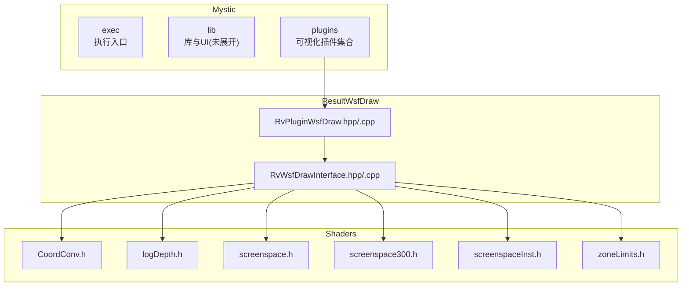
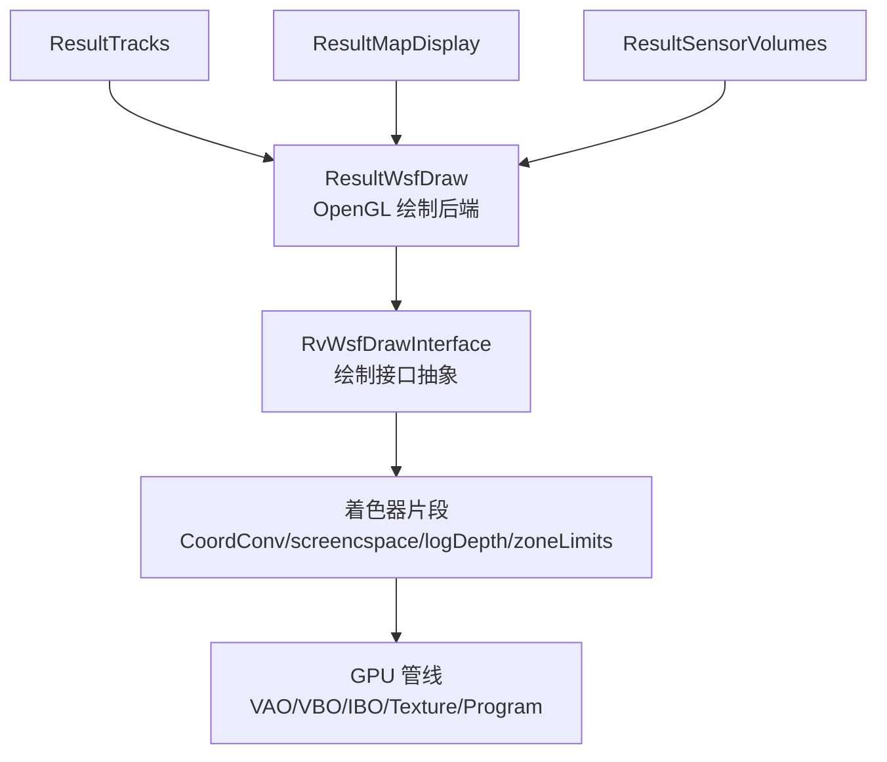
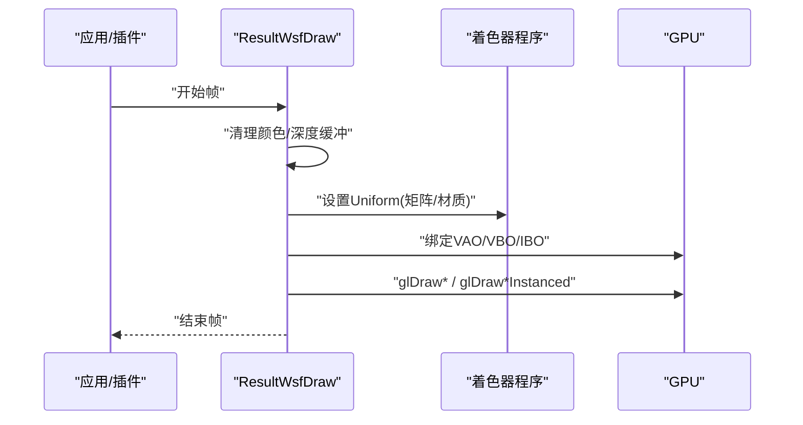
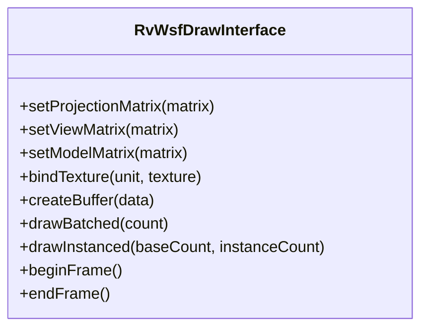
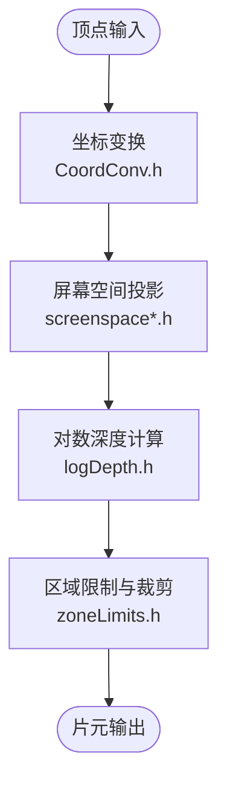
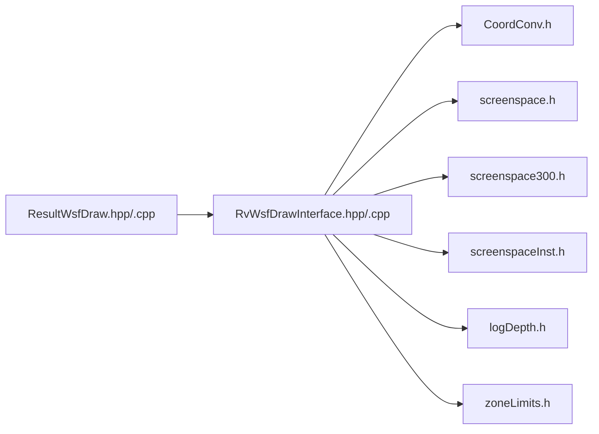

# 渲染系统

<cite>
**本文引用的文件**   
- [mystic/README.md](file://swdev/src/mystic/README.md)
- [ResultWsfDraw.hpp](file://swdev/src/mystic/plugins/ResultWsfDraw/source/RvPluginWsfDraw.hpp)
- [ResultWsfDraw.cpp](file://swdev/src/mystic/plugins/ResultWsfDraw/source/RvPluginWsfDraw.cpp)
- [RvWsfDrawInterface.hpp](file://swdev/src/mystic/plugins/ResultWsfDraw/source/RvWsfDrawInterface.hpp)
- [RvWsfDrawInterface.cpp](file://swdev/src/mystic/plugins/ResultWsfDraw/source/RvWsfDrawInterface.cpp)
- [CoordConv.h](file://resources/shaders/CoordConv.h)
- [logDepth.h](file://resources/shaders/logDepth.h)
- [screenspace.h](file://resources/shaders/screenspace.h)
- [screenspace300.h](file://resources/shaders/screenspace300.h)
- [screenspaceInst.h](file://resources/shaders/screenspaceInst.h)
- [zoneLimits.h](file://resources/shaders/zoneLimits.h)
</cite>

## 目录
1. [简介](#简介)
2. [项目结构](#项目结构)
3. [核心组件](#核心组件)
4. [架构总览](#架构总览)
5. [详细组件分析](#详细组件分析)
6. [依赖关系分析](#依赖关系分析)
7. [性能考量](#性能考量)
8. [故障排查指南](#故障排查指南)
9. [结论](#结论)
10. [附录](#附录)

## 简介
本文件为 Mystic 渲染系统的技术文档，聚焦于 2D/3D 渲染管线、OpenGL/Vulkan 后端选择、着色器管理、GPU 资源优化、场景图与视锥剔除、绘制批处理与实例化、纹理管理与几何体渲染、性能分析与调试方法，以及自定义渲染效果的实现指南。Mystic 是 AFSIM 的可视化子系统，通过插件机制扩展显示能力；其中 ResultWsfDraw 插件提供基于 OpenGL 的通用绘制能力，配合 resources/shaders 下的着色器片段实现坐标变换、屏幕空间投影、对数深度缓冲和区域限制等效果。

## 项目结构
Mystic 模块位于 swdev/src/mystic，包含执行入口、库与 UI（当前仓库未展开）、以及大量结果可视化插件。与渲染相关的核心代码集中在：
- mystic/plugins/ResultWsfDraw：OpenGL 绘制插件接口与实现
- resources/shaders：共享着色器片段（坐标转换、屏幕空间投影、对数深度、区域限制）

图示来源
- [ResultWsfDraw.hpp:1-200](file://swdev/src/mystic/plugins/ResultWsfDraw/source/RvPluginWsfDraw.hpp#L1-L200)
- [ResultWsfDraw.cpp:1-200](file://swdev/src/mystic/plugins/ResultWsfDraw/source/RvPluginWsfDraw.cpp#L1-L200)
- [RvWsfDrawInterface.hpp:1-200](file://swdev/src/mystic/plugins/ResultWsfDraw/source/RvWsfDrawInterface.hpp#L1-L200)
- [RvWsfDrawInterface.cpp:1-200](file://swdev/src/mystic/plugins/ResultWsfDraw/source/RvWsfDrawInterface.cpp#L1-L200)
- [CoordConv.h:1-200](file://resources/shaders/CoordConv.h#L1-L200)
- [logDepth.h:1-200](file://resources/shaders/logDepth.h#L1-L200)
- [screenspace.h:1-200](file://resources/shaders/screenspace.h#L1-L200)
- [screenspace300.h:1-200](file://resources/shaders/screenspace300.h#L1-L200)
- [screenspaceInst.h:1-200](file://resources/shaders/screenspaceInst.h#L1-L200)
- [zoneLimits.h:1-200](file://resources/shaders/zoneLimits.h#L1-L200)

章节来源
- [mystic/README.md:1-35](file://swdev/src/mystic/README.md#L1-L35)

## 核心组件
- ResultWsfDraw 插件：封装 OpenGL 绘制上下文、状态机、批处理与实例化绘制调用，向上暴露统一的绘制接口供其他插件使用。
- RvWsfDrawInterface：定义绘制接口抽象，解耦具体后端实现，便于未来扩展或替换。
- 着色器片段：
  - CoordConv.h：坐标系转换（世界/视图/投影矩阵组合）。
  - screenspace.h / screenspace300.h：屏幕空间投影与裁剪逻辑（GLSL 1.x/3.x 兼容）。
  - screenspaceInst.h：屏幕空间实例化绘制相关常量与辅助函数。
  - logDepth.h：对数深度缓冲计算，改善远距离精度。
  - zoneLimits.h：区域边界限制与裁剪。

章节来源
- [ResultWsfDraw.hpp:1-200](file://swdev/src/mystic/plugins/ResultWsfDraw/source/RvPluginWsfDraw.hpp#L1-L200)
- [ResultWsfDraw.cpp:1-200](file://swdev/src/mystic/plugins/ResultWsfDraw/source/RvPluginWsfDraw.cpp#L1-L200)
- [RvWsfDrawInterface.hpp:1-200](file://swdev/src/mystic/plugins/ResultWsfDraw/source/RvWsfDrawInterface.hpp#L1-L200)
- [RvWsfDrawInterface.cpp:1-200](file://swdev/src/mystic/plugins/ResultWsfDraw/source/RvWsfDrawInterface.cpp#L1-L200)
- [CoordConv.h:1-200](file://resources/shaders/CoordConv.h#L1-L200)
- [screenspace.h:1-200](file://resources/shaders/screenspace.h#L1-L200)
- [screenspace300.h:1-200](file://resources/shaders/screenspace300.h#L1-L200)
- [screenspaceInst.h:1-200](file://resources/shaders/screenspaceInst.h#L1-L200)
- [logDepth.h:1-200](file://resources/shaders/logDepth.h#L1-L200)
- [zoneLimits.h:1-200](file://resources/shaders/zoneLimits.h#L1-L200)

## 架构总览
Mystic 渲染架构采用“插件 + 接口”的分层设计：
- 上层：各 Result* 插件负责业务可视化（轨迹、地图、航迹、传感器体积等），通过统一接口请求绘制。
- 中层：ResultWsfDraw 提供 OpenGL 绘制后端，管理 VAO/VBO/IBO、着色器程序、Uniform 与纹理绑定。
- 下层：resources/shaders 提供可复用的 GLSL 片段，用于坐标变换、屏幕空间投影、实例化与深度缓冲。

图示来源
- [ResultWsfDraw.hpp:1-200](file://swdev/src/mystic/plugins/ResultWsfDraw/source/RvPluginWsfDraw.hpp#L1-L200)
- [RvWsfDrawInterface.hpp:1-200](file://swdev/src/mystic/plugins/ResultWsfDraw/source/RvWsfDrawInterface.hpp#L1-L200)
- [CoordConv.h:1-200](file://resources/shaders/CoordConv.h#L1-L200)
- [screenspace.h:1-200](file://resources/shaders/screenspace.h#L1-L200)
- [logDepth.h:1-200](file://resources/shaders/logDepth.h#L1-L200)
- [zoneLimits.h:1-200](file://resources/shaders/zoneLimits.h#L1-L200)

## 详细组件分析

### ResultWsfDraw 插件（OpenGL 绘制后端）
- 职责：
  - 初始化 OpenGL 上下文与状态（顶点数组对象、缓冲区、着色器程序、混合与深度测试）。
  - 提供批量绘制与实例化绘制 API，减少驱动调用开销。
  - 管理 Uniform 更新（模型/视图/投影矩阵、材质参数、时间戳等）。
  - 与着色器片段协作，完成坐标变换、屏幕空间投影、对数深度与区域裁剪。
- 关键流程（绘制一帧）：
  - 清理帧缓存与深度缓冲。
  - 遍历可见对象，按批次组织几何数据。
  - 绑定着色器与 Uniform，提交 VAO/VBO/IBO。
  - 根据需求启用混合/深度测试/模板测试。
  - 调用 glDrawArrays/glDrawElements 或 glDraw*Instanced。

图示来源
- [ResultWsfDraw.cpp:1-200](file://swdev/src/mystic/plugins/ResultWsfDraw/source/RvPluginWsfDraw.cpp#L1-L200)
- [RvWsfDrawInterface.cpp:1-200](file://swdev/src/mystic/plugins/ResultWsfDraw/source/RvWsfDrawInterface.cpp#L1-L200)

章节来源
- [ResultWsfDraw.hpp:1-200](file://swdev/src/mystic/plugins/ResultWsfDraw/source/RvPluginWsfDraw.hpp#L1-L200)
- [ResultWsfDraw.cpp:1-200](file://swdev/src/mystic/plugins/ResultWsfDraw/source/RvPluginWsfDraw.cpp#L1-L200)
- [RvWsfDrawInterface.hpp:1-200](file://swdev/src/mystic/plugins/ResultWsfDraw/source/RvWsfDrawInterface.hpp#L1-L200)
- [RvWsfDrawInterface.cpp:1-200](file://swdev/src/mystic/plugins/ResultWsfDraw/source/RvWsfDrawInterface.cpp#L1-L200)

### RvWsfDrawInterface（绘制接口抽象）
- 职责：
  - 定义统一的绘制接口（创建/销毁资源、设置状态、提交绘制命令）。
  - 屏蔽底层 OpenGL 细节，便于未来扩展 Vulkan 或其他后端。
- 设计要点：
  - 接口方法以“动作语义”命名（如 setProjectionMatrix、bindTexture、drawBatched）。
  - 错误处理与日志输出集中化，便于调试与诊断。

图示来源
- [RvWsfDrawInterface.hpp:1-200](file://swdev/src/mystic/plugins/ResultWsfDraw/source/RvWsfDrawInterface.hpp#L1-L200)

章节来源
- [RvWsfDrawInterface.hpp:1-200](file://swdev/src/mystic/plugins/ResultWsfDraw/source/RvWsfDrawInterface.hpp#L1-L200)
- [RvWsfDrawInterface.cpp:1-200](file://swdev/src/mystic/plugins/ResultWsfDraw/source/RvWsfDrawInterface.cpp#L1-L200)

### 着色器片段（坐标变换、屏幕空间、深度与区域）
- CoordConv.h：提供世界/视图/投影矩阵的组合与顶点坐标变换工具。
- screenspace.h / screenspace300.h：屏幕空间投影与裁剪，兼容不同 GLSL 版本。
- screenspaceInst.h：实例化绘制的屏幕空间常量与辅助宏。
- logDepth.h：对数深度缓冲计算，提升远距深度精度。
- zoneLimits.h：区域边界限制与裁剪，避免越界绘制。

图示来源
- [CoordConv.h:1-200](file://resources/shaders/CoordConv.h#L1-L200)
- [screenspace.h:1-200](file://resources/shaders/screenspace.h#L1-L200)
- [screenspace300.h:1-200](file://resources/shaders/screenspace300.h#L1-L200)
- [screenspaceInst.h:1-200](file://resources/shaders/screenspaceInst.h#L1-L200)
- [logDepth.h:1-200](file://resources/shaders/logDepth.h#L1-L200)
- [zoneLimits.h:1-200](file://resources/shaders/zoneLimits.h#L1-L200)

章节来源
- [CoordConv.h:1-200](file://resources/shaders/CoordConv.h#L1-L200)
- [screenspace.h:1-200](file://resources/shaders/screenspace.h#L1-L200)
- [screenspace300.h:1-200](file://resources/shaders/screenspace300.h#L1-L200)
- [screenspaceInst.h:1-200](file://resources/shaders/screenspaceInst.h#L1-L200)
- [logDepth.h:1-200](file://resources/shaders/logDepth.h#L1-L200)
- [zoneLimits.h:1-200](file://resources/shaders/zoneLimits.h#L1-L200)

## 依赖关系分析
- ResultWsfDraw 依赖 RvWsfDrawInterface 提供的抽象接口。
- RvWsfDrawInterface 在实现中引用着色器片段（CoordConv、screenspace、logDepth、zoneLimits）。
- 着色器片段之间相互独立，但共同构成完整的渲染管线阶段。

图示来源
- [ResultWsfDraw.hpp:1-200](file://swdev/src/mystic/plugins/ResultWsfDraw/source/RvPluginWsfDraw.hpp#L1-L200)
- [RvWsfDrawInterface.hpp:1-200](file://swdev/src/mystic/plugins/ResultWsfDraw/source/RvWsfDrawInterface.hpp#L1-L200)
- [CoordConv.h:1-200](file://resources/shaders/CoordConv.h#L1-L200)
- [screenspace.h:1-200](file://resources/shaders/screenspace.h#L1-L200)
- [screenspace300.h:1-200](file://resources/shaders/screenspace300.h#L1-L200)
- [screenspaceInst.h:1-200](file://resources/shaders/screenspaceInst.h#L1-L200)
- [logDepth.h:1-200](file://resources/shaders/logDepth.h#L1-L200)
- [zoneLimits.h:1-200](file://resources/shaders/zoneLimits.h#L1-L200)

章节来源
- [ResultWsfDraw.hpp:1-200](file://swdev/src/mystic/plugins/ResultWsfDraw/source/RvPluginWsfDraw.hpp#L1-L200)
- [RvWsfDrawInterface.hpp:1-200](file://swdev/src/mystic/plugins/ResultWsfDraw/source/RvWsfDrawInterface.hpp#L1-L200)

## 性能考量
- 批处理渲染：
  - 将相同材质/状态的几何合并为单一绘制调用，减少状态切换与驱动开销。
  - 建议按材质与纹理单元分组，必要时使用纹理图集。
- 实例化绘制：
  - 对重复几何（如粒子、图标）使用 glDraw*Instanced，降低 CPU-GPU 通信成本。
  - 利用 screenspaceInst.h 中的常量与辅助函数进行高效实例化。
- 纹理管理：
  - 使用压缩格式（如 ASTC/ETC2/PVRTC）降低显存占用与带宽压力。
  - 预生成 mipmap，减少采样抖动与过滤开销。
  - 引入纹理池与引用计数，避免频繁创建/销毁。
- 几何体渲染：
  - 使用索引缓冲（IBO）减少重复顶点传输。
  - 合理划分网格 LOD，远距离使用简化拓扑。
- 深度与裁剪：
  - 启用对数深度缓冲（logDepth.h）提高远距精度。
  - 结合 zoneLimits.h 进行区域裁剪，减少无效片元处理。
- 管线状态：
  - 最小化混合、深度测试、模板测试的状态切换。
  - 使用多套管线对象（Program）并按材质分组。

[本节为通用性能指导，不直接分析具体文件]

## 故障排查指南
- OpenGL 上下文与版本：
  - 确认 OpenGL 版本满足最低要求（OpenGL 3.0+）。
  - 检查扩展支持（如 instancing、texture compression）。
- 着色器编译与链接：
  - 捕获 GLSL 编译/链接错误日志，定位语法或版本不兼容问题。
  - 验证 screenspace.h 与 screenspace300.h 的版本分支是否正确。
- 资源泄漏与内存：
  - 监控 VAO/VBO/IBO/Texture/Program 的生命周期，确保正确释放。
  - 使用调试工具（如 RenderDoc、Nsight Graphics）检查 GPU 内存增长。
- 性能瓶颈：
  - 统计 draw call 数量、顶点/片元吞吐率、纹理带宽。
  - 分析批处理大小与实例化效率，调整分组策略。
- 常见问题：
  - 深度写入异常：检查深度缓冲配置与 logDepth.h 的使用。
  - 纹理模糊或锯齿：确认 mipmap 生成与采样器状态。
  - 区域裁剪失效：核对 zoneLimits.h 的参数与视锥匹配。

章节来源
- [ResultWsfDraw.cpp:1-200](file://swdev/src/mystic/plugins/ResultWsfDraw/source/RvPluginWsfDraw.cpp#L1-L200)
- [RvWsfDrawInterface.cpp:1-200](file://swdev/src/mystic/plugins/ResultWsfDraw/source/RvWsfDrawInterface.cpp#L1-L200)
- [screenspace.h:1-200](file://resources/shaders/screenspace.h#L1-L200)
- [screenspace300.h:1-200](file://resources/shaders/screenspace300.h#L1-L200)
- [logDepth.h:1-200](file://resources/shaders/logDepth.h#L1-L200)
- [zoneLimits.h:1-200](file://resources/shaders/zoneLimits.h#L1-L200)

## 结论
Mystic 渲染系统通过 ResultWsfDraw 插件与 RvWsfDrawInterface 抽象接口，构建了可扩展的 OpenGL 绘制后端，并借助 resources/shaders 中的着色器片段实现了坐标变换、屏幕空间投影、对数深度与区域裁剪等关键功能。通过批处理、实例化、纹理压缩与 mipmap、LOD 与几何优化等手段，系统在大规模场景中保持良好性能。未来可在接口层扩展 Vulkan 后端，进一步提升跨平台与高性能渲染能力。

[本节为总结性内容，不直接分析具体文件]

## 附录
- 自定义渲染效果实现指南：
  - 新增着色器片段：在 resources/shaders 下添加 .h 文件，遵循现有命名与结构（如 CoordConv、screenspace、logDepth、zoneLimits）。
  - 集成到绘制管线：在 RvWsfDrawInterface 中增加对应的 Uniform 设置与状态切换方法。
  - 插件接入：在 Result* 插件中调用统一接口，传入新的材质参数与纹理。
  - 调试与验证：使用 RenderDoc/Nsight 验证管线状态与 GPU 资源，逐步调优批处理与实例化参数。

[本节为概念性指导，不直接分析具体文件]