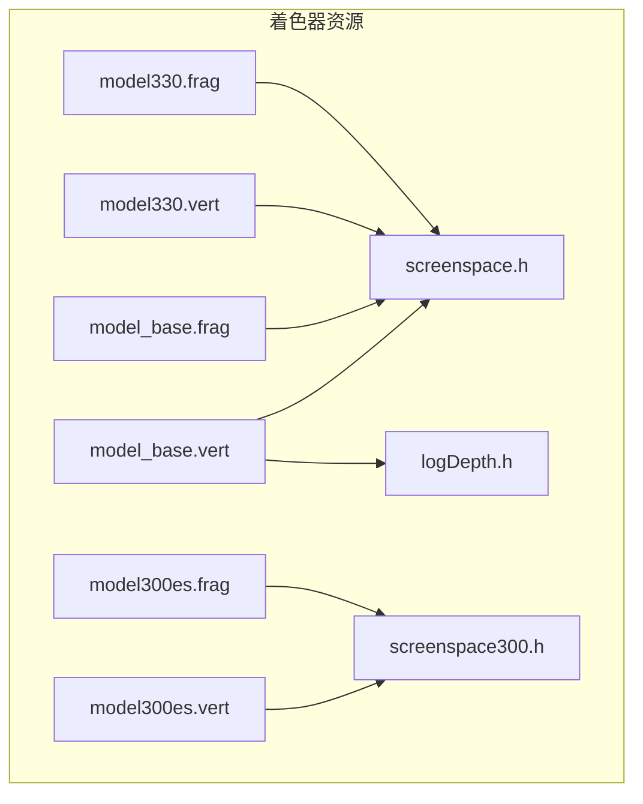
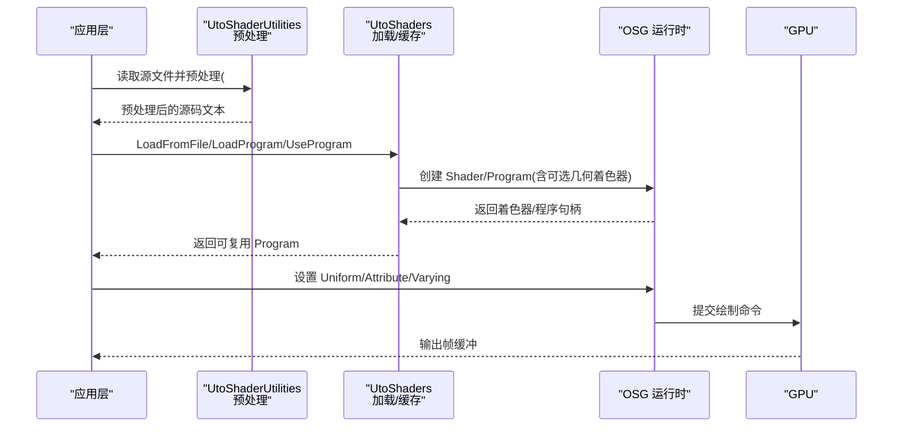
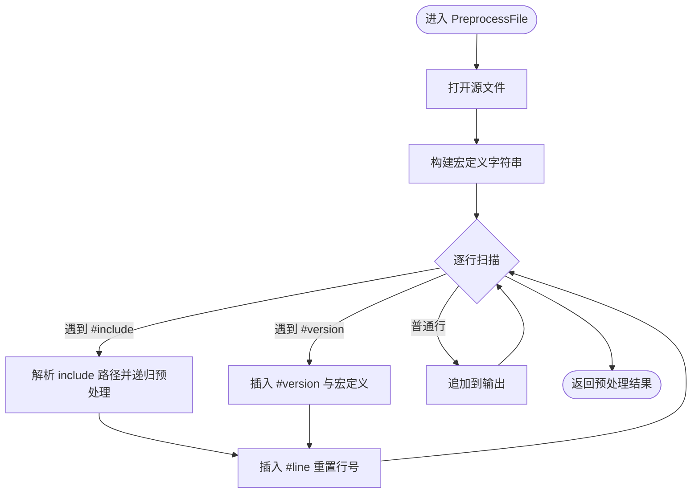
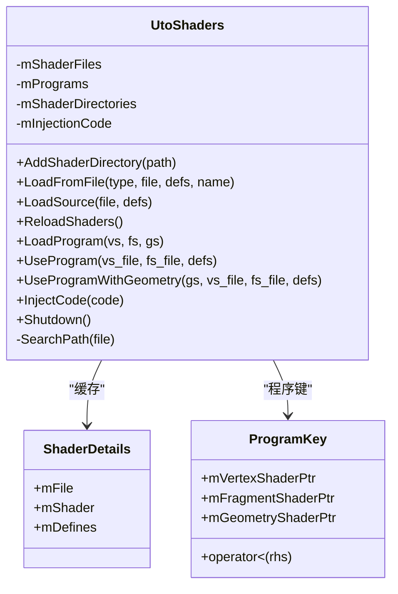
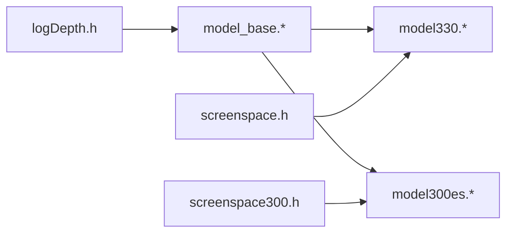
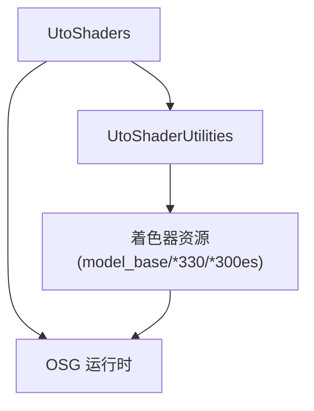

# 着色器管理系统

<cite>
**本文引用的文件**   
- [UtoShaderUtilities.hpp](file://swdev/src/tools/utilosg/source/include/UtoShaderUtilities.hpp)
- [UtoShaderUtilities.cpp](file://swdev/src/tools/utilosg/source/Utility/UtoShaderUtilities.cpp)
- [UtoShaders.hpp](file://swdev/src/tools/utilosg/uto/UtoShaders.hpp)
- [resources/shaders/model_base.vert](file://resources/shaders/model_base.vert)
- [resources/shaders/model330.vert](file://resources/shaders/model330.vert)
- [resources/shaders/model300es.vert](file://resources/shaders/model300es.vert)
- [resources/shaders/model_base.frag](file://resources/shaders/model_base.frag)
- [resources/shaders/model330.frag](file://resources/shaders/model330.frag)
- [resources/shaders/model300es.frag](file://resources/shaders/model300es.frag)
- [resources/shaders/screenspace.h](file://resources/shaders/screenspace.h)
- [resources/shaders/screenspace300.h](file://resources/shaders/screenspace300.h)
- [resources/shaders/logDepth.h](file://resources/shaders/logDepth.h)
</cite>

## 目录
1. [简介](#简介)
2. [项目结构](#项目结构)
3. [核心组件](#核心组件)
4. [架构总览](#架构总览)
5. [详细组件分析](#详细组件分析)
6. [依赖关系分析](#依赖关系分析)
7. [性能考虑](#性能考虑)
8. [故障排查指南](#故障排查指南)
9. [结论](#结论)
10. [附录](#附录)

## 简介
本文件面向 AFSIM 的着色器管理系统，系统性说明 GLSL 着色器的编译、加载与缓存机制，跨平台兼容性处理（GLSL ES 与桌面 GL），以及程序链接流程中的 uniform 变量绑定、attribute 属性管理与 varying 变量传递。文档还覆盖着色器变体系统（按硬件特性动态选择）、参数批量更新策略、调试工具使用与常见问题排查，并提供自定义着色器的开发示例与最佳实践。

## 项目结构
AFSIM 的着色器资源位于 resources/shaders 目录，采用“基础片段 + 平台变体”的组织方式：
- model_base.*：通用顶点/片段逻辑
- model330.* / model300es.*：分别对应 OpenGL 3.3 与 OpenGL ES 3.0 的变体
- screenspace*.h / logDepth.h：公共头文件，提供屏幕空间与对数深度等通用函数

图表来源
- [resources/shaders/model_base.vert](file://resources/shaders/model_base.vert)
- [resources/shaders/model_base.frag](file://resources/shaders/model_base.frag)
- [resources/shaders/model330.vert](file://resources/shaders/model330.vert)
- [resources/shaders/model330.frag](file://resources/shaders/model330.frag)
- [resources/shaders/model300es.vert](file://resources/shaders/model300es.vert)
- [resources/shaders/model300es.frag](file://resources/shaders/model300es.frag)
- [resources/shaders/screenspace.h](file://resources/shaders/screenspace.h)
- [resources/shaders/screenspace300.h](file://resources/shaders/screenspace300.h)
- [resources/shaders/logDepth.h](file://resources/shaders/logDepth.h)

章节来源
- [UtoShaderUtilities.hpp:25-65](file://swdev/src/tools/utilosg/source/include/UtoShaderUtilities.hpp#L25-L65)
- [UtoShaders.hpp:28-90](file://swdev/src/tools/utilosg/uto/UtoShaders.hpp#L28-L90)

## 核心组件
- UtoShaderUtilities：着色器预处理与工具集
  - 支持 #include、#version 指令解析与展开
  - 提供宏定义注入、包含路径搜索、行号重映射
  - 提供 RGBA 与 double 互转工具（用于纹理编码）
- UtoShaders：着色器与程序管理
  - 从文件加载着色器源码并创建 osg::Shader
  - 组合为 osg::Program，支持带几何着色器的程序
  - 程序共享缓存（基于 ProgramKey）
  - 支持注入代码、全局开关与重载

章节来源
- [UtoShaderUtilities.hpp:25-65](file://swdev/src/tools/utilosg/source/include/UtoShaderUtilities.hpp#L25-L65)
- [UtoShaders.hpp:28-90](file://swdev/src/tools/utilosg/uto/UtoShaders.hpp#L28-L90)

## 架构总览
下图展示从应用调用到 GPU 执行的端到端流程，包括预处理、编译、链接与渲染阶段。

图表来源
- [UtoShaderUtilities.cpp:25-55](file://swdev/src/tools/utilosg/source/Utility/UtoShaderUtilities.cpp#L25-L55)
- [UtoShaders.hpp:31-55](file://swdev/src/tools/utilosg/uto/UtoShaders.hpp#L31-L55)

## 详细组件分析

### 组件一：UtoShaderUtilities（预处理与工具）
职责
- 预处理着色器源码：展开 #include、#version，插入用户定义的宏
- 维护包含路径搜索顺序，确保 include 正确解析
- 生成 #line 指令以保留错误定位信息
- 提供 RGBA/double 互转工具，便于在纹理中打包数据

关键流程（预处理）

图表来源
- [UtoShaderUtilities.cpp:57-119](file://swdev/src/tools/utilosg/source/Utility/UtoShaderUtilities.cpp#L57-L119)
- [UtoShaderUtilities.cpp:140-188](file://swdev/src/tools/utilosg/source/Utility/UtoShaderUtilities.cpp#L140-L188)

章节来源
- [UtoShaderUtilities.hpp:25-65](file://swdev/src/tools/utilosg/source/include/UtoShaderUtilities.hpp#L25-L65)
- [UtoShaderUtilities.cpp:25-55](file://swdev/src/tools/utilosg/source/Utility/UtoShaderUtilities.cpp#L25-L55)
- [UtoShaderUtilities.cpp:57-119](file://swdev/src/tools/utilosg/source/Utility/UtoShaderUtilities.cpp#L57-L119)
- [UtoShaderUtilities.cpp:140-188](file://swdev/src/tools/utilosg/source/Utility/UtoShaderUtilities.cpp#L140-L188)
- [UtoShaderUtilities.cpp:190-215](file://swdev/src/tools/utilosg/source/Utility/UtoShaderUtilities.cpp#L190-L215)
- [UtoShaderUtilities.cpp:227-263](file://swdev/src/tools/utilosg/source/Utility/UtoShaderUtilities.cpp#L227-L263)

### 组件二：UtoShaders（着色器与程序管理）
职责
- 从文件系统加载着色器源码，支持宏定义与注入代码
- 将多个着色器组合为 osg::Program，支持顶点/片段/几何着色器
- 通过 ProgramKey 缓存已创建的 Program，避免重复编译
- 提供 UseProgram/UseProgramWithGeometry 便捷接口，自动查找与复用
- 支持全局 ReloadShaders 与 Shutdown

类图（简化）

图表来源
- [UtoShaders.hpp:28-90](file://swdev/src/tools/utilosg/uto/UtoShaders.hpp#L28-L90)

章节来源
- [UtoShaders.hpp:28-90](file://swdev/src/tools/utilosg/uto/UtoShaders.hpp#L28-L90)

### 组件三：着色器变体系统与跨平台兼容
目标
- 针对 OpenGL 3.3 与 OpenGL ES 3.0 提供不同实现
- 通过命名约定与头文件抽象屏蔽差异
- 在运行时根据能力选择合适变体

变体组织
- 模型渲染：model_base.* 作为通用逻辑；model330.* 与 model300es.* 分别适配桌面与移动端
- 屏幕空间计算：screenspace.h 与 screenspace300.h 提供不同版本的数学/精度相关实现
- 深度处理：logDepth.h 提供对数深度辅助

图表来源
- [resources/shaders/model_base.vert](file://resources/shaders/model_base.vert)
- [resources/shaders/model330.vert](file://resources/shaders/model330.vert)
- [resources/shaders/model300es.vert](file://resources/shaders/model300es.vert)
- [resources/shaders/model_base.frag](file://resources/shaders/model_base.frag)
- [resources/shaders/model330.frag](file://resources/shaders/model330.frag)
- [resources/shaders/model300es.frag](file://resources/shaders/model300es.frag)
- [resources/shaders/screenspace.h](file://resources/shaders/screenspace.h)
- [resources/shaders/screenspace300.h](file://resources/shaders/screenspace300.h)
- [resources/shaders/logDepth.h](file://resources/shaders/logDepth.h)

章节来源
- [resources/shaders/model_base.vert](file://resources/shaders/model_base.vert)
- [resources/shaders/model330.vert](file://resources/shaders/model330.vert)
- [resources/shaders/model300es.vert](file://resources/shaders/model300es.vert)
- [resources/shaders/model_base.frag](file://resources/shaders/model_base.frag)
- [resources/shaders/model330.frag](file://resources/shaders/model330.frag)
- [resources/shaders/model300es.frag](file://resources/shaders/model300es.frag)
- [resources/shaders/screenspace.h](file://resources/shaders/screenspace.h)
- [resources/shaders/screenspace300.h](file://resources/shaders/screenspace300.h)
- [resources/shaders/logDepth.h](file://resources/shaders/logDepth.h)

### 组件四：程序链接与变量管理（Uniform/Attribute/Varying）
说明
- 程序链接：由 UtoShaders::LoadProgram/UseProgram 负责将顶点、片段（及可选几何）着色器组合为 osg::Program
- Uniform 变量：在应用侧通过 OSG API 设置（例如矩阵、光照参数、材质属性），由驱动在 GPU 上绑定
- Attribute 属性：通常与顶点缓冲区关联（位置、法线、纹理坐标等），在绘制前绑定至 attribute 槽位
- Varying 变量：由顶点着色器写入，片段着色器读取，由管线自动插值

注意
- 本仓库未直接暴露 uniform/attribute/varying 绑定的具体封装代码；上述流程基于 OSG 标准用法与着色器资源组织推断

章节来源
- [UtoShaders.hpp:43-55](file://swdev/src/tools/utilosg/uto/UtoShaders.hpp#L43-L55)

### 组件五：着色器参数更新机制与批量优化
建议策略
- 合并频繁更新的 uniform 到统一缓冲区（UBO）或纹理数组，减少状态切换
- 使用 UtoShaders::UseProgram 复用已编译的程序，避免重复编译开销
- 对每帧变化的参数进行批处理，减少多次 SetUniform 调用
- 利用 UtoShaders::InjectCode 注入通用初始化代码，减少重复样板

章节来源
- [UtoShaders.hpp:47-57](file://swdev/src/tools/utilosg/uto/UtoShaders.hpp#L47-L57)

### 组件六：调试工具与常见问题排查
- 开发者菜单提供“Reload Shaders”功能，可重新加载所有 GLSL 着色器，便于热更新
- 常见错误
  - 找不到 include 文件：检查包含路径与文件名大小写
  - 版本不匹配：确认 #version 与目标平台一致（desktop vs ES）
  - 几何着色器不可用：检查驱动支持与 UtoShaderUtilities::EnableGeometryShaders 开关
  - 图标缺失：某些 GPU 不支持 GLSL 3.0 ES，需回退到兼容变体

章节来源
- [UtoShaderUtilities.hpp:35-39](file://swdev/src/tools/utilosg/source/include/UtoShaderUtilities.hpp#L35-L39)
- [documentation/html/docs/mystic_developer_menu.html:84](file://documentation/html/docs/mystic_developer_menu.html#L84)

## 依赖关系分析
- UtoShaderUtilities 被 UtoShaders 间接依赖（预处理后交由加载器）
- 着色器资源通过 include 与头文件耦合，形成模块化结构
- 变体文件通过命名约定与头文件抽象解耦平台差异

图表来源
- [UtoShaderUtilities.hpp:25-65](file://swdev/src/tools/utilosg/source/include/UtoShaderUtilities.hpp#L25-L65)
- [UtoShaders.hpp:28-90](file://swdev/src/tools/utilosg/uto/UtoShaders.hpp#L28-L90)

章节来源
- [UtoShaderUtilities.hpp:25-65](file://swdev/src/tools/utilosg/source/include/UtoShaderUtilities.hpp#L25-L65)
- [UtoShaders.hpp:28-90](file://swdev/src/tools/utilosg/uto/UtoShaders.hpp#L28-L90)

## 性能考虑
- 程序缓存：UtoShaders 内部维护 Program 缓存，避免重复编译
- 预处理开销：大量 #include 会增加启动时间，建议拆分头文件粒度
- 几何着色器：仅在需要时启用，避免在不支持的硬件上退化
- 纹理打包：使用 RGBA_ToDouble/DoubleToRGBA 可减少额外传输通道

[本节为通用指导，无需列出具体文件来源]

## 故障排查指南
- 预处理失败
  - 检查 #include 路径是否正确，是否使用了绝对/相对路径混用
  - 确认 #version 指令位于文件开头且与目标平台匹配
- 着色器编译失败
  - 查看日志输出（ut::log），定位具体行号（#line 已注入）
  - 针对 ES 设备，切换到 model300es.* 变体
- 运行期问题
  - 使用“Reload Shaders”刷新着色器
  - 检查 uniform/attribute 绑定是否与着色器声明一致

章节来源
- [UtoShaderUtilities.cpp:75-81](file://swdev/src/tools/utilosg/source/Utility/UtoShaderUtilities.cpp#L75-L81)
- [UtoShaderUtilities.cpp:176-178](file://swdev/src/tools/utilosg/source/Utility/UtoShaderUtilities.cpp#L176-L178)
- [documentation/html/docs/mystic_developer_menu.html:84](file://documentation/html/docs/mystic_developer_menu.html#L84)

## 结论
AFSIM 的着色器管理系统通过 UtoShaderUtilities 与 UtoShaders 两个核心组件，实现了 GLSL 着色器的预处理、加载、编译、链接与缓存，并以变体文件与头文件抽象的方式完成跨平台兼容。结合开发者工具的“Reload Shaders”，可在开发阶段快速迭代。遵循本文的最佳实践与排查步骤，可有效提升着色器开发与维护效率。

[本节为总结性内容，无需列出具体文件来源]

## 附录

### 自定义着色器开发示例与最佳实践
- 新建基础着色器
  - 在 resources/shaders 下新增 model_custom_base.vert/.frag，复用 screenspace.h/logDepth.h
- 添加平台变体
  - 复制为 modelcustom330.* 与 modelcustom300es.*，按需调整 GLSL 语法与精度
- 注册与使用
  - 通过 UtoShaders::UseProgram/UseProgramWithGeometry 加载并复用
  - 使用 UtoShaders::InjectCode 注入通用初始化代码
- 参数更新
  - 将频繁更新的 uniform 分组，减少状态切换
  - 使用纹理数组或 UBO 批量更新
- 调试
  - 使用“Reload Shaders”热更新
  - 关注 #line 输出的行号，定位错误

章节来源
- [UtoShaders.hpp:47-57](file://swdev/src/tools/utilosg/uto/UtoShaders.hpp#L47-L57)
- [resources/shaders/screenspace.h](file://resources/shaders/screenspace.h)
- [resources/shaders/logDepth.h](file://resources/shaders/logDepth.h)