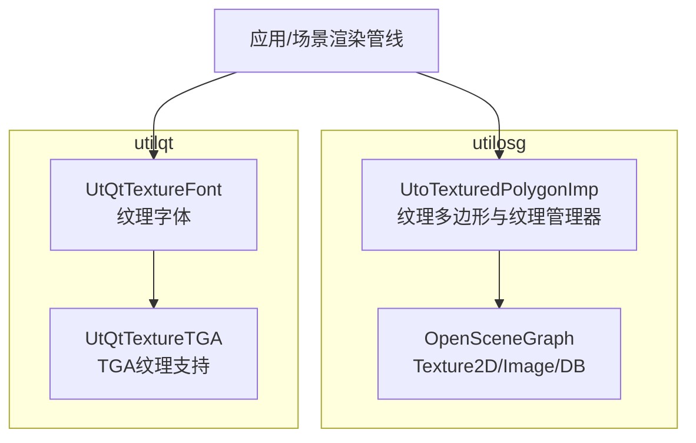
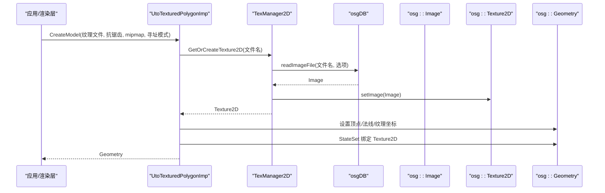
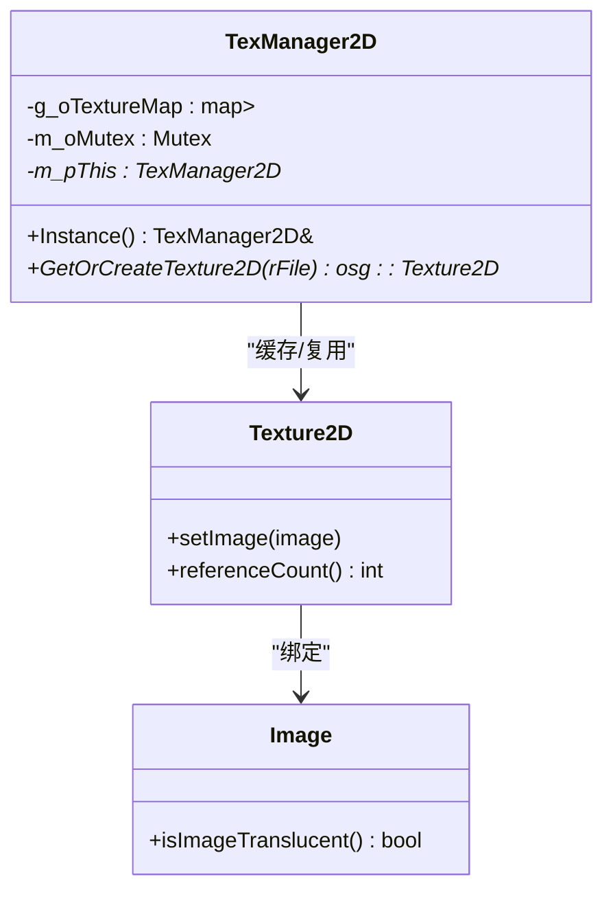
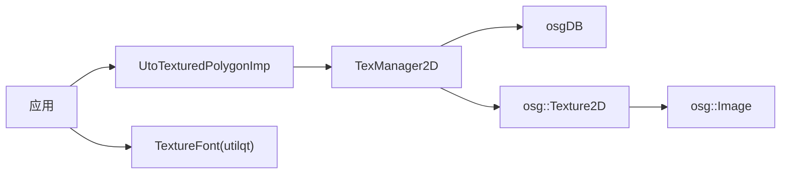

# 纹理管理系统

<cite>
**本文引用的文件**   
- [UtoTexturedPolygonImp.cpp](file://swdev/src/tools/utilosg/source/Shape/UtoTexturedPolygonImp.cpp)
- [UtQtTextureFont.hpp](file://swdev/src/tools/utilqt/source/UtQtTextureFont.hpp)
</cite>

## 目录
1. [简介](#简介)
2. [项目结构](#项目结构)
3. [核心组件](#核心组件)
4. [架构总览](#架构总览)
5. [详细组件分析](#详细组件分析)
6. [依赖关系分析](#依赖关系分析)
7. [性能考虑](#性能考虑)
8. [故障排查指南](#故障排查指南)
9. [结论](#结论)
10. [附录](#附录)

## 简介
本文件面向 AFSIM 工程中的纹理子系统，聚焦于纹理的加载、格式处理与压缩、内存管理（纹理池、mipmap、显存优化）、采样模式（过滤、寻址、各向异性过滤）、纹理图集技术、流式加载机制以及性能分析与监控工具的使用。文档同时给出自定义纹理格式的集成指南，帮助开发者扩展新的图像编解码器或 GPU 纹理格式。

## 项目结构
AFSIM 的图形渲染相关代码主要位于 swdev/src/tools/utilosg 与 swdev/src/tools/utilqt 两个子系统中：
- utilosg：基于 OpenSceneGraph 的通用图形工具库，提供纹理读取、缓存、几何绘制等能力。
- utilqt：基于 Qt 的工具库，提供纹理字体、TGA 纹理等 UI 相关的纹理资源管理能力。

图表来源
- [UtoTexturedPolygonImp.cpp:24-136](file://swdev/src/tools/utilosg/source/Shape/UtoTexturedPolygonImp.cpp#L24-L136)
- [UtQtTextureFont.hpp:19-108](file://swdev/src/tools/utilqt/source/UtQtTextureFont.hpp#L19-L108)

章节来源
- [UtoTexturedPolygonImp.cpp:24-136](file://swdev/src/tools/utilosg/source/Shape/UtoTexturedPolygonImp.cpp#L24-L136)
- [UtQtTextureFont.hpp:19-108](file://swdev/src/tools/utilqt/source/UtQtTextureFont.hpp#L19-L108)

## 核心组件
- 纹理多边形与纹理管理器（TexManager2D）
  - 负责从文件路径获取或创建 osg::Texture2D，绑定 osg::Image，并维护全局纹理缓存。
  - 提供纹理包装（WRAP_REPEAT/CLAMP_TO_EDGE）与基本几何构建。
- 纹理字体（TextureFont）
  - 将字符位图打包为 OpenGL 纹理，用于在 UI 中高效绘制文本。
  - 支持缩放、对齐、旋转等常用渲染参数。

章节来源
- [UtoTexturedPolygonImp.cpp:24-136](file://swdev/src/tools/utilosg/source/Shape/UtoTexturedPolygonImp.cpp#L24-L136)
- [UtoTexturedPolygonImp.cpp:255-345](file://swdev/src/tools/utilosg/source/Shape/UtoTexturedPolygonImp.cpp#L255-L345)
- [UtQtTextureFont.hpp:19-108](file://swdev/src/tools/utilqt/source/UtQtTextureFont.hpp#L19-L108)

## 架构总览
下图展示纹理从磁盘到 GPU 的关键流程：应用调用纹理多边形接口，内部通过 TexManager2D 使用 osgDB 读取图像，生成 Texture2D，并在几何体上设置状态集以启用纹理采样。

图表来源
- [UtoTexturedPolygonImp.cpp:24-136](file://swdev/src/tools/utilosg/source/Shape/UtoTexturedPolygonImp.cpp#L24-L136)
- [UtoTexturedPolygonImp.cpp:267-317](file://swdev/src/tools/utilosg/source/Shape/UtoTexturedPolygonImp.cpp#L267-L317)

## 详细组件分析

### 纹理加载与格式转换
- 图像读取
  - 通过 osgDB::readImageFile 读取图像，支持多种常见格式（由 OSG 插件决定）。
  - 可配置 ReaderWriter::Options 开启图像缓存策略，减少重复 IO。
- 纹理对象创建
  - 将读入的 osg::Image 绑定到 osg::Texture2D，供后续几何体使用。
- 格式转换与压缩
  - 若需 DDS 等 GPU 友好格式，可在预处理阶段将 PNG/JPEG 转换为 DDS；运行时由 OSG 直接加载 DDS 以减少 CPU 解码开销。
  - 对于不支持的格式，建议在离线工具链中进行统一转换，避免运行时重编码。

章节来源
- [UtoTexturedPolygonImp.cpp:267-317](file://swdev/src/tools/utilosg/source/Shape/UtoTexturedPolygonImp.cpp#L267-L317)

### 纹理内存管理与纹理池
- 纹理池（TexManager2D）
  - 使用静态 map 缓存已加载的 Texture2D，键为文件路径。
  - 首次访问时创建并缓存，后续复用，避免重复加载。
  - 遍历释放引用计数为 1 的纹理，降低显存占用。
- 引用计数与生命周期
  - 借助 osg::ref_ptr 管理对象生命周期，确保正确释放。
- 线程安全
  - 使用互斥锁保护纹理缓存的并发访问。

图表来源
- [UtoTexturedPolygonImp.cpp:255-345](file://swdev/src/tools/utilosg/source/Shape/UtoTexturedPolygonImp.cpp#L255-L345)

章节来源
- [UtoTexturedPolygonImp.cpp:255-345](file://swdev/src/tools/utilosg/source/Shape/UtoTexturedPolygonImp.cpp#L255-L345)

### Mipmap 生成与显存优化
- Mipmap
  - 在创建 Texture2D 后可启用 mipmap 以提升不同距离下的采样质量与带宽效率。
  - 建议对高频细节纹理启用 mipmap，并对 UI 小图标禁用以降低开销。
- 显存优化策略
  - 使用 DDS 等压缩格式（如 BC/DXT）减少显存占用。
  - 合理设置纹理尺寸（2 的幂次方），避免不必要的上采样。
  - 及时释放不再使用的纹理，利用引用计数清理。

章节来源
- [UtoTexturedPolygonImp.cpp:267-317](file://swdev/src/tools/utilosg/source/Shape/UtoTexturedPolygonImp.cpp#L267-L317)

### 纹理采样模式
- 过滤方式
  - 最小化过滤（MIN_FILTER）：NEAREST/MIP_LINEAR/LINEAR 等，影响缩小时的清晰度与性能。
  - 放大过滤（MAG_FILTER）：NEAREST/LINEAR，影响放大时的平滑度。
- 寻址模式（Wrap）
  - REPEAT：平铺重复。
  - CLAMP_TO_EDGE：边缘拉伸。
  - 示例中根据 WrapType 设置 WRAP_S/WRAP_T。
- 各向异性过滤
  - 在高斜视角下提升纹理清晰度，但会增加显存带宽消耗，可按场景开关。

章节来源
- [UtoTexturedPolygonImp.cpp:121-130](file://swdev/src/tools/utilosg/source/Shape/UtoTexturedPolygonImp.cpp#L121-L130)

### 纹理图集技术
- 图集优势
  - 将多个小纹理合并为一张大图，减少绘制调用次数与状态切换开销。
- 实现要点
  - 使用图集坐标裁剪子区域（CreateSubImage），通过纹理坐标映射到图集内矩形。
  - 结合图集索引表进行批量绘制，提高吞吐。

章节来源
- [UtoTexturedPolygonImp.cpp:139-252](file://swdev/src/tools/utilosg/source/Shape/UtoTexturedPolygonImp.cpp#L139-L252)

### 纹理流式加载机制
- 按需加载
  - 仅在需要时通过 TexManager2D 加载纹理，避免一次性加载全部资源。
- 动态卸载
  - 定期扫描引用计数为 1 的纹理并移除，释放显存。
- 大场景支持
  - 结合视锥剔除与 LOD，仅加载当前可见区域的纹理，降低峰值内存。

章节来源
- [UtoTexturedPolygonImp.cpp:267-317](file://swdev/src/tools/utilosg/source/Shape/UtoTexturedPolygonImp.cpp#L267-L317)

### 纹理字体（UI 文本）
- 纹理字体原理
  - 将字符字形渲染到纹理，通过四边形绘制与纹理坐标映射显示文本。
- 功能特性
  - 支持缩放、对齐、旋转、透明度等。
  - 适合 UI 与 HUD 的高效文本绘制。

章节来源
- [UtQtTextureFont.hpp:19-108](file://swdev/src/tools/utilqt/source/UtQtTextureFont.hpp#L19-L108)

## 依赖关系分析
- 外部依赖
  - OpenSceneGraph（OSG）：Texture2D、Image、DB 读写、Drawables。
  - Qt（utilqt）：TextureFont 依赖 GL 上下文与字体系统。
- 内部耦合
  - UtoTexturedPolygonImp 依赖 TexManager2D 进行纹理缓存。
  - TexManager2D 依赖 osgDB 进行图像读取。

图表来源
- [UtoTexturedPolygonImp.cpp:24-136](file://swdev/src/tools/utilosg/source/Shape/UtoTexturedPolygonImp.cpp#L24-L136)
- [UtoTexturedPolygonImp.cpp:267-317](file://swdev/src/tools/utilosg/source/Shape/UtoTexturedPolygonImp.cpp#L267-L317)
- [UtQtTextureFont.hpp:19-108](file://swdev/src/tools/utilqt/source/UtQtTextureFont.hpp#L19-L108)

章节来源
- [UtoTexturedPolygonImp.cpp:24-136](file://swdev/src/tools/utilosg/source/Shape/UtoTexturedPolygonImp.cpp#L24-L136)
- [UtoTexturedPolygonImp.cpp:267-317](file://swdev/src/tools/utilosg/source/Shape/UtoTexturedPolygonImp.cpp#L267-L317)
- [UtQtTextureFont.hpp:19-108](file://swdev/src/tools/utilqt/source/UtQtTextureFont.hpp#L19-L108)

## 性能考虑
- 纹理格式选择
  - 优先使用 DDS 等 GPU 原生压缩格式，减少 CPU 解码与显存占用。
- Mipmap 与过滤
  - 合理启用 mipmap 与线性过滤，平衡清晰度与性能。
- 图集与批渲染
  - 使用纹理图集减少绘制调用，提升吞吐。
- 流式加载与卸载
  - 按需加载与主动释放，控制峰值显存。
- 各向异性过滤
  - 在高斜视角场景中谨慎启用，避免带宽瓶颈。

[本节为通用指导，不直接分析具体文件]

## 故障排查指南
- 纹理未显示
  - 检查纹理路径是否正确，确认 osgDB 能成功读取图像。
  - 验证纹理是否被正确绑定到几何体的 StateSet。
- 纹理闪烁或撕裂
  - 检查寻址模式与过滤设置是否一致，避免边界采样异常。
- 显存不足
  - 检查是否存在未释放的纹理，确认引用计数与缓存清理逻辑生效。
  - 评估是否启用了过多高分辨率纹理或未必要的高品质过滤。
- 文本渲染异常
  - 检查 TextureFont 的纹理与显示列表初始化是否成功。
  - 确认 GL 上下文与纹理状态在绘制前已正确设置。

章节来源
- [UtoTexturedPolygonImp.cpp:267-317](file://swdev/src/tools/utilosg/source/Shape/UtoTexturedPolygonImp.cpp#L267-L317)
- [UtQtTextureFont.hpp:19-108](file://swdev/src/tools/utilqt/source/UtQtTextureFont.hpp#L19-L108)

## 结论
AFSIM 的纹理子系统通过 utilosg 的 TexManager2D 与 UtoTexturedPolygonImp 实现了高效的纹理加载、缓存与绘制，并结合 osgDB 与 OSG 生态提供灵活的格式支持与采样控制。utilqt 的 TextureFont 为 UI 文本提供了高性能的纹理化方案。通过合理的格式选择、mipmap 与过滤策略、图集与流式加载，可以在保证画质的同时显著降低显存与带宽压力。

[本节为总结性内容，不直接分析具体文件]

## 附录

### 自定义纹理格式集成指南
- 目标
  - 新增一种图像格式（例如自定义压缩格式）或 GPU 纹理格式（例如自定义压缩块格式）。
- 步骤
  - 图像解码
    - 在预处理阶段将源图像（PNG/JPEG）转码为目标格式（如 DDS），或使用第三方库在运行时解码。
    - 若使用 OSG 插件机制，可实现自定义 ReaderWriter 以支持新格式。
  - 纹理上传
    - 将解码后的像素数据上传至 GPU，选择合适的压缩格式（BC/DXT/PVRTC 等）以减少显存占用。
  - 采样与过滤
    - 针对新格式设置合适的 MIN/MAG 过滤与 Wrap 模式，必要时启用各向异性过滤。
  - 缓存与生命周期
    - 复用 TexManager2D 的缓存策略，确保纹理对象的生命周期管理正确。
  - 测试与验证
    - 在不同硬件与驱动环境下验证兼容性，关注显存占用与帧率表现。

[本节为通用指导，不直接分析具体文件]