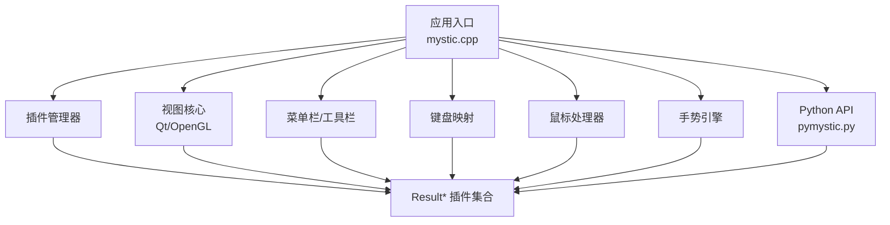
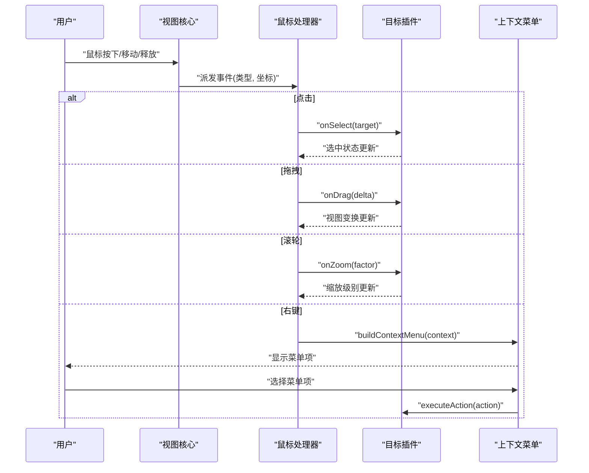
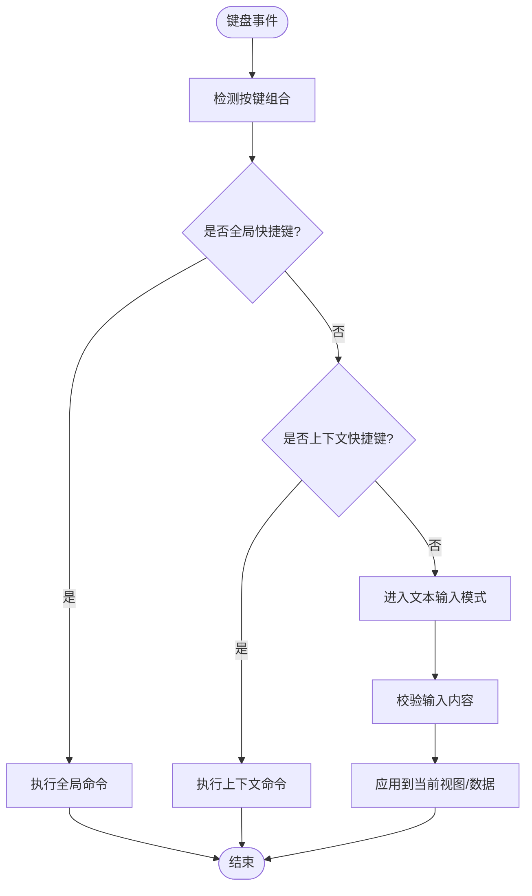
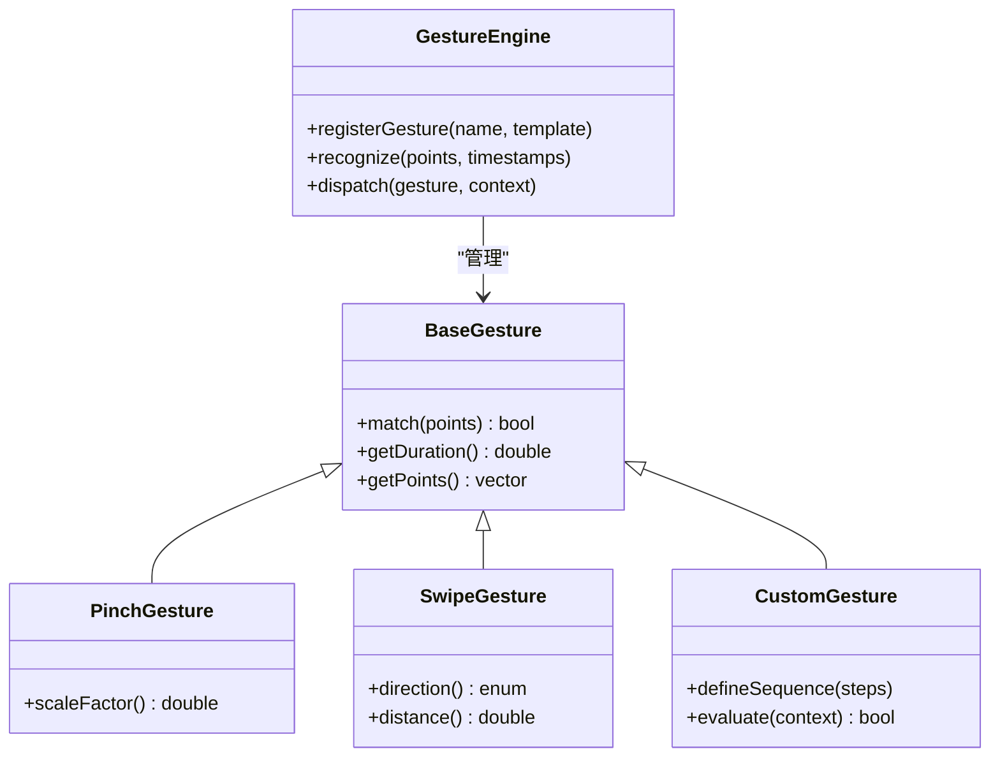
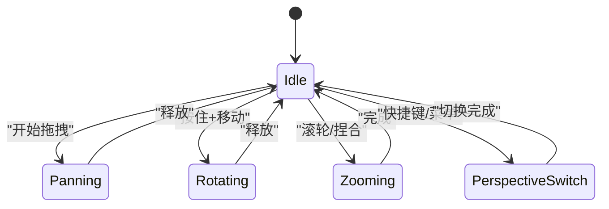
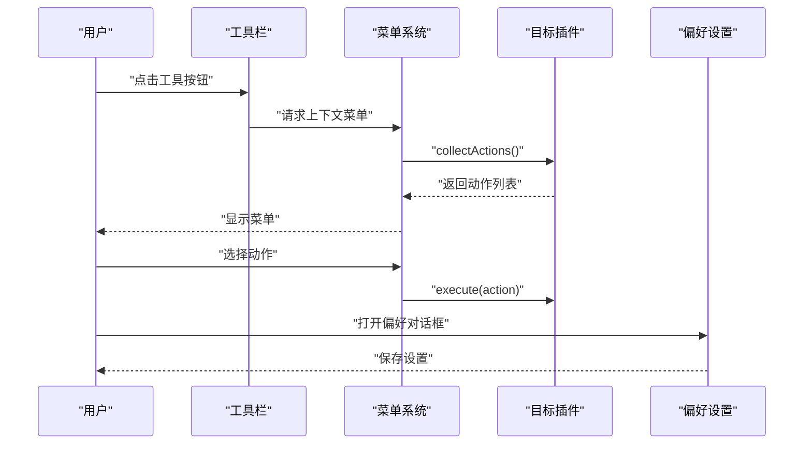
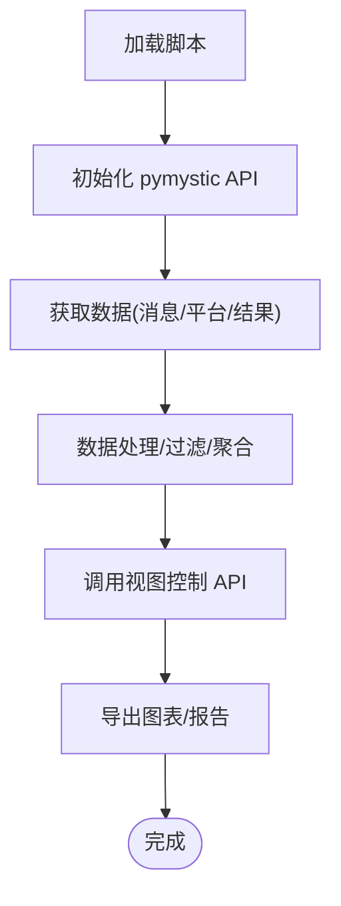
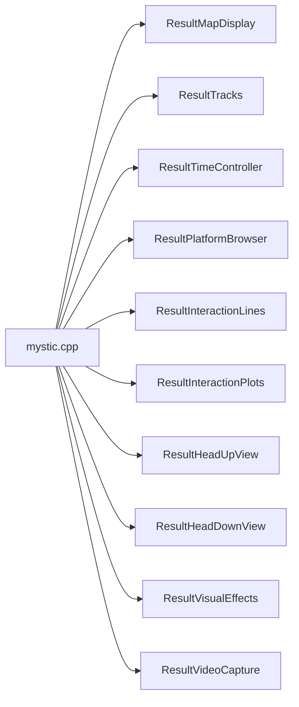

# 用户交互系统

<cite>
**本文引用的文件**   
- [mystic.cpp](file://swdev/src/mystic/exec/source/mystic.cpp)
- [pymystic.py](file://swdev/src/mystic/python/pymystic.py)
- [example_bigreport.py](file://swdev/src/mystic/python/example_bigreport.py)
- [example_graph.py](file://swdev/src/mystic/python/example_graph.py)
- [example_message_list.py](file://swdev/src/mystic/python/example_message_list.py)
- [example_print_message_data.py](file://swdev/src/mystic/python/example_print_message_data.py)
- [ResultMapDisplay](file://swdev/src/mystic/plugins/ResultMapDisplay)
- [ResultTracks](file://swdev/src/mystic/plugins/ResultTracks)
- [ResultTimeController](file://swdev/src/mystic/plugins/ResultTimeController)
- [ResultPlatformBrowser](file://swdev/src/mystic/plugins/ResultPlatformBrowser)
- [ResultInteractionLines](file://swdev/src/mystic/plugins/ResultInteractionLines)
- [ResultInteractionPlots](file://swdev/src/mystic/plugins/ResultInteractionPlots)
- [ResultHeadUpView](file://swdev/src/mystic/plugins/ResultHeadUpView)
- [ResultHeadDownView](file://swdev/src/mystic/plugins/ResultHeadDownView)
- [ResultVisualEffects](file://swdev/src/mystic/plugins/ResultVisualEffects)
- [ResultVideoCapture](file://swdev/src/mystic/plugins/ResultVideoCapture)
- [RvPlottingWidget.ui](file://swdev/src/mystic/lib/ui/RvPlottingWidget.ui)
- [RvMemoryPrefWidget.ui](file://swdev/src/mystic/lib/ui/RvMemoryPrefWidget.ui)
- [RvInterpolationPrefWidget.ui](file://swdev/src/mystic/lib/ui/RvInterpolationPrefWidget.ui)
- [RvChooserDialog.ui](file://swdev/src/mystic/lib/ui/RvChooserDialog.ui)
</cite>

## 目录
1. [简介](#简介)
2. [项目结构](#项目结构)
3. [核心组件](#核心组件)
4. [架构总览](#架构总览)
5. [详细组件分析](#详细组件分析)
6. [依赖关系分析](#依赖关系分析)
7. [性能考虑](#性能考虑)
8. [故障排查指南](#故障排查指南)
9. [结论](#结论)
10. [附录](#附录)

## 简介
本文件为 Mystic 用户交互系统的技术文档，聚焦以下方面：
- 鼠标事件处理机制（点击、拖拽、滚轮缩放、右键菜单）
- 键盘输入处理（快捷键绑定、命令模式、文本输入）
- 手势识别系统（多点触控、手势库、自定义手势）
- 视图导航功能（平移、旋转、缩放、视角切换）
- 工具栏与菜单系统（动态菜单生成、上下文相关操作、用户偏好设置）
- Python 脚本 API 使用示例与扩展开发指南

Mystic 是 AFSIM 的可视化与分析平台，提供丰富的结果展示插件与可扩展的用户界面。其交互能力由 Qt 驱动，并通过插件体系组织不同可视化模块。

## 项目结构
Mystic 的核心代码位于 swdev/src/mystic，包含执行入口、Python API 以及大量结果展示插件。UI 资源与对话框定义在 lib/ui 中，插件以 Result* 命名空间组织，便于按功能域拆分与维护。

```mermaid
graph TB
subgraph "Mystic 应用"
Exec["exec/source<br/>mystic.cpp"]
PyAPI["python<br/>pymystic.py"]
Examples["python/examples<br/>example_*.py"]
end
subgraph "UI 资源"
UI1["lib/ui/RvPlottingWidget.ui"]
UI2["lib/ui/RvMemoryPrefWidget.ui"]
UI3["lib/ui/RvInterpolationPrefWidget.ui"]
UI4["lib/ui/RvChooserDialog.ui"]
end
subgraph "插件集合"
Map["plugins/ResultMapDisplay"]
Tracks["plugins/ResultTracks"]
TimeCtrl["plugins/ResultTimeController"]
PlatformBrowser["plugins/ResultPlatformBrowser"]
IntLines["plugins/ResultInteractionLines"]
IntPlots["plugins/ResultInteractionPlots"]
HUD["plugins/ResultHeadUpView"]
HMD["plugins/ResultHeadDownView"]
VFX["plugins/ResultVisualEffects"]
Video["plugins/ResultVideoCapture"]
end
Exec --> Map
Exec --> Tracks
Exec --> TimeCtrl
Exec --> PlatformBrowser
Exec --> IntLines
Exec --> IntPlots
Exec --> HUD
Exec --> HMD
Exec --> VFX
Exec --> Video
PyAPI --> Examples
Exec --> UI1
Exec --> UI2
Exec --> UI3
Exec --> UI4
```

图表来源
- [mystic.cpp:1-200](file://swdev/src/mystic/exec/source/mystic.cpp#L1-L200)
- [pymystic.py:1-200](file://swdev/src/mystic/python/pymystic.py#L1-L200)
- [RvPlottingWidget.ui:1-200](file://swdev/src/mystic/lib/ui/RvPlottingWidget.ui#L1-L200)
- [RvMemoryPrefWidget.ui:1-200](file://swdev/src/mystic/lib/ui/RvMemoryPrefWidget.ui#L1-L200)
- [RvInterpolationPrefWidget.ui:1-200](file://swdev/src/mystic/lib/ui/RvInterpolationPrefWidget.ui#L1-L200)
- [RvChooserDialog.ui:1-200](file://swdev/src/mystic/lib/ui/RvChooserDialog.ui#L1-L200)

章节来源
- [mystic.cpp:1-200](file://swdev/src/mystic/exec/source/mystic.cpp#L1-L200)
- [pymystic.py:1-200](file://swdev/src/mystic/python/pymystic.py#L1-L200)

## 核心组件
- 应用入口与生命周期管理：负责初始化 Qt 环境、加载插件、启动主窗口与事件循环。
- Python 脚本 API：暴露给用户的脚本接口，用于数据访问、视图控制与自动化任务。
- 插件系统：每个 Result* 插件实现特定可视化或工具功能，统一通过插件接口注册到 Mystic。
- UI 资源与偏好设置：基于 Qt Designer 的 .ui 文件定义控件布局与行为，支持用户偏好配置。

章节来源
- [mystic.cpp:1-200](file://swdev/src/mystic/exec/source/mystic.cpp#L1-L200)
- [pymystic.py:1-200](file://swdev/src/mystic/python/pymystic.py#L1-L200)
- [RvPlottingWidget.ui:1-200](file://swdev/src/mystic/lib/ui/RvPlottingWidget.ui#L1-L200)
- [RvMemoryPrefWidget.ui:1-200](file://swdev/src/mystic/lib/ui/RvMemoryPrefWidget.ui#L1-L200)
- [RvInterpolationPrefWidget.ui:1-200](file://swdev/src/mystic/lib/ui/RvInterpolationPrefWidget.ui#L1-L200)
- [RvChooserDialog.ui:1-200](file://swdev/src/mystic/lib/ui/RvChooserDialog.ui#L1-L200)

## 架构总览
Mystic 采用“应用 + 插件”的架构。应用层负责 UI 框架、事件分发与插件加载；插件层提供具体可视化与交互逻辑。Python API 作为桥接层，允许用户在运行时调用核心功能并扩展行为。

图表来源
- [mystic.cpp:1-200](file://swdev/src/mystic/exec/source/mystic.cpp#L1-L200)
- [pymystic.py:1-200](file://swdev/src/mystic/python/pymystic.py#L1-L200)

## 详细组件分析

### 鼠标事件处理机制（点击、拖拽、滚轮缩放、右键菜单）
- 点击：用于选择对象、触发上下文菜单或执行默认动作（如打开属性面板）。
- 拖拽：用于平移视图、旋转相机或调整参数滑块。
- 滚轮缩放：用于放大/缩小场景或图表。
- 右键菜单：根据当前上下文（地图、轨道图、时间控制器等）动态生成菜单项。

典型流程如下：

图表来源
- [mystic.cpp:1-200](file://swdev/src/mystic/exec/source/mystic.cpp#L1-L200)
- [ResultMapDisplay:source/*](file://swdev/src/mystic/plugins/ResultMapDisplay)
- [ResultTracks:source/*](file://swdev/src/mystic/plugins/ResultTracks)
- [ResultTimeController:source/*](file://swdev/src/mystic/plugins/ResultTimeController)

章节来源
- [mystic.cpp:1-200](file://swdev/src/mystic/exec/source/mystic.cpp#L1-L200)
- [ResultMapDisplay:README.md](file://swdev/src/mystic/plugins/ResultMapDisplay/README.md)
- [ResultTracks:README.md](file://swdev/src/mystic/plugins/ResultTracks/README.md)
- [ResultTimeController:README.md](file://swdev/src/mystic/plugins/ResultTimeController/README.md)

### 键盘输入处理（快捷键绑定、命令模式、文本输入）
- 快捷键绑定：全局或上下文相关的按键组合，用于快速切换视图、执行常用操作。
- 命令模式：通过命令行或脚本接口输入指令，批量控制视图与数据。
- 文本输入：在搜索框、过滤器或属性编辑器中输入文本，实时过滤或更新显示。

图表来源
- [mystic.cpp:1-200](file://swdev/src/mystic/exec/source/mystic.cpp#L1-L200)
- [pymystic.py:1-200](file://swdev/src/mystic/python/pymystic.py#L1-L200)

章节来源
- [mystic.cpp:1-200](file://swdev/src/mystic/exec/source/mystic.cpp#L1-L200)
- [pymystic.py:1-200](file://swdev/src/mystic/python/pymystic.py#L1-L200)

### 手势识别系统（多点触控、手势库、自定义手势）
- 多点触控：支持双指缩放、三指旋转、滑动平移等基础手势。
- 手势库：内置常见手势（捏合、长按、双击、滑动手势），可被插件订阅。
- 自定义手势：开发者可定义复杂手势序列，结合时间与空间阈值进行匹配。

图表来源
- [mystic.cpp:1-200](file://swdev/src/mystic/exec/source/mystic.cpp#L1-L200)
- [ResultMapDisplay:source/*](file://swdev/src/mystic/plugins/ResultMapDisplay)
- [ResultTracks:source/*](file://swdev/src/mystic/plugins/ResultTracks)

章节来源
- [mystic.cpp:1-200](file://swdev/src/mystic/exec/source/mystic.cpp#L1-L200)
- [ResultMapDisplay:README.md](file://swdev/src/mystic/plugins/ResultMapDisplay/README.md)
- [ResultTracks:README.md](file://swdev/src/mystic/plugins/ResultTracks/README.md)

### 视图导航功能（平移、旋转、缩放、视角切换）
- 平移：通过拖拽或方向键移动视口中心。
- 旋转：通过鼠标拖拽或旋转手势改变相机角度。
- 缩放：滚轮或捏合手势调整缩放级别。
- 视角切换：预设视角（俯视、侧视、跟随目标）与自由视角。

图表来源
- [ResultHeadUpView:source/*](file://swdev/src/mystic/plugins/ResultHeadUpView)
- [ResultHeadDownView:source/*](file://swdev/src/mystic/plugins/ResultHeadDownView)
- [ResultVisualEffects:source/*](file://swdev/src/mystic/plugins/ResultVisualEffects)

章节来源
- [ResultHeadUpView:README.md](file://swdev/src/mystic/plugins/ResultHeadUpView/README.md)
- [ResultHeadDownView:README.md](file://swdev/src/mystic/plugins/ResultHeadDownView/README.md)
- [ResultVisualEffects:README.md](file://swdev/src/mystic/plugins/ResultVisualEffects/README.md)

### 工具栏与菜单系统（动态菜单生成、上下文相关操作、用户偏好设置）
- 动态菜单：根据当前视图与选中对象生成菜单项。
- 上下文相关：不同插件提供不同的上下文菜单（如地图上的目标右键菜单、轨道图的轨迹操作）。
- 用户偏好：通过 .ui 定义的偏好对话框保存用户设置（如内存使用、插值方式、绘图选项）。

图表来源
- [RvPlottingWidget.ui:1-200](file://swdev/src/mystic/lib/ui/RvPlottingWidget.ui#L1-L200)
- [RvMemoryPrefWidget.ui:1-200](file://swdev/src/mystic/lib/ui/RvMemoryPrefWidget.ui#L1-L200)
- [RvInterpolationPrefWidget.ui:1-200](file://swdev/src/mystic/lib/ui/RvInterpolationPrefWidget.ui#L1-L200)
- [RvChooserDialog.ui:1-200](file://swdev/src/mystic/lib/ui/RvChooserDialog.ui#L1-L200)

章节来源
- [RvPlottingWidget.ui:1-200](file://swdev/src/mystic/lib/ui/RvPlottingWidget.ui#L1-L200)
- [RvMemoryPrefWidget.ui:1-200](file://swdev/src/mystic/lib/ui/RvMemoryPrefWidget.ui#L1-L200)
- [RvInterpolationPrefWidget.ui:1-200](file://swdev/src/mystic/lib/ui/RvInterpolationPrefWidget.ui#L1-L200)
- [RvChooserDialog.ui:1-200](file://swdev/src/mystic/lib/ui/RvChooserDialog.ui#L1-L200)

### Python 脚本 API 使用示例与扩展开发指南
- 数据访问：通过 pymystic 提供的接口读取仿真消息、平台数据与结果对象。
- 视图控制：调用 API 切换视角、设置缩放、添加标注或高亮对象。
- 自动化任务：编写脚本批量导出图表、生成报告或执行重复性分析。

示例脚本路径：
- [example_bigreport.py](file://swdev/src/mystic/python/example_bigreport.py)
- [example_graph.py](file://swdev/src/mystic/python/example_graph.py)
- [example_message_list.py](file://swdev/src/mystic/python/example_message_list.py)
- [example_print_message_data.py](file://swdev/src/mystic/python/example_print_message_data.py)

图表来源
- [pymystic.py:1-200](file://swdev/src/mystic/python/pymystic.py#L1-L200)
- [example_bigreport.py:1-200](file://swdev/src/mystic/python/example_bigreport.py#L1-L200)
- [example_graph.py:1-200](file://swdev/src/mystic/python/example_graph.py#L1-L200)
- [example_message_list.py:1-200](file://swdev/src/mystic/python/example_message_list.py#L1-L200)
- [example_print_message_data.py:1-200](file://swdev/src/mystic/python/example_print_message_data.py#L1-L200)

章节来源
- [pymystic.py:1-200](file://swdev/src/mystic/python/pymystic.py#L1-L200)
- [example_bigreport.py:1-200](file://swdev/src/mystic/python/example_bigreport.py#L1-L200)
- [example_graph.py:1-200](file://swdev/src/mystic/python/example_graph.py#L1-L200)
- [example_message_list.py:1-200](file://swdev/src/mystic/python/example_message_list.py#L1-L200)
- [example_print_message_data.py:1-200](file://swdev/src/mystic/python/example_print_message_data.py#L1-L200)

## 依赖关系分析
Mystic 的依赖关系主要体现在应用入口对插件的加载与 UI 资源的引用。插件之间通常松耦合，通过统一的插件接口与事件总线通信。

图表来源
- [mystic.cpp:1-200](file://swdev/src/mystic/exec/source/mystic.cpp#L1-L200)
- [ResultMapDisplay:source/*](file://swdev/src/mystic/plugins/ResultMapDisplay)
- [ResultTracks:source/*](file://swdev/src/mystic/plugins/ResultTracks)
- [ResultTimeController:source/*](file://swdev/src/mystic/plugins/ResultTimeController)
- [ResultPlatformBrowser:source/*](file://swdev/src/mystic/plugins/ResultPlatformBrowser)
- [ResultInteractionLines:source/*](file://swdev/src/mystic/plugins/ResultInteractionLines)
- [ResultInteractionPlots:source/*](file://swdev/src/mystic/plugins/ResultInteractionPlots)
- [ResultHeadUpView:source/*](file://swdev/src/mystic/plugins/ResultHeadUpView)
- [ResultHeadDownView:source/*](file://swdev/src/mystic/plugins/ResultHeadDownView)
- [ResultVisualEffects:source/*](file://swdev/src/mystic/plugins/ResultVisualEffects)
- [ResultVideoCapture:source/*](file://swdev/src/mystic/plugins/ResultVideoCapture)

章节来源
- [mystic.cpp:1-200](file://swdev/src/mystic/exec/source/mystic.cpp#L1-L200)

## 性能考虑
- 渲染优化：启用视锥剔除、LOD 与批处理绘制以减少 GPU 压力。
- 数据流优化：按需加载大数据集，避免一次性载入全部消息。
- 事件节流：对高频鼠标/手势事件进行采样与合并，降低 CPU 占用。
- 内存管理：通过偏好设置限制缓存大小，及时释放不再使用的对象。

[本节为通用指导，不直接分析具体文件]

## 故障排查指南
- 插件未加载：检查插件目录结构与 CMake 配置，确认插件已编译并正确注册。
- 菜单不响应：验证上下文是否正确，检查插件是否实现了 collectActions 与 execute。
- 手势无响应：确认手势模板定义与阈值设置，检查多点触控输入是否被系统拦截。
- Python API 报错：核对 API 版本与脚本兼容性，查看日志输出定位错误位置。

章节来源
- [mystic.cpp:1-200](file://swdev/src/mystic/exec/source/mystic.cpp#L1-L200)
- [pymystic.py:1-200](file://swdev/src/mystic/python/pymystic.py#L1-L200)

## 结论
Mystic 的用户交互系统以 Qt 为基础，通过插件化架构提供灵活的可视化与交互能力。鼠标、键盘与手势事件统一由应用层分发至各插件，Python API 则为用户提供了强大的自动化与扩展手段。遵循本文档的架构与最佳实践，可有效提升交互体验与系统可维护性。

[本节为总结性内容，不直接分析具体文件]

## 附录
- 参考插件 README 以了解具体交互细节与配置选项。
- 使用 .ui 文件定制偏好对话框与工具栏布局。
- 通过 Python 脚本示例快速上手数据访问与视图控制。

[本节为补充信息，不直接分析具体文件]