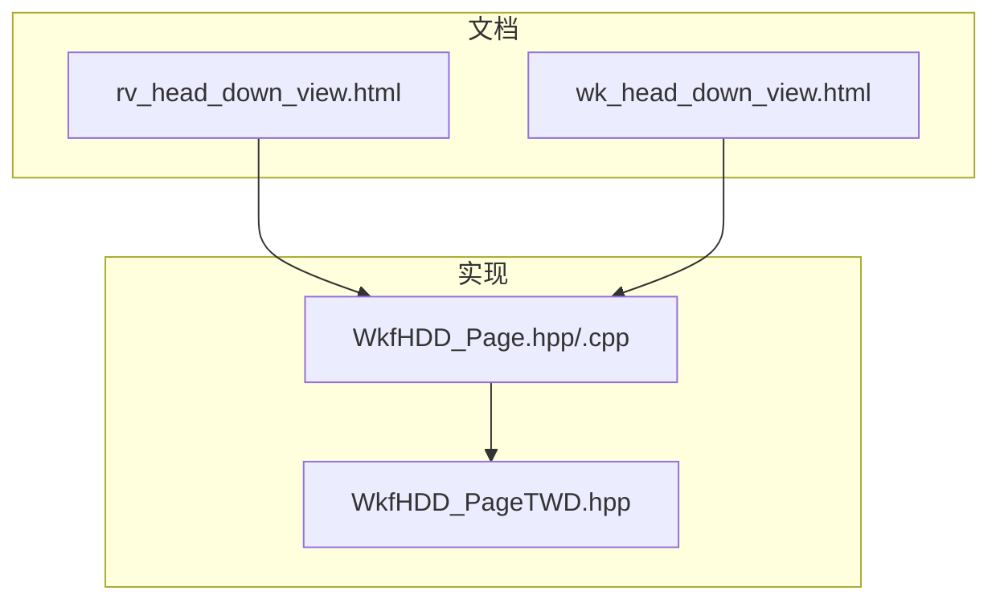
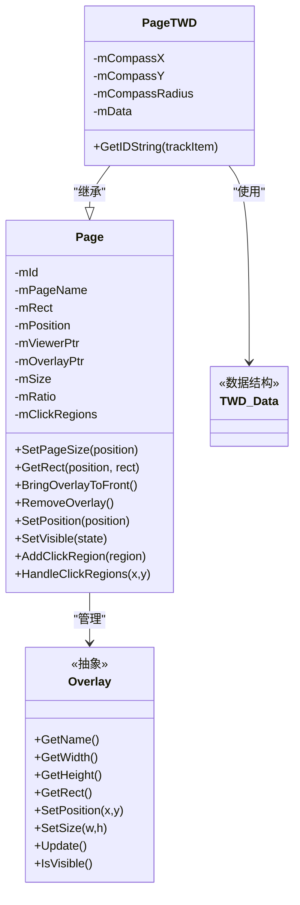
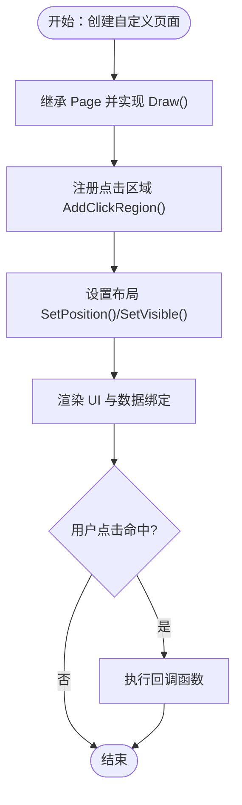
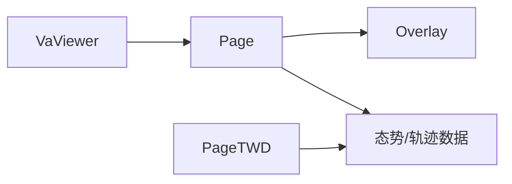

# 低头显示(HMD)

<cite>
**本文引用的文件**   
- [rv_head_down_view.html](file://documentation/html/docs/wkf_plugin/rv_head_down_view.html)
- [wk_head_down_view.html](file://documentation/html/docs/wkf_plugin/wk_head_down_view.html)
- [WkfHDD_Page.hpp](file://swdev/src/tools/wkf/air_combat/wkf_air_combat_common/source/hdd/WkfHDD_Page.hpp)
- [WkfHDD_Page.cpp](file://swdev/src/tools/wkf/air_combat/wkf_air_combat_common/source/hdd/WkfHDD_Page.cpp)
- [WkfHDD_PageTWD.hpp](file://swdev/src/tools/wkf/air_combat/wkf_air_combat_common/source/hdd/WkfHDD_PageTWD.hpp)
</cite>

## 目录
1. [简介](#简介)
2. [项目结构](#项目结构)
3. [核心组件](#核心组件)
4. [架构总览](#架构总览)
5. [详细组件分析](#详细组件分析)
6. [依赖关系分析](#依赖关系分析)
7. [性能考虑](#性能考虑)
8. [故障排查指南](#故障排查指南)
9. [结论](#结论)
10. [附录](#附录)

## 简介
本文件面向Mystic平台的“低头显示（Head Down View，简称HMD）”插件，系统化说明其控制面板功能、多页面界面设计、数据可视化能力、用户交互方式、与外部系统的集成接口以及响应式布局策略。同时提供自定义控制面板的开发指南与插件架构说明，帮助开发者扩展或替换现有页面与控件。

需要特别说明：官方文档指出该HMD插件已弃用，建议使用ACES Display替代；但为便于历史维护与迁移评估，本文仍对既有实现进行完整梳理。

## 项目结构
HMD在Mystic中以插件形式存在，相关文档位于documentation/html/docs/wkf_plugin下，对应实现位于tools/wkf/air_combat/wkf_air_combat_common/source/hdd目录。主要结构如下：
- 文档层：rv_head_down_view.html（Mystic版）、wk_head_down_view.html（Warlock版，供对照）
- 实现层：Page基类与各具体页面（如TWD威胁告警页等）

图示来源
- [rv_head_down_view.html:73-404](file://documentation/html/docs/wkf_plugin/rv_head_down_view.html#L73-L404)
- [wk_head_down_view.html:73-404](file://documentation/html/docs/wkf_plugin/wk_head_down_view.html#L73-L404)
- [WkfHDD_Page.hpp:48-191](file://swdev/src/tools/wkf/air_combat/wkf_air_combat_common/source/hdd/WkfHDD_Page.hpp#L48-L191)
- [WkfHDD_Page.cpp:16-210](file://swdev/src/tools/wkf/air_combat/wkf_air_combat_common/source/hdd/WkfHDD_Page.cpp#L16-L210)
- [WkfHDD_PageTWD.hpp:124-134](file://swdev/src/tools/wkf/air_combat/wkf_air_combat_common/source/hdd/WkfHDD_PageTWD.hpp#L124-L134)

章节来源
- [rv_head_down_view.html:73-404](file://documentation/html/docs/wkf_plugin/rv_head_down_view.html#L73-L404)
- [wk_head_down_view.html:73-404](file://documentation/html/docs/wkf_plugin/wk_head_down_view.html#L73-L404)

## 核心组件
- 页面基类 Page：负责所有页面的通用行为，包括位置/尺寸管理、可见性控制、点击区域处理、叠加层（Overlay）生命周期管理等。
- 具体页面：
  - EFI（姿态指示器）
  - ENG（发动机参数）
  - FUEL（燃油信息）
  - HUD（HUD重复显示）
  - NAV（移动地图）
  - SMS（武器挂载管理）
  - TSD（战术态势显示）
  - TWD（威胁告警显示）
- 头部状态栏：集中展示引擎、燃油、武器、起落架、ICAWS告警、平台信息与仿真时间等关键信息。

章节来源
- [rv_head_down_view.html:182-235](file://documentation/html/docs/wkf_plugin/rv_head_down_view.html#L182-L235)
- [rv_head_down_view.html:237-304](file://documentation/html/docs/wkf_plugin/rv_head_down_view.html#L237-L304)
- [rv_head_down_view.html:305-395](file://documentation/html/docs/wkf_plugin/rv_head_down_view.html#L305-L395)

## 架构总览
HMD采用“页面+叠加层”的架构：每个页面是一个Overlay，由Page统一管理其在视口中的位置、尺寸与可见性；具体页面继承Page并实现绘制逻辑。TWD作为威胁告警页面，封装了目标轨迹数据与罗盘交互。

图示来源
- [WkfHDD_Page.hpp:48-191](file://swdev/src/tools/wkf/air_combat/wkf_air_combat_common/source/hdd/WkfHDD_Page.hpp#L48-L191)
- [WkfHDD_Page.cpp:16-210](file://swdev/src/tools/wkf/air_combat/wkf_air_combat_common/source/hdd/WkfHDD_Page.cpp#L16-L210)
- [WkfHDD_PageTWD.hpp:124-134](file://swdev/src/tools/wkf/air_combat/wkf_air_combat_common/source/hdd/WkfHDD_PageTWD.hpp#L124-L134)

## 详细组件分析

### 系统设置与偏好
- 分辨率与默认页面配置：可在偏好中设置显示分辨率及各槽位的默认页面。若将第1页设置为TSD，则默认以最大尺寸展开。
- 插件启用：HMD为原型能力，默认禁用，需通过插件管理器启用。

章节来源
- [rv_head_down_view.html:396-404](file://documentation/html/docs/wkf_plugin/rv_head_down_view.html#L396-L404)
- [rv_head_down_view.html:84-87](file://documentation/html/docs/wkf_plugin/rv_head_down_view.html#L84-L87)

### 传感器控制与态势感知
- 态势感知处理器需求：为显示全部可用数据，平台需具备态势感知处理器（SA Processor）。
- 威胁告警（TWD）：要求轨迹处理器名称包含“esm”或“rwr”（不区分大小写），用于向TWD输入威胁轨迹。

章节来源
- [rv_head_down_view.html:80-83](file://documentation/html/docs/wkf_plugin/rv_head_down_view.html#L80-L83)
- [rv_head_down_view.html:387-395](file://documentation/html/docs/wkf_plugin/rv_head_down_view.html#L387-L395)

### 武器管理系统（SMS）
- 武器布局：支持最多16个武器的两行布局（>8时），或单行8个布局；从中间向外加载，按Bomb、SRM、MRM顺序。
- 武器识别：根据武器名关键字匹配绘制类型（bomb/agm→Bomb；srm/fox2/srv→SRM；否则→MRM）。
- 主保险与选中武器：主保险关闭显示SAFE框（青色边框），开启后变绿；选中武器下方显示，弹药耗尽时变红。
- 干扰物与舱门：显示箔条、诱饵、闪光弹计数；舱门开/关状态标签。

章节来源
- [rv_head_down_view.html:262-304](file://documentation/html/docs/wkf_plugin/rv_head_down_view.html#L262-L304)

### 多页面界面设计
- 页面编号与布局：顶部保留Header（位置0），1-4为中号页，5-12为小号页，13-16为大号页，17-18为全屏页。
- 页面切换：通过主页面左上角菜单按钮切换各页内容。
- 典型页面功能：
  - EFI：俯仰/滚转姿态
  - ENG：油门、推力、燃油流量
  - FUEL：总/内/外油量、油流、到空时间与距离、Joker/Bingo油量
  - HUD：航向、高度、真空速
  - NAV：基于导航地图的移动地图视图
  - TSD：战术态势（友/敌/中立/编队符号），范围缩放、域过滤、航路显示
  - TWD：ESM/RWR威胁环图

章节来源
- [WkfHDD_Page.hpp:52-65](file://swdev/src/tools/wkf/air_combat/wkf_air_combat_common/source/hdd/WkfHDD_Page.hpp#L52-L65)
- [WkfHDD_Page.cpp:26-60](file://swdev/src/tools/wkf/air_combat/wkf_air_combat_common/source/hdd/WkfHDD_Page.cpp#L26-L60)
- [WkfHDD_Page.cpp:62-128](file://swdev/src/tools/wkf/air_combat/wkf_air_combat_common/source/hdd/WkfHDD_Page.cpp#L62-L128)
- [rv_head_down_view.html:91-180](file://documentation/html/docs/wkf_plugin/rv_head_down_view.html#L91-L180)
- [rv_head_down_view.html:237-304](file://documentation/html/docs/wkf_plugin/rv_head_down_view.html#L237-L304)
- [rv_head_down_view.html:305-395](file://documentation/html/docs/wkf_plugin/rv_head_down_view.html#L305-L395)

### 数据可视化与实时数据流
- 图表与趋势：EFI/ENG/FUEL/HUD等页面以仪表/数值形式呈现实时状态；TSD/TWD以图形化态势/威胁环展示。
- 实时数据流：依赖态势感知处理器与特定轨迹处理器（esm/rwr）持续更新页面数据。
- 交互反馈：鼠标悬停TSD实体显示详细信息；点击固定详情窗口直至离开或丢失跟踪。

章节来源
- [rv_head_down_view.html:305-395](file://documentation/html/docs/wkf_plugin/rv_head_down_view.html#L305-L395)

### 用户交互设计
- 按钮与操作：
  - TSD：Range Up/Down切换范围（5/10/20/40/80/160/320/640 nm），Air/Gnd域显隐，Waypt航路显隐。
  - 页面切换：主页面左上角菜单按钮。
- 快捷键：参考Warlock提示中的键盘快捷键页面可自定义快捷键（适用于整体UI交互）。

章节来源
- [rv_head_down_view.html:356-385](file://documentation/html/docs/wkf_plugin/rv_head_down_view.html#L356-L385)
- [tips.txt:164-169](file://swdev/src/warlock/warlock_core/ui/resources/tips.txt#L164-L169)

### HMD与外部系统集成接口
- 态势感知数据：平台需配置态势感知处理器以输出可供HMD消费的状态与轨迹数据。
- 威胁数据源：轨迹处理器命名规则（esm/rwr）决定TWD是否接收数据。
- 协议转换：HMD本身不直接暴露外部协议接口，主要通过内部数据管道消费态势与轨迹数据。

章节来源
- [rv_head_down_view.html:80-83](file://documentation/html/docs/wkf_plugin/rv_head_down_view.html#L80-L83)
- [rv_head_down_view.html:387-395](file://documentation/html/docs/wkf_plugin/rv_head_down_view.html#L387-L395)

### 响应式设计与多分辨率适配
- 页面尺寸枚举：Small/Medium/Large/Full，依据位置映射不同宽高比与布局。
- 坐标与像素换算：通过pW()/pH()将相对坐标转换为像素坐标，确保在不同分辨率下绘制一致。
- 视口与叠加层：Page通过VaViewer管理Overlay的位置与尺寸，并在SetPosition时触发Update以避免闪烁。

章节来源
- [WkfHDD_Page.hpp:66-72](file://swdev/src/tools/wkf/air_combat/wkf_air_combat_common/source/hdd/WkfHDD_Page.hpp#L66-L72)
- [WkfHDD_Page.hpp:167-175](file://swdev/src/tools/wkf/air_combat/wkf_air_combat_common/source/hdd/WkfHDD_Page.hpp#L167-L175)
- [WkfHDD_Page.cpp:155-165](file://swdev/src/tools/wkf/air_combat/wkf_air_combat_common/source/hdd/WkfHDD_Page.cpp#L155-L165)

### 自定义控制面板开发指南与插件架构
- 页面开发步骤：
  1) 继承Page，实现Draw虚函数以绘制自定义UI。
  2) 使用AddClickRegion注册点击区域与回调函数，支持按页面尺寸差异化命中区。
  3) 通过SetPosition/SetVisible控制页面布局与可见性。
  4) 如需复杂交互（如罗盘），可参考PageTWD的数据结构与交互模式。
- 插件架构要点：
  - 每个页面即一个Overlay，由Page统一生命周期管理。
  - 通过VaViewer进行叠加层的前后序与移除操作。
  - 颜色常量与布局规范在Page头文件中定义，保持视觉一致性。

图示来源
- [WkfHDD_Page.hpp:155-162](file://swdev/src/tools/wkf/air_combat/wkf_air_combat_common/source/hdd/WkfHDD_Page.hpp#L155-L162)
- [WkfHDD_Page.cpp:172-209](file://swdev/src/tools/wkf/air_combat/wkf_air_combat_common/source/hdd/WkfHDD_Page.cpp#L172-L209)

章节来源
- [WkfHDD_Page.hpp:48-191](file://swdev/src/tools/wkf/air_combat/wkf_air_combat_common/source/hdd/WkfHDD_Page.hpp#L48-L191)
- [WkfHDD_Page.cpp:16-210](file://swdev/src/tools/wkf/air_combat/wkf_air_combat_common/source/hdd/WkfHDD_Page.cpp#L16-L210)
- [WkfHDD_PageTWD.hpp:124-134](file://swdev/src/tools/wkf/air_combat/wkf_air_combat_common/source/hdd/WkfHDD_PageTWD.hpp#L124-L134)

## 依赖关系分析
- 组件耦合：
  - Page与Overlay强耦合（管理叠加层生命周期与几何属性）。
  - Page与VaViewer耦合（获取视口尺寸、叠加层前后台管理）。
  - 具体页面（如TWD）依赖态势感知与轨迹处理器数据。
- 外部依赖：
  - 态势感知处理器（SA Processor）
  - 轨迹处理器（名称含esm或rwr）
- 潜在循环依赖：无直接循环依赖迹象，页面之间通过共享基类与数据容器解耦。

图示来源
- [WkfHDD_Page.hpp:48-191](file://swdev/src/tools/wkf/air_combat/wkf_air_combat_common/source/hdd/WkfHDD_Page.hpp#L48-L191)
- [WkfHDD_Page.cpp:16-210](file://swdev/src/tools/wkf/air_combat/wkf_air_combat_common/source/hdd/WkfHDD_Page.cpp#L16-L210)
- [rv_head_down_view.html:80-83](file://documentation/html/docs/wkf_plugin/rv_head_down_view.html#L80-L83)
- [rv_head_down_view.html:387-395](file://documentation/html/docs/wkf_plugin/rv_head_down_view.html#L387-L395)

章节来源
- [WkfHDD_Page.hpp:48-191](file://swdev/src/tools/wkf/air_combat/wkf_air_combat_common/source/hdd/WkfHDD_Page.hpp#L48-L191)
- [WkfHDD_Page.cpp:16-210](file://swdev/src/tools/wkf/air_combat/wkf_air_combat_common/source/hdd/WkfHDD_Page.cpp#L16-L210)
- [rv_head_down_view.html:80-83](file://documentation/html/docs/wkf_plugin/rv_head_down_view.html#L80-L83)
- [rv_head_down_view.html:387-395](file://documentation/html/docs/wkf_plugin/rv_head_down_view.html#L387-L395)

## 性能考虑
- 避免重绘闪烁：在SetPosition后调用Update以确保页面切换/缩放时无闪烁。
- 合理布局：优先使用中号/大号页面承载高复杂度UI，减少频繁缩放带来的重绘开销。
- 数据刷新频率：仅对必要页面订阅态势/轨迹数据，降低无关页面的计算压力。

章节来源
- [WkfHDD_Page.cpp:155-165](file://swdev/src/tools/wkf/air_combat/wkf_air_combat_common/source/hdd/WkfHDD_Page.cpp#L155-L165)

## 故障排查指南
- 无法显示全部数据：确认平台已配置态势感知处理器。
- TWD无威胁数据：检查轨迹处理器名称是否包含“esm”或“rwr”。
- 页面不可见或布局异常：检查SetVisible与SetPosition调用是否正确；确认Overlay未被提前移除。
- 点击无效：核对AddClickRegion注册的矩形区域是否与当前页面尺寸匹配。

章节来源
- [rv_head_down_view.html:80-83](file://documentation/html/docs/wkf_plugin/rv_head_down_view.html#L80-L83)
- [rv_head_down_view.html:387-395](file://documentation/html/docs/wkf_plugin/rv_head_down_view.html#L387-L395)
- [WkfHDD_Page.cpp:172-209](file://swdev/src/tools/wkf/air_combat/wkf_air_combat_common/source/hdd/WkfHDD_Page.cpp#L172-L209)

## 结论
Mystic的HMD插件提供了丰富的玻璃座舱式页面与态势可视化能力，涵盖系统状态、传感器控制与武器管理。尽管官方已弃用该插件并推荐使用ACES Display，但其页面基类与叠加层管理机制仍可作为自定义控制面板开发的参考。建议在迁移至ACES的同时，复用Page/Overlay的设计思想构建新的可视化模块。

## 附录
- 相关文档入口：
  - Mystic参考指南：包含HMD与其他可视化工具索引
  - Warlock参考指南：包含HMD对照文档
- 版本变更：
  - 2.8/2.9中对HMD进行了多项改进与菜单归类调整，详见相应变更日志。

章节来源
- [rv_head_down_view.html:73-404](file://documentation/html/docs/wkf_plugin/rv_head_down_view.html#L73-L404)
- [wk_head_down_view.html:73-404](file://documentation/html/docs/wkf_plugin/wk_head_down_view.html#L73-L404)