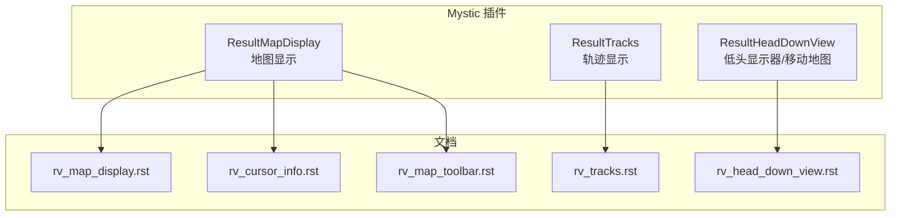
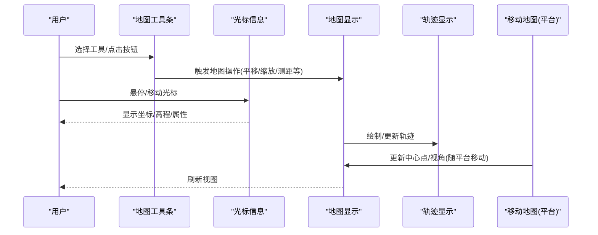
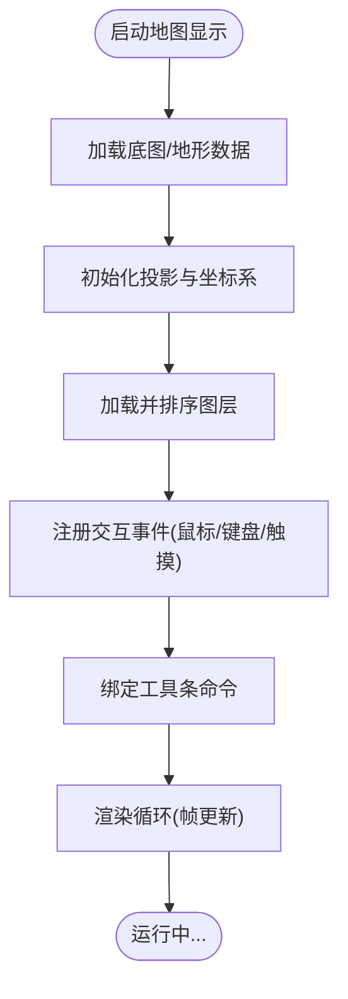
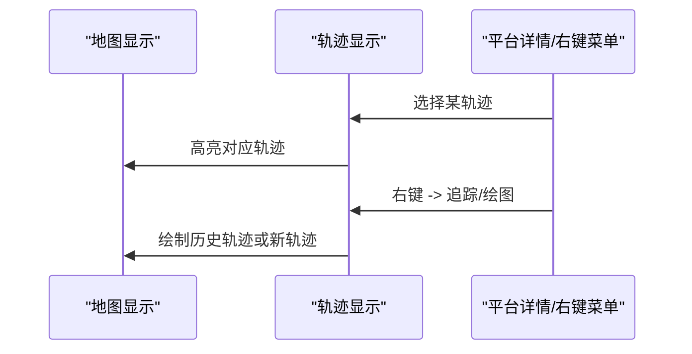
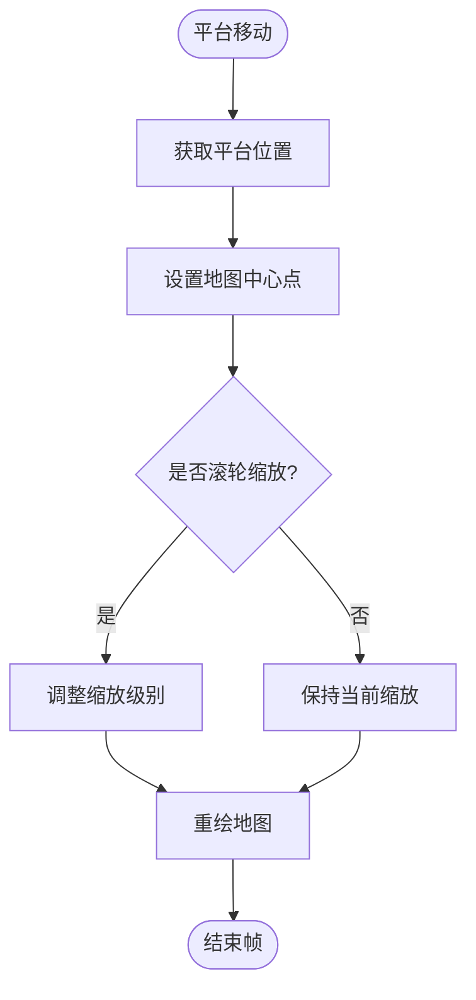
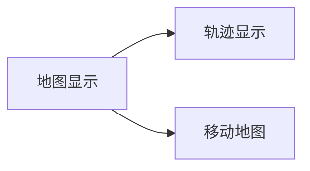

# 地图视图

<cite>
**本文引用的文件**   
- [rv_map_display.rst](file://swdev/src/mystic/plugins/ResultMapDisplay/doc/wkf_plugin/rv_map_display.rst)
- [rv_cursor_info.rst](file://swdev/src/mystic/plugins/ResultMapDisplay/doc/wkf_plugin/rv_cursor_info.rst)
- [rv_map_toolbar.rst](file://swdev/src/mystic/plugins/ResultMapDisplay/doc/wkf_plugin/rv_map_toolbar.rst)
- [rv_tracks.rst](file://swdev/src/mystic/plugins/ResultTracks/doc/wkf_plugin/rv_tracks.rst)
- [rv_head_down_view.rst](file://swdev/src/mystic/plugins/ResultHeadDownView/doc/wkf_plugin/rv_head_down_view.rst)
</cite>

## 目录
1. [简介](#简介)
2. [项目结构](#项目结构)
3. [核心组件](#核心组件)
4. [架构总览](#架构总览)
5. [详细组件分析](#详细组件分析)
6. [依赖关系分析](#依赖关系分析)
7. [性能考虑](#性能考虑)
8. [故障排查指南](#故障排查指南)
9. [结论](#结论)
10. [附录](#附录)

## 简介
本文件面向 Mystic 的“地图视图”能力，围绕地理坐标系统、地形渲染与图层管理、显示配置（缩放级别、投影模式、坐标系）、交互操作（鼠标、键盘、触摸）、标注系统（平台标记、路径显示、区域高亮）以及工具集（测量、定位、导航辅助）进行系统化说明。同时给出性能优化策略与大数据量处理建议，并提供自定义地图图层的开发指引与示例参考。

## 项目结构
Mystic 的地图相关功能以插件形式组织，核心文档位于 ResultMapDisplay 插件的文档目录中；轨迹显示由 ResultTracks 插件提供；移动地图（跟随平台）由 ResultHeadDownView 插件提供。下图展示与地图视图相关的插件与文档位置关系。

图表来源
- [rv_map_display.rst:1-22](file://swdev/src/mystic/plugins/ResultMapDisplay/doc/wkf_plugin/rv_map_display.rst#L1-L22)
- [rv_cursor_info.rst](file://swdev/src/mystic/plugins/ResultMapDisplay/doc/wkf_plugin/rv_cursor_info.rst)
- [rv_map_toolbar.rst](file://swdev/src/mystic/plugins/ResultMapDisplay/doc/wkf_plugin/rv_map_toolbar.rst)
- [rv_tracks.rst:10-41](file://swdev/src/mystic/plugins/ResultTracks/doc/wkf_plugin/rv_tracks.rst#L10-L41)
- [rv_head_down_view.rst:166](file://swdev/src/mystic/plugins/ResultHeadDownView/doc/wkf_plugin/rv_head_down_view.rst#L166)

章节来源
- [rv_map_display.rst:1-22](file://swdev/src/mystic/plugins/ResultMapDisplay/doc/wkf_plugin/rv_map_display.rst#L1-L22)

## 核心组件
- 地图显示（Map Display）：负责底图加载、坐标系统与投影、图层叠加、交互与工具条。
- 轨迹显示（Tracks）：在地图上绘制本地轨迹图标，支持历史追踪与轨迹绘图。
- 移动地图（Moving Map / Head Down View）：基于平台位置的动态地图，支持滚轮缩放。
- 光标信息与工具条：提供光标信息提示与常用地图工具入口。

章节来源
- [rv_map_display.rst:10-22](file://swdev/src/mystic/plugins/ResultMapDisplay/doc/wkf_plugin/rv_map_display.rst#L10-L22)
- [rv_tracks.rst:15-41](file://swdev/src/mystic/plugins/ResultTracks/doc/wkf_plugin/rv_tracks.rst#L15-L41)
- [rv_head_down_view.rst:166](file://swdev/src/mystic/plugins/ResultHeadDownView/doc/wkf_plugin/rv_head_down_view.rst#L166)

## 架构总览
下图展示地图视图在 Mystic 中的整体交互流程：用户通过地图工具条与光标信息进行交互，地图显示负责坐标转换与图层渲染，轨迹模块在地图上绘制轨迹元素，移动地图根据平台位置更新视图。

图表来源
- [rv_map_toolbar.rst](file://swdev/src/mystic/plugins/ResultMapDisplay/doc/wkf_plugin/rv_map_toolbar.rst)
- [rv_cursor_info.rst](file://swdev/src/mystic/plugins/ResultMapDisplay/doc/wkf_plugin/rv_cursor_info.rst)
- [rv_map_display.rst:10-22](file://swdev/src/mystic/plugins/ResultMapDisplay/doc/wkf_plugin/rv_map_display.rst#L10-L22)
- [rv_tracks.rst:15-41](file://swdev/src/mystic/plugins/ResultTracks/doc/wkf_plugin/rv_tracks.rst#L15-L41)
- [rv_head_down_view.rst:166](file://swdev/src/mystic/plugins/ResultHeadDownView/doc/wkf_plugin/rv_head_down_view.rst#L166)

## 详细组件分析

### 地图显示（Map Display）
- 职责
  - 底图与地形数据加载与渲染
  - 坐标系统与投影管理
  - 图层管理与叠加顺序控制
  - 交互事件分发（鼠标、键盘、触摸）
  - 工具条集成与扩展点
- 关键特性
  - 支持缩放级别调节
  - 支持投影模式切换
  - 支持坐标系设置（如经纬度、投影平面坐标）
  - 提供扩展接口用于添加额外功能

图表来源
- [rv_map_display.rst:10-22](file://swdev/src/mystic/plugins/ResultMapDisplay/doc/wkf_plugin/rv_map_display.rst#L10-L22)

章节来源
- [rv_map_display.rst:10-22](file://swdev/src/mystic/plugins/ResultMapDisplay/doc/wkf_plugin/rv_map_display.rst#L10-L22)

### 轨迹显示（Tracks）
- 职责
  - 在地图上显示本地轨迹图标
  - 与平台详情联动，选中轨迹时高亮
  - 支持右键菜单：轨迹追踪（历史）与轨迹绘图
- 典型流程

图表来源
- [rv_tracks.rst:15-41](file://swdev/src/mystic/plugins/ResultTracks/doc/wkf_plugin/rv_tracks.rst#L15-L41)

章节来源
- [rv_tracks.rst:15-41](file://swdev/src/mystic/plugins/ResultTracks/doc/wkf_plugin/rv_tracks.rst#L15-L41)

### 移动地图（Head Down View）
- 职责
  - 基于平台当前位置更新地图中心与视角
  - 支持滚轮缩放
- 行为要点
  - 地图由“导航地图配置文件”决定
  - 滚轮缩放是主要缩放方式

图表来源
- [rv_head_down_view.rst:166](file://swdev/src/mystic/plugins/ResultHeadDownView/doc/wkf_plugin/rv_head_down_view.rst#L166)

章节来源
- [rv_head_down_view.rst:166](file://swdev/src/mystic/plugins/ResultHeadDownView/doc/wkf_plugin/rv_head_down_view.rst#L166)

### 光标信息与工具条
- 光标信息
  - 实时显示光标所在位置的地理坐标、高程等信息
- 工具条
  - 提供常用地图工具入口（如测量、定位、导航辅助等）

章节来源
- [rv_cursor_info.rst](file://swdev/src/mystic/plugins/ResultMapDisplay/doc/wkf_plugin/rv_cursor_info.rst)
- [rv_map_toolbar.rst](file://swdev/src/mystic/plugins/ResultMapDisplay/doc/wkf_plugin/rv_map_toolbar.rst)

## 依赖关系分析
- 地图显示作为基础视图，被轨迹显示与移动地图共同依赖
- 轨迹显示依赖地图显示的渲染与交互能力
- 移动地图依赖平台位置数据与地图显示的中心点/缩放控制

图表来源
- [rv_map_display.rst:10-22](file://swdev/src/mystic/plugins/ResultMapDisplay/doc/wkf_plugin/rv_map_display.rst#L10-L22)
- [rv_tracks.rst:15-41](file://swdev/src/mystic/plugins/ResultTracks/doc/wkf_plugin/rv_tracks.rst#L15-L41)
- [rv_head_down_view.rst:166](file://swdev/src/mystic/plugins/ResultHeadDownView/doc/wkf_plugin/rv_head_down_view.rst#L166)

## 性能考虑
- 数据分层与按需加载
  - 将底图、地形、矢量图层分块加载，仅在视口内渲染
- 渲染优化
  - 使用视锥剔除与距离分级细节（LOD）
  - 批量绘制与合并几何体以减少绘制调用
- 交互优化
  - 对高频事件（鼠标移动、滚轮）做节流与去抖
  - 延迟计算与异步更新轨迹与标注
- 内存管理
  - 及时释放不可见区域的纹理与网格
  - 重用对象池减少分配开销
- 大数据量处理
  - 对海量轨迹/标注采用聚合与抽样显示
  - 使用空间索引加速查询与筛选
  - 增量更新而非全量重绘

[本节为通用性能建议，不直接分析具体文件]

## 故障排查指南
- 地图无法缩放
  - 检查滚动事件是否被拦截
  - 确认缩放级别范围配置是否正确
- 轨迹不显示或闪烁
  - 检查轨迹数据源是否更新
  - 确认图层可见性与渲染优先级
- 光标坐标异常
  - 校验坐标系与投影设置
  - 检查坐标转换链路与单位一致性
- 移动地图不跟随平台
  - 确认平台位置数据流是否连通
  - 检查中心点更新逻辑与帧率限制

[本节为通用排错建议，不直接分析具体文件]

## 结论
Mystic 的地图视图以插件化架构提供地图显示、轨迹显示与移动地图三大核心能力，配合光标信息与工具条形成完整的交互式地图体验。通过合理的坐标系统、投影与图层管理，结合性能优化与大数据处理策略，可满足从战术态势到工程分析的多样化需求。开发者可基于现有扩展点实现自定义地图图层与工具，快速构建专业可视化应用。

[本节为总结性内容，不直接分析具体文件]

## 附录

### 地图显示配置选项（摘要）
- 缩放级别
  - 最小/最大缩放范围
  - 滚轮缩放灵敏度
- 投影模式
  - 经纬度投影
  - 平面投影（如 UTM）
- 坐标系设置
  - 基准面（Datum）
  - 单位（米/英尺/角度）
- 图层管理
  - 图层可见性开关
  - 透明度与混合模式
  - 渲染顺序与优先级

[本节为概念性说明，不直接分析具体文件]

### 地图交互功能（摘要）
- 鼠标操作
  - 左键拖拽平移
  - 滚轮缩放
  - 右键菜单（轨迹追踪/绘图）
- 键盘控制
  - 方向键平移
  - +/- 缩放
  - 快捷键切换工具
- 触摸手势
  - 双指捏合缩放
  - 单指拖拽平移
  - 长按弹出上下文菜单

[本节为概念性说明，不直接分析具体文件]

### 地图标注系统（摘要）
- 平台标记
  - 图标样式与颜色
  - 标签文本与格式化
- 路径显示
  - 轨迹线型与宽度
  - 历史轨迹回放
- 区域高亮
  - 多边形填充与边框
  - 动态闪烁与动画

[本节为概念性说明，不直接分析具体文件]

### 地图工具集（摘要）
- 测量工具
  - 距离测量
  - 面积测量
- 定位工具
  - 坐标拾取
  - 地址反查
- 导航辅助
  - 指向标与比例尺
  - 航向线与等角航线

[本节为概念性说明，不直接分析具体文件]

### 自定义地图图层开发指南（步骤）
- 步骤
  - 继承地图图层基类（参考地图显示扩展点）
  - 实现数据加载与解析
  - 实现坐标转换与投影适配
  - 实现渲染回调（顶点/纹理/着色器）
  - 注册图层到地图显示管理器
  - 提供配置项与可视化参数
- 示例参考
  - 参考 ResultMapDisplay 的扩展文档与接口定义
  - 参考 ResultTracks 的轨迹绘制与交互模式

[本节为概念性说明，不直接分析具体文件]