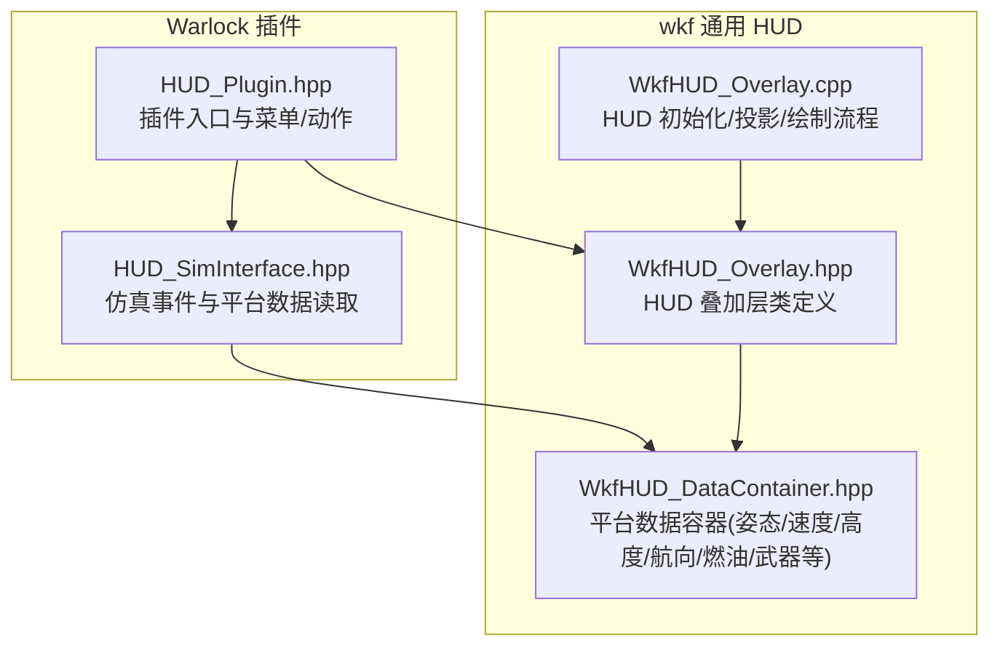
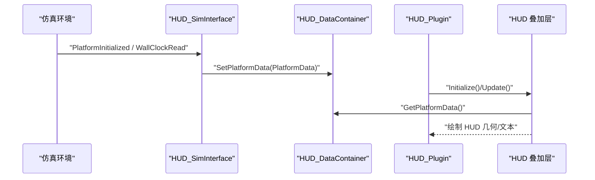
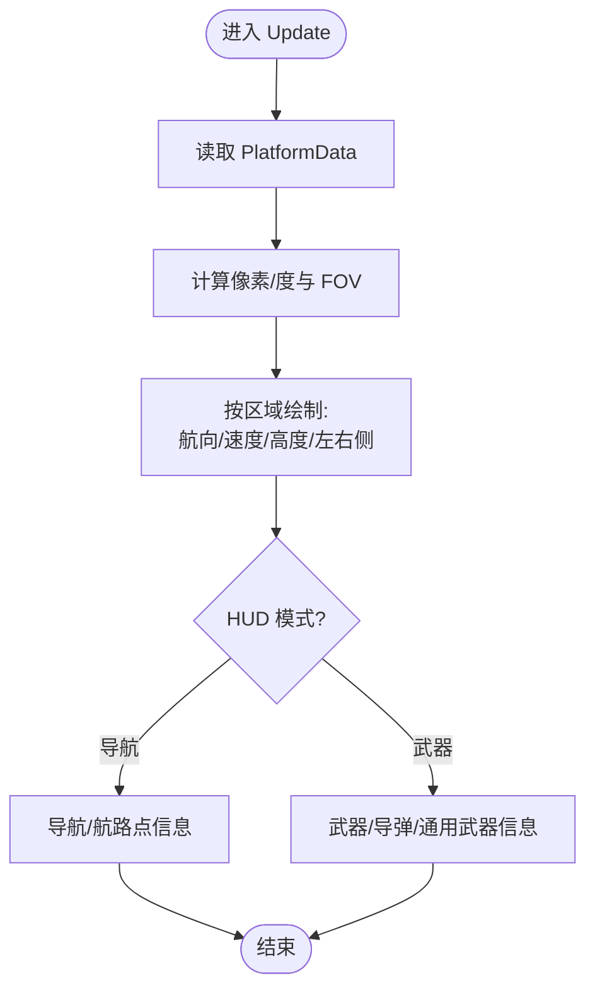
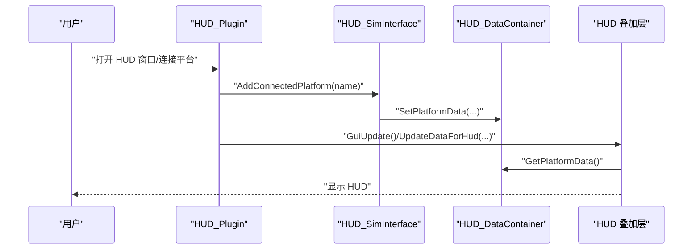
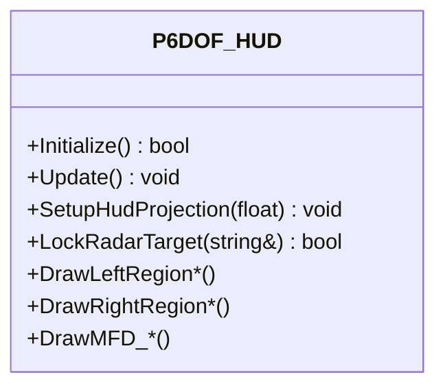
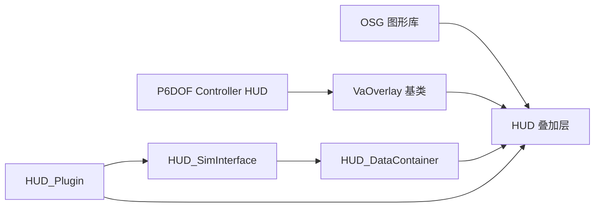

# 抬头显示(HUD)

<cite>
**本文引用的文件**   
- [WkfHUD_Overlay.hpp](file://swdev/src/tools/wkf/air_combat/wkf_air_combat_common/source/hud/WkfHUD_Overlay.hpp)
- [WkfHUD_Overlay.cpp](file://swdev/src/tools/wkf/air_combat/wkf_air_combat_common/source/hud/WkfHUD_Overlay.cpp)
- [WkfHUD_DataContainer.hpp](file://swdev/src/tools/wkf/air_combat/wkf_air_combat_common/source/hud/WkfHUD_DataContainer.hpp)
- [HUD_Plugin.hpp](file://swdev/src/warlock/plugins/HeadUpView/source/HUD_Plugin.hpp)
- [HUD_SimInterface.hpp](file://swdev/src/warlock/plugins/HeadUpView/source/HUD_SimInterface.hpp)
- [P6DOF_ControllerHUD.hpp](file://swdev/src/warlock/plugins/P6DOF_Controller/source/P6DOF_ControllerHUD.hpp)
</cite>

## 目录
1. [简介](#简介)
2. [项目结构](#项目结构)
3. [核心组件](#核心组件)
4. [架构总览](#架构总览)
5. [详细组件分析](#详细组件分析)
6. [依赖关系分析](#依赖关系分析)
7. [性能考虑](#性能考虑)
8. [故障排查指南](#故障排查指南)
9. [结论](#结论)
10. [附录](#附录)

## 简介
本文件为 Mystic 抬头显示（HUD）组件的全面技术文档，聚焦于以下能力：
- 航空仪表显示：姿态指示器、空速表、高度表、航向指示
- 武器瞄准系统：雷达锁定、导弹制导与攻击参数显示
- 飞行状态监控：发动机参数、燃油状态与系统告警
- 战术信息显示：威胁警告、友军位置与任务目标
- HUD 的 3D 叠加功能：虚拟仪表与增强现实元素
- HUD 定制化和主题配置选项
- 飞行员视角仿真与训练模式使用指南

该 HUD 实现基于 Warlock/Mystic 插件体系，通过数据容器与仿真接口在运行时获取平台状态，并在 OSG 渲染管线中绘制 HUD 几何与文本。

## 项目结构
HUD 相关代码主要分布在两个子系统中：
- wkf 通用 HUD 组件：提供 HUD 叠加层、数据容器、UI 停靠窗口与偏好设置
- Warlock 插件：将 HUD 集成到可视化环境中，负责仿真事件处理与平台连接管理

**图表来源**
- [HUD_Plugin.hpp:24-97](file://swdev/src/warlock/plugins/HeadUpView/source/HUD_Plugin.hpp#L24-L97)
- [HUD_SimInterface.hpp:26-91](file://swdev/src/warlock/plugins/HeadUpView/source/HUD_SimInterface.hpp#L26-L91)
- [WkfHUD_Overlay.hpp:32-393](file://swdev/src/tools/wkf/air_combat/wkf_air_combat_common/source/hud/WkfHUD_Overlay.hpp#L32-L393)
- [WkfHUD_DataContainer.hpp:30-179](file://swdev/src/tools/wkf/air_combat/wkf_air_combat_common/source/hud/WkfHUD_DataContainer.hpp#L30-L179)

**章节来源**
- [HUD_Plugin.hpp:24-97](file://swdev/src/warlock/plugins/HeadUpView/source/HUD_Plugin.hpp#L24-L97)
- [HUD_SimInterface.hpp:26-91](file://swdev/src/warlock/plugins/HeadUpView/source/HUD_SimInterface.hpp#L26-L91)
- [WkfHUD_Overlay.hpp:32-393](file://swdev/src/tools/wkf/air_combat/wkf_air_combat_common/source/hud/WkfHUD_Overlay.hpp#L32-L393)
- [WkfHUD_DataContainer.hpp:30-179](file://swdev/src/tools/wkf/air_combat/wkf_air_combat_common/source/hud/WkfHUD_DataContainer.hpp#L30-L179)

## 核心组件
- HUD 叠加层（Overlay）：负责 HUD 的初始化、投影矩阵设置、区域划分与绘制（航向区、速度区、高度区、左右侧信息区、中心圆、滚转指针、速度矢量、俯仰梯等）。
- 数据容器（DataContainer）：集中保存受控平台的仿真数据，包括姿态、速度、高度、航向、燃油、武器与告警标志等。
- Warlock 插件（Plugin/SimInterface）：提供 HUD 窗口创建、平台连接、仿真事件处理与数据更新调度。
- P6DOF Controller HUD：面向六自由度控制器的扩展 HUD，包含更多 MFD 视图与控制模式。

关键职责映射：
- 姿态指示器：通过 DrawPitchLadder、DrawRollPointer、DrawVelocityVector 等方法呈现
- 空速表：DrawSpeedRegion 显示 KCAS/KTAS/Mach
- 高度表：DrawAltitudeRegion 显示 MSL/RADAR 高度与垂直速度
- 航向指示：DrawHeadingRegion 显示航向刻度与航向标记
- 武器瞄准：左侧/右侧区域根据模式切换显示导弹/通用武器/测试等
- 飞行状态监控：燃油、发动机节流、告警标志（Bingo/Shoot/Master Warning/Caution）
- 战术信息：目标框、RWR/IRST/FLIR（MFD 迁移至 HDD）、数据链（注释中保留）
- 3D 叠加：通过 VaOverlay + OSG Geode/Projection/MatrixTransform 将 HUD 几何叠加到世界坐标

**章节来源**
- [WkfHUD_Overlay.hpp:130-239](file://swdev/src/tools/wkf/air_combat/wkf_air_combat_common/source/hud/WkfHUD_Overlay.hpp#L130-L239)
- [WkfHUD_DataContainer.hpp:64-152](file://swdev/src/tools/wkf/air_combat/wkf_air_combat_common/source/hud/WkfHUD_DataContainer.hpp#L64-L152)
- [HUD_Plugin.hpp:33-90](file://swdev/src/warlock/plugins/HeadUpView/source/HUD_Plugin.hpp#L33-L90)
- [P6DOF_ControllerHUD.hpp:124-206](file://swdev/src/warlock/plugins/P6DOF_Controller/source/P6DOF_ControllerHUD.hpp#L124-L206)

## 架构总览
HUD 的数据流从仿真环境经 Warlock 插件的 SimInterface 读取平台状态，填充到 HUD_DataContainer；随后 HUD 叠加层在每帧 Update 时读取数据并绘制 HUD 几何与文本。

**图表来源**
- [HUD_SimInterface.hpp:32-91](file://swdev/src/warlock/plugins/HeadUpView/source/HUD_SimInterface.hpp#L32-L91)
- [HUD_Plugin.hpp:51-90](file://swdev/src/warlock/plugins/HeadUpView/source/HUD_Plugin.hpp#L51-L90)
- [WkfHUD_Overlay.hpp:45-65](file://swdev/src/tools/wkf/air_combat/wkf_air_combat_common/source/hud/WkfHUD_Overlay.hpp#L45-L65)
- [WkfHUD_DataContainer.hpp:157-171](file://swdev/src/tools/wkf/air_combat/wkf_air_combat_common/source/hud/WkfHUD_DataContainer.hpp#L157-L171)

## 详细组件分析

### HUD 叠加层（Overlay）
- 初始化与投影：绑定形状、禁用深度测试、设置透明渲染与最后渲染顺序，计算像素/度比例与正交投影矩阵
- 绘制流程：按区域划分（航向、速度、高度、左右侧），根据 HUD 模式（导航/武器）切换内容
- 3D 叠加：使用 OSG Geode/Projection/MatrixTransform 将 HUD 几何叠加到世界坐标系

**图表来源**
- [WkfHUD_Overlay.cpp:191-200](file://swdev/src/tools/wkf/air_combat/wkf_air_combat_common/source/hud/WkfHUD_Overlay.cpp#L191-L200)
- [WkfHUD_Overlay.hpp:130-239](file://swdev/src/tools/wkf/air_combat/wkf_air_combat_common/source/hud/WkfHUD_Overlay.hpp#L130-L239)

**章节来源**
- [WkfHUD_Overlay.cpp:91-161](file://swdev/src/tools/wkf/air_combat/wkf_air_combat_common/source/hud/WkfHUD_Overlay.cpp#L91-L161)
- [WkfHUD_Overlay.cpp:163-189](file://swdev/src/tools/wkf/air_combat/wkf_air_combat_common/source/hud/WkfHUD_Overlay.cpp#L163-L189)
- [WkfHUD_Overlay.hpp:45-65](file://swdev/src/tools/wkf/air_combat/wkf_air_combat_common/source/hud/WkfHUD_Overlay.hpp#L45-L65)

### 数据容器（DataContainer）
- 平台数据字段涵盖：
  - 姿态与运动：lat/lon、KCAS/KTAS/Mach、MSL/RADAR 高度、垂直速度、alpha/beta、G 载荷、heading/pitch/roll、GX/GY
  - 控制输入：减速板、油门、推力归一化、军用/加力节流位置
  - 导航/航路点：航路点数量/列表、当前航路点、航向偏差、距离/时间到航路点
  - 燃油：内/外油箱油量、容量、总油量、毛重、Joker/Bingo 阈值、耗油率、有效性标志
  - 武器与对抗措施：选择武器、已交战目标数据、弹舱门开闭、支援武器、主警告/主注意、射击提示、干扰检测、箔条/热诱饵/诱饵计数
- 线程安全通信：通过 SimEvents 与信号槽机制更新

```mermaid
classDiagram
class HUD_DataContainer {
+bool GetSimulationInitialized()
+void SetSimulationInitialized(bool)
+const map<string, PlatformData>& GetPlatformData()
+void SetPlatformData(map<string, PlatformData>)
+signal Update_DataContainer()
}
class PlatformData {
+double simTime
+double lat_deg
+double lon_deg
+double kcas
+double ktas
+double mach
+double altitudeMSL_ft
+double radarAltitude_ft
+double verticalSpeed_fpm
+double alpha_deg
+double beta_deg
+double gLoad
+double gAvail
+double heading_deg
+double pitch_deg
+double roll_deg
+double gX
+double gY
+string pilotType
+bool afterburnerOn
+bool contrailing
+bool stallWarning
+bool alphaValid
+bool betaValid
+bool kcasValid
+bool nxValid
+bool nyValid
+bool nzValid
+bool gAvailValid
+double speedBrakeInput
+double speedBrakeNormalized
+double throttleInput
+double thrustNormalized
+bool throttleValid
+double engineThrottleNormalizedMilitary
+double engineThrottleNormalizedAfterburner
+double throttleMilitaryControllerPosition
+double throttleAfterburnerControllerPosition
+size_t numWaypoints
+vector<HudWaypointData> waypoints
+size_t currentWaypoint
+double headingBug_deg
+double distanceToWaypoint_nm
+double timeToWaypoint_sec
+bool wayptDataValid
+double currentInternalFuelQuantity_lbs
+double currentExternalFuelQuantity_lbs
+double currentTotalFuelQuantity_lbs
+double internalFuelCapacity_lbs
+double externalFuelCapacity_lbs
+double totalFuelCapacity_lbs
+double grossWeight_lbs
+double joker_lbs
+double bingo_lbs
+bool bingoFlagActive
+double fuelFlow_pph
+bool fuelValid
+string selectedWeapon
+int numSelectedWeapon
+bool selectedWeaponValid
+HudEngagedTargetData engagedTargetData
+bool engagedTargetValid
+bool weaponBayDoorsOpen
+bool supportingWeapon
+bool masterWarning
+bool masterCaution
+bool shootCueActive
+bool shootCueBlink
+bool masterArmActive
+bool jammingDetected
+int numChaff
+int numFlares
+int numDecoys
}
HUD_DataContainer --> PlatformData : "map<string, PlatformData>"
```

**图表来源**
- [WkfHUD_DataContainer.hpp:30-179](file://swdev/src/tools/wkf/air_combat/wkf_air_combat_common/source/hud/WkfHUD_DataContainer.hpp#L30-L179)

**章节来源**
- [WkfHUD_DataContainer.hpp:35-152](file://swdev/src/tools/wkf/air_combat/wkf_air_combat_common/source/hud/WkfHUD_DataContainer.hpp#L35-L152)

### Warlock 插件（Plugin/SimInterface）
- Plugin：提供上下文菜单动作以打开 HUD 窗口、连接平台、切换 HUD 模式、第一人称/第三人称视角、GUI 更新与偏好设置
- SimInterface：监听仿真生命周期事件（初始化、删除平台、墙钟事件），读取平台数据并写入 DataContainer，维护连接状态与态势感知处理器存在性

**图表来源**
- [HUD_Plugin.hpp:33-90](file://swdev/src/warlock/plugins/HeadUpView/source/HUD_Plugin.hpp#L33-L90)
- [HUD_SimInterface.hpp:32-91](file://swdev/src/warlock/plugins/HeadUpView/source/HUD_SimInterface.hpp#L32-L91)

**章节来源**
- [HUD_Plugin.hpp:33-90](file://swdev/src/warlock/plugins/HeadUpView/source/HUD_Plugin.hpp#L33-L90)
- [HUD_SimInterface.hpp:32-91](file://swdev/src/warlock/plugins/HeadUpView/source/HUD_SimInterface.hpp#L32-L91)

### P6DOF Controller HUD（扩展）
- 提供针对六自由度控制器的 HUD 视图，包括更多 MFD 模式（雷达、RWR、IRST、FLIR、数据链、武器、燃油、发动机）与控制/测试页面
- 支持雷达目标锁定交互（LockRadarTarget）

**图表来源**
- [P6DOF_ControllerHUD.hpp:29-305](file://swdev/src/warlock/plugins/P6DOF_Controller/source/P6DOF_ControllerHUD.hpp#L29-L305)

**章节来源**
- [P6DOF_ControllerHUD.hpp:29-305](file://swdev/src/warlock/plugins/P6DOF_Controller/source/P6DOF_ControllerHUD.hpp#L29-L305)

## 依赖关系分析
- HUD 叠加层依赖 OSG 图形库进行几何与文本绘制，并通过 VaOverlay 基类接入可视化框架
- HUD 叠加层依赖 HUD_DataContainer 提供的平台数据
- Warlock 插件依赖 SimInterface 与 HUD_DataContainer，协调 GUI 更新与数据同步
- P6DOF Controller HUD 复用 VaOverlay 与 UtoRawShape，扩展了更多 MFD 与控制模式

**图表来源**
- [WkfHUD_Overlay.hpp:17-28](file://swdev/src/tools/wkf/air_combat/wkf_air_combat_common/source/hud/WkfHUD_Overlay.hpp#L17-L28)
- [HUD_Plugin.hpp:14-20](file://swdev/src/warlock/plugins/HeadUpView/source/HUD_Plugin.hpp#L14-L20)
- [HUD_SimInterface.hpp:19-26](file://swdev/src/warlock/plugins/HeadUpView/source/HUD_SimInterface.hpp#L19-L26)
- [P6DOF_ControllerHUD.hpp:14-25](file://swdev/src/warlock/plugins/P6DOF_Controller/source/P6DOF_ControllerHUD.hpp#L14-L25)

**章节来源**
- [WkfHUD_Overlay.hpp:17-28](file://swdev/src/tools/wkf/air_combat/wkf_air_combat_common/source/hud/WkfHUD_Overlay.hpp#L17-L28)
- [HUD_Plugin.hpp:14-20](file://swdev/src/warlock/plugins/HeadUpView/source/HUD_Plugin.hpp#L14-L20)
- [HUD_SimInterface.hpp:19-26](file://swdev/src/warlock/plugins/HeadUpView/source/HUD_SimInterface.hpp#L19-L26)
- [P6DOF_ControllerHUD.hpp:14-25](file://swdev/src/warlock/plugins/P6DOF_Controller/source/P6DOF_ControllerHUD.hpp#L14-L25)

## 性能考虑
- HUD 几何绘制采用禁用深度测试与透明渲染，确保 HUD 始终在最上层显示，避免被场景遮挡
- 使用正交投影与像素/度换算，保证在不同分辨率下 HUD 布局一致
- 通过分区域绘制减少不必要的几何重建，提升每帧更新效率
- 建议在大规模场景或高刷新率下，按需关闭非关键区域的绘制以降低开销

[本节为一般性指导，不直接分析具体文件]

## 故障排查指南
- HUD 无法绑定形状：检查 Initialize 中的 BindShape 返回值与日志输出
- HUD 投影异常：确认 SetupHudProjection 的 FOV 与视口尺寸计算正确
- 数据未更新：验证 SimInterface 的 WallClockRead 是否触发，以及 DataContainer 的 SetPlatformData 是否被调用
- 连接丢失：检查 IsConnectionDestroyed 与 HUD 的连接销毁标志，必要时重连平台

**章节来源**
- [WkfHUD_Overlay.cpp:91-109](file://swdev/src/tools/wkf/air_combat/wkf_air_combat_common/source/hud/WkfHUD_Overlay.cpp#L91-L109)
- [HUD_SimInterface.hpp:48-51](file://swdev/src/warlock/plugins/HeadUpView/source/HUD_SimInterface.hpp#L48-L51)

## 结论
Mystic HUD 组件通过 Warlock 插件与 wkf 通用 HUD 模块协同工作，实现了完整的航空仪表显示、武器瞄准、飞行状态监控与战术信息显示能力。其 3D 叠加功能借助 OSG 与 VaOverlay 提供了灵活的增强现实体验。结合数据容器的结构化平台数据与插件的事件驱动架构，HUD 能够在复杂仿真环境中稳定运行并提供实时反馈。

[本节为总结性内容，不直接分析具体文件]

## 附录

### 航空仪表显示要点
- 姿态指示器：俯仰梯、滚转指针、速度矢量
- 空速表：KCAS/KTAS/Mach 显示
- 高度表：MSL/RADAR 高度与垂直速度
- 航向指示：航向刻度与航向标记

**章节来源**
- [WkfHUD_Overlay.hpp:143-205](file://swdev/src/tools/wkf/air_combat/wkf_air_combat_common/source/hud/WkfHUD_Overlay.hpp#L143-L205)

### 武器瞄准系统要点
- 雷达锁定：LockRadarTarget（P6DOF Controller HUD）
- 导弹制导：左侧/右侧区域在武器模式下显示导弹相关参数
- 攻击参数：目标范围、接近速率、拦截时间、目标方位/俯仰角

**章节来源**
- [P6DOF_ControllerHUD.hpp:63-71](file://swdev/src/warlock/plugins/P6DOF_Controller/source/P6DOF_ControllerHUD.hpp#L63-L71)
- [WkfHUD_DataContainer.hpp:41-55](file://swdev/src/tools/wkf/air_combat/wkf_air_combat_common/source/hud/WkfHUD_DataContainer.hpp#L41-L55)

### 飞行状态监控要点
- 发动机参数：油门输入、推力归一化、军用/加力节流位置
- 燃油状态：内/外油箱油量、容量、总油量、耗油率、Joker/Bingo 阈值
- 系统告警：主警告/主注意、射击提示、干扰检测、箔条/热诱饵/诱饵计数

**章节来源**
- [WkfHUD_DataContainer.hpp:100-152](file://swdev/src/tools/wkf/air_combat/wkf_air_combat_common/source/hud/WkfHUD_DataContainer.hpp#L100-L152)

### 战术信息显示要点
- 威胁警告：RWR/IRST/FLIR（MFD 迁移至 HDD）
- 友军位置：数据链（MFD 迁移至 HDD）
- 任务目标：目标框与目标跟踪信息

**章节来源**
- [WkfHUD_Overlay.hpp:252-278](file://swdev/src/tools/wkf/air_combat/wkf_air_combat_common/source/hud/WkfHUD_Overlay.hpp#L252-L278)

### HUD 定制化与主题配置
- HUD 颜色与透明度：SetHudColors 可调整红绿蓝与 Alpha
- 字体与线宽缩放：mFontSizeMult、mLineWidthMult
- 调试模式：debugFlagHUD 用于调试区域绘制

**章节来源**
- [WkfHUD_Overlay.hpp:280-375](file://swdev/src/tools/wkf/air_combat/wkf_air_combat_common/source/hud/WkfHUD_Overlay.hpp#L280-L375)

### 飞行员视角仿真与训练模式
- 第一人称/第三人称视角：FirstPerson 方法
- HUD 模式切换：CycleHUDMode 在导航与武器模式间切换
- 训练模式：通过 P6DOF Controller HUD 的控制/测试页面进行训练

**章节来源**
- [HUD_Plugin.hpp:58-64](file://swdev/src/warlock/plugins/HeadUpView/source/HUD_Plugin.hpp#L58-L64)
- [P6DOF_ControllerHUD.hpp:136-156](file://swdev/src/warlock/plugins/P6DOF_Controller/source/P6DOF_ControllerHUD.hpp#L136-L156)