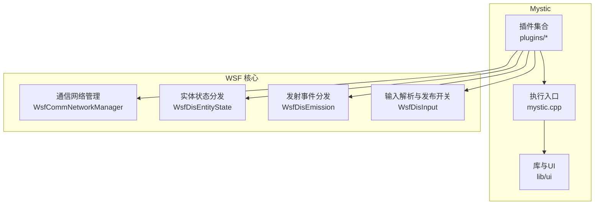
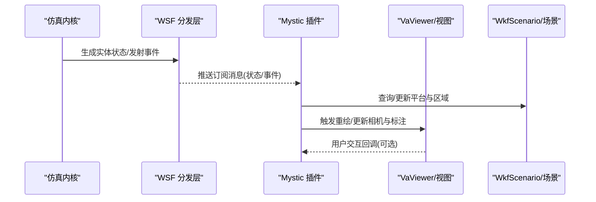
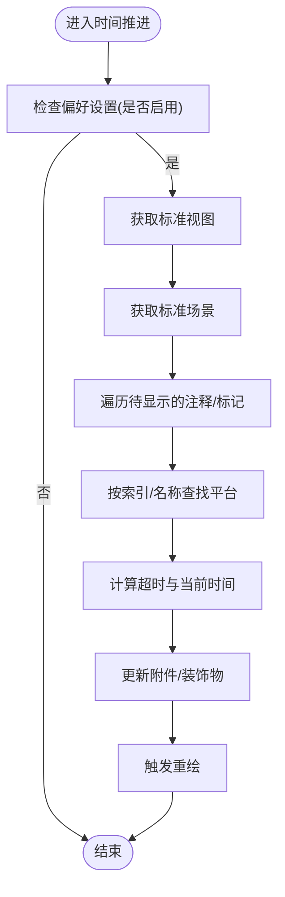
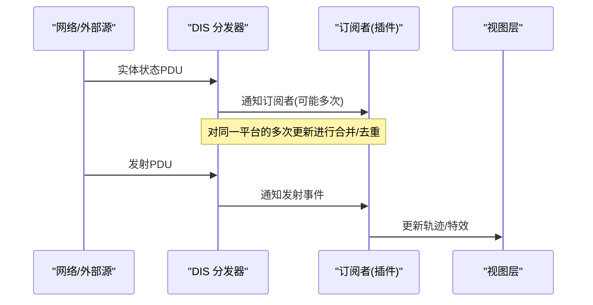
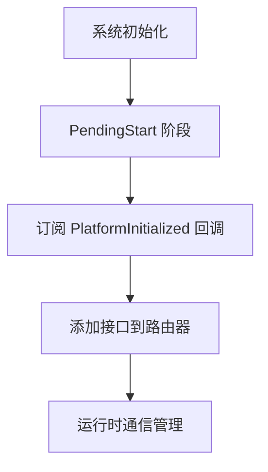
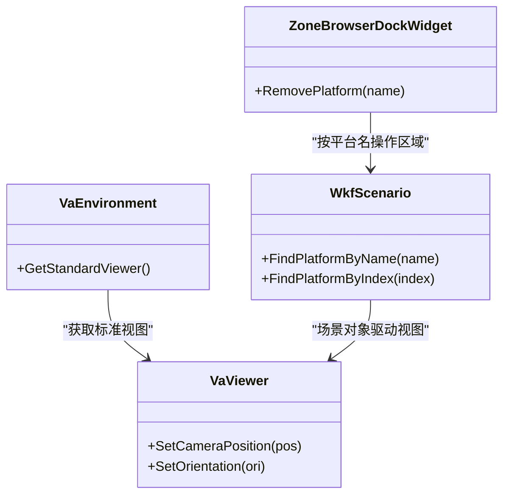
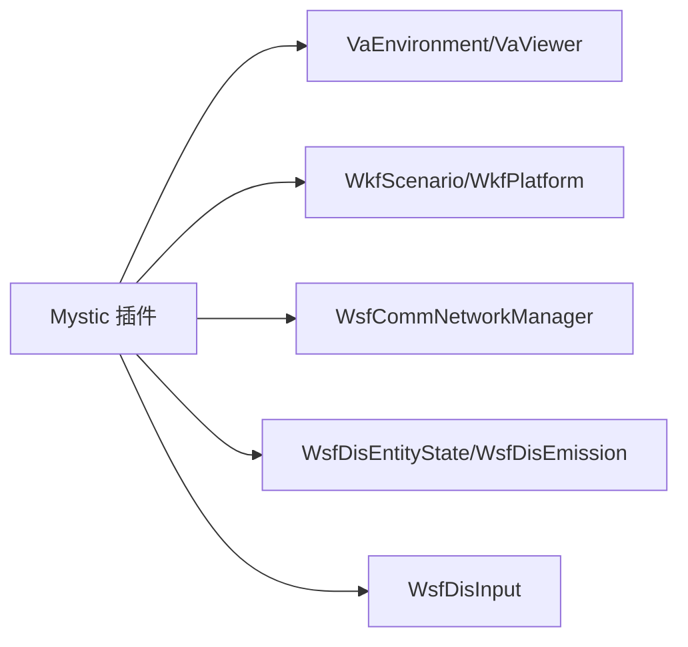

# 视图同步机制

<cite>
**本文引用的文件**   
- [README.md](file://swdev/src/mystic/README.md)
- [RvCommentPlugin.cpp](file://swdev/src/mystic/plugins/ResultComment/source/RvCommentPlugin.cpp)
- [MysticPluginZoneDockWidget.cpp](file://swdev/src/mystic/plugins/ResultZones/source/MysticPluginZoneDockWidget.cpp)
- [WsfCommNetworkManager.cpp](file://swdev/src/core/wsf/source/comm/WsfCommNetworkManager.cpp)
- [WsfDisEntityState.cpp](file://swdev/src/core/wsf/source/dis/WsfDisEntityState.cpp)
- [WsfDisEmission.cpp](file://swdev/src/core/wsf/source/dis/WsfDisEmission.cpp)
- [WsfDisInput.cpp](file://swdev/src/core/wsf/source/dis/WsfDisInput.cpp)
</cite>

## 目录
1. [简介](#简介)
2. [项目结构](#项目结构)
3. [核心组件](#核心组件)
4. [架构总览](#架构总览)
5. [详细组件分析](#详细组件分析)
6. [依赖关系分析](#依赖关系分析)
7. [性能考虑](#性能考虑)
8. [故障排查指南](#故障排查指南)
9. [结论](#结论)
10. [附录](#附录)

## 简介
本技术文档聚焦于 Mystic 视图同步机制，围绕多视图间的数据同步算法与实现进行系统化说明。内容涵盖时间同步、状态同步、事件传播、发布订阅模式、事件总线与数据共享层、增量更新与批量处理、异步传输、视图状态管理（相机位置同步、视角对齐、坐标系转换）、冲突解决策略（优先级、版本控制、回滚），以及调试与性能监控方法，并提供自定义同步逻辑的实现指南与最佳实践。

## 项目结构
Mystic 模块由执行入口、库与 UI、插件生态组成；其中插件体系承载了具体视图能力与同步行为。核心代码位于 swdev/src/mystic 及其 plugins 子目录，底层通信与仿真框架在 core/wsf 中提供。

图表来源
- [README.md:1-35](file://swdev/src/mystic/README.md#L1-L35)
- [WsfCommNetworkManager.cpp:61-185](file://swdev/src/core/wsf/source/comm/WsfCommNetworkManager.cpp#L61-L185)
- [WsfDisEntityState.cpp:124-141](file://swdev/src/core/wsf/source/dis/WsfDisEntityState.cpp#L124-L141)
- [WsfDisEmission.cpp:84-84](file://swdev/src/core/wsf/source/dis/WsfDisEmission.cpp#L84-L84)
- [WsfDisInput.cpp:574-617](file://swdev/src/core/wsf/source/dis/WsfDisInput.cpp#L574-L617)

章节来源
- [README.md:1-35](file://swdev/src/mystic/README.md#L1-L35)

## 核心组件
- 视图与场景访问：插件通过 VaEnvironment 获取标准视图，通过 WkfScenario 访问平台、区域等场景对象，用于读取/更新可视化状态。
- 结果数据与平台数据：插件从 RvResultData/RvResultPlatform 等接口消费仿真结果，驱动视图渲染与交互。
- 事件与回调：插件在时间推进时触发重绘或状态刷新，例如 AdvanceTimeRead 回调中调用 Redraw。
- 通信与分发：WSF 的通信网络管理与 DIS 分发器为跨进程/跨节点的状态与事件同步提供基础能力。

章节来源
- [RvCommentPlugin.cpp:98-129](file://swdev/src/mystic/plugins/ResultComment/source/RvCommentPlugin.cpp#L98-L129)
- [MysticPluginZoneDockWidget.cpp:28-39](file://swdev/src/mystic/plugins/ResultZones/source/MysticPluginZoneDockWidget.cpp#L28-L39)

## 架构总览
下图展示了“仿真内核 → WSF 分发 → Mystic 插件 → 视图渲染”的整体数据流，以及发布订阅与事件总线在其中的作用。

图表来源
- [WsfDisEntityState.cpp:124-141](file://swdev/src/core/wsf/source/dis/WsfDisEntityState.cpp#L124-L141)
- [WsfDisEmission.cpp:84-84](file://swdev/src/core/wsf/source/dis/WsfDisEmission.cpp#L84-L84)
- [RvCommentPlugin.cpp:98-129](file://swdev/src/mystic/plugins/ResultComment/source/RvCommentPlugin.cpp#L98-L129)

## 详细组件分析

### 时间同步与视图刷新
- 时间推进回调：插件在 AdvanceTimeRead 中根据当前仿真时间进行重绘或状态更新，确保视图与仿真时钟一致。
- 视图访问：通过 VaEnvironment 获取标准视图，结合 WkfScenario 定位目标平台并更新其关联的装饰物或标注。
- 典型流程：时间步进 → 条件判断（偏好设置/可见性）→ 遍历注释/标记 → 查找平台 → 计算超时/显示逻辑 → 触发重绘。

图表来源
- [RvCommentPlugin.cpp:98-129](file://swdev/src/mystic/plugins/ResultComment/source/RvCommentPlugin.cpp#L98-L129)

章节来源
- [RvCommentPlugin.cpp:98-129](file://swdev/src/mystic/plugins/ResultComment/source/RvCommentPlugin.cpp#L98-L129)

### 状态同步与事件传播
- 实体状态分发：DIS 实体状态处理器在收到 PDU 后通知订阅者，可能因多订阅者导致同一平台多次更新，内部以平台为单位进行合并/去重以避免重复开销。
- 发射事件分发：当接收到发射类 PDU 时，通知订阅者，供视图层展示轨迹、爆炸效果等。
- 输入解析与发布开关：DIS 输入解析支持将特定字段（如 x/y/z 及速率、方位角等）标记为可发布，从而控制哪些属性参与同步。

图表来源
- [WsfDisEntityState.cpp:124-141](file://swdev/src/core/wsf/source/dis/WsfDisEntityState.cpp#L124-L141)
- [WsfDisEmission.cpp:84-84](file://swdev/src/core/wsf/source/dis/WsfDisEmission.cpp#L84-L84)
- [WsfDisInput.cpp:574-617](file://swdev/src/core/wsf/source/dis/WsfDisInput.cpp#L574-L617)

章节来源
- [WsfDisEntityState.cpp:124-141](file://swdev/src/core/wsf/source/dis/WsfDisEntityState.cpp#L124-L141)
- [WsfDisEmission.cpp:84-84](file://swdev/src/core/wsf/source/dis/WsfDisEmission.cpp#L84-L84)
- [WsfDisInput.cpp:574-617](file://swdev/src/core/wsf/source/dis/WsfDisInput.cpp#L574-L617)

### 发布订阅模式与事件总线
- 订阅时机：通信网络管理器在 PendingStart 之后才订阅 PlatformInitialized 回调，避免过早订阅导致的重复初始化。
- 路由与接口：在需要时将接口加入路由器，保证消息正确转发到目标订阅者。
- 运行时管理：在合适阶段订阅平台初始化回调，以支持运行时的通信管理。

图表来源
- [WsfCommNetworkManager.cpp:61-185](file://swdev/src/core/wsf/source/comm/WsfCommNetworkManager.cpp#L61-L185)
- [WsfCommNetworkManager.cpp:373-373](file://swdev/src/core/wsf/source/comm/WsfCommNetworkManager.cpp#L373-L373)

章节来源
- [WsfCommNetworkManager.cpp:61-185](file://swdev/src/core/wsf/source/comm/WsfCommNetworkManager.cpp#L61-L185)
- [WsfCommNetworkManager.cpp:373-373](file://swdev/src/core/wsf/source/comm/WsfCommNetworkManager.cpp#L373-L373)

### 数据共享层与视图状态管理
- 场景对象访问：插件通过 WkfScenario 查找平台、区域等对象，用于更新视图中的标注、轨迹、区域覆盖等。
- 区域数据更新：在移除平台时，遍历区域数据容器，匹配平台名并清理相关区域，保持视图与场景一致性。
- 相机与视角：通过 VaViewer 获取标准视图，可在插件中调整相机位置、视角对齐与坐标系转换，以实现多视图间的统一观察点。

图表来源
- [RvCommentPlugin.cpp:108-129](file://swdev/src/mystic/plugins/ResultComment/source/RvCommentPlugin.cpp#L108-L129)
- [MysticPluginZoneDockWidget.cpp:28-39](file://swdev/src/mystic/plugins/ResultZones/source/MysticPluginZoneDockWidget.cpp#L28-L39)

章节来源
- [RvCommentPlugin.cpp:108-129](file://swdev/src/mystic/plugins/ResultComment/source/RvCommentPlugin.cpp#L108-L129)
- [MysticPluginZoneDockWidget.cpp:28-39](file://swdev/src/mystic/plugins/ResultZones/source/MysticPluginZoneDockWidget.cpp#L28-L39)

### 冲突解决策略
- 优先级处理：在多个订阅者同时更新同一平台状态时，WSF 内部对实体状态更新进行合并，减少重复与抖动。
- 版本控制：DIS 输入解析支持选择性发布字段，便于在冲突场景中仅同步必要属性，降低版本不一致风险。
- 回滚机制：建议在插件侧维护本地快照与版本号，当检测到远端更新落后或异常时，回滚至上一稳定状态并重试拉取。

章节来源
- [WsfDisEntityState.cpp:124-141](file://swdev/src/core/wsf/source/dis/WsfDisEntityState.cpp#L124-L141)
- [WsfDisInput.cpp:574-617](file://swdev/src/core/wsf/source/dis/WsfDisInput.cpp#L574-L617)

## 依赖关系分析
Mystic 插件依赖 WSF 提供的通信与分发能力，并通过 Va/WKF 环境访问视图与场景对象。关键依赖如下：

图表来源
- [RvCommentPlugin.cpp:98-129](file://swdev/src/mystic/plugins/ResultComment/source/RvCommentPlugin.cpp#L98-L129)
- [WsfCommNetworkManager.cpp:61-185](file://swdev/src/core/wsf/source/comm/WsfCommNetworkManager.cpp#L61-L185)
- [WsfDisEntityState.cpp:124-141](file://swdev/src/core/wsf/source/dis/WsfDisEntityState.cpp#L124-L141)
- [WsfDisEmission.cpp:84-84](file://swdev/src/core/wsf/source/dis/WsfDisEmission.cpp#L84-L84)
- [WsfDisInput.cpp:574-617](file://swdev/src/core/wsf/source/dis/WsfDisInput.cpp#L574-L617)

章节来源
- [RvCommentPlugin.cpp:98-129](file://swdev/src/mystic/plugins/ResultComment/source/RvCommentPlugin.cpp#L98-L129)
- [WsfCommNetworkManager.cpp:61-185](file://swdev/src/core/wsf/source/comm/WsfCommNetworkManager.cpp#L61-L185)
- [WsfDisEntityState.cpp:124-141](file://swdev/src/core/wsf/source/dis/WsfDisEntityState.cpp#L124-L141)
- [WsfDisEmission.cpp:84-84](file://swdev/src/core/wsf/source/dis/WsfDisEmission.cpp#L84-L84)
- [WsfDisInput.cpp:574-617](file://swdev/src/core/wsf/source/dis/WsfDisInput.cpp#L574-L617)

## 性能考虑
- 增量更新：仅在必要时更新变化字段，避免全量刷新；利用 DIS 输入解析的选择性发布能力，缩小同步范围。
- 批量处理：对短时间内的大量状态变更进行批量化合并，减少视图重绘次数。
- 异步传输：在网络受限环境下采用异步队列与背压控制，避免阻塞主循环；在插件侧使用非阻塞回调更新 UI。
- 缓存与去抖：对频繁变化的属性（如位置、姿态）做时间窗口去抖与插值平滑，降低渲染压力。

[本节为通用指导，不直接分析具体文件]

## 故障排查指南
- 视图未刷新：检查时间推进回调是否被调用，确认偏好设置与可见性条件是否满足。
- 重复更新抖动：查看 DIS 实体状态分发逻辑，确认订阅者数量与合并去重机制是否生效。
- 属性不同步：核对 DIS 输入解析的发布开关，确认所需字段已启用发布。
- 区域数据不一致：检查区域浏览器在平台移除时的清理逻辑，确保按平台名匹配并删除对应区域。

章节来源
- [RvCommentPlugin.cpp:98-129](file://swdev/src/mystic/plugins/ResultComment/source/RvCommentPlugin.cpp#L98-L129)
- [WsfDisEntityState.cpp:124-141](file://swdev/src/core/wsf/source/dis/WsfDisEntityState.cpp#L124-L141)
- [WsfDisInput.cpp:574-617](file://swdev/src/core/wsf/source/dis/WsfDisInput.cpp#L574-L617)
- [MysticPluginZoneDockWidget.cpp:28-39](file://swdev/src/mystic/plugins/ResultZones/source/MysticPluginZoneDockWidget.cpp#L28-L39)

## 结论
Mystic 的视图同步机制建立在 WSF 的通信与分发能力之上，通过插件化的方式实现对多视图的时间同步、状态同步与事件传播。借助发布订阅模式与事件总线，系统能够在复杂场景下保持视图与仿真的一致性。通过增量更新、批量处理与异步传输等手段，可有效提升同步性能与用户体验。在冲突处理方面，WSF 提供了基础的合并与去重能力，插件侧可进一步引入版本控制与回滚机制以增强鲁棒性。

[本节为总结性内容，不直接分析具体文件]

## 附录
- 自定义同步逻辑实现指南
  - 在插件中订阅 WSF 的事件与状态回调，按需过滤与聚合数据。
  - 使用 VaViewer 与 WkfScenario 进行视图与场景对象的读写，确保坐标系统与视角对齐。
  - 在时间推进回调中进行增量更新与去抖，避免频繁重绘。
  - 针对网络延迟与丢包，实现重试与回滚策略，并在日志中记录关键状态变化。
  - 使用 DIS 输入解析的选择性发布功能，精确控制同步字段，降低带宽与 CPU 占用。

[本节为通用指导，不直接分析具体文件]