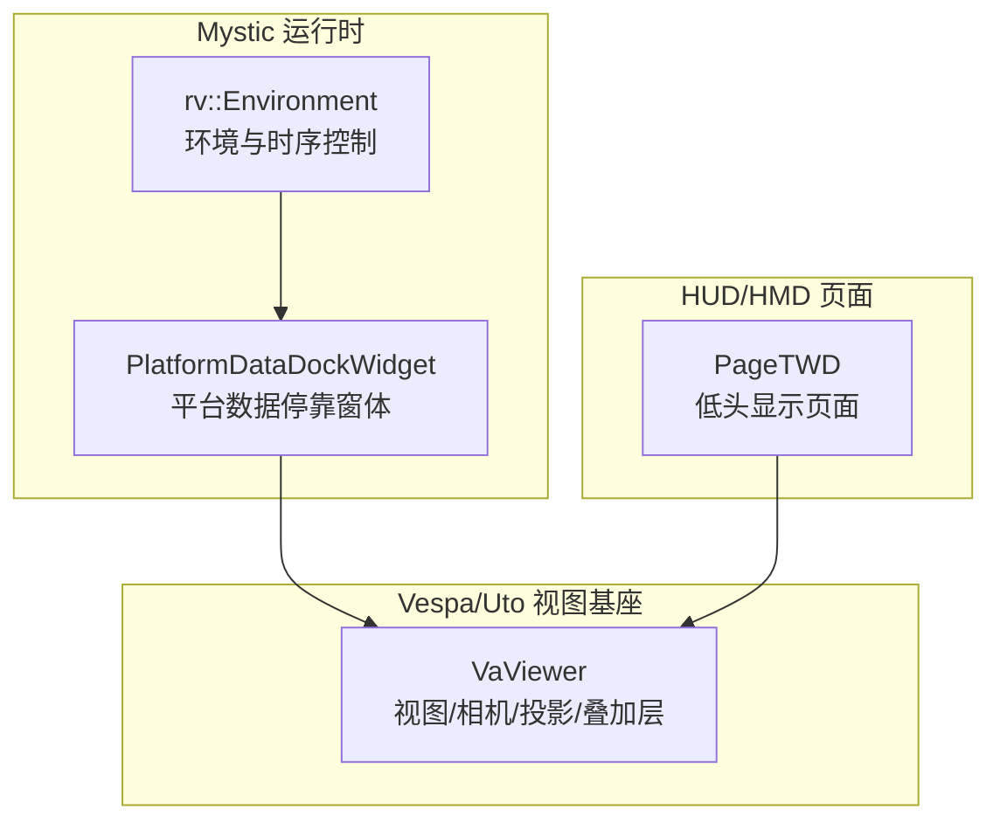
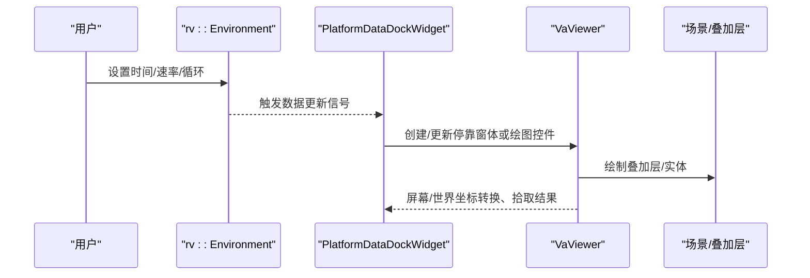
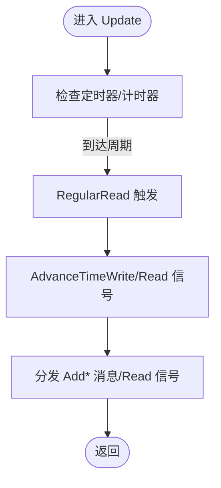
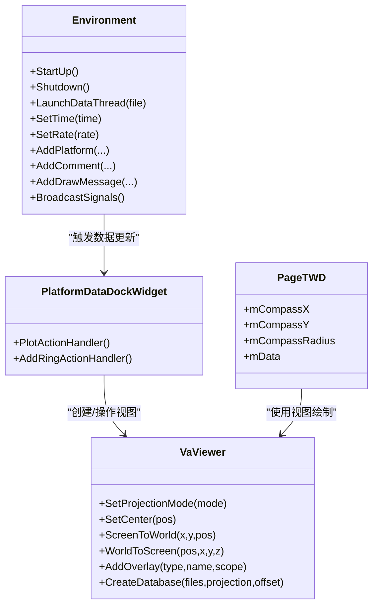

# 视图管理系统

<cite>
**本文引用的文件**   
- [RvEnvironment.hpp](file://swdev/src/mystic/lib/source/RvEnvironment.hpp)
- [VaViewer.hpp](file://swdev/src/tools/vespatk/source/VaViewer.hpp)
- [RvPlatformDataDockWidget.cpp](file://swdev/src/mystic/lib/source/RvPlatformDataDockWidget.cpp)
- [wkfHDD_PageTWD.hpp](file://swdev/src/tools/wkf/air_combat/wkf_air_combat_common/source/hdd/WkfHDD_PageTWD.hpp)
- [README.md](file://swdev/src/mystic/README.md)
</cite>

## 目录
1. [简介](#简介)
2. [项目结构](#项目结构)
3. [核心组件](#核心组件)
4. [架构总览](#架构总览)
5. [详细组件分析](#详细组件分析)
6. [依赖关系分析](#依赖关系分析)
7. [性能考虑](#性能考虑)
8. [故障排查指南](#故障排查指南)
9. [结论](#结论)
10. [附录](#附录)

## 简介
本文件面向 Mystic 视图管理系统的多视图架构与实现，围绕以下目标展开：
- 多视图容器、布局管理与视图间通信机制
- 典型视图类型：地图视图、抬头显示(HUD)、低头显示(HMD)、战术视图
- 视图状态管理：相机控制、投影变换、坐标系转换
- 视图同步机制：时间同步、数据更新、事件传播
- 视图定制功能：图层控制、标注系统、测量工具
- 插件开发与自定义视图类型的实现方法

Mystic 作为可视化与结果回放平台，通过环境管理器协调数据线程、播放控制与事件分发；底层渲染由 Vespa/Uto 提供的 VaViewer 体系承载，支持多种投影模式与叠加层。HUD/HMD 等专用视图以插件形式扩展，复用统一的场景图、相机与坐标转换能力。

## 项目结构
Mystic 的视图相关代码主要分布在以下位置：
- mystic/lib：Mystic 运行时环境与通用 UI 组件（如平台数据停靠窗体）
- tools/vespatk：Vespa 可视化工具包，提供 VaViewer 等基础视图抽象
- tools/wkf：任务框架相关组件，包含 HUD/HMD 页面类
- plugins：各类结果可视化插件（地图、HUD、HMD、战术态势等）

图表来源
- [RvEnvironment.hpp:59-167](file://swdev/src/mystic/lib/source/RvEnvironment.hpp#L59-L167)
- [RvPlatformDataDockWidget.cpp:43-107](file://swdev/src/mystic/lib/source/RvPlatformDataDockWidget.cpp#L43-L107)
- [VaViewer.hpp:62-210](file://swdev/src/tools/vespatk/source/VaViewer.hpp#L62-L210)
- [wkfHDD_PageTWD.hpp:21-36](file://swdev/src/tools/wkf/air_combat/wkf_air_combat_common/source/hdd/WkfHDD_PageTWD.hpp#L21-L36)

章节来源
- [README.md:1-35](file://swdev/src/mystic/README.md#L1-L35)

## 核心组件
- 环境与环境变量
  - Environment 单例负责启动/关闭、数据线程调度、时间控制、事件广播与扩展点注册
  - 提供播放状态、时间推进、常规读取回调、传感器/武器模式定义、注释/书签/区域等消息分发
- 视图基座
  - VaViewer 封装了 OpenGL/Osg 视图、相机、投影模式、叠加层、拾取、地形与光照、屏幕/世界坐标转换等
- HUD/HMD 页面
  - PageTWD 为低头显示页面的数据载体与交互入口，持有航向、仿真时间与跟踪项映射
- 平台数据停靠窗体
  - PlatformDataDockWidget 提供绘图窗口创建、环形阈值设置等交互，并与 VaViewer 和 Scenario 交互

章节来源
- [RvEnvironment.hpp:59-167](file://swdev/src/mystic/lib/source/RvEnvironment.hpp#L59-L167)
- [VaViewer.hpp:62-210](file://swdev/src/tools/vespatk/source/VaViewer.hpp#L62-L210)
- [wkfHDD_PageTWD.hpp:21-36](file://swdev/src/tools/wkf/air_combat/wkf_air_combat_common/source/hdd/WkfHDD_PageTWD.hpp#L21-L36)
- [RvPlatformDataDockWidget.cpp:43-107](file://swdev/src/mystic/lib/source/RvPlatformDataDockWidget.cpp#L43-L107)

## 架构总览
Mystic 的多视图架构遵循“环境驱动 + 视图基座 + 插件视图”的分层设计：
- 环境层：统一时序、数据加载、事件总线
- 视图层：VaViewer 提供一致的相机/投影/叠加层接口
- 插件层：地图、HUD、HMD、战术态势等视图以插件方式接入，复用环境与时序能力

图表来源
- [RvEnvironment.hpp:76-142](file://swdev/src/mystic/lib/source/RvEnvironment.hpp#L76-L142)
- [RvPlatformDataDockWidget.cpp:43-107](file://swdev/src/mystic/lib/source/RvPlatformDataDockWidget.cpp#L43-L107)
- [VaViewer.hpp:140-210](file://swdev/src/tools/vespatk/source/VaViewer.hpp#L140-L210)

## 详细组件分析

### 环境与时序控制（rv::Environment）
职责
- 生命周期：Create/StartUp/Shutdown
- 数据线程：LaunchDataThread 启动数据读取线程
- 时间控制：SetTime/SetRate/SetLooped/SetExtrapolateAtEnd
- 播放控制：SendPauseCommand/SendResumeCommand/SendReverseCommand/SendRestartCommmand
- 事件分发：Add* 系列方法与 Read 信号，将平台、注释、通信、网络、路由、绘制命令、武器发射/终止、平台状态、日期、资源、标注、区域、元数据、书签等消息广播给订阅者
- 扩展点：RegisterDataExtension 允许外部扩展数据模型

关键流程（时间推进与数据读取）

图表来源
- [RvEnvironment.hpp:76-142](file://swdev/src/mystic/lib/source/RvEnvironment.hpp#L76-L142)

章节来源
- [RvEnvironment.hpp:59-167](file://swdev/src/mystic/lib/source/RvEnvironment.hpp#L59-L167)

### 视图基座（VaViewer）
职责
- 视图初始化与尺寸调整：Initialize/SetupViewer/Resize
- 相机控制：GetCamera/SetCenter/AnimateToCenter/CenterCamera/CenterOnEntity/CenterOnBoundingBox
- 投影模式：SetProjectionMode/GetProjectionMode 及字符串枚举转换
- 坐标转换：ScreenToWorld/WorldToScreen/LLAToWorld/WindowToWorld
- 叠加层：AddOverlay/RemoveOverlay/DeleteLater/BringOverlayToFront
- 地形与光照：CreateDatabase/GetDatabase/ClearTerrain/EnableLighting/UpdateLighting
- 拾取与选择：PickFromScreen/ChooseHit/SetSelection/ClearSelection/SelectionIncludes
- 子视图：AddSubordinate/RemoveSubordinate

投影模式
- 正交2D、正交3D、透视投影，便于地图、HUD/HMD、战术态势等不同视图需求

章节来源
- [VaViewer.hpp:117-210](file://swdev/src/tools/vespatk/source/VaViewer.hpp#L117-L210)
- [VaViewer.hpp:272-300](file://swdev/src/tools/vespatk/source/VaViewer.hpp#L272-L300)
- [VaViewer.hpp:305-398](file://swdev/src/tools/vespatk/source/VaViewer.hpp#L305-L398)

### HUD/HMD 页面（PageTWD）
职责
- 数据载体：保存告警/干扰弹数量、航向、仿真时间与跟踪项映射
- 导航与姿态：设置航向、维护罗盘位置与半径
- 与视图集成：构造函数接收 VaViewer 指针，用于在 HUD/HMD 上绘制信息页

章节来源
- [wkfHDD_PageTWD.hpp:21-36](file://swdev/src/tools/wkf/air_combat/wkf_air_combat_common/source/hdd/WkfHDD_PageTWD.hpp#L21-L36)
- [wkfHDD_PageTWD.hpp:124-132](file://swdev/src/tools/wkf/air_combat/wkf_air_combat_common/source/hdd/WkfHDD_PageTWD.hpp#L124-L132)

### 平台数据停靠窗体（PlatformDataDockWidget）
职责
- 绘图窗口：根据上下文菜单参数创建 PlottingWidget 并绑定 PlotUpdater
- 环形阈值：打开 RingDataDialog，依据数据类型自动换算单位与初始值
- 与场景交互：通过 vaEnv.GetStandardScenario() 获取平台，vaEnv.GetStandardViewer() 获取视图

章节来源
- [RvPlatformDataDockWidget.cpp:43-107](file://swdev/src/mystic/lib/source/RvPlatformDataDockWidget.cpp#L43-L107)

### 视图类型与用途
- 地图视图：基于 VaViewer 的正交2D/3D投影，叠加地图、轨迹、区域、覆盖层等
- 抬头显示(HUD)：以透视投影为主，叠加飞行参数、瞄准线、威胁告警等
- 低头显示(HMD)：以信息页为主，展示航向、跟踪项、告警统计等
- 战术视图：态势感知、编队、交战态势、传感器体积等

说明
- 上述视图类型均通过插件机制挂载到 Mystic 主界面，复用 Environment 与 VaViewer 的能力

章节来源
- [VaViewer.hpp:72-79](file://swdev/src/tools/vespatk/source/VaViewer.hpp#L72-L79)
- [wkfHDD_PageTWD.hpp:21-36](file://swdev/src/tools/wkf/air_combat/wkf_air_combat_common/source/hdd/WkfHDD_PageTWD.hpp#L21-L36)

## 依赖关系分析
- Environment 依赖 Qt 定时器与日历、WSF 环境、结果数据与消息类型
- PlatformDataDockWidget 依赖 wkf 平台/场景 API 与 VaViewer
- VaViewer 依赖 OSG/OsgViewer、Uto 地图投影、地形、颜色与地球模型
- PageTWD 依赖 VaViewer 与 WSF 仿真数据结构

图表来源
- [RvEnvironment.hpp:59-167](file://swdev/src/mystic/lib/source/RvEnvironment.hpp#L59-L167)
- [RvPlatformDataDockWidget.cpp:43-107](file://swdev/src/mystic/lib/source/RvPlatformDataDockWidget.cpp#L43-L107)
- [VaViewer.hpp:117-210](file://swdev/src/tools/vespatk/source/VaViewer.hpp#L117-L210)
- [wkfHDD_PageTWD.hpp:21-36](file://swdev/src/tools/wkf/air_combat/wkf_air_combat_common/source/hdd/WkfHDD_PageTWD.hpp#L21-L36)

章节来源
- [RvEnvironment.hpp:59-167](file://swdev/src/mystic/lib/source/RvEnvironment.hpp#L59-L167)
- [VaViewer.hpp:117-210](file://swdev/src/tools/vespatk/source/VaViewer.hpp#L117-L210)
- [RvPlatformDataDockWidget.cpp:43-107](file://swdev/src/mystic/lib/source/RvPlatformDataDockWidget.cpp#L43-L107)
- [wkfHDD_PageTWD.hpp:21-36](file://swdev/src/tools/wkf/air_combat/wkf_air_combat_common/source/hdd/WkfHDD_PageTWD.hpp#L21-L36)

## 性能考虑
- 数据读取频率：通过 RegularRead 与计时器控制，避免频繁刷新导致 UI 卡顿
- 投影与裁剪：合理选择投影模式与视锥体范围，减少不必要的绘制
- 叠加层管理：按需添加/移除叠加层，避免过多叠加层影响帧率
- 地形与纹理：按需加载地形数据库，避免一次性加载全部资源
- 拾取与选择：仅在需要时启用拾取，降低每帧计算开销

[本节为通用指导，不直接分析具体文件]

## 故障排查指南
常见问题与定位要点
- 视图无响应或黑屏
  - 检查 VaViewer 是否已 Initialize/SetupViewer
  - 确认投影模式与视口尺寸设置正确
- 坐标转换异常
  - 校验 ScreenToWorld/WorldToScreen 调用顺序与坐标系一致性
  - 确认 LLAToWorld 使用的地理参考与地图投影一致
- 数据不同步
  - 检查 Environment 的时间推进与 RegularRead 触发逻辑
  - 确认 Add* 消息是否正确广播并被订阅者处理
- HUD/HMD 显示异常
  - 检查 PageTWD 的数据字段是否被正确填充
  - 确认 VaViewer 的叠加层是否按预期添加与置顶

章节来源
- [RvEnvironment.hpp:76-142](file://swdev/src/mystic/lib/source/RvEnvironment.hpp#L76-L142)
- [VaViewer.hpp:140-210](file://swdev/src/tools/vespatk/source/VaViewer.hpp#L140-L210)
- [wkfHDD_PageTWD.hpp:21-36](file://swdev/src/tools/wkf/air_combat/wkf_air_combat_common/source/hdd/WkfHDD_PageTWD.hpp#L21-L36)

## 结论
Mystic 的视图管理系统以 Environment 为核心调度器，以 VaViewer 为统一视图基座，通过插件机制扩展地图、HUD、HMD、战术态势等多种视图类型。其优势在于：
- 统一的时间与事件模型，确保多视图数据一致
- 灵活的投影与叠加层机制，适配不同视角与信息密度
- 可扩展的插件体系，便于新增视图类型与定制功能

[本节为总结性内容，不直接分析具体文件]

## 附录

### 视图状态管理要点
- 相机控制
  - 中心点：SetCenter/AnimateToCenter/CenterCamera
  - 实体聚焦：CenterOnEntity/CenterOnBoundingBox
- 投影变换
  - SetProjectionMode 切换正交/透视
  - GetViewMatrix/GetProjectionMatrix 获取矩阵供高级定制
- 坐标系转换
  - ScreenToWorld/WorldToScreen/LLAToWorld/WindowToWorld

章节来源
- [VaViewer.hpp:140-210](file://swdev/src/tools/vespatk/source/VaViewer.hpp#L140-L210)

### 视图同步机制要点
- 时间同步
  - SetTime/SetRate/SetLooped/SetExtrapolateAtEnd
  - AdvanceTimeRead/AdvanceTimeWrite 信号协调读/写时序
- 数据更新
  - RegularRead 定时触发，Add* 方法入队消息
- 事件传播
  - 通过 Read 信号将平台、注释、通信、网络、路由、绘制命令、武器事件、平台状态、日期、资源、标注、区域、元数据、书签等消息广播至各视图

章节来源
- [RvEnvironment.hpp:76-142](file://swdev/src/mystic/lib/source/RvEnvironment.hpp#L76-L142)

### 视图定制功能要点
- 图层控制
  - AddOverlay/RemoveOverlay/DeleteLater/BringOverlayToFront
- 标注系统
  - AnnotationRead 消息注入标注对象
- 测量工具
  - 利用 ScreenToWorld/WorldToScreen 进行距离/角度测量
  - 结合 VaViewer 的拾取与选择机制实现交互式测量

章节来源
- [VaViewer.hpp:179-210](file://swdev/src/tools/vespatk/source/VaViewer.hpp#L179-L210)
- [RvEnvironment.hpp:120-142](file://swdev/src/mystic/lib/source/RvEnvironment.hpp#L120-L142)

### 插件开发与自定义视图类型指南
- 插件注册
  - 继承 rv::Plugin 或 rv::PluginT<Base>，在插件中创建视图/停靠窗体
- 视图创建
  - 通过 vaEnv.GetFactory()->CreateDockWidget 创建 UI 控件
  - 使用 vaEnv.GetStandardViewer() 获取 VaViewer 实例
- 数据绑定
  - 订阅 Environment 的 Read 信号，处理 Add* 消息
  - 使用 PlatformDataDockWidget 的模式创建 PlottingWidget 并绑定 PlotUpdater
- 视图交互
  - 使用 VaViewer 的叠加层与拾取机制实现交互
  - 通过 ScreenToWorld/WorldToScreen 实现鼠标/触摸交互

章节来源
- [RvPlatformDataDockWidget.cpp:43-107](file://swdev/src/mystic/lib/source/RvPlatformDataDockWidget.cpp#L43-L107)
- [VaViewer.hpp:179-210](file://swdev/src/tools/vespatk/source/VaViewer.hpp#L179-L210)
- [RvEnvironment.hpp:112-142](file://swdev/src/mystic/lib/source/RvEnvironment.hpp#L112-L142)