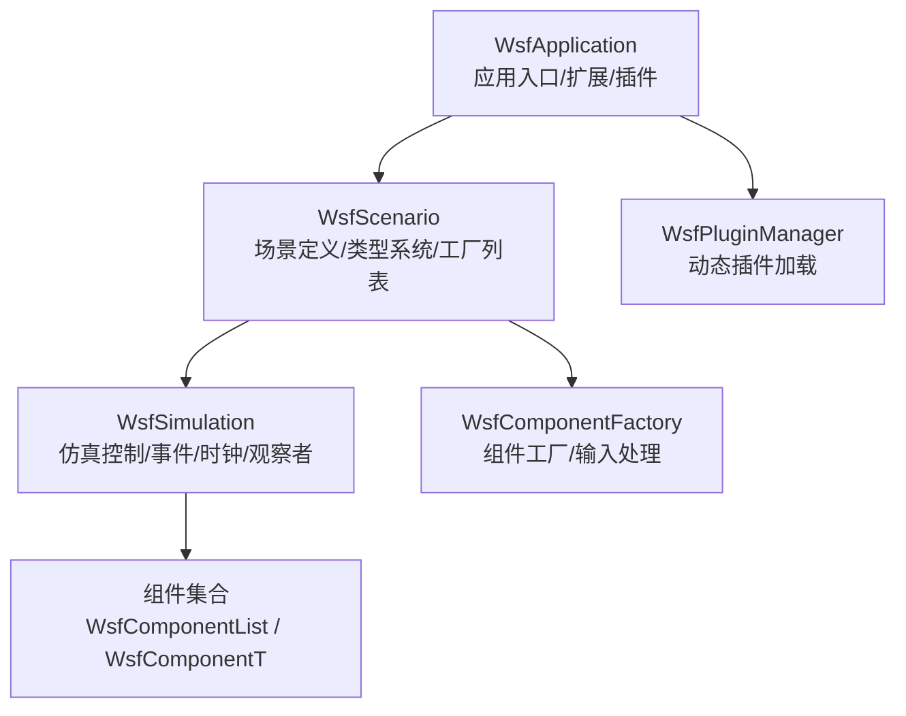
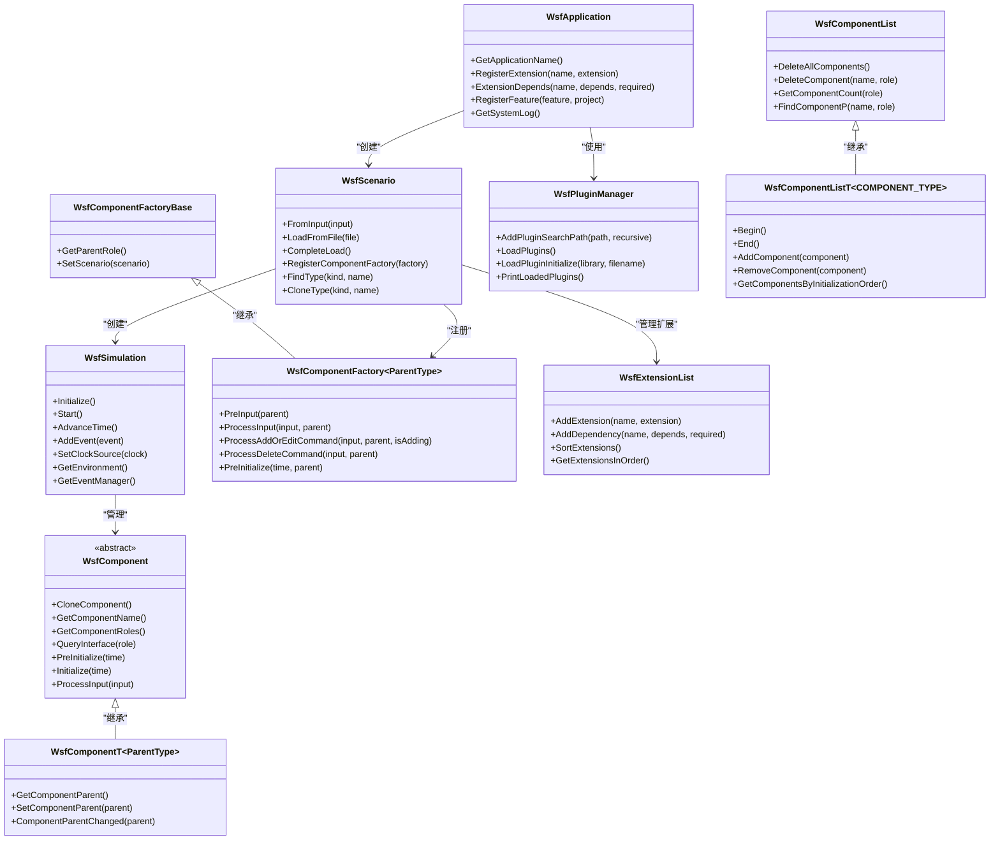
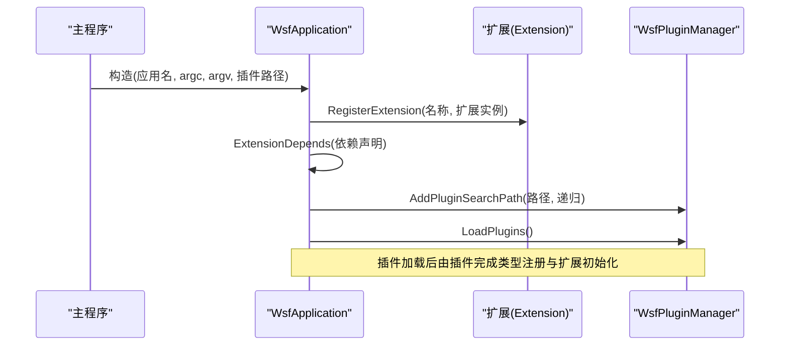
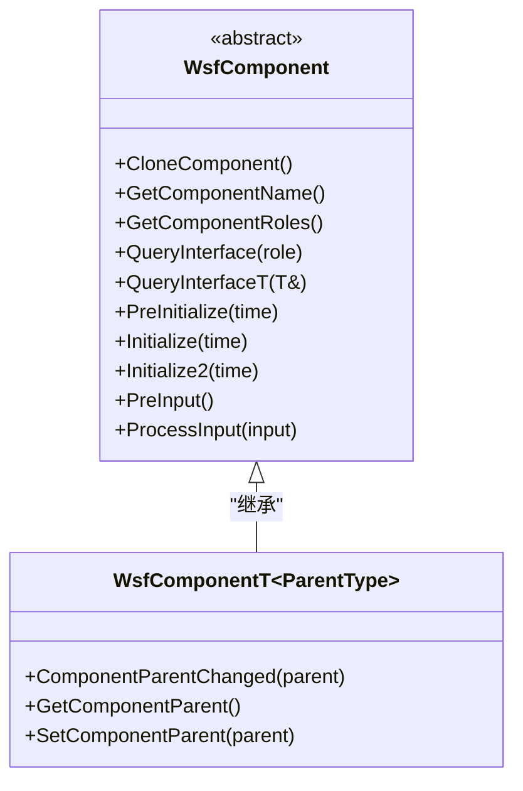
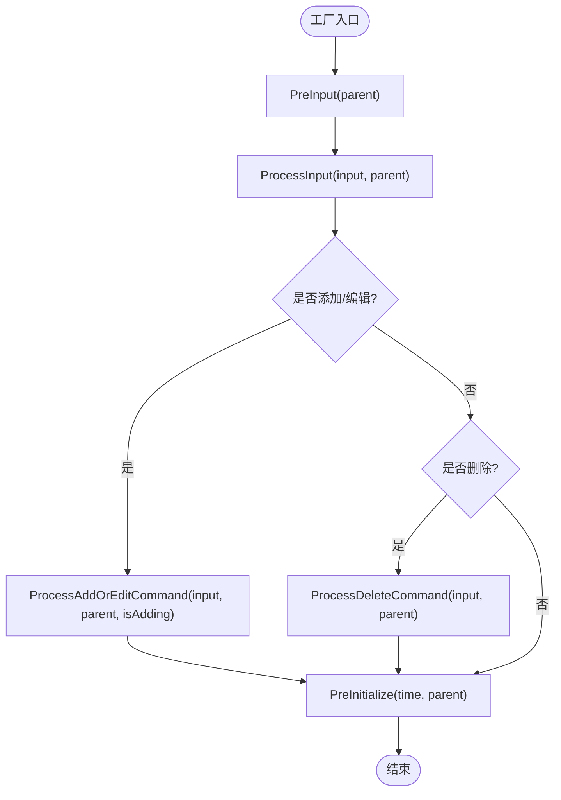
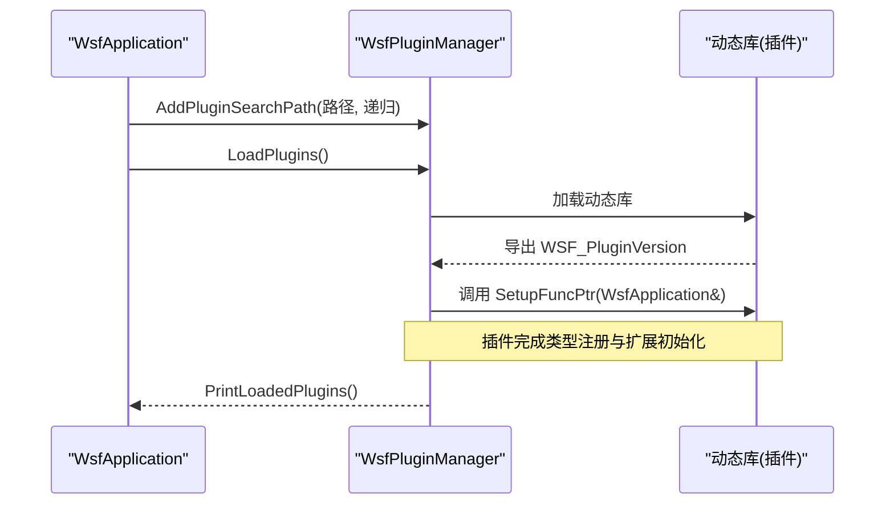
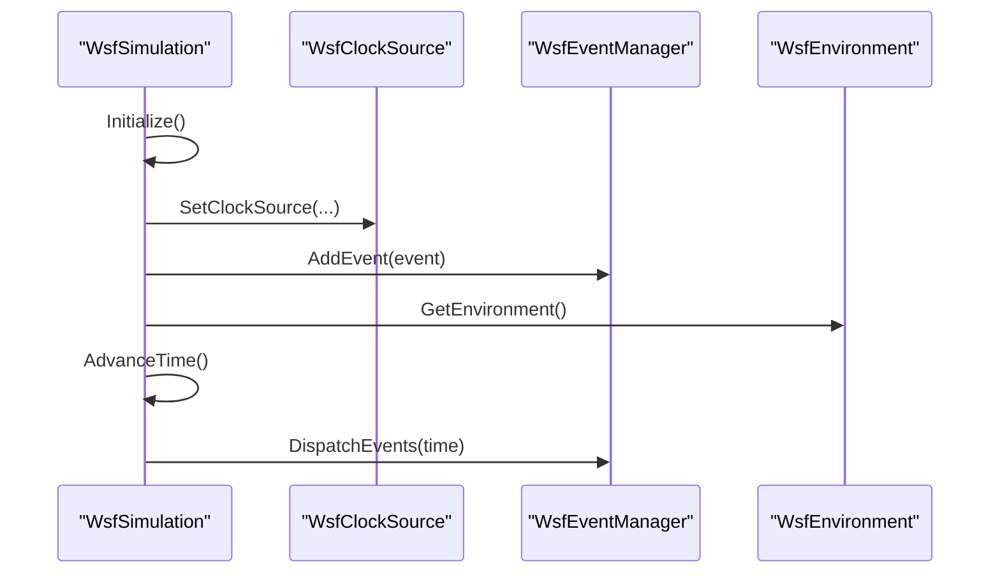
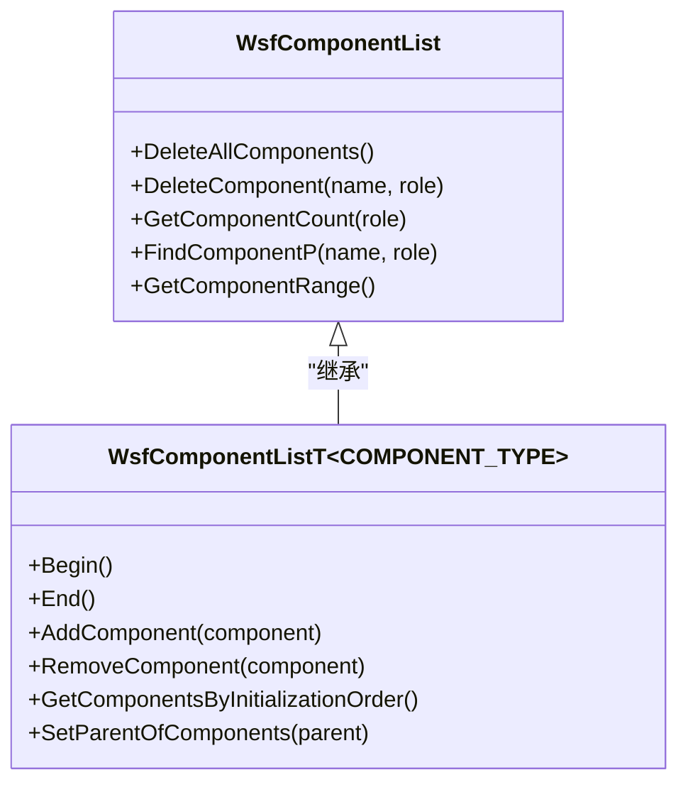
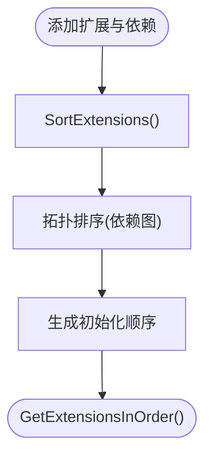
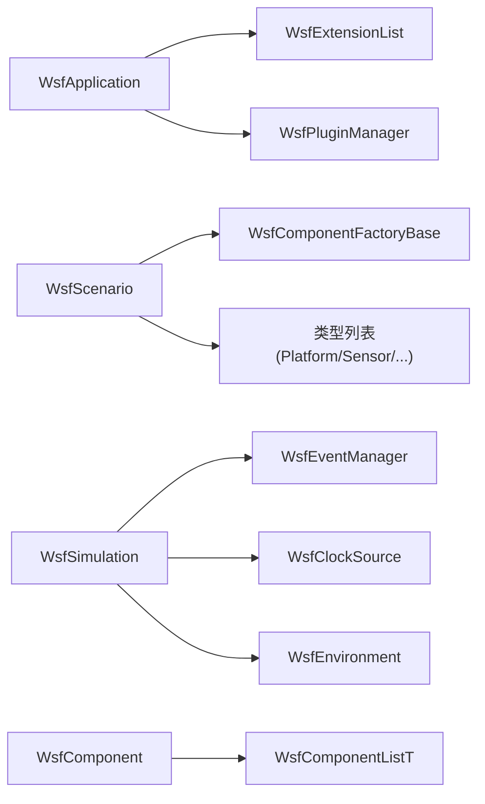

# WSF框架架构

<cite>
**本文引用的文件**   
- [WsfApplication.hpp](file://swdev/src/core/wsf/source/WsfApplication.hpp)
- [WsfComponent.hpp](file://swdev/src/core/wsf/source/WsfComponent.hpp)
- [WsfComponentFactory.hpp](file://swdev/src/core/wsf/source/WsfComponentFactory.hpp)
- [WsfPluginManager.hpp](file://swdev/src/core/wsf/source/WsfPluginManager.hpp)
- [WsfSimulation.hpp](file://swdev/src/core/wsf/source/WsfSimulation.hpp)
- [WsfScenario.hpp](file://swdev/src/core/wsf/source/WsfScenario.hpp)
- [WsfComponentList.hpp](file://swdev/src/core/wsf/source/WsfComponentList.hpp)
- [WsfExtensionList.hpp](file://swdev/src/core/wsf/source/WsfExtensionList.hpp)
</cite>

## 目录
1. [简介](#简介)
2. [项目结构](#项目结构)
3. [核心组件](#核心组件)
4. [架构总览](#架构总览)
5. [详细组件分析](#详细组件分析)
6. [依赖关系分析](#依赖关系分析)
7. [性能考虑](#性能考虑)
8. [故障排查指南](#故障排查指南)
9. [结论](#结论)
10. [附录](#附录)

## 简介
WSF（Warfare Simulation Framework）是一个面向仿真与建模的模块化、可扩展框架。其核心设计理念包括：
- 组件化架构：通过统一的组件接口与角色体系，实现高内聚、低耦合的可插拔能力。
- 插件机制：支持动态加载外部插件，扩展类型系统与运行时行为。
- 生命周期管理：从应用初始化、场景构建到仿真运行，提供清晰的生命周期阶段与扩展点。

本文件聚焦于以下关键主题：
- WsfApplication 的初始化流程、扩展注册与特性管理
- WsfComponent 基类的设计模式、角色查询与生命周期钩子
- 组件工厂模式与输入处理、预初始化阶段
- 插件管理器与动态加载、版本约定
- 核心服务管理器（事件、时钟、环境等）在仿真中的组织方式
- 组件开发最佳实践与架构图示

## 项目结构
WSF 的核心代码位于 swdev/src/core/wsf 目录下，围绕应用、场景、仿真、组件与插件等层次展开。下图给出概念性结构视图（非直接映射具体文件）：

[本节为概念性说明，不直接分析具体文件，故无“章节来源”]

## 核心组件
- WsfApplication：应用级单例，负责扩展注册、特性声明、命令行参数、脚本类型与系统日志等全局资源；提供插件路径管理与扩展依赖排序。
- WsfScenario：场景对象，负责输入解析、类型系统注册、组件工厂注册、平台实例与蒙特卡洛迭代控制等。
- WsfSimulation：仿真控制器，维护事件队列、时间推进、平台管理、观察者、随机源、时钟源与环境等。
- WsfComponent/WsfComponentT：组件抽象与带父对象的模板化组件，提供角色查询、克隆、初始化顺序与父对象连接。
- WsfComponentFactory/WsfComponentFactoryBase：组件工厂基类与模板化工厂，负责输入命令处理与预初始化校验。
- WsfPluginManager：插件管理器，基于底层 UtPluginManager 实现动态库加载、版本导出与插件初始化。
- WsfComponentList/WsfComponentListT：组件容器，提供按角色查找、删除、迭代与初始化顺序排序等能力。
- WsfExtensionList：扩展容器，维护扩展依赖并计算拓扑排序后的初始化顺序。

**章节来源**
- [WsfApplication.hpp:32-44](file://swdev/src/core/wsf/source/WsfApplication.hpp#L32-L44)
- [WsfScenario.hpp:109-122](file://swdev/src/core/wsf/source/WsfScenario.hpp#L109-L122)
- [WsfSimulation.hpp:91-106](file://swdev/src/core/wsf/source/WsfSimulation.hpp#L91-L106)
- [WsfComponent.hpp:35-112](file://swdev/src/core/wsf/source/WsfComponent.hpp#L35-L112)
- [WsfComponentFactory.hpp:23-49](file://swdev/src/core/wsf/source/WsfComponentFactory.hpp#L23-L49)
- [WsfPluginManager.hpp:35-48](file://swdev/src/core/wsf/source/WsfPluginManager.hpp#L35-L48)
- [WsfComponentList.hpp:33-51](file://swdev/src/core/wsf/source/WsfComponentList.hpp#L33-L51)
- [WsfExtensionList.hpp:42-49](file://swdev/src/core/wsf/source/WsfExtensionList.hpp#L42-L49)

## 架构总览
WSF 的整体架构以“应用-场景-仿真-组件-插件”为主线，扩展点贯穿各层。下图展示主要类之间的关系与数据流向（映射至实际源码文件）：

**图表来源**
- [WsfApplication.hpp:76-105](file://swdev/src/core/wsf/source/WsfApplication.hpp#L76-L105)
- [WsfScenario.hpp:117-135](file://swdev/src/core/wsf/source/WsfScenario.hpp#L117-L135)
- [WsfSimulation.hpp:171-229](file://swdev/src/core/wsf/source/WsfSimulation.hpp#L171-L229)
- [WsfComponent.hpp:38-112](file://swdev/src/core/wsf/source/WsfComponent.hpp#L38-L112)
- [WsfComponentFactory.hpp:23-106](file://swdev/src/core/wsf/source/WsfComponentFactory.hpp#L23-L106)
- [WsfPluginManager.hpp:39-68](file://swdev/src/core/wsf/source/WsfPluginManager.hpp#L39-L68)
- [WsfComponentList.hpp:42-51](file://swdev/src/core/wsf/source/WsfComponentList.hpp#L42-L51)
- [WsfExtensionList.hpp:45-97](file://swdev/src/core/wsf/source/WsfExtensionList.hpp#L45-L97)

**章节来源**
- [WsfApplication.hpp:76-105](file://swdev/src/core/wsf/source/WsfApplication.hpp#L76-L105)
- [WsfScenario.hpp:117-135](file://swdev/src/core/wsf/source/WsfScenario.hpp#L117-L135)
- [WsfSimulation.hpp:171-229](file://swdev/src/core/wsf/source/WsfSimulation.hpp#L171-L229)
- [WsfComponent.hpp:38-112](file://swdev/src/core/wsf/source/WsfComponent.hpp#L38-L112)
- [WsfComponentFactory.hpp:23-106](file://swdev/src/core/wsf/source/WsfComponentFactory.hpp#L23-L106)
- [WsfPluginManager.hpp:39-68](file://swdev/src/core/wsf/source/WsfPluginManager.hpp#L39-L68)
- [WsfComponentList.hpp:42-51](file://swdev/src/core/wsf/source/WsfComponentList.hpp#L42-L51)
- [WsfExtensionList.hpp:45-97](file://swdev/src/core/wsf/source/WsfExtensionList.hpp#L45-L97)

## 详细组件分析

### WsfApplication：应用初始化与扩展管理
- 初始化流程
  - 构造时接收应用名、命令行参数与插件路径列表。
  - 内部维护扩展列表、特性注册表、系统日志、脚本类型与插件管理器指针。
  - 提供扩展注册与依赖声明方法，支持条件性依赖与拓扑排序初始化。
- 扩展点设计
  - 通过 RegisterExtension 与 ExtensionDepends 管理扩展及其依赖。
  - 提供 WSF_REGISTER_EXTENSION 宏简化扩展注册调用。
- 特性管理
  - 内置操作系统、处理器、地址位宽、构建类型等特性，允许扩展追加自定义特性。
- 测试环境
  - 提供 IsTestingEnabled 与 FeatureNotPresent 异常用于自动化测试。

**图表来源**
- [WsfApplication.hpp:76-105](file://swdev/src/core/wsf/source/WsfApplication.hpp#L76-L105)
- [WsfApplication.hpp:192-214](file://swdev/src/core/wsf/source/WsfApplication.hpp#L192-L214)
- [WsfPluginManager.hpp:49-55](file://swdev/src/core/wsf/source/WsfPluginManager.hpp#L49-L55)

**章节来源**
- [WsfApplication.hpp:76-105](file://swdev/src/core/wsf/source/WsfApplication.hpp#L76-L105)
- [WsfApplication.hpp:192-214](file://swdev/src/core/wsf/source/WsfApplication.hpp#L192-L214)

### WsfComponent 与 WsfComponentT：组件接口与状态管理
- 组件接口
  - CloneComponent：克隆组件（可选）。
  - GetComponentName：获取唯一组件名。
  - GetComponentRoles：返回角色数组（按特异性降序）。
  - QueryInterface：按角色查询接口指针。
  - QueryInterfaceT：类型安全的接口查询模板。
- 生命周期钩子
  - PreInitialize/Initialize/Initialize2：分阶段初始化。
  - PreInput/ProcessInput：输入处理阶段。
- 父对象连接
  - WsfComponentT 提供 SetComponentParent/ComponentParentChanged 回调，便于组件感知所属父对象变化。
- 初始化顺序
  - GetComponentInitializationOrder 控制组件初始化优先级。

**图表来源**
- [WsfComponent.hpp:38-112](file://swdev/src/core/wsf/source/WsfComponent.hpp#L38-L112)
- [WsfComponent.hpp:117-168](file://swdev/src/core/wsf/source/WsfComponent.hpp#L117-L168)

**章节来源**
- [WsfComponent.hpp:38-112](file://swdev/src/core/wsf/source/WsfComponent.hpp#L38-L112)
- [WsfComponent.hpp:117-168](file://swdev/src/core/wsf/source/WsfComponent.hpp#L117-L168)

### 组件工厂模式：输入处理与预初始化
- 工厂基类
  - WsfComponentFactoryBase 持有父角色与场景指针，供派生工厂访问场景上下文。
- 模板化工厂
  - WsfComponentFactory~ParentType~ 针对特定父类型提供：
    - PreInput：预处理输入（可能被多次调用）。
    - ProcessInput：处理通用输入命令。
    - ProcessAddOrEditCommand：处理添加或编辑命令。
    - ProcessDeleteCommand：处理删除命令。
    - PreInitialize：在父对象初始化前进行必要检查与补充。
- 典型用法
  - 工厂在场景加载期间被调用，根据输入流创建或修改组件。

**图表来源**
- [WsfComponentFactory.hpp:23-49](file://swdev/src/core/wsf/source/WsfComponentFactory.hpp#L23-L49)
- [WsfComponentFactory.hpp:51-106](file://swdev/src/core/wsf/source/WsfComponentFactory.hpp#L51-L106)

**章节来源**
- [WsfComponentFactory.hpp:23-49](file://swdev/src/core/wsf/source/WsfComponentFactory.hpp#L23-L49)
- [WsfComponentFactory.hpp:51-106](file://swdev/src/core/wsf/source/WsfComponentFactory.hpp#L51-L106)

### 插件管理器：动态加载与版本约定
- 插件搜索路径
  - AddPluginSearchPath 支持递归与非递归扫描。
- 插件加载
  - LoadPlugins 遍历路径并调用 LoadPluginInitialize 进行动态库加载。
- 版本导出
  - WSF_PLUGIN_DEFINE_VERSION 宏要求插件导出 WSF_PluginVersion 函数，返回 UT_PLUGIN_VERSION_CREATE。
- 插件初始化
  - 插件可调用 SetupFuncPtr/CompleteFuncPtr 对应用进行初始化与收尾。

**图表来源**
- [WsfPluginManager.hpp:49-55](file://swdev/src/core/wsf/source/WsfPluginManager.hpp#L49-L55)
- [WsfPluginManager.hpp:26-33](file://swdev/src/core/wsf/source/WsfPluginManager.hpp#L26-L33)

**章节来源**
- [WsfPluginManager.hpp:26-33](file://swdev/src/core/wsf/source/WsfPluginManager.hpp#L26-L33)
- [WsfPluginManager.hpp:49-55](file://swdev/src/core/wsf/source/WsfPluginManager.hpp#L49-L55)

### 核心服务管理器：事件、时钟与环境
- 事件管理
  - WsfSimulation 维护 WsfEventManager 与墙钟事件管理器，支持事件调度与时间推进。
- 时钟源
  - 通过 SetClockSource 注入 WsfClockSource，支持实时时钟源与速率控制。
- 环境与基础设施
  - GetEnvironment 提供环境对象；同时暴露大气、地形、通信网络、组管理、路径查找、脚本执行器等。
- 观察者体系
  - 提供行为、通信、DIS、燃料、移动器、平台、处理器、传感器、任务、轨迹、区域等观察者接口。

**图表来源**
- [WsfSimulation.hpp:171-229](file://swdev/src/core/wsf/source/WsfSimulation.hpp#L171-L229)
- [WsfSimulation.hpp:317-329](file://swdev/src/core/wsf/source/WsfSimulation.hpp#L317-L329)
- [WsfSimulation.hpp:406-460](file://swdev/src/core/wsf/source/WsfSimulation.hpp#L406-L460)

**章节来源**
- [WsfSimulation.hpp:171-229](file://swdev/src/core/wsf/source/WsfSimulation.hpp#L171-L229)
- [WsfSimulation.hpp:317-329](file://swdev/src/core/wsf/source/WsfSimulation.hpp#L317-L329)
- [WsfSimulation.hpp:406-460](file://swdev/src/core/wsf/source/WsfSimulation.hpp#L406-L460)

### 组件容器：WsfComponentList 与 WsfComponentListT
- 基础容器
  - WsfComponentList 提供组件增删查改、按角色查找、计数与清理等通用操作。
- 类型安全容器
  - WsfComponentListT~COMPONENT_TYPE~ 约束组件类型，提供迭代器、范围遍历、初始化顺序排序与父对象连接更新。
- 初始化顺序
  - GetComponentsByInitializationOrder 按组件初始化优先级稳定排序，确保依赖正确。

**图表来源**
- [WsfComponentList.hpp:42-51](file://swdev/src/core/wsf/source/WsfComponentList.hpp#L42-L51)
- [WsfComponentList.hpp:340-534](file://swdev/src/core/wsf/source/WsfComponentList.hpp#L340-L534)

**章节来源**
- [WsfComponentList.hpp:42-51](file://swdev/src/core/wsf/source/WsfComponentList.hpp#L42-L51)
- [WsfComponentList.hpp:340-534](file://swdev/src/core/wsf/source/WsfComponentList.hpp#L340-L534)

### 扩展列表：依赖与拓扑排序
- 扩展容器
  - WsfExtensionList 维护扩展映射与依赖列表，支持添加扩展与依赖。
- 初始化顺序
  - SortExtensions 使用拓扑排序计算满足依赖的初始化顺序，避免循环依赖。
- 访问接口
  - GetExtensionsInOrder 返回按序扩展指针列表，便于有序初始化。

**图表来源**
- [WsfExtensionList.hpp:45-97](file://swdev/src/core/wsf/source/WsfExtensionList.hpp#L45-L97)

**章节来源**
- [WsfExtensionList.hpp:45-97](file://swdev/src/core/wsf/source/WsfExtensionList.hpp#L45-L97)

## 依赖关系分析
WSF 的关键依赖如下：
- WsfApplication 依赖 WsfPluginManager 与 WsfExtensionList，负责扩展与插件的统一管理。
- WsfScenario 依赖 WsfComponentFactoryBase 与多种类型列表，负责输入解析与类型注册。
- WsfSimulation 依赖 WsfEventManager、WsfClockSource、WsfEnvironment 等基础设施。
- 组件与容器之间通过 WsfComponent 与 WsfComponentListT 解耦，支持多角色与类型安全。

**图表来源**
- [WsfApplication.hpp:76-105](file://swdev/src/core/wsf/source/WsfApplication.hpp#L76-L105)
- [WsfScenario.hpp:198-202](file://swdev/src/core/wsf/source/WsfScenario.hpp#L198-L202)
- [WsfSimulation.hpp:406-460](file://swdev/src/core/wsf/source/WsfSimulation.hpp#L406-L460)
- [WsfComponentList.hpp:340-534](file://swdev/src/core/wsf/source/WsfComponentList.hpp#L340-L534)

**章节来源**
- [WsfApplication.hpp:76-105](file://swdev/src/core/wsf/source/WsfApplication.hpp#L76-L105)
- [WsfScenario.hpp:198-202](file://swdev/src/core/wsf/source/WsfScenario.hpp#L198-L202)
- [WsfSimulation.hpp:406-460](file://swdev/src/core/wsf/source/WsfSimulation.hpp#L406-L460)
- [WsfComponentList.hpp:340-534](file://swdev/src/core/wsf/source/WsfComponentList.hpp#L340-L534)

## 性能考虑
- 事件驱动与时间步进
  - WsfSimulation 支持事件驱动与固定时间步长两种模式，可通过 GetTimestep 与 IsEventStepSimulation 判断。
- 多线程与随机源隔离
  - MultiThreadingActive 与 Random/ScriptRandom 分离，避免脚本与仿真模型竞争随机数池。
- 组件初始化顺序
  - 通过 GetComponentInitializationOrder 与稳定排序减少初始化阶段的依赖冲突。
- 插件加载开销
  - 插件路径扫描与动态库加载可能带来启动开销，建议合理配置递归与非递归策略。

[本节为一般性指导，不直接分析具体文件，故无“章节来源”]

## 故障排查指南
- 扩展未找到或重复注册
  - 使用 WsfUnknownExtension 与 WsfDuplicateExtension 异常定位问题，检查扩展名称与依赖声明。
- 组件角色查询失败
  - 确认组件实现了 GetComponentRoles 与 QueryInterface，并确保角色数组顺序正确。
- 插件版本不匹配
  - 确保插件导出 WSF_PluginVersion 且返回 UT_PLUGIN_VERSION_CREATE。
- 仿真状态异常
  - 检查 WsfSimulation::State 与 CompletionReason，确认 Initialize/Start/Complete 调用顺序正确。

**章节来源**
- [WsfExtensionList.hpp:26-40](file://swdev/src/core/wsf/source/WsfExtensionList.hpp#L26-L40)
- [WsfComponent.hpp:57-75](file://swdev/src/core/wsf/source/WsfComponent.hpp#L57-L75)
- [WsfPluginManager.hpp:26-33](file://swdev/src/core/wsf/source/WsfPluginManager.hpp#L26-L33)
- [WsfSimulation.hpp:111-131](file://swdev/src/core/wsf/source/WsfSimulation.hpp#L111-L131)

## 结论
WSF 通过清晰的层次划分与扩展点设计，实现了高内聚、低耦合的仿真框架。WsfApplication 作为应用入口统一管理扩展与插件；WsfScenario 负责场景构建与类型系统；WsfSimulation 作为仿真控制器协调事件、时钟与环境；WsfComponent 与工厂模式提供灵活的组件扩展能力；WsfComponentList 与 WsfExtensionList 保障类型安全与依赖排序。该架构既适合快速原型开发，也支持大规模复杂仿真系统的扩展与维护。

[本节为总结性内容，不直接分析具体文件，故无“章节来源”]

## 附录
- 组件开发最佳实践
  - 继承 WsfComponent 或 WsfComponentT，实现必需接口（CloneComponent、GetComponentName、GetComponentRoles、QueryInterface）。
  - 在组件中实现必要的生命周期钩子（PreInitialize/Initialize/Initialize2/ProcessInput）。
  - 使用角色体系表达组件能力，并在 GetComponentRoles 中按特异性降序列出。
  - 通过 WsfScenario.RegisterComponentFactory 注册工厂，处理输入命令与预初始化逻辑。
  - 在插件中导出 WSF_PluginVersion，并通过 SetupFuncPtr/CompleteFuncPtr 完成应用初始化与收尾。
  - 使用 WsfExtensionList 声明扩展依赖，确保初始化顺序正确。

[本节为一般性指导，不直接分析具体文件，故无“章节来源”]