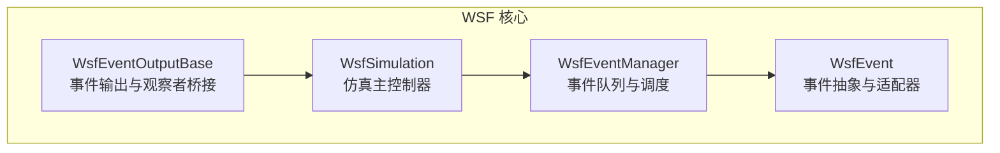
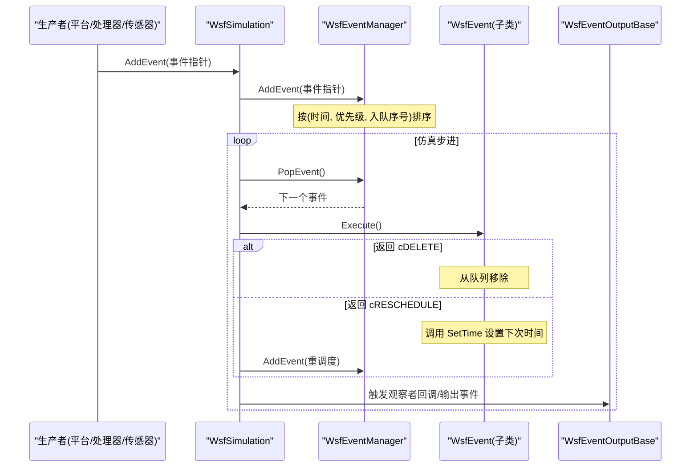
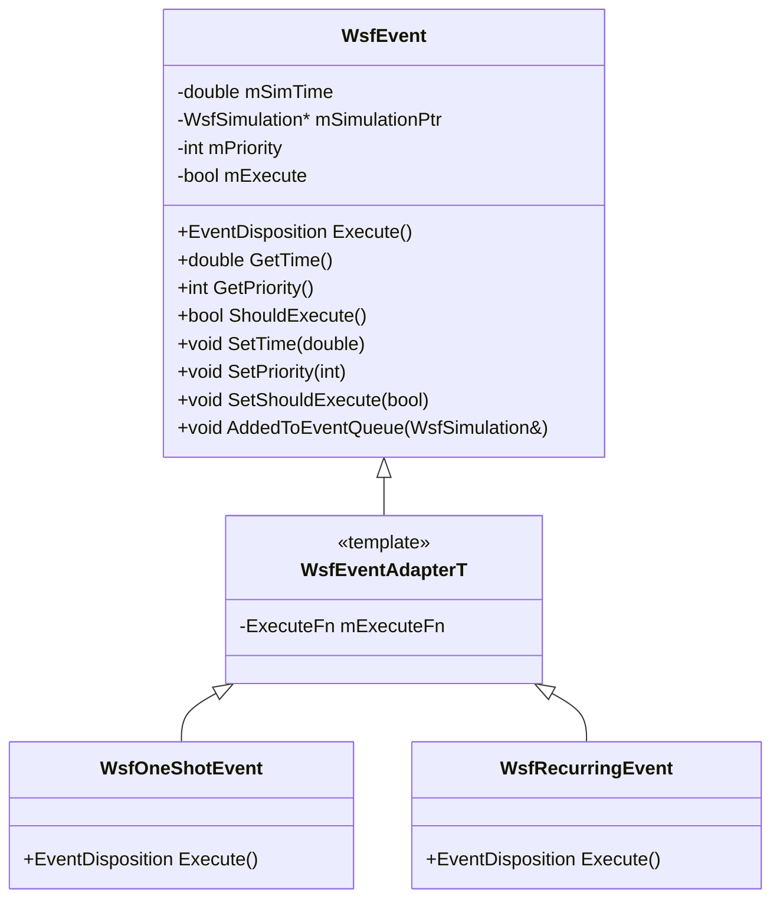
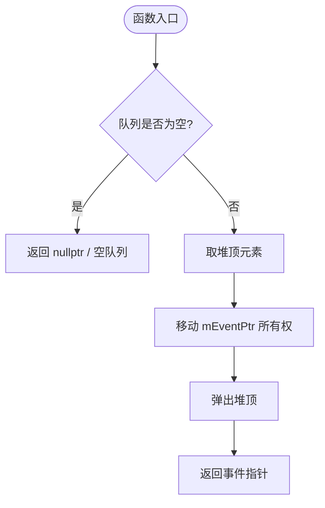
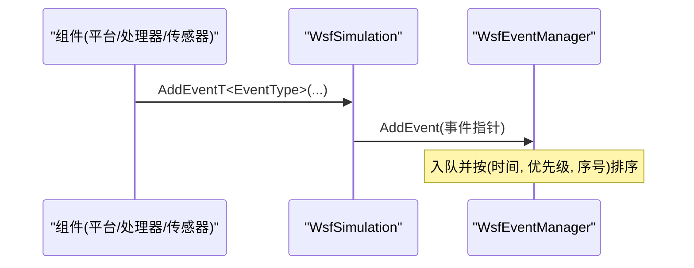
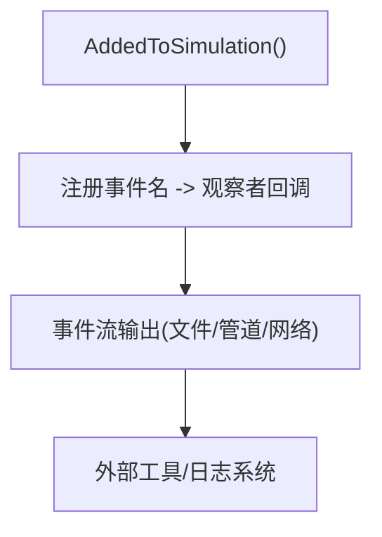
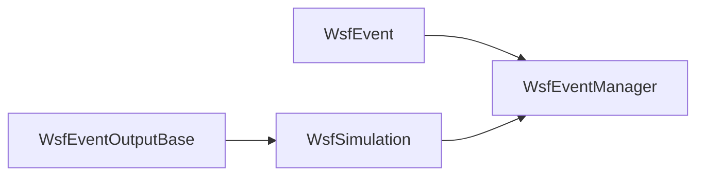

# 事件系统

<cite>
**本文引用的文件**   
- [WsfEvent.hpp](file://swdev/src/core/wsf/source/WsfEvent.hpp)
- [WsfEventManager.hpp](file://swdev/src/core/wsf/source/WsfEventManager.hpp)
- [WsfEventManager.cpp](file://swdev/src/core/wsf/source/WsfEventManager.cpp)
- [WsfSimulation.hpp](file://swdev/src/core/wsf/source/WsfSimulation.hpp)
- [WsfEventOutputBase.cpp](file://swdev/src/core/wsf/source/WsfEventOutputBase.cpp)
</cite>

## 目录
1. [简介](#简介)
2. [项目结构](#项目结构)
3. [核心组件](#核心组件)
4. [架构总览](#架构总览)
5. [详细组件分析](#详细组件分析)
6. [依赖关系分析](#依赖关系分析)
7. [性能与可扩展性](#性能与可扩展性)
8. [故障排查指南](#故障排查指南)
9. [结论](#结论)
10. [附录：典型使用场景与最佳实践](#附录典型使用场景与最佳实践)

## 简介
本文件系统化梳理 AFSIM WSF（Warfare Simulation Framework）事件系统的架构与实现，围绕事件驱动设计理念展开，覆盖以下主题：
- 事件的定义、分发与处理机制
- WsfEvent 类设计：事件类型、数据封装、时间戳与优先级管理
- 事件管理器（WsfEventManager）：队列、优先级调度、线程安全与重置
- 订阅/发布模式：观察者回调注册、事件输出与异步处理
- 事件生命周期：创建、入队、调度、执行、重调度与清理
- 设计原则：解耦、可扩展性与性能考量
- 典型使用场景与最佳实践示例

## 项目结构
WSF 事件系统位于核心库 swdev/src/core/wsf 中，关键头文件与实现如下：
- 事件抽象与适配器：WsfEvent.hpp
- 事件队列与调度器：WsfEventManager.hpp/.cpp
- 仿真主控制器（负责事件入队与调度循环）：WsfSimulation.hpp
- 事件输出与观察者桥接：WsfEventOutputBase.cpp

图表来源
- [WsfEvent.hpp:21-113](file://swdev/src/core/wsf/source/WsfEvent.hpp#L21-L113)
- [WsfEventManager.hpp:28-110](file://swdev/src/core/wsf/source/WsfEventManager.hpp#L28-L110)
- [WsfSimulation.hpp:91-106](file://swdev/src/core/wsf/source/WsfSimulation.hpp#L91-L106)
- [WsfEventOutputBase.cpp:324-432](file://swdev/src/core/wsf/source/WsfEventOutputBase.cpp#L324-L432)

章节来源
- [WsfEvent.hpp:21-113](file://swdev/src/core/wsf/source/WsfEvent.hpp#L21-L113)
- [WsfEventManager.hpp:28-110](file://swdev/src/core/wsf/source/WsfEventManager.hpp#L28-L110)
- [WsfSimulation.hpp:91-106](file://swdev/src/core/wsf/source/WsfSimulation.hpp#L91-L106)
- [WsfEventOutputBase.cpp:324-432](file://swdev/src/core/wsf/source/WsfEventOutputBase.cpp#L324-L432)

## 核心组件
- WsfEvent：所有事件的抽象基类，提供执行接口 Execute()、时间 GetTime/SetTime、优先级 GetPriority/SetPriority、是否应执行的开关 ShouldExecute/SetShouldExecute，以及加入队列时的回调 AddedToEventQueue。
- WsfEventAdapterT：基于 std::function 的适配器模板，简化一次性或周期性事件的构造与执行。
- WsfOneShotEvent：一次性事件，执行后返回 cDELETE 从队列移除。
- WsfRecurringEvent：可重调度事件，Execute 返回 cRESCHEDULE 并配合 SetTime 进行周期调度。
- WsfEventManager：维护按仿真时间排序的事件优先队列，支持 PeekEvent/PopEvent/Reset，内部使用递归互斥保证并发安全。
- WsfSimulation：仿真主控制器，持有事件管理器，对外暴露 AddEvent/AddWallEvent 等接口，并在仿真步进中调度事件。
- WsfEventOutputBase：将观察者（Observer）回调桥接到事件输出系统，为各类子系统（通信、链路、平台、传感器等）提供统一的事件命名与输出通道。

章节来源
- [WsfEvent.hpp:21-172](file://swdev/src/core/wsf/source/WsfEvent.hpp#L21-L172)
- [WsfEventManager.hpp:28-110](file://swdev/src/core/wsf/source/WsfEventManager.hpp#L28-L110)
- [WsfEventManager.cpp:16-61](file://swdev/src/core/wsf/source/WsfEventManager.cpp#L16-L61)
- [WsfSimulation.hpp:185-200](file://swdev/src/core/wsf/source/WsfSimulation.hpp#L185-L200)
- [WsfEventOutputBase.cpp:324-432](file://swdev/src/core/wsf/source/WsfEventOutputBase.cpp#L324-L432)

## 架构总览
WSF 采用“事件驱动 + 观察者”的架构：
- 生产者（平台、处理器、传感器、任务等）通过 WsfSimulation::AddEvent 将事件入队。
- 调度器（WsfEventManager）依据仿真时间与优先级弹出下一个事件。
- 消费者（具体事件 Execute 实现或观察者回调）处理业务逻辑，可选择删除或重调度事件。
- 事件输出层（WsfEventOutputBase）将内部状态变化映射为命名事件，供外部工具或日志系统消费。

图表来源
- [WsfEventManager.cpp:22-54](file://swdev/src/core/wsf/source/WsfEventManager.cpp#L22-L54)
- [WsfEvent.hpp:61-99](file://swdev/src/core/wsf/source/WsfEvent.hpp#L61-L99)
- [WsfSimulation.hpp:185-200](file://swdev/src/core/wsf/source/WsfSimulation.hpp#L185-L200)
- [WsfEventOutputBase.cpp:324-432](file://swdev/src/core/wsf/source/WsfEventOutputBase.cpp#L324-L432)

## 详细组件分析

### WsfEvent 设计与语义
- 事件类型与生命周期
  - 一次性事件：WsfOneShotEvent，Execute 后返回 cDELETE。
  - 周期性事件：WsfRecurringEvent，Execute 返回 cRESCHEDULE，并通过 SetTime 指定下一次执行时间。
- 时间戳与优先级
  - GetTime/SetTime 控制事件调度时间；SetTime 在队列中修改无效，需重调度。
  - GetPriority/SetPriority 用于同时间事件排序；优先级在入队时生效，重调度时可再次调整。
- 执行控制
  - ShouldExecute/SetShouldExecute 允许在执行前取消事件。
  - AddedToEventQueue 在事件加入队列时被调用，便于事件获取所属仿真上下文。
- 适配器模式
  - WsfEventAdapterT 封装 std::function，减少自定义事件类的样板代码。

图表来源
- [WsfEvent.hpp:21-172](file://swdev/src/core/wsf/source/WsfEvent.hpp#L21-L172)

章节来源
- [WsfEvent.hpp:21-172](file://swdev/src/core/wsf/source/WsfEvent.hpp#L21-L172)

### WsfEventManager：队列与调度
- 数据结构
  - 使用 std::priority_queue 存储 Event，键为 (time, priority, counter)，确保稳定有序。
  - Event.mEventPtr 声明为 mutable，以便在 top() const 访问时移动所有权。
- 线程安全
  - 使用 std::recursive_mutex 保护队列操作，避免并发入队/出队冲突。
- 主要接口
  - AddEvent：入队，调用 AddedToEventQueue 注入仿真上下文。
  - PeekEvent：只读查看下一个事件。
  - PopEvent：取出并转移所有权给调用者。
  - Reset：清空队列。

图表来源
- [WsfEventManager.cpp:32-54](file://swdev/src/core/wsf/source/WsfEventManager.cpp#L32-L54)
- [WsfEventManager.hpp:83-110](file://swdev/src/core/wsf/source/WsfEventManager.hpp#L83-L110)

章节来源
- [WsfEventManager.hpp:28-110](file://swdev/src/core/wsf/source/WsfEventManager.hpp#L28-L110)
- [WsfEventManager.cpp:16-61](file://swdev/src/core/wsf/source/WsfEventManager.cpp#L16-L61)

### WsfSimulation：事件入口与调度循环
- 事件入口
  - AddEvent/AddWallEvent 将事件交给事件管理器；同时提供 AddEventT/AddWallEventT 模板辅助构造。
- 仿真状态与时序
  - 仿真状态机包含初始化、启动、活跃、完成等阶段，事件调度发生在活跃阶段。
- 内置事件
  - 例如 AddPlatformEvent 作为内部事件，演示了如何继承 WsfEvent 并实现 Execute。

图表来源
- [WsfSimulation.hpp:185-200](file://swdev/src/core/wsf/source/WsfSimulation.hpp#L185-L200)
- [WsfEventManager.cpp:22-29](file://swdev/src/core/wsf/source/WsfEventManager.cpp#L22-L29)

章节来源
- [WsfSimulation.hpp:185-200](file://swdev/src/core/wsf/source/WsfSimulation.hpp#L185-L200)

### 事件输出与观察者桥接（WsfEventOutputBase）
- 作用
  - 将内部子系统状态变化（如平台增删、通信链路状态、传感器检测、消息路由等）映射为命名事件，供外部工具或日志系统消费。
- 注册机制
  - 在 AddedToSimulation 中集中注册大量事件名到对应观察者回调，形成统一的“事件字典”。
- 扩展点
  - 新增子系统事件只需在此处注册新的事件名与回调即可接入输出管道。

图表来源
- [WsfEventOutputBase.cpp:324-432](file://swdev/src/core/wsf/source/WsfEventOutputBase.cpp#L324-L432)

章节来源
- [WsfEventOutputBase.cpp:324-432](file://swdev/src/core/wsf/source/WsfEventOutputBase.cpp#L324-L432)

## 依赖关系分析
- 耦合关系
  - WsfEventManager 依赖 WsfEvent 抽象与 WsfSimulation 引用（用于 AddedToEventQueue）。
  - WsfSimulation 依赖 WsfEventManager 以管理事件队列。
  - WsfEventOutputBase 依赖 WsfSimulation 以获取仿真上下文和平台列表。
- 可能的循环依赖
  - 通过前置声明与弱引用避免强耦合；事件对象仅保存仿真指针而不拥有它。
- 外部集成点
  - 脚本层、可视化、日志、外部仿真接口（如 Warlock）通过事件输出与观察者回调与仿真解耦。

图表来源
- [WsfEvent.hpp:21-113](file://swdev/src/core/wsf/source/WsfEvent.hpp#L21-L113)
- [WsfEventManager.hpp:28-110](file://swdev/src/core/wsf/source/WsfEventManager.hpp#L28-L110)
- [WsfSimulation.hpp:91-106](file://swdev/src/core/wsf/source/WsfSimulation.hpp#L91-L106)
- [WsfEventOutputBase.cpp:324-432](file://swdev/src/core/wsf/source/WsfEventOutputBase.cpp#L324-L432)

章节来源
- [WsfEvent.hpp:21-113](file://swdev/src/core/wsf/source/WsfEvent.hpp#L21-L113)
- [WsfEventManager.hpp:28-110](file://swdev/src/core/wsf/source/WsfEventManager.hpp#L28-L110)
- [WsfSimulation.hpp:91-106](file://swdev/src/core/wsf/source/WsfSimulation.hpp#L91-L106)
- [WsfEventOutputBase.cpp:324-432](file://swdev/src/core/wsf/source/WsfEventOutputBase.cpp#L324-L432)

## 性能与可扩展性
- 时间复杂度
  - 入队/出队：O(log N)（优先队列），N 为队列长度。
  - 同时间同优先级：通过递增计数器保证 FIFO 稳定性。
- 内存与所有权
  - 使用 std::unique_ptr 明确所有权，避免悬垂指针与重复释放。
- 并发安全
  - 递归互斥保护队列操作，适合多线程环境下的入队/出队。
- 可扩展性
  - 通过 WsfEventAdapterT 与 std::function 降低自定义事件成本。
  - 事件输出层集中注册，新增事件无需改动调度核心。
- 优化建议
  - 批量入队时尽量合并相近时间的低优先级事件以减少频繁重排。
  - 对高频周期性事件，合理设置间隔与优先级，避免阻塞高优事件。
  - 谨慎使用 ShouldExecute 取消事件，避免频繁切换导致额外开销。

[本节为通用指导，不直接分析具体文件]

## 故障排查指南
- 事件未按预期执行
  - 检查 ShouldExecute 是否被设置为 false。
  - 确认 SetTime 是否在重调度路径中被正确调用。
- 事件顺序异常
  - 检查优先级是否正确设置；注意优先级仅在入队时生效。
  - 同一时间同优先级事件遵循入队顺序（计数器）。
- 内存泄漏或崩溃
  - 确认事件所有权由 WsfEventManager 管理，避免手动 delete。
  - 避免在 Execute 中访问已销毁的仿真对象（AddedToEventQueue 提供的指针可能为空）。
- 输出缺失
  - 检查 WsfEventOutputBase 中是否注册了对应事件名与回调。
  - 确认事件输出流已打开且未被关闭。

章节来源
- [WsfEvent.hpp:77-106](file://swdev/src/core/wsf/source/WsfEvent.hpp#L77-L106)
- [WsfEventManager.cpp:22-54](file://swdev/src/core/wsf/source/WsfEventManager.cpp#L22-L54)
- [WsfEventOutputBase.cpp:324-432](file://swdev/src/core/wsf/source/WsfEventOutputBase.cpp#L324-L432)

## 结论
WSF 事件系统以 WsfEvent 抽象为核心，结合 WsfEventManager 的稳定有序调度与 WsfSimulation 的统一入口，构建了高内聚、低耦合的事件驱动框架。通过适配器模式与观察者桥接，系统既易于扩展又具备良好的性能表现。遵循本文的设计原则与实践建议，可在复杂仿真场景中可靠地组织与控制事件流。

[本节为总结性内容，不直接分析具体文件]

## 附录：典型使用场景与最佳实践

- 一次性告警事件
  - 使用 WsfOneShotEvent 在特定仿真时刻触发一次告警或动作。
  - 参考路径：[WsfEvent.hpp:134-151](file://swdev/src/core/wsf/source/WsfEvent.hpp#L134-L151)
- 周期性心跳/采样
  - 使用 WsfRecurringEvent 在 Execute 中更新 SetTime 并返回 cRESCHEDULE。
  - 参考路径：[WsfEvent.hpp:153-172](file://swdev/src/core/wsf/source/WsfEvent.hpp#L153-L172)
- 平台生命周期事件
  - 通过 WsfSimulation::AddEventT 添加 AddPlatformEvent 等内置事件。
  - 参考路径：[WsfSimulation.hpp:156-169](file://swdev/src/core/wsf/source/WsfSimulation.hpp#L156-L169)
- 事件输出与观察
  - 在 WsfEventOutputBase::AddedToSimulation 中注册新的事件名与回调，以接入输出管道。
  - 参考路径：[WsfEventOutputBase.cpp:324-432](file://swdev/src/core/wsf/source/WsfEventOutputBase.cpp#L324-L432)

章节来源
- [WsfEvent.hpp:134-172](file://swdev/src/core/wsf/source/WsfEvent.hpp#L134-L172)
- [WsfSimulation.hpp:156-169](file://swdev/src/core/wsf/source/WsfSimulation.hpp#L156-L169)
- [WsfEventOutputBase.cpp:324-432](file://swdev/src/core/wsf/source/WsfEventOutputBase.cpp#L324-L432)