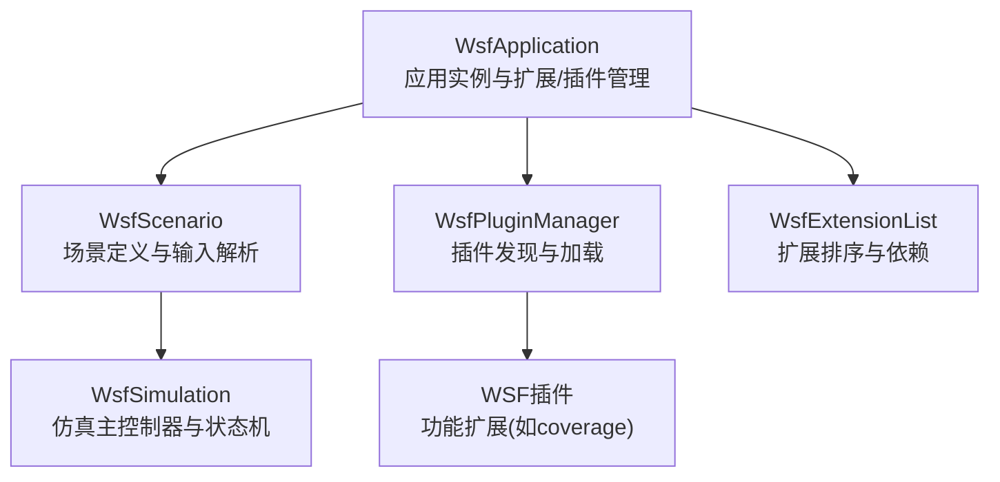
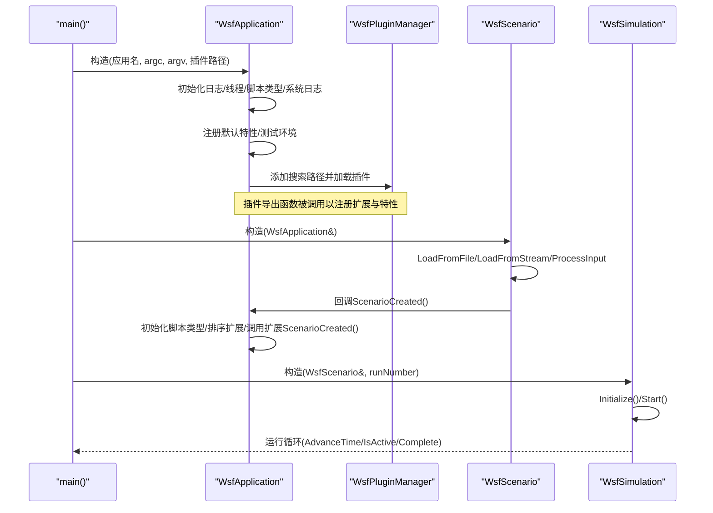
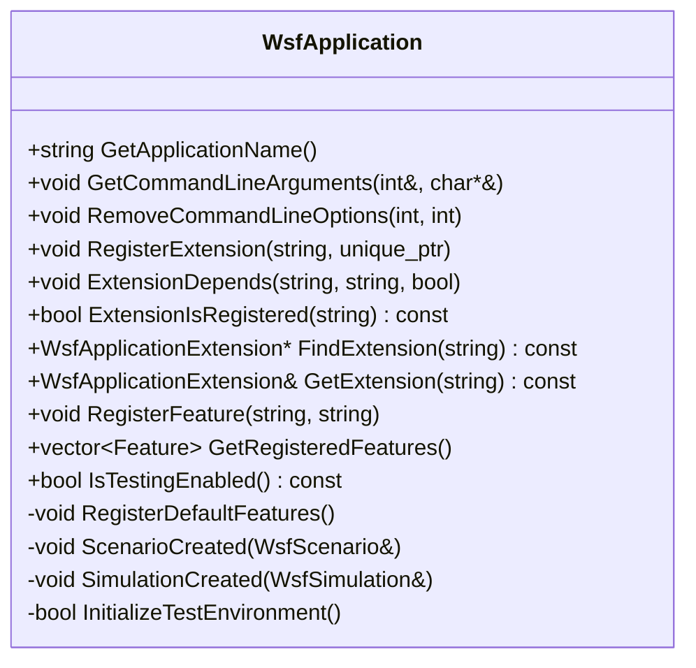
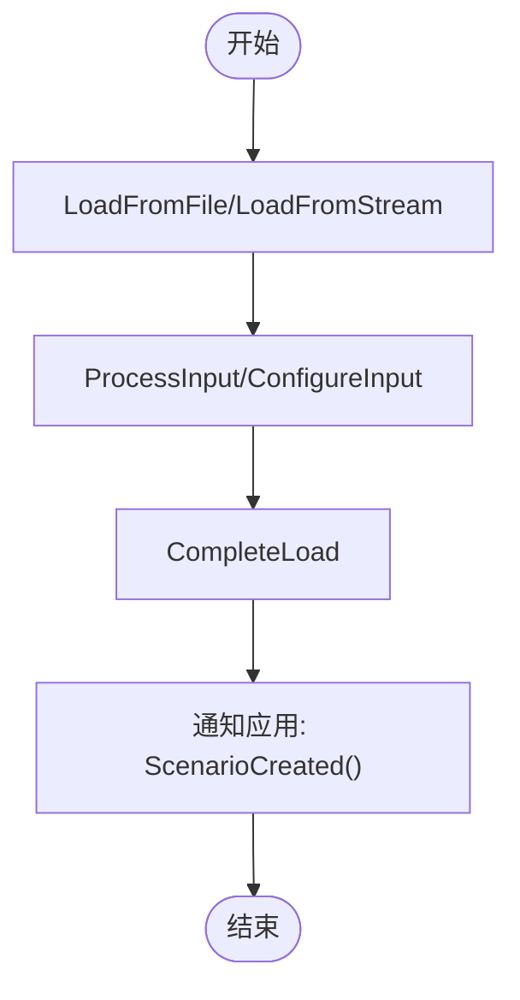
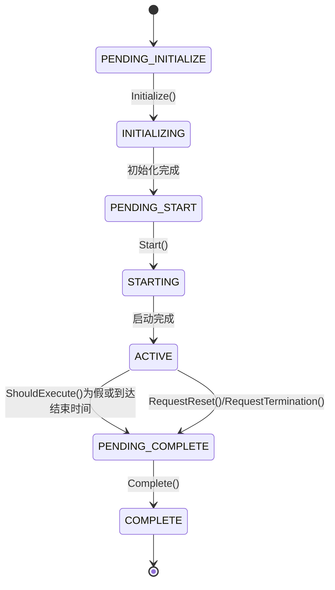
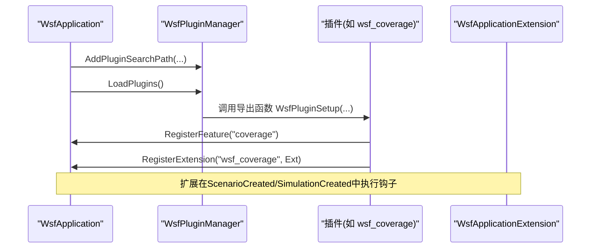
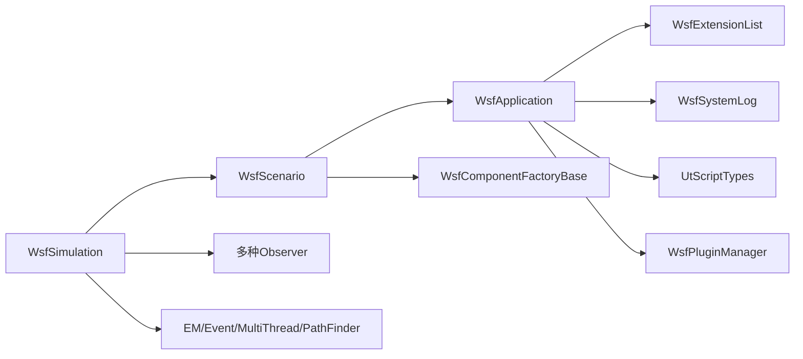

# 应用管理

<cite>
**本文引用的文件**
- [WsfApplication.hpp](file://swdev/src/core/wsf/source/WsfApplication.hpp)
- [WsfApplication.cpp](file://swdev/src/core/wsf/source/WsfApplication.cpp)
- [WsfScenario.hpp](file://swdev/src/core/wsf/source/WsfScenario.hpp)
- [WsfSimulation.hpp](file://swdev/src/core/wsf/source/WsfSimulation.hpp)
- [WsfCoverageRegistration.cpp](file://swdev/src/wsf_plugins/wsf_coverage/source/WsfCoverageRegistration.cpp)
</cite>

## 目录
1. [简介](#简介)
2. [项目结构](#项目结构)
3. [核心组件](#核心组件)
4. [架构总览](#架构总览)
5. [详细组件分析](#详细组件分析)
6. [依赖关系分析](#依赖关系分析)
7. [性能与扩展性考虑](#性能与扩展性考虑)
8. [故障排查指南](#故障排查指南)
9. [结论](#结论)
10. [附录](#附录)

## 简介
本文件面向WSF（仿真框架）应用管理系统，聚焦于WsfApplication类的核心职责与生命周期，系统阐述仿真应用的初始化、配置解析、模块注册与组件初始化顺序；详细说明应用启动流程（命令行参数处理、配置文件加载、插件加载、扩展点注册）、应用状态管理机制（运行状态转换、异常处理、优雅关闭），以及配置系统的设计要点（XML/文本配置解析、环境变量注入、运行时配置更新）。同时提供扩展点说明（自定义处理器注册、插件加载机制、钩子函数实现）和典型启动示例与错误处理模式。

## 项目结构
WSF核心位于swdev/src/core/wsf，应用入口与生命周期由WsfApplication统一管理，场景与仿真分别由WsfScenario与WsfSimulation承载。插件通过WsfPluginManager动态加载，扩展点通过WsfApplicationExtension与WsfScenarioExtension等接口进行挂载。

**图示来源**
- [WsfApplication.hpp:32-44](file://swdev/src/core/wsf/source/WsfApplication.hpp#L32-L44)
- [WsfScenario.hpp:109-131](file://swdev/src/core/wsf/source/WsfScenario.hpp#L109-L131)
- [WsfSimulation.hpp:91-121](file://swdev/src/core/wsf/source/WsfSimulation.hpp#L91-L121)

**章节来源**
- [WsfApplication.hpp:32-44](file://swdev/src/core/wsf/source/WsfApplication.hpp#L32-L44)
- [WsfScenario.hpp:109-131](file://swdev/src/core/wsf/source/WsfScenario.hpp#L109-L131)
- [WsfSimulation.hpp:91-121](file://swdev/src/core/wsf/source/WsfSimulation.hpp#L91-L121)

## 核心组件
- WsfApplication：应用单例，负责命令行参数、扩展与插件管理、默认特性注册、脚本类型与系统日志初始化、测试环境准备。
- WsfScenario：场景对象，负责输入文件加载、类型系统注册、平台与组件工厂注册、扩展点挂载。
- WsfSimulation：仿真控制器，维护事件队列、平台生命周期、时间推进、观察者体系与扩展点。

**章节来源**
- [WsfApplication.hpp:32-44](file://swdev/src/core/wsf/source/WsfApplication.hpp#L32-L44)
- [WsfScenario.hpp:109-131](file://swdev/src/core/wsf/source/WsfScenario.hpp#L109-L131)
- [WsfSimulation.hpp:91-121](file://swdev/src/core/wsf/source/WsfSimulation.hpp#L91-L121)

## 架构总览
WSF应用启动的关键路径：
1. 构造WsfApplication：初始化日志、线程错误处理、复制命令行参数、创建扩展列表、注册默认特性、初始化脚本类型与系统日志、网络套接字管理器、测试环境、插件管理器并加载插件。
2. 构造WsfScenario：从输入流或文件加载场景，完成类型系统与组件工厂注册，调用CompleteLoad后触发应用级扩展回调。
3. 构造WsfSimulation：基于场景创建仿真实例，进入状态机（初始化→启动→运行→完成）。

**图示来源**
- [WsfApplication.cpp:47-121](file://swdev/src/core/wsf/source/WsfApplication.cpp#L47-L121)
- [WsfScenario.hpp:117-131](file://swdev/src/core/wsf/source/WsfScenario.hpp#L117-L131)
- [WsfSimulation.hpp:171-223](file://swdev/src/core/wsf/source/WsfSimulation.hpp#L171-L223)

**章节来源**
- [WsfApplication.cpp:47-121](file://swdev/src/core/wsf/source/WsfApplication.cpp#L47-L121)
- [WsfScenario.hpp:117-131](file://swdev/src/core/wsf/source/WsfScenario.hpp#L117-L131)
- [WsfSimulation.hpp:171-223](file://swdev/src/core/wsf/source/WsfSimulation.hpp#L171-L223)

## 详细组件分析

### WsfApplication：应用管理与扩展/插件协调
- 构造函数职责
  - 设置线程错误处理与日志捕获
  - 记录版本与构建信息
  - 确保单例存在性
  - 拷贝命令行参数供后续扩展处理
  - 创建扩展列表、注册默认特性（OS/CPU/地址位宽/构建类型）
  - 初始化系统日志、脚本类型、网络套接字管理器
  - 检测自动化测试环境（AUTO_TEST环境变量）
  - 创建插件管理器，按优先级添加插件搜索路径（环境变量WSF_PLUGIN_PATH或默认路径），加载插件
- 命令行参数
  - GetCommandLineArguments/RemoveCommandLineOptions用于获取与清理已处理的参数
- 扩展与特性
  - RegisterExtension/ExtensionDepends/FindExtension/GetExtension/ExtensionIsRegistered
  - RegisterFeature/GetRegisteredFeatures
- 生命周期回调
  - ScenarioCreated/SimulationCreated：在场景与仿真创建时，按依赖顺序调用各扩展的对应钩子

**图示来源**
- [WsfApplication.hpp:44-189](file://swdev/src/core/wsf/source/WsfApplication.hpp#L44-L189)

**章节来源**
- [WsfApplication.cpp:47-121](file://swdev/src/core/wsf/source/WsfApplication.cpp#L47-L121)
- [WsfApplication.cpp:143-164](file://swdev/src/core/wsf/source/WsfApplication.cpp#L143-L164)
- [WsfApplication.cpp:173-218](file://swdev/src/core/wsf/source/WsfApplication.cpp#L173-L218)
- [WsfApplication.cpp:224-277](file://swdev/src/core/wsf/source/WsfApplication.cpp#L224-L277)
- [WsfApplication.cpp:286-319](file://swdev/src/core/wsf/source/WsfApplication.cpp#L286-L319)
- [WsfApplication.cpp:329-345](file://swdev/src/core/wsf/source/WsfApplication.cpp#L329-L345)

### WsfScenario：场景定义与输入解析
- 输入加载
  - FromInput/LoadFromFile/LoadFromStream/ProcessInput/ConfigureInput/CompleteLoad
- 类型系统与组件工厂
  - RegisterComponentFactory/GetComponentFactoryList
  - FindType/CloneType及各类具体类型访问器（传感器、移动体、武器等）
- 扩展点
  - RegisterExtension/ExtensionDepends/FindExtension/GetExtension/GetExtensions
- 平台与蒙特卡洛
  - AddInputPlatform/GetInputPlatformByName/PlatformIsAvailable
  - Monte-Carlo迭代控制（初始/结束编号、步长、随机种子）

**图示来源**
- [WsfScenario.hpp:117-136](file://swdev/src/core/wsf/source/WsfScenario.hpp#L117-L136)
- [WsfScenario.hpp:198-202](file://swdev/src/core/wsf/source/WsfScenario.hpp#L198-L202)
- [WsfScenario.hpp:204-287](file://swdev/src/core/wsf/source/WsfScenario.hpp#L204-L287)
- [WsfScenario.hpp:325-340](file://swdev/src/core/wsf/source/WsfScenario.hpp#L325-L340)
- [WsfScenario.hpp:289-320](file://swdev/src/core/wsf/source/WsfScenario.hpp#L289-L320)

**章节来源**
- [WsfScenario.hpp:117-136](file://swdev/src/core/wsf/source/WsfScenario.hpp#L117-L136)
- [WsfScenario.hpp:198-202](file://swdev/src/core/wsf/source/WsfScenario.hpp#L198-L202)
- [WsfScenario.hpp:204-287](file://swdev/src/core/wsf/source/WsfScenario.hpp#L204-L287)
- [WsfScenario.hpp:289-320](file://swdev/src/core/wsf/source/WsfScenario.hpp#L289-L320)
- [WsfScenario.hpp:325-340](file://swdev/src/core/wsf/source/WsfScenario.hpp#L325-L340)

### WsfSimulation：仿真状态机与运行循环
- 状态枚举
  - PENDING_INITIALIZE → INITIALIZING → PENDING_START → STARTING → ACTIVE → PENDING_COMPLETE → COMPLETE
- 关键方法
  - Initialize/PrepareSimulation/AddEvent/Start/Pause/Resume/Complete/RequestReset/RequestTermination
  - AdvanceTime/ShouldExecute/IsActive/GetStateString/GetCompletionReason
- 平台与子系统
  - AddPlatform/DeletePlatform/TurnPartOn/TurnPartOff/SetPartOperational
- 观察者与扩展
  - 多种Observer访问器（行为、通信、DIS、燃料、移动体、平台、处理器、脚本状态机、传感器、任务、轨迹、区域）
  - 扩展点RegisterExtension/FindExtension/GetExtensionNames

**图示来源**
- [WsfSimulation.hpp:111-131](file://swdev/src/core/wsf/source/WsfSimulation.hpp#L111-L131)
- [WsfSimulation.hpp:181-223](file://swdev/src/core/wsf/source/WsfSimulation.hpp#L181-L223)
- [WsfSimulation.hpp:229-257](file://swdev/src/core/wsf/source/WsfSimulation.hpp#L229-L257)

**章节来源**
- [WsfSimulation.hpp:111-131](file://swdev/src/core/wsf/source/WsfSimulation.hpp#L111-L131)
- [WsfSimulation.hpp:181-223](file://swdev/src/core/wsf/source/WsfSimulation.hpp#L181-L223)
- [WsfSimulation.hpp:229-257](file://swdev/src/core/wsf/source/WsfSimulation.hpp#L229-L257)
- [WsfSimulation.hpp:331-382](file://swdev/src/core/wsf/source/WsfSimulation.hpp#L331-L382)
- [WsfSimulation.hpp:406-434](file://swdev/src/core/wsf/source/WsfSimulation.hpp#L406-L434)

### 插件与扩展点机制
- 插件加载
  - WsfApplication在构造时创建WsfPluginManager，优先读取环境变量WSF_PLUGIN_PATH，否则使用默认相对路径（../应用名_plugins与../wsf_plugins），随后调用LoadPlugins()
- 扩展注册
  - 插件通过导出函数（如WsfPluginSetup）调用WsfApplication::RegisterFeature与RegisterExtension，将自身能力注册到应用层
  - 扩展可继承WsfApplicationExtension并重写AddedToApplication/ScenarioCreated/SimulationCreated等钩子

**图示来源**
- [WsfApplication.cpp:94-121](file://swdev/src/core/wsf/source/WsfApplication.cpp#L94-L121)
- [WsfCoverageRegistration.cpp:40-58](file://swdev/src/wsf_plugins/wsf_coverage/source/WsfCoverageRegistration.cpp#L40-L58)

**章节来源**
- [WsfApplication.cpp:94-121](file://swdev/src/core/wsf/source/WsfApplication.cpp#L94-L121)
- [WsfCoverageRegistration.cpp:40-58](file://swdev/src/wsf_plugins/wsf_coverage/source/WsfCoverageRegistration.cpp#L40-L58)

## 依赖关系分析
- WsfApplication依赖：
  - WsfExtensionList（扩展排序与依赖）
  - WsfSystemLog（系统日志）
  - UtScriptTypes/WsfScriptManager（脚本类型与脚本管理）
  - GenSockets（网络套接字）
  - WsfPluginManager（插件加载）
- WsfScenario依赖：
  - WsfApplication（应用上下文）
  - 大量类型系统（传感器、移动体、武器、通信协议等）
  - WsfComponentFactoryBase（组件工厂）
- WsfSimulation依赖：
  - WsfScenario（场景数据）
  - 观察者体系（行为、通信、DIS、燃料、移动体、平台、处理器、脚本状态机、传感器、任务、轨迹、区域）
  - 多组件（EM_Manager、EventManager、MultiThreadManager、PathFinderList等）

**图示来源**
- [WsfApplication.hpp:150-189](file://swdev/src/core/wsf/source/WsfApplication.hpp#L150-L189)
- [WsfScenario.hpp:393-419](file://swdev/src/core/wsf/source/WsfScenario.hpp#L393-L419)
- [WsfSimulation.hpp:527-577](file://swdev/src/core/wsf/source/WsfSimulation.hpp#L527-L577)

**章节来源**
- [WsfApplication.hpp:150-189](file://swdev/src/core/wsf/source/WsfApplication.hpp#L150-L189)
- [WsfScenario.hpp:393-419](file://swdev/src/core/wsf/source/WsfScenario.hpp#L393-L419)
- [WsfSimulation.hpp:527-577](file://swdev/src/core/wsf/source/WsfSimulation.hpp#L527-L577)

## 性能与扩展性考虑
- 插件路径与环境变量
  - WSF_PLUGIN_PATH可覆盖默认插件搜索路径，便于部署与隔离
- 扩展依赖排序
  - ExtensionDepends保证扩展初始化顺序，避免循环依赖与未就绪访问
- 脚本与随机数隔离
  - 仿真与脚本随机源分离，避免相互影响
- 多线程与实时
  - MultiThreadingActive/IsRealTime支持多线程与实时约束，可根据负载调整

[本节为通用指导，不直接分析具体文件]

## 故障排查指南
- 单例冲突
  - 若重复构造WsfApplication会触发致命日志并退出进程
- 插件加载失败
  - 检查WSF_PLUGIN_PATH与默认路径是否存在目标插件
- 扩展未生效
  - 确认插件导出了正确的注册函数并已调用RegisterExtension
- 仿真状态异常
  - 检查Initialize/Start/Complete调用顺序是否符合状态机要求
- 自动化测试挂起
  - 设置AUTO_TEST环境变量以禁用Windows错误弹窗

**章节来源**
- [WsfApplication.cpp:61-68](file://swdev/src/core/wsf/source/WsfApplication.cpp#L61-L68)
- [WsfApplication.cpp:94-121](file://swdev/src/core/wsf/source/WsfApplication.cpp#L94-L121)
- [WsfApplication.cpp:329-345](file://swdev/src/core/wsf/source/WsfApplication.cpp#L329-L345)
- [WsfSimulation.hpp:111-131](file://swdev/src/core/wsf/source/WsfSimulation.hpp#L111-L131)

## 结论
WsfApplication作为WSF应用的核心枢纽，统一了命令行参数、扩展与插件管理、默认特性与脚本环境初始化，并通过WsfScenario与WsfSimulation将场景定义与仿真运行解耦。其扩展点与插件机制提供了强大的可插拔能力，配合严格的状态机与观察者体系，使复杂仿真系统的构建与维护更加清晰可控。

[本节为总结性内容，不直接分析具体文件]

## 附录

### 应用启动流程清单
- 构造WsfApplication
  - 初始化日志/线程/脚本类型/系统日志
  - 注册默认特性与测试环境
  - 加载插件（WSF_PLUGIN_PATH或默认路径）
- 构造WsfScenario
  - 加载输入文件（LoadFromFile/LoadFromStream）
  - 解析配置（ProcessInput/ConfigureInput）
  - 完成加载（CompleteLoad）并触发应用扩展回调
- 构造WsfSimulation
  - 初始化（Initialize）→ 启动（Start）→ 运行循环（AdvanceTime/IsActive）→ 完成（Complete）

**章节来源**
- [WsfApplication.cpp:47-121](file://swdev/src/core/wsf/source/WsfApplication.cpp#L47-L121)
- [WsfScenario.hpp:117-136](file://swdev/src/core/wsf/source/WsfScenario.hpp#L117-L136)
- [WsfSimulation.hpp:181-223](file://swdev/src/core/wsf/source/WsfSimulation.hpp#L181-L223)

### 配置系统设计要点
- 输入解析
  - WsfScenario通过UtInput进行流式解析，支持条件块、延迟输入与扩展输入处理
- 环境变量注入
  - WSF_PLUGIN_PATH决定插件搜索路径
  - AUTO_TEST启用自动化测试模式
- 运行时配置更新
  - 通过WsfSimulation的观察者与扩展点，可在运行期调整行为（如时钟速率、实时模式、输出变量替换）

**章节来源**
- [WsfScenario.hpp:117-136](file://swdev/src/core/wsf/source/WsfScenario.hpp#L117-L136)
- [WsfApplication.cpp:94-121](file://swdev/src/core/wsf/source/WsfApplication.cpp#L94-L121)
- [WsfApplication.cpp:329-345](file://swdev/src/core/wsf/source/WsfApplication.cpp#L329-L345)
- [WsfSimulation.hpp:298-329](file://swdev/src/core/wsf/source/WsfSimulation.hpp#L298-L329)

### 典型扩展点与钩子
- 应用级扩展（WsfApplicationExtension）
  - AddedToApplication：应用加入扩展后的初始化
  - ScenarioCreated：场景创建后的扩展逻辑
  - SimulationCreated：仿真创建后的扩展逻辑
- 场景级扩展（WsfScenarioExtension）
  - 在场景内注册特定功能（如覆盖率统计）
- 插件导出函数
  - WsfPluginSetup：插件入口，调用RegisterFeature/RegisterExtension

**章节来源**
- [WsfCoverageRegistration.cpp:24-47](file://swdev/src/wsf_plugins/wsf_coverage/source/WsfCoverageRegistration.cpp#L24-L47)
- [WsfCoverageRegistration.cpp:40-58](file://swdev/src/wsf_plugins/wsf_coverage/source/WsfCoverageRegistration.cpp#L40-L58)