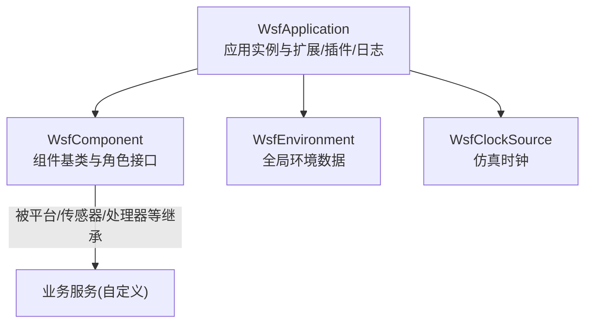
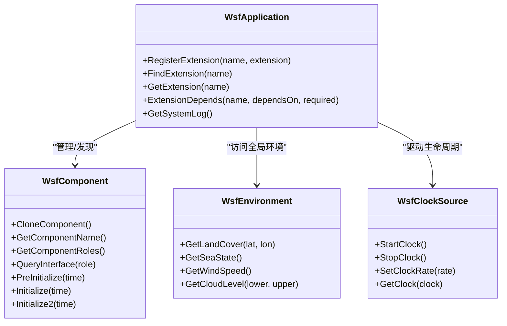
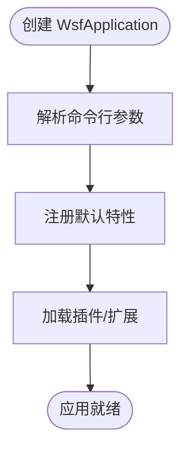
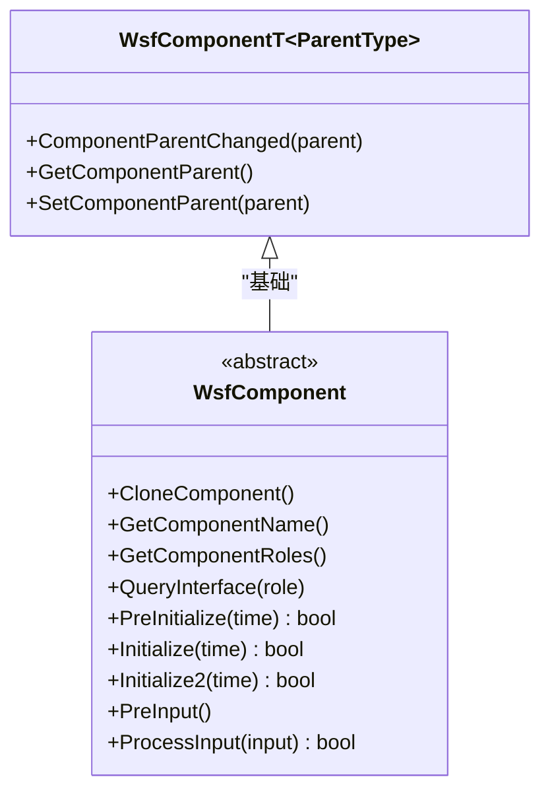
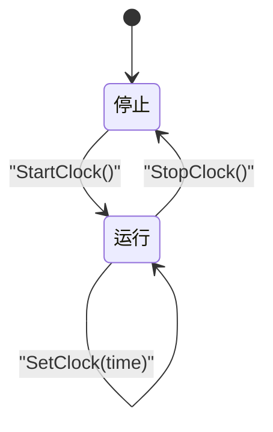
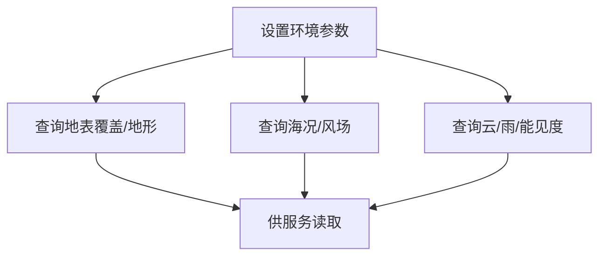
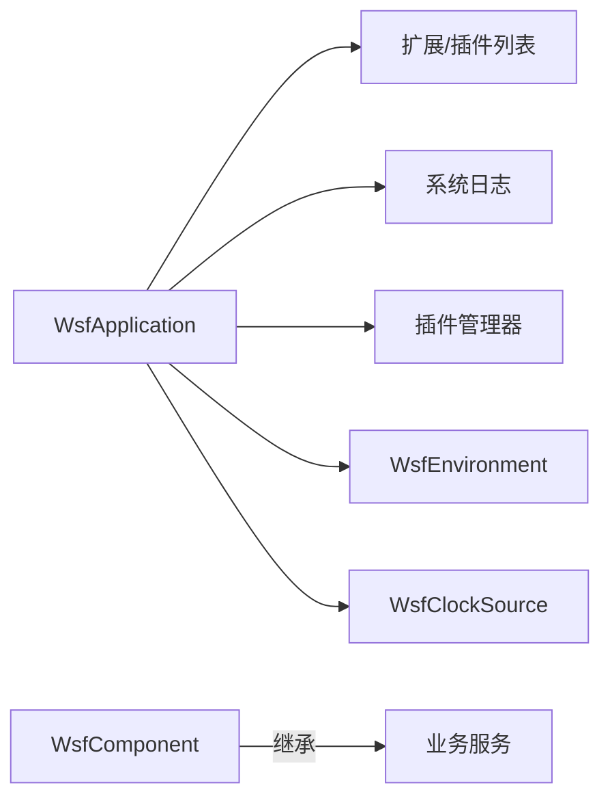

# 服务管理器

<cite>
**本文引用的文件**   
- [WsfApplication.hpp](file://swdev/src/core/wsf/source/WsfApplication.hpp)
- [WsfComponent.hpp](file://swdev/src/core/wsf/source/WsfComponent.hpp)
- [WsfClockSource.hpp](file://swdev/src/core/wsf/source/WsfClockSource.hpp)
- [WsfEnvironment.hpp](file://swdev/src/core/wsf/source/WsfEnvironment.hpp)
</cite>

## 目录
1. [简介](#简介)
2. [项目结构](#项目结构)
3. [核心组件](#核心组件)
4. [架构总览](#架构总览)
5. [详细组件分析](#详细组件分析)
6. [依赖关系分析](#依赖关系分析)
7. [性能考虑](#性能考虑)
8. [故障排查指南](#故障排查指南)
9. [结论](#结论)
10. [附录](#附录)

## 简介
本文件面向WSF（仿真框架）中的“服务管理器”概念，围绕服务的注册、查找、生命周期控制与依赖管理展开，并结合仓库中已有的基础设施类进行说明。需要特别说明的是：在当前提供的源码片段中，并未直接出现名为“服务管理器”的单一类；但通过应用级对象、组件接口、时钟源与环境管理等基础设施，可以构建出完整的服务化体系。因此，本文以这些基础设施为锚点，解释如何在其之上实现服务注册/发现、生命周期编排、依赖管理与通信机制，并给出扩展与实践建议。

## 项目结构
WSF核心代码位于 swdev/src/core/wsf/source 目录下。本次文档聚焦以下关键头文件：
- WsfApplication.hpp：应用入口与全局扩展/插件/系统日志等能力
- WsfComponent.hpp：通用组件模型与角色查询接口
- WsfClockSource.hpp：仿真时钟抽象
- WsfEnvironment.hpp：全局环境数据与策略

图表来源
- [WsfApplication.hpp:32-189](file://swdev/src/core/wsf/source/WsfApplication.hpp#L32-L189)
- [WsfComponent.hpp:35-112](file://swdev/src/core/wsf/source/WsfComponent.hpp#L35-L112)
- [WsfClockSource.hpp:21-60](file://swdev/src/core/wsf/source/WsfClockSource.hpp#L21-L60)
- [WsfEnvironment.hpp:30-201](file://swdev/src/core/wsf/source/WsfEnvironment.hpp#L30-L201)

章节来源
- [WsfApplication.hpp:32-189](file://swdev/src/core/wsf/source/WsfApplication.hpp#L32-L189)
- [WsfComponent.hpp:35-112](file://swdev/src/core/wsf/source/WsfComponent.hpp#L35-L112)
- [WsfClockSource.hpp:21-60](file://swdev/src/core/wsf/source/WsfClockSource.hpp#L21-L60)
- [WsfEnvironment.hpp:30-201](file://swdev/src/core/wsf/source/WsfEnvironment.hpp#L30-L201)

## 核心组件
本节从“服务管理器”的职责出发，映射到现有基础设施的能力边界与扩展点。

- 服务注册与发现
  - 应用级扩展注册：WsfApplication 提供 RegisterExtension / FindExtension / GetExtension 等方法，可作为“服务注册表”的基础。
  - 组件角色查询：WsfComponent::QueryInterface 支持按角色获取接口指针，适合用于“按能力发现服务”。

- 生命周期控制
  - 组件初始化阶段：WsfComponent 暴露 PreInitialize / Initialize / Initialize2 等钩子，可用于服务启动阶段的顺序编排。
  - 时钟驱动：WsfClockSource 提供 StartClock / StopClock / SetClockRate 等，便于在仿真时间推进中触发服务更新。

- 依赖管理
  - 扩展依赖声明：WsfApplication::ExtensionDepends 可表达扩展间的依赖关系，有助于在服务间建立依赖拓扑。
  - 组件父对象关系：WsfComponentT 维护 Parent 指针，便于在层级结构中定位依赖。

- 环境与上下文
  - 全局环境：WsfEnvironment 提供地形、海况、风场、云雨等环境数据，供服务读取或订阅。
  - 系统日志：WsfApplication::GetSystemLog 提供统一日志通道，便于服务输出诊断信息。

章节来源
- [WsfApplication.hpp:92-142](file://swdev/src/core/wsf/source/WsfApplication.hpp#L92-L142)
- [WsfComponent.hpp:47-112](file://swdev/src/core/wsf/source/WsfComponent.hpp#L47-L112)
- [WsfClockSource.hpp:32-47](file://swdev/src/core/wsf/source/WsfClockSource.hpp#L32-L47)
- [WsfEnvironment.hpp:111-174](file://swdev/src/core/wsf/source/WsfEnvironment.hpp#L111-L174)

## 架构总览
下图展示以 WsfApplication 为中心，结合 WsfComponent 角色机制、WsfClockSource 时钟驱动与 WsfEnvironment 环境数据的整体架构。

图表来源
- [WsfApplication.hpp:92-142](file://swdev/src/core/wsf/source/WsfApplication.hpp#L92-L142)
- [WsfComponent.hpp:47-112](file://swdev/src/core/wsf/source/WsfComponent.hpp#L47-L112)
- [WsfClockSource.hpp:32-47](file://swdev/src/core/wsf/source/WsfClockSource.hpp#L32-L47)
- [WsfEnvironment.hpp:111-174](file://swdev/src/core/wsf/source/WsfEnvironment.hpp#L111-L174)

## 详细组件分析

### 应用与应用扩展（WsfApplication）
- 职责
  - 维护应用名称、命令行参数、扩展列表、特性标志、脚本类型、系统日志与插件管理器。
  - 提供扩展的注册、依赖声明与查询方法，作为“服务注册中心”的基础。
- 关键点
  - 单例式应用实例：mInstancePtr 保证全局唯一性。
  - 线程安全：使用递归互斥量保护扩展列表操作。
  - 测试模式：IsTestingEnabled 用于自动化测试场景。

图表来源
- [WsfApplication.hpp:76-189](file://swdev/src/core/wsf/source/WsfApplication.hpp#L76-L189)

章节来源
- [WsfApplication.hpp:32-189](file://swdev/src/core/wsf/source/WsfApplication.hpp#L32-L189)

### 组件与角色（WsfComponent）
- 职责
  - 定义通用组件接口：克隆、命名、角色枚举、角色查询。
  - 提供初始化钩子：PreInitialize / Initialize / Initialize2，以及输入处理钩子。
  - 模板派生 WsfComponentT 维护父子关系，便于层级化组织服务。
- 关键点
  - 角色机制：GetComponentRoles 返回由具体到一般的角色数组，QueryInterface 按角色返回接口指针。
  - 类型安全的 QueryInterfaceT 模板辅助查询。

图表来源
- [WsfComponent.hpp:35-112](file://swdev/src/core/wsf/source/WsfComponent.hpp#L35-L112)
- [WsfComponent.hpp:117-168](file://swdev/src/core/wsf/source/WsfComponent.hpp#L117-L168)

章节来源
- [WsfComponent.hpp:35-168](file://swdev/src/core/wsf/source/WsfComponent.hpp#L35-L168)

### 时钟源（WsfClockSource）
- 职责
  - 抽象仿真时钟：当前时间、速率、暂停/运行、最大时间限制。
- 关键点
  - 提供 ResetClock / SetClock / SetClockRate / StartClock / StopClock 等控制方法。
  - IsStopped 指示时钟是否暂停。

图表来源
- [WsfClockSource.hpp:32-51](file://swdev/src/core/wsf/source/WsfClockSource.hpp#L32-L51)

章节来源
- [WsfClockSource.hpp:21-60](file://swdev/src/core/wsf/source/WsfClockSource.hpp#L21-L60)

### 环境管理器（WsfEnvironment）
- 职责
  - 维护全局环境数据：地表覆盖、地形起伏、海况、风场、云层、降雨、能见度等。
  - 提供基于经纬度的查询方法与策略回调（如动态地表覆盖）。
- 关键点
  - 提供风场高度表、噪声云类型、中央体/椭球体等高级能力。
  - 支持极坐标偏移角配置。

图表来源
- [WsfEnvironment.hpp:111-174](file://swdev/src/core/wsf/source/WsfEnvironment.hpp#L111-L174)

章节来源
- [WsfEnvironment.hpp:30-201](file://swdev/src/core/wsf/source/WsfEnvironment.hpp#L30-L201)

## 依赖关系分析
- 组件耦合
  - WsfApplication 聚合扩展列表、系统日志与插件管理器，承担“服务注册中心”与“运行时上下文”的角色。
  - WsfComponent 是所有业务服务的抽象基类，通过角色机制解耦调用方与被调方。
- 外部依赖
  - WsfEnvironment 依赖地理/气象相关的数据结构与工具（例如 CentralPoint/CentralBody）。
  - WsfClockSource 独立于其他组件，仅维护时间与状态。

图表来源
- [WsfApplication.hpp:150-189](file://swdev/src/core/wsf/source/WsfApplication.hpp#L150-L189)
- [WsfEnvironment.hpp:178-201](file://swdev/src/core/wsf/source/WsfEnvironment.hpp#L178-L201)
- [WsfClockSource.hpp:53-60](file://swdev/src/core/wsf/source/WsfClockSource.hpp#L53-L60)

章节来源
- [WsfApplication.hpp:150-189](file://swdev/src/core/wsf/source/WsfApplication.hpp#L150-L189)
- [WsfEnvironment.hpp:178-201](file://swdev/src/core/wsf/source/WsfEnvironment.hpp#L178-L201)
- [WsfClockSource.hpp:53-60](file://swdev/src/core/wsf/source/WsfClockSource.hpp#L53-L60)

## 性能考虑
- 时钟驱动
  - 合理设置时钟速率与步长，避免频繁唤醒导致CPU抖动。
- 环境查询
  - 对高频查询的环境数据（如风场、云高）建议缓存或采用增量更新策略。
- 组件初始化
  - 利用 GetComponentInitializationOrder 控制初始化顺序，减少不必要的重计算。
- 日志输出
  - 在高吞吐路径上谨慎使用系统日志，必要时降级为异步或采样输出。

[本节为通用指导，不直接分析具体文件]

## 故障排查指南
- 应用未找到扩展
  - 检查是否在应用启动时正确调用 RegisterExtension，并通过 ExtensionDepends 声明依赖。
  - 使用 FindExtension / GetExtension 验证扩展是否已注册。
- 组件接口为空
  - 确认组件实现了 GetComponentRoles 并在 QueryInterface 中返回对应角色指针。
- 时钟异常
  - 检查 StartClock / StopClock 调用顺序，确保未在停止状态下修改时钟。
- 环境数据不一致
  - 核对环境参数设置顺序与生效范围，必要时通过策略回调替换默认行为。

章节来源
- [WsfApplication.hpp:92-142](file://swdev/src/core/wsf/source/WsfApplication.hpp#L92-L142)
- [WsfComponent.hpp:47-112](file://swdev/src/core/wsf/source/WsfComponent.hpp#L47-L112)
- [WsfClockSource.hpp:32-51](file://swdev/src/core/wsf/source/WsfClockSource.hpp#L32-L51)
- [WsfEnvironment.hpp:111-174](file://swdev/src/core/wsf/source/WsfEnvironment.hpp#L111-L174)

## 结论
尽管仓库未直接提供名为“服务管理器”的单一类，但通过 WsfApplication 的扩展注册与管理、WsfComponent 的角色化组件模型、WsfClockSource 的时钟驱动以及 WsfEnvironment 的全局环境数据，已经具备构建完整服务体系的基石。在此基础上，可实现服务的注册/发现、生命周期编排、依赖管理与通信机制，并支撑上层业务服务的高效开发与集成。

[本节为总结性内容，不直接分析具体文件]

## 附录
- 典型服务开发步骤（概念性流程）
  - 设计服务接口：继承 WsfComponent，实现 CloneComponent / GetComponentName / GetComponentRoles / QueryInterface。
  - 注册服务：在应用启动时通过 WsfApplication::RegisterExtension 注册服务扩展。
  - 声明依赖：使用 ExtensionDepends 声明与其他扩展的依赖关系。
  - 生命周期接入：在 PreInitialize / Initialize / Initialize2 中完成资源准备与初始化。
  - 事件与通信：通过系统日志与扩展机制进行跨服务通信与调试。

[本节为概念性流程，不直接分析具体文件]