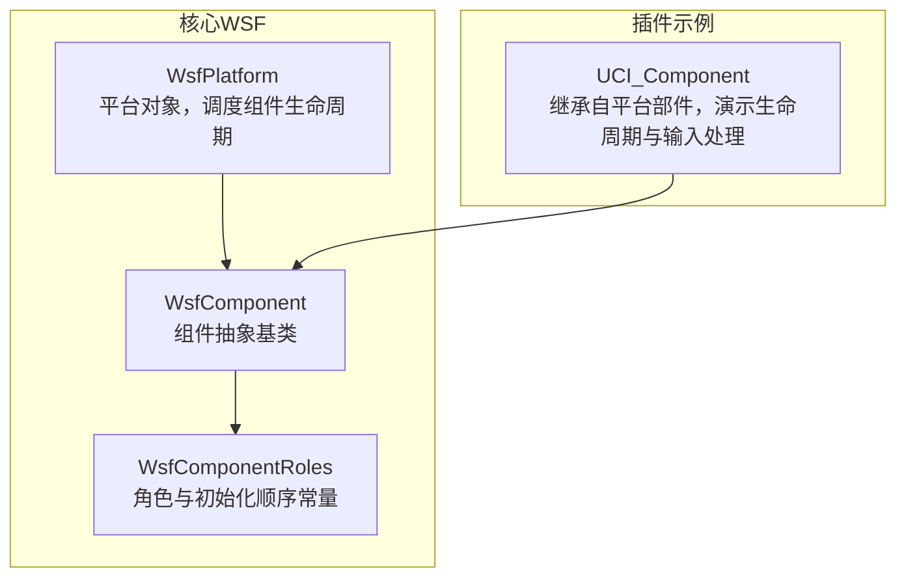
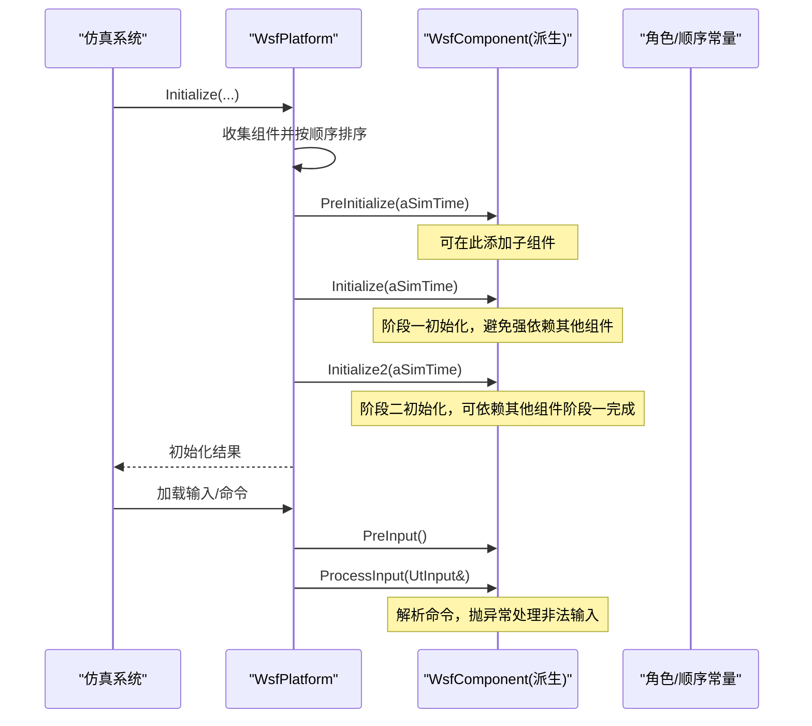
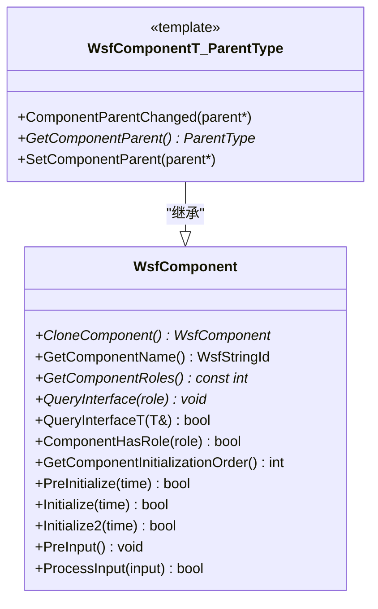
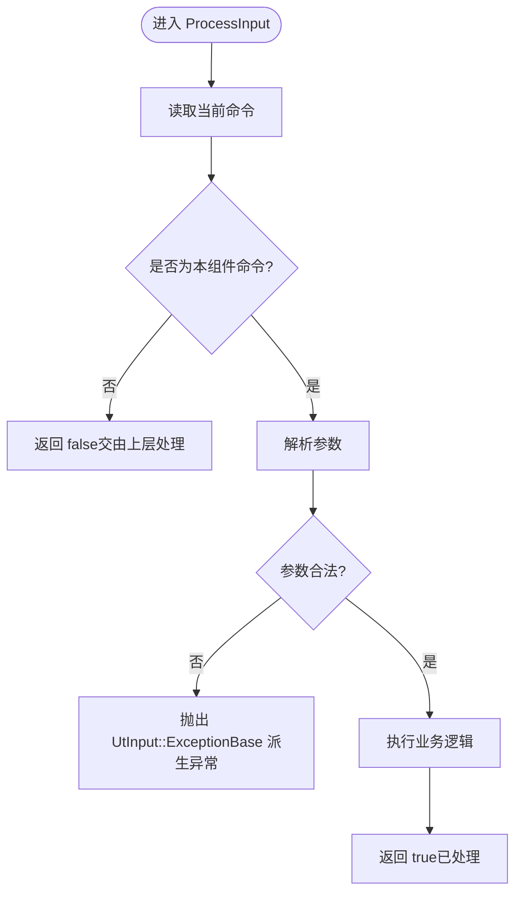
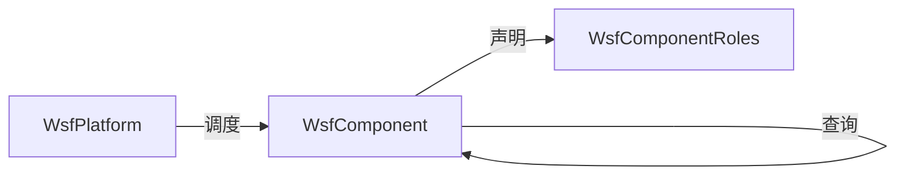

# 组件基类设计

<cite>
**本文引用的文件**   
- [WsfComponent.hpp](file://swdev/src/core/wsf/source/WsfComponent.hpp)
- [WsfComponent.cpp](file://swdev/src/core/wsf/source/WsfComponent.cpp)
- [WsfComponentRoles.hpp](file://swdev/src/core/wsf/source/WsfComponentRoles.hpp)
- [WsfPlatform.cpp](file://swdev/src/core/wsf/source/WsfPlatform.cpp)
- [WsfUCI_Component.cpp](file://swdev/src/wsf_plugins/wsf_oms_uci/source/WsfUCI_Component.cpp)
</cite>

## 目录
1. [引言](#引言)
2. [项目结构](#项目结构)
3. [核心组件](#核心组件)
4. [架构总览](#架构总览)
5. [详细组件分析](#详细组件分析)
6. [依赖关系分析](#依赖关系分析)
7. [性能考虑](#性能考虑)
8. [故障排查指南](#故障排查指南)
9. [结论](#结论)
10. [附录](#附录)

## 引言
本文件面向WSF（AFSIM的仿真框架）中的组件体系，聚焦于组件抽象基类 WsfComponent 的设计与使用。文档将深入解释：
- 组件抽象接口定义（克隆、命名、角色与查询）
- 生命周期管理（PreInitialize、Initialize、Initialize2、PreInput、ProcessInput）
- 消息/输入处理机制（ProcessInput）
- 状态模型与初始化顺序控制（GetComponentInitializationOrder）
- 继承最佳实践（虚函数重写规范、内存管理与异常处理模式）
并给出基于仓库中真实实现的参考路径，帮助读者正确实现自定义组件。

## 项目结构
围绕 WsfComponent 的关键代码位于核心 WSF 模块中，平台侧负责调度组件生命周期；示例插件展示了如何扩展基类。

图表来源
- [WsfComponent.hpp:38-112](file://swdev/src/core/wsf/source/WsfComponent.hpp#L38-L112)
- [WsfComponentRoles.hpp:89-184](file://swdev/src/core/wsf/source/WsfComponentRoles.hpp#L89-L184)
- [WsfPlatform.cpp:249-403](file://swdev/src/core/wsf/source/WsfPlatform.cpp#L249-L403)
- [WsfUCI_Component.cpp:143-169](file://swdev/src/wsf_plugins/wsf_oms_uci/source/WsfUCI_Component.cpp#L143-L169)

章节来源
- [WsfComponent.hpp:38-112](file://swdev/src/core/wsf/source/WsfComponent.hpp#L38-L112)
- [WsfComponentRoles.hpp:89-184](file://swdev/src/core/wsf/source/WsfComponentRoles.hpp#L89-L184)
- [WsfPlatform.cpp:249-403](file://swdev/src/core/wsf/source/WsfPlatform.cpp#L249-L403)
- [WsfUCI_Component.cpp:143-169](file://swdev/src/wsf_plugins/wsf_oms_uci/source/WsfUCI_Component.cpp#L143-L169)

## 核心组件
本节聚焦 WsfComponent 的核心职责与接口契约。

- 组件抽象接口
  - CloneComponent：克隆组件，返回空指针表示不支持克隆
  - GetComponentName：组件唯一名称
  - GetComponentRoles：组件角色数组（首项为主角色，按具体性降序）
  - QueryInterface：按角色查询接口指针
  - QueryInterfaceT：类型安全的接口查询模板封装
  - ComponentHasRole：判断是否具备某角色

- 通用生命周期钩子（可选实现）
  - PreInitialize(aSimTime)：预初始化，允许添加子组件
  - Initialize(aSimTime)：第一阶段初始化，完成数据校验与准备
  - Initialize2(aSimTime)：第二阶段初始化，可依赖其他组件已完成阶段一
  - PreInput()：在首次输入处理前调用，用于工厂或类型相关的前置逻辑
  - ProcessInput(UtInput&)：解析并处理输入命令

- 初始化顺序控制
  - GetComponentInitializationOrder()：默认返回0，可通过重写强制排序

章节来源
- [WsfComponent.hpp:38-112](file://swdev/src/core/wsf/source/WsfComponent.hpp#L38-L112)
- [WsfComponent.cpp:14-103](file://swdev/src/core/wsf/source/WsfComponent.cpp#L14-L103)

## 架构总览
下图展示平台如何驱动组件生命周期，以及组件如何通过角色进行互操作。

图表来源
- [WsfPlatform.cpp:249-403](file://swdev/src/core/wsf/source/WsfPlatform.cpp#L249-L403)
- [WsfComponent.cpp:14-103](file://swdev/src/core/wsf/source/WsfComponent.cpp#L14-L103)
- [WsfComponentRoles.hpp:155-184](file://swdev/src/core/wsf/source/WsfComponentRoles.hpp#L155-L184)

## 详细组件分析

### 组件抽象接口与角色机制
- 角色枚举与约定
  - 角色编号由委员会统一分配，核心WSF占0-199，扩展在其他目录，站点从1000起
  - 组件可声明多个角色，首项为主角色
  - 通过 QueryInterface 获取指定角色的接口指针

- 类型安全查询
  - QueryInterfaceT 提供模板化查询，减少显式转换风险

- 克隆与命名
  - CloneComponent 必须实现以支持对象复制/克隆流程
  - GetComponentName 保证组件名唯一性

章节来源
- [WsfComponent.hpp:38-112](file://swdev/src/core/wsf/source/WsfComponent.hpp#L38-L112)
- [WsfComponentRoles.hpp:64-153](file://swdev/src/core/wsf/source/WsfComponentRoles.hpp#L64-L153)

#### 类图（WsfComponent 及其模板派生）

图表来源
- [WsfComponent.hpp:38-168](file://swdev/src/core/wsf/source/WsfComponent.hpp#L38-L168)

### 生命周期方法详解

- PreInitialize(double aSimTime)
  - 调用时机：平台初始化早期，所有组件之前
  - 目的：允许组件添加子组件；不得假设其他组件的状态
  - 返回值：true 成功，false 失败（平台会记录错误）
  - 注意：此阶段是添加子组件的唯一合适位置

- Initialize(double aSimTime)
  - 调用时机：阶段一初始化，按 GetComponentInitializationOrder 排序
  - 目的：完成输入数据的最终校验与运行前准备
  - 约束：不应依赖其他组件已初始化；如需依赖，请使用 Initialize2 或调整顺序
  - 返回值：true 成功，false 失败

- Initialize2(double aSimTime)
  - 调用时机：阶段二初始化，在所有组件阶段一完成后
  - 目的：处理跨组件依赖的最终装配
  - 约束：不得添加子组件
  - 返回值：true 成功，false 失败

- PreInput()
  - 调用时机：首次输入处理前（某些上下文）
  - 目的：供工厂或类型相关逻辑执行前置工作（例如动态添加子组件）
  - 说明：当前仅在部分平台级组件中实现（如通信、处理器、传感器等）

- ProcessInput(UtInput& aInput)
  - 调用时机：输入流解析时
  - 行为：读取当前命令，若识别则处理并返回 true；否则返回 false
  - 异常：遇到非法输入应抛出 UtInput::ExceptionBase 派生异常

章节来源
- [WsfComponent.cpp:14-103](file://swdev/src/core/wsf/source/WsfComponent.cpp#L14-L103)

### 初始化顺序与依赖管理
- 顺序控制
  - 通过 GetComponentInitializationOrder 返回整型值，越小越先初始化
  - 框架提供若干参考常量（如 mover、track manager、comm、sensor 等），便于插入自身顺序

- 依赖策略
  - 阶段一（Initialize）应避免对其他组件状态的依赖
  - 阶段二（Initialize2）可用于处理跨组件依赖
  - 若确需严格顺序，优先调整 GetComponentInitializationOrder，其次才考虑在 Initialize2 中做条件检查

章节来源
- [WsfComponent.hpp:77-79](file://swdev/src/core/wsf/source/WsfComponent.hpp#L77-L79)
- [WsfComponentRoles.hpp:155-184](file://swdev/src/core/wsf/source/WsfComponentRoles.hpp#L155-L184)

### 消息传递与输入处理机制
- 输入处理入口
  - 组件通过 ProcessInput 接收并解析命令
  - 不识别的命令应原样留在输入流并返回 false，交由上层继续分发

- 典型用法
  - 读取命令后，根据分支处理参数
  - 对非法参数抛出 UtInput::ExceptionBase 派生异常
  - 若需要调用父类实现，应在末尾回传父类结果

章节来源
- [WsfComponent.cpp:88-103](file://swdev/src/core/wsf/source/WsfComponent.cpp#L88-L103)
- [WsfUCI_Component.cpp:151-169](file://swdev/src/wsf_plugins/wsf_oms_uci/source/WsfUCI_Component.cpp#L151-L169)

### 继承与最佳实践

- 虚函数重写规范
  - 必须实现：CloneComponent、GetComponentName、GetComponentRoles、QueryInterface
  - 建议实现：PreInitialize、Initialize、Initialize2、ProcessInput（按需）
  - 若继承自平台部件（如 WsfPlatformPart），在 Initialize2 中应最后调用父类实现

- 内存管理原则
  - 克隆：CloneComponent 返回新对象；不支持克隆时返回 nullptr
  - 父指针：通过 SetComponentParent 设置父对象，内部会通知 ComponentParentChanged
  - 删除：遵循平台/列表的生命周期管理，不要直接析构平台成员

- 异常处理模式
  - 输入解析失败：抛出 UtInput::ExceptionBase 派生异常
  - 初始化失败：返回 false，由平台记录错误日志
  - 不要在 PreInitialize 之外添加子组件

- 示例参考
  - UCI_Component 在 Initialize2 中调用父类实现，并在 ProcessInput 中处理特定命令

章节来源
- [WsfComponent.hpp:118-168](file://swdev/src/core/wsf/source/WsfComponent.hpp#L118-L168)
- [WsfUCI_Component.cpp:143-169](file://swdev/src/wsf_plugins/wsf_oms_uci/source/WsfUCI_Component.cpp#L143-L169)

### 代码级流程图（ProcessInput 决策）

图表来源
- [WsfComponent.cpp:88-103](file://swdev/src/core/wsf/source/WsfComponent.cpp#L88-L103)

## 依赖关系分析
- 组件与平台
  - WsfPlatform 负责收集组件、排序、依次调用生命周期方法
  - 组件通过角色暴露能力，平台可在运行时通过 QueryInterface 获取特定接口

- 组件与角色
  - 角色常量集中管理，确保跨模块一致性
  - 组件通过 GetComponentRoles 声明其能力层次

图表来源
- [WsfPlatform.cpp:249-403](file://swdev/src/core/wsf/source/WsfPlatform.cpp#L249-L403)
- [WsfComponentRoles.hpp:89-184](file://swdev/src/core/wsf/source/WsfComponentRoles.hpp#L89-L184)
- [WsfComponent.hpp:38-112](file://swdev/src/core/wsf/source/WsfComponent.hpp#L38-L112)

章节来源
- [WsfPlatform.cpp:249-403](file://swdev/src/core/wsf/source/WsfPlatform.cpp#L249-L403)
- [WsfComponentRoles.hpp:89-184](file://swdev/src/core/wsf/source/WsfComponentRoles.hpp#L89-L184)
- [WsfComponent.hpp:38-112](file://swdev/src/core/wsf/source/WsfComponent.hpp#L38-L112)

## 性能考虑
- 初始化顺序
  - 合理设置 GetComponentInitializationOrder 可减少不必要的条件判断与重试
- 输入处理
  - 在 ProcessInput 中尽早返回 false，避免无谓的参数解析
- 克隆
  - 仅实现必要的克隆逻辑，避免深拷贝昂贵资源

[本节为通用指导，不涉及具体文件分析]

## 故障排查指南
- 初始化失败
  - 检查 PreInitialize/Initialize/Initialize2 的返回值
  - 查看平台日志中关于“failed phase one/two initialization”的错误信息
- 输入解析异常
  - 确认 ProcessInput 中对非法参数的异常抛出是否正确
  - 检查命令分支是否遗漏了必要字段
- 依赖未就绪
  - 若组件在 Initialize 中访问其他组件状态导致问题，请迁移至 Initialize2 或调整初始化顺序

章节来源
- [WsfPlatform.cpp:314-403](file://swdev/src/core/wsf/source/WsfPlatform.cpp#L314-L403)
- [WsfComponent.cpp:88-103](file://swdev/src/core/wsf/source/WsfComponent.cpp#L88-L103)

## 结论
WsfComponent 提供了统一的组件抽象与生命周期钩子，配合 WsfPlatform 的调度与 WsfComponentRoles 的角色/顺序常量，构成了可扩展、可组合的仿真组件体系。开发者应遵循：
- 明确角色与接口契约
- 合理使用两阶段初始化
- 谨慎管理依赖与顺序
- 正确处理输入与异常
以此构建健壮、可维护的自定义组件。

[本节为总结性内容，不涉及具体文件分析]

## 附录

### 关键API速查
- 组件抽象
  - CloneComponent / GetComponentName / GetComponentRoles / QueryInterface / QueryInterfaceT / ComponentHasRole
- 生命周期
  - PreInitialize / Initialize / Initialize2 / PreInput / ProcessInput
- 顺序控制
  - GetComponentInitializationOrder

章节来源
- [WsfComponent.hpp:38-112](file://swdev/src/core/wsf/source/WsfComponent.hpp#L38-L112)
- [WsfComponent.cpp:14-103](file://swdev/src/core/wsf/source/WsfComponent.cpp#L14-L103)