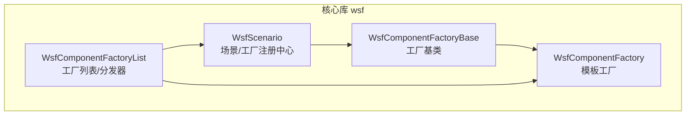
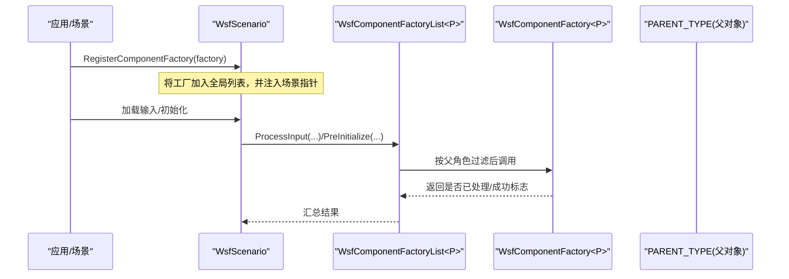
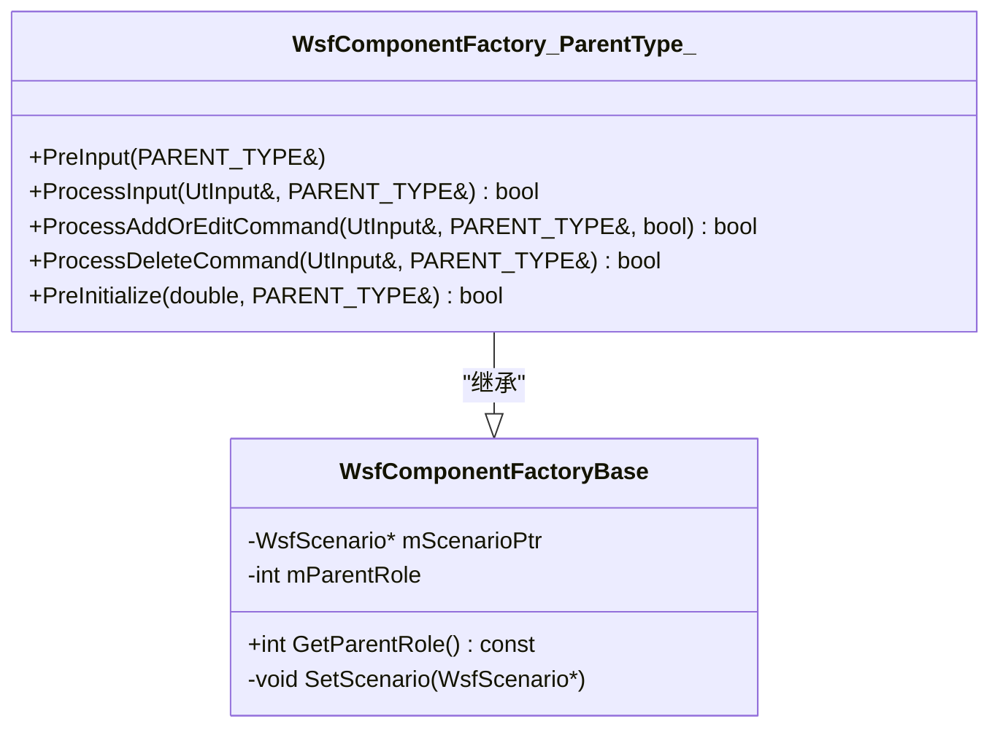
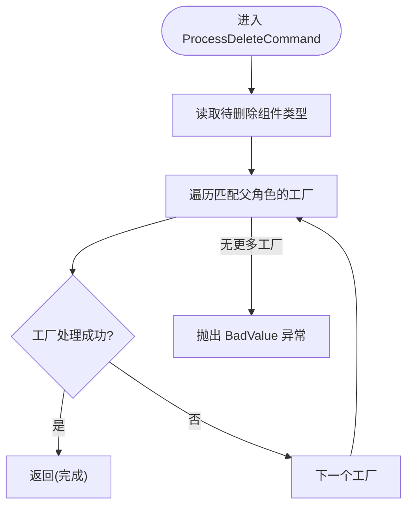
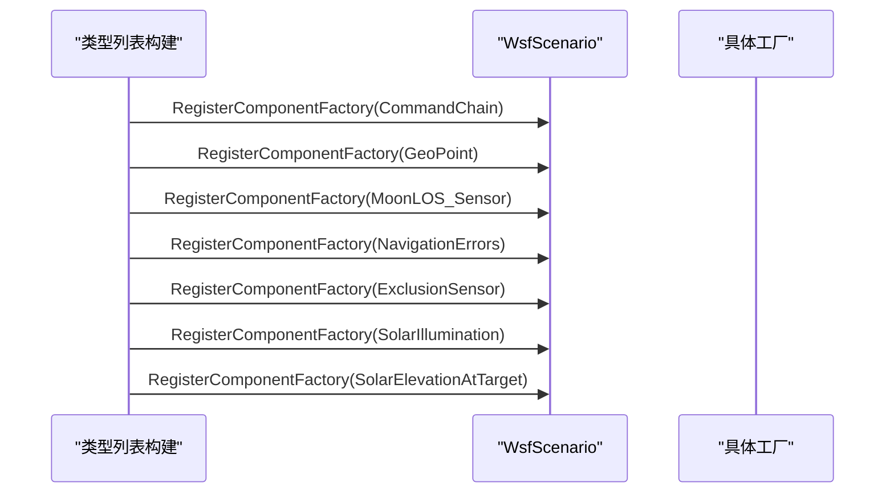
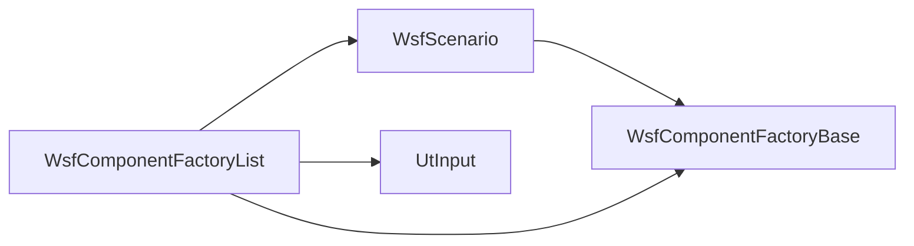

# 组件工厂系统

<cite>
**本文引用的文件**   
- [WsfComponentFactory.hpp](file://swdev/src/core/wsf/source/WsfComponentFactory.hpp)
- [WsfComponentFactory.cpp](file://swdev/src/core/wsf/source/WsfComponentFactory.cpp)
- [WsfComponentFactoryList.hpp](file://swdev/src/core/wsf/source/WsfComponentFactoryList.hpp)
- [WsfScenario.hpp](file://swdev/src/core/wsf/source/WsfScenario.hpp)
- [WsfScenario.cpp](file://swdev/src/core/wsf/source/WsfScenario.cpp)
</cite>

## 目录
1. [引言](#引言)
2. [项目结构](#项目结构)
3. [核心组件](#核心组件)
4. [架构总览](#架构总览)
5. [详细组件分析](#详细组件分析)
6. [依赖关系分析](#依赖关系分析)
7. [性能与可扩展性](#性能与可扩展性)
8. [故障排查指南](#故障排查指南)
9. [结论](#结论)
10. [附录：配置语法与扩展点参考](#附录配置语法与扩展点参考)

## 引言
本文件面向WSF（Simulation Integration and Modeling Framework）中的“组件工厂系统”，聚焦于模板类 WsfComponentFactory 的设计模式与实现原理，解释其动态实例化机制、类型注册体系、以及基于场景的生命周期管理。文档同时给出工厂模式的扩展点、组件发现机制、生命周期阶段、错误恢复策略，并提供自定义工厂开发示例与配置语法参考，帮助读者在AFSIM中扩展平台部件、处理器等可配置组件的创建流程。

## 项目结构
围绕组件工厂的核心代码位于核心库 wsf 模块中，关键文件如下：
- 工厂基类与模板工厂定义：WsfComponentFactory.hpp/.cpp
- 工厂列表与分发器：WsfComponentFactoryList.hpp
- 场景管理与工厂注册：WsfScenario.hpp/.cpp

图示来源
- [WsfComponentFactory.hpp:23-58](file://swdev/src/core/wsf/source/WsfComponentFactory.hpp#L23-L58)
- [WsfComponentFactoryList.hpp:54-176](file://swdev/src/core/wsf/source/WsfComponentFactoryList.hpp#L54-L176)
- [WsfScenario.hpp:198-201](file://swdev/src/core/wsf/source/WsfScenario.hpp#L198-L201)

章节来源
- [WsfComponentFactory.hpp:23-106](file://swdev/src/core/wsf/source/WsfComponentFactory.hpp#L23-L106)
- [WsfComponentFactoryList.hpp:21-52](file://swdev/src/core/wsf/source/WsfComponentFactoryList.hpp#L21-L52)
- [WsfScenario.hpp:198-201](file://swdev/src/core/wsf/source/WsfScenario.hpp#L198-L201)

## 核心组件
- WsfComponentFactoryBase：工厂基类，持有父角色与场景引用，提供 SetScenario 钩子用于注入场景上下文。
- WsfComponentFactory<PARENT_TYPE>：针对特定父类型的模板工厂，暴露 PreInput、ProcessInput、ProcessAddOrEditCommand、ProcessDeleteCommand、PreInitialize 等生命周期钩子，供具体组件类型覆盖以实现解析、校验与初始化逻辑。
- WsfComponentFactoryList<PARENT_TYPE>：按父类型过滤并迭代调用工厂方法的分发器，封装了遍历、短路返回、异常抛出等通用行为。
- WsfScenario：场景对象，负责集中注册所有工厂，并在类型列表构建阶段统一注册默认工厂；对外提供 RegisterComponentFactory 与 GetComponentFactoryList 接口。

章节来源
- [WsfComponentFactory.hpp:23-106](file://swdev/src/core/wsf/source/WsfComponentFactory.hpp#L23-L106)
- [WsfComponentFactory.cpp:14-22](file://swdev/src/core/wsf/source/WsfComponentFactory.cpp#L14-L22)
- [WsfComponentFactoryList.hpp:54-176](file://swdev/src/core/wsf/source/WsfComponentFactoryList.hpp#L54-L176)
- [WsfScenario.hpp:198-201](file://swdev/src/core/wsf/source/WsfScenario.hpp#L198-L201)
- [WsfScenario.cpp:850-854](file://swdev/src/core/wsf/source/WsfScenario.cpp#L850-L854)

## 架构总览
组件工厂系统采用“模板工厂 + 列表分发 + 场景注册”的组合模式：
- 每个组件类型对应一个继承自 WsfComponentFactory<PARENT_TYPE> 的具体工厂。
- 各工厂通过 WsfScenario::RegisterComponentFactory 注册到全局工厂列表。
- 输入处理与初始化阶段由 WsfComponentFactoryList 根据父类型筛选并顺序调用工厂方法，形成统一的扩展点。

图示来源
- [WsfScenario.cpp:850-854](file://swdev/src/core/wsf/source/WsfScenario.cpp#L850-L854)
- [WsfComponentFactoryList.hpp:117-175](file://swdev/src/core/wsf/source/WsfComponentFactoryList.hpp#L117-L175)
- [WsfComponentFactory.hpp:61-105](file://swdev/src/core/wsf/source/WsfComponentFactory.hpp#L61-L105)

## 详细组件分析

### WsfComponentFactoryBase 与 WsfComponentFactory<PARENT_TYPE>
- 设计要点
  - 通过 cCOMPONENT_ROLE<PARENT_TYPE>() 绑定父角色，确保列表分发时仅匹配目标父类型。
  - 暴露标准生命周期钩子：PreInput、ProcessInput、ProcessAddOrEditCommand、ProcessDeleteCommand、PreInitialize。
  - 支持多次调用 PreInput（同一父对象可能被多次预处理）。
- 复杂度与行为
  - 工厂本身不维护复杂状态，主要职责是解析输入、校验参数、必要时添加/删除组件，或在预初始化阶段进行依赖检查。
  - 返回值约定：Process* 系列方法返回 true 表示已处理该命令，false 表示交由后续工厂处理。

图示来源
- [WsfComponentFactory.hpp:23-58](file://swdev/src/core/wsf/source/WsfComponentFactory.hpp#L23-L58)
- [WsfComponentFactory.hpp:51-106](file://swdev/src/core/wsf/source/WsfComponentFactory.hpp#L51-L106)

章节来源
- [WsfComponentFactory.hpp:23-106](file://swdev/src/core/wsf/source/WsfComponentFactory.hpp#L23-L106)
- [WsfComponentFactory.cpp:14-22](file://swdev/src/core/wsf/source/WsfComponentFactory.cpp#L14-L22)

### WsfComponentFactoryList<PARENT_TYPE>
- 设计要点
  - 内部 Iterator 根据父角色过滤工厂列表，跳过不匹配的工厂，保证只调用相关工厂。
  - 静态方法封装了对工厂的统一调用：PreInput、ProcessInput、ProcessAddOrEditCommand、ProcessDeleteCommand、PreInitialize。
  - 对未知删除命令抛出 UtInput::BadValue 异常，便于上层捕获与提示。
- 算法流程（以 ProcessDeleteCommand 为例）

图示来源
- [WsfComponentFactoryList.hpp:149-160](file://swdev/src/core/wsf/source/WsfComponentFactoryList.hpp#L149-L160)

章节来源
- [WsfComponentFactoryList.hpp:54-176](file://swdev/src/core/wsf/source/WsfComponentFactoryList.hpp#L54-L176)

### WsfScenario 与工厂注册
- 工厂注册
  - RegisterComponentFactory 将工厂加入全局列表，并通过 SetScenario 注入场景指针，使工厂能访问场景资源。
- 默认工厂注册
  - CreateTypeLists 中统一注册若干默认组件工厂（如命令链、地理点、月球视线传感器、导航误差、排除区传感器、太阳照明/高度角等），确保内置能力可用。

图示来源
- [WsfScenario.cpp:955-1012](file://swdev/src/core/wsf/source/WsfScenario.cpp#L955-L1012)

章节来源
- [WsfScenario.hpp:198-201](file://swdev/src/core/wsf/source/WsfScenario.hpp#L198-L201)
- [WsfScenario.cpp:850-854](file://swdev/src/core/wsf/source/WsfScenario.cpp#L850-L854)
- [WsfScenario.cpp:955-1012](file://swdev/src/core/wsf/source/WsfScenario.cpp#L955-L1012)

## 依赖关系分析
- 耦合关系
  - WsfComponentFactoryBase 依赖 WsfScenario（通过 SetScenario 注入）。
  - WsfComponentFactoryList 依赖 WsfScenario（获取工厂列表）与 UtInput（解析命令）。
  - WsfScenario 聚合所有工厂，并在类型列表构建阶段主动注册默认工厂。
- 外部依赖
  - 日志：UtLog（用于错误记录）。
  - 输入解析：UtInput（命令与属性解析）。
  - 内存管理：std::unique_ptr（工厂所有权）。

图示来源
- [WsfComponentFactoryList.hpp:17-19](file://swdev/src/core/wsf/source/WsfComponentFactoryList.hpp#L17-L19)
- [WsfComponentFactory.hpp:17-21](file://swdev/src/core/wsf/source/WsfComponentFactory.hpp#L17-L21)
- [WsfScenario.hpp:198-201](file://swdev/src/core/wsf/source/WsfScenario.hpp#L198-L201)

章节来源
- [WsfComponentFactoryList.hpp:17-19](file://swdev/src/core/wsf/source/WsfComponentFactoryList.hpp#L17-L19)
- [WsfComponentFactory.hpp:17-21](file://swdev/src/core/wsf/source/WsfComponentFactory.hpp#L17-L21)
- [WsfScenario.hpp:198-201](file://swdev/src/core/wsf/source/WsfScenario.hpp#L198-L201)

## 性能与可扩展性
- 性能特性
  - 工厂列表为线性遍历，时间复杂度 O(n)，n 为注册的工厂数量。由于按父角色过滤，实际调用数通常较小。
  - 使用 std::unique_ptr 管理工厂生命周期，避免额外拷贝开销。
- 可扩展性
  - 新增组件类型：实现 WsfComponentFactory<YourParentType> 子类，并在合适时机调用 WsfScenario::RegisterComponentFactory 注册。
  - 插件式扩展：可在插件初始化阶段注册自定义工厂，无需修改核心代码。
  - 版本兼容：通过父角色与类型名区分不同版本或变体，避免冲突。

[本节为通用指导，不涉及具体文件分析]

## 故障排查指南
- 常见错误
  - 未知删除命令：当没有工厂处理删除命令时，WsfComponentFactoryList 会抛出 UtInput::BadValue，包含待删除对象类型信息。
  - 工厂未注册：若自定义组件无法被识别，检查是否在场景初始化阶段调用了 RegisterComponentFactory。
  - 父角色不匹配：确保工厂构造时使用正确的 PARENT_TYPE，以保证 cCOMPONENT_ROLE 匹配。
- 定位建议
  - 查看日志输出：工厂预初始化失败时会记录组件名称。
  - 检查注册顺序：确保依赖的工厂先于使用者注册。
  - 验证输入语法：确认命令与属性映射符合预期。

章节来源
- [WsfComponentFactoryList.hpp:149-160](file://swdev/src/core/wsf/source/WsfComponentFactoryList.hpp#L149-L160)
- [WsfComponentFactoryList.hpp:162-175](file://swdev/src/core/wsf/source/WsfComponentFactoryList.hpp#L162-L175)

## 结论
WSF 组件工厂系统通过模板工厂与列表分发机制，提供了稳定、可扩展的组件创建与生命周期管理能力。WsfComponentFactory 定义了清晰的扩展点，WsfComponentFactoryList 实现了统一的调度与错误处理，WsfScenario 作为注册中心协调工厂的装配。借助这一框架，开发者可以以最小侵入的方式扩展平台部件、处理器等组件，满足复杂仿真建模需求。

[本节为总结性内容，不涉及具体文件分析]

## 附录：配置语法与扩展点参考

### 生命周期钩子与用途
- PreInput：在父对象预处理阶段执行，适合做前置准备或数据收集。
- ProcessInput：解析与当前父对象相关的输入命令，返回 true 表示已处理。
- ProcessAddOrEditCommand：处理 add/edit 语义的命令，常用于平台级组件的增改。
- ProcessDeleteCommand：处理 delete 语义的命令，需配合列表分发器的异常处理。
- PreInitialize：在父对象真正初始化前进行依赖检查与必要组件的添加/修复。

章节来源
- [WsfComponentFactory.hpp:61-105](file://swdev/src/core/wsf/source/WsfComponentFactory.hpp#L61-L105)

### 工厂注册与发现机制
- 静态注册表：WsfScenario 维护工厂列表，CreateTypeLists 中注册默认工厂。
- 动态发现：插件或用户代码在运行时调用 RegisterComponentFactory 注册新工厂。
- 自动装配：通过父角色与类型名匹配，列表分发器自动选择并调用相应工厂。

章节来源
- [WsfScenario.cpp:955-1012](file://swdev/src/core/wsf/source/WsfScenario.cpp#L955-L1012)
- [WsfScenario.hpp:198-201](file://swdev/src/core/wsf/source/WsfScenario.hpp#L198-L201)

### 自定义工厂开发示例（步骤说明）
- 步骤一：定义你的父类型 PARENT_TYPE（例如某平台部件类型）。
- 步骤二：实现 WsfComponentFactory<PARENT_TYPE> 的子类，覆盖需要的钩子方法（如 ProcessInput、PreInitialize）。
- 步骤三：在合适的初始化位置（如插件入口或场景构建阶段）调用 WsfScenario::RegisterComponentFactory 注册你的工厂。
- 步骤四：在输入文件中编写对应的命令与属性，确保与工厂解析逻辑一致。
- 步骤五：运行测试，观察日志与异常信息，必要时调整工厂逻辑。

[本节为概念性指导，不涉及具体文件分析]

### XML/文本配置语法参考
- 命令语法：通过 UtInput 解析命令字符串，工厂在 ProcessInput/ProcessAddOrEditCommand/ProcessDeleteCommand 中消费命令。
- 属性映射：工厂从 UtInput 流中读取属性键值对，并进行类型转换与约束校验。
- 约束验证：在 PreInitialize 中进行跨字段或依赖关系的校验，失败时返回 false 并记录错误。

章节来源
- [WsfComponentFactoryList.hpp:125-147](file://swdev/src/core/wsf/source/WsfComponentFactoryList.hpp#L125-L147)
- [WsfComponentFactory.hpp:69-90](file://swdev/src/core/wsf/source/WsfComponentFactory.hpp#L69-L90)