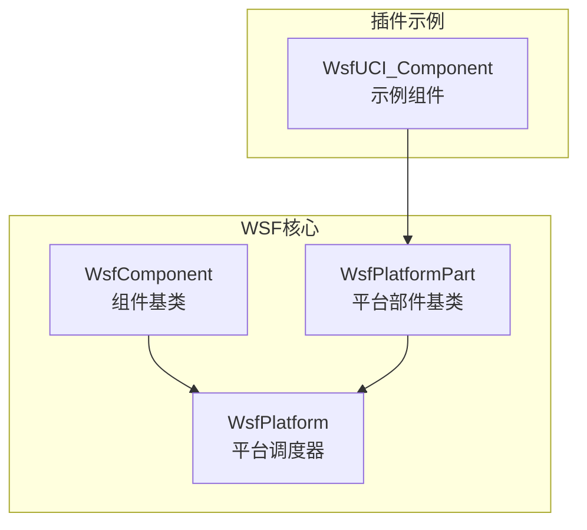
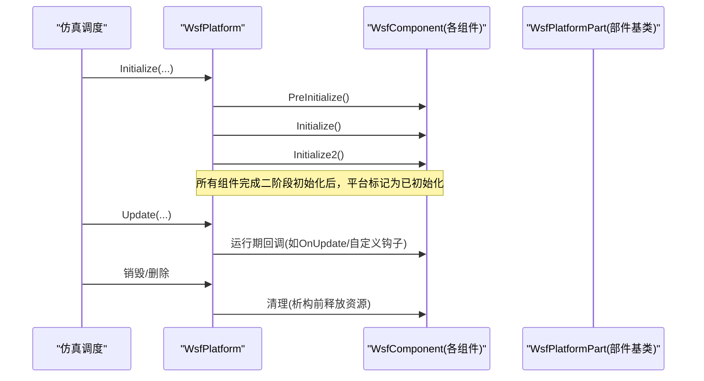
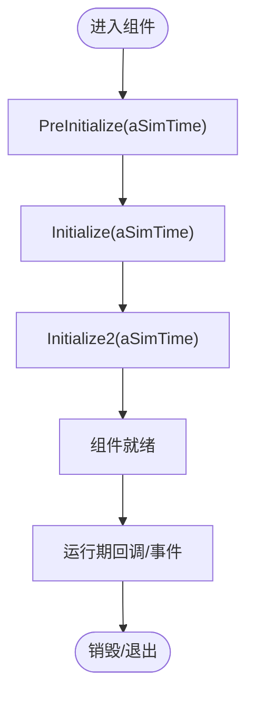
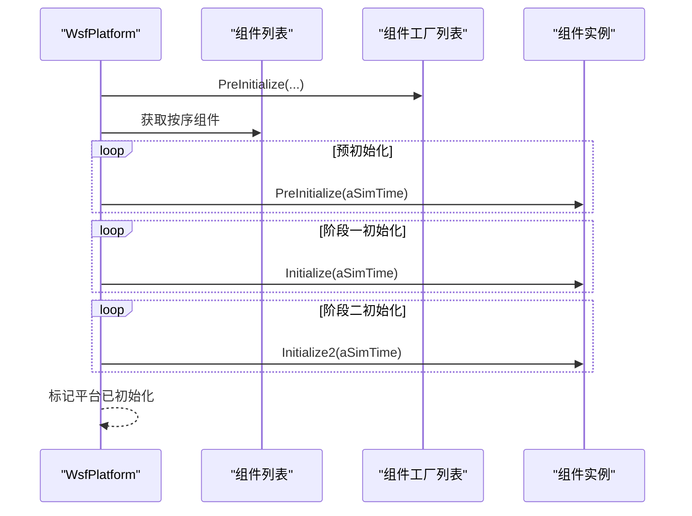
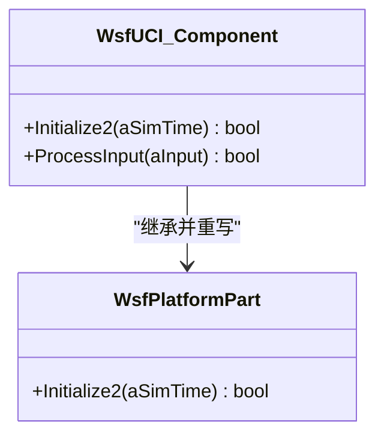
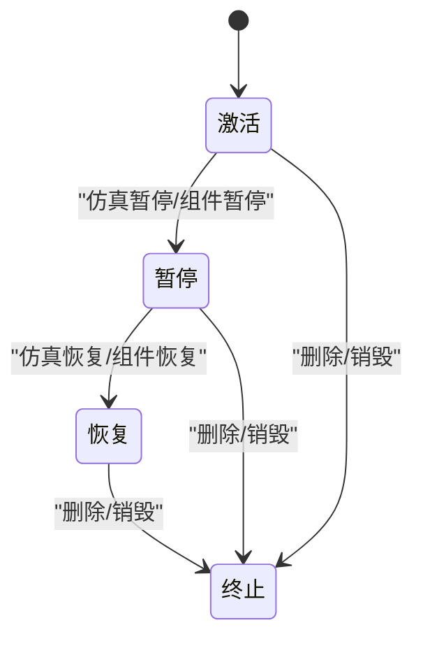
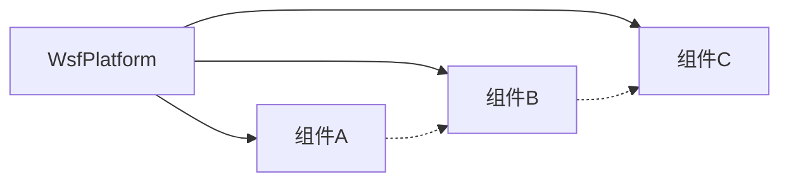

# 组件生命周期管理

<cite>
**本文引用的文件**   
- [WsfComponent.cpp](file://swdev/src/core/wsf/source/WsfComponent.cpp)
- [WsfPlatform.cpp](file://swdev/src/core/wsf/source/WsfPlatform.cpp)
- [WsfPlatformPart.cpp](file://swdev/src/core/wsf/source/WsfPlatformPart.cpp)
- [WsfUCI_Component.cpp](file://swdev/src/wsf_plugins/wsf_oms_uci/source/WsfUCI_Component.cpp)
</cite>

## 目录
1. [简介](#简介)
2. [项目结构](#项目结构)
3. [核心组件](#核心组件)
4. [架构总览](#架构总览)
5. [详细组件分析](#详细组件分析)
6. [依赖关系分析](#依赖关系分析)
7. [性能考虑](#性能考虑)
8. [故障排查指南](#故障排查指南)
9. [结论](#结论)
10. [附录](#附录)

## 简介
本文面向WSF（仿真框架）中的组件生命周期管理，系统阐述从创建到销毁的完整流程，重点覆盖多阶段初始化（PreInitialize、Initialize、Initialize2）、运行阶段与清理阶段。文档解释设计动机、执行顺序、依赖解析、资源分配与状态同步；给出组件状态转换图、并行初始化机制（线程安全、死锁预防、性能优化）以及生命周期钩子的使用指南；并提供常见问题诊断与解决方案。

## 项目结构
围绕WSF平台与组件的核心实现主要位于以下源文件：
- WsfComponent.cpp：定义组件基类的生命周期钩子（PreInitialize、Initialize、Initialize2、PreInput、ProcessInput）。
- WsfPlatform.cpp：平台级对象，负责调度组件的多阶段初始化、脚本上下文、更新循环与观察者通知等。
- WsfPlatformPart.cpp：平台部件基类，提供可被具体部件继承的生命周期方法（如Initialize2）。
- WsfUCI_Component.cpp：示例插件组件，演示如何重写Initialize2并委托给基类。

图表来源
- [WsfComponent.cpp:14-66](file://swdev/src/core/wsf/source/WsfComponent.cpp#L14-L66)
- [WsfPlatform.cpp:249-403](file://swdev/src/core/wsf/source/WsfPlatform.cpp#L249-L403)
- [WsfPlatformPart.cpp:1-200](file://swdev/src/core/wsf/source/WsfPlatformPart.cpp#L1-L200)
- [WsfUCI_Component.cpp:143-149](file://swdev/src/wsf_plugins/wsf_oms_uci/source/WsfUCI_Component.cpp#L143-L149)

章节来源
- [WsfComponent.cpp:14-66](file://swdev/src/core/wsf/source/WsfComponent.cpp#L14-L66)
- [WsfPlatform.cpp:249-403](file://swdev/src/core/wsf/source/WsfPlatform.cpp#L249-L403)
- [WsfPlatformPart.cpp:1-200](file://swdev/src/core/wsf/source/WsfPlatformPart.cpp#L1-L200)
- [WsfUCI_Component.cpp:143-149](file://swdev/src/wsf_plugins/wsf_oms_uci/source/WsfUCI_Component.cpp#L143-L149)

## 核心组件
- WsfComponent：组件抽象基类，定义生命周期钩子与输入处理接口。
- WsfPlatform：平台实例，负责组件注册、初始化编排、运行期更新与销毁。
- WsfPlatformPart：平台部件基类，供具体部件继承以复用生命周期逻辑。
- WsfUCI_Component：示例组件，展示在Initialize2中调用基类实现的模式。

章节来源
- [WsfComponent.cpp:14-66](file://swdev/src/core/wsf/source/WsfComponent.cpp#L14-L66)
- [WsfPlatform.cpp:249-403](file://swdev/src/core/wsf/source/WsfPlatform.cpp#L249-L403)
- [WsfPlatformPart.cpp:1-200](file://swdev/src/core/wsf/source/WsfPlatformPart.cpp#L1-L200)
- [WsfUCI_Component.cpp:143-149](file://swdev/src/wsf_plugins/wsf_oms_uci/source/WsfUCI_Component.cpp#L143-L149)

## 架构总览
WSF采用“平台驱动”的组件生命周期模型：
- 平台在加载与启动时依次触发组件的PreInitialize、Initialize、Initialize2。
- 组件在运行期通过平台的Update/DoUpdate进行位置、传感器、通信等逻辑推进。
- 销毁阶段由平台统一清理组件与相关资源。

图表来源
- [WsfPlatform.cpp:249-403](file://swdev/src/core/wsf/source/WsfPlatform.cpp#L249-L403)
- [WsfComponent.cpp:14-66](file://swdev/src/core/wsf/source/WsfComponent.cpp#L14-L66)

## 详细组件分析

### 组件基类生命周期钩子
- PreInitialize：用于在真正初始化之前添加其他组件或做轻量准备；不应假设其他组件的状态。
- Initialize：第一阶段初始化，完成输入校验与准备工作；不应依赖其他组件的状态。
- Initialize2：第二阶段初始化，适用于存在跨组件依赖的场景；完成后组件应就绪。
- PreInput：在首次输入处理前调用，允许工厂层添加子组件。
- ProcessInput：处理输入命令流。

图表来源
- [WsfComponent.cpp:14-66](file://swdev/src/core/wsf/source/WsfComponent.cpp#L14-L66)

章节来源
- [WsfComponent.cpp:14-66](file://swdev/src/core/wsf/source/WsfComponent.cpp#L14-L66)

### 平台对组件初始化的编排
- 平台先调用组件工厂的PreInitialize，再遍历组件列表调用每个组件的PreInitialize。
- 随后按初始化顺序调用每个组件的Initialize。
- 最后按初始化顺序调用每个组件的Initialize2，并在全部成功后标记平台已初始化。

图表来源
- [WsfPlatform.cpp:314-403](file://swdev/src/core/wsf/source/WsfPlatform.cpp#L314-L403)

章节来源
- [WsfPlatform.cpp:314-403](file://swdev/src/core/wsf/source/WsfPlatform.cpp#L314-L403)

### 示例组件：WsfUCI_Component
- 重写Initialize2，并在末尾调用基类WsfPlatformPart::Initialize2，确保基类逻辑在派生类之后执行。
- 该模式保证派生类可在基类之前完成自身状态设置，同时不破坏基类清理/初始化契约。

图表来源
- [WsfUCI_Component.cpp:143-149](file://swdev/src/wsf_plugins/wsf_oms_uci/source/WsfUCI_Component.cpp#L143-L149)
- [WsfPlatformPart.cpp:1-200](file://swdev/src/core/wsf/source/WsfPlatformPart.cpp#L1-L200)

章节来源
- [WsfUCI_Component.cpp:143-149](file://swdev/src/wsf_plugins/wsf_oms_uci/source/WsfUCI_Component.cpp#L143-L149)
- [WsfPlatformPart.cpp:1-200](file://swdev/src/core/wsf/source/WsfPlatformPart.cpp#L1-L200)

### 组件状态转换图
- 激活（Active）：组件已完成Initialize2且平台已标记为已初始化。
- 暂停（Paused）：运行期被暂停（例如仿真暂停），不再执行更新。
- 恢复（Resumed）：从暂停恢复，继续执行运行期逻辑。
- 终止（Terminated）：组件被删除或平台销毁，进入清理阶段。

说明
- 上述状态为概念性描述，实际实现中由平台与组件共同维护标志位与回调控制。

### 并行初始化机制与线程安全
- 初始化顺序：平台通过GetComponentsByInitializationOrder确定组件初始化顺序，避免隐式依赖导致的竞态。
- 线程安全要点：
  - 初始化期间应避免在多个线程上并发修改共享数据结构。
  - 若需并行执行独立任务，应在Initialize2内显式组织并行任务，并确保无交叉依赖。
- 死锁预防：
  - 避免在初始化回调中持有全局锁的同时调用可能再次请求同一锁的方法。
  - 将耗时操作（如IO、网络）移出关键临界区。
- 性能优化策略：
  - 将重计算放入Initialize2，避免重复工作。
  - 使用延迟初始化与缓存结果。
  - 合理拆分组件职责，减少初始化阶段的耦合。

章节来源
- [WsfPlatform.cpp:314-403](file://swdev/src/core/wsf/source/WsfPlatform.cpp#L314-L403)

### 生命周期钩子使用指南
- 事件订阅：
  - 在PreInitialize或Initialize中订阅平台或组件事件（如平台更新、传感器数据到达）。
  - 在Initialize2中完成最终绑定，确保依赖对象已就绪。
- 资源监控：
  - 在Initialize2中注册资源监控回调（如内存、句柄计数），便于定位泄漏。
- 调试信息输出：
  - 在各阶段入口/出口记录日志，包含组件名、时间戳与关键状态。
  - 在异常路径输出错误上下文，便于快速定位问题。

章节来源
- [WsfComponent.cpp:14-66](file://swdev/src/core/wsf/source/WsfComponent.cpp#L14-L66)
- [WsfPlatform.cpp:314-403](file://swdev/src/core/wsf/source/WsfPlatform.cpp#L314-L403)

## 依赖关系分析
- 组件与平台：
  - 平台负责组件的创建、初始化编排与销毁。
  - 组件依赖平台提供的上下文（如仿真时间、脚本上下文、地形等）。
- 组件之间：
  - 通过初始化顺序与Initialize2解决依赖；避免在Initialize中直接访问其他组件状态。
- 外部依赖：
  - 脚本上下文、地形、轨迹管理等外部子系统在平台初始化早期被配置，组件在其后可用。

图表来源
- [WsfPlatform.cpp:314-403](file://swdev/src/core/wsf/source/WsfPlatform.cpp#L314-L403)
- [WsfComponent.cpp:14-66](file://swdev/src/core/wsf/source/WsfComponent.cpp#L14-L66)

章节来源
- [WsfPlatform.cpp:314-403](file://swdev/src/core/wsf/source/WsfPlatform.cpp#L314-L403)
- [WsfComponent.cpp:14-66](file://swdev/src/core/wsf/source/WsfComponent.cpp#L14-L66)

## 性能考虑
- 初始化阶段：
  - 将昂贵计算放在Initialize2，避免重复执行。
  - 使用懒加载与缓存，减少初始化开销。
- 运行阶段：
  - 避免在高频回调中进行阻塞IO或重型计算。
  - 使用批量处理与异步任务降低主循环压力。
- 并行化：
  - 仅在无数据竞争的前提下并行执行独立任务。
  - 使用细粒度锁或无锁数据结构提升吞吐。

[本节为通用指导，不涉及具体文件分析]

## 故障排查指南
- 初始化失败：
  - 检查PreInitialize/Initialize/Initialize2返回值与日志。
  - 确认组件初始化顺序是否满足依赖要求；必要时调整顺序或使用Initialize2。
- 状态不一致：
  - 验证平台是否已标记为已初始化后再访问组件状态。
  - 检查是否在Initialize中访问了尚未初始化的其他组件。
- 资源泄漏：
  - 在Initialize2中注册资源监控，在析构前释放所有动态资源。
  - 使用RAII与智能指针管理资源所有权。
- 死锁与卡顿：
  - 排查初始化回调中是否持有全局锁并调用可能再次加锁的方法。
  - 将耗时操作移出关键路径，使用异步或批处理。

章节来源
- [WsfPlatform.cpp:314-403](file://swdev/src/core/wsf/source/WsfPlatform.cpp#L314-L403)
- [WsfComponent.cpp:14-66](file://swdev/src/core/wsf/source/WsfComponent.cpp#L14-L66)

## 结论
WSF通过平台驱动的三阶段初始化（PreInitialize、Initialize、Initialize2）实现了清晰的组件生命周期管理与依赖解耦。平台负责编排与协调，组件专注于自身职责。遵循本文的设计原则与实践建议，可有效避免常见生命周期问题，提升系统的稳定性与性能。

[本节为总结性内容，不涉及具体文件分析]

## 附录
- 最佳实践清单：
  - 在PreInitialize中添加组件，不在Initialize/Initialize2中新增组件。
  - 在Initialize中完成输入校验与轻量准备。
  - 在Initialize2中处理跨组件依赖与最终绑定。
  - 在运行期仅执行轻量逻辑，避免阻塞。
  - 在析构前释放所有资源，遵循RAII。

[本节为补充性内容，不涉及具体文件分析]