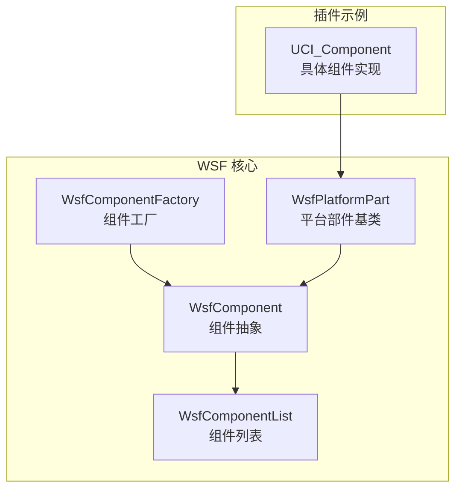
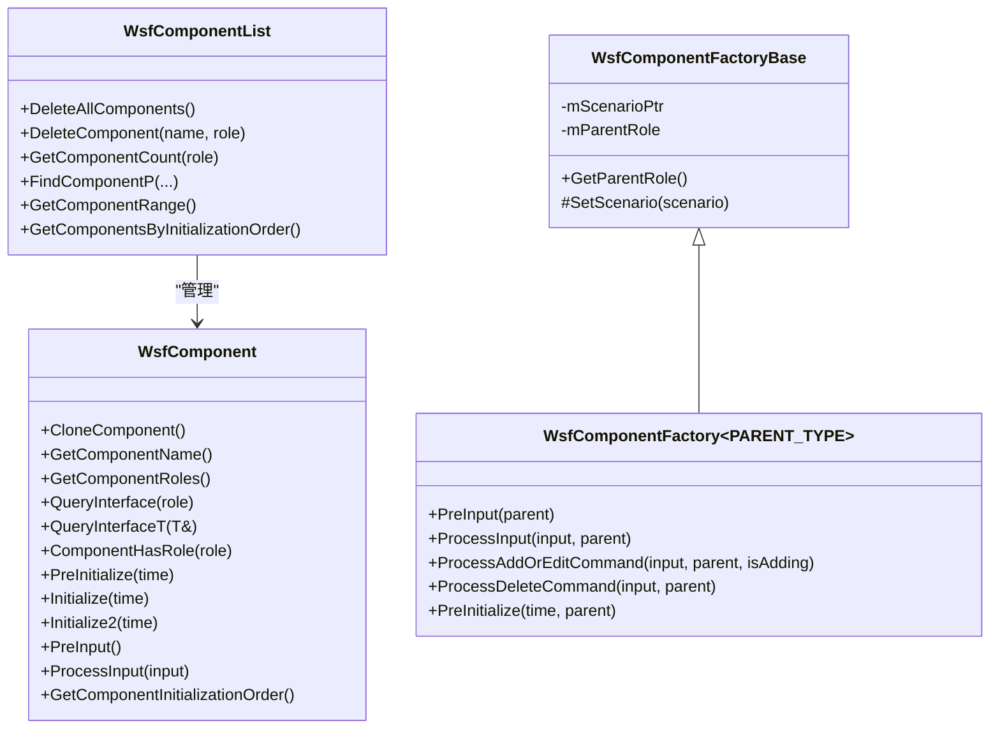
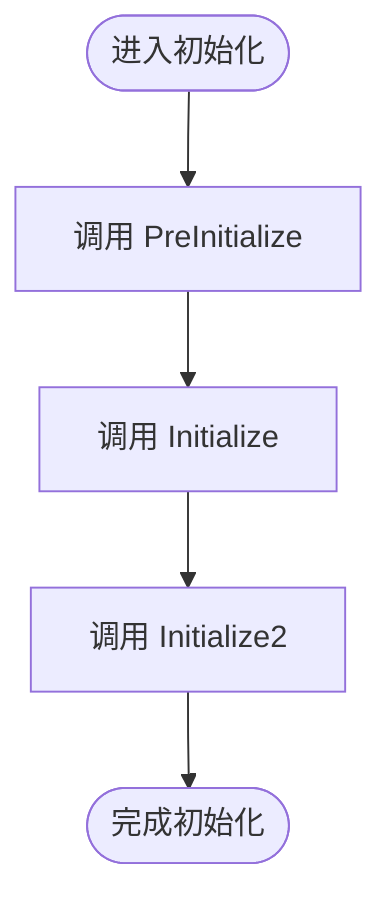
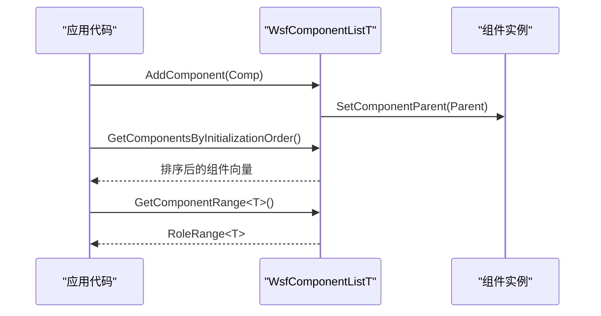
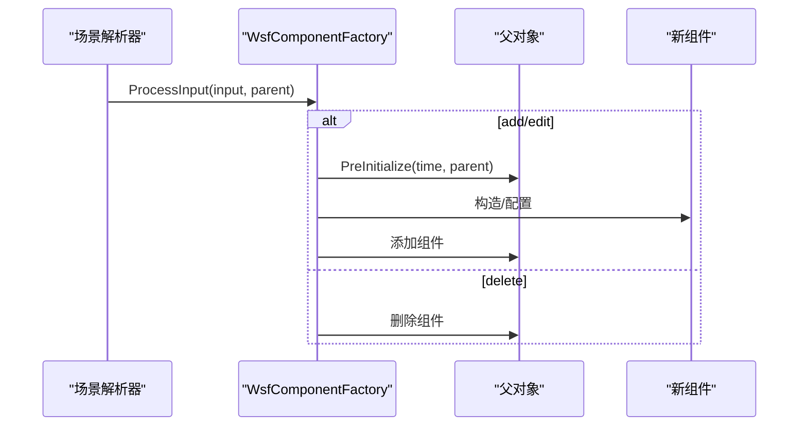
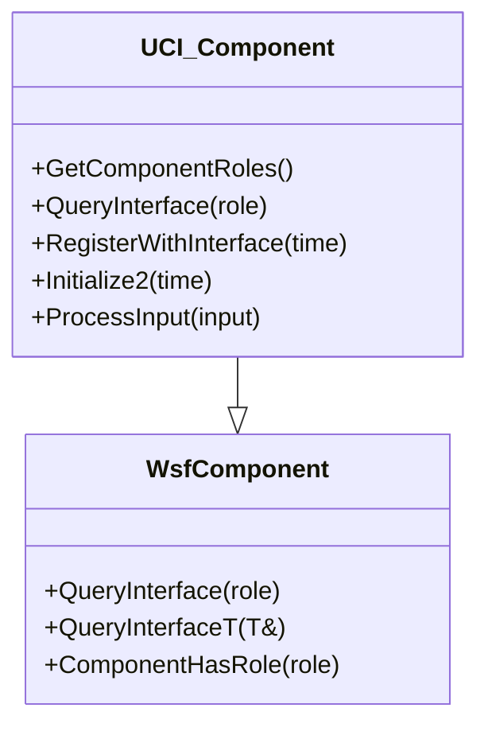
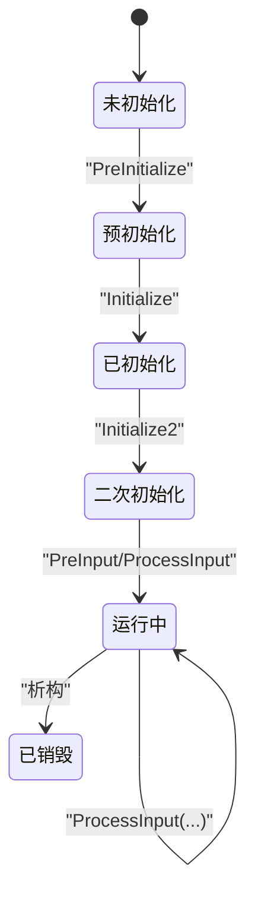
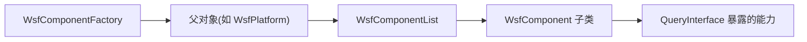
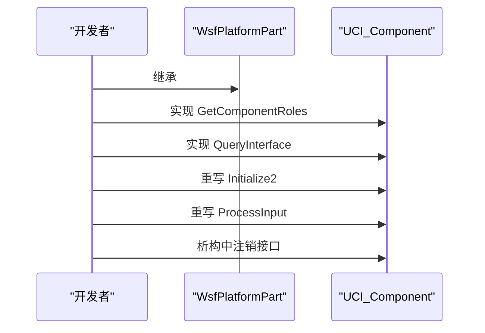

# 组件系统

<cite>
**本文引用的文件**   
- [WsfComponent.hpp](file://swdev/src/core/wsf/source/WsfComponent.hpp)
- [WsfComponentFactory.hpp](file://swdev/src/core/wsf/source/WsfComponentFactory.hpp)
- [WsfComponentList.hpp](file://swdev/src/core/wsf/source/WsfComponentList.hpp)
- [WsfPlatformPart.hpp](file://swdev/src/core/wsf/source/WsfPlatformPart.hpp)
- [WsfUCI_Component.cpp](file://swdev/src/wsf_plugins/wsf_oms_uci/source/WsfUCI_Component.cpp)
</cite>

## 目录
1. [简介](#简介)
2. [项目结构](#项目结构)
3. [核心组件](#核心组件)
4. [架构总览](#架构总览)
5. [详细组件分析](#详细组件分析)
6. [依赖关系分析](#依赖关系分析)
7. [性能考虑](#性能考虑)
8. [故障排查指南](#故障排查指南)
9. [结论](#结论)
10. [附录：自定义组件开发示例](#附录自定义组件开发示例)

## 简介
本文件系统性梳理 AFSIM WSF（Warfare Simulation Framework）中的组件体系，围绕 WsfComponent 基类的设计理念展开，涵盖接口定义、生命周期管理、消息与事件机制、工厂模式、注册与发现机制，以及组件间通信。文档同时给出状态模型、最佳实践与完整示例路径，帮助开发者快速构建可插拔、可扩展的仿真组件。

## 项目结构
WSF 组件体系的核心位于 core/wsf 源码目录，关键头文件包括：
- WsfComponent.hpp：组件抽象基类与模板化父指针支持
- WsfComponentFactory.hpp：组件工厂基类与模板化工厂
- WsfComponentList.hpp：组件列表与类型安全访问/迭代
- WsfPlatformPart.hpp：平台部件基类（常见组件继承链起点）
- WsfUCI_Component.cpp：具体组件实现示例（展示角色、查询接口、初始化流程等）

图表来源
- [WsfComponent.hpp:35-112](file://swdev/src/core/wsf/source/WsfComponent.hpp#L35-L112)
- [WsfComponentList.hpp:42-338](file://swdev/src/core/wsf/source/WsfComponentList.hpp#L42-L338)
- [WsfComponentFactory.hpp:24-106](file://swdev/src/core/wsf/source/WsfComponentFactory.hpp#L24-L106)
- [WsfPlatformPart.hpp](file://swdev/src/core/wsf/source/WsfPlatformPart.hpp)
- [WsfUCI_Component.cpp:68-92](file://swdev/src/wsf_plugins/wsf_oms_uci/source/WsfUCI_Component.cpp#L68-L92)

章节来源
- [WsfComponent.hpp:35-112](file://swdev/src/core/wsf/source/WsfComponent.hpp#L35-L112)
- [WsfComponentList.hpp:42-338](file://swdev/src/core/wsf/source/WsfComponentList.hpp#L42-L338)
- [WsfComponentFactory.hpp:24-106](file://swdev/src/core/wsf/source/WsfComponentFactory.hpp#L24-L106)

## 核心组件
本节聚焦三大核心：组件抽象、组件列表、组件工厂。

- 组件抽象（WsfComponent）
  - 提供统一的角色声明与查询接口（GetComponentRoles、QueryInterface、QueryInterfaceT）
  - 提供通用生命周期钩子（PreInitialize、Initialize、Initialize2、PreInput、ProcessInput）
  - 通过 GetComponentInitializationOrder 控制初始化顺序
- 组件列表（WsfComponentList / WsfComponentListT）
  - 维护按名称索引的组件集合，支持按角色查找、删除、计数、迭代
  - 提供 RoleIterator/RoleRange 以类型安全方式遍历特定角色的组件
  - 提供 GetComponentsByInitializationOrder 排序后的初始化序列
- 组件工厂（WsfComponentFactoryBase / WsfComponentFactory）
  - 绑定父角色（Parent Role），负责解析输入、创建/编辑/删除组件
  - 提供 PreInitialize 钩子在父对象初始化前进行前置检查或自动装配

章节来源
- [WsfComponent.hpp:35-112](file://swdev/src/core/wsf/source/WsfComponent.hpp#L35-L112)
- [WsfComponentList.hpp:42-338](file://swdev/src/core/wsf/source/WsfComponentList.hpp#L42-L338)
- [WsfComponentFactory.hpp:24-106](file://swdev/src/core/wsf/source/WsfComponentFactory.hpp#L24-L106)

## 架构总览
WSF 采用“组件 + 列表 + 工厂”的分层设计：
- 组件通过角色（Role）暴露能力，外部通过 QueryInterface 动态获取
- 列表统一管理组件的生命周期与查找
- 工厂在场景解析阶段根据输入命令创建/配置组件，并可在父对象初始化前执行校验与装配

图表来源
- [WsfComponent.hpp:35-112](file://swdev/src/core/wsf/source/WsfComponent.hpp#L35-L112)
- [WsfComponentList.hpp:42-338](file://swdev/src/core/wsf/source/WsfComponentList.hpp#L42-L338)
- [WsfComponentFactory.hpp:24-106](file://swdev/src/core/wsf/source/WsfComponentFactory.hpp#L24-L106)

## 详细组件分析

### WsfComponent 基类与生命周期
- 设计理念
  - 通过“角色”解耦组件对外能力，避免强类型耦合
  - 生命周期方法分层：PreInitialize/Initialize/Initialize2 分别承担准备、主初始化、二次初始化职责
  - 输入处理：PreInput/ProcessInput 用于解析运行时或配置输入
- 初始化顺序
  - 通过 GetComponentInitializationOrder 返回优先级，列表会稳定排序后依次初始化
- 父对象连接
  - WsfComponentT 提供 SetComponentParent/ComponentParentChanged 回调，便于组件感知所属父对象变化

图表来源
- [WsfComponent.hpp:106-111](file://swdev/src/core/wsf/source/WsfComponent.hpp#L106-L111)
- [WsfComponentList.hpp:491-504](file://swdev/src/core/wsf/source/WsfComponentList.hpp#L491-L504)

章节来源
- [WsfComponent.hpp:35-112](file://swdev/src/core/wsf/source/WsfComponent.hpp#L35-L112)
- [WsfComponentList.hpp:491-504](file://swdev/src/core/wsf/source/WsfComponentList.hpp#L491-L504)

### 组件列表与类型安全访问
- 按角色查找与删除：DeleteComponent/GetComponentCount/FindByRole
- 迭代器与范围：RoleIterator/RoleRange 支持 for-each 风格遍历指定角色组件
- 初始化顺序：GetComponentsByInitializationOrder 返回稳定排序后的组件向量
- 父指针传播：WsfComponentListT::SetParentOfComponents 将父指针设置到所有子组件

图表来源
- [WsfComponentList.hpp:451-472](file://swdev/src/core/wsf/source/WsfComponentList.hpp#L451-L472)
- [WsfComponentList.hpp:491-504](file://swdev/src/core/wsf/source/WsfComponentList.hpp#L491-L504)
- [WsfComponentList.hpp:309-313](file://swdev/src/core/wsf/source/WsfComponentList.hpp#L309-L313)

章节来源
- [WsfComponentList.hpp:42-338](file://swdev/src/core/wsf/source/WsfComponentList.hpp#L42-L338)
- [WsfComponentList.hpp:341-534](file://swdev/src/core/wsf/source/WsfComponentList.hpp#L341-L534)

### 组件工厂与动态实例化
- 工厂职责
  - 绑定父角色（如平台），在场景解析时处理 add/edit/delete 命令
  - 提供 PreInitialize 钩子，在父对象真正初始化前做必要检查或自动装配
- 典型流程
  - 解析输入 -> 判断命令 -> 创建/编辑/删除组件 -> 可选地触发父对象 PreInitialize

图表来源
- [WsfComponentFactory.hpp:61-105](file://swdev/src/core/wsf/source/WsfComponentFactory.hpp#L61-L105)

章节来源
- [WsfComponentFactory.hpp:24-106](file://swdev/src/core/wsf/source/WsfComponentFactory.hpp#L24-L106)

### 组件角色与接口查询
- 角色数组：GetComponentRoles 返回由具体到抽象的顺序数组，并以空终止
- 接口查询：QueryInterface 根据角色返回对应接口指针；QueryInterfaceT 提供模板化版本
- 示例：UCI_Component 声明自身为 UCI 与 PlatformPart 角色，并在 QueryInterface 中返回相应指针

图表来源
- [WsfUCI_Component.cpp:68-92](file://swdev/src/wsf_plugins/wsf_oms_uci/source/WsfUCI_Component.cpp#L68-L92)
- [WsfComponent.hpp:57-99](file://swdev/src/core/wsf/source/WsfComponent.hpp#L57-L99)

章节来源
- [WsfUCI_Component.cpp:68-92](file://swdev/src/wsf_plugins/wsf_oms_uci/source/WsfUCI_Component.cpp#L68-L92)
- [WsfComponent.hpp:57-99](file://swdev/src/core/wsf/source/WsfComponent.hpp#L57-L99)

### 组件状态模型
WSF 组件的状态转换主要由生命周期钩子驱动：
- 预初始化：PreInitialize
- 初始化：Initialize
- 二次初始化：Initialize2
- 输入处理：PreInput -> ProcessInput
- 销毁：析构函数（通常在此释放资源、注销接口等）

图表来源
- [WsfComponent.hpp:106-111](file://swdev/src/core/wsf/source/WsfComponent.hpp#L106-L111)
- [WsfUCI_Component.cpp:145-149](file://swdev/src/wsf_plugins/wsf_oms_uci/source/WsfUCI_Component.cpp#L145-L149)

章节来源
- [WsfComponent.hpp:106-111](file://swdev/src/core/wsf/source/WsfComponent.hpp#L106-L111)
- [WsfUCI_Component.cpp:145-149](file://swdev/src/wsf_plugins/wsf_oms_uci/source/WsfUCI_Component.cpp#L145-L149)

### 组件间通信机制
- 事件发布订阅
  - 通过平台部件事件与观察者机制（例如 WsfPlatformPartEvent、WsfPlatformPartObserver）实现松耦合通知
- 同步调用
  - 通过 QueryInterface 获取目标组件接口后直接调用其方法
- 异步消息处理
  - 通过 ProcessInput 接收并处理输入流，适合批处理或延迟任务
- 示例参考
  - UCI_Component 在 Initialize2 中完成注册，在析构中注销，体现生命周期内的通信接入点

章节来源
- [WsfPlatformPart.hpp](file://swdev/src/core/wsf/source/WsfPlatformPart.hpp)
- [WsfUCI_Component.cpp:145-149](file://swdev/src/wsf_plugins/wsf_oms_uci/source/WsfUCI_Component.cpp#L145-L149)

## 依赖关系分析
- 组件与列表
  - 列表持有组件指针并按角色索引；组件通过 QueryInterface 暴露能力
- 工厂与父对象
  - 工厂绑定父角色，负责在父对象上下文中创建/配置组件
- 平台部件
  - 大多数组件继承自 WsfPlatformPart，从而获得平台上下文与通用行为

图表来源
- [WsfComponentFactory.hpp:24-106](file://swdev/src/core/wsf/source/WsfComponentFactory.hpp#L24-L106)
- [WsfComponentList.hpp:42-338](file://swdev/src/core/wsf/source/WsfComponentList.hpp#L42-L338)
- [WsfComponent.hpp:35-112](file://swdev/src/core/wsf/source/WsfComponent.hpp#L35-L112)

章节来源
- [WsfComponentFactory.hpp:24-106](file://swdev/src/core/wsf/source/WsfComponentFactory.hpp#L24-L106)
- [WsfComponentList.hpp:42-338](file://swdev/src/core/wsf/source/WsfComponentList.hpp#L42-L338)
- [WsfComponent.hpp:35-112](file://swdev/src/core/wsf/source/WsfComponent.hpp#L35-L112)

## 性能考虑
- 初始化顺序优化
  - 使用 GetComponentInitializationOrder 减少跨组件依赖导致的多次扫描
- 列表操作复杂度
  - 按名称查找通常为 O(log n) 或 O(1)（取决于底层容器），按角色遍历为 O(n)
- 迭代器与范围
  - 使用 RoleRange/RoleIterator 避免重复条件判断，提升可读性与性能
- 内存管理
  - 在析构中释放外部资源（如接口注册、句柄关闭），避免泄漏

[本节为通用指导，不直接分析具体文件]

## 故障排查指南
- 组件未找到
  - 检查 GetComponentRoles 是否正确声明，确保 QueryInterface 能返回对应角色
- 初始化失败
  - 确认 PreInitialize/Initialize/Initialize2 的执行顺序与返回值逻辑
- 输入命令未生效
  - 检查 ProcessInput 是否识别命令，并确保父列表正确分发输入
- 资源泄漏
  - 在析构函数中清理外部资源（如注销接口、关闭句柄）

章节来源
- [WsfComponent.hpp:57-111](file://swdev/src/core/wsf/source/WsfComponent.hpp#L57-L111)
- [WsfUCI_Component.cpp:145-169](file://swdev/src/wsf_plugins/wsf_oms_uci/source/WsfUCI_Component.cpp#L145-L169)

## 结论
WSF 组件体系通过角色化接口、统一的列表管理与工厂驱动的实例化机制，实现了高内聚、低耦合的可扩展架构。开发者应遵循角色声明规范、生命周期约定与输入处理约定，结合列表提供的类型安全工具，构建健壮且易维护的仿真组件。

[本节为总结性内容，不直接分析具体文件]

## 附录：自定义组件开发示例
以下示例基于 UCI_Component，展示如何定义角色、实现接口查询、处理输入与生命周期钩子。

- 步骤概览
  - 继承 WsfPlatformPart（或其他合适的父类）
  - 实现 GetComponentRoles 返回角色数组
  - 实现 QueryInterface 返回对应接口指针
  - 重写 Initialize2 完成二次初始化（如注册接口）
  - 在析构中注销接口或释放资源
  - 重写 ProcessInput 处理自定义命令

图表来源
- [WsfUCI_Component.cpp:28-45](file://swdev/src/wsf_plugins/wsf_oms_uci/source/WsfUCI_Component.cpp#L28-L45)
- [WsfUCI_Component.cpp:68-92](file://swdev/src/wsf_plugins/wsf_oms_uci/source/WsfUCI_Component.cpp#L68-L92)
- [WsfUCI_Component.cpp:145-169](file://swdev/src/wsf_plugins/wsf_oms_uci/source/WsfUCI_Component.cpp#L145-L169)

章节来源
- [WsfUCI_Component.cpp:28-45](file://swdev/src/wsf_plugins/wsf_oms_uci/source/WsfUCI_Component.cpp#L28-L45)
- [WsfUCI_Component.cpp:68-92](file://swdev/src/wsf_plugins/wsf_oms_uci/source/WsfUCI_Component.cpp#L68-L92)
- [WsfUCI_Component.cpp:145-169](file://swdev/src/wsf_plugins/wsf_oms_uci/source/WsfUCI_Component.cpp#L145-L169)