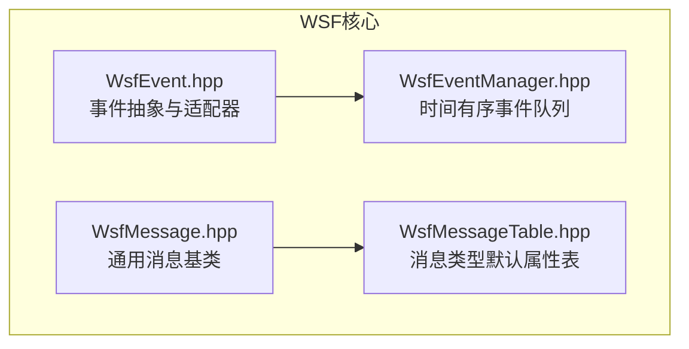
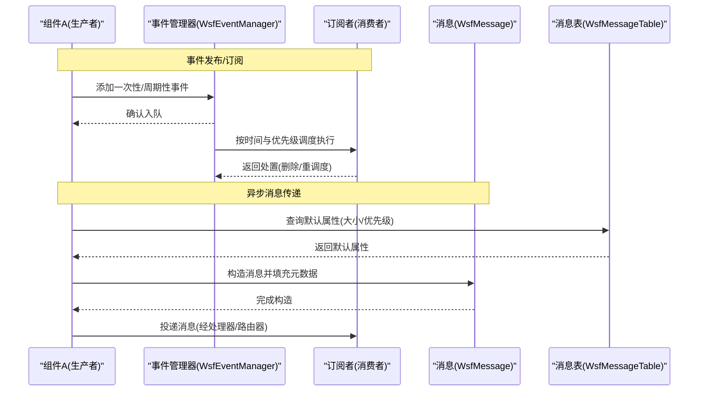
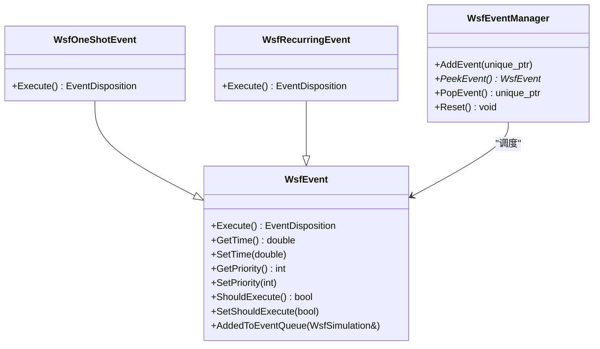
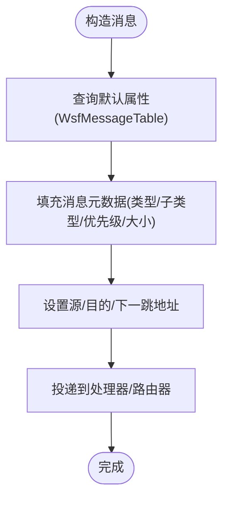
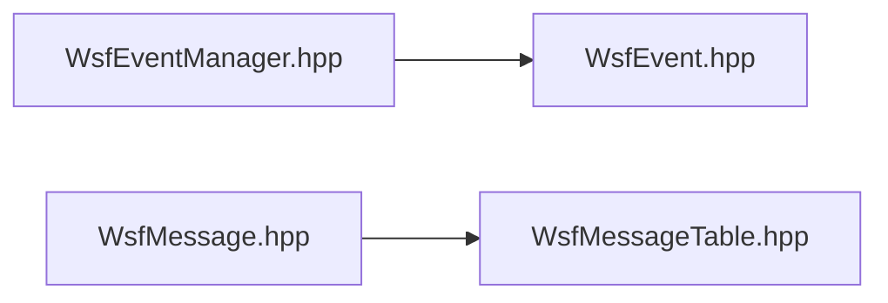

# 组件通信机制

<cite>
**本文引用的文件**   
- [WsfEvent.hpp](file://swdev/src/core/wsf/source/WsfEvent.hpp)
- [WsfEventManager.hpp](file://swdev/src/core/wsf/source/WsfEventManager.hpp)
- [WsfMessage.hpp](file://swdev/src/core/wsf/source/WsfMessage.hpp)
- [WsfMessageTable.hpp](file://swdev/src/core/wsf/source/WsfMessageTable.hpp)
</cite>

## 目录
1. [引言](#引言)
2. [项目结构](#项目结构)
3. [核心组件](#核心组件)
4. [架构总览](#架构总览)
5. [详细组件分析](#详细组件分析)
6. [依赖关系分析](#依赖关系分析)
7. [性能考虑](#性能考虑)
8. [故障排查指南](#故障排查指南)
9. [结论](#结论)
10. [附录：API参考与使用示例](#附录api参考与使用示例)

## 引言
本文件面向WSF（Warfare Simulation Framework）的组件通信机制，系统性阐述三种主要通信模式：事件发布/订阅、同步调用与异步消息传递。重点覆盖以下方面：
- 事件系统架构设计：事件类型定义、调度队列、执行语义与重调度机制
- 消息传递协议：消息格式规范、路由字段、优先级与默认属性配置
- 性能优化技术：批量处理、缓冲管理与内存池使用建议
- API参考：事件注册与调度、消息发送与回调处理
- 典型应用场景：传感器数据流、武器控制系统、战术决策链
- 安全性：权限控制、数据验证与异常隔离

## 项目结构
WSF的核心通信能力集中在core/wsf模块中，关键头文件包括：
- 事件子系统：WsfEvent、WsfEventManager
- 消息子系统：WsfMessage、WsfMessageTable
这些文件定义了事件驱动仿真中的时间有序事件队列与通用消息基类，以及消息类型的默认属性管理。

**图示来源**
- [WsfEvent.hpp:21-113](file://swdev/src/core/wsf/source/WsfEvent.hpp#L21-L113)
- [WsfEventManager.hpp:28-110](file://swdev/src/core/wsf/source/WsfEventManager.hpp#L28-L110)
- [WsfMessage.hpp:31-239](file://swdev/src/core/wsf/source/WsfMessage.hpp#L31-L239)
- [WsfMessageTable.hpp:25-144](file://swdev/src/core/wsf/source/WsfMessageTable.hpp#L25-L144)

**章节来源**
- [WsfEvent.hpp:21-113](file://swdev/src/core/wsf/source/WsfEvent.hpp#L21-L113)
- [WsfEventManager.hpp:28-110](file://swdev/src/core/wsf/source/WsfEventManager.hpp#L28-L110)
- [WsfMessage.hpp:31-239](file://swdev/src/core/wsf/source/WsfMessage.hpp#L31-L239)
- [WsfMessageTable.hpp:25-144](file://swdev/src/core/wsf/source/WsfMessageTable.hpp#L25-L144)

## 核心组件
- WsfEvent：事件抽象基类，定义事件执行语义、调度时间与优先级，支持一次性与可重调度事件适配器
- WsfEventManager：基于优先队列的时间有序事件管理器，负责事件的添加、查看与弹出，保证同一时刻按优先级与入队顺序稳定排序
- WsfMessage：通用消息基类，封装消息类型、子类型、优先级、源/目的地址、序列号、大小等元数据，并提供序列化接口
- WsfMessageTable：维护不同通信设备类型下消息类型的默认大小与优先级，支持随机属性生成与批量设置

**章节来源**
- [WsfEvent.hpp:21-172](file://swdev/src/core/wsf/source/WsfEvent.hpp#L21-L172)
- [WsfEventManager.hpp:28-110](file://swdev/src/core/wsf/source/WsfEventManager.hpp#L28-L110)
- [WsfMessage.hpp:31-239](file://swdev/src/core/wsf/source/WsfMessage.hpp#L31-L239)
- [WsfMessageTable.hpp:25-144](file://swdev/src/core/wsf/source/WsfMessageTable.hpp#L25-L144)

## 架构总览
WSF通信架构以“事件驱动”为核心，辅以“消息总线”进行组件间解耦通信。三类通信模式如下：
- 事件发布/订阅：通过WsfEvent与WsfEventManager实现时间有序的事件分发；订阅者以函数对象或派生类方式参与执行
- 同步调用：组件直接调用对方接口，适用于强一致性与低延迟场景
- 异步消息传递：通过WsfMessage在处理器、传感器与通信设备之间传递结构化数据，结合WsfMessageTable进行默认属性配置

**图示来源**
- [WsfEventManager.hpp:50-79](file://swdev/src/core/wsf/source/WsfEventManager.hpp#L50-L79)
- [WsfEvent.hpp:134-172](file://swdev/src/core/wsf/source/WsfEvent.hpp#L134-L172)
- [WsfMessage.hpp:110-164](file://swdev/src/core/wsf/source/WsfMessage.hpp#L110-L164)
- [WsfMessageTable.hpp:82-92](file://swdev/src/core/wsf/source/WsfMessageTable.hpp#L82-L92)

## 详细组件分析

### 事件系统与调度器
- 事件抽象与适配器
  - WsfEvent提供Execute接口与调度时间、优先级、是否执行的标志位
  - WsfOneShotEvent与WsfRecurringEvent分别实现一次性与周期性事件，通过std::function适配用户逻辑
- 事件管理器
  - 使用priority_queue维护时间有序队列，键为(时间, 优先级, 入队序号)，保证稳定排序
  - 提供AddEvent、PeekEvent、PopEvent等方法，支持线程安全访问（互斥锁）

**图示来源**
- [WsfEvent.hpp:21-172](file://swdev/src/core/wsf/source/WsfEvent.hpp#L21-L172)
- [WsfEventManager.hpp:40-110](file://swdev/src/core/wsf/source/WsfEventManager.hpp#L40-L110)

**章节来源**
- [WsfEvent.hpp:21-172](file://swdev/src/core/wsf/source/WsfEvent.hpp#L21-L172)
- [WsfEventManager.hpp:40-110](file://swdev/src/core/wsf/source/WsfEventManager.hpp#L40-L110)

### 消息传递协议与路由
- 消息基类
  - 包含类型、子类型、优先级、大小、序列号、数据标签、源/目的/下一跳地址等元数据
  - 提供Clone、Serialize等扩展点，便于跨组件传输与持久化
- 消息属性表
  - 针对特定通信设备类型（如无线电收发机），维护消息类型与子类型的默认大小与优先级
  - 支持查找、随机生成与批量设置消息属性

**图示来源**
- [WsfMessage.hpp:110-164](file://swdev/src/core/wsf/source/WsfMessage.hpp#L110-L164)
- [WsfMessageTable.hpp:82-92](file://swdev/src/core/wsf/source/WsfMessageTable.hpp#L82-L92)

**章节来源**
- [WsfMessage.hpp:31-239](file://swdev/src/core/wsf/source/WsfMessage.hpp#L31-L239)
- [WsfMessageTable.hpp:25-144](file://swdev/src/core/wsf/source/WsfMessageTable.hpp#L25-L144)

### 同步调用模式
- 适用场景：需要严格时序与即时反馈的组件交互，例如武器发射前的安全检查、传感器参数校验
- 特点：调用方阻塞等待被调方返回结果，适合小粒度、高内聚操作
- 建议：避免在高频路径中进行重型计算，必要时将耗时逻辑下沉至事件或异步消息

### 异步消息传递模式
- 适用场景：传感器数据流、目标跟踪更新、跨平台状态广播
- 特点：松耦合、可扩展，通过消息类型与子类型进行路由与过滤
- 建议：结合WsfMessageTable统一配置消息大小与优先级，减少运行时开销

### 事件发布/订阅模式
- 适用场景：周期性任务（雷达扫描）、条件触发（威胁告警）、仿真阶段切换
- 特点：时间有序、优先级可控、支持一次性与周期性事件
- 建议：周期性事件在Execute中重调度，避免频繁创建销毁事件对象

## 依赖关系分析
- WsfEventManager依赖WsfEvent，用于事件对象的统一调度
- WsfMessage作为所有消息的基类，被处理器、传感器与通信设备广泛使用
- WsfMessageTable为消息提供默认属性，降低组件初始化复杂度

**图示来源**
- [WsfEventManager.hpp:28-110](file://swdev/src/core/wsf/source/WsfEventManager.hpp#L28-L110)
- [WsfEvent.hpp:21-172](file://swdev/src/core/wsf/source/WsfEvent.hpp#L21-L172)
- [WsfMessage.hpp:31-239](file://swdev/src/core/wsf/source/WsfMessage.hpp#L31-L239)
- [WsfMessageTable.hpp:25-144](file://swdev/src/core/wsf/source/WsfMessageTable.hpp#L25-L144)

**章节来源**
- [WsfEventManager.hpp:28-110](file://swdev/src/core/wsf/source/WsfEventManager.hpp#L28-L110)
- [WsfEvent.hpp:21-172](file://swdev/src/core/wsf/source/WsfEvent.hpp#L21-L172)
- [WsfMessage.hpp:31-239](file://swdev/src/core/wsf/source/WsfMessage.hpp#L31-L239)
- [WsfMessageTable.hpp:25-144](file://swdev/src/core/wsf/source/WsfMessageTable.hpp#L25-L144)

## 性能考虑
- 批量处理
  - 对高频传感器数据采用批处理聚合，减少消息数量与上下文切换开销
  - 使用WsfMessageTable批量设置默认属性，避免重复配置
- 缓冲管理
  - 在高吞吐场景下，合理设置消息缓冲区大小，避免频繁分配释放
  - 利用WsfMessage::Clone进行必要的深拷贝，注意引用计数与生命周期
- 内存池
  - 对短生命周期的小对象（如临时消息、事件适配器）建议使用内存池，降低碎片化
- 事件调度
  - 周期性事件应复用事件对象并通过SetTime重调度，避免频繁new/delete
  - 合理使用优先级，确保关键事件优先执行

[本节为通用指导，不直接分析具体文件]

## 故障排查指南
- 事件未执行
  - 检查事件是否已添加到事件队列，且ShouldExecute为true
  - 确认事件时间设置正确，未被其他事件覆盖
- 消息丢失或乱序
  - 检查源/目的/下一跳地址是否正确设置
  - 确认消息类型与子类型匹配接收端过滤器
- 性能瓶颈
  - 分析事件调度频率与消息吞吐量，调整优先级与批处理策略
  - 监控内存分配热点，评估是否需要引入内存池

**章节来源**
- [WsfEvent.hpp:77-113](file://swdev/src/core/wsf/source/WsfEvent.hpp#L77-L113)
- [WsfMessage.hpp:140-164](file://swdev/src/core/wsf/source/WsfMessage.hpp#L140-L164)

## 结论
WSF通过WsfEvent与WsfEventManager构建高效的事件驱动框架，配合WsfMessage与WsfMessageTable形成灵活的消息传递协议。三种通信模式（事件发布/订阅、同步调用、异步消息）在不同场景中互补，既满足实时性要求，又保持组件间的松耦合。通过合理的批量处理、缓冲管理与内存池使用，可在大规模仿真中取得良好性能。安全性方面，建议在组件边界实施严格的权限控制、数据验证与异常隔离，确保系统稳健运行。

[本节为总结性内容，不直接分析具体文件]

## 附录：API参考与使用示例

### 事件API参考
- 事件基类
  - Execute：执行事件逻辑，返回处置（删除或重调度）
  - GetTime/SetTime：获取/设置调度时间
  - GetPriority/SetPriority：获取/设置优先级
  - ShouldExecute/SetShouldExecute：控制是否执行
- 一次性事件
  - WsfOneShotEvent：构造函数接受std::function<void()>，执行后自动删除
- 周期性事件
  - WsfRecurringEvent：构造函数接受std::function<EventDisposition(WsfEvent&)>，可在回调中重调度

**章节来源**
- [WsfEvent.hpp:61-113](file://swdev/src/core/wsf/source/WsfEvent.hpp#L61-L113)
- [WsfEvent.hpp:134-172](file://swdev/src/core/wsf/source/WsfEvent.hpp#L134-L172)

### 事件管理器API参考
- AddEvent：添加事件到队列（所有权转移）
- PeekEvent：查看下一个待调度事件（不取出）
- PopEvent：取出并拥有下一个事件
- Reset：重置队列状态

**章节来源**
- [WsfEventManager.hpp:50-81](file://swdev/src/core/wsf/source/WsfEventManager.hpp#L50-L81)

### 消息API参考
- 基本属性
  - GetType/SetType：消息类型
  - GetSubType/SetSubType：消息子类型
  - GetPriority/SetPriority：消息优先级
  - GetSizeBits/SetSizeBits：消息大小（比特）
  - GetDataTag/SetDataTag：数据标签
  - GetSerialNumber/SetSerialNumber：序列号
- 地址信息
  - GetSrcAddr/SetSrcAddr：源地址
  - GetDstAddr/SetDstAddr：目的地址
  - GetNextHopAddr/SetNextHopAddr：下一跳地址
- 其他
  - Clone：克隆消息
  - Serialize：序列化/反序列化

**章节来源**
- [WsfMessage.hpp:110-214](file://swdev/src/core/wsf/source/WsfMessage.hpp#L110-L214)

### 消息表API参考
- Find：根据通信设备类型、消息类型与子类型查找默认属性
- RandomProp：随机生成消息属性
- SetMessageProp：批量设置消息属性
- DefaultProp：获取默认属性

**章节来源**
- [WsfMessageTable.hpp:82-92](file://swdev/src/core/wsf/source/WsfMessageTable.hpp#L82-L92)

### 使用示例（概念性）
- 传感器数据流
  - 传感器周期性产生测量数据，通过WsfRecurringEvent调度采集任务
  - 采集结果封装为WsfMessage，设置类型为“TRACK_UPDATE”，子类型为“RADAR_MEASUREMENT”
  - 处理器订阅该消息类型，进行轨迹关联与滤波
- 武器控制系统
  - 发射前安全检查采用同步调用，确保关键参数有效
  - 发射指令通过WsfMessage广播至各子系统，使用优先级保障实时性
- 战术决策链
  - 威胁评估事件由WsfOneShotEvent触发，决策结果通过消息链传递给火力单元
  - 使用WsfMessageTable统一配置不同通信设备的消息大小与优先级

[本节为概念性示例，不直接分析具体文件]