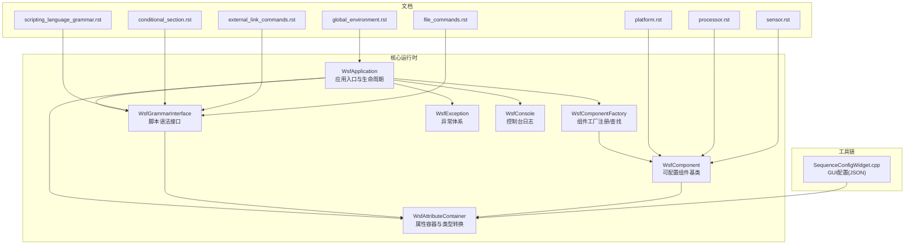
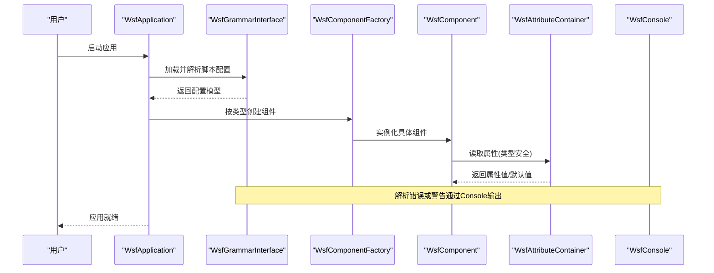
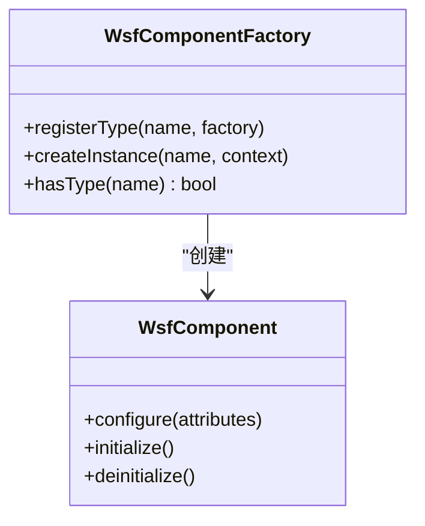
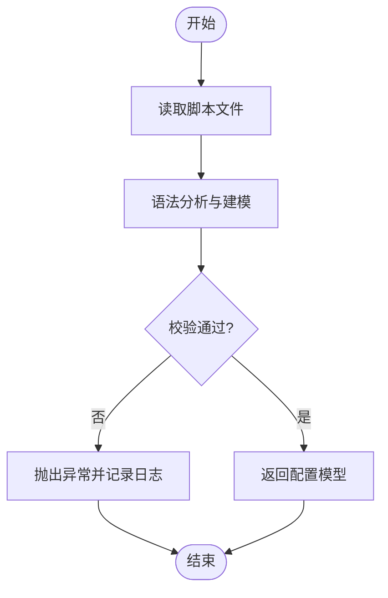
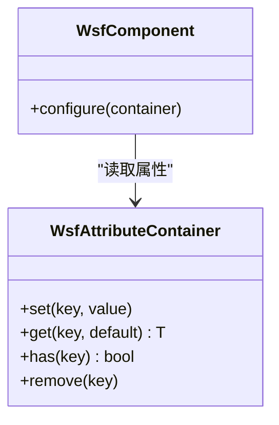
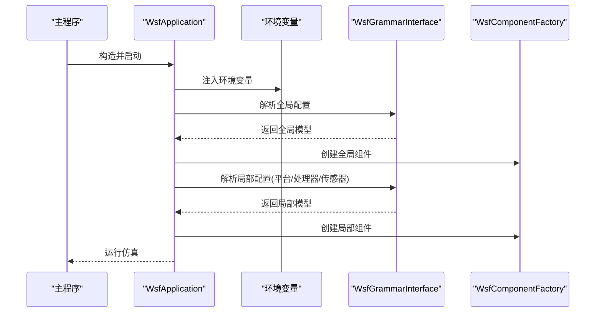
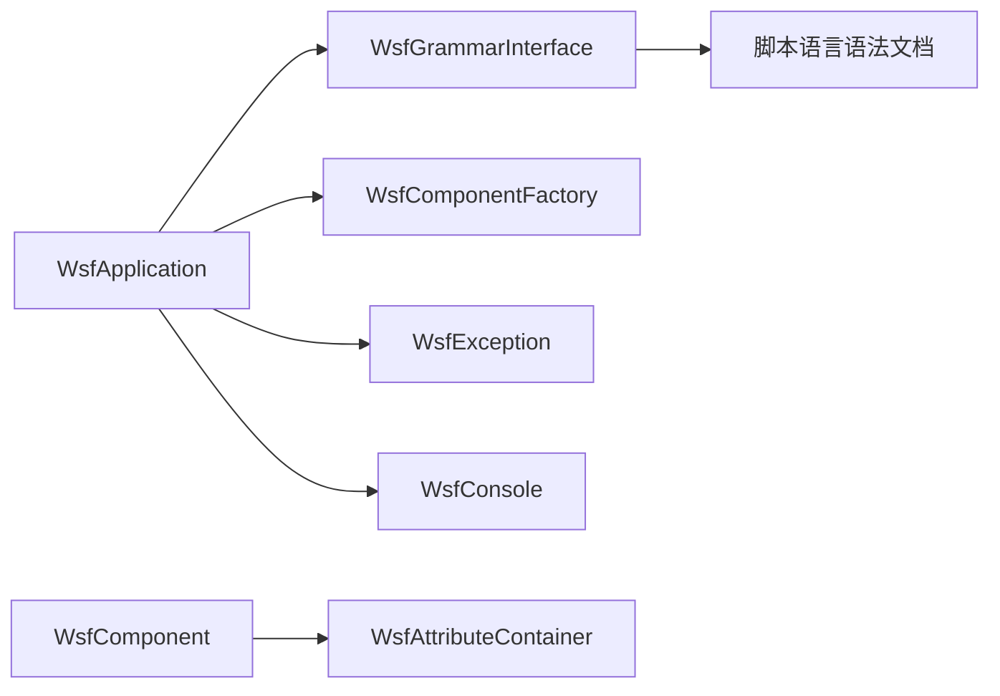

# 配置系统

<cite>
**本文引用的文件**   
- [WsfApplication.hpp](file://swdev/src/core/wsf/source/WsfApplication.hpp)
- [WsfApplication.cpp](file://swdev/src/core/wsf/source/WsfApplication.cpp)
- [WsfComponentFactory.hpp](file://swdev/src/core/wsf/source/WsfComponentFactory.hpp)
- [WsfComponentFactory.cpp](file://swdev/src/core/wsf/source/WsfComponentFactory.cpp)
- [WsfGrammarInterface.hpp](file://swdev/src/core/wsf/source/WsfGrammarInterface.hpp)
- [WsfGrammarInterface.cpp](file://swdev/src/core/wsf/source/WsfGrammarInterface.cpp)
- [WsfAttributeContainer.hpp](file://swdev/src/core/wsf/source/WsfAttributeContainer.hpp)
- [WsfAttributeContainer.cpp](file://swdev/src/core/wsf/source/WsfAttributeContainer.cpp)
- [WsfComponent.hpp](file://swdev/src/core/wsf/source/WsfComponent.hpp)
- [WsfComponent.cpp](file://swdev/src/core/wsf/source/WsfComponent.cpp)
- [WsfException.hpp](file://swdev/src/core/wsf/source/WsfException.hpp)
- [WsfConsole.hpp](file://swdev/src/core/wsf/source/WsfConsole.hpp)
- [WsfConsole.cpp](file://swdev/src/core/wsf/source/WsfConsole.cpp)
- [scripting_language_grammar.rst](file://swdev/src/core/wsf/doc/scripting_language_grammar.rst)
- [platform.rst](file://swdev/src/core/wsf/doc/platform.rst)
- [processor.rst](file://swdev/src/core/wsf/doc/processor.rst)
- [sensor.rst](file://swdev/src/core/wsf/doc/sensor.rst)
- [global_environment.rst](file://swdev/src/core/wsf/doc/global_environment.rst)
- [conditional_section.rst](file://swdev/src/core/wsf/doc/conditional_section.rst)
- [external_link_commands.rst](file://swdev/src/core/wsf/doc/external_link_commands.rst)
- [file_commands.rst](file://swdev/src/core/wsf/doc/file_commands.rst)
- [sequenceConfigWidget.cpp](file://swdev/src/tools/wkf/wsfg/wsf_spaceg/source/SequenceConfigWidget.cpp)
</cite>

## 目录
1. [简介](#简介)
2. [项目结构](#项目结构)
3. [核心组件](#核心组件)
4. [架构总览](#架构总览)
5. [详细组件分析](#详细组件分析)
6. [依赖关系分析](#依赖关系分析)
7. [性能考虑](#性能考虑)
8. [故障排查指南](#故障排查指南)
9. [结论](#结论)
10. [附录](#附录)

## 简介
本文件面向WSF（Warfare Simulation Framework）配置系统，系统性阐述其设计目标与实现机制，覆盖以下关键主题：
- 设计目标：层次化配置、动态加载、类型安全访问
- 配置文件语法：文本脚本语言（非XML）、节点定义、属性设置、引用机制
- 解析器工作原理：文件读取、语法分析、验证与缓存
- 配置访问接口：类型安全的属性获取、默认值处理、错误报告
- 继承与覆盖：全局配置、局部配置与环境变量注入
- 最佳实践：命名约定、模块化组织、版本管理
- 示例与常见模式：基于文档与源码的参考路径

说明：
- WSF的配置并非传统意义上的XML格式，而是采用自有的脚本语言（参见“脚本语言语法”文档）。该语言支持结构化节点、属性键值对、条件分支、外部引用等能力。
- 配置系统在运行时通过工厂注册与组件实例化完成动态加载；属性访问提供类型安全接口，并在缺失或非法时进行错误报告。

## 项目结构
WSF配置相关代码主要位于核心库与工具链中：
- 核心运行时：负责应用生命周期、组件工厂、语法接口、属性容器、异常与控制台输出
- 文档：描述脚本语言语法、平台/处理器/传感器等命令规范
- 工具链：GUI配置编辑器（如SpaceG）使用JSON配置驱动UI控件，体现“配置即数据”的设计思路

图表来源
- [WsfApplication.hpp:1-200](file://swdev/src/core/wsf/source/WsfApplication.hpp#L1-L200)
- [WsfComponentFactory.hpp:1-200](file://swdev/src/core/wsf/source/WsfComponentFactory.hpp#L1-L200)
- [WsfGrammarInterface.hpp:1-200](file://swdev/src/core/wsf/source/WsfGrammarInterface.hpp#L1-L200)
- [WsfAttributeContainer.hpp:1-200](file://swdev/src/core/wsf/source/WsfAttributeContainer.hpp#L1-L200)
- [WsfComponent.hpp:1-200](file://swdev/src/core/wsf/source/WsfComponent.hpp#L1-L200)
- [WsfException.hpp:1-200](file://swdev/src/core/wsf/source/WsfException.hpp#L1-L200)
- [WsfConsole.hpp:1-200](file://swdev/src/core/wsf/source/WsfConsole.hpp#L1-L200)
- [scripting_language_grammar.rst:1-200](file://swdev/src/core/wsf/doc/scripting_language_grammar.rst#L1-L200)
- [platform.rst:1-200](file://swdev/src/core/wsf/doc/platform.rst#L1-L200)
- [processor.rst:1-200](file://swdev/src/core/wsf/doc/processor.rst#L1-L200)
- [sensor.rst:1-200](file://swdev/src/core/wsf/doc/sensor.rst#L1-L200)
- [global_environment.rst:1-200](file://swdev/src/core/wsf/doc/global_environment.rst#L1-L200)
- [conditional_section.rst:1-200](file://swdev/src/core/wsf/doc/conditional_section.rst#L1-L200)
- [external_link_commands.rst:1-200](file://swdev/src/core/wsf/doc/external_link_commands.rst#L1-L200)
- [file_commands.rst:1-200](file://swdev/src/core/wsf/doc/file_commands.rst#L1-L200)
- [sequenceConfigWidget.cpp:1-46](file://swdev/src/tools/wkf/wsfg/wsf_spaceg/source/SequenceConfigWidget.cpp#L1-L46)

章节来源
- [WsfApplication.hpp:1-200](file://swdev/src/core/wsf/source/WsfApplication.hpp#L1-L200)
- [WsfComponentFactory.hpp:1-200](file://swdev/src/core/wsf/source/WsfComponentFactory.hpp#L1-L200)
- [WsfGrammarInterface.hpp:1-200](file://swdev/src/core/wsf/source/WsfGrammarInterface.hpp#L1-L200)
- [WsfAttributeContainer.hpp:1-200](file://swdev/src/core/wsf/source/WsfAttributeContainer.hpp#L1-L200)
- [WsfComponent.hpp:1-200](file://swdev/src/core/wsf/source/WsfComponent.hpp#L1-L200)
- [WsfException.hpp:1-200](file://swdev/src/core/wsf/source/WsfException.hpp#L1-L200)
- [WsfConsole.hpp:1-200](file://swdev/src/core/wsf/source/WsfConsole.hpp#L1-L200)
- [scripting_language_grammar.rst:1-200](file://swdev/src/core/wsf/doc/scripting_language_grammar.rst#L1-L200)
- [platform.rst:1-200](file://swdev/src/core/wsf/doc/platform.rst#L1-L200)
- [processor.rst:1-200](file://swdev/src/core/wsf/doc/processor.rst#L1-L200)
- [sensor.rst:1-200](file://swdev/src/core/wsf/doc/sensor.rst#L1-L200)
- [global_environment.rst:1-200](file://swdev/src/core/wsf/doc/global_environment.rst#L1-L200)
- [conditional_section.rst:1-200](file://swdev/src/core/wsf/doc/conditional_section.rst#L1-L200)
- [external_link_commands.rst:1-200](file://swdev/src/core/wsf/doc/external_link_commands.rst#L1-L200)
- [file_commands.rst:1-200](file://swdev/src/core/wsf/doc/file_commands.rst#L1-L200)
- [sequenceConfigWidget.cpp:1-46](file://swdev/src/tools/wkf/wsfg/wsf_spaceg/source/SequenceConfigWidget.cpp#L1-L46)

## 核心组件
- WsfApplication：应用启动、初始化、运行与销毁；协调配置加载、环境上下文与子系统生命周期
- WsfComponentFactory：组件类型注册、查找与实例化；支撑动态加载与插件式扩展
- WsfGrammarInterface：脚本语法解析入口；将文本配置转换为内部AST/对象模型
- WsfAttributeContainer：属性容器与类型转换；提供类型安全的属性访问与默认值
- WsfComponent：可配置组件基类；承载属性、生命周期钩子与行为
- WsfException：统一的异常体系；用于配置解析与运行时错误上报
- WsfConsole：控制台输出；记录解析与运行期诊断信息

章节来源
- [WsfApplication.hpp:1-200](file://swdev/src/core/wsf/source/WsfApplication.hpp#L1-L200)
- [WsfComponentFactory.hpp:1-200](file://swdev/src/core/wsf/source/WsfComponentFactory.hpp#L1-L200)
- [WsfGrammarInterface.hpp:1-200](file://swdev/src/core/wsf/source/WsfGrammarInterface.hpp#L1-L200)
- [WsfAttributeContainer.hpp:1-200](file://swdev/src/core/wsf/source/WsfAttributeContainer.hpp#L1-L200)
- [WsfComponent.hpp:1-200](file://swdev/src/core/wsf/source/WsfComponent.hpp#L1-L200)
- [WsfException.hpp:1-200](file://swdev/src/core/wsf/source/WsfException.hpp#L1-L200)
- [WsfConsole.hpp:1-200](file://swdev/src/core/wsf/source/WsfConsole.hpp#L1-L200)

## 架构总览
WSF配置系统的整体流程如下：
- 应用启动后，由WsfApplication初始化并加载配置
- WsfGrammarInterface解析脚本语言，构建内部模型
- WsfComponentFactory根据配置中的类型声明创建具体组件
- WsfAttributeContainer为组件提供类型安全的属性访问
- 解析过程中产生的错误通过WsfException抛出，并由WsfConsole输出诊断信息

图表来源
- [WsfApplication.cpp:1-200](file://swdev/src/core/wsf/source/WsfApplication.cpp#L1-L200)
- [WsfGrammarInterface.cpp:1-200](file://swdev/src/core/wsf/source/WsfGrammarInterface.cpp#L1-L200)
- [WsfComponentFactory.cpp:1-200](file://swdev/src/core/wsf/source/WsfComponentFactory.cpp#L1-L200)
- [WsfAttributeContainer.cpp:1-200](file://swdev/src/core/wsf/source/WsfAttributeContainer.cpp#L1-L200)
- [WsfConsole.cpp:1-200](file://swdev/src/core/wsf/source/WsfConsole.cpp#L1-L200)

## 详细组件分析

### 组件A：WsfComponentFactory（动态加载与类型注册）
- 职责：维护组件类型到构造函数的映射；在运行时根据配置中的类型名创建实例
- 关键点：
  - 工厂注册：允许扩展模块在启动阶段注册自定义组件类型
  - 查找与实例化：根据类型名查找对应构造函数并创建对象
  - 错误处理：未注册类型或构造失败时抛出异常

图表来源
- [WsfComponentFactory.hpp:1-200](file://swdev/src/core/wsf/source/WsfComponentFactory.hpp#L1-L200)
- [WsfComponentFactory.cpp:1-200](file://swdev/src/core/wsf/source/WsfComponentFactory.cpp#L1-L200)
- [WsfComponent.hpp:1-200](file://swdev/src/core/wsf/source/WsfComponent.hpp#L1-L200)

章节来源
- [WsfComponentFactory.hpp:1-200](file://swdev/src/core/wsf/source/WsfComponentFactory.hpp#L1-L200)
- [WsfComponentFactory.cpp:1-200](file://swdev/src/core/wsf/source/WsfComponentFactory.cpp#L1-L200)
- [WsfComponent.hpp:1-200](file://swdev/src/core/wsf/source/WsfComponent.hpp#L1-L200)

### 组件B：WsfGrammarInterface（脚本语法解析）
- 职责：提供脚本语言的解析入口；将文本配置转换为内部模型供后续使用
- 关键点：
  - 文件读取：支持从文件系统读取脚本文件
  - 语法分析：遵循“脚本语言语法”文档定义的规则
  - 条件与引用：支持条件分支与外部引用（见文档）
  - 错误报告：解析错误通过异常与控制台输出

图表来源
- [WsfGrammarInterface.cpp:1-200](file://swdev/src/core/wsf/source/WsfGrammarInterface.cpp#L1-L200)
- [scripting_language_grammar.rst:1-200](file://swdev/src/core/wsf/doc/scripting_language_grammar.rst#L1-L200)
- [conditional_section.rst:1-200](file://swdev/src/core/wsf/doc/conditional_section.rst#L1-L200)
- [external_link_commands.rst:1-200](file://swdev/src/core/wsf/doc/external_link_commands.rst#L1-L200)
- [file_commands.rst:1-200](file://swdev/src/core/wsf/doc/file_commands.rst#L1-L200)

章节来源
- [WsfGrammarInterface.cpp:1-200](file://swdev/src/core/wsf/source/WsfGrammarInterface.cpp#L1-L200)
- [scripting_language_grammar.rst:1-200](file://swdev/src/core/wsf/doc/scripting_language_grammar.rst#L1-L200)
- [conditional_section.rst:1-200](file://swdev/src/core/wsf/doc/conditional_section.rst#L1-L200)
- [external_link_commands.rst:1-200](file://swdev/src/core/wsf/doc/external_link_commands.rst#L1-L200)
- [file_commands.rst:1-200](file://swdev/src/core/wsf/doc/file_commands.rst#L1-L200)

### 组件C：WsfAttributeContainer（类型安全属性访问）
- 职责：存储属性键值对并提供类型安全的读取接口；支持默认值与缺失处理
- 关键点：
  - 类型转换：字符串到数值、布尔、枚举等的转换
  - 默认值：当属性缺失时使用默认值
  - 错误报告：类型不匹配或缺失时抛出异常

图表来源
- [WsfAttributeContainer.hpp:1-200](file://swdev/src/core/wsf/source/WsfAttributeContainer.hpp#L1-L200)
- [WsfAttributeContainer.cpp:1-200](file://swdev/src/core/wsf/source/WsfAttributeContainer.cpp#L1-L200)
- [WsfComponent.hpp:1-200](file://swdev/src/core/wsf/source/WsfComponent.hpp#L1-L200)

章节来源
- [WsfAttributeContainer.hpp:1-200](file://swdev/src/core/wsf/source/WsfAttributeContainer.hpp#L1-L200)
- [WsfAttributeContainer.cpp:1-200](file://swdev/src/core/wsf/source/WsfAttributeContainer.cpp#L1-L200)
- [WsfComponent.hpp:1-200](file://swdev/src/core/wsf/source/WsfComponent.hpp#L1-L200)

### 组件D：WsfApplication（应用生命周期与配置编排）
- 职责：应用启动、配置加载、组件初始化与运行循环
- 关键点：
  - 初始化顺序：先加载全局配置，再加载场景/平台/处理器等局部配置
  - 环境变量注入：在配置解析前注入环境变量，供脚本使用
  - 错误处理：统一捕获解析与初始化异常，输出诊断信息

图表来源
- [WsfApplication.cpp:1-200](file://swdev/src/core/wsf/source/WsfApplication.cpp#L1-L200)
- [WsfGrammarInterface.cpp:1-200](file://swdev/src/core/wsf/source/WsfGrammarInterface.cpp#L1-L200)
- [WsfComponentFactory.cpp:1-200](file://swdev/src/core/wsf/source/WsfComponentFactory.cpp#L1-L200)

章节来源
- [WsfApplication.cpp:1-200](file://swdev/src/core/wsf/source/WsfApplication.cpp#L1-L200)
- [WsfGrammarInterface.cpp:1-200](file://swdev/src/core/wsf/source/WsfGrammarInterface.cpp#L1-L200)
- [WsfComponentFactory.cpp:1-200](file://swdev/src/core/wsf/source/WsfComponentFactory.cpp#L1-L200)

### 组件E：WsfException与WsfConsole（错误与诊断）
- 职责：统一异常类型与控制台输出
- 关键点：
  - 异常分类：解析错误、类型不匹配、文件不存在等
  - 日志级别：信息、警告、错误
  - 诊断辅助：包含文件位置、行号、上下文信息

章节来源
- [WsfException.hpp:1-200](file://swdev/src/core/wsf/source/WsfException.hpp#L1-L200)
- [WsfConsole.hpp:1-200](file://swdev/src/core/wsf/source/WsfConsole.hpp#L1-L200)
- [WsfConsole.cpp:1-200](file://swdev/src/core/wsf/source/WsfConsole.cpp#L1-L200)

## 依赖关系分析
- 耦合关系：
  - WsfApplication依赖WsfGrammarInterface与WsfComponentFactory
  - WsfComponent依赖WsfAttributeContainer
  - 所有组件均可能抛出WsfException并通过WsfConsole输出日志
- 外部依赖：
  - 脚本语言语法文档定义了配置文件的结构与语义
  - 工具链（如SpaceG）使用JSON配置驱动UI，体现“配置即数据”的理念

图表来源
- [WsfApplication.cpp:1-200](file://swdev/src/core/wsf/source/WsfApplication.cpp#L1-L200)
- [WsfGrammarInterface.cpp:1-200](file://swdev/src/core/wsf/source/WsfGrammarInterface.cpp#L1-L200)
- [WsfComponentFactory.cpp:1-200](file://swdev/src/core/wsf/source/WsfComponentFactory.cpp#L1-L200)
- [WsfAttributeContainer.cpp:1-200](file://swdev/src/core/wsf/source/WsfAttributeContainer.cpp#L1-L200)
- [WsfException.hpp:1-200](file://swdev/src/core/wsf/source/WsfException.hpp#L1-L200)
- [WsfConsole.cpp:1-200](file://swdev/src/core/wsf/source/WsfConsole.cpp#L1-L200)
- [scripting_language_grammar.rst:1-200](file://swdev/src/core/wsf/doc/scripting_language_grammar.rst#L1-L200)

章节来源
- [WsfApplication.cpp:1-200](file://swdev/src/core/wsf/source/WsfApplication.cpp#L1-L200)
- [WsfGrammarInterface.cpp:1-200](file://swdev/src/core/wsf/source/WsfGrammarInterface.cpp#L1-L200)
- [WsfComponentFactory.cpp:1-200](file://swdev/src/core/wsf/source/WsfComponentFactory.cpp#L1-L200)
- [WsfAttributeContainer.cpp:1-200](file://swdev/src/core/wsf/source/WsfAttributeContainer.cpp#L1-L200)
- [WsfException.hpp:1-200](file://swdev/src/core/wsf/source/WsfException.hpp#L1-L200)
- [WsfConsole.cpp:1-200](file://swdev/src/core/wsf/source/WsfConsole.cpp#L1-L200)
- [scripting_language_grammar.rst:1-200](file://swdev/src/core/wsf/doc/scripting_language_grammar.rst#L1-L200)

## 性能考虑
- 解析缓存：建议对频繁使用的脚本片段进行缓存，减少重复解析开销
- 工厂查找优化：组件类型注册表可使用哈希表提升查找效率
- 属性访问：避免在热路径中进行大量字符串操作，优先使用预编译的属性键
- I/O优化：批量读取配置文件，减少磁盘I/O次数

[本节为通用指导，无需特定文件来源]

## 故障排查指南
常见问题与定位方法：
- 脚本语法错误：检查“脚本语言语法”文档，确认节点与属性书写正确
- 类型不匹配：确认属性值的类型与组件期望一致，必要时使用类型转换函数
- 文件找不到：检查路径与环境变量是否正确，确保文件存在且可读
- 组件未注册：确认组件类型已在工厂中注册，插件已正确加载

诊断步骤：
- 查看控制台日志，定位异常堆栈与文件位置
- 启用更详细的日志级别，观察解析过程
- 逐步简化配置，定位问题所在片段

章节来源
- [WsfException.hpp:1-200](file://swdev/src/core/wsf/source/WsfException.hpp#L1-L200)
- [WsfConsole.cpp:1-200](file://swdev/src/core/wsf/source/WsfConsole.cpp#L1-L200)
- [scripting_language_grammar.rst:1-200](file://swdev/src/core/wsf/doc/scripting_language_grammar.rst#L1-L200)

## 结论
WSF配置系统以脚本语言为核心，结合工厂模式与类型安全属性容器，实现了灵活、可扩展且易于维护的配置机制。通过全局与局部配置的层次化组织、条件分支与外部引用，以及环境变量注入，系统能够适应复杂多变的仿真需求。配合完善的错误报告与诊断工具，用户在开发与运维过程中可获得良好的体验。

[本节为总结性内容，无需特定文件来源]

## 附录

### 配置文件语法与结构
- 脚本语言语法：定义节点、属性、条件分支、外部引用等
- 平台/处理器/传感器命令：定义各类组件的配置项与行为
- 全局环境：定义全局变量与环境参数
- 条件分支：根据运行时条件选择不同配置片段
- 外部引用：引入其他配置文件或片段，实现模块化组织
- 文件命令：控制文件读取与包含逻辑

章节来源
- [scripting_language_grammar.rst:1-200](file://swdev/src/core/wsf/doc/scripting_language_grammar.rst#L1-L200)
- [platform.rst:1-200](file://swdev/src/core/wsf/doc/platform.rst#L1-L200)
- [processor.rst:1-200](file://swdev/src/core/wsf/doc/processor.rst#L1-L200)
- [sensor.rst:1-200](file://swdev/src/core/wsf/doc/sensor.rst#L1-L200)
- [global_environment.rst:1-200](file://swdev/src/core/wsf/doc/global_environment.rst#L1-L200)
- [conditional_section.rst:1-200](file://swdev/src/core/wsf/doc/conditional_section.rst#L1-L200)
- [external_link_commands.rst:1-200](file://swdev/src/core/wsf/doc/external_link_commands.rst#L1-L200)
- [file_commands.rst:1-200](file://swdev/src/core/wsf/doc/file_commands.rst#L1-L200)

### 配置最佳实践
- 命名约定：使用一致的命名风格，避免歧义
- 模块化组织：将公共配置抽取为独立文件，通过外部引用复用
- 版本管理：对配置进行版本控制，记录变更历史
- 默认值策略：为可选属性提供合理默认值，降低配置复杂度
- 环境变量注入：将敏感或环境相关参数通过环境变量注入，提高灵活性

[本节为通用指导，无需特定文件来源]

### GUI配置编辑器（SpaceG）
- 使用JSON配置驱动UI控件，便于可视化编辑
- 配置结构清晰，便于自动生成与校验

章节来源
- [sequenceConfigWidget.cpp:1-46](file://swdev/src/tools/wkf/wsfg/wsf_spaceg/source/SequenceConfigWidget.cpp#L1-L46)