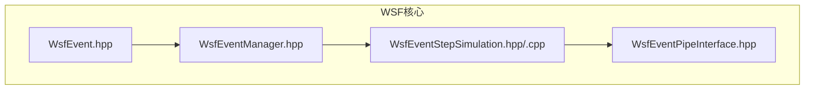
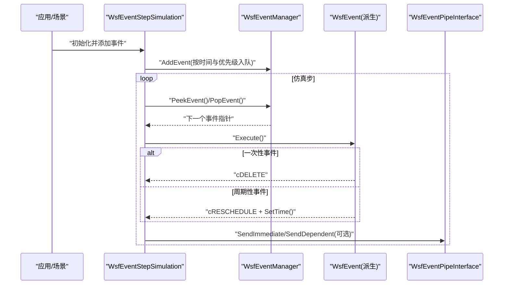
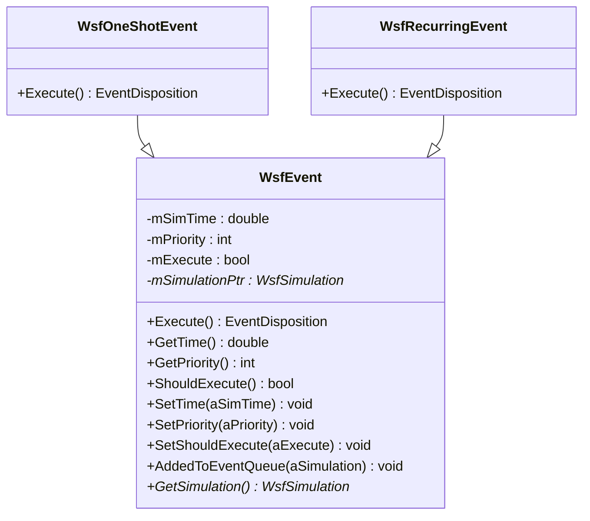
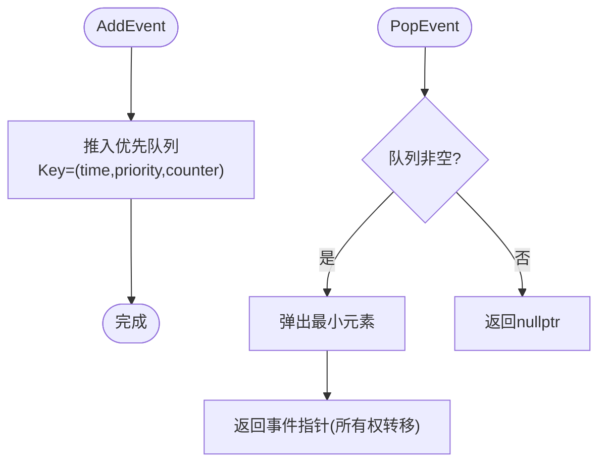
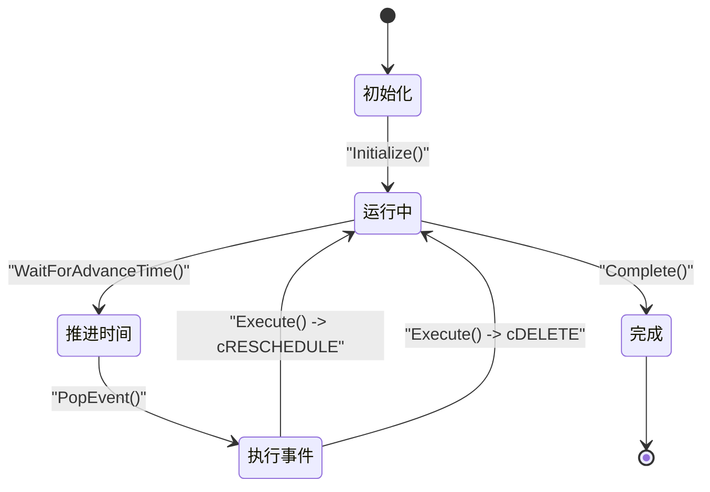
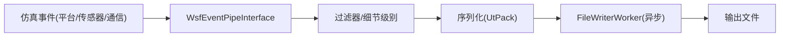
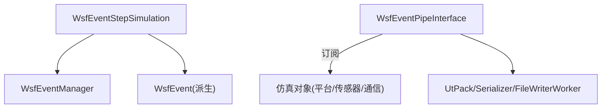

# 事件驱动系统

<cite>
**本文引用的文件**   
- [WsfEvent.hpp](file://swdev/src/core/wsf/source/WsfEvent.hpp)
- [WsfEventManager.hpp](file://swdev/src/core/wsf/source/WsfEventManager.hpp)
- [WsfEventStepSimulation.hpp](file://swdev/src/core/wsf/source/WsfEventStepSimulation.hpp)
- [WsfEventStepSimulation.cpp](file://swdev/src/core/wsf/source/WsfEventStepSimulation.cpp)
- [WsfEventPipeInterface.hpp](file://swdev/src/core/wsf/source/event_pipe/WsfEventPipeInterface.hpp)
</cite>

## 目录
1. [简介](#简介)
2. [项目结构](#项目结构)
3. [核心组件](#核心组件)
4. [架构总览](#架构总览)
5. [详细组件分析](#详细组件分析)
6. [依赖关系分析](#依赖关系分析)
7. [性能考虑](#性能考虑)
8. [故障排查指南](#故障排查指南)
9. [结论](#结论)

## 简介
本文件面向AFSIM的WSF（Warfare Simulation Framework）事件驱动子系统，系统性阐述以下主题：
- 事件模型设计：WsfEvent基类、事件类型与优先级调度
- 事件管理器：队列管理、时间步进调度与并发控制
- 事件管道：数据流处理、过滤器链与输出格式化
- 仿真时间管理：逻辑时间推进、事件排序与时间同步
- 回调机制：处理器注册、事件分发与异常处理
- 编程模式：观察者、命令与策略在事件系统中的体现
- 性能优化：批处理、内存池与异步处理建议

## 项目结构
围绕事件驱动的核心代码位于core/wsf目录，关键文件包括：
- 事件基类与适配器：WsfEvent.hpp
- 事件管理器：WsfEventManager.hpp
- 事件步进仿真器：WsfEventStepSimulation.hpp/.cpp
- 事件管道接口：event_pipe/WsfEventPipeInterface.hpp

图示来源
- [WsfEvent.hpp:21-113](file://swdev/src/core/wsf/source/WsfEvent.hpp#L21-L113)
- [WsfEventManager.hpp:28-109](file://swdev/src/core/wsf/source/WsfEventManager.hpp#L28-L109)
- [WsfEventStepSimulation.hpp:20-51](file://swdev/src/core/wsf/source/WsfEventStepSimulation.hpp#L20-L51)
- [WsfEventPipeInterface.hpp:86-119](file://swdev/src/core/wsf/source/event_pipe/WsfEventPipeInterface.hpp#L86-L119)

章节来源
- [WsfEvent.hpp:21-113](file://swdev/src/core/wsf/source/WsfEvent.hpp#L21-L113)
- [WsfEventManager.hpp:28-109](file://swdev/src/core/wsf/source/WsfEventManager.hpp#L28-L109)
- [WsfEventStepSimulation.hpp:20-51](file://swdev/src/core/wsf/source/WsfEventStepSimulation.hpp#L20-L51)
- [WsfEventPipeInterface.hpp:86-119](file://swdev/src/core/wsf/source/event_pipe/WsfEventPipeInterface.hpp#L86-L119)

## 核心组件
- WsfEvent：所有事件的抽象基类，定义执行接口、时间与优先级、调度返回语义。
- WsfEventManager：基于优先队列的时间有序事件队列，支持稳定排序与并发保护。
- WsfEventStepSimulation：事件步进仿真实现，负责逻辑时间推进、时钟管理与实时同步。
- WsfEventPipeInterface：事件管道接口，提供消息发送、过滤、序列化与异步写入。

章节来源
- [WsfEvent.hpp:21-113](file://swdev/src/core/wsf/source/WsfEvent.hpp#L21-L113)
- [WsfEventManager.hpp:28-109](file://swdev/src/core/wsf/source/WsfEventManager.hpp#L28-L109)
- [WsfEventStepSimulation.hpp:20-51](file://swdev/src/core/wsf/source/WsfEventStepSimulation.hpp#L20-L51)
- [WsfEventPipeInterface.hpp:86-119](file://swdev/src/core/wsf/source/event_pipe/WsfEventPipeInterface.hpp#L86-L119)

## 架构总览
下图展示事件从创建到执行、再到输出的整体流程，以及各组件的职责边界。

图示来源
- [WsfEventManager.hpp:50-79](file://swdev/src/core/wsf/source/WsfEventManager.hpp#L50-L79)
- [WsfEvent.hpp:31-67](file://swdev/src/core/wsf/source/WsfEvent.hpp#L31-L67)
- [WsfEventStepSimulation.cpp:108-160](file://swdev/src/core/wsf/source/WsfEventStepSimulation.cpp#L108-L160)
- [WsfEventPipeInterface.hpp:103-119](file://swdev/src/core/wsf/source/event_pipe/WsfEventPipeInterface.hpp#L103-L119)

## 详细组件分析

### 事件模型：WsfEvent与事件类型
- 基类职责
  - 定义Execute()纯虚接口，由具体事件实现业务逻辑。
  - 维护仿真时间mSimTime、优先级mPriority、是否应执行标志mExecute。
  - 通过EventDisposition(cDELETE/cRESCHEDULE)告知管理器后续调度行为。
- 便捷适配器
  - WsfOneShotEvent：一次性事件，执行后删除。
  - WsfRecurringEvent：可重调度事件，Execute中可调用SetTime并重排。
- 复杂度与约束
  - 获取时间与优先级为O(1)。
  - 禁止拷贝，避免多实例状态不一致。

图示来源
- [WsfEvent.hpp:21-113](file://swdev/src/core/wsf/source/WsfEvent.hpp#L21-L113)
- [WsfEvent.hpp:134-172](file://swdev/src/core/wsf/source/WsfEvent.hpp#L134-L172)

章节来源
- [WsfEvent.hpp:21-113](file://swdev/src/core/wsf/source/WsfEvent.hpp#L21-L113)
- [WsfEvent.hpp:134-172](file://swdev/src/core/wsf/source/WsfEvent.hpp#L134-L172)

### 事件管理器：队列、排序与并发
- 队列组织
  - 使用优先队列，键为(std::tuple<double, int, unsigned int>)，按时间升序、同时间按优先级升序、再按插入序号保证稳定顺序。
- 主要接口
  - AddEvent：将事件加入队列，所有权转移给管理器。
  - PeekEvent/PopEvent：查看或弹出下一个待处理事件。
  - Reset：清空队列。
- 并发安全
  - 内部使用递归互斥量保护队列访问。

图示来源
- [WsfEventManager.hpp:50-109](file://swdev/src/core/wsf/source/WsfEventManager.hpp#L50-L109)

章节来源
- [WsfEventManager.hpp:28-109](file://swdev/src/core/wsf/source/WsfEventManager.hpp#L28-L109)

### 仿真时间管理：逻辑推进与同步
- 角色定位
  - WsfEventStepSimulation继承自WsfSimulation，实现事件步进仿真。
- 关键能力
  - Initialize/Complete：生命周期钩子。
  - CreateClock：创建时钟源。
  - WaitForAdvanceTime：等待推进逻辑时间（含实时模式）。
  - Platform/Part相关回调：平台与部件生命周期事件。
- 与事件系统的协作
  - 通过事件管理器拉取并执行事件；根据Execute返回决定删除或重调度。

图示来源
- [WsfEventStepSimulation.hpp:20-51](file://swdev/src/core/wsf/source/WsfEventStepSimulation.hpp#L20-L51)
- [WsfEventStepSimulation.cpp:108-160](file://swdev/src/core/wsf/source/WsfEventStepSimulation.cpp#L108-L160)

章节来源
- [WsfEventStepSimulation.hpp:20-51](file://swdev/src/core/wsf/source/WsfEventStepSimulation.hpp#L20-L51)
- [WsfEventStepSimulation.cpp:108-160](file://swdev/src/core/wsf/source/WsfEventStepSimulation.cpp#L108-L160)

### 事件管道：数据流、过滤器与输出
- 职责
  - 作为仿真扩展，订阅仿真事件（平台、传感器、通信等），进行过滤、打包与输出。
- 核心接口
  - SendImmediate/SendDependent：立即或依赖平台的消息发送。
  - GetCombinedOptions：合并后的选项集合，用于确定观察者连接范围。
  - AddLogger/RemoveLogger：日志记录器管理。
- 内部机制
  - 使用UtPackMessageStdStreamO与序列化器/Schema进行高效序列化。
  - FileWriterWorker异步写文件，降低主循环开销。
  - 维护过滤器与细节级别，按平台维度组合选项。

图示来源
- [WsfEventPipeInterface.hpp:86-119](file://swdev/src/core/wsf/source/event_pipe/WsfEventPipeInterface.hpp#L86-L119)
- [WsfEventPipeInterface.hpp:361-375](file://swdev/src/core/wsf/source/event_pipe/WsfEventPipeInterface.hpp#L361-L375)
- [WsfEventPipeInterface.hpp:377-401](file://swdev/src/core/wsf/source/event_pipe/WsfEventPipeInterface.hpp#L377-L401)

章节来源
- [WsfEventPipeInterface.hpp:86-119](file://swdev/src/core/wsf/source/event_pipe/WsfEventPipeInterface.hpp#L86-L119)
- [WsfEventPipeInterface.hpp:361-401](file://swdev/src/core/wsf/source/event_pipe/WsfEventPipeInterface.hpp#L361-L401)

### 回调机制：注册、分发与异常
- 回调基础
  - WsfCallback提供平台组件级别的回调能力，支持ExecuteAndNotify在指定仿真时间触发。
- 与事件的关系
  - 可通过WsfOneShotEvent/WsfRecurringEvent将回调包装为事件，纳入统一调度。
- 异常处理
  - Execute中抛出异常会中断当前事件处理；建议在回调/处理器内捕获并记录，避免影响仿真主循环。

章节来源
- [WsfCallback.hpp:21-57](file://swdev/src/core/wsf/source/WsfCallback.hpp#L21-L57)
- [WsfCallback.cpp:65-68](file://swdev/src/core/wsf/source/WsfCallback.cpp#L65-L68)
- [WsfEvent.hpp:134-172](file://swdev/src/core/wsf/source/WsfEvent.hpp#L134-L172)

### 编程模式在事件系统中的体现
- 观察者模式
  - 事件管道通过大量回调持有者（如UtCallbackHolder）订阅仿真对象变化，典型于平台、传感器、通信等事件。
- 命令模式
  - WsfOneShotEvent/WsfRecurringEvent封装std::function为“命令”，延迟执行，便于统一调度与重调度。
- 策略模式
  - 事件管道的过滤器与细节级别配置（Filter/DetailSettingData）允许以不同策略筛选和输出数据。

章节来源
- [WsfEventPipeInterface.hpp:444-476](file://swdev/src/core/wsf/source/event_pipe/WsfEventPipeInterface.hpp#L444-L476)
- [WsfEvent.hpp:134-172](file://swdev/src/core/wsf/source/WsfEvent.hpp#L134-L172)
- [WsfEventPipeInterface.hpp:377-401](file://swdev/src/core/wsf/source/event_pipe/WsfEventPipeInterface.hpp#L377-L401)

## 依赖关系分析
- 组件耦合
  - WsfEventStepSimulation依赖WsfEventManager进行事件拉取与执行。
  - WsfEventPipeInterface作为仿真扩展，依赖仿真对象（平台、传感器、通信等）并通过回调订阅其状态变化。
- 外部依赖
  - 序列化与IO：UtPackMessageStdStreamO、Serializer、Schema、FileWriterWorker。
  - 线程与锁：std::mutex用于辅助数据结构保护。

图示来源
- [WsfEventStepSimulation.hpp:20-51](file://swdev/src/core/wsf/source/WsfEventStepSimulation.hpp#L20-L51)
- [WsfEventManager.hpp:28-109](file://swdev/src/core/wsf/source/WsfEventManager.hpp#L28-L109)
- [WsfEventPipeInterface.hpp:361-375](file://swdev/src/core/wsf/source/event_pipe/WsfEventPipeInterface.hpp#L361-L375)

章节来源
- [WsfEventStepSimulation.hpp:20-51](file://swdev/src/core/wsf/source/WsfEventStepSimulation.hpp#L20-L51)
- [WsfEventManager.hpp:28-109](file://swdev/src/core/wsf/source/WsfEventManager.hpp#L28-L109)
- [WsfEventPipeInterface.hpp:361-375](file://swdev/src/core/wsf/source/event_pipe/WsfEventPipeInterface.hpp#L361-L375)

## 性能考虑
- 事件批处理
  - 对高频小事件采用批量入队与批量处理，减少锁竞争与上下文切换。
- 内存池
  - 对频繁创建销毁的事件对象（尤其一次性事件）引入对象池，降低分配开销。
- 异步处理
  - 事件管道已采用FileWriterWorker异步写盘；可将重型计算任务投递至后台线程，仅在主循环提交轻量结果。
- 过滤与节流
  - 利用管道过滤器与更新间隔（如实体状态更新间隔）减少不必要的数据传输。
- 稳定性与确定性
  - 保持事件优先级与插入顺序一致，确保仿真可重复性。

[本节为通用指导，不直接分析具体文件]

## 故障排查指南
- 事件未执行
  - 检查事件时间设置是否正确，是否在队列中；确认ShouldExecute未被置为false。
- 事件顺序异常
  - 核查优先级设置；注意仅在入队时生效，重调度后才会重新排序。
- 管道无输出
  - 确认已启用对应事件类型与细节级别；检查过滤器条件与平台关联。
- 性能退化
  - 评估事件频率与大小；开启异步写盘、增加批处理粒度；检查是否有阻塞式I/O在主循环。

章节来源
- [WsfEvent.hpp:77-99](file://swdev/src/core/wsf/source/WsfEvent.hpp#L77-L99)
- [WsfEventManager.hpp:50-79](file://swdev/src/core/wsf/source/WsfEventManager.hpp#L50-L79)
- [WsfEventPipeInterface.hpp:103-119](file://swdev/src/core/wsf/source/event_pipe/WsfEventPipeInterface.hpp#L103-L119)

## 结论
AFSIM的WSF事件驱动系统以WsfEvent为核心抽象，配合WsfEventManager提供稳定、可预测的时间有序调度；WsfEventStepSimulation负责逻辑时间推进与实时同步；WsfEventPipeInterface则承担高吞吐的数据输出与过滤。通过观察者、命令与策略模式的结合，系统在可扩展性与性能之间取得良好平衡。遵循本文的性能与排障建议，可在大规模仿真场景中保持稳定与高效。