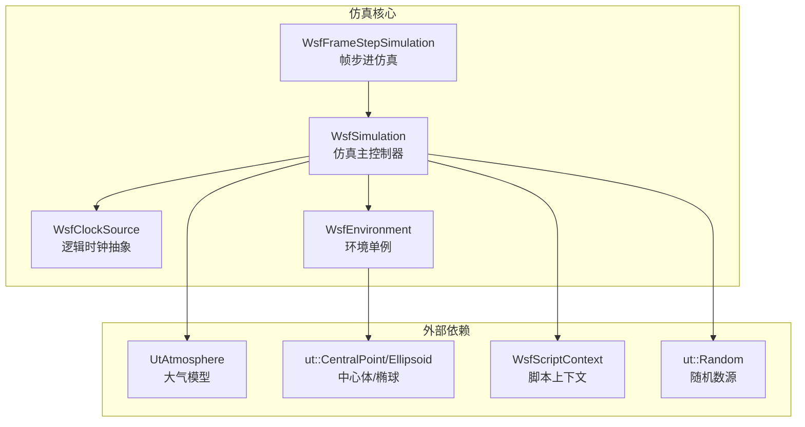
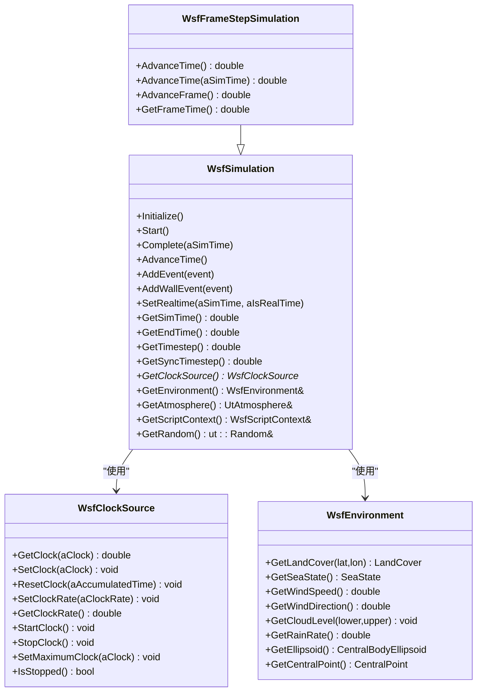
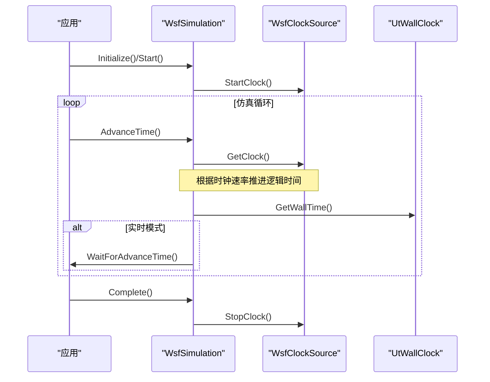
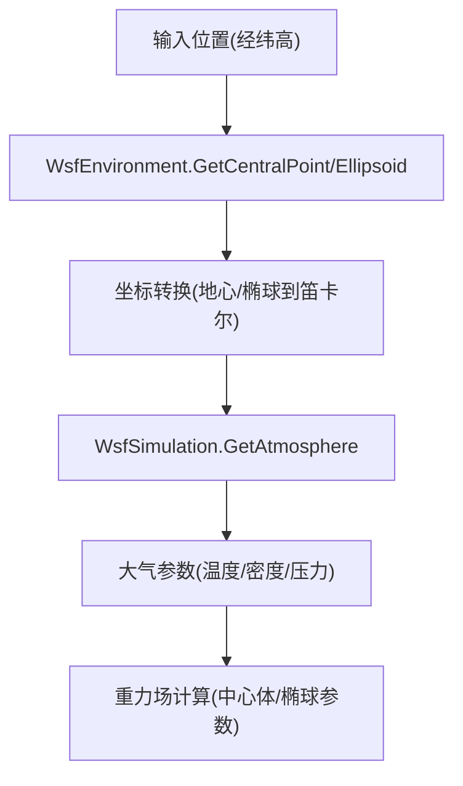
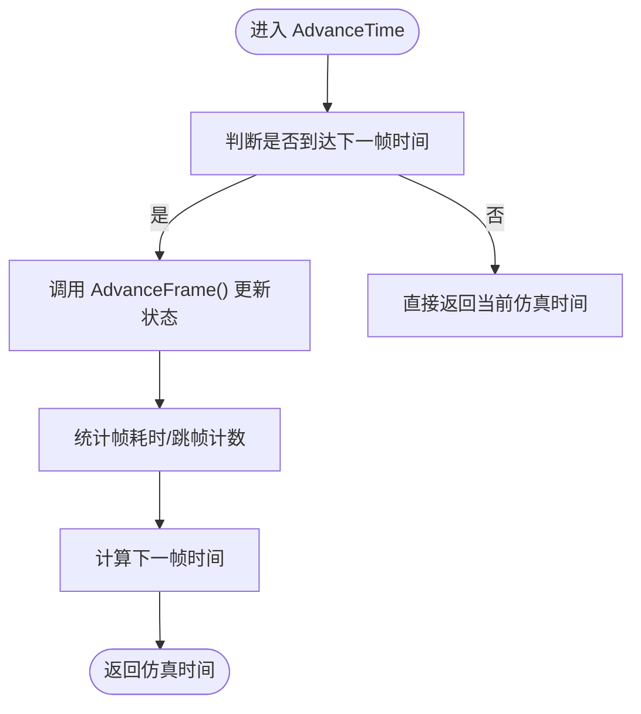
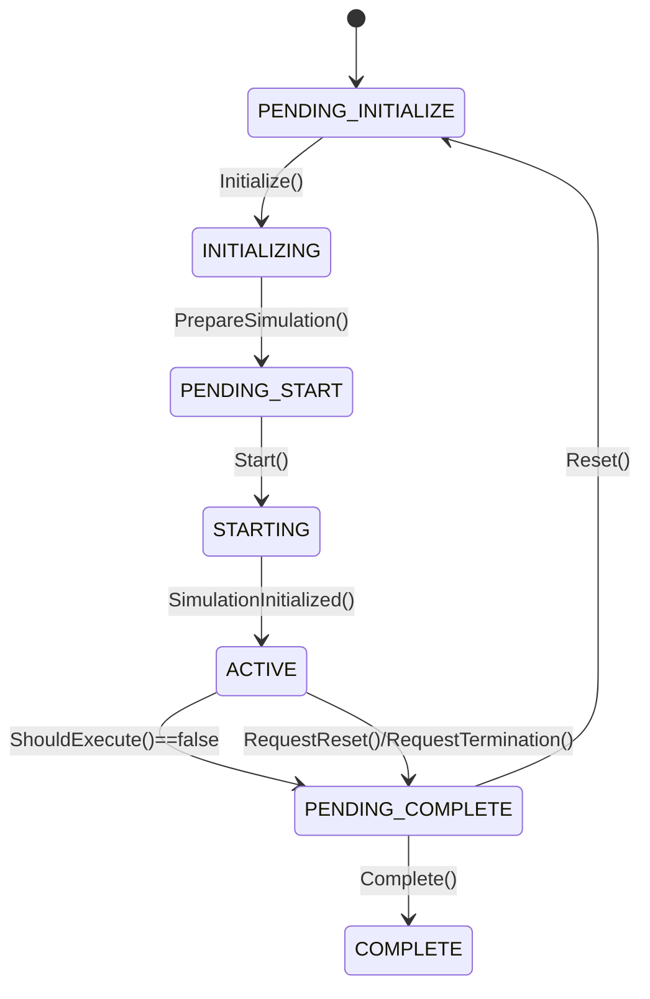
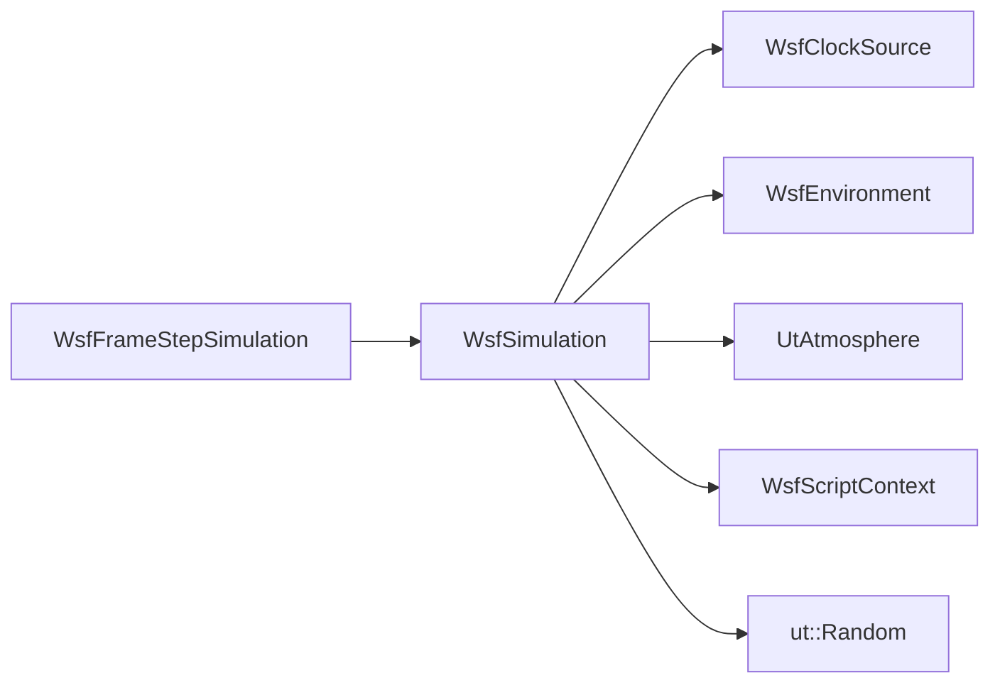

# 仿真引擎核心

<cite>
**本文引用的文件**   
- [WsfSimulation.hpp](file://swdev/src/core/wsf/source/WsfSimulation.hpp)
- [WsfClockSource.hpp](file://swdev/src/core/wsf/source/WsfClockSource.hpp)
- [WsfFrameStepSimulation.hpp](file://swdev/src/core/wsf/source/WsfFrameStepSimulation.hpp)
- [WsfEnvironment.hpp](file://swdev/src/core/wsf/source/WsfEnvironment.hpp)
</cite>

## 目录
1. [简介](#简介)
2. [项目结构](#项目结构)
3. [核心组件](#核心组件)
4. [架构总览](#架构总览)
5. [详细组件分析](#详细组件分析)
6. [依赖关系分析](#依赖关系分析)
7. [性能考虑](#性能考虑)
8. [故障排查指南](#故障排查指南)
9. [结论](#结论)
10. [附录](#附录)

## 简介
本文件面向AFSIM仿真引擎的核心子系统，围绕以下目标展开：
- 仿真时间管理机制：逻辑时钟、物理时钟与时间同步策略
- 环境管理系统：地理坐标转换、大气模型与重力场计算
- 帧步进仿真器：时间步长控制、状态更新与结果输出
- 仿真状态管理：检查点机制、恢复功能与并行仿真支持
- 仿真配置选项：精度设置、性能调优与资源限制
- 仿真调试工具：日志记录、性能监控与错误诊断
- 最佳实践：数值稳定性、收敛性分析与结果验证

## 项目结构
AFSIM核心代码位于 swdev/src/core/wsf 下，其中与仿真引擎直接相关的核心头文件包括：
- WsfSimulation.hpp：仿真主控制器，负责事件调度、平台生命周期、观察者、随机数、脚本上下文等
- WsfClockSource.hpp：仿真时钟抽象，提供逻辑时钟的读取、重置、速率控制与暂停/启动
- WsfFrameStepSimulation.hpp：基于固定时间步（帧）的仿真实现示例
- WsfEnvironment.hpp：全局环境单例，包含地表覆盖、海况、风场、云雨、中心体与椭球参数等

图表来源
- [WsfSimulation.hpp:91-106](file://swdev/src/core/wsf/source/WsfSimulation.hpp#L91-L106)
- [WsfClockSource.hpp:17-60](file://swdev/src/core/wsf/source/WsfClockSource.hpp#L17-L60)
- [WsfFrameStepSimulation.hpp:21-30](file://swdev/src/core/wsf/source/WsfFrameStepSimulation.hpp#L21-L30)
- [WsfEnvironment.hpp:30-36](file://swdev/src/core/wsf/source/WsfEnvironment.hpp#L30-L36)

章节来源
- [WsfSimulation.hpp:91-106](file://swdev/src/core/wsf/source/WsfSimulation.hpp#L91-L106)
- [WsfClockSource.hpp:17-60](file://swdev/src/core/wsf/source/WsfClockSource.hpp#L17-L60)
- [WsfFrameStepSimulation.hpp:21-30](file://swdev/src/core/wsf/source/WsfFrameStepSimulation.hpp#L21-L30)
- [WsfEnvironment.hpp:30-36](file://swdev/src/core/wsf/source/WsfEnvironment.hpp#L30-L36)

## 核心组件
- 仿真主控制器（WsfSimulation）
  - 维护仿真状态机（初始化、开始、运行、完成等）
  - 管理事件队列（逻辑事件与墙钟事件）
  - 管理平台生命周期（添加、删除、系统开关）
  - 提供观察者接口（行为、通信、传感器、轨道等）
  - 暴露时间与同步API（逻辑时钟、实时模式、时间步长、同步时间步）
  - 集成脚本执行器、随机数源、组管理器、LOS管理器、EM管理器、路径查找器等
- 时钟抽象（WsfClockSource）
  - 提供 GetClock/SetClock/ResetClock/SetClockRate/StartClock/StopClock 等接口
  - 支持最大时钟值与暂停状态
- 帧步进仿真（WsfFrameStepSimulation）
  - 在基类基础上实现固定时间步推进，封装 AdvanceFrame 回调
  - 统计帧耗时、跳帧计数等指标
- 环境单例（WsfEnvironment）
  - 提供地表覆盖、地形形态、海况、风场、云雨、能见度等
  - 提供中心体与椭球访问接口，用于地理坐标转换

章节来源
- [WsfSimulation.hpp:91-106](file://swdev/src/core/wsf/source/WsfSimulation.hpp#L91-L106)
- [WsfSimulation.hpp:179-329](file://swdev/src/core/wsf/source/WsfSimulation.hpp#L179-L329)
- [WsfClockSource.hpp:17-60](file://swdev/src/core/wsf/source/WsfClockSource.hpp#L17-L60)
- [WsfFrameStepSimulation.hpp:21-30](file://swdev/src/core/wsf/source/WsfFrameStepSimulation.hpp#L21-L30)
- [WsfEnvironment.hpp:30-36](file://swdev/src/core/wsf/source/WsfEnvironment.hpp#L30-L36)

## 架构总览
下图展示仿真主控制器、时钟、帧步进仿真与环境之间的交互关系。

图表来源
- [WsfSimulation.hpp:91-106](file://swdev/src/core/wsf/source/WsfSimulation.hpp#L91-L106)
- [WsfSimulation.hpp:179-329](file://swdev/src/core/wsf/source/WsfSimulation.hpp#L179-L329)
- [WsfClockSource.hpp:17-60](file://swdev/src/core/wsf/source/WsfClockSource.hpp#L17-L60)
- [WsfFrameStepSimulation.hpp:21-30](file://swdev/src/core/wsf/source/WsfFrameStepSimulation.hpp#L21-L30)
- [WsfEnvironment.hpp:30-36](file://swdev/src/core/wsf/source/WsfEnvironment.hpp#L30-L36)

## 详细组件分析

### 仿真时间管理机制（逻辑时钟、物理时钟、时间同步）
- 逻辑时钟
  - 通过 WsfClockSource 抽象获取当前仿真时间，支持速率缩放（clock rate）、暂停/启动、最大时钟值限制
  - WsfSimulation 持有 WsfClockSource 指针并提供 SetClockSource/GetClockSource 接口
- 物理时钟（墙钟）
  - WsfSimulation 内部维护 UtWallClock 以测量真实世界时间，并暴露 GetWallTime/GetRealTime/IsRealTime 等接口
  - 支持实时模式（real-time），可通过 SetRealtime 切换
- 时间同步策略
  - 提供 GetSyncTimestep 获取“缩放+步进”的同步时间步（常用于DIS-NRT等场景）
  - 提供 SetTimeParameters 统一设置时间方案、起始时间、时钟速率、时间步等参数
  - 提供 WaitForAdvanceTime 等待外部时间推进（如与外部系统同步）

图表来源
- [WsfSimulation.hpp:179-329](file://swdev/src/core/wsf/source/WsfSimulation.hpp#L179-L329)
- [WsfClockSource.hpp:17-60](file://swdev/src/core/wsf/source/WsfClockSource.hpp#L17-L60)

章节来源
- [WsfSimulation.hpp:179-329](file://swdev/src/core/wsf/source/WsfSimulation.hpp#L179-L329)
- [WsfClockSource.hpp:17-60](file://swdev/src/core/wsf/source/WsfClockSource.hpp#L17-L60)

### 环境管理系统（地理坐标转换、大气模型、重力场）
- 地理坐标与中心体
  - WsfEnvironment 提供 GetCentralPoint/GetEllipsoid 访问中心体与椭球参数，用于经纬高与笛卡尔坐标转换
- 大气模型
  - WsfSimulation 暴露 GetAtmosphere 接口，返回 UtAtmosphere 引用，供各类模型查询温度、密度、压力等
- 重力场
  - 通过环境提供的中心体/椭球参数，结合地球重力模型（由上层或扩展模块提供）进行重力计算
- 其他环境属性
  - 地表覆盖、地形形态、海况、风场、云雨、能见度等均可通过 WsfEnvironment 查询或设置

图表来源
- [WsfEnvironment.hpp:170-174](file://swdev/src/core/wsf/source/WsfEnvironment.hpp#L170-L174)
- [WsfSimulation.hpp:459-460](file://swdev/src/core/wsf/source/WsfSimulation.hpp#L459-L460)

章节来源
- [WsfEnvironment.hpp:170-174](file://swdev/src/core/wsf/source/WsfEnvironment.hpp#L170-L174)
- [WsfSimulation.hpp:459-460](file://swdev/src/core/wsf/source/WsfSimulation.hpp#L459-L460)

### 帧步进仿真器（时间步长控制、状态更新、结果输出）
- 时间步长控制
  - WsfFrameStepSimulation 继承自 WsfSimulation，重写 AdvanceTime/AdvanceTime(double)，并在内部维护帧时间、下一帧时间、帧间剩余时间等
  - 提供 GetFrameTime 获取帧时长
- 状态更新
  - 通过 AdvanceFrame 虚函数钩子驱动对象更新（平台、通信、处理器、传感器等）
  - 内部维护平台、通信、处理器、传感器的容器列表，便于批量更新
- 结果输出
  - 可结合观察者与事件输出机制，在每帧结束时触发数据写入或可视化更新

图表来源
- [WsfFrameStepSimulation.hpp:35-55](file://swdev/src/core/wsf/source/WsfFrameStepSimulation.hpp#L35-L55)
- [WsfFrameStepSimulation.hpp:71-95](file://swdev/src/core/wsf/source/WsfFrameStepSimulation.hpp#L71-L95)

章节来源
- [WsfFrameStepSimulation.hpp:35-55](file://swdev/src/core/wsf/source/WsfFrameStepSimulation.hpp#L35-L55)
- [WsfFrameStepSimulation.hpp:71-95](file://swdev/src/core/wsf/source/WsfFrameStepSimulation.hpp#L71-L95)

### 仿真状态管理（检查点、恢复、并行仿真）
- 状态机
  - WsfSimulation 定义 State 枚举（PENDING_INITIALIZE、INITIALIZING、PENDING_START、STARTING、ACTIVE、PENDING_COMPLETE、COMPLETE）与 CompletionReason
  - 提供 GetState/GetStateString/GetCompletionReason 等方法
- 检查点与恢复
  - 通过 AddEvent/AddWallEvent 将检查点写入事件队列；恢复时从事件队列重放或加载历史状态
  - 可使用 Complete/RequestReset/RequestTermination 控制仿真生命周期
- 并行仿真支持
  - 提供 MultiThreadingActive/MultiThreaded 标志位与 WsfMultiThreadManager 集成
  - 通过 SetAmAnEventStepSimulation 标记事件步进仿真类型，配合多线程调度

图表来源
- [WsfSimulation.hpp:111-131](file://swdev/src/core/wsf/source/WsfSimulation.hpp#L111-L131)
- [WsfSimulation.hpp:181-227](file://swdev/src/core/wsf/source/WsfSimulation.hpp#L181-L227)

章节来源
- [WsfSimulation.hpp:111-131](file://swdev/src/core/wsf/source/WsfSimulation.hpp#L111-L131)
- [WsfSimulation.hpp:181-227](file://swdev/src/core/wsf/source/WsfSimulation.hpp#L181-L227)

### 仿真配置选项（精度、性能、资源限制）
- 精度相关
  - 通过 SetTimeParameters 设置时间方案、起始时间、时钟速率、时间步
  - 通过 GetTimestep/GetSyncTimestep 获取当前时间步
- 性能相关
  - 启用/禁用多线程：MultiThreadingActive/MultiThreaded
  - 实时模式：SetRealtime/IsRealTime/IsFlexibleRealtime
  - 事件步进仿真标识：SetAmAnEventStepSimulation/IsEventStepSimulation
- 资源限制
  - 通过 WsfClockSource::SetMaximumClock 限制逻辑时钟最大值
  - 通过 GetEndTime 设置仿真结束时间，避免无限运行

章节来源
- [WsfSimulation.hpp:290-329](file://swdev/src/core/wsf/source/WsfSimulation.hpp#L290-L329)
- [WsfClockSource.hpp:46-59](file://swdev/src/core/wsf/source/WsfClockSource.hpp#L46-L59)

### 仿真调试工具（日志、性能监控、错误诊断）
- 日志
  - 通过 GetSystemLog 获取系统日志接口（具体实现由上层提供）
- 性能监控
  - 帧步进仿真中统计帧耗时、跳帧计数、最坏超时时延等指标
  - 通过 GetWallTime/GetRealTime/GetTimeBehind 评估仿真与真实时间的偏差
- 错误诊断
  - 抛出 InitializeError/StartError/CreateError 等异常类型
  - 提供 GetCompletionReason/GetCompletionReasonString 解释仿真结束原因

章节来源
- [WsfSimulation.hpp:133-154](file://swdev/src/core/wsf/source/WsfSimulation.hpp#L133-L154)
- [WsfSimulation.hpp:253-257](file://swdev/src/core/wsf/source/WsfSimulation.hpp#L253-L257)
- [WsfFrameStepSimulation.hpp:84-90](file://swdev/src/core/wsf/source/WsfFrameStepSimulation.hpp#L84-L90)

## 依赖关系分析
- 组件耦合
  - WsfSimulation 强依赖 WsfClockSource（时间源）、WsfEnvironment（环境）、UtAtmosphere（大气）、WsfScriptContext（脚本）、ut::Random（随机数）
  - WsfFrameStepSimulation 弱耦合于 WsfSimulation，仅扩展时间推进与帧更新逻辑
- 外部依赖
  - 中心体/椭球（ut::CentralPoint/Ellipsoid）用于坐标转换
  - 观察者体系（Behavior/Comm/Sensor/Track 等）用于解耦数据收集与处理
- 潜在循环依赖
  - 通过前向声明与接口隔离降低耦合（例如 WsfScenario、WsfPlatform 等）

图表来源
- [WsfSimulation.hpp:24-77](file://swdev/src/core/wsf/source/WsfSimulation.hpp#L24-L77)
- [WsfFrameStepSimulation.hpp:18-20](file://swdev/src/core/wsf/source/WsfFrameStepSimulation.hpp#L18-L20)

章节来源
- [WsfSimulation.hpp:24-77](file://swdev/src/core/wsf/source/WsfSimulation.hpp#L24-L77)
- [WsfFrameStepSimulation.hpp:18-20](file://swdev/src/core/wsf/source/WsfFrameStepSimulation.hpp#L18-L20)

## 性能考虑
- 时间步选择
  - 合理设置时间步与帧率，避免过细导致计算开销过大，过粗导致数值不稳定
- 实时模式
  - 在实时模式下，应减少I/O与复杂计算，必要时启用灵活实时模式（IsFlexibleRealtime）
- 多线程
  - 开启多线程需确保各组件线程安全，尤其是随机数与事件队列
- I/O与输出
  - 批量输出与异步写入可降低主循环阻塞

[本节为通用指导，不直接分析具体文件]

## 故障排查指南
- 仿真无法启动
  - 检查 Initialize/PrepareSimulation/Start 流程是否正确
  - 查看 GetState/GetStateString 与异常类型（InitializeError/StartError/CreateError）
- 时间不同步
  - 核对 SetTimeParameters/GetTimestep/GetSyncTimestep 的设置
  - 确认 IsRealTime/IsFlexibleRealtime 与实际需求一致
- 帧卡顿或跳帧
  - 检查 AdvanceFrame 中的计算复杂度与I/O操作
  - 关注帧统计指标（跳帧计数、最坏超时时延）
- 环境数据异常
  - 校验中心体/椭球参数与大气模型配置
  - 检查风场、云雨、能见度等环境参数的合理性

章节来源
- [WsfSimulation.hpp:133-154](file://swdev/src/core/wsf/source/WsfSimulation.hpp#L133-L154)
- [WsfSimulation.hpp:244-257](file://swdev/src/core/wsf/source/WsfSimulation.hpp#L244-L257)
- [WsfFrameStepSimulation.hpp:84-90](file://swdev/src/core/wsf/source/WsfFrameStepSimulation.hpp#L84-L90)

## 结论
AFSIM仿真引擎核心通过清晰的职责分离与可扩展的抽象层，实现了稳健的时间管理、环境建模与帧步进仿真能力。WsfSimulation作为中枢协调者，结合WsfClockSource与WsfEnvironment，提供了强大的仿真控制与数据访问能力；WsfFrameStepSimulation则给出了固定时间步仿真的参考实现。在实际工程中，建议结合场景需求合理配置时间步、实时模式与多线程，并通过日志与性能指标持续优化仿真稳定性与效率。

[本节为总结性内容，不直接分析具体文件]

## 附录
- 关键API速查
  - 时间管理：AdvanceTime/GetSimTime/GetEndTime/GetTimestep/GetSyncTimestep/SetTimeParameters/SetRealtime
  - 环境访问：GetEnvironment/GetAtmosphere/GetCentralPoint/GetEllipsoid
  - 状态控制：Initialize/Start/Complete/RequestReset/RequestTermination/IsActive/GetState
  - 调试与监控：GetSystemLog/GetWallTime/GetRealTime/GetTimeBehind

章节来源
- [WsfSimulation.hpp:179-329](file://swdev/src/core/wsf/source/WsfSimulation.hpp#L179-L329)
- [WsfEnvironment.hpp:109-174](file://swdev/src/core/wsf/source/WsfEnvironment.hpp#L109-L174)