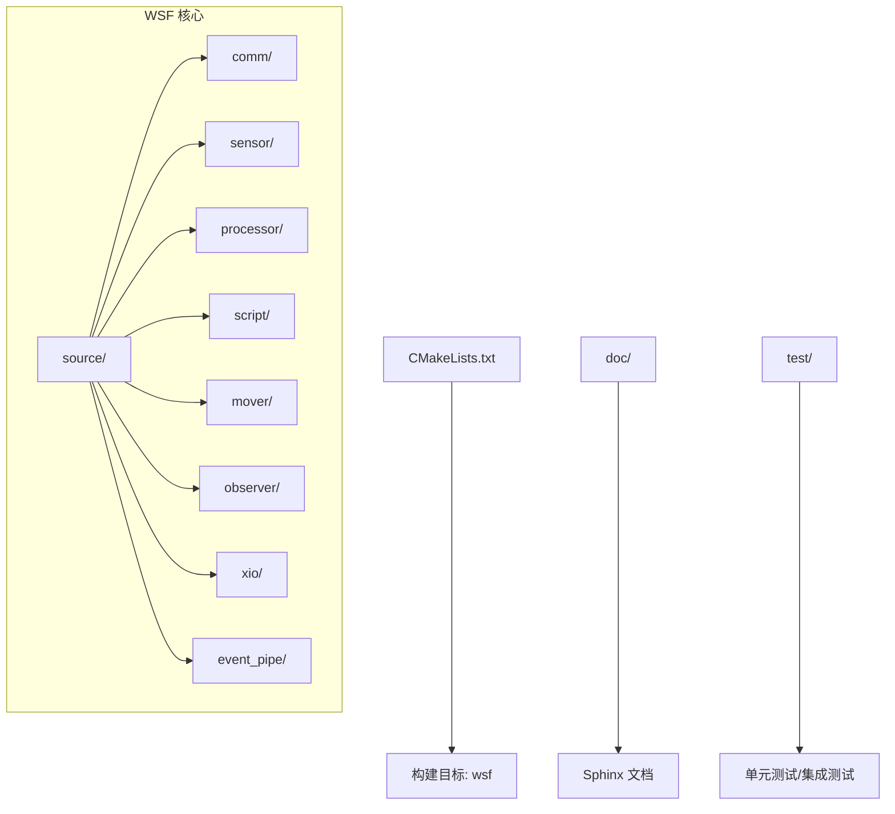
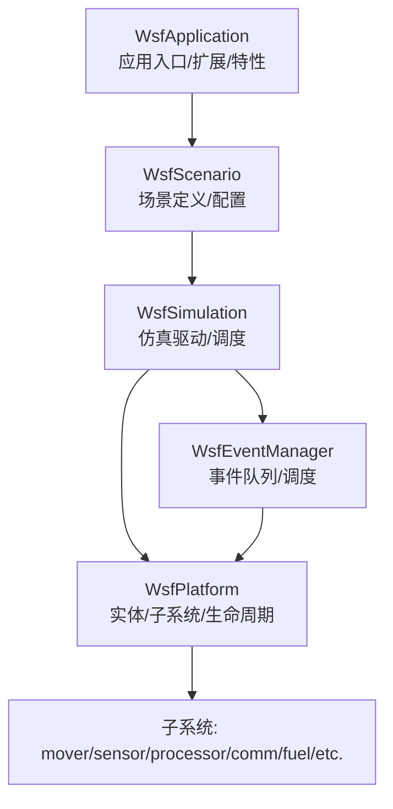
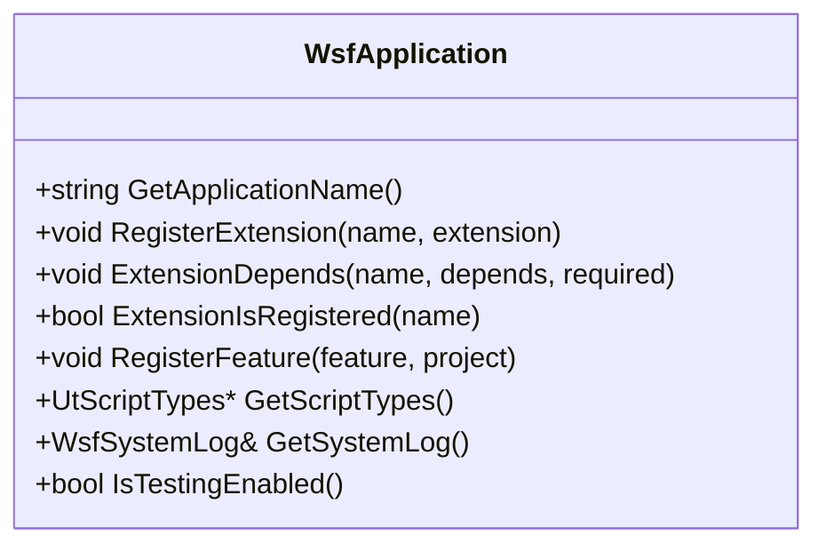
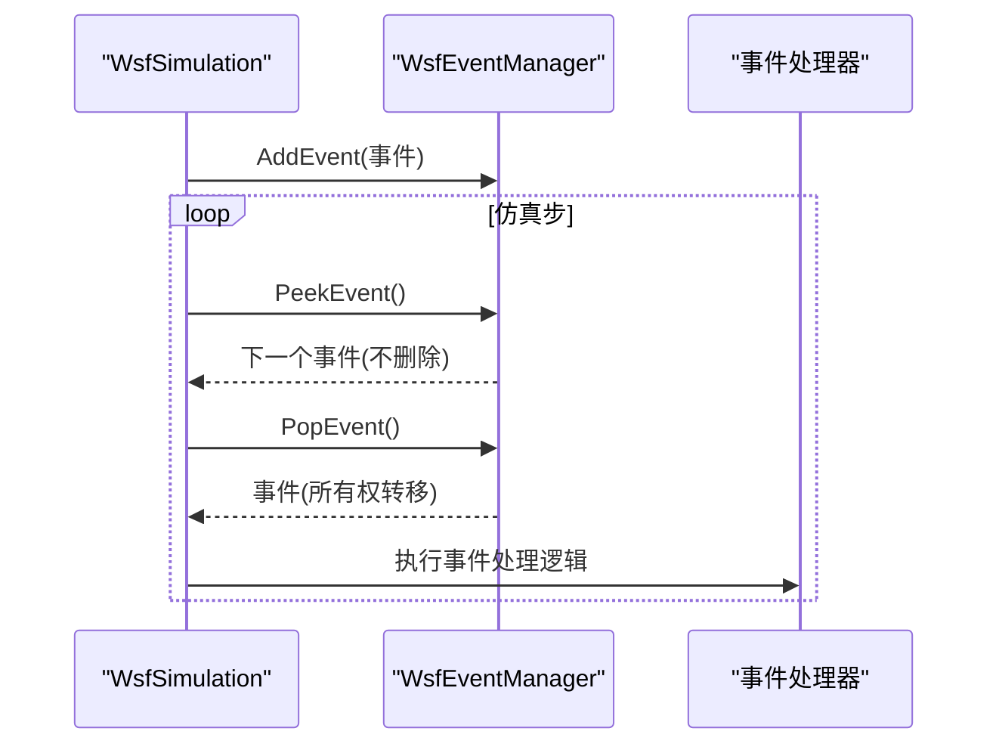
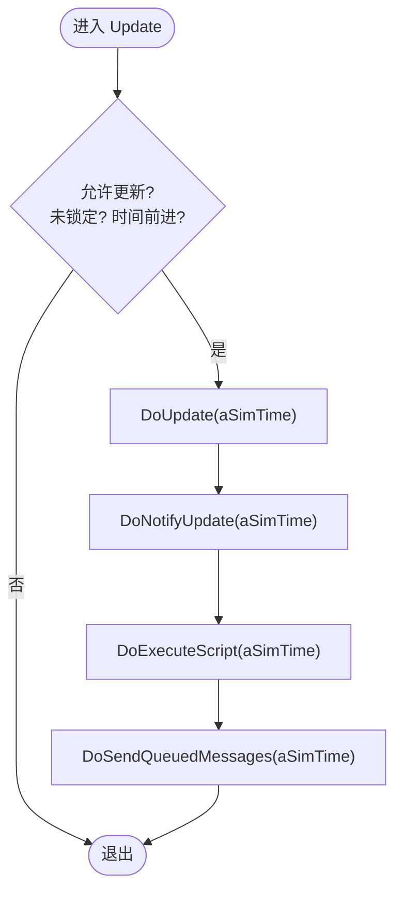
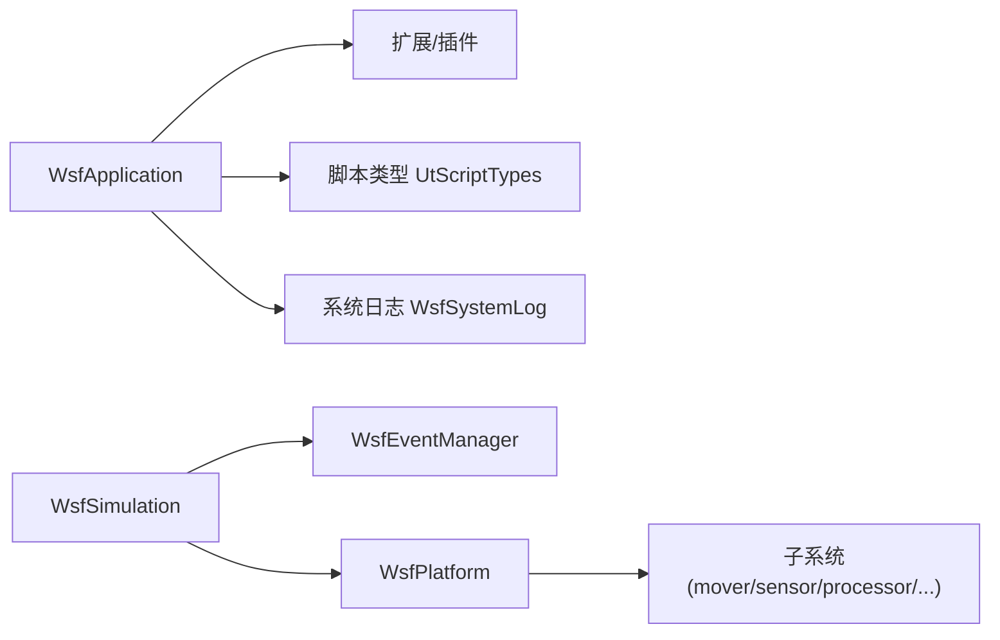

# 核心框架

<cite>
**本文引用的文件**   
- [CMakeLists.txt](file://swdev/src/core/wsf/CMakeLists.txt)
- [README.md](file://swdev/src/core/wsf/README.md)
- [WsfApplication.hpp](file://swdev/src/core/wsf/source/WsfApplication.hpp)
- [WsfEventManager.hpp](file://swdev/src/core/wsf/source/WsfEventManager.hpp)
- [WsfPlatform.hpp](file://swdev/src/core/wsf/source/WsfPlatform.hpp)
</cite>

## 目录
1. [简介](#简介)
2. [项目结构](#项目结构)
3. [核心组件](#核心组件)
4. [架构总览](#架构总览)
5. [详细组件分析](#详细组件分析)
6. [依赖关系分析](#依赖关系分析)
7. [性能考虑](#性能考虑)
8. [故障排查指南](#故障排查指南)
9. [结论](#结论)
10. [附录](#附录)

## 简介
本文件为 AFSIM 核心框架（WSF，Warfare Simulation Framework）的架构文档。重点阐述以下方面：
- WSF 的设计理念与架构模式：事件驱动、平台管理与生命周期管理
- Mystic GUI 的架构设计与用户交互流程（概念性说明）
- 仿真引擎核心组件：调度器、实体管理器、事件管道等
- 配置系统的语法与解析机制（概念性说明）
- 核心 API 接口：平台创建、属性管理、事件处理等
- 扩展点与自定义模块/处理器开发指南
- 性能优化建议与最佳实践
- 使用架构图和数据流图展示组件间关系与交互模式

## 项目结构
WSF 位于 swdev/src/core/wsf，包含源码、文档、测试与构建脚本。顶层 CMakeLists 定义了 WSF 作为库的目标、语法文件安装、Doxygen/Sphinx 文档集成以及与其他子项目的依赖关系。源码按功能域组织在 source 目录下，例如 comm、sensor、processor、script、mover、observer、xio 等。

图表来源
- [CMakeLists.txt:1-86](file://swdev/src/core/wsf/CMakeLists.txt#L1-L86)

章节来源
- [CMakeLists.txt:1-86](file://swdev/src/core/wsf/CMakeLists.txt#L1-L86)

## 核心组件
本节聚焦三个关键类：应用入口 WsfApplication、事件管理器 WsfEventManager、平台实体 WsfPlatform。它们分别承担应用级初始化与扩展注册、时间有序事件队列管理、仿真实体建模与生命周期管理等职责。

- WsfApplication
  - 负责应用名称、命令行参数、插件路径、扩展注册与依赖声明、特性（Feature）注册、系统日志与脚本类型访问、自动化测试开关等
  - 提供宏 WSF_REGISTER_EXTENSION 用于便捷注册扩展
- WsfEventManager
  - 维护一个基于优先级队列的时间有序事件队列，按仿真时间排序，同时间按优先级排序，同时间同优先级按入队顺序 FIFO
  - 提供 AddEvent、PeekEvent、PopEvent、Reset 等方法
- WsfPlatform
  - 代表仿真中的实体（平台），聚合 mover、fuel、signature、track、category/group、terrain 等子系统
  - 提供 Update/UpdateMultiThread/NotifyUpdate/ExecuteScript/SendQueuedMessages 等生命周期更新钩子
  - 支持外部控制、破坏状态、不可摧毁、阴影实体、假目标等能力标志
  - 提供属性与外观（appearance/capabilities）、尺寸、质量、损伤因子、隐蔽因子等接口

章节来源
- [WsfApplication.hpp:32-189](file://swdev/src/core/wsf/source/WsfApplication.hpp#L32-L189)
- [WsfEventManager.hpp:28-110](file://swdev/src/core/wsf/source/WsfEventManager.hpp#L28-L110)
- [WsfPlatform.hpp:66-115](file://swdev/src/core/wsf/source/WsfPlatform.hpp#L66-L115)

## 架构总览
WSF 采用“应用-场景-仿真”的分层模型：
- 应用层（WsfApplication）：负责全局扩展、插件、特性与系统资源
- 场景层（WsfScenario）：定义仿真输入、平台类型与实例、传感器/处理器等配置
- 仿真层（WsfSimulation）：驱动时间推进、事件调度、实体更新与输出

事件驱动是核心机制：所有行为通过事件触发，由 WsfEventManager 统一调度；平台（WsfPlatform）在每次调度时执行更新、脚本、消息发送等步骤。

图表来源
- [WsfApplication.hpp:32-189](file://swdev/src/core/wsf/source/WsfApplication.hpp#L32-L189)
- [WsfEventManager.hpp:28-110](file://swdev/src/core/wsf/source/WsfEventManager.hpp#L28-L110)
- [WsfPlatform.hpp:66-115](file://swdev/src/core/wsf/source/WsfPlatform.hpp#L66-L115)

## 详细组件分析

### 应用与应用扩展（WsfApplication）
- 设计要点
  - 单例式应用对象，确保全局扩展与特性的唯一性
  - 通过 RegisterExtension/ExtensionDepends 管理扩展及其依赖
  - 通过 RegisterFeature 暴露运行时特性，供条件编译或输入文件条件判断
  - 提供 GetScriptTypes/GetSystemLog 等系统级服务访问
- 扩展点
  - 使用 WSF_REGISTER_EXTENSION(APP, NAME) 宏自动调用扩展的 Register_<NAME>(WsfApplication&)
  - 扩展可注册新的特性、命令、处理器类型等

图表来源
- [WsfApplication.hpp:32-189](file://swdev/src/core/wsf/source/WsfApplication.hpp#L32-L189)

章节来源
- [WsfApplication.hpp:32-189](file://swdev/src/core/wsf/source/WsfApplication.hpp#L32-L189)

### 事件管理器与事件调度（WsfEventManager）
- 设计要点
  - 以 (仿真时间, 优先级, 入队序号) 三元组作为排序键，保证稳定且可预测的执行顺序
  - 线程安全：内部使用递归互斥量保护队列操作
  - 所有权语义：AddEvent 将事件所有权转移给管理器；PopEvent 返回拥有者指针
- 典型流程
  - 仿真循环中反复 PeekEvent/PopEvent，并交由具体处理器执行

图表来源
- [WsfEventManager.hpp:28-110](file://swdev/src/core/wsf/source/WsfEventManager.hpp#L28-L110)

章节来源
- [WsfEventManager.hpp:28-110](file://swdev/src/core/wsf/source/WsfEventManager.hpp#L28-L110)

### 平台实体与生命周期（WsfPlatform）
- 设计要点
  - 多继承组合：WsfObject、WsfPlatformComponent、WsfPlatformComponentList、WsfUniqueId、UtEntity、WsfAuxDataEnabled
  - 生命周期方法：Initialize/Initialize2/CompleteLoad/Update/UpdateMultiThread/NotifyUpdate/ExecuteScript/SendQueuedMessages
  - 状态与能力：外部控制/移动、破坏/删除、不可摧毁、阴影实体、假目标、损伤/隐蔽因子、外观/能力位域
  - 子系统聚合：Mover/Fuel/Signature/TrackManager/Terrain/Category/Group 等
- 更新流程（单线程/多线程）
  - Update 检查 mUpdateAllowed 与 mUpdateLocked，避免重复更新与并发冲突
  - DoUpdate/DoUpdateMultiThread 分派到具体实现，再回调子系统更新

图表来源
- [WsfPlatform.hpp:155-206](file://swdev/src/core/wsf/source/WsfPlatform.hpp#L155-L206)
- [WsfPlatform.hpp:593-607](file://swdev/src/core/wsf/source/WsfPlatform.hpp#L593-L607)

章节来源
- [WsfPlatform.hpp:66-115](file://swdev/src/core/wsf/source/WsfPlatform.hpp#L66-L115)
- [WsfPlatform.hpp:155-206](file://swdev/src/core/wsf/source/WsfPlatform.hpp#L155-L206)
- [WsfPlatform.hpp:593-607](file://swdev/src/core/wsf/source/WsfPlatform.hpp#L593-L607)

### 配置系统与解析机制（概念性说明）
- WSF 通过 grammar 与 parser 子系统解析文本配置（平台、传感器、处理器、通信、网络等）
- 典型流程：词法分析 → 语法分析 → 构建输入树 → 工厂创建对象 → 属性绑定 → 完成加载
- 扩展方式：新增 grammar 规则与对应的解析器/处理器，注册到 WsfApplication 的特性与类型表中

（本节为概念性说明，不直接分析具体文件）

### Mystic GUI 界面架构（概念性说明）
- 角色定位：可视化与交互式前端，连接后端仿真（WSF）
- 主要模块：场景编辑、实时视图、数据回放、日志与事件查看、参数调节
- 交互流程：用户操作 → 前端事件 → 调用仿真 API（创建/修改平台、触发事件、读取状态）→ 渲染更新
- 扩展点：插件化视图/工具面板、自定义数据源、脚本联动

（本节为概念性说明，不直接分析具体文件）

## 依赖关系分析
- 组件内聚与耦合
  - WsfApplication 低耦合于具体领域，仅依赖扩展/插件/脚本类型等抽象
  - WsfEventManager 仅依赖 WsfSimulation 与 WsfEvent，保持调度通用性
  - WsfPlatform 聚合多个子系统，但通过接口与弱引用降低紧耦合
- 外部依赖
  - 构建系统：CMake 管理依赖、文档生成与安装
  - 脚本系统：UtScriptTypes 提供脚本侧可见的类型与函数
  - 日志系统：WsfSystemLog 提供统一日志输出

图表来源
- [WsfApplication.hpp:32-189](file://swdev/src/core/wsf/source/WsfApplication.hpp#L32-L189)
- [WsfEventManager.hpp:28-110](file://swdev/src/core/wsf/source/WsfEventManager.hpp#L28-L110)
- [WsfPlatform.hpp:66-115](file://swdev/src/core/wsf/source/WsfPlatform.hpp#L66-L115)

章节来源
- [WsfApplication.hpp:32-189](file://swdev/src/core/wsf/source/WsfApplication.hpp#L32-L189)
- [WsfEventManager.hpp:28-110](file://swdev/src/core/wsf/source/WsfEventManager.hpp#L28-L110)
- [WsfPlatform.hpp:66-115](file://swdev/src/core/wsf/source/WsfPlatform.hpp#L66-L115)

## 性能考虑
- 事件调度
  - 优先使用稳定的时间/优先级/入队序号排序键，避免频繁重排
  - 批量添加事件时尽量合并或预分配，减少队列扩容开销
- 平台更新
  - 利用 Update/UpdateMultiThread 的锁与标记，避免重复计算
  - 将昂贵计算放入 DoUpdate 子类实现，并在必要时进行结果缓存
- 子系统耦合
  - 通过接口与弱引用降低强依赖，减少更新时的传播成本
- 内存与对象生命周期
  - 谨慎持有平台指针，建议使用索引并通过仿真查询获取最新指针
  - 及时释放不再使用的临时对象，避免事件队列与平台列表膨胀

（本节为通用指导，不直接分析具体文件）

## 故障排查指南
- 事件未触发或顺序异常
  - 检查事件时间与优先级设置是否正确
  - 确认 AddEvent 后是否被正确 PopEvent 并处理
- 平台状态不一致
  - 检查 Update/UpdateMultiThread 的 mUpdateAllowed/mUpdateLocked 标志
  - 确认 Initialize/Initialize2/CompleteLoad 是否按序调用
- 扩展未生效
  - 确认 WSF_REGISTER_EXTENSION 是否被调用
  - 检查 ExtensionDepends 依赖是否满足
- 日志与调试
  - 通过 WsfApplication::GetSystemLog 获取系统日志
  - 启用 IsTestingEnabled 以辅助自动化测试定位问题

章节来源
- [WsfApplication.hpp:135-189](file://swdev/src/core/wsf/source/WsfApplication.hpp#L135-L189)
- [WsfPlatform.hpp:155-206](file://swdev/src/core/wsf/source/WsfPlatform.hpp#L155-L206)

## 结论
WSF 以事件驱动为核心，围绕 WsfApplication、WsfEventManager、WsfPlatform 三大支柱构建了可扩展、高内聚、低耦合的仿真框架。通过清晰的层次划分与丰富的扩展点，WSF 能够支撑从简单场景到复杂多域仿真的多样化需求。配合 Mystic GUI 与配置解析体系，形成完整的“配置-仿真-可视化”闭环。

## 附录
- 术语
  - 平台（Platform）：仿真中的实体，承载子系统与行为
  - 事件（Event）：驱动仿真推进的最小动作单元
  - 扩展（Extension）：对 WSF 能力的横向增强（如新处理器、新协议）
  - 特性（Feature）：运行时环境或能力的字符串标识，用于条件判断
- 参考
  - WSF 构建与文档集成见 CMakeLists 与 doc 目录
  - 更多示例与用法参见 demos 与 training 目录