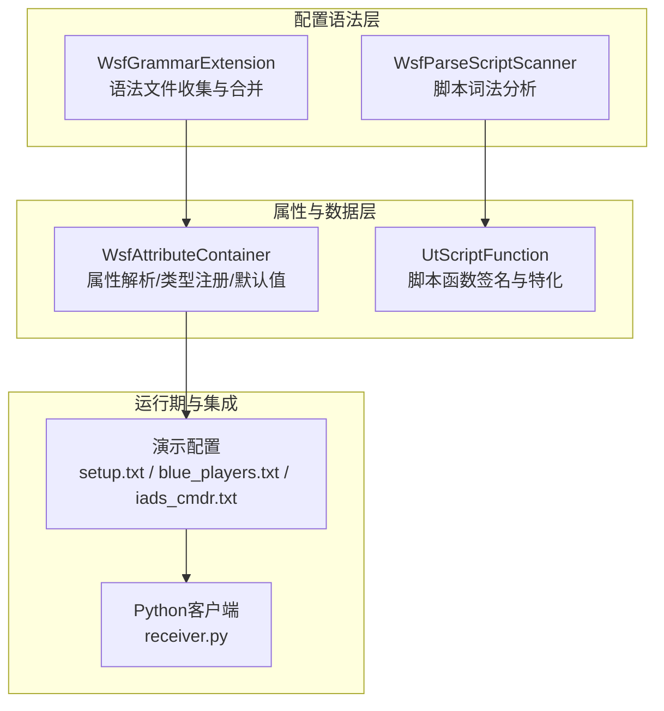
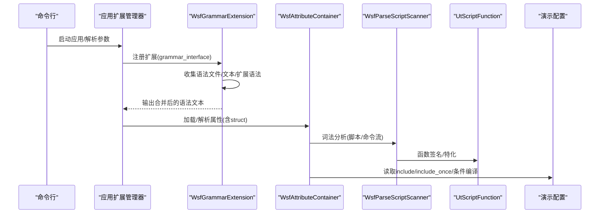
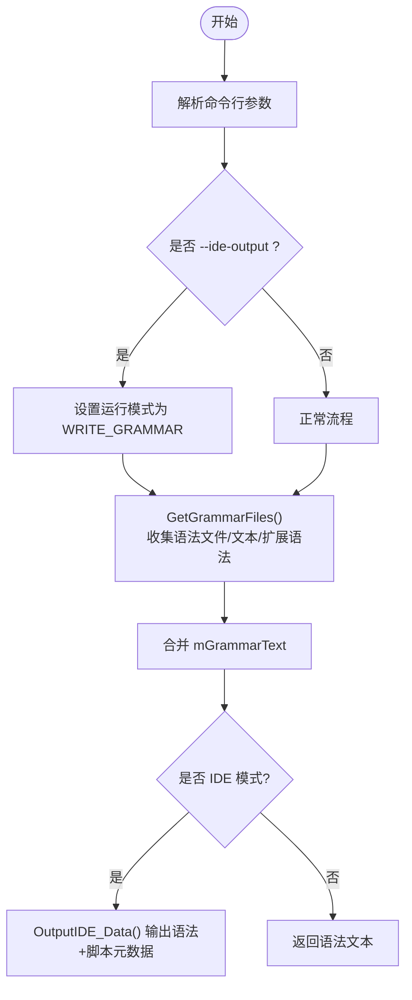
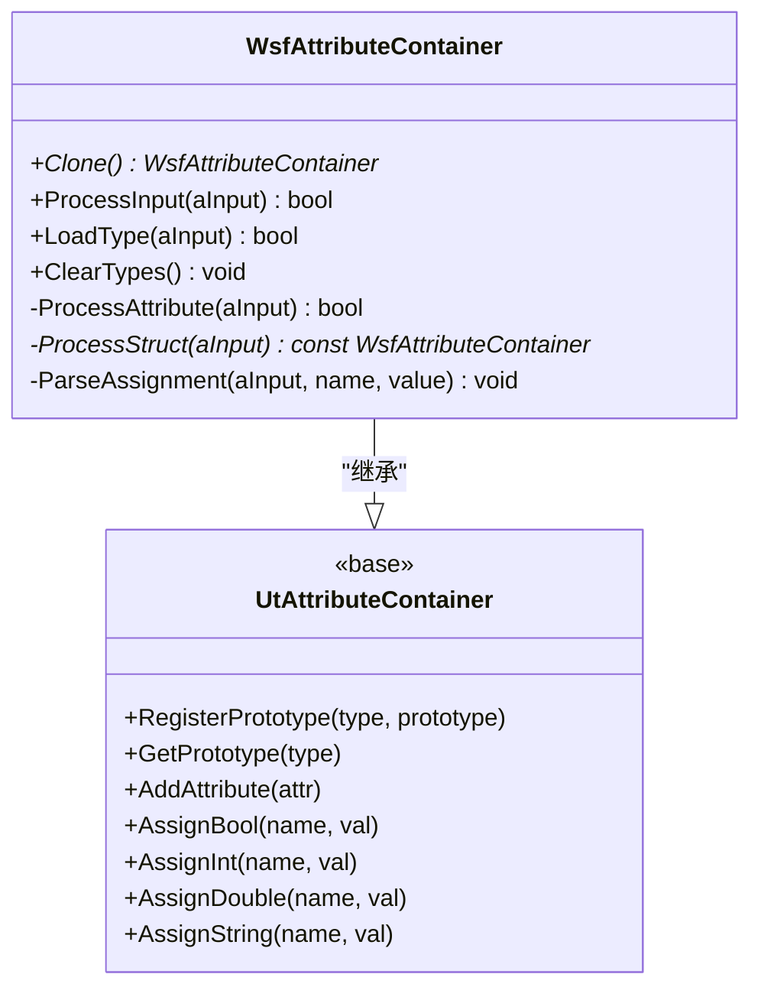
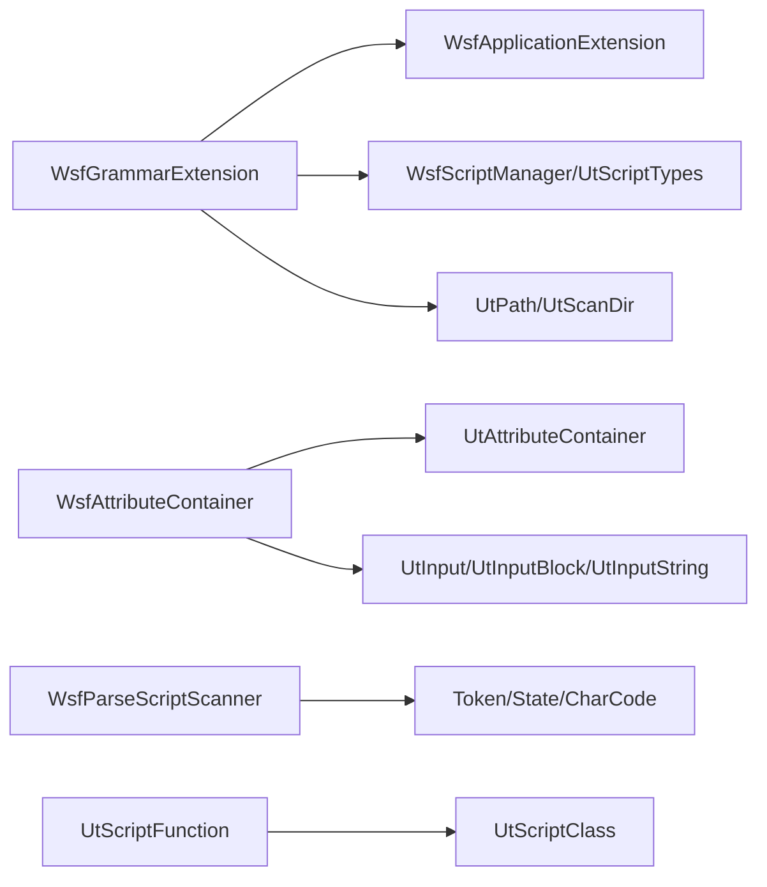

# 配置系统

<cite>
**本文引用的文件**   
- [WsfGrammarInterface.hpp](file://swdev/src/core/wsf/source/WsfGrammarInterface.hpp)
- [WsfGrammarInterface.cpp](file://swdev/src/core/wsf/source/WsfGrammarInterface.cpp)
- [WsfAttributeContainer.hpp](file://swdev/src/core/wsf/source/WsfAttributeContainer.hpp)
- [WsfAttributeContainer.cpp](file://swdev/src/core/wsf/source/WsfAttributeContainer.cpp)
- [WsfParseScriptScanner.hpp](file://swdev/src/core/wsf_parser/source/WsfParseScriptScanner.hpp)
- [UtScriptFunction.cpp](file://swdev/src/tools/util_script/source/UtScriptFunction.cpp)
- [receiver.py](file://training/developer/core/labs/solution/observer/receiver.py)
- [setup.txt](file://demos/aea_iads/setup.txt)
- [blue_players.txt](file://demos/aea_iads/platforms/blue_players.txt)
- [iads_cmdr.txt](file://demos/aea_iads/platforms/iads_cmdr.txt)
</cite>

## 目录
1. [简介](#简介)
2. [项目结构](#项目结构)
3. [核心组件](#核心组件)
4. [架构总览](#架构总览)
5. [详细组件分析](#详细组件分析)
6. [依赖关系分析](#依赖关系分析)
7. [性能考虑](#性能考虑)
8. [故障排查指南](#故障排查指南)
9. [结论](#结论)
10. [附录：最佳实践与示例模式](#附录最佳实践与示例模式)

## 简介
本文件面向AFSIM配置系统的实现与使用，聚焦以下目标：
- 解释声明式配置语法、嵌套结构与继承机制的设计。
- 详解WsfGrammarInterface的解析流程（词法分析、语法分析、语义验证）。
- 说明属性容器系统（属性定义、类型检查、默认值管理）。
- 描述配置文件组织方式（模块划分、依赖管理、条件编译）。
- 文档化脚本集成机制（Python脚本调用、变量绑定、函数库扩展）。
- 提供配置最佳实践与常见模式，帮助构建可重用的配置模板。

## 项目结构
AFSIM的配置能力由“语法接口”和“属性容器”两大核心支撑，辅以脚本扫描器与脚本函数体系，以及大量演示用例中的配置文件组织方式。



图表来源
- [WsfGrammarInterface.cpp:29-38](file://swdev/src/core/wsf/source/WsfGrammarInterface.cpp#L29-L38)
- [WsfParseScriptScanner.hpp:37-159](file://swdev/src/core/wsf_parser/source/WsfParseScriptScanner.hpp#L37-L159)
- [WsfAttributeContainer.cpp:35-199](file://swdev/src/core/wsf/source/WsfAttributeContainer.cpp#L35-L199)
- [UtScriptFunction.cpp:16-71](file://swdev/src/tools/util_script/source/UtScriptFunction.cpp#L16-L71)
- [receiver.py:10-24](file://training/developer/core/labs/solution/observer/receiver.py#L10-L24)
- [setup.txt:21-30](file://demos/aea_iads/setup.txt#L21-L30)

章节来源
- [WsfGrammarInterface.cpp:29-38](file://swdev/src/core/wsf/source/WsfGrammarInterface.cpp#L29-L38)
- [WsfAttributeContainer.cpp:35-199](file://swdev/src/core/wsf/source/WsfAttributeContainer.cpp#L35-L199)

## 核心组件
- WsfGrammarExtension：负责收集、合并并输出WSF语法文本；支持从二进制路径加载内置语法、从扩展点聚合语法、从输入文本追加语法，并提供IDE辅助输出。
- WsfAttributeContainer：基于UtAttributeContainer，提供对标准类型（bool/int/double/string/unitary）与自定义结构的解析、类型注册、默认值处理与错误包装。
- WsfParseScriptScanner：脚本词法分析器，定义Token枚举、字符分类与状态机，为脚本语言提供基础词法能力。
- UtScriptFunction：脚本函数元信息（返回类型、参数、标志位），支持泛型特化与比较排序，用于脚本函数注册与重载解析。
- 演示配置：展示include/include_once、条件编译、模块化组织等常用模式。

章节来源
- [WsfGrammarInterface.hpp:22-53](file://swdev/src/core/wsf/source/WsfGrammarInterface.hpp#L22-L53)
- [WsfAttributeContainer.hpp:21-51](file://swdev/src/core/wsf/source/WsfAttributeContainer.hpp#L21-L51)
- [WsfParseScriptScanner.hpp:37-159](file://swdev/src/core/wsf_parser/source/WsfParseScriptScanner.hpp#L37-L159)
- [UtScriptFunction.cpp:16-71](file://swdev/src/tools/util_script/source/UtScriptFunction.cpp#L16-L71)

## 架构总览
下图展示了从命令行到语法收集、再到属性解析与脚本集成的整体流程。



图表来源
- [WsfGrammarInterface.cpp:29-38](file://swdev/src/core/wsf/source/WsfGrammarInterface.cpp#L29-L38)
- [WsfGrammarInterface.cpp:119-183](file://swdev/src/core/wsf/source/WsfGrammarInterface.cpp#L119-L183)
- [WsfAttributeContainer.cpp:35-199](file://swdev/src/core/wsf/source/WsfAttributeContainer.cpp#L35-L199)
- [WsfParseScriptScanner.hpp:37-159](file://swdev/src/core/wsf_parser/source/WsfParseScriptScanner.hpp#L37-L159)
- [UtScriptFunction.cpp:16-71](file://swdev/src/tools/util_script/source/UtScriptFunction.cpp#L16-L71)

## 详细组件分析

### WsfGrammarInterface：语法收集与IDE输出
- 功能要点
  - 通过ProcessCommandLine处理--ide-output参数，进入IDE数据输出模式。
  - AddGrammarFile/AddGrammarText/AddGrammarDirectory分别支持文件、文本块、目录批量添加。
  - GetGrammarFiles在首次调用时自动探测安装目录下的grammar文件夹，合并所有语法源，并调用各扩展的PrintGrammar以聚合扩展语法。
  - OutputIDE_Data将语法、脚本类/方法元数据、版本与应用名写入指定文件，供IDE或工具链消费。



图表来源
- [WsfGrammarInterface.cpp:55-84](file://swdev/src/core/wsf/source/WsfGrammarInterface.cpp#L55-L84)
- [WsfGrammarInterface.cpp:119-183](file://swdev/src/core/wsf/source/WsfGrammarInterface.cpp#L119-L183)
- [WsfGrammarInterface.cpp:185-281](file://swdev/src/core/wsf/source/WsfGrammarInterface.cpp#L185-L281)

章节来源
- [WsfGrammarInterface.cpp:29-38](file://swdev/src/core/wsf/source/WsfGrammarInterface.cpp#L29-L38)
- [WsfGrammarInterface.cpp:55-84](file://swdev/src/core/wsf/source/WsfGrammarInterface.cpp#L55-L84)
- [WsfGrammarInterface.cpp:119-183](file://swdev/src/core/wsf/source/WsfGrammarInterface.cpp#L119-L183)
- [WsfGrammarInterface.cpp:185-281](file://swdev/src/core/wsf/source/WsfGrammarInterface.cpp#L185-L281)

### 属性容器系统：类型、默认值与结构体
- 支持的声明式类型
  - bool：布尔赋值，支持空值表示false。
  - int/double：数值赋值，支持可选初始值。
  - unitary：带单位的数值，自动单位换算后存储为double。
  - string：字符串需引号包裹，支持跨行拼接。
  - struct：结构体定义，支持嵌套struct，注册为可复用类型原型。
- 类型系统与默认值
  - 通过RegisterPrototype注册自定义类型原型，实例化时clone原型并设置名称。
  - 未注册类型会抛出BadValue异常，统一包装为输入异常以便定位。
  - ClearTypes/ClearStatic用于清理全局类型注册表。
- 解析流程
  - ProcessInput按命令标签分发到对应分支，必要时调用ParseAssignment解析name=value形式。
  - ProcessStruct递归处理嵌套结构，最终注册为新类型。



图表来源
- [WsfAttributeContainer.hpp:21-51](file://swdev/src/core/wsf/source/WsfAttributeContainer.hpp#L21-L51)
- [WsfAttributeContainer.cpp:35-199](file://swdev/src/core/wsf/source/WsfAttributeContainer.cpp#L35-L199)
- [WsfAttributeContainer.cpp:224-269](file://swdev/src/core/wsf/source/WsfAttributeContainer.cpp#L224-L269)
- [WsfAttributeContainer.cpp:271-323](file://swdev/src/core/wsf/source/WsfAttributeContainer.cpp#L271-L323)

章节来源
- [WsfAttributeContainer.cpp:35-199](file://swdev/src/core/wsf/source/WsfAttributeContainer.cpp#L35-L199)
- [WsfAttributeContainer.cpp:224-269](file://swdev/src/core/wsf/source/WsfAttributeContainer.cpp#L224-L269)
- [WsfAttributeContainer.cpp:271-323](file://swdev/src/core/wsf/source/WsfAttributeContainer.cpp#L271-L323)

### 脚本集成：词法分析与函数库扩展
- 词法分析
  - WsfParseScriptScanner定义Token枚举（如cTC_RETURN、cTC_FUNCTION、cTC_INT等）、字符分类（字母、数字、特殊符、空白等）与内部状态机（NORMAL、NUMBER、IDENTIFIER、BLOCK_COMMENT等）。
  - 提供Prime/Get/Peek等接口，供上层语法分析器消费Token流。
- 脚本函数
  - UtScriptFunction封装函数签名（返回类型、参数列表、标志位），支持泛型特化（Specialize/SpecializeType）与比较排序（operator<），便于函数重载解析与索引。

```mermaid
flowchart TD
ScanStart["输入脚本文本"] --> Prime["Prime() 初始化扫描器"]
Prime --> Loop{"循环取Token"}
Loop --> |Get()/Peek()| Token["识别Token/状态机"]
Token --> Next["继续扫描/跳过空白/注释"]
Next --> Loop
Loop --> |结束| End["完成词法分析"]
```

图表来源
- [WsfParseScriptScanner.hpp:37-159](file://swdev/src/core/wsf_parser/source/WsfParseScriptScanner.hpp#L37-L159)
- [UtScriptFunction.cpp:16-71](file://swdev/src/tools/util_script/source/UtScriptFunction.cpp#L16-L71)

章节来源
- [WsfParseScriptScanner.hpp:37-159](file://swdev/src/core/wsf_parser/source/WsfParseScriptScanner.hpp#L37-L159)
- [UtScriptFunction.cpp:16-71](file://swdev/src/tools/util_script/source/UtScriptFunction.cpp#L16-L71)

### 配置文件组织：模块划分、依赖管理与条件编译
- include/include_once：用于包含其他配置文件，避免重复包含。
- #include：条件编译宏控制片段是否参与解析。
- $(VAR)：变量替换，常用于选择不同处理器/传感器等模块。
- 典型组织
  - setup.txt：集中引入事件输出、地形、多线程等公共模块。
  - platforms/*.txt：平台相关配置，常include_once通用平台与传感器/处理器。
  - iads_cmdr.txt：示例中使用$(TRACKER_TYPE)动态选择跟踪器模块。

章节来源
- [setup.txt:21-30](file://demos/aea_iads/setup.txt#L21-L30)
- [blue_players.txt:14-16](file://demos/aea_iads/platforms/blue_players.txt#L14-L16)
- [iads_cmdr.txt:149-149](file://demos/aea_iads/platforms/iads_cmdr.txt#L149-L149)

## 依赖关系分析
- 组件耦合
  - WsfGrammarExtension依赖应用扩展框架（WsfApplicationExtension）与脚本类型系统（WsfScriptManager/UtScriptTypes），用于聚合语法与导出脚本元数据。
  - WsfAttributeContainer依赖UtAttributeContainer基类与UtInput系列工具进行输入解析与异常包装。
  - WsfParseScriptScanner独立于具体语法，提供通用词法能力。
  - UtScriptFunction与脚本类系统协作，提供函数签名与特化能力。
- 外部依赖
  - 文件系统与路径工具（UtPath、UtScanDir）用于语法文件发现。
  - 日志工具（UtLog）用于诊断与错误上报。



图表来源
- [WsfGrammarInterface.cpp:119-183](file://swdev/src/core/wsf/source/WsfGrammarInterface.cpp#L119-L183)
- [WsfAttributeContainer.cpp:35-199](file://swdev/src/core/wsf/source/WsfAttributeContainer.cpp#L35-L199)
- [WsfParseScriptScanner.hpp:37-159](file://swdev/src/core/wsf_parser/source/WsfParseScriptScanner.hpp#L37-L159)
- [UtScriptFunction.cpp:16-71](file://swdev/src/tools/util_script/source/UtScriptFunction.cpp#L16-L71)

章节来源
- [WsfGrammarInterface.cpp:119-183](file://swdev/src/core/wsf/source/WsfGrammarInterface.cpp#L119-L183)
- [WsfAttributeContainer.cpp:35-199](file://swdev/src/core/wsf/source/WsfAttributeContainer.cpp#L35-L199)

## 性能考虑
- 语法收集阶段
  - 仅在首次调用GetGrammarFiles时执行目录扫描与文件读取，后续直接返回缓存结果，避免重复IO。
  - 扩展语法聚合通过顺序遍历扩展列表，复杂度O(N)，N为扩展数量。
- 属性解析阶段
  - 标准类型分支判断为常数时间；自定义类型查找通过原型表，通常为O(1)。
  - struct嵌套解析深度受限于配置规模，建议合理拆分模块以降低单次解析压力。
- 脚本词法分析
  - 状态机驱动的单遍扫描，线性时间复杂度；应避免过深的嵌套与超长单行。

[本节为通用指导，不直接分析具体文件]

## 故障排查指南
- 常见问题与定位
  - 未注册类型：当使用未注册的自定义类型时会抛出BadValue，提示类型未注册或赋值格式不正确。
  - 字符串未加引号：string类型要求引号包裹，否则抛出BadValue并提示必须加引号。
  - 赋值符号位置错误：=两侧需要空格分隔，否则会触发BadValue。
  - 重复结构体类型：struct类型名重复会抛出OutOfContext异常。
- 调试建议
  - 使用--ide-output生成语法与脚本元数据文件，结合IDE或外部工具检查语法完整性。
  - 逐步启用include/include_once，缩小问题范围。
  - 利用日志输出（UtLog）打印关键解析节点与变量值。

章节来源
- [WsfAttributeContainer.cpp:111-163](file://swdev/src/core/wsf/source/WsfAttributeContainer.cpp#L111-L163)
- [WsfAttributeContainer.cpp:271-323](file://swdev/src/core/wsf/source/WsfAttributeContainer.cpp#L271-L323)
- [WsfAttributeContainer.cpp:224-269](file://swdev/src/core/wsf/source/WsfAttributeContainer.cpp#L224-L269)
- [WsfGrammarInterface.cpp:55-84](file://swdev/src/core/wsf/source/WsfGrammarInterface.cpp#L55-L84)

## 结论
AFSIM配置系统通过WsfGrammarExtension与WsfAttributeContainer构建了可扩展、强类型的声明式配置能力，配合脚本词法分析与函数库扩展，形成从语法收集、类型注册、属性解析到脚本集成的完整链路。演示配置展示了模块化组织、依赖管理与条件编译的最佳实践，有助于构建可维护、可复用的配置模板。

[本节为总结性内容，不直接分析具体文件]

## 附录：最佳实践与示例模式
- 模块化设计
  - 将平台、传感器、处理器等拆分为独立文件，通过include_once引入，避免重复定义。
  - 使用setup.txt集中引入公共模块（事件输出、地形、多线程等），保持主场景简洁。
- 参数验证与默认值
  - 优先使用unitary类型确保单位一致性；为数值类型提供合理的默认值。
  - 对string类型严格校验引号与换行拼接规则。
- 错误处理
  - 捕获并包装BadValue/OutOfContext异常，提供清晰的错误上下文。
  - 使用--ide-output输出语法与脚本元数据，辅助IDE与静态检查。
- 条件编译与变量替换
  - 使用#include控制可选模块；使用$(VAR)动态选择组件类型（如跟踪器）。
- Python脚本集成
  - 通过UDP套接字与AFSIM交互，receiver.py示例展示了接收数据的简单客户端。

章节来源
- [setup.txt:21-30](file://demos/aea_iads/setup.txt#L21-L30)
- [blue_players.txt:14-16](file://demos/aea_iads/platforms/blue_players.txt#L14-L16)
- [iads_cmdr.txt:149-149](file://demos/aea_iads/platforms/iads_cmdr.txt#L149-L149)
- [receiver.py:10-24](file://training/developer/core/labs/solution/observer/receiver.py#L10-L24)