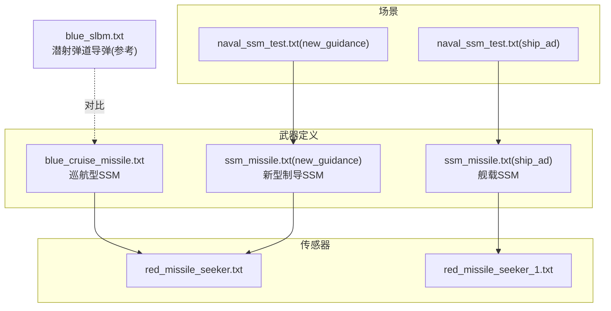
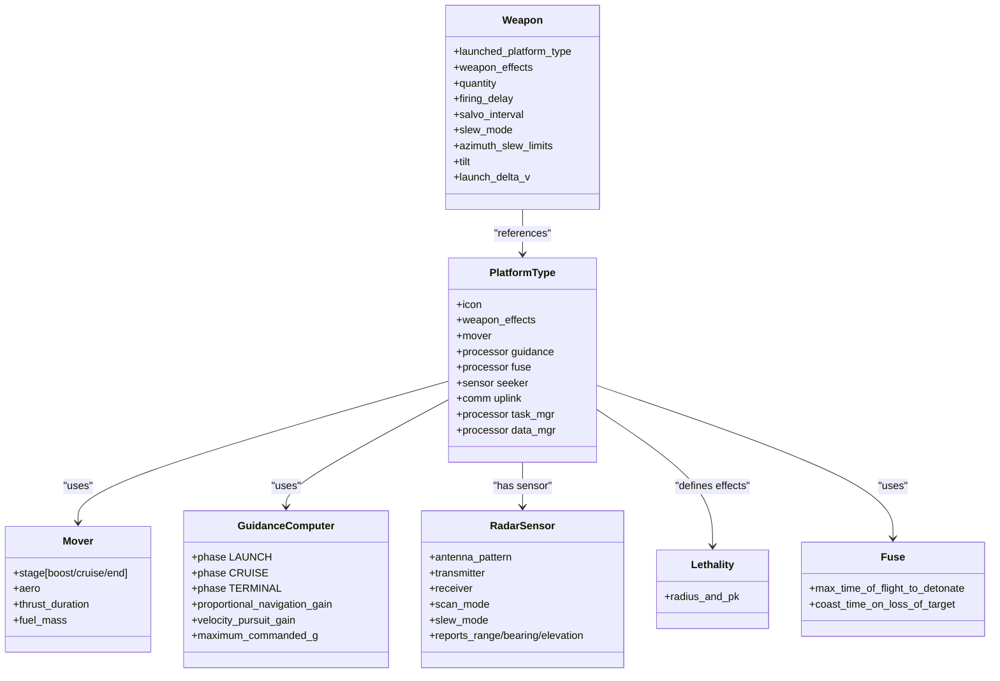
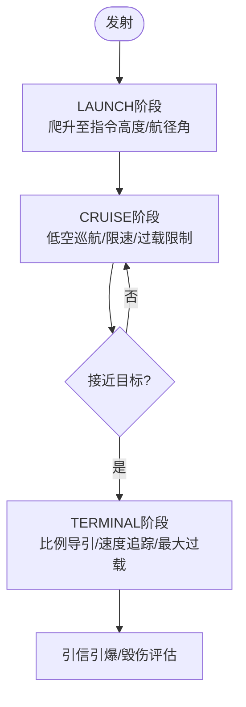
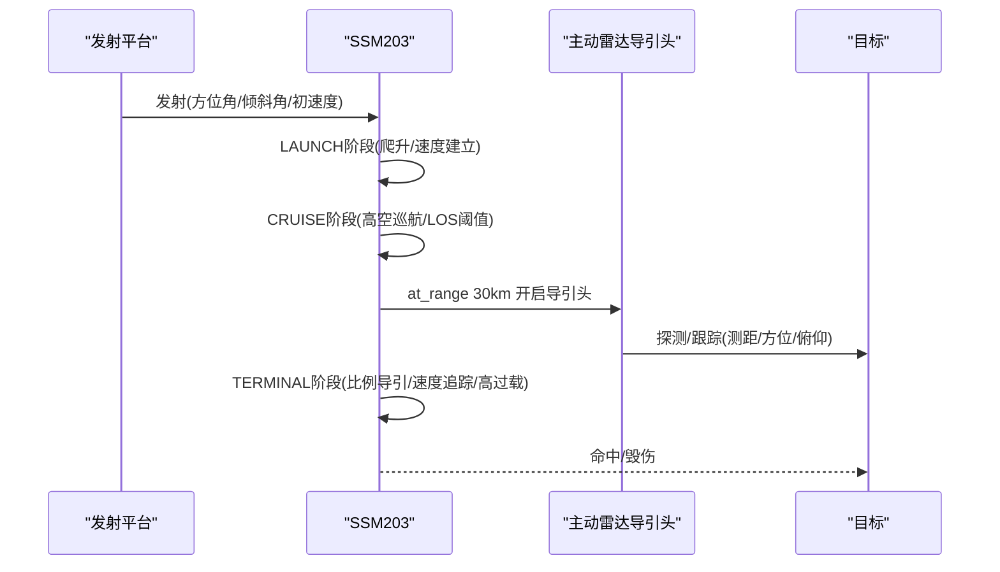
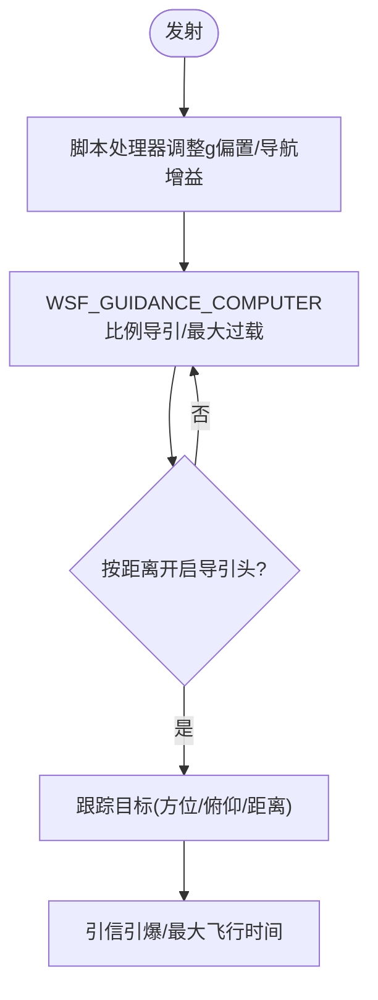
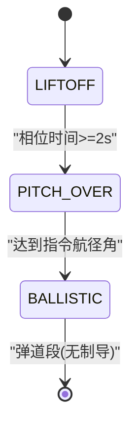
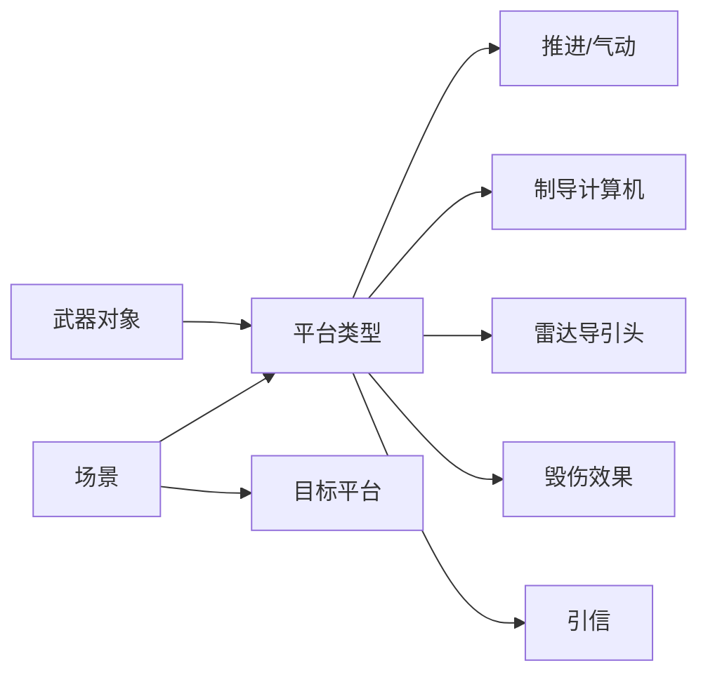

# 反舰导弹(SSM)

<cite>
**本文引用的文件**   
- [demos/base_types/weapons/ssm/blue_cruise_missile.txt](file://demos/base_types/weapons/ssm/blue_cruise_missile.txt)
- [demos/new_guidance/weapons/ssm/ssm_missile.txt](file://demos/new_guidance/weapons/ssm/ssm_missile.txt)
- [demos/ship_ad/weapons/ssm/ssm_missile.txt](file://demos/ship_ad/weapons/ssm/ssm_missile.txt)
- [demos/new_guidance/scenarios/naval_ssm_test.txt](file://demos/new_guidance/scenarios/naval_ssm_test.txt)
- [demos/ship_ad/scenarios/naval_ssm_test.txt](file://demos/ship_ad/scenarios/naval_ssm_test.txt)
- [demos/new_guidance/sensors/radar/red_missile_seeker.txt](file://demos/new_guidance/sensors/radar/red_missile_seeker.txt)
- [demos/ship_ad/sensors/radar/red_missile_seeker_1.txt](file://demos/ship_ad/sensors/radar/red_missile_seeker_1.txt)
- [demos/base_types_nx/weapons/ssm/blue_slbm.txt](file://demos/base_types_nx/weapons/ssm/blue_slbm.txt)
</cite>

## 目录
1. [引言](#引言)
2. [项目结构](#项目结构)
3. [核心组件](#核心组件)
4. [架构总览](#架构总览)
5. [详细组件分析](#详细组件分析)
6. [依赖关系分析](#依赖关系分析)
7. [性能与作战效能评估](#性能与作战效能评估)
8. [故障排查指南](#故障排查指南)
9. [结论](#结论)
10. [附录：配置示例与命中概率计算](#附录配置示例与命中概率计算)

## 引言
本技术文档面向反舰导弹（SSM）系统，结合仓库中的可运行示例与武器定义，系统化阐述以下主题：
- 作战概念与战术运用：掠海飞行、突防技术与多弹头攻击模式
- 导航与制导：惯性导航、地形匹配、卫星导航与末段主动寻的
- 突防技术：电子对抗、地形规避与机动突防策略
- 平台集成：舰载发射、空中投放与潜艇发射
- 性能分析与作战效能评估方法
- 完整配置示例与命中概率计算方法

本说明以AFSIM框架下的SSM武器定义与场景为蓝本，确保内容可直接映射到实际仿真模型与参数。

## 项目结构
围绕SSM的关键资产分布在以下路径：
- 巡航型SSM示例：demos/base_types/weapons/ssm/blue_cruise_missile.txt
- 新型制导SSM示例：demos/new_guidance/weapons/ssm/ssm_missile.txt
- 舰载防空/SSM演示：demos/ship_ad/weapons/ssm/ssm_missile.txt
- 雷达导引头传感器：demos/new_guidance/sensors/radar/red_missile_seeker.txt 与 demos/ship_ad/sensors/radar/red_missile_seeker_1.txt
- 水面舰艇与直升机协同场景：demos/new_guidance/scenarios/naval_ssm_test.txt 与 demos/ship_ad/scenarios/naval_ssm_test.txt
- 潜射弹道导弹（参考对比）：demos/base_types_nx/weapons/ssm/blue_slbm.txt

**图示来源** 
- [demos/base_types/weapons/ssm/blue_cruise_missile.txt:1-125](file://demos/base_types/weapons/ssm/blue_cruise_missile.txt#L1-L125)
- [demos/new_guidance/weapons/ssm/ssm_missile.txt:1-216](file://demos/new_guidance/weapons/ssm/ssm_missile.txt#L1-L216)
- [demos/ship_ad/weapons/ssm/ssm_missile.txt:1-127](file://demos/ship_ad/weapons/ssm/ssm_missile.txt#L1-L127)
- [demos/new_guidance/sensors/radar/red_missile_seeker.txt:1-69](file://demos/new_guidance/sensors/radar/red_missile_seeker.txt#L1-L69)
- [demos/ship_ad/sensors/radar/red_missile_seeker_1.txt:1-78](file://demos/ship_ad/sensors/radar/red_missile_seeker_1.txt#L1-L78)
- [demos/new_guidance/scenarios/naval_ssm_test.txt:1-43](file://demos/new_guidance/scenarios/naval_ssm_test.txt#L1-L43)
- [demos/ship_ad/scenarios/naval_ssm_test.txt:1-52](file://demos/ship_ad/scenarios/naval_ssm_test.txt#L1-L52)
- [demos/base_types_nx/weapons/ssm/blue_slbm.txt:1-196](file://demos/base_types_nx/weapons/ssm/blue_slbm.txt#L1-L196)

**章节来源**
- [demos/base_types/weapons/ssm/blue_cruise_missile.txt:1-125](file://demos/base_types/weapons/ssm/blue_cruise_missile.txt#L1-L125)
- [demos/new_guidance/weapons/ssm/ssm_missile.txt:1-216](file://demos/new_guidance/weapons/ssm/ssm_missile.txt#L1-L216)
- [demos/ship_ad/weapons/ssm/ssm_missile.txt:1-127](file://demos/ship_ad/weapons/ssm/ssm_missile.txt#L1-L127)
- [demos/new_guidance/scenarios/naval_ssm_test.txt:1-43](file://demos/new_guidance/scenarios/naval_ssm_test.txt#L1-L43)
- [demos/ship_ad/scenarios/naval_ssm_test.txt:1-52](file://demos/ship_ad/scenarios/naval_ssm_test.txt#L1-L52)
- [demos/base_types_nx/weapons/ssm/blue_slbm.txt:1-196](file://demos/base_types_nx/weapons/ssm/blue_slbm.txt#L1-L196)

## 核心组件
- 飞行器动力学与推进（WSF_GUIDED_MOVER）
  - 多级推进：助推器、巡航发动机、末段动力
  - 气动特性：阻力系数随马赫数变化、参考面积、升阻比
- 制导与控制（WSF_GUIDANCE_COMPUTER）
  - 阶段化控制：LAUNCH、CRUISE、TERMINAL
  - 比例导引、速度追踪增益、最大过载限制
- 传感器与寻的（WSF_RADAR_SENSOR + WSF_PERFECT_TRACKER/WSF_WEAPON_TRACK_PROCESSOR）
  - 主动雷达导引头：天线方向图、发射机/接收机参数、扫描/指向范围
  - 跟踪建立与维护条件、测量噪声滤波
- 毁伤效果（WSF_GRADUATED_LETHALITY）
  - 杀伤半径与命中概率曲线
- 引信（WSF_GROUND_TARGET_FUSE）
  - 目标丢失后滑翔时间、最大飞行时间引爆
- 通信与任务管理（WSF_COMM_TRANSCEIVER, WSF_TASK_PROCESSOR, WSF_TRACK_PROCESSOR）
  - 上行链路、任务处理器、航迹数据管理

**章节来源**
- [demos/base_types/weapons/ssm/blue_cruise_missile.txt:27-112](file://demos/base_types/weapons/ssm/blue_cruise_missile.txt#L27-L112)
- [demos/new_guidance/weapons/ssm/ssm_missile.txt:52-202](file://demos/new_guidance/weapons/ssm/ssm_missile.txt#L52-L202)
- [demos/ship_ad/weapons/ssm/ssm_missile.txt:28-107](file://demos/ship_ad/weapons/ssm/ssm_missile.txt#L28-L107)
- [demos/new_guidance/sensors/radar/red_missile_seeker.txt:14-69](file://demos/new_guidance/sensors/radar/red_missile_seeker.txt#L14-L69)
- [demos/ship_ad/sensors/radar/red_missile_seeker_1.txt:23-78](file://demos/ship_ad/sensors/radar/red_missile_seeker_1.txt#L23-L78)

## 架构总览
下图展示SSM在AFSIM中的典型架构：平台类型定义包含推进、制导、传感器、毁伤与引信等处理器；武器对象引用平台类型并定义发射参数；场景文件组织发射平台、目标与航线。

**图示来源**
- [demos/base_types/weapons/ssm/blue_cruise_missile.txt:27-112](file://demos/base_types/weapons/ssm/blue_cruise_missile.txt#L27-L112)
- [demos/new_guidance/weapons/ssm/ssm_missile.txt:52-202](file://demos/new_guidance/weapons/ssm/ssm_missile.txt#L52-L202)
- [demos/ship_ad/weapons/ssm/ssm_missile.txt:28-107](file://demos/ship_ad/weapons/ssm/ssm_missile.txt#L28-L107)
- [demos/new_guidance/sensors/radar/red_missile_seeker.txt:14-69](file://demos/new_guidance/sensors/radar/red_missile_seeker.txt#L14-L69)
- [demos/ship_ad/sensors/radar/red_missile_seeker_1.txt:23-78](file://demos/ship_ad/sensors/radar/red_missile_seeker_1.txt#L23-L78)

## 详细组件分析

### 巡航型SSM（蓝色巡航导弹）
- 推进与气动
  - 两级推进：助推器与涡扇巡航发动机，提供高初始速度与长航程巡航能力
  - 气动参数：亚音速/超音速阻力系数、马赫数过渡区、参考面积与升力上限
- 制导阶段
  - LAUNCH：爬升到指定高度与航径角
  - CRUISE：低空巡航（AGL），限速与过载限制
  - TERMINAL：比例导引与速度追踪，提高末端拦截精度
- 传感器与引信
  - 未安装终端传感器（注释说明），使用理想制导（guide_to_truth）用于测试
  - 地面目标引信，支持目标丢失后的滑翔时间
- 武器发射
  - 方位角旋转、倾斜角设置、齐射间隔与延迟

**图示来源**
- [demos/base_types/weapons/ssm/blue_cruise_missile.txt:71-96](file://demos/base_types/weapons/ssm/blue_cruise_missile.txt#L71-L96)
- [demos/base_types/weapons/ssm/blue_cruise_missile.txt:98-112](file://demos/base_types/weapons/ssm/blue_cruise_missile.txt#L98-L112)

**章节来源**
- [demos/base_types/weapons/ssm/blue_cruise_missile.txt:27-112](file://demos/base_types/weapons/ssm/blue_cruise_missile.txt#L27-L112)

### 新型制导SSM（SSM203）
- 推进与气动
  - 三级推进：助推、二级轻点火、巡航阶段，覆盖从加速到长航程巡航的全包线
  - 气动表：多马赫点阻力系数，适配跨声速与高超音速段
- 制导逻辑
  - LAUNCH：快速爬升与速度建立，比例导引与速度追踪增益
  - CRUISE：高空巡航，LOS角度阈值触发进入末端
  - TERMINAL：高过载与速度追踪，提升末端机动性
- 传感器与开关逻辑
  - 主动雷达导引头：X波段、脉冲宽度、PRF、扫描/指向范围
  - 武器跟踪处理器：按距离或时间开启导引头，降低早期暴露风险
- 武器发射
  - 方位角旋转、倾斜角、发射初速度增量

**图示来源**
- [demos/new_guidance/weapons/ssm/ssm_missile.txt:93-163](file://demos/new_guidance/weapons/ssm/ssm_missile.txt#L93-L163)
- [demos/new_guidance/weapons/ssm/ssm_missile.txt:184-199](file://demos/new_guidance/weapons/ssm/ssm_missile.txt#L184-L199)
- [demos/new_guidance/sensors/radar/red_missile_seeker.txt:23-69](file://demos/new_guidance/sensors/radar/red_missile_seeker.txt#L23-L69)

**章节来源**
- [demos/new_guidance/weapons/ssm/ssm_missile.txt:52-216](file://demos/new_guidance/weapons/ssm/ssm_missile.txt#L52-L216)
- [demos/new_guidance/sensors/radar/red_missile_seeker.txt:14-69](file://demos/new_guidance/sensors/radar/red_missile_seeker.txt#L14-L69)

### 舰载SSM（ship_ad）
- 推进与气动
  - 单级推进，短促高推力，适合近海快速打击
- 制导与控制
  - 比例导引增益与g偏置可调，脚本处理器动态调整制导参数
- 传感器与开关逻辑
  - 完美跟踪器或主动雷达导引头，按距离开启
- 引信
  - 最大飞行时间引爆，防止长时滑翔

**图示来源**
- [demos/ship_ad/weapons/ssm/ssm_missile.txt:56-89](file://demos/ship_ad/weapons/ssm/ssm_missile.txt#L56-L89)
- [demos/ship_ad/weapons/ssm/ssm_missile.txt:91-106](file://demos/ship_ad/weapons/ssm/ssm_missile.txt#L91-L106)

**章节来源**
- [demos/ship_ad/weapons/ssm/ssm_missile.txt:28-127](file://demos/ship_ad/weapons/ssm/ssm_missile.txt#L28-L127)

### 潜射弹道导弹（参考对比）
- 推进与气动
  - 多级固体火箭，高比冲，长射程
- 制导逻辑
  - 起飞、滚转、弹道段无制导（重力转弯）
- 发射计算机
  - 表面到表面弹道表，预生成解算

**图示来源**
- [demos/base_types_nx/weapons/ssm/blue_slbm.txt:120-141](file://demos/base_types_nx/weapons/ssm/blue_slbm.txt#L120-L141)
- [demos/base_types_nx/weapons/ssm/blue_slbm.txt:169-171](file://demos/base_types_nx/weapons/ssm/blue_slbm.txt#L169-L171)

**章节来源**
- [demos/base_types_nx/weapons/ssm/blue_slbm.txt:1-196](file://demos/base_types_nx/weapons/ssm/blue_slbm.txt#L1-L196)

## 依赖关系分析
- 平台类型依赖
  - 推进器（WSF_GUIDED_MOVER）与气动表（WSF_AERO）
  - 制导计算机（WSF_GUIDANCE_COMPUTER）与阶段逻辑
  - 传感器（WSF_RADAR_SENSOR）与跟踪处理器（WSF_PERFECT_TRACKER/WSF_WEAPON_TRACK_PROCESSOR）
  - 毁伤效果（WSF_GRADUATED_LETHALITY）与引信（WSF_GROUND_TARGET_FUSE）
- 武器对象依赖
  - 发射平台类型、毁伤效果、发射参数（方位角、倾斜角、齐射间隔）
- 场景依赖
  - 发射平台（舰船/直升机）、目标平台（车辆/舰船）、航线与位置

**图示来源**
- [demos/base_types/weapons/ssm/blue_cruise_missile.txt:27-112](file://demos/base_types/weapons/ssm/blue_cruise_missile.txt#L27-L112)
- [demos/new_guidance/weapons/ssm/ssm_missile.txt:52-216](file://demos/new_guidance/weapons/ssm/ssm_missile.txt#L52-L216)
- [demos/ship_ad/weapons/ssm/ssm_missile.txt:28-127](file://demos/ship_ad/weapons/ssm/ssm_missile.txt#L28-L127)
- [demos/new_guidance/scenarios/naval_ssm_test.txt:11-43](file://demos/new_guidance/scenarios/naval_ssm_test.txt#L11-L43)
- [demos/ship_ad/scenarios/naval_ssm_test.txt:18-52](file://demos/ship_ad/scenarios/naval_ssm_test.txt#L18-L52)

**章节来源**
- [demos/base_types/weapons/ssm/blue_cruise_missile.txt:27-112](file://demos/base_types/weapons/ssm/blue_cruise_missile.txt#L27-L112)
- [demos/new_guidance/weapons/ssm/ssm_missile.txt:52-216](file://demos/new_guidance/weapons/ssm/ssm_missile.txt#L52-L216)
- [demos/ship_ad/weapons/ssm/ssm_missile.txt:28-127](file://demos/ship_ad/weapons/ssm/ssm_missile.txt#L28-L127)
- [demos/new_guidance/scenarios/naval_ssm_test.txt:11-43](file://demos/new_guidance/scenarios/naval_ssm_test.txt#L11-L43)
- [demos/ship_ad/scenarios/naval_ssm_test.txt:18-52](file://demos/ship_ad/scenarios/naval_ssm_test.txt#L18-L52)

## 性能与作战效能评估
- 性能分析方法
  - 推进效率：比冲、推力持续时间、燃料质量占比
  - 气动特性：阻力系数随马赫数变化、参考面积对升阻比的影响
  - 制导精度：比例导引增益、速度追踪增益、最大过载限制
  - 传感器性能：检测范围、扫描/指向范围、跟踪建立/维持条件、测量噪声
- 作战效能评估
  - 命中概率：基于毁伤半径与目标RCS、环境杂波、干扰强度
  - 突防成功率：电子对抗（干扰/欺骗）、地形规避（低空/掠海）、机动突防（高过载/变轨）
  - 多弹头攻击：齐射间隔、方位角旋转、饱和攻击对防御系统的压力

**章节来源**
- [demos/base_types/weapons/ssm/blue_cruise_missile.txt:27-112](file://demos/base_types/weapons/ssm/blue_cruise_missile.txt#L27-L112)
- [demos/new_guidance/weapons/ssm/ssm_missile.txt:52-216](file://demos/new_guidance/weapons/ssm/ssm_missile.txt#L52-L216)
- [demos/ship_ad/weapons/ssm/ssm_missile.txt:28-127](file://demos/ship_ad/weapons/ssm/ssm_missile.txt#L28-L127)
- [demos/new_guidance/sensors/radar/red_missile_seeker.txt:23-69](file://demos/new_guidance/sensors/radar/red_missile_seeker.txt#L23-L69)
- [demos/ship_ad/sensors/radar/red_missile_seeker_1.txt:23-78](file://demos/ship_ad/sensors/radar/red_missile_seeker_1.txt#L23-L78)

## 故障排查指南
- 导引头无法建立跟踪
  - 检查扫描/指向范围是否覆盖目标
  - 确认跟踪建立/维持条件（hits_to_establish_track/hits_to_maintain_track）
  - 验证测量噪声滤波参数（range/bearing/elevation sigma）
- 制导不稳定或过载超限
  - 调整比例导引增益与速度追踪增益
  - 检查最大过载限制与g偏置设置
- 传感器过早暴露
  - 使用武器跟踪处理器按距离或时间开启导引头
- 引信提前或过晚引爆
  - 校验最大飞行时间引爆与目标丢失后的滑翔时间

**章节来源**
- [demos/new_guidance/sensors/radar/red_missile_seeker.txt:55-69](file://demos/new_guidance/sensors/radar/red_missile_seeker.txt#L55-L69)
- [demos/ship_ad/sensors/radar/red_missile_seeker_1.txt:64-78](file://demos/ship_ad/sensors/radar/red_missile_seeker_1.txt#L64-L78)
- [demos/new_guidance/weapons/ssm/ssm_missile.txt:195-199](file://demos/new_guidance/weapons/ssm/ssm_missile.txt#L195-L199)
- [demos/ship_ad/weapons/ssm/ssm_missile.txt:56-89](file://demos/ship_ad/weapons/ssm/ssm_missile.txt#L56-L89)

## 结论
通过AFSIM中的SSM示例与场景，可以构建完整的反舰导弹仿真体系：
- 巡航型与新型制导SSM展示了不同推进与制导策略
- 主动雷达导引头与跟踪处理器实现末段精确打击
- 场景文件组织发射平台与目标，支持水面舰艇与直升机协同
- 性能与效能评估可通过推进、气动、制导与传感器参数进行量化分析

## 附录：配置示例与命中概率计算

### 完整配置示例
- 巡航型SSM
  - 推进：助推器+涡扇巡航发动机
  - 制导：LAUNCH/CRUISE/TERMINAL阶段
  - 传感器：未安装终端传感器（测试用理想制导）
  - 引信：地面目标引信
  - 武器发射：方位角旋转、倾斜角、齐射间隔
- 新型制导SSM
  - 推进：三级推进（助推/二级轻点火/巡航）
  - 制导：比例导引与速度追踪，LOS阈值触发末端
  - 传感器：主动雷达导引头，按距离开启
  - 武器发射：方位角旋转、倾斜角、初速度增量
- 舰载SSM
  - 推进：单级高推力
  - 制导：脚本处理器动态调整g偏置与导航增益
  - 传感器：完美跟踪器或主动雷达导引头
  - 引信：最大飞行时间引爆

**章节来源**
- [demos/base_types/weapons/ssm/blue_cruise_missile.txt:27-125](file://demos/base_types/weapons/ssm/blue_cruise_missile.txt#L27-L125)
- [demos/new_guidance/weapons/ssm/ssm_missile.txt:52-216](file://demos/new_guidance/weapons/ssm/ssm_missile.txt#L52-L216)
- [demos/ship_ad/weapons/ssm/ssm_missile.txt:28-127](file://demos/ship_ad/weapons/ssm/ssm_missile.txt#L28-L127)

### 命中概率计算方法
- 基础公式
  - Pk = f(Rkill, RCS, 环境杂波, 干扰强度)
  - Rkill：毁伤半径（由WSF_GRADUATED_LETHALITY定义）
  - RCS：目标雷达反射截面积（影响检测与跟踪）
- 步骤
  - 确定Rkill与Pk曲线（例如半径_and_pk）
  - 根据目标RCS与环境条件修正检测概率Pd
  - 计算跟踪概率Pt（考虑跟踪建立/维持条件）
  - 最终命中概率 P = Pd × Pt × Pk
- 参数来源
  - 毁伤效果：radius_and_pk
  - 传感器：one_m2_detect_range、maximum_range、scan/slew limits
  - 跟踪处理器：hits_to_establish_track/hits_to_maintain_track

**章节来源**
- [demos/base_types/weapons/ssm/blue_cruise_missile.txt:38-40](file://demos/base_types/weapons/ssm/blue_cruise_missile.txt#L38-L40)
- [demos/new_guidance/weapons/ssm/ssm_missile.txt:48-50](file://demos/new_guidance/weapons/ssm/ssm_missile.txt#L48-L50)
- [demos/ship_ad/weapons/ssm/ssm_missile.txt:109-112](file://demos/ship_ad/weapons/ssm/ssm_missile.txt#L109-L112)
- [demos/new_guidance/sensors/radar/red_missile_seeker.txt:23-69](file://demos/new_guidance/sensors/radar/red_missile_seeker.txt#L23-L69)
- [demos/ship_ad/sensors/radar/red_missile_seeker_1.txt:23-78](file://demos/ship_ad/sensors/radar/red_missile_seeker_1.txt#L23-L78)