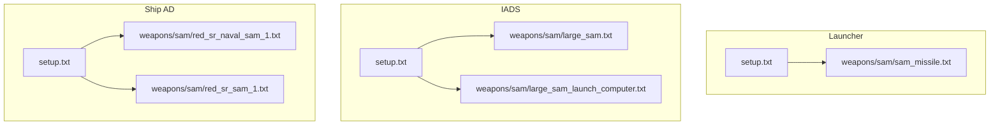
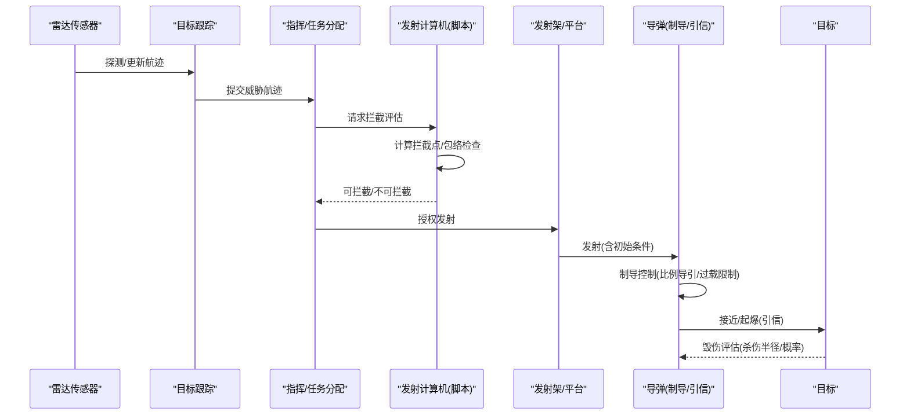
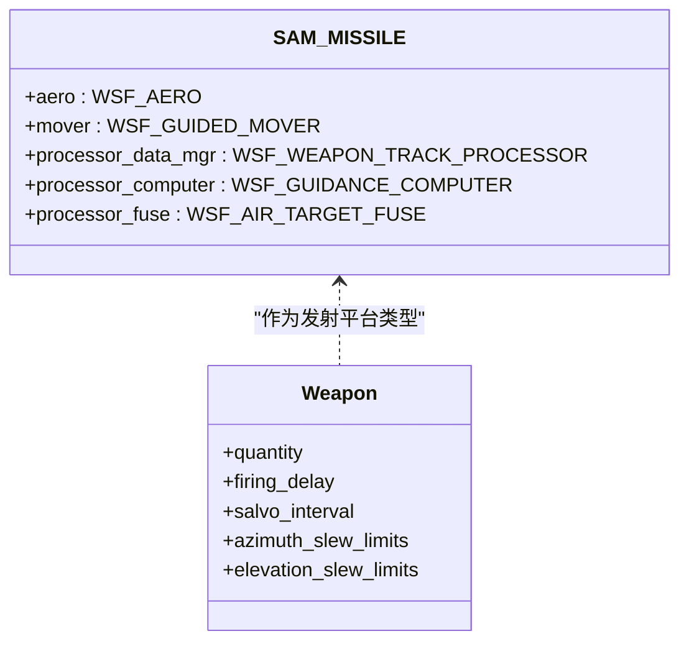
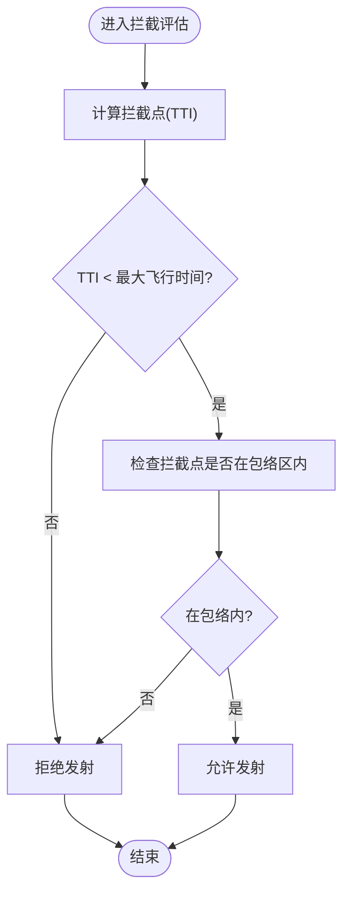
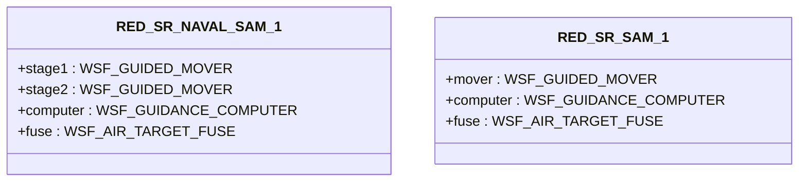
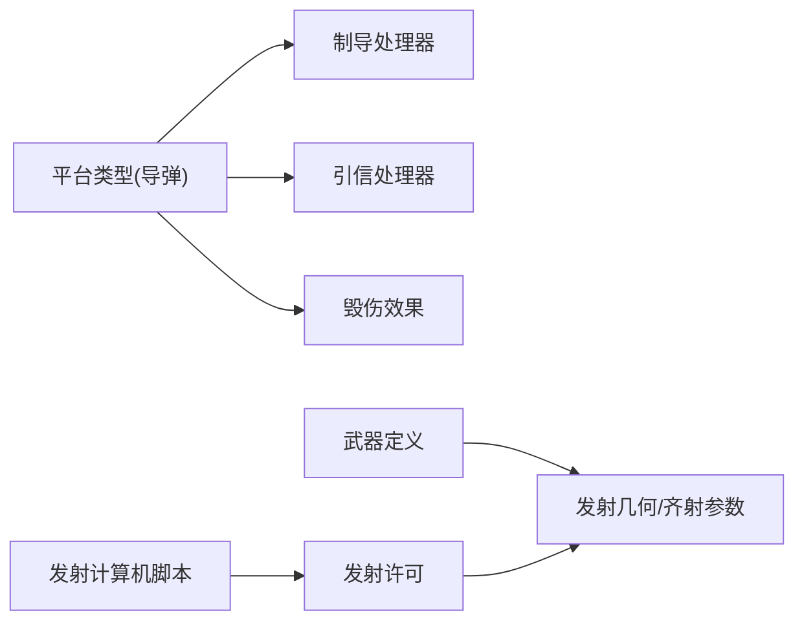

# 地空导弹(SAM)

<cite>
**本文引用的文件**   
- [sam_missile.txt](file://demos/launcher/weapons/sam/sam_missile.txt)
- [large_sam.txt](file://demos/iads/weapons/sam/large_sam.txt)
- [large_sam_launch_computer.txt](file://demos/iads/weapons/sam/large_sam_launch_computer.txt)
- [red_sr_naval_sam_1.txt](file://demos/ship_ad/weapons/sam/red_sr_naval_sam_1.txt)
- [red_sr_sam_1.txt](file://demos/ship_ad/weapons/sam/red_sr_sam_1.txt)
- [setup.txt（Launcher）](file://demos/launcher/setup.txt)
- [setup.txt（IADS）](file://demos/iads/setup.txt)
- [setup.txt（Ship AD）](file://demos/ship_ad/setup.txt)
</cite>

## 目录
1. [引言](#引言)
2. [项目结构](#项目结构)
3. [核心组件](#核心组件)
4. [架构总览](#架构总览)
5. [详细组件分析](#详细组件分析)
6. [依赖关系分析](#依赖关系分析)
7. [性能与拦截效果评估](#性能与拦截效果评估)
8. [故障排查指南](#故障排查指南)
9. [结论](#结论)
10. [附录：配置示例与战术运用要点](#附录配置示例与战术运用要点)

## 引言
本技术文档围绕AFSIM仓库中与地空导弹（SAM）相关的演示与配置，系统梳理防空导弹的作战模式、拦截策略、发射平台集成方式、制导与引信模型、战斗部毁伤特性，以及战术运用与性能评估方法。文档以“固定阵地/机动发射车/舰载”三类典型平台为线索，结合“区域防空”和“点防御”两类应用场景，给出可复现的配置示例与拦截效果分析方法，帮助读者快速搭建并评估SAM体系能力。

## 项目结构
与SAM相关的关键内容分布在以下演示目录中：
- launcher：展示单发/多联装发射流程与基础SAM武器定义
- iads：面向一体化防空反导（IADS）的大口径远程SAM及其发射计算机脚本
- ship_ad：面向舰载近程/中程SAM的陆基与海基变体

图表来源
- [setup.txt（Launcher）:1-19](file://demos/launcher/setup.txt#L1-L19)
- [setup.txt（IADS）:1-35](file://demos/iads/setup.txt#L1-L35)
- [setup.txt（Ship AD）:1-31](file://demos/ship_ad/setup.txt#L1-L31)

章节来源
- [setup.txt（Launcher）:1-19](file://demos/launcher/setup.txt#L1-L19)
- [setup.txt（IADS）:1-35](file://demos/iads/setup.txt#L1-L35)
- [setup.txt（Ship AD）:1-31](file://demos/ship_ad/setup.txt#L1-L31)

## 核心组件
- 导弹平台类型与气动/运动学
  - 采用WSF_AERO描述阻力系数、参考面积、最大升力等；WSF_GUIDED_MOVER或WSF_STRAIGHT_LINE_MOVER描述推进、推力、飞行包线与机动能力。
- 制导与跟踪处理器
  - WSF_GUIDANCE_COMPUTER提供比例导引、速度追踪、过载限制等参数；WSF_PERFECT_TRACKER用于理想跟踪器场景。
- 引信与毁伤
  - WSF_AIR_TARGET_FUSE设置最大飞行时间引爆；WSF_GRADUATED_LETHALITY通过杀伤半径与概率曲线建模破片杀伤。
- 武器发射与再装填
  - WSF_EXPLICIT_WEAPON定义数量、齐射间隔、方位/俯仰转塔范围、再装填阈值/增量/库存/耗时等。
- 发射计算机脚本
  - 基于拦截点计算与包络区判定，决定是否开火。

章节来源
- [sam_missile.txt:12-53](file://demos/launcher/weapons/sam/sam_missile.txt#L12-L53)
- [large_sam.txt:26-46](file://demos/iads/weapons/sam/large_sam.txt#L26-L46)
- [red_sr_naval_sam_1.txt:23-76](file://demos/ship_ad/weapons/sam/red_sr_naval_sam_1.txt#L23-L76)
- [red_sr_sam_1.txt:23-65](file://demos/ship_ad/weapons/sam/red_sr_sam_1.txt#L23-L65)

## 架构总览
SAM体系在AFSIM中的典型数据流如下：传感器探测→目标跟踪→任务规划/分配→发射计算机决策→导弹发射→制导控制→引信起爆→毁伤评估。

图表来源
- [large_sam_launch_computer.txt:16-48](file://demos/iads/weapons/sam/large_sam_launch_computer.txt#L16-L48)
- [sam_missile.txt:39-53](file://demos/launcher/weapons/sam/sam_missile.txt#L39-L53)
- [large_sam.txt:48-78](file://demos/iads/weapons/sam/large_sam.txt#L48-L78)

## 详细组件分析

### 组件A：通用SAM导弹（Launcher示例）
- 气动与运动
  - 亚音速/超音速阻力系数、马赫数过渡、参考面积、最大升力；WSF_GUIDED_MOVER提供推力、燃烧时间与更新频率。
- 制导与跟踪
  - WSF_GUIDANCE_COMPUTER：比例导引增益、速度追踪增益、过载偏置、最大指令过载、更新间隔。
  - WSF_WEAPON_TRACK_PROCESSOR：内部数据管理。
- 引信与毁伤
  - WSF_AIR_TARGET_FUSE：最大飞行时间引爆。
  - WSF_GRADUATED_LETHALITY：杀伤半径与命中概率。
- 武器发射
  - 数量、齐射间隔、方位/俯仰转塔范围。

图表来源
- [sam_missile.txt:12-53](file://demos/launcher/weapons/sam/sam_missile.txt#L12-L53)
- [sam_missile.txt:59-68](file://demos/launcher/weapons/sam/sam_missile.txt#L59-L68)

章节来源
- [sam_missile.txt:12-68](file://demos/launcher/weapons/sam/sam_missile.txt#L12-L68)

### 组件B：大型远程SAM（IADS示例）
- 平台与传感器特征
  - 红外/光学/雷达签名常量；WSF_STRAIGHT_LINE_MOVER以平均速度与最大横向过载描述高速拦截段；WSF_PERFECT_TRACKER提供理想跟踪。
- 引信与毁伤
  - WSF_AIR_TARGET_FUSE：最大飞行时间引爆。
  - WSF_GRADUATED_LETHALITY：较大杀伤半径与概率；附带脚本输出交战关键信息（位置、距离、Pk等）。
- 武器发射
  - 数量、齐射间隔、方位/俯仰转塔范围。

图表来源
- [large_sam_launch_computer.txt:16-48](file://demos/iads/weapons/sam/large_sam_launch_computer.txt#L16-L48)

章节来源
- [large_sam.txt:14-46](file://demos/iads/weapons/sam/large_sam.txt#L14-L46)
- [large_sam.txt:48-93](file://demos/iads/weapons/sam/large_sam.txt#L48-L93)
- [large_sam_launch_computer.txt:16-48](file://demos/iads/weapons/sam/large_sam_launch_computer.txt#L16-L48)

### 组件C：舰载近/中程SAM（Ship AD示例）
- 海军型（双级推进）
  - 两级WSF_GUIDED_MOVER：一级短促高推、二级持续加速；达到较高马赫数；WSF_GUIDANCE_COMPUTER与WSF_AIR_TARGET_FUSE配置合理；WSF_GRADUATED_LETHALITY设定杀伤半径。
  - 武器再装填：阈值、增量、库存、装填时间。
- 陆基型（单级推进）
  - 单级WSF_GUIDED_MOVER；WSF_GUIDANCE_COMPUTER与WSF_AIR_TARGET_FUSE；WSF_GRADUATED_LETHALITY；武器再装填参数。

图表来源
- [red_sr_naval_sam_1.txt:23-76](file://demos/ship_ad/weapons/sam/red_sr_naval_sam_1.txt#L23-L76)
- [red_sr_sam_1.txt:23-65](file://demos/ship_ad/weapons/sam/red_sr_sam_1.txt#L23-L65)

章节来源
- [red_sr_naval_sam_1.txt:23-98](file://demos/ship_ad/weapons/sam/red_sr_naval_sam_1.txt#L23-L98)
- [red_sr_sam_1.txt:23-89](file://demos/ship_ad/weapons/sam/red_sr_sam_1.txt#L23-L89)

## 依赖关系分析
- 平台类型与处理器
  - 所有SAM平台均依赖WSF_GUIDANCE_COMPUTER进行制导，WSF_AIR_TARGET_FUSE进行起爆逻辑，WSF_GRADUATED_LETHALITY进行毁伤建模。
- 武器与发射
  - WSF_EXPLICIT_WEAPON绑定launch_platform_type与weapon_effects，并通过slew_mode与方位/俯仰限制约束发射几何。
- 发射计算机脚本
  - 依赖拦截点计算与包络区判断，决定发射许可。

图表来源
- [sam_missile.txt:39-68](file://demos/launcher/weapons/sam/sam_missile.txt#L39-L68)
- [large_sam.txt:48-93](file://demos/iads/weapons/sam/large_sam.txt#L48-L93)
- [red_sr_naval_sam_1.txt:62-98](file://demos/ship_ad/weapons/sam/red_sr_naval_sam_1.txt#L62-L98)
- [red_sr_sam_1.txt:51-89](file://demos/ship_ad/weapons/sam/red_sr_sam_1.txt#L51-L89)
- [large_sam_launch_computer.txt:16-48](file://demos/iads/weapons/sam/large_sam_launch_computer.txt#L16-L48)

章节来源
- [sam_missile.txt:39-68](file://demos/launcher/weapons/sam/sam_missile.txt#L39-L68)
- [large_sam.txt:48-93](file://demos/iads/weapons/sam/large_sam.txt#L48-L93)
- [red_sr_naval_sam_1.txt:62-98](file://demos/ship_ad/weapons/sam/red_sr_naval_sam_1.txt#L62-L98)
- [red_sr_sam_1.txt:51-89](file://demos/ship_ad/weapons/sam/red_sr_sam_1.txt#L51-L89)
- [large_sam_launch_computer.txt:16-48](file://demos/iads/weapons/sam/large_sam_launch_computer.txt#L16-L48)

## 性能与拦截效果评估
- 指标建议
  - 拦截成功率（Pk）、脱靶量（Miss Distance）、最大可用射程、最大飞行时间、再装填时间、饱和攻击下的并发拦截能力。
- 数据来源
  - 大口径SAM的weapon_effects脚本会输出交战关键信息（位置、距离、Pk、PkDegrade等），可用于统计命中率与毁伤效果。
- 评估步骤
  - 在IADS场景中运行拦截脚本，收集事件输出；对多次仿真取均值与方差，比较不同包络/高度/速度条件下的拦截表现。
  - 对比舰载近程与中程SAM的再装填与并发能力，评估点防御与区域防空的互补性。

章节来源
- [large_sam.txt:48-78](file://demos/iads/weapons/sam/large_sam.txt#L48-L78)

## 故障排查指南
- 无法发射
  - 检查发射计算机脚本是否返回“可拦截”，确认拦截点TTI与最大飞行时间、包络区判定逻辑。
  - 核查武器定义的方位/俯仰转塔范围是否覆盖目标。
- 未命中或过早/过晚引爆
  - 检查WSF_AIR_TARGET_FUSE的最大飞行时间是否合理；核对导弹速度/加速度与目标相对运动。
- 毁伤效果异常
  - 检查WSF_GRADUATED_LETHALITY的杀伤半径与概率曲线；确认miss distance与Pk映射是否符合预期。
- 再装填问题
  - 检查reload_threshold、reload_increment、reload_inventory、reload_time与inhibit_while_reloading设置。

章节来源
- [large_sam_launch_computer.txt:16-48](file://demos/iads/weapons/sam/large_sam_launch_computer.txt#L16-L48)
- [sam_missile.txt:50-68](file://demos/launcher/weapons/sam/sam_missile.txt#L50-L68)
- [red_sr_naval_sam_1.txt:82-98](file://demos/ship_ad/weapons/sam/red_sr_naval_sam_1.txt#L82-L98)
- [red_sr_sam_1.txt:71-89](file://demos/ship_ad/weapons/sam/red_sr_sam_1.txt#L71-L89)

## 结论
AFSIM提供的SAM相关演示与配置覆盖了从通用SAM到远程大口径SAM、再到舰载近/中程SAM的典型能力。通过平台类型、处理器、武器与发射计算机脚本的组合，可以灵活构建区域防空与点防御场景，并进行拦截效果量化评估。建议在实战化演练中，结合传感器与任务规划模块，完善从探测到毁伤的闭环评估。

## 附录：配置示例与战术运用要点

### 配置示例一：固定阵地/机动发射车（Launcher）
- 使用launcher/setup.txt引入雷达、平台与SAM导弹定义；通过WSF_EXPLICIT_WEAPON的方位/俯仰转塔范围与齐射参数模拟固定阵地或机动发射车的火力组织。
- 适用场景：区域防空前沿拦截、要地防空点防御。

章节来源
- [setup.txt（Launcher）:1-19](file://demos/launcher/setup.txt#L1-L19)
- [sam_missile.txt:59-68](file://demos/launcher/weapons/sam/sam_missile.txt#L59-L68)

### 配置示例二：区域防空（IADS）
- 使用iads/setup.txt加载平台与网络/包络定义；通过large_sam.txt与large_sam_launch_computer.txt实现远程拦截与包络区校验。
- 适用场景：广域防空、高空高速目标拦截、多批目标饱和攻击下的分层拦截。

章节来源
- [setup.txt（IADS）:1-35](file://demos/iads/setup.txt#L1-L35)
- [large_sam.txt:26-93](file://demos/iads/weapons/sam/large_sam.txt#L26-L93)
- [large_sam_launch_computer.txt:16-48](file://demos/iads/weapons/sam/large_sam_launch_computer.txt#L16-L48)

### 配置示例三：舰载点防御（Ship AD）
- 使用ship_ad/setup.txt加载舰艇与武器；red_sr_naval_sam_1.txt与red_sr_sam_1.txt分别代表海军型与陆基型近/中程SAM，支持再装填与并发拦截。
- 适用场景：舰队近程点防御、低空突防目标拦截、高并发饱和攻击应对。

章节来源
- [setup.txt（Ship AD）:1-31](file://demos/ship_ad/setup.txt#L1-L31)
- [red_sr_naval_sam_1.txt:23-98](file://demos/ship_ad/weapons/sam/red_sr_naval_sam_1.txt#L23-L98)
- [red_sr_sam_1.txt:23-89](file://demos/ship_ad/weapons/sam/red_sr_sam_1.txt#L23-L89)

### 战术运用指导
- 区域防空
  - 优先部署远程大口径SAM，利用拦截计算机脚本与包络区限制提高拦截效率；配合预警雷达与指挥链路形成多层拦截。
- 点防御
  - 在近程/中程SAM上优化再装填与并发能力，确保对低空突防目标的快速反应；必要时与近防炮/CIWS协同。
- 编组与火力分配
  - 根据目标批序与威胁等级，合理分配远程与近程SAM的拦截任务，避免火力重叠与资源浪费。

[本节为概念性内容，不直接分析具体文件]