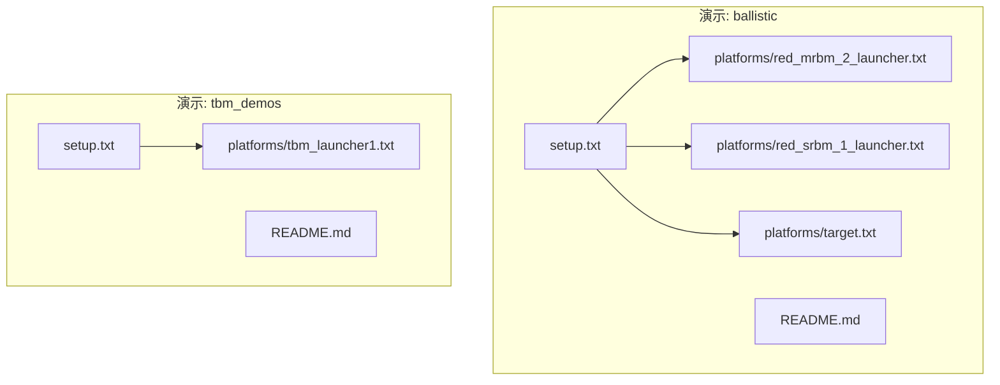
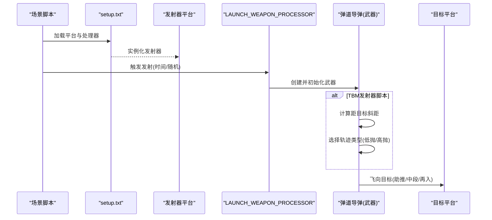
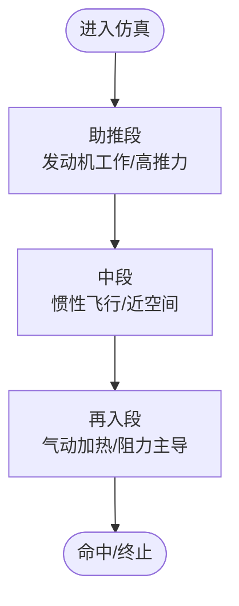
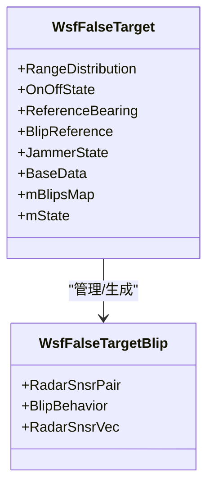
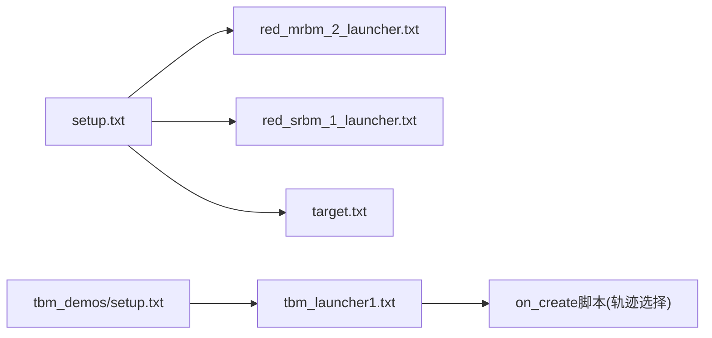

# 弹道导弹

<cite>
**本文引用的文件**   
- [ballistic/README.md](file://demos/ballistic/README.md)
- [tbm_demos/README.md](file://demos/tbm_demos/README.md)
- [ballistic/setup.txt](file://demos/ballistic/setup.txt)
- [tbm_demos/setup.txt](file://demos/tbm_demos/setup.txt)
- [ballistic/platforms/red_mrbm_2_launcher.txt](file://demos/ballistic/platforms/red_mrbm_2_launcher.txt)
- [ballistic/platforms/red_srbm_1_launcher.txt](file://demos/ballistic/platforms/red_srbm_1_launcher.txt)
- [ballistic/platforms/target.txt](file://demos/ballistic/platforms/target.txt)
- [tbm_demos/platforms/tbm_launcher1.txt](file://demos/tbm_demos/platforms/tbm_launcher1.txt)
</cite>

## 目录
1. [简介](#简介)
2. [项目结构](#项目结构)
3. [核心组件](#核心组件)
4. [架构总览](#架构总览)
5. [详细组件分析](#详细组件分析)
6. [依赖关系分析](#依赖关系分析)
7. [性能与精度考量](#性能与精度考量)
8. [故障排查指南](#故障排查指南)
9. [结论](#结论)
10. [附录：配置示例与工具使用](#附录配置示例与工具使用)

## 简介
本技术文档面向弹道导弹仿真与建模，围绕战术弹道导弹（TBM）、中程弹道导弹（MRBM）与洲际弹道导弹（ICBM）的分类、飞行轨迹计算（助推段、中段、再入段动力学模型）、多弹头分导与诱饵释放机制、制导精度控制与末端修正、拦截仿真与防御系统设计，以及完整配置示例与弹道分析工具使用方法进行系统化说明。文档以AFSIM仓库中的“ballistic”和“tbm_demos”演示为工程化依据，结合平台、武器、处理器与场景组织方式，给出可复现的仿真流程与最佳实践。

## 项目结构
AFSIM的弹道相关演示主要位于以下两个目录：
- demos/ballistic：展示多种短程/中程弹道导弹发射器与目标平台的组合，包含发射脚本、地形与事件输出等。
- demos/tbm_demos：聚焦战术弹道导弹（TBM）的多阶段、多轨迹类型与发射器行为脚本示例。

图示来源
- [ballistic/setup.txt:10-24](file://demos/ballistic/setup.txt#L10-L24)
- [tbm_demos/setup.txt:12-23](file://demos/tbm_demos/setup.txt#L12-L23)

章节来源
- [ballistic/README.md:1-22](file://demos/ballistic/README.md#L1-L22)
- [tbm_demos/README.md:1-14](file://demos/tbm_demos/README.md#L1-L14)
- [ballistic/setup.txt:10-24](file://demos/ballistic/setup.txt#L10-L24)
- [tbm_demos/setup.txt:12-23](file://demos/tbm_demos/setup.txt#L12-L23)

## 核心组件
- 发射器平台类型：定义地面移动器、武器挂载与发射处理器，支持按脚本变量控制发射时机与武器名称。
- 目标平台类型：用于接收打击或作为观测参考点。
- 武器类型：在base_types/weapons/ssm目录下提供SRBM/MRBM/TBM等弹道导弹类型定义（由演示引用）。
- 处理器：LAUNCH_WEAPON_PROCESSOR通过脚本实现条件发射、随机时间发射与轨迹类型选择。
- 场景与设置：setup.txt统一引入地形、事件管道与平台定义；场景脚本驱动发射序列。

章节来源
- [ballistic/platforms/red_mrbm_2_launcher.txt:12-24](file://demos/ballistic/platforms/red_mrbm_2_launcher.txt#L12-L24)
- [ballistic/platforms/red_srbm_1_launcher.txt:12-24](file://demos/ballistic/platforms/red_srbm_1_launcher.txt#L12-L24)
- [ballistic/platforms/target.txt:9-13](file://demos/ballistic/platforms/target.txt#L9-L13)
- [tbm_demos/platforms/tbm_launcher1.txt:18-41](file://demos/tbm_demos/platforms/tbm_launcher1.txt#L18-L41)

## 架构总览
下图展示了从场景到平台、武器与处理器的调用链，以及TBM发射器在创建武器时根据距离动态选择轨迹类型的逻辑。

图示来源
- [tbm_demos/platforms/tbm_launcher1.txt:25-39](file://demos/tbm_demos/platforms/tbm_launcher1.txt#L25-L39)
- [ballistic/platforms/red_mrbm_2_launcher.txt:19-23](file://demos/ballistic/platforms/red_mrbm_2_launcher.txt#L19-L23)
- [ballistic/platforms/red_srbm_1_launcher.txt:19-23](file://demos/ballistic/platforms/red_srbm_1_launcher.txt#L19-L23)

## 详细组件分析

### 分类与射程范围（TBM/MRBM/ICBM）
- 战术弹道导弹（TBM）：典型短程/中程任务，具备多段推进与末段机动能力，常用于精确打击。
- 中程弹道导弹（MRBM）：覆盖区域更广，通常具备更高的能量与更长的中段飞行时间。
- 洲际弹道导弹（ICBM）：跨洲打击，具备显著的中段与再入段特性，常伴随多弹头与诱饵对抗。

在AFSIM中，这些分类通过不同的武器类型与气动/推进数据表体现，并在场景中通过不同发射器与处理器进行调度。

章节来源
- [ballistic/README.md:17-19](file://demos/ballistic/README.md#L17-L19)

### 飞行轨迹计算与三段动力学模型
- 助推段：发动机工作期间的高推力阶段，速度快速增加，高度上升，受推进系统特性与气动阻力影响显著。
- 中段：发动机关机后惯性飞行阶段，主要在稀薄大气或近空间环境，轨道主要由初始速度与姿态决定。
- 再入段：返回稠密大气层，气动加热与阻力主导，需考虑热防护与制导修正。

AFSIM通过六自由度（P6DOF）与气动数据表对飞行器进行高精度建模，支持不同马赫数与攻角下的稳定性导数表，从而在三段飞行中准确反映动力学响应。

图示来源
- [swdev/src/wsf_plugins/wsf_p6dof/doc/p6dof_aerodynamics_data.rst:26-54](file://swdev/src/wsf_plugins/wsf_p6dof/doc/p6dof_aerodynamics_data.rst#L26-L54)

章节来源
- [swdev/src/wsf_plugins/wsf_p6dof/doc/p6dof_aerodynamics_data.rst:26-54](file://swdev/src/wsf_plugins/wsf_p6dof/doc/p6dof_aerodynamics_data.rst#L26-L54)

### 多弹头分导与诱饵释放机制
- 多弹头分导（MIRV）：在中段或再入前分离多个弹头，各自独立制导至不同目标，提升突防概率。
- 诱饵释放：在飞行过程中释放诱饵体，干扰敌方雷达跟踪与识别，降低拦截成功率。

AFSIM的电子战模块提供了虚假目标（False Target）与信号生成能力，可用于模拟诱饵体的雷达回波与运动学特征，配合弹道导弹的分导与释放时序进行对抗仿真。

图示来源
- [swdev/src/core/wsf_mil/source/ew/WsfFalseTarget.hpp:40-124](file://swdev/src/core/wsf_mil/source/ew/WsfFalseTarget.hpp#L40-L124)
- [swdev/src/core/wsf_mil/source/ew/WsfFalseTarget.hpp:331-338](file://swdev/src/core/wsf_mil/source/ew/WsfFalseTarget.hpp#L331-L338)

章节来源
- [swdev/src/core/wsf_mil/source/ew/WsfFalseTarget.hpp:40-124](file://swdev/src/core/wsf_mil/source/ew/WsfFalseTarget.hpp#L40-L124)
- [swdev/src/core/wsf_mil/source/ew/WsfFalseTarget.hpp:331-338](file://swdev/src/core/wsf_mil/source/ew/WsfFalseTarget.hpp#L331-L338)

### 制导精度控制与末端修正
- 制导精度：通过导航与制导算法（如比例导引、终端寻的）提高命中精度。
- 末端修正：在再入段利用传感器反馈与姿态控制进行轨迹微调，补偿大气扰动与初始误差。

在AFSIM中，可通过六自由度运动器与气动数据表实现高精度的姿态与轨迹控制，并结合处理器脚本在末端注入修正指令。

章节来源
- [swdev/src/wsf_plugins/wsf_p6dof/doc/p6dof_aerodynamics_data.rst:26-54](file://swdev/src/wsf_plugins/wsf_p6dof/doc/p6dof_aerodynamics_data.rst#L26-L54)

### 拦截仿真与防御系统设计
- 拦截器：地空/空空导弹或定向能武器，针对弹道导弹各段进行拦截。
- 探测与跟踪：雷达/光电传感器负责早期预警与持续跟踪。
- 火力控制：分配拦截资源、计算拦截窗口与交战包线。

AFSIM的IADS与传感器/武器子系统支持构建完整的拦截链路，包括雷达探测、目标跟踪、威胁评估与拦截器发射。

章节来源
- [tbm_demos/README.md:1-14](file://demos/tbm_demos/README.md#L1-L14)
- [ballistic/README.md:1-22](file://demos/ballistic/README.md#L1-L22)

## 依赖关系分析
- setup.txt统一引入事件管道、地形与平台定义，确保仿真环境与实体一致。
- 发射器平台类型依赖武器类型与处理器脚本，实现发射逻辑与轨迹控制。
- TBM发射器脚本在on_create回调中根据距目标的斜距动态选择轨迹类型（低抛/高抛），体现末端修正与任务自适应。

图示来源
- [ballistic/setup.txt:19-24](file://demos/ballistic/setup.txt#L19-L24)
- [tbm_demos/setup.txt:20-23](file://demos/tbm_demos/setup.txt#L20-L23)
- [tbm_demos/platforms/tbm_launcher1.txt:25-39](file://demos/tbm_demos/platforms/tbm_launcher1.txt#L25-L39)

章节来源
- [ballistic/setup.txt:19-24](file://demos/ballistic/setup.txt#L19-L24)
- [tbm_demos/setup.txt:20-23](file://demos/tbm_demos/setup.txt#L20-L23)
- [tbm_demos/platforms/tbm_launcher1.txt:25-39](file://demos/tbm_demos/platforms/tbm_launcher1.txt#L25-L39)

## 性能与精度考量
- 六自由度建模与气动数据表：提供更真实的姿态与轨迹响应，但会增加计算开销。
- 事件管道与输出：合理配置事件输出与重放文件，有助于离线分析与可视化。
- 处理器脚本：避免在高频回调中进行复杂计算，尽量将逻辑下沉至数据表或批处理。

[本节为通用指导，不直接分析具体文件]

## 故障排查指南
- 发射未触发：检查处理器脚本变量（如WEAPON_NAME）与场景时间参数是否正确。
- 轨迹类型异常：确认TBM发射器脚本的距离阈值与轨迹类型映射是否匹配任务需求。
- 输出为空：确认event_pipe与event_output已正确引入，且场景运行后生成了重放文件。

章节来源
- [ballistic/README.md:5-22](file://demos/ballistic/README.md#L5-L22)
- [tbm_demos/platforms/tbm_launcher1.txt:25-39](file://demos/tbm_demos/platforms/tbm_launcher1.txt#L25-L39)

## 结论
AFSIM的弹道导弹演示提供了从平台、武器到处理器与场景的完整仿真链路。通过六自由度与气动数据表可实现三段飞行的精细化建模；电子战模块支持诱饵与多弹头分导的对抗仿真；处理器脚本则赋予发射器灵活的任务自适应能力。结合IADS与传感器/武器子系统，可构建端到端的拦截仿真与防御系统设计。

[本节为总结性内容，不直接分析具体文件]

## 附录：配置示例与工具使用
- 配置示例路径
  - 弹道演示设置：[ballistic/setup.txt](file://demos/ballistic/setup.txt)
  - TBM演示设置：[tbm_demos/setup.txt](file://demos/tbm_demos/setup.txt)
  - MRBM发射器：[ballistic/platforms/red_mrbm_2_launcher.txt](file://demos/ballistic/platforms/red_mrbm_2_launcher.txt)
  - SRBM发射器：[ballistic/platforms/red_srbm_1_launcher.txt](file://demos/ballistic/platforms/red_srbm_1_launcher.txt)
  - 目标平台：[ballistic/platforms/target.txt](file://demos/ballistic/platforms/target.txt)
  - TBM发射器脚本：[tbm_demos/platforms/tbm_launcher1.txt](file://demos/tbm_demos/platforms/tbm_launcher1.txt)

- 工具使用方法
  - 运行演示：执行launch_all.txt或tbm_demos中的场景脚本，查看output目录下的重放文件与事件输出。
  - 调整发射时间：修改场景或处理器脚本中的时间变量（如TIME_TO_LAUNCH、MIN_TIME、MAX_TIME）。
  - 轨迹类型选择：在TBM发射器脚本中根据距离阈值切换trajectory_type（depressed/lofted）。

章节来源
- [ballistic/README.md:17-22](file://demos/ballistic/README.md#L17-L22)
- [tbm_demos/README.md:5-14](file://demos/tbm_demos/README.md#L5-L14)
- [tbm_demos/platforms/tbm_launcher1.txt:25-39](file://demos/tbm_demos/platforms/tbm_launcher1.txt#L25-L39)