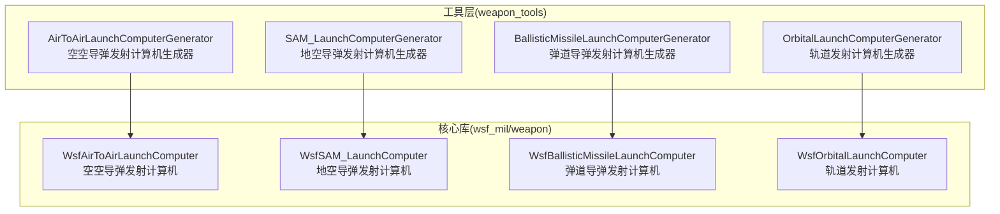
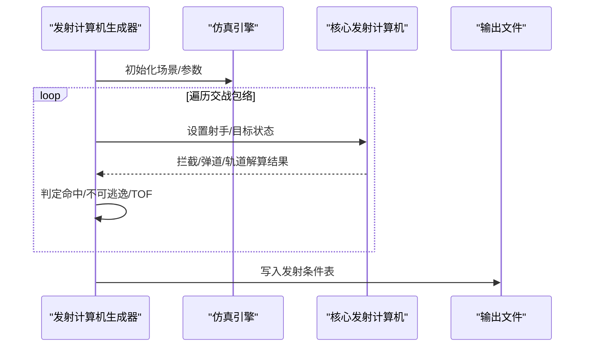
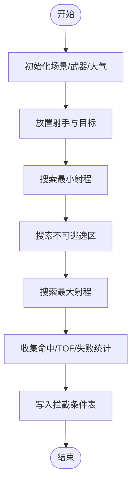
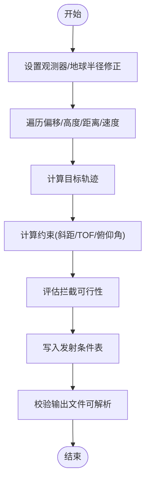
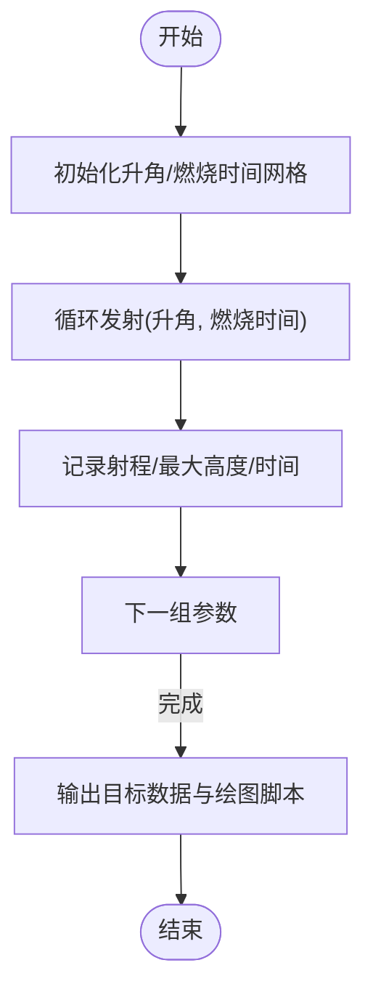
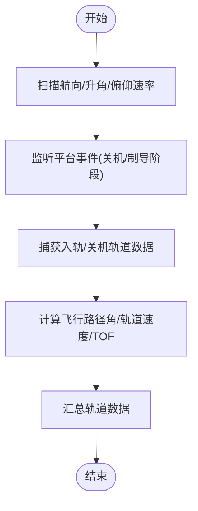
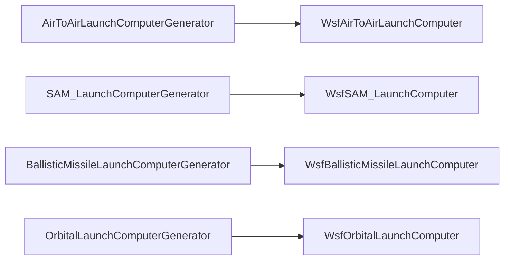

# 武器发射计算机

<cite>
**本文引用的文件**   
- [AirToAirLaunchComputerGenerator.hpp](file://swdev/src/weapon_tools/source/AirToAirLaunchComputerGenerator.hpp)
- [SAM_LaunchComputerGenerator.hpp](file://swdev/src/weapon_tools/source/SAM_LaunchComputerGenerator.hpp)
- [BallisticMissileLaunchComputerGenerator.hpp](file://swdev/src/weapon_tools/source/BallisticMissileLaunchComputerGenerator.hpp)
- [OrbitalLaunchComputerGenerator.hpp](file://swdev/src/weapon_tools/source/OrbitalLaunchComputerGenerator.hpp)
- [WsfAirToAirLaunchComputer.hpp](file://swdev/src/core/wsf_mil/source/weapon/WsfAirToAirLaunchComputer.hpp)
- [WsfSAM_LaunchComputer.hpp](file://swdev/src/core/wsf_mil/source/weapon/WsfSAM_LaunchComputer.hpp)
- [WsfBallisticMissileLaunchComputer.hpp](file://swdev/src/core/wsf_mil/source/weapon/WsfBallisticMissileLaunchComputer.hpp)
- [WsfOrbitalLaunchComputer.hpp](file://swdev/src/core/wsf_mil/source/weapon/WsfOrbitalLaunchComputer.hpp)
</cite>

## 目录
1. [简介](#简介)
2. [项目结构](#项目结构)
3. [核心组件](#核心组件)
4. [架构总览](#架构总览)
5. [详细组件分析](#详细组件分析)
6. [依赖关系分析](#依赖关系分析)
7. [性能与优化](#性能与优化)
8. [故障排查指南](#故障排查指南)
9. [结论](#结论)
10. [附录：配置与测试示例](#附录配置与测试示例)

## 简介
本技术文档面向“武器发射计算机”子系统，聚焦以下目标：
- 系统架构与模块职责（目标跟踪、拦截预测、能量管理、发射决策）
- 不同武器类型的发射计算机算法（导弹拦截、炸弹投放、火炮火控）
- 发射条件判断逻辑（距离、角度、速度、能量约束）
- 与传感器和平台的集成接口
- 配置参数与调优方法
- 完整配置示例与性能测试方法

说明：
- 本仓库包含多套“发射计算机生成工具”，用于批量仿真并导出可被WSF使用的发射条件表。这些工具围绕四类发射计算机展开：空空导弹、地空导弹、弹道导弹、轨道发射。
- 对于“炸弹投放”和“火炮火控”，仓库未提供专用发射计算机头文件；相关能力通常由平台/武器模型或外部火控流程实现。本文在相应章节给出概念性说明与集成建议。

## 项目结构
武器发射计算机相关代码主要位于两个区域：
- 核心库：wsf_mil/weapon 下的具体发射计算机类定义
- 工具层：weapon_tools 下的各类“发射计算机生成器”，负责遍历交战包络、执行仿真、输出发射条件表

图表来源
- [AirToAirLaunchComputerGenerator.hpp:26-43](file://swdev/src/weapon_tools/source/AirToAirLaunchComputerGenerator.hpp#L26-L43)
- [SAM_LaunchComputerGenerator.hpp:24-28](file://swdev/src/weapon_tools/source/SAM_LaunchComputerGenerator.hpp#L24-L28)
- [BallisticMissileLaunchComputerGenerator.hpp:23-33](file://swdev/src/weapon_tools/source/BallisticMissileLaunchComputerGenerator.hpp#L23-L33)
- [OrbitalLaunchComputerGenerator.hpp:26-49](file://swdev/src/weapon_tools/source/OrbitalLaunchComputerGenerator.hpp#L26-L49)

章节来源
- [AirToAirLaunchComputerGenerator.hpp:26-43](file://swdev/src/weapon_tools/source/AirToAirLaunchComputerGenerator.hpp#L26-L43)
- [SAM_LaunchComputerGenerator.hpp:24-28](file://swdev/src/weapon_tools/source/SAM_LaunchComputerGenerator.hpp#L24-L28)
- [BallisticMissileLaunchComputerGenerator.hpp:23-33](file://swdev/src/weapon_tools/source/BallisticMissileLaunchComputerGenerator.hpp#L23-L33)
- [OrbitalLaunchComputerGenerator.hpp:26-49](file://swdev/src/weapon_tools/source/OrbitalLaunchComputerGenerator.hpp#L26-L49)

## 核心组件
- 空空导弹发射计算机（WsfAirToAirLaunchComputer）
  - 功能：计算空空导弹的拦截包络、最小/最大射程、不可逃逸区、飞行时间等
  - 输入：射手与目标的运动学状态、大气环境、武器特性
  - 输出：拦截条件表（供WSF武器系统使用）
- 地空导弹发射计算机（WsfSAM_LaunchComputer）
  - 功能：评估地对空导弹对空中威胁的拦截可行性，计算TOF与可达范围
  - 输入：目标轨迹、雷达/传感器探测条件、地球曲率修正
  - 输出：发射条件表
- 弹道导弹发射计算机（WsfBallisticMissileLaunchComputer）
  - 功能：弹道段规划、升角/燃烧时间扫描、落点/高度/时间统计
  - 输入：目标位置、弹道参数空间
  - 输出：弹道包络与发射窗口
- 轨道发射计算机（WsfOrbitalLaunchComputer）
  - 功能：入轨/关机轨道参数计算、俯仰速率/升角/航向扫描
  - 输入：发射姿态、推进参数、轨道力学模型
  - 输出：轨道注入数据与发射条件

章节来源
- [WsfAirToAirLaunchComputer.hpp](file://swdev/src/core/wsf_mil/source/weapon/WsfAirToAirLaunchComputer.hpp)
- [WsfSAM_LaunchComputer.hpp](file://swdev/src/core/wsf_mil/source/weapon/WsfSAM_LaunchComputer.hpp)
- [WsfBallisticMissileLaunchComputer.hpp](file://swdev/src/core/wsf_mil/source/weapon/WsfBallisticMissileLaunchComputer.hpp)
- [WsfOrbitalLaunchComputer.hpp](file://swdev/src/core/wsf_mil/source/weapon/WsfOrbitalLaunchComputer.hpp)

## 架构总览
发射计算机体系采用“生成器 + 核心计算机”的分层架构：
- 生成器（Tool子类）：负责场景构建、参数遍历、仿真驱动、结果收集与文件输出
- 核心计算机（Wsf*LaunchComputer）：封装具体武器的拦截/弹道/轨道解算逻辑
- 数据流：生成器调用核心计算机进行多次仿真，汇总得到发射条件表，供WSF武器系统加载

图表来源
- [AirToAirLaunchComputerGenerator.hpp:26-43](file://swdev/src/weapon_tools/source/AirToAirLaunchComputerGenerator.hpp#L26-L43)
- [SAM_LaunchComputerGenerator.hpp:24-28](file://swdev/src/weapon_tools/source/SAM_LaunchComputerGenerator.hpp#L24-L28)
- [BallisticMissileLaunchComputerGenerator.hpp:23-33](file://swdev/src/weapon_tools/source/BallisticMissileLaunchComputerGenerator.hpp#L23-L33)
- [OrbitalLaunchComputerGenerator.hpp:26-49](file://swdev/src/weapon_tools/source/OrbitalLaunchComputerGenerator.hpp#L26-L49)

## 详细组件分析

### 空空导弹发射计算机（WsfAirToAirLaunchComputer）
- 生成器职责
  - 遍历射手马赫数、目标马赫数、目标方位角、目标高度等组合
  - 通过二分/区间搜索确定最小/最大射程与不可逃逸区
  - 记录每次仿真的命中/失败、TOF，最终输出WSF可读的拦截表
- 关键流程
  - 初始化场景与武器对象
  - 放置射手与目标，赋予完美跟踪
  - 迭代射程，判定是否可拦截（运动学可行+战斗部杀伤半径）
  - 输出拦截条件表

图表来源
- [AirToAirLaunchComputerGenerator.hpp:26-43](file://swdev/src/weapon_tools/source/AirToAirLaunchComputerGenerator.hpp#L26-L43)
- [AirToAirLaunchComputerGenerator.hpp:56-84](file://swdev/src/weapon_tools/source/AirToAirLaunchComputerGenerator.hpp#L56-L84)
- [AirToAirLaunchComputerGenerator.hpp:97-126](file://swdev/src/weapon_tools/source/AirToAirLaunchComputerGenerator.hpp#L97-L126)

章节来源
- [AirToAirLaunchComputerGenerator.hpp:26-43](file://swdev/src/weapon_tools/source/AirToAirLaunchComputerGenerator.hpp#L26-L43)
- [AirToAirLaunchComputerGenerator.hpp:56-84](file://swdev/src/weapon_tools/source/AirToAirLaunchComputerGenerator.hpp#L56-L84)
- [AirToAirLaunchComputerGenerator.hpp:97-126](file://swdev/src/weapon_tools/source/AirToAirLaunchComputerGenerator.hpp#L97-L126)
- [WsfAirToAirLaunchComputer.hpp](file://swdev/src/core/wsf_mil/source/weapon/WsfAirToAirLaunchComputer.hpp)

### 地空导弹发射计算机（WsfSAM_LaunchComputer）
- 生成器职责
  - 以地面距离为自变量，遍历偏移量、高度、速度等参数
  - 计算斜距、TOF、约束条件（如雷达俯仰角、地球曲率修正）
  - 输出地空导弹发射条件表
- 关键流程
  - 根据偏移/高度/速度构造目标轨迹
  - 计算约束（最小/最大斜距、TOF上限等）
  - 输出并校验生成的文件可解析

图表来源
- [SAM_LaunchComputerGenerator.hpp:24-28](file://swdev/src/weapon_tools/source/SAM_LaunchComputerGenerator.hpp#L24-L28)
- [SAM_LaunchComputerGenerator.hpp:70-88](file://swdev/src/weapon_tools/source/SAM_LaunchComputerGenerator.hpp#L70-L88)
- [SAM_LaunchComputerGenerator.hpp:92-133](file://swdev/src/weapon_tools/source/SAM_LaunchComputerGenerator.hpp#L92-L133)

章节来源
- [SAM_LaunchComputerGenerator.hpp:24-28](file://swdev/src/weapon_tools/source/SAM_LaunchComputerGenerator.hpp#L24-L28)
- [SAM_LaunchComputerGenerator.hpp:70-88](file://swdev/src/weapon_tools/source/SAM_LaunchComputerGenerator.hpp#L70-L88)
- [SAM_LaunchComputerGenerator.hpp:92-133](file://swdev/src/weapon_tools/source/SAM_LaunchComputerGenerator.hpp#L92-L133)
- [WsfSAM_LaunchComputer.hpp](file://swdev/src/core/wsf_mil/source/weapon/WsfSAM_LaunchComputer.hpp)

### 弹道导弹发射计算机（WsfBallisticMissileLaunchComputer）
- 生成器职责
  - 扫描升角与燃烧时间，统计射程、最大高度、到达时间等
  - 支持高抛/低抛弹道模式，输出目标数据与绘图脚本
- 关键流程
  - 初始化升角/燃烧时间网格
  - 逐次发射，记录射程/高度/时间
  - 输出目标数据与gnuplot脚本

图表来源
- [BallisticMissileLaunchComputerGenerator.hpp:38-87](file://swdev/src/weapon_tools/source/BallisticMissileLaunchComputerGenerator.hpp#L38-L87)

章节来源
- [BallisticMissileLaunchComputerGenerator.hpp:38-87](file://swdev/src/weapon_tools/source/BallisticMissileLaunchComputerGenerator.hpp#L38-L87)
- [WsfBallisticMissileLaunchComputer.hpp](file://swdev/src/core/wsf_mil/source/weapon/WsfBallisticMissileLaunchComputer.hpp)

### 轨道发射计算机（WsfOrbitalLaunchComputer）
- 生成器职责
  - 扫描发射航向、升角、俯仰速率，采集入轨/关机轨道参数
  - 计算飞行路径角、轨道速度、TOF等
  - 汇总所有发射的轨道数据
- 关键流程
  - 监听平台事件（推力关机、制导阶段变化）
  - 捕获入轨/关机轨道数据
  - 输出轨道数据文件

图表来源
- [OrbitalLaunchComputerGenerator.hpp:26-49](file://swdev/src/weapon_tools/source/OrbitalLaunchComputerGenerator.hpp#L26-L49)
- [OrbitalLaunchComputerGenerator.hpp:51-89](file://swdev/src/weapon_tools/source/OrbitalLaunchComputerGenerator.hpp#L51-L89)

章节来源
- [OrbitalLaunchComputerGenerator.hpp:26-49](file://swdev/src/weapon_tools/source/OrbitalLaunchComputerGenerator.hpp#L26-L49)
- [OrbitalLaunchComputerGenerator.hpp:51-89](file://swdev/src/weapon_tools/source/OrbitalLaunchComputerGenerator.hpp#L51-L89)
- [WsfOrbitalLaunchComputer.hpp](file://swdev/src/core/wsf_mil/source/weapon/WsfOrbitalLaunchComputer.hpp)

### 炸弹投放与火炮火控（概念性说明）
- 炸弹投放
  - 典型流程：平台进入投弹走廊→计算投放点/提前量→释放炸弹→自由落体/滑翔→命中评估
  - 在AFSIM中，炸弹投放常由平台/武器模型或处理器完成，非独立“炸弹发射计算机”
- 火炮火控
  - 典型流程：传感器跟踪→弹道解算（含风偏/科氏力/地球曲率）→装定射击诸元→开火
  - 若需专用火控，可通过自定义处理器或扩展武器模型实现

[本节为概念性说明，不直接分析具体源文件]

## 依赖关系分析
- 生成器与核心计算机的耦合
  - 生成器依赖对应核心计算机的头文件，调用其解算接口
  - 生成器负责场景搭建、参数遍历、结果聚合与文件输出
- 外部依赖
  - 仿真引擎（WsfSimulation）、平台（WsfPlatform）、跟踪（WsfTrack）
  - 大气模型（UtAtmosphere）等通用工具

图表来源
- [AirToAirLaunchComputerGenerator.hpp:16-24](file://swdev/src/weapon_tools/source/AirToAirLaunchComputerGenerator.hpp#L16-L24)
- [SAM_LaunchComputerGenerator.hpp:15-22](file://swdev/src/weapon_tools/source/SAM_LaunchComputerGenerator.hpp#L15-L22)
- [BallisticMissileLaunchComputerGenerator.hpp:15-21](file://swdev/src/weapon_tools/source/BallisticMissileLaunchComputerGenerator.hpp#L15-L21)
- [OrbitalLaunchComputerGenerator.hpp:18-24](file://swdev/src/weapon_tools/source/OrbitalLaunchComputerGenerator.hpp#L18-L24)

章节来源
- [AirToAirLaunchComputerGenerator.hpp:16-24](file://swdev/src/weapon_tools/source/AirToAirLaunchComputerGenerator.hpp#L16-L24)
- [SAM_LaunchComputerGenerator.hpp:15-22](file://swdev/src/weapon_tools/source/SAM_LaunchComputerGenerator.hpp#L15-L22)
- [BallisticMissileLaunchComputerGenerator.hpp:15-21](file://swdev/src/weapon_tools/source/BallisticMissileLaunchComputerGenerator.hpp#L15-L21)
- [OrbitalLaunchComputerGenerator.hpp:18-24](file://swdev/src/weapon_tools/source/OrbitalLaunchComputerGenerator.hpp#L18-L24)

## 性能与优化
- 参数空间裁剪
  - 预先剔除明显不可行的参数组合（如超远距、极端高度/速度），减少无效仿真
- 并行化
  - 将不同参数组合的仿真任务拆分到多线程/多进程执行
- 自适应搜索
  - 使用二分/区间收缩策略快速收敛至边界（如最小/最大射程、不可逃逸区）
- I/O优化
  - 批量写入输出文件，避免频繁刷新磁盘
- 数值稳定性
  - 合理设置步长与容差，避免发散或震荡

[本节为通用指导，不直接分析具体源文件]

## 故障排查指南
- 常见问题
  - 输出文件无法解析：检查生成器是否成功写入且格式正确
  - 无命中/不可逃逸区异常：核查目标轨迹、传感器约束、地球曲率修正
  - TOF异常大或小：检查初始条件、推进参数、大气模型
- 定位手段
  - 启用中间日志，记录每轮仿真的关键状态（射程、TOF、约束值）
  - 逐步缩小参数空间，复现问题
  - 对比不同求解器/步长的结果差异

[本节为通用指导，不直接分析具体源文件]

## 结论
- AFSIM中的武器发射计算机采用“生成器 + 核心计算机”的分层设计，覆盖空空、地空、弹道与轨道发射场景
- 生成器负责参数遍历与结果聚合，核心计算机封装具体解算逻辑
- 针对炸弹投放与火炮火控，建议在平台/武器模型或处理器层面实现，必要时可扩展专用模块
- 通过合理的参数裁剪、并行化与I/O优化，可显著提升生成效率与稳定性

[本节为总结性内容，不直接分析具体源文件]

## 附录：配置与测试示例
- 空空导弹发射计算机
  - 配置要点：射手/目标马赫数、方位角、高度、大气模型、搜索容差
  - 测试方法：固定一组参数，验证最小/最大射程与不可逃逸区的收敛性
- 地空导弹发射计算机
  - 配置要点：偏移量、高度、地面距离、目标速度、雷达俯仰角限制、地球半径修正
  - 测试方法：单点扫描+边界搜索，校验TOF上限与斜距约束
- 弹道导弹发射计算机
  - 配置要点：升角/燃烧时间网格、高抛/低抛模式、输出时间/范围/高度限制
  - 测试方法：网格扫描，统计射程/最大高度/时间分布
- 轨道发射计算机
  - 配置要点：发射航向、升角、俯仰速率、入轨/关机数据采集
  - 测试方法：参数扫描，汇总轨道注入数据，验证飞行路径角/轨道速度一致性

[本节为示例性说明，不直接分析具体源文件]