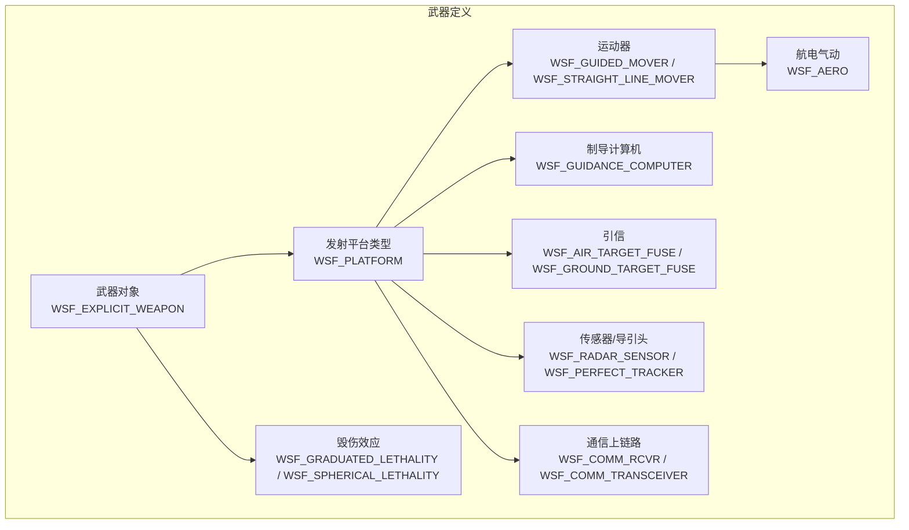
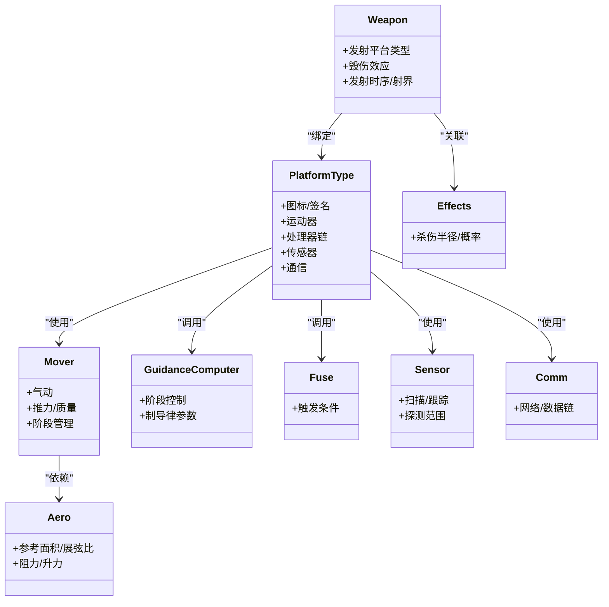
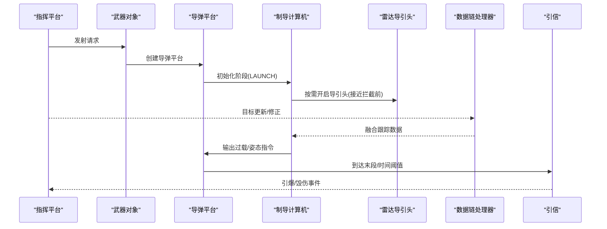
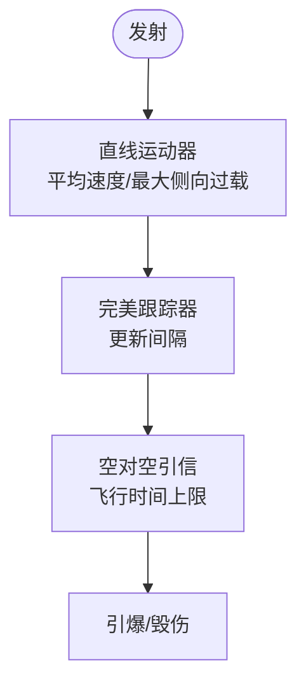
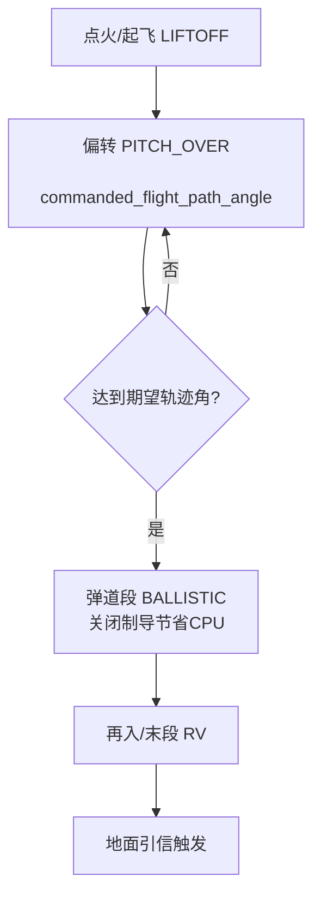
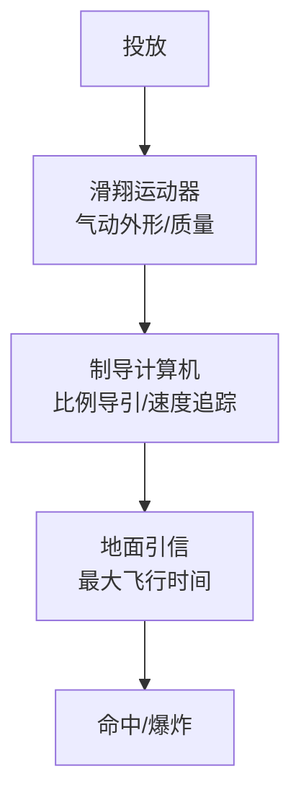
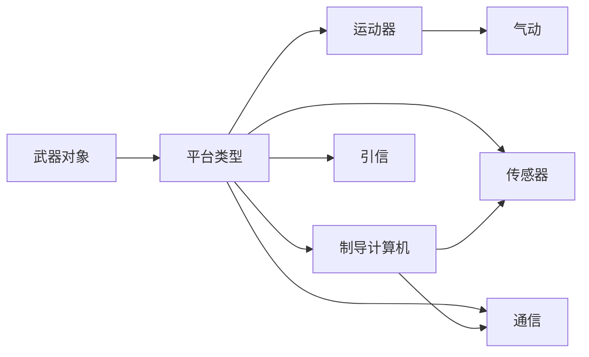

# 武器系统

<cite>
**本文引用的文件**   
- [medium_range_radar_missile.txt](file://demos/air_to_air/weapons/aam/medium_range_radar_missile.txt)
- [short_range_ir_missile.txt](file://demos/air_to_air/weapons/aam/short_range_ir_missile.txt)
- [large_sam.txt](file://demos/alternate_locations/weapons/sam/large_sam.txt)
- [red_mrbm_1.txt](file://demos/ballistic_missile_shootdown/weapons/ssm/red_mrbm_1.txt)
- [blue_glide_bomb_1.txt](file://demos/alternate_locations/weapons/agm/blue_glide_bomb_1.txt)
</cite>

## 目录
1. [简介](#简介)
2. [项目结构](#项目结构)
3. [核心组件](#核心组件)
4. [架构总览](#架构总览)
5. [详细组件分析](#详细组件分析)
6. [依赖关系分析](#依赖关系分析)
7. [性能与仿真特性](#性能与仿真特性)
8. [故障排查指南](#故障排查指南)
9. [结论](#结论)
10. [附录：配置语法与参数速查](#附录配置语法与参数速查)

## 简介
本技术文档面向AFSIM中的武器系统建模与仿真，覆盖空空导弹(AAM)、地空导弹(SAM)、反舰/地对地导弹(SSM/BM)、制导炸弹(AGM)等典型武器类型。文档从系统架构、数据流、处理逻辑、集成方式到效果评估进行系统化说明，并提供可操作的配置示例与分析方法，帮助读者快速搭建、调优与验证武器模型。

## 项目结构
仓库中武器相关定义以“平台类型+运动器+处理器（制导/引信）+传感器+通信+武器对象”的方式组织，示例位于各演示场景的weapons目录下。以下图展示典型武器文件的组成与关系。

图示来源
- [medium_range_radar_missile.txt:116-259](file://demos/air_to_air/weapons/aam/medium_range_radar_missile.txt#L116-L259)
- [short_range_ir_missile.txt:115-209](file://demos/air_to_air/weapons/aam/short_range_ir_missile.txt#L115-L209)
- [large_sam.txt:22-61](file://demos/alternate_locations/weapons/sam/large_sam.txt#L22-L61)
- [red_mrbm_1.txt:236-421](file://demos/ballistic_missile_shootdown/weapons/ssm/red_mrbm_1.txt#L236-L421)
- [blue_glide_bomb_1.txt:26-66](file://demos/alternate_locations/weapons/agm/blue_glide_bomb_1.txt#L26-L66)

章节来源
- [medium_range_radar_missile.txt:116-259](file://demos/air_to_air/weapons/aam/medium_range_radar_missile.txt#L116-L259)
- [short_range_ir_missile.txt:115-209](file://demos/air_to_air/weapons/aam/short_range_ir_missile.txt#L115-L209)
- [large_sam.txt:22-61](file://demos/alternate_locations/weapons/sam/large_sam.txt#L22-L61)
- [red_mrbm_1.txt:236-421](file://demos/ballistic_missile_shootdown/weapons/ssm/red_mrbm_1.txt#L236-L421)
- [blue_glide_bomb_1.txt:26-66](file://demos/alternate_locations/weapons/agm/blue_glide_bomb_1.txt#L26-L66)

## 核心组件
- 武器对象(Weapon)
  - 负责挂载、发射时序、射界限制、齐射间隔、与发射平台的绑定以及毁伤效应关联。
- 平台类型(Platform Type)
  - 描述武器实体，包含图标、签名、运动器、处理器链、传感器与通信接口。
- 运动器(Mover)
  - 六自由度或简化运动模型，支持多段推进、质量变化、气动外形与推力曲线。
- 制导计算机(Guidance Computer)
  - 分阶段制导律（如比例导引、速度追踪、攻角/过载指令），支持条件切换阶段。
- 引信(Fuse)
  - 空对空/地对空/地对地引信，支持时间/距离/目标丢失等触发策略。
- 传感器/导引头(Sensor/Seeker)
  - 雷达/红外/光学导引头，含扫描模式、天线方向图、探测范围、跟踪建立/维持门限。
- 通信(Comm/Uplink)
  - 中段数据链，用于接收指挥平台的目标更新与修正指令。
- 气动(Aero)
  - 参考面积、展弦比、最大升力系数、阻力系数随马赫数变化等。
- 毁伤效应(Weapon Effects)
  - 渐变杀伤/球形杀伤模型，定义杀伤半径、概率、损伤阈值与指数。

章节来源
- [medium_range_radar_missile.txt:149-229](file://demos/air_to_air/weapons/aam/medium_range_radar_missile.txt#L149-L229)
- [short_range_ir_missile.txt:124-183](file://demos/air_to_air/weapons/aam/short_range_ir_missile.txt#L124-L183)
- [large_sam.txt:29-41](file://demos/alternate_locations/weapons/sam/large_sam.txt#L29-L41)
- [red_mrbm_1.txt:236-346](file://demos/ballistic_missile_shootdown/weapons/ssm/red_mrbm_1.txt#L236-L346)
- [blue_glide_bomb_1.txt:30-47](file://demos/alternate_locations/weapons/agm/blue_glide_bomb_1.txt#L30-L47)

## 架构总览
下图给出AAM/SAM/SSM/AGM在AFSIM中的统一架构视图，强调“平台类型-运动器-制导-引信-传感器-通信-毁伤”的数据与控制流。

图示来源
- [medium_range_radar_missile.txt:116-259](file://demos/air_to_air/weapons/aam/medium_range_radar_missile.txt#L116-L259)
- [short_range_ir_missile.txt:115-209](file://demos/air_to_air/weapons/aam/short_range_ir_missile.txt#L115-L209)
- [large_sam.txt:22-61](file://demos/alternate_locations/weapons/sam/large_sam.txt#L22-L61)
- [red_mrbm_1.txt:236-421](file://demos/ballistic_missile_shootdown/weapons/ssm/red_mrbm_1.txt#L236-L421)
- [blue_glide_bomb_1.txt:26-66](file://demos/alternate_locations/weapons/agm/blue_glide_bomb_1.txt#L26-L66)

## 详细组件分析

### 空空导弹(AAM)
- 中距雷达制导导弹(MRM)
  - 运动器：WSF_GUIDED_MOVER，固体火箭发动机参数（推力、比冲、燃烧时长）、气动外形、质量与燃料。
  - 制导：WSF_GUIDANCE_COMPUTER，分LAUNCH与TERMINAL两阶段，比例导引与速度追踪增益可调。
  - 引信：WSF_AIR_TARGET_FUSE，飞行时间上限。
  - 传感器：WSF_RADAR_SENSOR，搜索/跟踪模式、天线方向图、探测范围、跟踪建立/维持命中次数。
  - 通信：WSF_COMM_RCVR，中段数据链；WSF_WEAPON_TRACK_PROCESSOR控制导引头上电时机。
  - 毁伤：WSF_GRADUATED_LETHALITY，半径与杀伤概率。
- 近程红外制导导弹(SRM)
  - 运动器：WSF_GUIDED_MOVER，较小质量与推力，短燃烧时间。
  - 制导：WSF_GUIDANCE_COMPUTER，高比例导引增益。
  - 传感器：WSF_PERFECT_TRACKER提供理想目标信息，同时保留雷达导引头用于观测数据注入。
  - 毁伤：WSF_GRADUATED_LETHALITY，较小杀伤半径。

图示来源
- [medium_range_radar_missile.txt:149-229](file://demos/air_to_air/weapons/aam/medium_range_radar_missile.txt#L149-L229)
- [short_range_ir_missile.txt:124-183](file://demos/air_to_air/weapons/aam/short_range_ir_missile.txt#L124-L183)

章节来源
- [medium_range_radar_missile.txt:95-259](file://demos/air_to_air/weapons/aam/medium_range_radar_missile.txt#L95-L259)
- [short_range_ir_missile.txt:94-209](file://demos/air_to_air/weapons/aam/short_range_ir_missile.txt#L94-L209)

### 地空导弹(SAM)
- 大型SAM
  - 运动器：WSF_STRAIGHT_LINE_MOVER，恒定速度与最大横向过载，引导模式为lead_pursuit。
  - 引信：WSF_AIR_TARGET_FUSE，飞行时间上限对应射程。
  - 传感器：WSF_PERFECT_TRACKER，简化跟踪。
  - 武器对象：数量、齐射间隔、方位/俯仰射界限制。

图示来源
- [large_sam.txt:29-41](file://demos/alternate_locations/weapons/sam/large_sam.txt#L29-L41)

章节来源
- [large_sam.txt:22-61](file://demos/alternate_locations/weapons/sam/large_sam.txt#L22-L61)

### 反舰/地对地导弹(SSM/BM)
- 中程弹道导弹(Red MRBM)
  - 运动器：WSF_GUIDED_MOVER，多级推进（Stage 1/2/RV），每级独立气动、质量、燃料、比冲与燃烧时长。
  - 制导：WSF_GUIDANCE_COMPUTER，分LIFTOFF/PITCH_OVER/BALLISTIC阶段，重力转弯与轨迹角控制。
  - 引信：WSF_GROUND_TARGET_FUSE，地面目标引信，支持目标丢失后滑翔时间。
  - 发射计算机：WSF_BALLISTIC_MISSILE_LAUNCH_COMPUTER，基于弹道表计算抛射角/轨迹。
  - 分离脚本：按阶段释放抛体（spent stages）。

图示来源
- [red_mrbm_1.txt:236-346](file://demos/ballistic_missile_shootdown/weapons/ssm/red_mrbm_1.txt#L236-L346)

章节来源
- [red_mrbm_1.txt:192-421](file://demos/ballistic_missile_shootdown/weapons/ssm/red_mrbm_1.txt#L192-L421)

### 制导炸弹(AGM)
- 滑翔炸弹
  - 运动器：WSF_GUIDED_MOVER，带气动外形，无动力滑翔。
  - 制导：WSF_GUIDANCE_COMPUTER，比例导引/速度追踪增益，过载限制。
  - 引信：WSF_GROUND_TARGET_FUSE，最大飞行时间。
  - 毁伤：WSF_SPHERICAL_LETHALITY，球形杀伤模型。

图示来源
- [blue_glide_bomb_1.txt:30-47](file://demos/alternate_locations/weapons/agm/blue_glide_bomb_1.txt#L30-L47)

章节来源
- [blue_glide_bomb_1.txt:14-66](file://demos/alternate_locations/weapons/agm/blue_glide_bomb_1.txt#L14-L66)

## 依赖关系分析
- 组件耦合
  - 武器对象依赖平台类型；平台类型组合运动器、制导、引信、传感器与通信。
  - 运动器依赖气动数据；制导依赖传感器/数据链提供的目标状态。
- 外部依赖
  - 发射计算机依赖弹道/轨迹数据表（SSM）。
  - 传感器依赖天线方向图与探测范围参数。
- 潜在循环
  - 通过内部链接(internal_link)将传感器/通信与跟踪处理器解耦，避免直接循环依赖。

图示来源
- [medium_range_radar_missile.txt:149-229](file://demos/air_to_air/weapons/aam/medium_range_radar_missile.txt#L149-L229)
- [red_mrbm_1.txt:236-421](file://demos/ballistic_missile_shootdown/weapons/ssm/red_mrbm_1.txt#L236-L421)

章节来源
- [medium_range_radar_missile.txt:149-229](file://demos/air_to_air/weapons/aam/medium_range_radar_missile.txt#L149-L229)
- [red_mrbm_1.txt:236-421](file://demos/ballistic_missile_shootdown/weapons/ssm/red_mrbm_1.txt#L236-L421)

## 性能与仿真特性
- 六自由度/动力学
  - 通过WSF_GUIDED_MOVER实现质量变化、推力曲线与气动外形耦合，支持多段推进与积分步长控制。
- 制导律
  - 比例导引与速度追踪增益可调；分阶段切换，便于模拟中段修正与末段拦截。
- 传感器与跟踪
  - 雷达导引头具备扫描模式、帧时间、带宽与探测范围；可通过internal_link接入数据链与跟踪处理器。
- 通信与数据链
  - 中段上链支持网络名称与内部数据管理器，允许动态目标更新与融合。
- 毁伤与环境效应
  - 渐变杀伤与球形杀伤模型，支持半径、概率、阈值与指数参数化。

[本节为通用指导，不直接分析具体文件]

## 故障排查指南
- 导引头未开机或无法跟踪
  - 检查WSF_WEAPON_TRACK_PROCESSOR的上电时机（before_intercept或range阈值）与sensor开关状态。
  - 确认internal_link已正确连接到track_mgr与weapon_manager。
- 制导发散或过载超限
  - 调整WSF_GUIDANCE_COMPUTER的比例导引/速度追踪增益与maximum_commanded_g。
  - 检查aero的cl_max与参考面积是否合理。
- 引信过早/过晚引爆
  - 校验WSF_AIR/GROUND_TARGET_FUSE的max_time_of_flight或触发条件。
- 弹道射程不匹配
  - 核对WSF_BALLISTIC_MISSILE_LAUNCH_COMPUTER的弹道表与ballistic_missile_launch_computer的RV气动/质量数据。
- 数据链丢包或延迟
  - 检查WSF_COMM_RCVR/TRANSCEIVER的网络名称与data_mgr的fused_track_reporting与purge_interval设置。

章节来源
- [medium_range_radar_missile.txt:195-229](file://demos/air_to_air/weapons/aam/medium_range_radar_missile.txt#L195-L229)
- [red_mrbm_1.txt:373-386](file://demos/ballistic_missile_shootdown/weapons/ssm/red_mrbm_1.txt#L373-L386)

## 结论
AFSIM的武器系统通过平台类型聚合运动器、制导、引信、传感器与通信，形成可扩展、可配置的模块化架构。AAM/SAM/SSM/AGM四类武器在统一框架下实现差异化的动力学、制导律与毁伤模型。借助示例配置文件，用户可快速搭建并调优武器系统，结合发射计算机与数据链完成中段修正与末段拦截，并通过渐变/球形杀伤模型评估毁伤与环境效应。

[本节为总结性内容，不直接分析具体文件]

## 附录：配置语法与参数速查
- 平台类型(WSF_PLATFORM)
  - 关键项：icon、infrared_signature/optical_signature/radar_signature、mover、processor、sensor、comm。
- 运动器
  - WSF_GUIDED_MOVER：integration_timestep、update_interval、stage(n).aero/total_mass/fuel_mass/specific_impulse/thrust_duration。
  - WSF_STRAIGHT_LINE_MOVER：average_speed、maximum_lateral_acceleration、guidance_mode。
- 制导计算机(WSF_GUIDANCE_COMPUTER)
  - phase(name)：guidance_delay、commanded_flight_path_angle/proportional_navigation_gain/velocity_pursuit_gain/g_bias/maximum_commanded_g、next_phase when条件。
- 引信
  - WSF_AIR_TARGET_FUSE：max_time_of_flight_to_detonate。
  - WSF_GROUND_TARGET_FUSE：coast_time_on_loss_of_target、maximum_time_of_flight。
- 传感器/导引头
  - WSF_RADAR_SENSOR：initial_mode、slew_mode、scan_limits、frame_time、transmitter(receiver)参数、one_m2_detect_range、hits_to_establish_track/maintain_track。
  - WSF_PERFECT_TRACKER：update_interval。
- 通信
  - WSF_COMM_RCVR/TRANSCEIVER：network_name、internal_link。
- 气动(WSF_AERO)
  - reference_area、aspect_ratio、oswalds_factor、cl_max、cd_zero_subsonic/supersonic、mach_begin_cd_rise/mach_end_cd_rise/mach_max_supersonic、mach_and_cd点列。
- 武器对象(WSF_EXPLICIT_WEAPON)
  - launched_platform_type、weapon_effects、launch_computer、firing_delay/firing_interval/salvo_interval、slew_mode与方位/俯仰射界、quantity、location/tilt/cue_to_predicted_intercept等。
- 毁伤效应
  - WSF_GRADUATED_LETHALITY：radius_and_pk。
  - WSF_SPHERICAL_LETHALITY：minimum_radius、maximum_radius、minimum_damage、maximum_damage、threshold_damage、exponent。

章节来源
- [medium_range_radar_missile.txt:95-259](file://demos/air_to_air/weapons/aam/medium_range_radar_missile.txt#L95-L259)
- [short_range_ir_missile.txt:94-209](file://demos/air_to_air/weapons/aam/short_range_ir_missile.txt#L94-L209)
- [large_sam.txt:22-61](file://demos/alternate_locations/weapons/sam/large_sam.txt#L22-L61)
- [red_mrbm_1.txt:192-421](file://demos/ballistic_missile_shootdown/weapons/ssm/red_mrbm_1.txt#L192-L421)
- [blue_glide_bomb_1.txt:14-66](file://demos/alternate_locations/weapons/agm/blue_glide_bomb_1.txt#L14-L66)