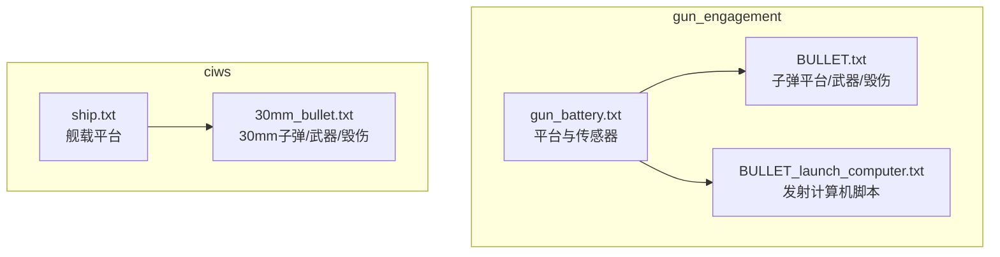
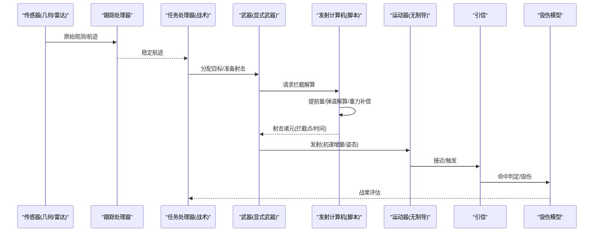
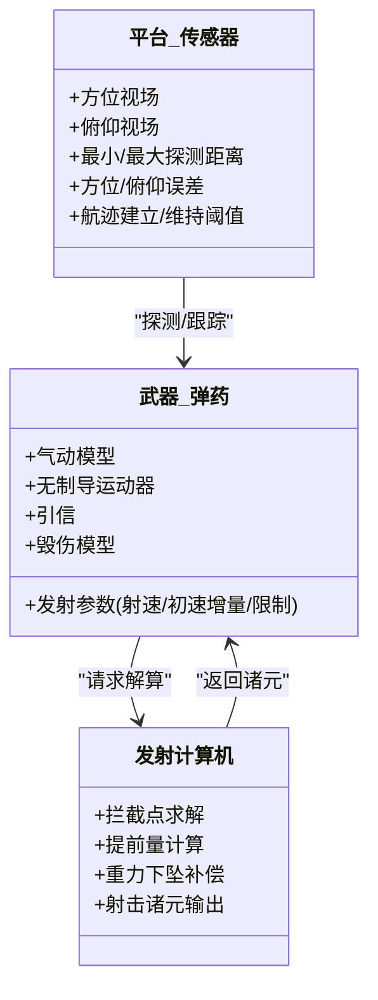
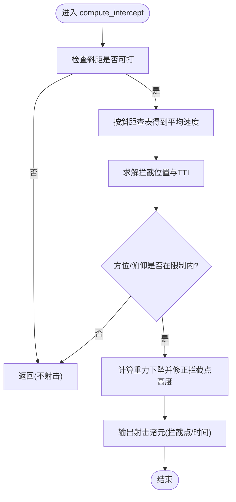
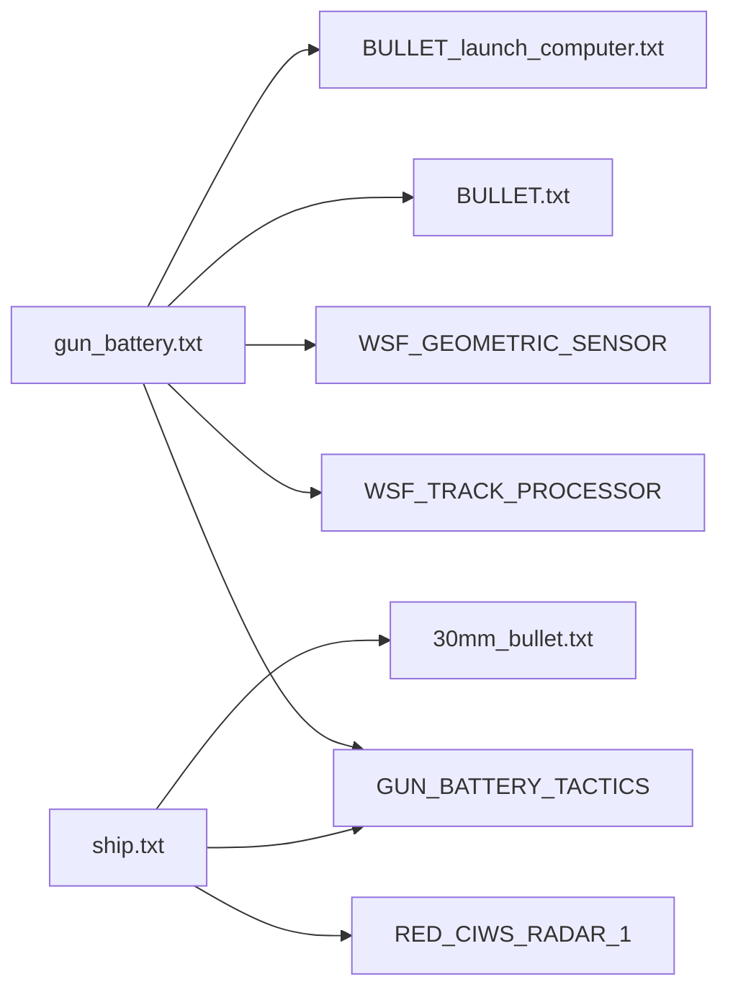

# 火炮系统

<cite>
**本文引用的文件**   
- [gun_engagement.rst](file://demos/gun_engagement/doc/gun_engagement.rst)
- [README.md](file://demos/gun_engagement/README.md)
- [gun_battery.txt](file://demos/gun_engagement/platforms/gun_battery.txt)
- [BULLET.txt](file://demos/gun_engagement/weapons/guns/BULLET.txt)
- [BULLET_launch_computer.txt](file://demos/gun_engagement/weapons/guns/BULLET_launch_computer.txt)
- [30mm_bullet.txt](file://demos/ciws/weapons/guns/30mm_bullet.txt)
- [ship.txt](file://demos/ciws/platforms/ship.txt)
</cite>

## 目录
1. [引言](#引言)
2. [项目结构](#项目结构)
3. [核心组件](#核心组件)
4. [架构总览](#架构总览)
5. [详细组件分析](#详细组件分析)
6. [依赖关系分析](#依赖关系分析)
7. [性能与精度考量](#性能与精度考量)
8. [故障排查指南](#故障排查指南)
9. [结论](#结论)
10. [附录：配置示例与命中率分析](#附录配置示例与命中率分析)

## 引言
本技术文档围绕 AFSIM 仓库中的“火炮系统”主题，聚焦舰炮、近防炮（CIWS）等面状防空/对海火力平台的建模与仿真。文档基于仓库中 gun_engagement 与 ciws 两个演示工程，系统说明：
- 火炮弹道计算模型（初速、射程、散布与弹道系数）
- 瞄准系统与火控算法（提前量计算、弹道解算、射击诸元生成）
- 炮弹战斗部类型与毁伤效果（穿甲、高爆、照明等）
- 火力控制配置与射击模拟流程
- 完整配置示例与命中率分析方法

## 项目结构
本项目的火炮相关能力主要由以下演示工程提供：
- demos/gun_engagement：面向子弹武器与发射计算机的端到端演示，包含平台、传感器、处理器、武器与发射计算机定义
- demos/ciws：面向近防炮（30mm）的舰载防空演示，包含平台、雷达传感器与武器定义

图示来源
- [gun_battery.txt:16-61](file://demos/gun_engagement/platforms/gun_battery.txt#L16-L61)
- [BULLET.txt:19-64](file://demos/gun_engagement/weapons/guns/BULLET.txt#L19-L64)
- [BULLET_launch_computer.txt:4-259](file://demos/gun_engagement/weapons/guns/BULLET_launch_computer.txt#L4-L259)
- [ship.txt:15-48](file://demos/ciws/platforms/ship.txt#L15-L48)
- [30mm_bullet.txt:24-78](file://demos/ciws/weapons/guns/30mm_bullet.txt#L24-L78)

章节来源
- [gun_engagement.rst:27-49](file://demos/gun_engagement/doc/gun_engagement.rst#L27-L49)
- [README.md:1-49](file://demos/gun_engagement/README.md#L1-L49)

## 核心组件
- 平台与传感器
  - gun_battery：定义反炮兵/高炮平台、任务处理器、跟踪处理器与几何传感器（方位/俯仰视场、误差、探测范围）
  - ship：定义舰载平台、近防炮武器挂载点与雷达传感器
- 武器与弹药
  - BULLET：定义子弹气动特性、无制导运动器、引信、武器毁伤（渐变杀伤半径与概率）、武器发射参数（初速增量、射速、散布/散布扩展预留）
  - 30MM_BULLET：定义30mm子弹的气动、运动器、引信、毁伤与武器发射参数（含初速随机方差）
- 发射计算机（火控）
  - BULLET_LAUNCH_COMPUTER：实现目标拦截点求解、提前量计算、重力下坠补偿、射击诸元输出（拦截时间、发射时间、飞行时间）

章节来源
- [gun_battery.txt:16-61](file://demos/gun_engagement/platforms/gun_battery.txt#L16-L61)
- [ship.txt:15-48](file://demos/ciws/platforms/ship.txt#L15-L48)
- [BULLET.txt:19-64](file://demos/gun_engagement/weapons/guns/BULLET.txt#L19-L64)
- [30mm_bullet.txt:24-78](file://demos/ciws/weapons/guns/30mm_bullet.txt#L24-L78)
- [BULLET_launch_computer.txt:4-259](file://demos/gun_engagement/weapons/guns/BULLET_launch_computer.txt#L4-L259)

## 架构总览
下图展示从传感器探测到发射计算机解算再到武器发射与毁伤评估的整体数据流与控制流。

图示来源
- [gun_battery.txt:24-60](file://demos/gun_engagement/platforms/gun_battery.txt#L24-L60)
- [BULLET.txt:34-64](file://demos/gun_engagement/weapons/guns/BULLET.txt#L34-L64)
- [BULLET_launch_computer.txt:5-259](file://demos/gun_engagement/weapons/guns/BULLET_launch_computer.txt#L5-L259)
- [30mm_bullet.txt:41-78](file://demos/ciws/weapons/guns/30mm_bullet.txt#L41-L78)

## 详细组件分析

### 平台与传感器（gun_battery / ship）
- gun_battery
  - 定义平台类型、武器挂载、任务处理器（GUN_BATTERY_TACTICS）、跟踪处理器与几何传感器
  - 传感器关键参数：方位/俯仰视场、最小/最大探测距离、更新间隔、方位/俯仰误差标准差、建立/维持航迹所需命中数
- ship
  - 定义舰载平台、武器挂载位置、任务处理器变量（传感器名、武器名、齐射规模、最大射程）
  - 集成 CIWS 雷达传感器

章节来源
- [gun_battery.txt:16-61](file://demos/gun_engagement/platforms/gun_battery.txt#L16-L61)
- [ship.txt:15-48](file://demos/ciws/platforms/ship.txt#L15-L48)

### 武器与弹药（BULLET / 30MM_BULLET）
- 气动与运动学
  - 通过 WSF_AERO 定义参考面积与阻力系数随马赫数的变化；WSF_UNGUIDED_MOVER 设置质量、气动与更新步长
- 引信
  - WSF_AIR_TARGET_FUSE 设置粗/细更新间隔与近炸/命中近炸半径
- 毁伤模型
  - WSF_GRADUATED_LETHALITY 定义杀伤半径与命中概率（BULLET 为 5m/0.9；30MM_BULLET 为 2.0m/1.0）
- 武器发射参数
  - 显式武器 WSF_EXPLICIT_WEAPON 定义发射模式、方位/俯仰 slew 限制、数量、射速/齐射间隔、初速增量、自动目标提示与预测拦截提示
  - 30MM_BULLET 在 on_create 脚本中引入初速均匀分布方差，体现散布建模

图示来源
- [gun_battery.txt:40-60](file://demos/gun_engagement/platforms/gun_battery.txt#L40-L60)
- [BULLET.txt:19-64](file://demos/gun_engagement/weapons/guns/BULLET.txt#L19-L64)
- [30mm_bullet.txt:24-78](file://demos/ciws/weapons/guns/30mm_bullet.txt#L24-L78)
- [BULLET_launch_computer.txt:4-259](file://demos/gun_engagement/weapons/guns/BULLET_launch_computer.txt#L4-L259)

章节来源
- [BULLET.txt:19-64](file://demos/gun_engagement/weapons/guns/BULLET.txt#L19-L64)
- [30mm_bullet.txt:24-78](file://demos/ciws/weapons/guns/30mm_bullet.txt#L24-L78)

### 发射计算机与火控算法（BULLET_LAUNCH_COMPUTER）
- 拦截点求解
  - 使用 InterceptLocation3D 获取目标未来拦截位置与飞行时间 TTI
- 提前量与弹道解算
  - 根据斜距查表选择平均速度（考虑空气阻力导致的初速衰减），用于更准确的提前量估计
- 重力下坠补偿
  - 依据 tti 计算重力下坠量并修正拦截点高度
- 射击诸元输出
  - SetInterceptPoint/SetInterceptTime/SetLaunchTime/SetTimeOfFlight 输出拦截点、拦截时间、发射时间与飞行时间
- 方位/俯仰限制检查
  - 确保计算出的指向在武器的 slew 限制范围内

图示来源
- [BULLET_launch_computer.txt:5-259](file://demos/gun_engagement/weapons/guns/BULLET_launch_computer.txt#L5-L259)

章节来源
- [BULLET_launch_computer.txt:5-259](file://demos/gun_engagement/weapons/guns/BULLET_launch_computer.txt#L5-L259)

### 战术处理器与任务编排（GUN_BATTERY_TACTICS）
- 负责将传感器航迹映射到武器通道，控制齐射规模、最大射程与传感器切换
- 在 gun_battery 中通过 script_variables 注入传感器名称、武器名称、齐射规模与最大射程等参数

章节来源
- [gun_battery.txt:24-33](file://demos/gun_engagement/platforms/gun_battery.txt#L24-L33)
- [ship.txt:23-34](file://demos/ciws/platforms/ship.txt#L23-L34)

## 依赖关系分析
- gun_battery 依赖：
  - 处理器：GUN_BATTERY_TACTICS（战术）、WSF_TRACK_PROCESSOR（跟踪）
  - 传感器：WSF_GEOMETRIC_SENSOR（几何传感器）
  - 武器：BULLET（显式武器）
  - 发射计算机：BULLET_LAUNCH_COMPUTER（脚本）
- ship 依赖：
  - 处理器：GUN_BATTERY_TACTICS（复用）
  - 传感器：RED_CIWS_RADAR_1（CIWS 雷达）
  - 武器：30MM_BULLET（显式武器）

图示来源
- [gun_battery.txt:16-61](file://demos/gun_engagement/platforms/gun_battery.txt#L16-L61)
- [ship.txt:15-48](file://demos/ciws/platforms/ship.txt#L15-L48)

章节来源
- [gun_battery.txt:16-61](file://demos/gun_engagement/platforms/gun_battery.txt#L16-L61)
- [ship.txt:15-48](file://demos/ciws/platforms/ship.txt#L15-L48)

## 性能与精度考量
- 仿真步长与实时性
  - 子弹运动器更新间隔为 0.001 sec，适合高帧率（约 100 Hz）仿真，但不建议用于任务级分析
- 弹道与散布
  - 通过气动模型（CD-Mach 曲线）与无制导运动器模拟阻力衰减；30MM_BULLET 在 on_create 中引入初速均匀分布方差以体现散布
- 传感器误差
  - 几何传感器方位/俯仰误差标准差为 0.1 mil，影响早期跟踪与火控输入精度
- 射速与齐射
  - 通过 firing_interval/salvo_interval 控制射速；齐射规模由战术处理器变量控制

章节来源
- [README.md:1-49](file://demos/gun_engagement/README.md#L1-L49)
- [BULLET.txt:21-26](file://demos/gun_engagement/weapons/guns/BULLET.txt#L21-L26)
- [30mm_bullet.txt:74-77](file://demos/ciws/weapons/guns/30mm_bullet.txt#L74-L77)
- [gun_battery.txt:51-52](file://demos/gun_engagement/platforms/gun_battery.txt#L51-L52)

## 故障排查指南
- 无法开火或无拦截点
  - 检查斜距是否超过最大射程（发射计算机内部有 2000m 门限）
  - 检查方位/俯仰是否超出武器 slew 限制
- 命中率低
  - 检查传感器误差与跟踪质量（hits_to_establish_track/hits_to_maintain_track）
  - 检查毁伤半径与概率是否匹配目标尺寸
- 初速异常
  - 确认 on_create 脚本是否正确设置初速（30MM_BULLET）
  - 检查 launch_delta_v 与初始速度向量一致性

章节来源
- [BULLET_launch_computer.txt:6-8](file://demos/gun_engagement/weapons/guns/BULLET_launch_computer.txt#L6-L8)
- [BULLET_launch_computer.txt:232-234](file://demos/gun_engagement/weapons/guns/BULLET_launch_computer.txt#L232-L234)
- [gun_battery.txt:55-59](file://demos/gun_engagement/platforms/gun_battery.txt#L55-L59)
- [30mm_bullet.txt:74-77](file://demos/ciws/weapons/guns/30mm_bullet.txt#L74-L77)

## 结论
AFSIM 的火炮系统通过“平台+传感器+战术处理器+武器+发射计算机”的分层架构，实现了从探测、跟踪、火控解算到发射与毁伤评估的闭环仿真。gun_engagement 与 ciws 演示提供了完整的配置范式，支持：
- 精确的弹道解算（含重力下坠补偿与速度衰减查表）
- 灵活的散布与毁伤建模（气动、引信、渐变杀伤）
- 可扩展的传感器与战术逻辑（几何/雷达、任务处理器）

## 附录：配置示例与命中率分析

### 配置要点清单
- 平台与传感器
  - 定义平台类型、武器挂载、任务处理器与跟踪处理器
  - 配置几何/雷达传感器的视场、误差、探测范围与航迹建立/维持阈值
- 武器与弹药
  - 定义气动模型、无制导运动器、引信与毁伤模型
  - 设置显式武器参数：方位/俯仰 slew 限制、数量、射速/齐射间隔、初速增量、自动提示与预测拦截
- 发射计算机
  - 实现拦截点求解、提前量计算、重力下坠补偿与射击诸元输出
  - 增加方位/俯仰限制检查与可视化工具（可选）

章节来源
- [gun_battery.txt:16-61](file://demos/gun_engagement/platforms/gun_battery.txt#L16-L61)
- [BULLET.txt:19-64](file://demos/gun_engagement/weapons/guns/BULLET.txt#L19-L64)
- [BULLET_launch_computer.txt:4-259](file://demos/gun_engagement/weapons/guns/BULLET_launch_computer.txt#L4-L259)
- [30mm_bullet.txt:24-78](file://demos/ciws/weapons/guns/30mm_bullet.txt#L24-L78)

### 命中率分析方法
- 基础指标
  - 单发命中概率：由毁伤模型的杀伤半径与目标截面决定
  - 齐射命中期望：结合齐射规模与单发命中概率
- 散布建模
  - 初速方差（30MM_BULLET on_create）导致落点散布
  - 传感器误差（方位/俯仰 0.1 mil）影响早期火控输入
- 统计方法
  - 蒙特卡洛多次射击统计命中次数与散布椭圆
  - 对比不同传感器误差、毁伤半径与初速方差对命中率的影响

章节来源
- [BULLET.txt:43-45](file://demos/gun_engagement/weapons/guns/BULLET.txt#L43-L45)
- [30mm_bullet.txt:50-52](file://demos/ciws/weapons/guns/30mm_bullet.txt#L50-L52)
- [gun_battery.txt:51-52](file://demos/gun_engagement/platforms/gun_battery.txt#L51-L52)
- [30mm_bullet.txt:74-77](file://demos/ciws/weapons/guns/30mm_bullet.txt#L74-L77)