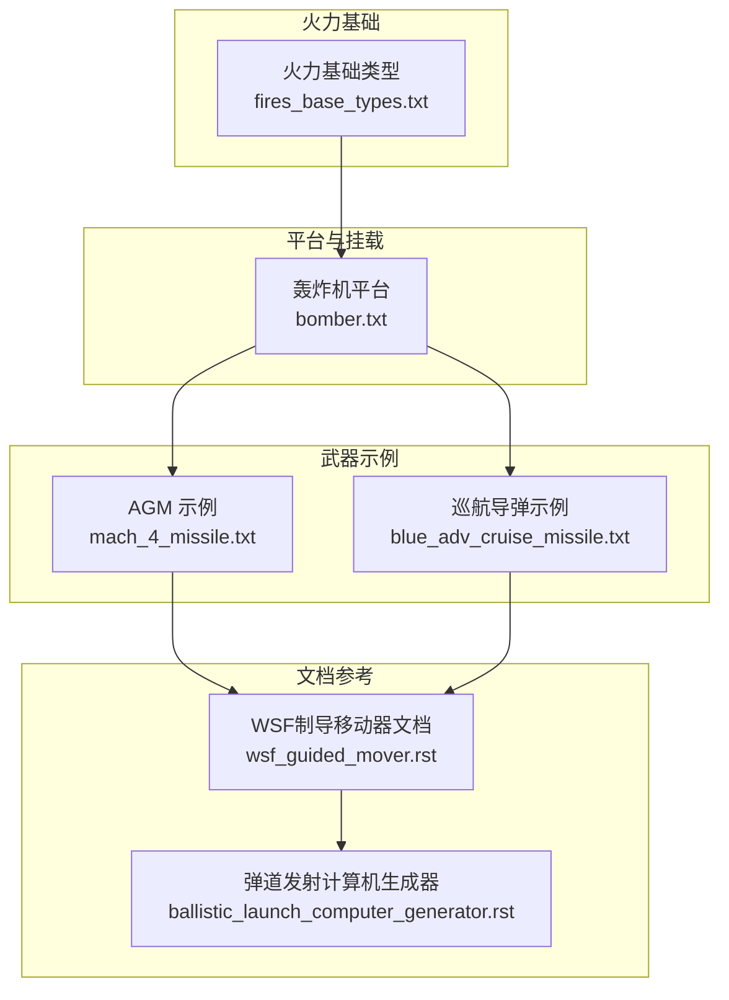
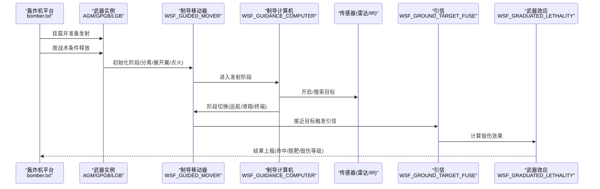
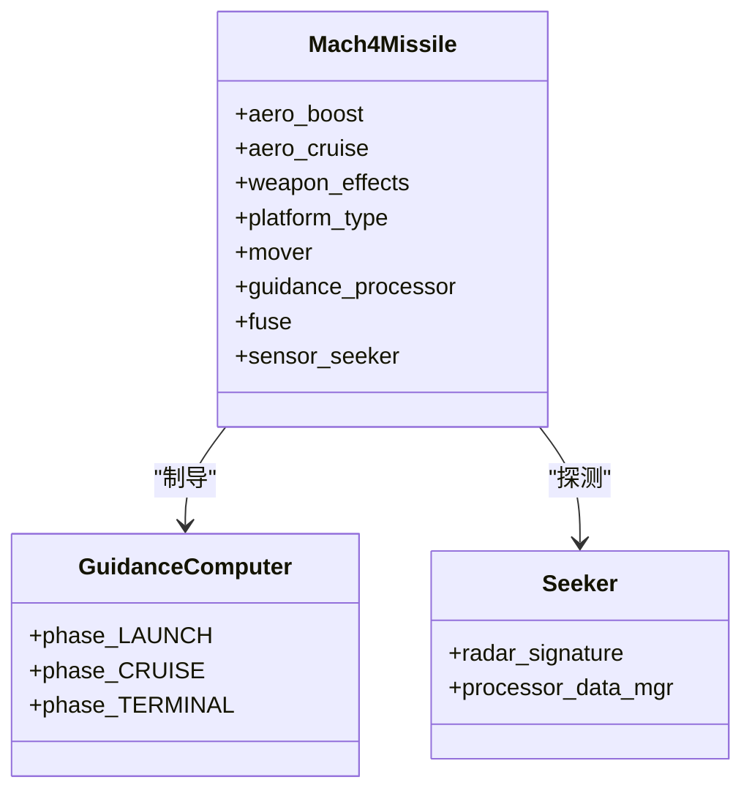
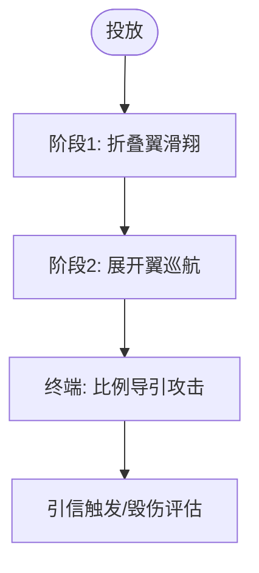
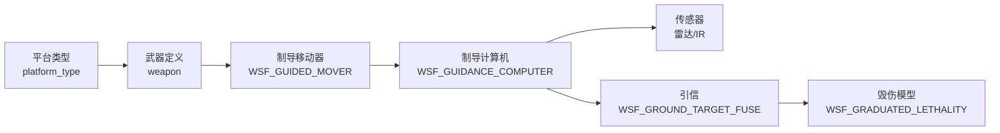

# 炸弹和精确制导武器

<cite>
**本文引用的文件**   
- [mach_4_missile.txt](file://demos/base_types/weapons/agm/mach_4_missile.txt)
- [blue_adv_cruise_missile.txt](file://demos/base_types/weapons/agm/blue_adv_cruise_missile.txt)
- [fires_base_types.txt](file://demos/fires/types/fires_base_types.txt)
- [bomber.txt](file://demos/suppressor/platforms/bomber.txt)
- [wsf_guided_mover.rst](file://documentation/html/_sources/docs/wsf_guided_mover.rst)
- [ballistic_launch_computer_generator.rst](file://documentation/html/_sources/docs/ballistic_launch_computer_generator.rst)
</cite>

## 目录
1. [简介](#简介)
2. [项目结构](#项目结构)
3. [核心组件](#核心组件)
4. [架构总览](#架构总览)
5. [详细组件分析](#详细组件分析)
6. [依赖关系分析](#依赖关系分析)
7. [性能与精度考量](#性能与精度考量)
8. [故障排查指南](#故障排查指南)
9. [结论](#结论)
10. [附录：配置示例与命中精度分析方法](#附录配置示例与命中精度分析方法)

## 简介
本技术文档聚焦于AFSIM中“炸弹与精确制导武器”的建模与仿真能力，覆盖无制导炸弹、激光/电视/红外成像等导引头类型的概念化说明，GPS制导炸弹（GPGB）、激光制导炸弹（LGB）以及空地导弹（AGM）的技术特点与应用场景。文档同时给出投放条件与弹道计算模型（自由落体、滑翔弹道、动力飞行）的实现要点，战斗部毁伤效果评估方法，轰炸机挂载与投放集成配置，并提供多种武器的配置示例与命中精度分析方法。

## 项目结构
仓库中与炸弹/精确制导武器相关的示例与类型定义主要位于以下路径：
- 空对地导弹（AGM）示例：demos/base_types/weapons/agm
- 火力（Fires）基础类型：demos/fires/types
- 轰炸机平台与武器挂载示例：demos/suppressor/platforms/bomber.txt
- 文档参考：documentation/html/_sources/docs（含WSF制导移动器与弹道发射计算机生成器）

图表来源
- [mach_4_missile.txt:1-161](file://demos/base_types/weapons/agm/mach_4_missile.txt#L1-L161)
- [blue_adv_cruise_missile.txt:1-113](file://demos/base_types/weapons/agm/blue_adv_cruise_missile.txt#L1-L113)
- [fires_base_types.txt:1-35](file://demos/fires/types/fires_base_types.txt#L1-L35)
- [bomber.txt:1-120](file://demos/suppressor/platforms/bomber.txt#L1-L120)
- [wsf_guided_mover.rst:1-120](file://documentation/html/_sources/docs/wsf_guided_mover.rst#L1-L120)
- [ballistic_launch_computer_generator.rst:1-60](file://documentation/html/_sources/docs/ballistic_launch_computer_generator.rst#L1-L60)

章节来源
- [mach_4_missile.txt:1-161](file://demos/base_types/weapons/agm/mach_4_missile.txt#L1-L161)
- [blue_adv_cruise_missile.txt:1-113](file://demos/base_types/weapons/agm/blue_adv_cruise_missile.txt#L1-L113)
- [fires_base_types.txt:1-35](file://demos/fires/types/fires_base_types.txt#L1-L35)
- [bomber.txt:1-120](file://demos/suppressor/platforms/bomber.txt#L1-L120)
- [wsf_guided_mover.rst:1-120](file://documentation/html/_sources/docs/wsf_guided_mover.rst#L1-L120)
- [ballistic_launch_computer_generator.rst:1-60](file://documentation/html/_sources/docs/ballistic_launch_computer_generator.rst#L1-L60)

## 核心组件
- 武器平台与类型：通过 platform_type 定义导弹/炸弹的平台属性、气动外形、推进阶段、传感器与处理器。
- 制导移动器（WSF_GUIDED_MOVER）：负责多阶段推进、滑翔与终端制导逻辑，支持无动力滑翔与动力巡航。
- 制导计算机（WSF_GUIDANCE_COMPUTER）：定义各阶段（发射、巡航、终端）的控制律与切换条件。
- 引信（WSF_GROUND_TARGET_FUSE）：地面目标触发逻辑。
- 武器效应（WSF_GRADUATED_LETHALITY）：以杀伤半径与概率描述毁伤效果。
- 传感器（雷达/红外/电视/激光半主动等）：在示例中以雷达导引头或IR寻的器体现；其他导引头类型可参照文档扩展。
- 任务/数据处理器：用于任务编排、跟踪处理与通信链路。

章节来源
- [mach_4_missile.txt:47-147](file://demos/base_types/weapons/agm/mach_4_missile.txt#L47-L147)
- [blue_adv_cruise_missile.txt:59-105](file://demos/base_types/weapons/agm/blue_adv_cruise_missile.txt#L59-L105)
- [wsf_guided_mover.rst:1-120](file://documentation/html/_sources/docs/wsf_guided_mover.rst#L1-L120)

## 架构总览
下图展示从轰炸机挂载到武器释放、制导与毁伤的端到端流程。

图表来源
- [bomber.txt:1-120](file://demos/suppressor/platforms/bomber.txt#L1-L120)
- [mach_4_missile.txt:87-147](file://demos/base_types/weapons/agm/mach_4_missile.txt#L87-L147)
- [blue_adv_cruise_missile.txt:81-105](file://demos/base_types/weapons/agm/blue_adv_cruise_missile.txt#L81-L105)

## 详细组件分析

### 空地导弹（AGM）—— Mach 4 导弹
- 气动与推进：包含助推段、再加速段与冲压发动机巡航段的多阶段推进；不同阶段使用不同气动参数。
- 制导与控制：采用 WSF_GUIDANCE_COMPUTER，分发射、巡航、终端三阶段；终端采用比例导引与速度控制。
- 传感器：内置雷达导引头，结合任务处理器进行目标跟踪与开火时机控制。
- 毁伤：基于 WSF_GRADUATED_LETHALITY 的杀伤半径与概率模型。

图表来源
- [mach_4_missile.txt:16-45](file://demos/base_types/weapons/agm/mach_4_missile.txt#L16-L45)
- [mach_4_missile.txt:47-147](file://demos/base_types/weapons/agm/mach_4_missile.txt#L47-L147)

章节来源
- [mach_4_missile.txt:16-147](file://demos/base_types/weapons/agm/mach_4_missile.txt#L16-L147)

### 巡航导弹（JSOW类）—— 蓝方先进巡航导弹
- 气动：折叠翼与展开翼两种气动外形，模拟投放后展开与滑翔。
- 制导：WSF_GUIDANCE_COMPUTER 定义发射、滑翔与终端阶段；终端采用比例导引与高过载限制。
- 引信与效应：地面目标引信与渐变杀伤模型。

图表来源
- [blue_adv_cruise_missile.txt:36-56](file://demos/base_types/weapons/agm/blue_adv_cruise_missile.txt#L36-L56)
- [blue_adv_cruise_missile.txt:64-105](file://demos/base_types/weapons/agm/blue_adv_cruise_missile.txt#L64-L105)

章节来源
- [blue_adv_cruise_missile.txt:36-105](file://demos/base_types/weapons/agm/blue_adv_cruise_missile.txt#L36-L105)

### 火力基础类型与间接火力
- 提供通用发射器平台类型与脚本接口，便于向指定坐标发射弹药（如火箭、炮弹）。
- 可作为无制导炸弹/火箭的基础载体，配合外部脚本实现批量齐射。

章节来源
- [fires_base_types.txt:9-35](file://demos/fires/types/fires_base_types.txt#L9-L35)

### 轰炸机挂载与武器释放
- 轰炸机平台通过 weapon 条目挂载具体武器类型（例如 GPS 炸弹），并通过脚本或处理器控制发射时机与方式。
- 典型流程：挂载武器 -> 进入航路点 -> 满足条件时调用 FireSalvo -> 武器进入制导流程。

章节来源
- [bomber.txt:40-110](file://demos/suppressor/platforms/bomber.txt#L40-L110)

## 依赖关系分析
- 平台与武器：platform_type 定义导弹/炸弹平台，weapon 将具体武器与平台类型绑定。
- 移动器与制导：WSF_GUIDED_MOVER 依赖 WSF_GUIDANCE_COMPUTER 的阶段控制与切换条件。
- 传感器与处理器：传感器（雷达/IR）输出目标信息至任务/跟踪处理器，供制导计算机决策。
- 引信与毁伤：引信根据接近度/高度等信息触发，毁伤模型依据半径与概率计算效果。

图表来源
- [mach_4_missile.txt:47-147](file://demos/base_types/weapons/agm/mach_4_missile.txt#L47-L147)
- [blue_adv_cruise_missile.txt:64-105](file://demos/base_types/weapons/agm/blue_adv_cruise_missile.txt#L64-L105)

章节来源
- [mach_4_missile.txt:47-147](file://demos/base_types/weapons/agm/mach_4_missile.txt#L47-L147)
- [blue_adv_cruise_missile.txt:64-105](file://demos/base_types/weapons/agm/blue_adv_cruise_missile.txt#L64-L105)

## 性能与精度考量
- 制导移动器更新步长与积分时间步：影响轨迹平滑度与计算开销，需权衡精度与性能。
- 阶段切换阈值：如目标斜距、视线角、相位时间等，决定制导模式转换的及时性与稳定性。
- 传感器开关策略：提前开启传感器可提高命中率但增加计算量；延迟开启可能降低命中率。
- 毁伤模型参数：杀伤半径与概率曲线直接影响命中后的毁伤评估结果。

章节来源
- [mach_4_missile.txt:51-85](file://demos/base_types/weapons/agm/mach_4_missile.txt#L51-L85)
- [blue_adv_cruise_missile.txt:68-80](file://demos/base_types/weapons/agm/blue_adv_cruise_missile.txt#L68-L80)
- [wsf_guided_mover.rst:1-120](file://documentation/html/_sources/docs/wsf_guided_mover.rst#L1-L120)

## 故障排查指南
- 传感器未开启或过早关闭：检查传感器处理器中的开启条件与距离阈值。
- 阶段切换异常：核查制导计算机各阶段的 next_phase 条件是否合理（如 target_slant_range、los_target_angle、phase_time）。
- 引信不触发：确认引信类型与目标环境匹配，检查高度/接近度阈值设置。
- 毁伤效果不符合预期：核对 WSF_GRADUATED_LETHALITY 的半径与概率参数。

章节来源
- [mach_4_missile.txt:87-147](file://demos/base_types/weapons/agm/mach_4_missile.txt#L87-L147)
- [blue_adv_cruise_missile.txt:81-105](file://demos/base_types/weapons/agm/blue_adv_cruise_missile.txt#L81-L105)

## 结论
AFSIM提供了完整的炸弹与精确制导武器建模框架，涵盖从平台挂载、武器释放、制导控制到毁伤评估的全流程。通过 WSF_GUIDED_MOVER 与 WSF_GUIDANCE_COMPUTER 的组合，可以灵活实现自由落体、滑翔与动力飞行的弹道模型；结合传感器与引信，可实现高精度打击与毁伤评估。示例文件为实际工程应用提供了可直接复用的配置模板。

## 附录：配置示例与命中精度分析方法

### 配置示例
- 空地导弹（AGM）：参考 mach_4_missile.txt，包含气动、推进、制导、传感器与毁伤配置。
- 巡航导弹（JSOW类）：参考 blue_adv_cruise_missile.txt，包含折叠/展开翼气动与制导阶段。
- 火力基础：参考 fires_base_types.txt，提供通用发射器与脚本接口。
- 轰炸机挂载：参考 bomber.txt，展示武器挂载与发射调用。

章节来源
- [mach_4_missile.txt:1-161](file://demos/base_types/weapons/agm/mach_4_missile.txt#L1-L161)
- [blue_adv_cruise_missile.txt:1-113](file://demos/base_types/weapons/agm/blue_adv_cruise_missile.txt#L1-L113)
- [fires_base_types.txt:1-35](file://demos/fires/types/fires_base_types.txt#L1-L35)
- [bomber.txt:1-120](file://demos/suppressor/platforms/bomber.txt#L1-L120)

### 命中精度分析方法
- 统计脱靶量（CEP）：通过多次仿真统计命中位置与目标的偏差分布，计算圆概率误差。
- 敏感性分析：对传感器噪声、风场扰动、初始投放状态等参数进行扰动，观察命中精度变化。
- 阶段切换影响：比较不同 next_phase 条件对终端制导精度的影响。
- 毁伤评估一致性：对比不同 WSF_GRADUATED_LETHALITY 参数下的毁伤概率与范围。

[本节为方法论概述，不直接分析具体文件]