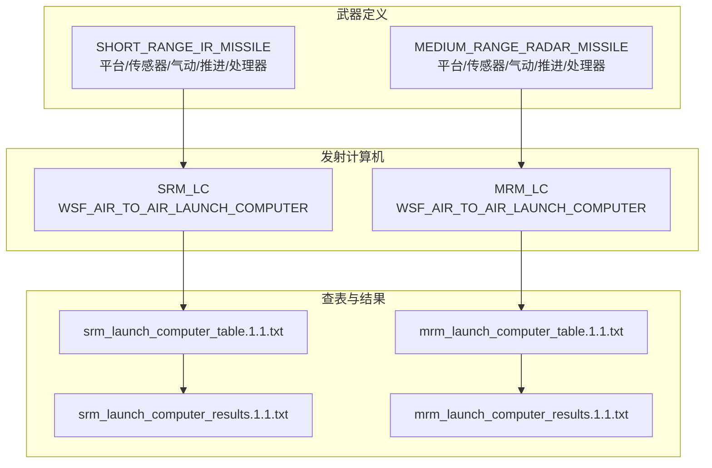
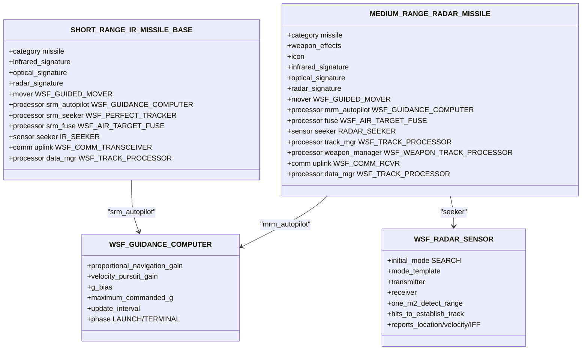
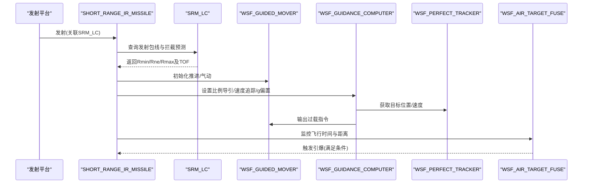
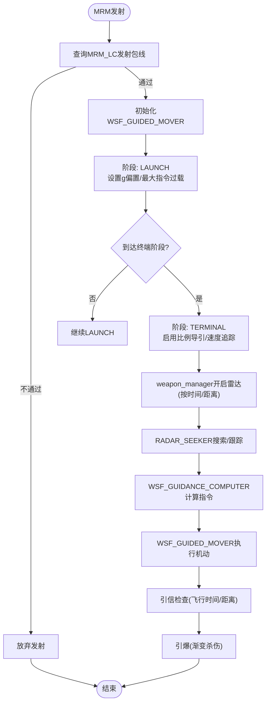
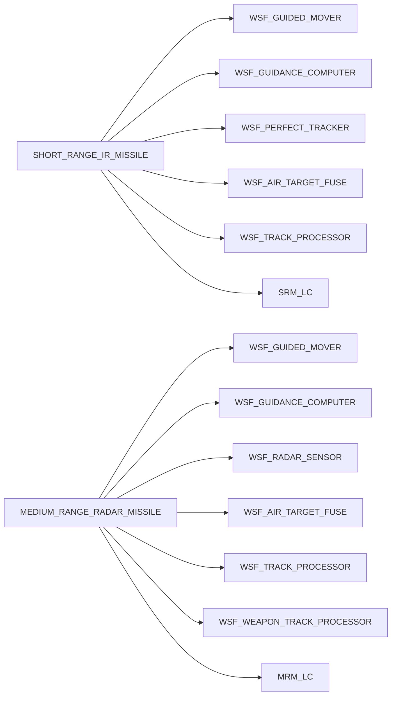
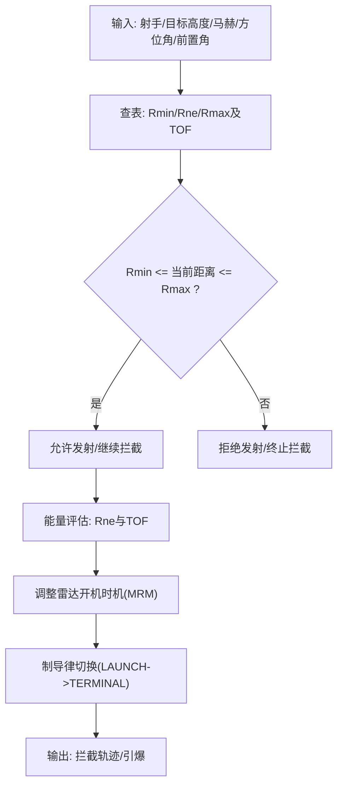

# 空空导弹(AAM)

<cite>
**本文引用的文件**   
- [short_range_ir_missile.txt](file://demos/air_to_air/weapons/aam/short_range_ir_missile.txt)
- [medium_range_radar_missile.txt](file://demos/air_to_air/weapons/aam/medium_range_radar_missile.txt)
- [srm_lc.txt](file://demos/air_to_air/weapons/aam/srm_lc.txt)
- [mrm_lc.txt](file://demos/air_to_air/weapons/aam/mrm_lc.txt)
- [srm_launch_computer_table.1.1.txt](file://demos/air_to_air/weapons/aam/srm_launch_computer_table.1.1.txt)
- [mrm_launch_computer_table.1.1.txt](file://demos/air_to_air/weapons/aam/mrm_launch_computer_table.1.1.txt)
- [srm_launch_computer_results.1.1.txt](file://demos/air_to_air/weapons/aam/srm_launch_computer_results.1.1.txt)
- [mrm_launch_computer_results.1.1.txt](file://demos/air_to_air/weapons/aam/mrm_launch_computer_results.1.1.txt)
</cite>

## 目录
1. [简介](#简介)
2. [项目结构](#项目结构)
3. [核心组件](#核心组件)
4. [架构总览](#架构总览)
5. [详细组件分析](#详细组件分析)
6. [依赖关系分析](#依赖关系分析)
7. [性能与包线分析](#性能与包线分析)
8. [故障排查指南](#故障排查指南)
9. [结论](#结论)
10. [附录：配置文件示例与仿真分析方法](#附录配置文件示例与仿真分析方法)

## 简介
本技术文档围绕AFSIM仓库中的空空导弹（AAM）子系统，聚焦两类典型导弹：短程红外导弹（SRM）与中程雷达导弹（MRM）。文档从系统架构、组件关系、数据流、处理逻辑、集成点、错误处理、性能特征等维度展开，详细说明飞行包线、机动能力、推进系统与战斗部配置；并给出发射计算机的配置参数（发射条件、拦截预测、能量管理策略）、制导律实现（比例导引、速度追踪、主动雷达制导），以及性能分析与优化调优方法。同时提供实际的导弹配置文件路径与仿真结果分析方法，便于读者复现与扩展。

## 项目结构
在AFSIM的air_to_air演示中，AAM相关定义集中在 weapons/aam 目录下，包含：
- SRM 与 MRM 的平台类型、传感器、气动、推进、处理器（制导计算机、寻的器、引信、跟踪处理器）与武器对象定义
- 发射计算机（LC）及其查表数据与拦截结果
- 用于生成或引用发射计算机表的脚本/工具输出

**图表来源** 
- [short_range_ir_missile.txt:115-209](file://demos/air_to_air/weapons/aam/short_range_ir_missile.txt#L115-L209)
- [medium_range_radar_missile.txt:116-259](file://demos/air_to_air/weapons/aam/medium_range_radar_missile.txt#L116-L259)
- [srm_lc.txt:10-12](file://demos/air_to_air/weapons/aam/srm_lc.txt#L10-L12)
- [mrm_lc.txt:10-12](file://demos/air_to_air/weapons/aam/mrm_lc.txt#L10-L12)
- [srm_launch_computer_table.1.1.txt:10-35](file://demos/air_to_air/weapons/aam/srm_launch_computer_table.1.1.txt#L10-L35)
- [mrm_launch_computer_table.1.1.txt:10-35](file://demos/air_to_air/weapons/aam/mrm_launch_computer_table.1.1.txt#L10-L35)

**章节来源**
- [short_range_ir_missile.txt:115-209](file://demos/air_to_air/weapons/aam/short_range_ir_missile.txt#L115-L209)
- [medium_range_radar_missile.txt:116-259](file://demos/air_to_air/weapons/aam/medium_range_radar_missile.txt#L116-L259)
- [srm_lc.txt:10-12](file://demos/air_to_air/weapons/aam/srm_lc.txt#L10-L12)
- [mrm_lc.txt:10-12](file://demos/air_to_air/weapons/aam/mrm_lc.txt#L10-L12)
- [srm_launch_computer_table.1.1.txt:10-35](file://demos/air_to_air/weapons/aam/srm_launch_computer_table.1.1.txt#L10-L35)
- [mrm_launch_computer_table.1.1.txt:10-35](file://demos/air_to_air/weapons/aam/mrm_launch_computer_table.1.1.txt#L10-L35)

## 核心组件
- 短程红外导弹（SRM）
  - 平台类型：SHORT_RANGE_IR_MISSILE_BASE
  - 传感器：IR_SEEKER（基于雷达传感器模型，但用于模拟红外导弹的寻的器数据输入）
  - 气动：SHORT_RANGE_IR_MISSILE_AERO（含阻力系数随马赫变化、参考面积、最大升力系数、展弦比、奥斯瓦尔德因子）
  - 推进：WSF_GUIDED_MOVER（质量、燃料、比冲、推力、推力持续时间、更新间隔）
  - 处理器：srm_autopilot（WSF_GUIDANCE_COMPUTER，比例导引增益、速度追踪增益、g偏置、最大指令过载、更新间隔）、srm_seeker（WSF_PERFECT_TRACKER）、srm_fuse（WSF_AIR_TARGET_FUSE）
  - 通信与跟踪：uplink（WSF_COMM_TRANSCEIVER）、data_mgr（WSF_TRACK_PROCESSOR）
  - 武器效果：SHORT_RANGE_IR_MISSILE_EFFECT（WSF_GRADUATED_LETHALITY）
  - 武器对象：SHORT_RANGE_IR_MISSILE（WSF_EXPLICIT_WEAPON），关联发射计算机 SRM_LC

- 中程雷达导弹（MRM）
  - 平台类型：MEDIUM_RANGE_RADAR_MISSILE
  - 传感器：RADAR_SEEKER（WSF_RADAR_SENSOR，主动雷达寻的器）
  - 气动：MRM_AERO（阻力系数随马赫变化、参考面积、最大升力系数、展弦比、奥斯瓦尔德因子）
  - 推进：WSF_GUIDED_MOVER（质量、燃料、比冲、推力、推力持续时间、更新间隔）
  - 处理器：mrm_autopilot（WSF_GUIDANCE_COMPUTER，分阶段LAUNCH/TERMINAL，不同阶段的导航增益与g偏置）、fuse（WSF_AIR_TARGET_FUSE）、weapon_manager（WSF_WEAPON_TRACK_PROCESSOR，控制雷达开机时机、滑翔时间、上链路需求）
  - 通信与跟踪：uplink（WSF_COMM_RCVR）、track_mgr（WSF_TRACK_PROCESSOR）、data_mgr（WSF_TRACK_PROCESSOR）
  - 武器效果：SIMPLE_EFFECT（WSF_GRADUATED_LETHALITY）
  - 武器对象：MEDIUM_RANGE_RADAR_MISSILE（WSF_EXPLICIT_WEAPON），关联发射计算机 MRM_LC

**章节来源**
- [short_range_ir_missile.txt:32-92](file://demos/air_to_air/weapons/aam/short_range_ir_missile.txt#L32-L92)
- [short_range_ir_missile.txt:94-113](file://demos/air_to_air/weapons/aam/short_range_ir_missile.txt#L94-L113)
- [short_range_ir_missile.txt:115-183](file://demos/air_to_air/weapons/aam/short_range_ir_missile.txt#L115-L183)
- [short_range_ir_missile.txt:188-209](file://demos/air_to_air/weapons/aam/short_range_ir_missile.txt#L188-L209)
- [medium_range_radar_missile.txt:22-52](file://demos/air_to_air/weapons/aam/medium_range_radar_missile.txt#L22-L52)
- [medium_range_radar_missile.txt:58-93](file://demos/air_to_air/weapons/aam/medium_range_radar_missile.txt#L58-L93)
- [medium_range_radar_missile.txt:95-111](file://demos/air_to_air/weapons/aam/medium_range_radar_missile.txt#L95-L111)
- [medium_range_radar_missile.txt:116-242](file://demos/air_to_air/weapons/aam/medium_range_radar_missile.txt#L116-L242)
- [medium_range_radar_missile.txt:244-259](file://demos/air_to_air/weapons/aam/medium_range_radar_missile.txt#L244-L259)

## 架构总览
下图展示SRM与MRM在AFSIM中的整体架构与关键交互：

**图表来源**
- [short_range_ir_missile.txt:115-183](file://demos/air_to_air/weapons/aam/short_range_ir_missile.txt#L115-L183)
- [medium_range_radar_missile.txt:116-242](file://demos/air_to_air/weapons/aam/medium_range_radar_missile.txt#L116-L242)
- [medium_range_radar_missile.txt:58-93](file://demos/air_to_air/weapons/aam/medium_range_radar_missile.txt#L58-L93)

## 详细组件分析

### 短程红外导弹（SRM）
- 气动与机动
  - 阻力系数按马赫数分段定义，参考面积与最大升力系数用于估算转弯能力（约30G级）
  - 展弦比与奥斯瓦尔德因子影响诱导阻力与升阻特性
- 推进系统
  - 固体火箭发动机模型：质量、燃料、比冲、推力、推力持续时间、更新间隔
- 制导与自动驾驶
  - WSF_GUIDANCE_COMPUTER：比例导引增益、速度追踪增益、g偏置、最大指令过载、更新间隔
- 寻的器与跟踪
  - 使用WSF_PERFECT_TRACKER提供目标真值数据；IR_SEEKER为占位传感器，连接数据管理器
- 引信与毁伤
  - WSF_AIR_TARGET_FUSE：最大飞行时间至引爆
  - WSF_GRADUATED_LETHALITY：渐变杀伤半径与概率
- 发射计算机
  - SRM_LC：WSF_AIR_TO_AIR_LAUNCH_COMPUTER，加载srm_launch_computer_table.1.1.txt

**图表来源**
- [short_range_ir_missile.txt:115-183](file://demos/air_to_air/weapons/aam/short_range_ir_missile.txt#L115-L183)
- [short_range_ir_missile.txt:188-209](file://demos/air_to_air/weapons/aam/short_range_ir_missile.txt#L188-L209)
- [srm_lc.txt:10-12](file://demos/air_to_air/weapons/aam/srm_lc.txt#L10-L12)

**章节来源**
- [short_range_ir_missile.txt:32-92](file://demos/air_to_air/weapons/aam/short_range_ir_missile.txt#L32-L92)
- [short_range_ir_missile.txt:94-113](file://demos/air_to_air/weapons/aam/short_range_ir_missile.txt#L94-L113)
- [short_range_ir_missile.txt:115-183](file://demos/air_to_air/weapons/aam/short_range_ir_missile.txt#L115-L183)
- [short_range_ir_missile.txt:188-209](file://demos/air_to_air/weapons/aam/short_range_ir_missile.txt#L188-L209)
- [srm_lc.txt:10-12](file://demos/air_to_air/weapons/aam/srm_lc.txt#L10-L12)

### 中程雷达导弹（MRM）
- 气动与机动
  - 阻力系数按马赫数分段定义，参考面积与最大升力系数用于估算转弯能力（约30G级）
- 推进系统
  - 固体火箭发动机模型：质量、燃料、比冲、推力、推力持续时间、更新间隔
- 制导与自动驾驶
  - WSF_GUIDANCE_COMPUTER：分阶段LAUNCH/TERMINAL，不同阶段的导航增益与g偏置
- 主动雷达寻的器
  - WSF_RADAR_SENSOR：搜索模式、扫描范围、帧时间、发射机/接收机参数、探测距离、跟踪建立/维持命中次数
- 武器管理与上链路
  - WSF_WEAPON_TRACK_PROCESSOR：控制雷达开机时机（如“距拦截前若干秒”或“距拦截前若干米”）、滑翔时间、是否要求上链路
- 引信与毁伤
  - WSF_AIR_TARGET_FUSE：最大飞行时间至引爆
  - WSF_GRADUATED_LETHALITY：渐变杀伤半径与概率
- 发射计算机
  - MRM_LC：WSF_AIR_TO_AIR_LAUNCH_COMPUTER，加载mrm_launch_computer_table.1.1.txt

**图表来源**
- [medium_range_radar_missile.txt:116-242](file://demos/air_to_air/weapons/aam/medium_range_radar_missile.txt#L116-L242)
- [medium_range_radar_missile.txt:58-93](file://demos/air_to_air/weapons/aam/medium_range_radar_missile.txt#L58-L93)
- [mrm_lc.txt:10-12](file://demos/air_to_air/weapons/aam/mrm_lc.txt#L10-L12)

**章节来源**
- [medium_range_radar_missile.txt:22-52](file://demos/air_to_air/weapons/aam/medium_range_radar_missile.txt#L22-L52)
- [medium_range_radar_missile.txt:58-93](file://demos/air_to_air/weapons/aam/medium_range_radar_missile.txt#L58-L93)
- [medium_range_radar_missile.txt:95-111](file://demos/air_to_air/weapons/aam/medium_range_radar_missile.txt#L95-L111)
- [medium_range_radar_missile.txt:116-242](file://demos/air_to_air/weapons/aam/medium_range_radar_missile.txt#L116-L242)
- [medium_range_radar_missile.txt:244-259](file://demos/air_to_air/weapons/aam/medium_range_radar_missile.txt#L244-L259)
- [mrm_lc.txt:10-12](file://demos/air_to_air/weapons/aam/mrm_lc.txt#L10-L12)

## 依赖关系分析
- 组件耦合
  - SRM/MRM平台类型依赖WSF_GUIDED_MOVER（推进/气动）、WSF_GUIDANCE_COMPUTER（制导律）、WSF_RADAR_SENSOR或WSF_PERFECT_TRACKER（寻的器/跟踪）、WSF_AIR_TARGET_FUSE（引信）、WSF_TRACK_PROCESSOR（跟踪融合）
  - 发射计算机WSF_AIR_TO_AIR_LAUNCH_COMPUTER依赖查表数据（独立变量：射手/目标高度、马赫、目标方位角、目标前置角；拦截结果：Rmin/Rne/Rmax及对应TOF）
- 外部依赖
  - 传感器模型（雷达寻的器）依赖天线方向图、发射机/接收机参数、探测距离、跟踪建立/维持命中次数
  - 武器效果模块依赖渐变杀伤模型（半径与概率）

**图表来源**
- [short_range_ir_missile.txt:115-183](file://demos/air_to_air/weapons/aam/short_range_ir_missile.txt#L115-L183)
- [medium_range_radar_missile.txt:116-242](file://demos/air_to_air/weapons/aam/medium_range_radar_missile.txt#L116-L242)

**章节来源**
- [short_range_ir_missile.txt:115-183](file://demos/air_to_air/weapons/aam/short_range_ir_missile.txt#L115-L183)
- [medium_range_radar_missile.txt:116-242](file://demos/air_to_air/weapons/aam/medium_range_radar_missile.txt#L116-L242)

## 性能与包线分析
- 飞行包线与拦截预测
  - 发射计算机表定义了独立变量维度：射手高度、射手马赫、目标高度、目标马赫、目标方位角、目标前置角
  - 拦截结果包含最小可攻击距离Rmin（及TOF）、中性距离Rne（及TOF）、最大可攻击距离Rmax（及TOF）
  - SRM与MRM分别有独立的拦截结果表，反映不同导弹的性能差异
- 能量管理策略
  - 通过Rne（中性距离）与TOF评估导弹能量状态与剩余射程潜力
  - 在MRM中，weapon_manager控制雷达开机时机以平衡探测精度与能量消耗
- 机动能力
  - 通过cl_max与气动参数估算最大转弯率（约30G级）
  - WSF_GUIDANCE_COMPUTER的maximum_commanded_g限制指令过载上限
- 推进系统
  - 固体火箭发动机：推力、比冲、推力持续时间决定初始加速与能量注入
  - 质量与燃料质量影响射程与末段机动能力

**图表来源**
- [srm_launch_computer_table.1.1.txt:10-35](file://demos/air_to_air/weapons/aam/srm_launch_computer_table.1.1.txt#L10-L35)
- [mrm_launch_computer_table.1.1.txt:10-35](file://demos/air_to_air/weapons/aam/mrm_launch_computer_table.1.1.txt#L10-L35)
- [medium_range_radar_missile.txt:208-216](file://demos/air_to_air/weapons/aam/medium_range_radar_missile.txt#L208-L216)

**章节来源**
- [srm_launch_computer_table.1.1.txt:10-35](file://demos/air_to_air/weapons/aam/srm_launch_computer_table.1.1.txt#L10-L35)
- [mrm_launch_computer_table.1.1.txt:10-35](file://demos/air_to_air/weapons/aam/mrm_launch_computer_table.1.1.txt#L10-L35)
- [srm_launch_computer_results.1.1.txt:1-200](file://demos/air_to_air/weapons/aam/srm_launch_computer_results.1.1.txt#L1-L200)
- [mrm_launch_computer_results.1.1.txt:1-200](file://demos/air_to_air/weapons/aam/mrm_launch_computer_results.1.1.txt#L1-L200)

## 故障排查指南
- 发射失败或拦截不可达
  - 检查发射计算机表中的独立变量是否与场景匹配（射手/目标高度、马赫、方位角、前置角）
  - 核对Rmin/Rne/Rmax与当前距离/TOF的关系
- 雷达未开机或跟踪丢失
  - 检查weapon_manager的turn_on_sensor参数（时间或距离阈值）
  - 确认RADAR_SEEKER的初始模式、扫描范围、帧时间与探测距离
- 制导不稳定或过载超限
  - 调整WSF_GUIDANCE_COMPUTER的比例导引增益、速度追踪增益、g偏置与maximum_commanded_g
  - 验证阶段切换条件（LAUNCH->TERMINAL）
- 引信过早/过晚引爆
  - 检查WSF_AIR_TARGET_FUSE的max_time_of_flight_to_detonate
  - 结合Rmin/Rne/Rmax与TOF进行校准

**章节来源**
- [medium_range_radar_missile.txt:208-216](file://demos/air_to_air/weapons/aam/medium_range_radar_missile.txt#L208-L216)
- [medium_range_radar_missile.txt:163-175](file://demos/air_to_air/weapons/aam/medium_range_radar_missile.txt#L163-L175)
- [short_range_ir_missile.txt:137-151](file://demos/air_to_air/weapons/aam/short_range_ir_missile.txt#L137-L151)

## 结论
SRM与MRM在AFSIM中通过统一的平台/传感器/气动/推进/处理器框架实现，差异主要体现在寻的器类型（红外/雷达）、制导律阶段划分与雷达开机策略、以及发射计算机包的拦截预测。通过发射计算机查表与拦截结果，可量化导弹的飞行包线与能量管理；通过气动与推进参数可评估机动能力与射程。实际工程中，建议基于具体任务场景校准发射计算机表与制导律参数，并结合雷达开机时机优化能量使用与命中率。

## 附录：配置文件示例与仿真分析方法
- 配置文件路径
  - SRM平台与武器定义：[short_range_ir_missile.txt](file://demos/air_to_air/weapons/aam/short_range_ir_missile.txt)
  - MRM平台与武器定义：[medium_range_radar_missile.txt](file://demos/air_to_air/weapons/aam/medium_range_radar_missile.txt)
  - SRM发射计算机：[srm_lc.txt](file://demos/air_to_air/weapons/aam/srm_lc.txt)
  - MRM发射计算机：[mrm_lc.txt](file://demos/air_to_air/weapons/aam/mrm_lc.txt)
  - SRM发射计算机表：[srm_launch_computer_table.1.1.txt](file://demos/air_to_air/weapons/aam/srm_launch_computer_table.1.1.txt)
  - MRM发射计算机表：[mrm_launch_computer_table.1.1.txt](file://demos/air_to_air/weapons/aam/mrm_launch_computer_table.1.1.txt)
  - SRM拦截结果：[srm_launch_computer_results.1.1.txt](file://demos/air_to_air/weapons/aam/srm_launch_computer_results.1.1.txt)
  - MRM拦截结果：[mrm_launch_computer_results.1.1.txt](file://demos/air_to_air/weapons/aam/mrm_launch_computer_results.1.1.txt)

- 仿真结果分析方法
  - 读取拦截结果表，统计成功/失败样本数、显著条件数量、Rmin/Rne/Rmax的最小/最大值及其TOF
  - 对比不同独立变量组合下的Rne与TOF，评估能量管理与射程潜力
  - 结合MRM的weapon_manager参数，分析雷达开机时机对跟踪质量与能耗的影响
  - 通过调整WSF_GUIDANCE_COMPUTER参数与气动/推进参数，进行灵敏度分析与优化

**章节来源**
- [srm_launch_computer_table.1.1.txt:10-35](file://demos/air_to_air/weapons/aam/srm_launch_computer_table.1.1.txt#L10-L35)
- [mrm_launch_computer_table.1.1.txt:10-35](file://demos/air_to_air/weapons/aam/mrm_launch_computer_table.1.1.txt#L10-L35)
- [srm_launch_computer_results.1.1.txt:1-200](file://demos/air_to_air/weapons/aam/srm_launch_computer_results.1.1.txt#L1-L200)
- [mrm_launch_computer_results.1.1.txt:1-200](file://demos/air_to_air/weapons/aam/mrm_launch_computer_results.1.1.txt#L1-L200)