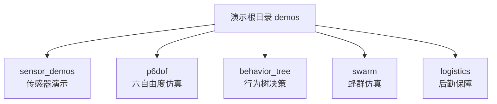
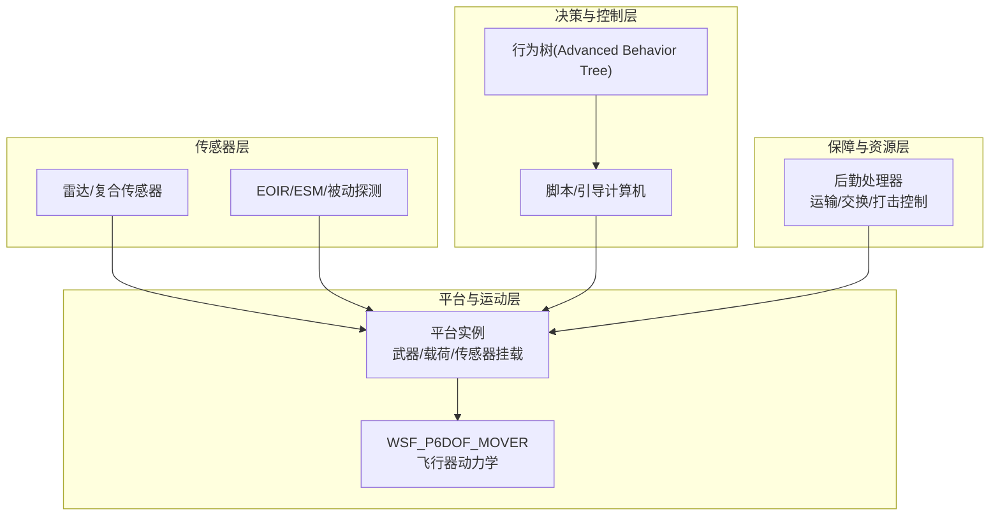
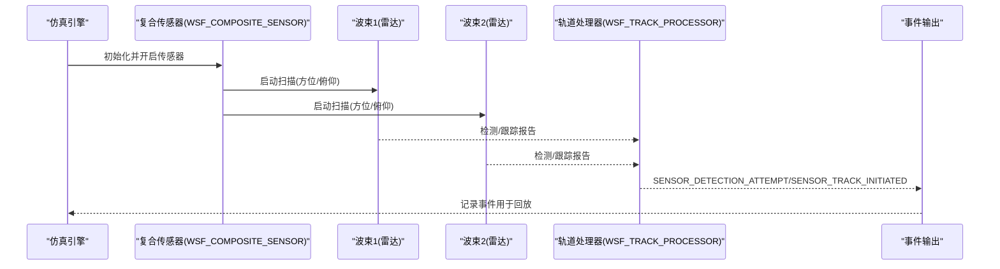
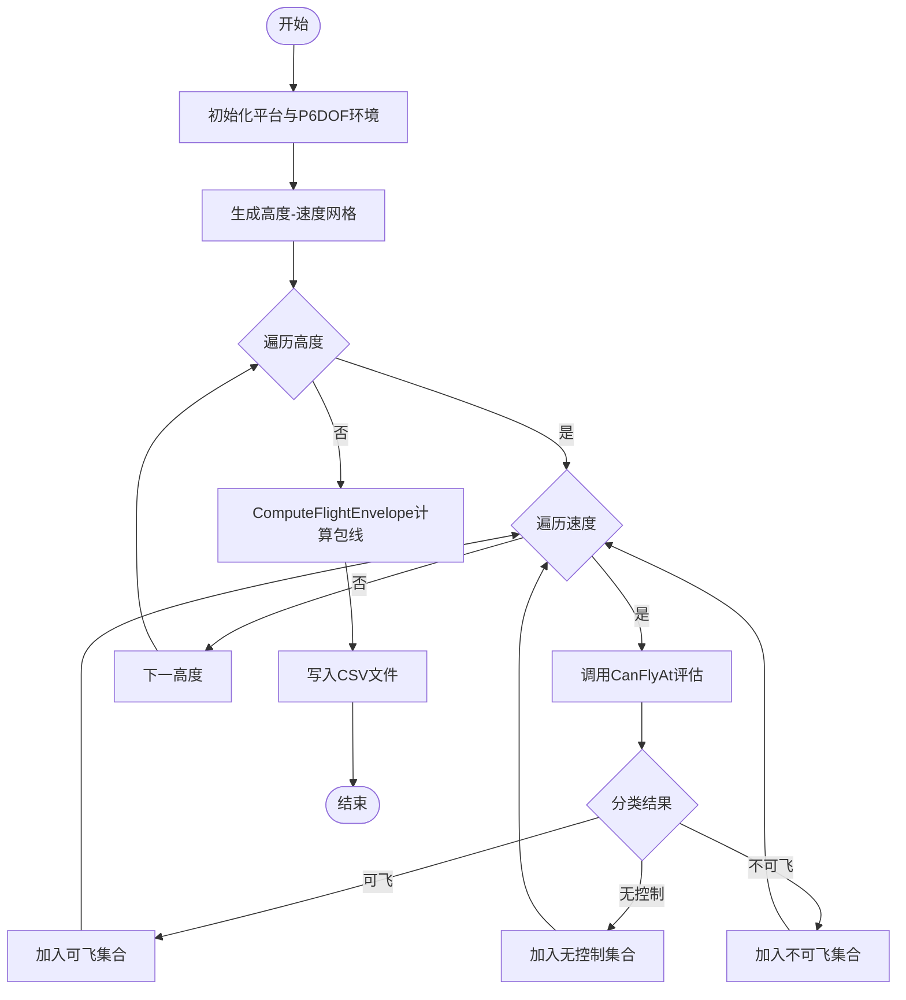
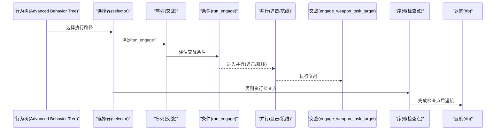
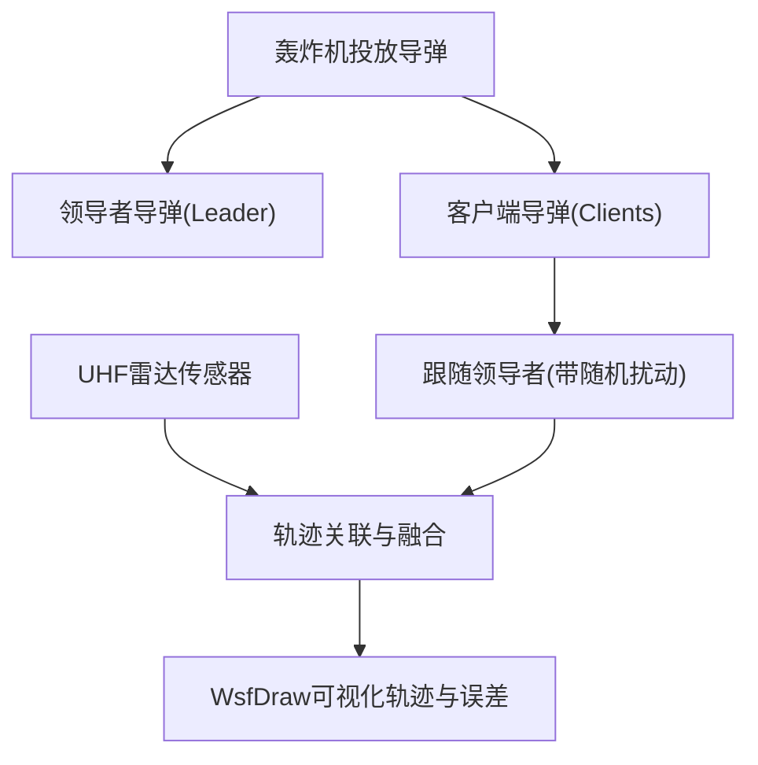
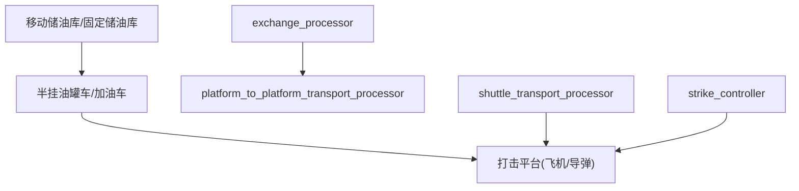
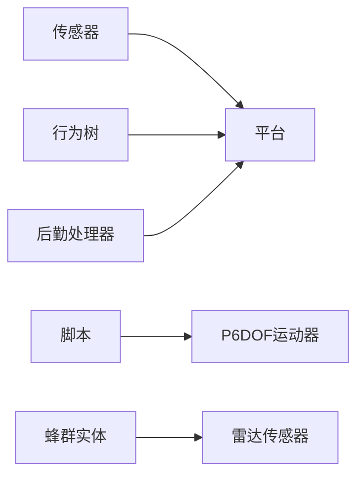

# 专业演示场景

<cite>
**本文引用的文件**   
- [sensor_demos/README.md](file://demos/sensor_demos/README.md)
- [sensor_demos/eoir_demo.txt](file://demos/sensor_demos/eoir_demo.txt)
- [sensor_demos/composite_demo.txt](file://demos/sensor_demos/composite_demo.txt)
- [p6dof/README.md](file://demos/p6dof/README.md)
- [p6dof/flight_envelope.txt](file://demos/p6dof/flight_envelope.txt)
- [p6dof/tactical_maneuvers.txt](file://demos/p6dof/tactical_maneuvers.txt)
- [behavior_tree/README.md](file://demos/behavior_tree/README.md)
- [behavior_tree/run_tree.txt](file://demos/behavior_tree/run_tree.txt)
- [swarm/README.md](file://demos/swarm/README.md)
- [logistics/README.md](file://demos/logistics/README.md)
</cite>

## 目录
1. [引言](#引言)
2. [项目结构](#项目结构)
3. [核心组件](#核心组件)
4. [架构总览](#架构总览)
5. [详细组件分析](#详细组件分析)
6. [依赖关系分析](#依赖关系分析)
7. [性能考量](#性能考量)
8. [故障排查指南](#故障排查指南)
9. [结论](#结论)
10. [附录](#附录)

## 引言
本教程面向AFSIM专业演示场景，围绕五大主题展开：传感器演示、六自由度（6DoF）仿真、行为树决策系统、蜂群仿真与后勤仿真。文档从系统架构、数据流、处理逻辑、集成点与错误处理等维度进行深度解析，并提供可视化图示与实践指导，帮助读者快速掌握雷达、红外、光学等传感器的精确建模方法，飞行器动力学与操纵面控制，复杂决策逻辑实现，大规模实体管理与协同机制，以及物资调配与运输调度流程建模。

## 项目结构
AFSIM的演示场景以“demos”为根目录组织，每个子目录代表一个专业领域或专题演示。本次教程聚焦以下五个子目录：
- sensor_demos：传感器综合演示（雷达、复合传感器、EOIR等）
- p6dof：六自由度飞行器动力学与战术机动
- behavior_tree：行为树决策系统与可视化
- swarm：蜂群仿真与协同控制
- logistics：后勤保障与物资调度

[本节未直接分析具体源文件]

## 核心组件
- 传感器子系统：支持雷达、电子战雷达、复合传感器、被动探测、导航、SAR/ISAR等；提供多波束扫描、杂波模型、检测与跟踪事件输出。
- 六自由度运动器：基于WSF_P6DOF_MOVER，支持气动、推进、环境、地形与脚本化机动控制，可生成飞行包线与战术机动序列。
- 行为树决策：通过advanced_behavior_tree节点组合条件、选择器、序列、并行、装饰器等，实现复杂任务编排与可视化调试。
- 蜂群管理：通过引导计算机脚本控制“领导者-跟随者”编队，结合雷达感知与轨迹关联融合，展示大规模实体协同。
- 后勤保障：通过处理器（transport/shuttle/exchange/strike_controller）与平台类型（油料车、半挂油罐车、移动储油库、打击平台等）构建补给链路。

**章节来源**
- [sensor_demos/README.md:1-45](file://demos/sensor_demos/README.md#L1-L45)
- [p6dof/README.md:1-45](file://demos/p6dof/README.md#L1-L45)
- [behavior_tree/README.md:1-49](file://demos/behavior_tree/README.md#L1-L49)
- [swarm/README.md:1-60](file://demos/swarm/README.md#L1-L60)
- [logistics/README.md:1-45](file://demos/logistics/README.md#L1-L45)

## 架构总览
下图展示了传感器、6DoF、行为树、蜂群与后勤在AFSIM中的交互关系与数据流向。

[本节为概念性架构图，不映射到具体源文件]

## 详细组件分析

### 传感器演示（雷达、复合传感器、EOIR）
- 复合传感器示例：定义多个雷达波束，分别配置发射机、接收机、杂波模型、检测律与跟踪参数；通过WSF_COMPOSITE_SENSOR聚合四向扫描面，内部链接轨道处理器，输出检测与跟踪事件。
- EOIR演示：包含无人机EOIR平台与地面站点，启用传感器模式切换、检测尝试、跟踪建立与丢失等事件输出，便于回放与分析。

**图表来源**
- [sensor_demos/composite_demo.txt:46-104](file://demos/sensor_demos/composite_demo.txt#L46-L104)
- [sensor_demos/composite_demo.txt:116-160](file://demos/sensor_demos/composite_demo.txt#L116-L160)
- [sensor_demos/eoir_demo.txt:10-31](file://demos/sensor_demos/eoir_demo.txt#L10-L31)

**章节来源**
- [sensor_demos/composite_demo.txt:10-178](file://demos/sensor_demos/composite_demo.txt#L10-L178)
- [sensor_demos/eoir_demo.txt:1-34](file://demos/sensor_demos/eoir_demo.txt#L1-L34)

实践要点
- 使用clutter_model与SWERLING_CASE调节杂波与目标闪烁特性。
- 通过probability_of_false_alarm与number_of_pulses_integrated优化检测性能。
- 利用event_output启用SENSOR_*事件，便于回放与可视化。

### 六自由度仿真（飞行器动力学、操纵面控制、飞行包线）
- 飞行包线生成：脚本遍历高度-速度网格，调用CanFlyAt评估可控/不可控区域，ComputeFlightEnvelope计算持续包线，输出CSV供绘图。
- 战术机动：通过SetRollRate/SetPitchGLoad/SetBankAngle等API驱动P6DOF运动器，实现滚转、拉起、桶滚、硬转弯等动作序列，并与追踪器配合演示对抗机动。

**图表来源**
- [p6dof/flight_envelope.txt:63-90](file://demos/p6dof/flight_envelope.txt#L63-L90)
- [p6dof/flight_envelope.txt:140-179](file://demos/p6dof/flight_envelope.txt#L140-L179)
- [p6dof/flight_envelope.txt:242-314](file://demos/p6dof/flight_envelope.txt#L242-L314)

**章节来源**
- [p6dof/flight_envelope.txt:1-315](file://demos/p6dof/flight_envelope.txt#L1-L315)
- [p6dof/tactical_maneuvers.txt:385-461](file://demos/p6dof/tactical_maneuvers.txt#L385-L461)
- [p6dof/tactical_maneuvers.txt:465-736](file://demos/p6dof/tactical_maneuvers.txt#L465-L736)

实践要点
- 通过on_initialize设置初始姿态与速度，确保CanFlyAt返回正确状态。
- 使用SetMaxBankAngle/SetMaxGLoad限制机动边界，避免超出平台能力。
- 将脚本与平台update_interval匹配，保证控制指令高频更新。

### 行为树决策系统（架构设计与复杂决策逻辑）
- 架构组成：通过advanced_behavior_tree节点组合parallel、selector、sequence、condition与behavior_node，形成“选择树-交战-返航”等多分支决策流。
- 可视化调试：启用BEHAVIOR_TOOL事件管道，输出行为树执行轨迹，便于观察节点状态与条件判断。

**图表来源**
- [behavior_tree/run_tree.txt:46-75](file://demos/behavior_tree/run_tree.txt#L46-L75)

**章节来源**
- [behavior_tree/run_tree.txt:1-135](file://demos/behavior_tree/run_tree.txt#L1-L135)
- [behavior_tree/README.md:1-49](file://demos/behavior_tree/README.md#L1-L49)

实践要点
- 使用condition节点前置条件过滤，减少不必要的行为执行。
- 将长周期任务拆分为sequence+behavior_node，便于分步调试。
- 通过parallel组合独立子任务，提高决策效率。

### 蜂群仿真（大规模实体管理与协同控制）
- 编队控制：轰炸机投放“领导者”巡航导弹后，再投放大量“客户端”导弹，客户端跟随领导者但存在随机扰动，体现引导计算机脚本的编队控制能力。
- 感知与融合：UHF雷达传感器按bullseye定位，对密集来袭导弹进行跟踪，由于空间接近性仅能跟踪部分目标，展示轨迹关联与融合效果，并通过WsfDraw可视化感知与真实轨迹差异。

**图表来源**
- [swarm/README.md:5-18](file://demos/swarm/README.md#L5-L18)

**章节来源**
- [swarm/README.md:1-60](file://demos/swarm/README.md#L1-L60)

实践要点
- 在引导计算机脚本中实现跟随算法，考虑相对位置与速度约束。
- 调整雷达检测阈值与跟踪门限，平衡跟踪数量与精度。
- 使用事件管道与可视化工具验证编队稳定性与感知一致性。

### 后勤保障（物资调配、运输调度与保障流程）
- 平台类型：包括加油车、半挂油罐车、移动储油库、打击平台等，构成完整的补给链。
- 处理器：exchange_processor、platform_to_platform_transport_processor、shuttle_transport_processor、strike_controller负责资源交换、平台间运输、往返运输与打击任务协调。
- 场景：涵盖机械维护、海上加油、卡车补给、固定储油库、轰炸机打击等典型后勤流程。

**图表来源**
- [logistics/README.md:1-45](file://demos/logistics/README.md#L1-L45)

**章节来源**
- [logistics/README.md:1-45](file://demos/logistics/README.md#L1-L45)

实践要点
- 根据任务需求选择合适的处理器组合，确保资源流转闭环。
- 通过静态全局变量与路线定义，优化调度路径与时间窗口。
- 结合事件输出监控补给状态与异常中断。

## 依赖关系分析
- 传感器与平台：传感器作为平台的附加组件，依赖平台的位置、姿态与载荷信息。
- 6DoF与脚本：P6DOF运动器受脚本控制，脚本通过API设置姿态、速率与载荷状态。
- 行为树与平台：行为树通过处理器注入平台，驱动任务执行与状态切换。
- 蜂群与雷达：蜂群实体受雷达感知影响，感知质量决定编队可见性与跟踪稳定性。
- 后勤与平台：后勤处理器协调平台间的资源转移，依赖平台类型与路线定义。

[本节为概念性依赖图，不映射到具体源文件]

**章节来源**
- [sensor_demos/composite_demo.txt:116-160](file://demos/sensor_demos/composite_demo.txt#L116-L160)
- [p6dof/tactical_maneuvers.txt:385-461](file://demos/p6dof/tactical_maneuvers.txt#L385-L461)
- [behavior_tree/run_tree.txt:46-75](file://demos/behavior_tree/run_tree.txt#L46-L75)
- [swarm/README.md:5-18](file://demos/swarm/README.md#L5-L18)
- [logistics/README.md:1-45](file://demos/logistics/README.md#L1-L45)

## 性能考量
- 传感器：降低frame_time与提升number_of_pulses_integrated可提高检测率，但会增加计算负载；合理设置probability_of_false_alarm以平衡虚警与漏检。
- 6DoF：缩短update_interval提升控制精度，但增加仿真步数；建议按需调整并在关键阶段启用高精度模式。
- 行为树：并行节点可提升决策吞吐，但需避免过度嵌套导致状态爆炸；建议使用条件前置过滤减少无效分支。
- 蜂群：大规模实体下，雷达跟踪与轨迹融合成为瓶颈；可通过聚类与距离门限降低关联复杂度。
- 后勤：处理器调度频率与路径规划影响整体吞吐量；建议批量任务合并与动态重路由。

[本节为通用性能指导，不直接分析具体源文件]

## 故障排查指南
- 传感器无检测/跟踪：
  - 检查是否启用SENSOR_*事件输出。
  - 确认传感器已开启(on)、忽略同侧(ignore_same_side)与扫描范围设置正确。
  - 核查杂波模型与检测律参数是否过于保守。
- 6DoF无法飞/不可控：
  - 检查CanFlyAt返回值分类是否正确。
  - 确认初始姿态与速度设置符合平台能力。
  - 校验控制API调用是否在正确的update_interval内执行。
- 行为树不执行：
  - 检查condition节点前置条件是否满足。
  - 确认advanced_behavior_tree节点已启用(btt on)。
  - 查看BEHAVIOR_TOOL事件管道输出，定位失败节点。
- 蜂群编队不稳定：
  - 调整跟随算法的随机扰动幅度与通信延迟。
  - 优化雷达检测阈值与跟踪门限，避免频繁丢失目标。
- 后勤断链：
  - 检查处理器连接与平台类型定义是否完整。
  - 确认路线与静态全局变量配置无误。
  - 通过事件输出监控资源交接状态。

**章节来源**
- [sensor_demos/eoir_demo.txt:16-31](file://demos/sensor_demos/eoir_demo.txt#L16-L31)
- [sensor_demos/composite_demo.txt:167-175](file://demos/sensor_demos/composite_demo.txt#L167-L175)
- [p6dof/flight_envelope.txt:140-179](file://demos/p6dof/flight_envelope.txt#L140-L179)
- [behavior_tree/run_tree.txt:18-21](file://demos/behavior_tree/run_tree.txt#L18-L21)

## 结论
本教程系统梳理了AFSIM在传感器、6DoF、行为树、蜂群与后勤五大专业演示场景中的核心技术与实践方法。通过可视化图示与源码级引用，读者可以快速理解各组件的职责、交互关系与调优策略。建议在实战中结合具体任务需求，逐步扩展与定制演示场景，以获得更贴近工程应用的仿真效果。

[本节为总结性内容，不直接分析具体源文件]

## 附录
- 常用事件类型：SENSOR_DETECTION_ATTEMPT、SENSOR_TRACK_INITIATED、SENSOR_MODE_ACTIVATED、BEHAVIOR_TOOL等。
- 关键API：SetRollRate、SetPitchGLoad、SetBankAngle、CanFlyAt、ComputeFlightEnvelope等。
- 处理器类型：WSF_TRACK_PROCESSOR、exchange_processor、platform_to_platform_transport_processor、shuttle_transport_processor、strike_controller。

[本节为参考性内容，不直接分析具体源文件]