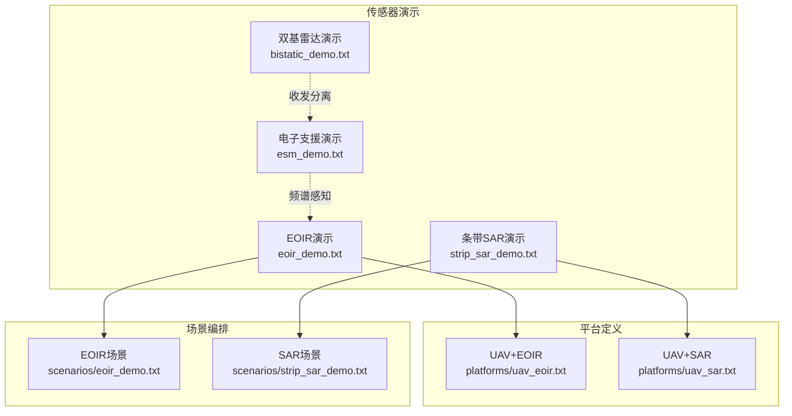
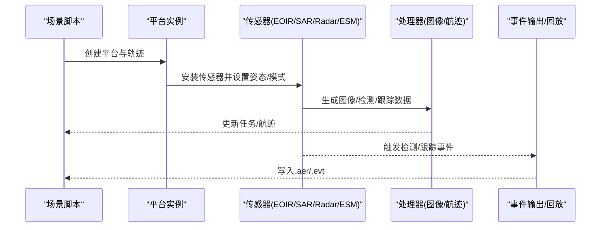
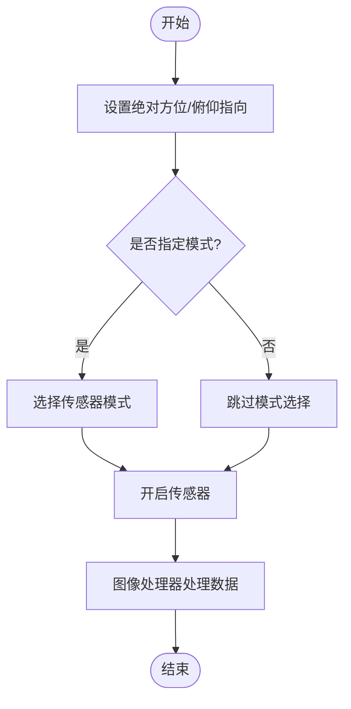
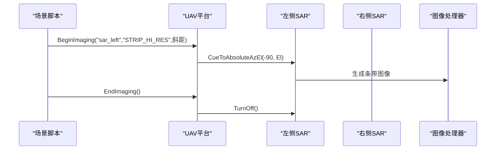
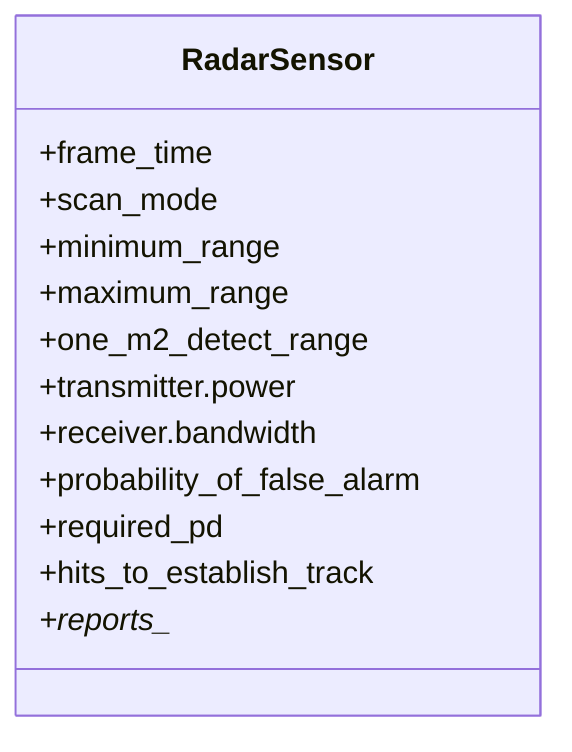
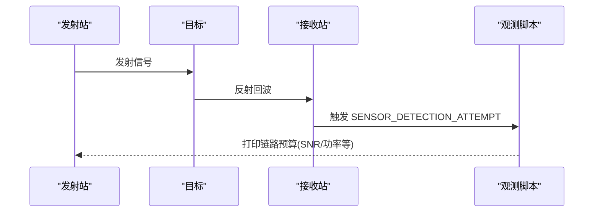
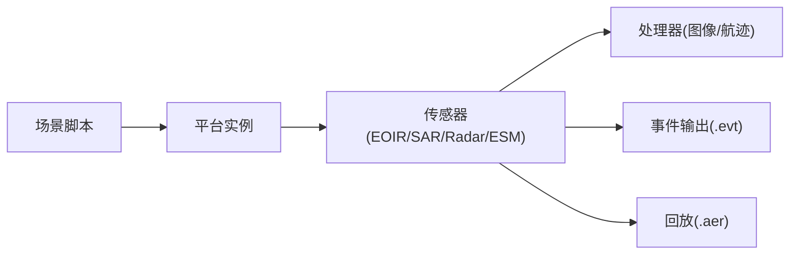

# 传感器演示

<cite>
**本文引用的文件**   
- [demos/sensor_demos/README.md](file://demos/sensor_demos/README.md)
- [demos/sensor_demos/eoir_demo.txt](file://demos/sensor_demos/eoir_demo.txt)
- [demos/sensor_demos/esm_demo.txt](file://demos/sensor_demos/esm_demo.txt)
- [demos/sensor_demos/strip_sar_demo.txt](file://demos/sensor_demos/strip_sar_demo.txt)
- [demos/sensor_demos/bistatic_demo.txt](file://demos/sensor_demos/bistatic_demo.txt)
- [demos/sensor_demos/platforms/uav_eoir.txt](file://demos/sensor_demos/platforms/uav_eoir.txt)
- [demos/sensor_demos/platforms/uav_sar.txt](file://demos/sensor_demos/platforms/uav_sar.txt)
- [demos/sensor_demos/scenarios/eoir_demo.txt](file://demos/sensor_demos/scenarios/eoir_demo.txt)
- [demos/sensor_demos/scenarios/strip_sar_demo.txt](file://demos/sensor_demos/scenarios/strip_sar_demo.txt)
- [training/user/10_Other_Topics/bam/scenarios/floridistan/27_floridistan_cluster_gci/sensors/radar/ew_radar.txt](file://training/user/10_Other_Topics/bam/scenarios/floridistan/27_floridistan_cluster_gci/sensors/radar/ew_radar.txt)
- [swdev/src/core/wsf_mil/source/ew/WsfFalseTarget.hpp](file://swdev/src/core/wsf_mil/source/ew/WsfFalseTarget.hpp)
</cite>

## 目录
1. [简介](#简介)
2. [项目结构](#项目结构)
3. [核心组件](#核心组件)
4. [架构总览](#架构总览)
5. [详细组件分析](#详细组件分析)
6. [依赖关系分析](#依赖关系分析)
7. [性能与精度评估方法](#性能与精度评估方法)
8. [环境适应性分析](#环境适应性分析)
9. [传感器选型与优化建议](#传感器选型与优化建议)
10. [故障排查指南](#故障排查指南)
11. [结论](#结论)

## 简介
本文件面向AFSIM中的多类传感器（雷达、红外/光学EOIR、合成孔径雷达SAR、电子支援ESM等）的建模原理、参数配置、测试方法与结果分析，提供可复现的示例路径与可视化流程图，帮助读者快速搭建、验证并优化传感器模型。

## 项目结构
传感器演示位于 demos/sensor_demos 下，包含：
- 场景脚本：eoir_demo.txt、strip_sar_demo.txt、bistatic_demo.txt、esm_demo.txt 等
- 平台定义：uav_eoir.txt、uav_sar.txt
- 场景编排：scenarios/eoir_demo.txt、scenarios/strip_sar_demo.txt
- 文档与输出：doc/、output/

图表来源
- [demos/sensor_demos/eoir_demo.txt:1-34](file://demos/sensor_demos/eoir_demo.txt#L1-L34)
- [demos/sensor_demos/strip_sar_demo.txt:1-39](file://demos/sensor_demos/strip_sar_demo.txt#L1-L39)
- [demos/sensor_demos/bistatic_demo.txt:1-197](file://demos/sensor_demos/bistatic_demo.txt#L1-L197)
- [demos/sensor_demos/esm_demo.txt:1-252](file://demos/sensor_demos/esm_demo.txt#L1-L252)
- [demos/sensor_demos/platforms/uav_eoir.txt:1-68](file://demos/sensor_demos/platforms/uav_eoir.txt#L1-L68)
- [demos/sensor_demos/platforms/uav_sar.txt:1-82](file://demos/sensor_demos/platforms/uav_sar.txt#L1-L82)
- [demos/sensor_demos/scenarios/eoir_demo.txt:1-83](file://demos/sensor_demos/scenarios/eoir_demo.txt#L1-L83)
- [demos/sensor_demos/scenarios/strip_sar_demo.txt:1-86](file://demos/sensor_demos/scenarios/strip_sar_demo.txt#L1-L86)

章节来源
- [demos/sensor_demos/README.md:1-45](file://demos/sensor_demos/README.md#L1-L45)

## 核心组件
- EOIR（光电/红外）传感器：用于成像与目标识别，支持模式选择与指向控制。
- SAR（合成孔径雷达）传感器：条带/聚束成像，支持左右侧视与分辨率模式。
- 雷达传感器（WSF_RADAR_SENSOR）：主动探测，支持收发参数、扫描模式、检测概率与虚警率等。
- ESM（电子支援）传感器：被动接收电磁辐射，进行频谱分析与定位。
- 双基雷达：发射与接收分离，验证几何链路预算与SNR计算。

章节来源
- [demos/sensor_demos/platforms/uav_eoir.txt:1-68](file://demos/sensor_demos/platforms/uav_eoir.txt#L1-L68)
- [demos/sensor_demos/platforms/uav_sar.txt:1-82](file://demos/sensor_demos/platforms/uav_sar.txt#L1-L82)
- [demos/sensor_demos/esm_demo.txt:1-252](file://demos/sensor_demos/esm_demo.txt#L1-L252)
- [demos/sensor_demos/bistatic_demo.txt:1-197](file://demos/sensor_demos/bistatic_demo.txt#L1-L197)

## 架构总览
传感器在平台上的装配与数据流如下：

图表来源
- [demos/sensor_demos/eoir_demo.txt:10-34](file://demos/sensor_demos/eoir_demo.txt#L10-L34)
- [demos/sensor_demos/strip_sar_demo.txt:10-39](file://demos/sensor_demos/strip_sar_demo.txt#L10-L39)
- [demos/sensor_demos/esm_demo.txt:118-150](file://demos/sensor_demos/esm_demo.txt#L118-L150)
- [demos/sensor_demos/bistatic_demo.txt:79-103](file://demos/sensor_demos/bistatic_demo.txt#L79-L103)

## 详细组件分析

### EOIR（光电/红外）传感器
- 建模要点
  - 通过 GENERIC_EOIR 类型挂载到无人机平台，支持绝对方位/俯仰指向 CueToAbsoluteAzEl。
  - 支持模式切换 SelectMode 与开关 TurnOn/TurnOff。
  - 图像处理器 WSF_IMAGE_PROCESSOR 处理图像数据并可链接至任务处理器。
- 关键参数与行为
  - 安装位置偏置 yaw/pitch 决定视轴方向。
  - 内部链路 internal_link 将图像数据传递给处理器。
  - 自动关闭 automatic_turn_off 可在条件满足时自动关断。
- 典型流程
  - 场景按时间调用 BeginImaging/EndImaging，完成成像窗口控制。

图表来源
- [demos/sensor_demos/platforms/uav_eoir.txt:23-46](file://demos/sensor_demos/platforms/uav_eoir.txt#L23-L46)
- [demos/sensor_demos/scenarios/eoir_demo.txt:16-28](file://demos/sensor_demos/scenarios/eoir_demo.txt#L16-L28)

章节来源
- [demos/sensor_demos/platforms/uav_eoir.txt:1-68](file://demos/sensor_demos/platforms/uav_eoir.txt#L1-L68)
- [demos/sensor_demos/scenarios/eoir_demo.txt:1-83](file://demos/sensor_demos/scenarios/eoir_demo.txt#L1-L83)
- [demos/sensor_demos/eoir_demo.txt:1-34](file://demos/sensor_demos/eoir_demo.txt#L1-L34)

### SAR（合成孔径雷达）传感器
- 建模要点
  - 使用 GENERIC_SAR 类型，支持左右两侧视（sar_left/sar_right）。
  - 通过场景脚本控制成像模式（如 STRIP_HI_RES）与地面斜距。
  - 图像处理器 WSF_IMAGE_PROCESSOR 与航迹处理器 WSF_TRACK_PROCESSOR 协同工作。
- 关键参数与行为
  - yaw/pitch 设定侧视角度与俯仰。
  - automatic_turn_off 自动关断避免持续占用资源。
  - show_status 便于调试状态。
- 典型流程
  - 场景按时间调用 BeginImaging/EndImaging，切换左右侧视与分辨率模式。

图表来源
- [demos/sensor_demos/platforms/uav_sar.txt:55-69](file://demos/sensor_demos/platforms/uav_sar.txt#L55-L69)
- [demos/sensor_demos/scenarios/strip_sar_demo.txt:16-28](file://demos/sensor_demos/scenarios/strip_sar_demo.txt#L16-L28)

章节来源
- [demos/sensor_demos/platforms/uav_sar.txt:1-82](file://demos/sensor_demos/platforms/uav_sar.txt#L1-L82)
- [demos/sensor_demos/scenarios/strip_sar_demo.txt:1-86](file://demos/sensor_demos/scenarios/strip_sar_demo.txt#L1-L86)
- [demos/sensor_demos/strip_sar_demo.txt:1-39](file://demos/sensor_demos/strip_sar_demo.txt#L1-L39)

### 雷达传感器（WSF_RADAR_SENSOR）
- 建模要点
  - 主动探测，支持天线方向图、发射功率、频率、带宽、脉冲宽度、PRI等。
  - 支持扫描模式（azimuth/elevation/both）、视场限制、最小/最大距离。
  - 检测参数包括 one_m2_detect_range、probability_of_false_alarm、required_pd、Swerling case。
  - 航迹建立与维护阈值 hits_to_establish_track/hits_to_maintain_track。
- 典型用法
  - 早期预警雷达与ESM组合，实现探测与频谱感知联动。
  - 报告项 reports_location/velocity/range/bearing/elevation 等。

图表来源
- [training/user/10_Other_Topics/bam/scenarios/floridistan/27_floridistan_cluster_gci/sensors/radar/ew_radar.txt:15-63](file://training/user/10_Other_Topics/bam/scenarios/floridistan/27_floridistan_cluster_gci/sensors/radar/ew_radar.txt#L15-L63)
- [demos/sensor_demos/esm_demo.txt:24-85](file://demos/sensor_demos/esm_demo.txt#L24-L85)

章节来源
- [training/user/10_Other_Topics/bam/scenarios/floridistan/27_floridistan_cluster_gci/sensors/radar/ew_radar.txt:1-63](file://training/user/10_Other_Topics/bam/scenarios/floridistan/27_floridistan_cluster_gci/sensors/radar/ew_radar.txt#L1-L63)
- [demos/sensor_demos/esm_demo.txt:1-252](file://demos/sensor_demos/esm_demo.txt#L1-L252)

### 电子支援（ESM）传感器
- 建模要点
  - 被动接收，设置 receiver.detection_threshold/noise_power/internal_loss。
  - frequency_band 定义频段范围。
  - 报告 location/type/frequency 等。
- 典型用法
  - 与雷达站点配合，对敌方雷达辐射源进行探测与定位。

章节来源
- [demos/sensor_demos/esm_demo.txt:87-113](file://demos/sensor_demos/esm_demo.txt#L87-L113)

### 双基雷达
- 建模要点
  - 收发分离：BISTATIC_SENSOR_RCVR（仅接收）与 BISTATIC_SENSOR_XMTR（仅发射）。
  - 使用 radar_signature.use_bisector_for_bisstatic true 启用双基几何。
  - 通过脚本打印链路预算指标（RcvdPower、NoisePower、SNR等）。
- 典型流程
  - 固定目标位置，验证信号参数与计算一致性。

图表来源
- [demos/sensor_demos/bistatic_demo.txt:16-77](file://demos/sensor_demos/bistatic_demo.txt#L16-L77)
- [demos/sensor_demos/bistatic_demo.txt:163-181](file://demos/sensor_demos/bistatic_demo.txt#L163-L181)

章节来源
- [demos/sensor_demos/bistatic_demo.txt:1-197](file://demos/sensor_demos/bistatic_demo.txt#L1-L197)

## 依赖关系分析
- 平台与传感器
  - UAV平台装配 EOIR/SAR 传感器，并通过处理器链路与任务系统交互。
- 场景与平台
  - 场景脚本驱动平台轨迹与传感器操作时序。
- 事件输出
  - event_output 与 event_pipe 将传感器事件与回放数据写入 output 目录。

图表来源
- [demos/sensor_demos/eoir_demo.txt:16-31](file://demos/sensor_demos/eoir_demo.txt#L16-L31)
- [demos/sensor_demos/strip_sar_demo.txt:18-36](file://demos/sensor_demos/strip_sar_demo.txt#L18-L36)
- [demos/sensor_demos/esm_demo.txt:192-245](file://demos/sensor_demos/esm_demo.txt#L192-L245)

章节来源
- [demos/sensor_demos/eoir_demo.txt:1-34](file://demos/sensor_demos/eoir_demo.txt#L1-L34)
- [demos/sensor_demos/strip_sar_demo.txt:1-39](file://demos/sensor_demos/strip_sar_demo.txt#L1-L39)
- [demos/sensor_demos/esm_demo.txt:1-252](file://demos/sensor_demos/esm_demo.txt#L1-L252)

## 性能与精度评估方法
- 雷达检测性能
  - 通过 probability_of_false_alarm、required_pd、Swerling case 控制检测概率与虚警率。
  - 使用 one_m2_detect_range 作为基准探测距离，结合 transmitter/receiver 参数推导链路预算。
- SAR成像质量
  - 通过模式（如 STRIP_HI_RES）与斜距控制影响分辨率与覆盖范围。
  - 利用 image_proc 的输出评估图像清晰度与目标可辨识度。
- ESM频谱感知
  - 通过 detection_threshold 与 noise_power 调整灵敏度，frequency_band 限定频段。
- 双基链路预算
  - 使用脚本输出 RcvdPower、NoisePower、SNR 等指标，验证几何与传播损耗计算。

章节来源
- [training/user/10_Other_Topics/bam/scenarios/floridistan/27_floridistan_cluster_gci/sensors/radar/ew_radar.txt:24-63](file://training/user/10_Other_Topics/bam/scenarios/floridistan/27_floridistan_cluster_gci/sensors/radar/ew_radar.txt#L24-L63)
- [demos/sensor_demos/strip_sar_demo.txt:16-28](file://demos/sensor_demos/strip_sar_demo.txt#L16-L28)
- [demos/sensor_demos/esm_demo.txt:94-113](file://demos/sensor_demos/esm_demo.txt#L94-L113)
- [demos/sensor_demos/bistatic_demo.txt:163-181](file://demos/sensor_demos/bistatic_demo.txt#L163-L181)

## 环境适应性分析
- 地形与遮挡
  - 可通过 terrain 加载地形数据，评估地物遮挡对雷达/EOIR视线的限制。
- 杂波与干扰
  - 雷达场景中可引入杂波与干扰（clutter/jamming），评估检测性能退化。
- 多平台协同
  - 多平台ESM与雷达联合，提升定位与抗干扰能力。

章节来源
- [demos/sensor_demos/esm_demo.txt:247-252](file://demos/sensor_demos/esm_demo.txt#L247-L252)
- [demos/sensor_demos/bistatic_demo.txt:192-197](file://demos/sensor_demos/bistatic_demo.txt#L192-L197)

## 传感器选型与优化建议
- 雷达
  - 根据探测距离需求选择 one_m2_detect_range，并结合 transmitter power 与 receiver bandwidth 优化SNR。
  - 合理设置 scan_mode 与 azimuth_scan_limits 以平衡覆盖与帧时间。
- EOIR
  - 根据任务阶段选择合适的模式与指向策略，避免长时间开机导致能耗过高。
- SAR
  - 根据分辨率与覆盖权衡选择模式（如 STRIP_HI_RES），并考虑左右侧视布局。
- ESM
  - 根据威胁频谱特征设置 frequency_band 与 detection_threshold，提高发现概率。
- 双基雷达
  - 利用收发分离优势，优化几何布局以提升SNR与抗干扰能力。

章节来源
- [training/user/10_Other_Topics/bam/scenarios/floridistan/27_floridistan_cluster_gci/sensors/radar/ew_radar.txt:24-63](file://training/user/10_Other_Topics/bam/scenarios/floridistan/27_floridistan_cluster_gci/sensors/radar/ew_radar.txt#L24-L63)
- [demos/sensor_demos/platforms/uav_eoir.txt:55-63](file://demos/sensor_demos/platforms/uav_eoir.txt#L55-L63)
- [demos/sensor_demos/platforms/uav_sar.txt:55-69](file://demos/sensor_demos/platforms/uav_sar.txt#L55-L69)
- [demos/sensor_demos/esm_demo.txt:94-113](file://demos/sensor_demos/esm_demo.txt#L94-L113)
- [demos/sensor_demos/bistatic_demo.txt:35-77](file://demos/sensor_demos/bistatic_demo.txt#L35-L77)

## 故障排查指南
- 事件未输出
  - 检查 event_output 中是否 enable 了所需的事件类型（如 SENSOR_DETECTION_ATTEMPT、SENSOR_TRACK_INITIATED）。
- 传感器未工作
  - 确认传感器已 TurnOn，且模式选择正确；检查 internal_link 是否正确连接处理器。
- 双基链路异常
  - 检查 radar_signature.use_bisector_for_bisstatic 是否为 true；核对收发站与目标几何位置。
- 日志与回放
  - 使用 log_file 与 event_pipe 输出 .log/.aer 文件，辅助定位问题。

章节来源
- [demos/sensor_demos/eoir_demo.txt:16-31](file://demos/sensor_demos/eoir_demo.txt#L16-L31)
- [demos/sensor_demos/strip_sar_demo.txt:22-36](file://demos/sensor_demos/strip_sar_demo.txt#L22-L36)
- [demos/sensor_demos/esm_demo.txt:192-245](file://demos/sensor_demos/esm_demo.txt#L192-L245)
- [demos/sensor_demos/bistatic_demo.txt:112-161](file://demos/sensor_demos/bistatic_demo.txt#L112-L161)

## 结论
通过上述传感器演示与配置文件示例，读者可以系统地掌握雷达、EOIR、SAR与ESM的建模与测试方法。结合性能评估与环境适应性分析，能够科学地进行传感器选型与优化，并在仿真中验证其实际效果。