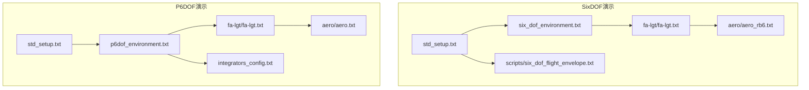
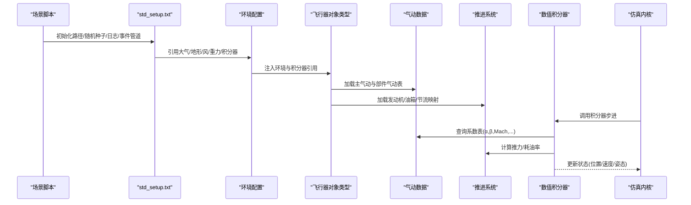
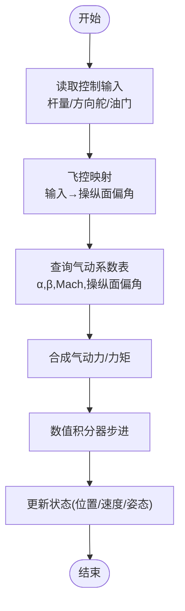
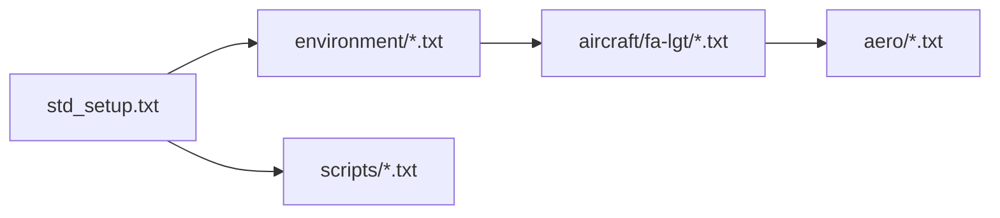
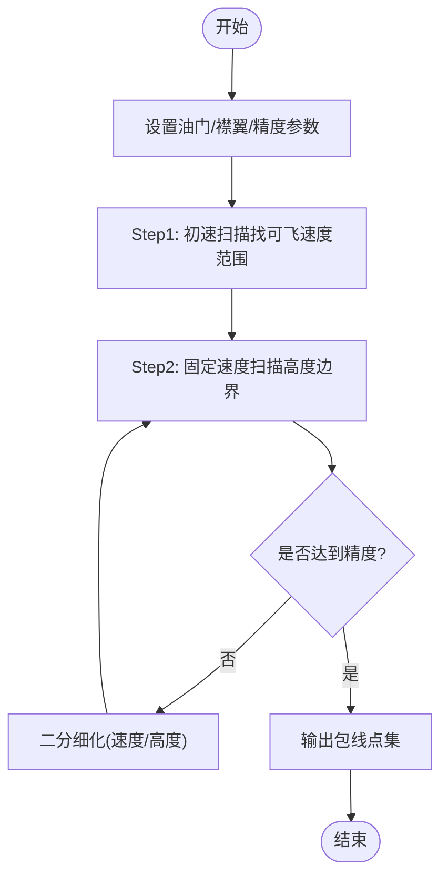

# 六自由度仿真

<cite>
**本文引用的文件**   
- [demos/six_dof/std_setup.txt](file://demos/six_dof/std_setup.txt)
- [demos/p6dof/std_setup.txt](file://demos/p6dof/std_setup.txt)
- [demos/six_dof/six_dof_types/environment/six_dof_environment.txt](file://demos/six_dof/six_dof_types/environment/six_dof_environment.txt)
- [demos/p6dof/p6dof_types/environment/p6dof_environment.txt](file://demos/p6dof/p6dof_types/environment/p6dof_environment.txt)
- [demos/six_dof/six_dof_types/aircraft/fa-lgt/fa-lgt.txt](file://demos/six_dof/six_dof_types/aircraft/fa-lgt/fa-lgt.txt)
- [demos/p6dof/p6dof_types/aircraft/fa-lgt/fa-lgt.txt](file://demos/p6dof/p6dof_types/aircraft/fa-lgt/fa-lgt.txt)
- [demos/six_dof/six_dof_types/aircraft/fa-lgt/aero/aero_rb6.txt](file://demos/six_dof/six_dof_types/aircraft/fa-lgt/aero/aero_rb6.txt)
- [demos/p6dof/p6dof_types/aircraft/fa-lgt/aero/aero.txt](file://demos/p6dof/p6dof_types/aircraft/fa-lgt/aero/aero.txt)
- [demos/six_dof/scripts/six_dof_flight_envelope.txt](file://demos/six_dof/scripts/six_dof_flight_envelope.txt)
- [demos/p6dof/p6dof_types/environment/integrators_config.txt](file://demos/p6dof/p6dof_types/environment/integrators_config.txt)
</cite>

## 目录
1. [引言](#引言)
2. [项目结构](#项目结构)
3. [核心组件](#核心组件)
4. [架构总览](#架构总览)
5. [详细组件分析](#详细组件分析)
6. [依赖关系分析](#依赖关系分析)
7. [性能与数值积分](#性能与数值积分)
8. [飞行包线与稳定性分析](#飞行包线与稳定性分析)
9. [操纵品质评估](#操纵品质评估)
10. [建模与参数调优指南](#建模与参数调优指南)
11. [飞行器类型定义与脚本示例](#飞行器类型定义与脚本示例)
12. [故障排查](#故障排查)
13. [结论](#结论)

## 引言
本文件面向六自由度（SixDOF）飞行仿真的技术实现，系统梳理AFSIM中SixDOF/P6DOF的建模方法、气动系数表组织、操纵面响应、环境模型、数值积分器配置，以及飞行包线、稳定性与操纵品质的分析方法。文档同时提供面向工程实践的参数调优建议与可复现的脚本示例路径，帮助读者在AFSIM中搭建高保真飞行器动力学仿真。

## 项目结构
AFSIM的六自由度仿真示例主要位于两个演示目录：
- demos/six_dof：基于rigid_body_vehicle_type与point_mass_vehicle_type的SixDOF对象类型定义，包含FA-LGT轻型战斗机完整的气动、控制、推进与环境配置。
- demos/p6dof：基于p6dof_object_type的P6DOF对象类型定义，结构与SixDOF类似，但使用P6DOF专用环境对象（大气、风、地形、重力、积分器）。

图表来源
- [demos/six_dof/std_setup.txt:28-59](file://demos/six_dof/std_setup.txt#L28-L59)
- [demos/six_dof/six_dof_types/environment/six_dof_environment.txt:32-38](file://demos/six_dof/six_dof_types/environment/six_dof_environment.txt#L32-L38)
- [demos/six_dof/six_dof_types/aircraft/fa-lgt/fa-lgt.txt:20-26](file://demos/six_dof/six_dof_types/aircraft/fa-lgt/fa-lgt.txt#L20-L26)
- [demos/six_dof/six_dof_types/aircraft/fa-lgt/aero/aero_rb6.txt:32-430](file://demos/six_dof/six_dof_types/aircraft/fa-lgt/aero/aero_rb6.txt#L32-L430)
- [demos/six_dof/scripts/six_dof_flight_envelope.txt:204-242](file://demos/six_dof/scripts/six_dof_flight_envelope.txt#L204-L242)
- [demos/p6dof/std_setup.txt:28-58](file://demos/p6dof/std_setup.txt#L28-L58)
- [demos/p6dof/p6dof_types/environment/p6dof_environment.txt:35-42](file://demos/p6dof/p6dof_types/environment/p6dof_environment.txt#L35-L42)
- [demos/p6dof/p6dof_types/aircraft/fa-lgt/fa-lgt.txt:20-25](file://demos/p6dof/p6dof_types/aircraft/fa-lgt/fa-lgt.txt#L20-L25)
- [demos/p6dof/p6dof_types/aircraft/fa-lgt/aero/aero.txt:32-430](file://demos/p6dof/p6dof_types/aircraft/fa-lgt/aero/aero.txt#L32-L430)
- [demos/p6dof/p6dof_types/environment/integrators_config.txt:18-22](file://demos/p6dof/p6dof_types/environment/integrators_config.txt#L18-L22)

章节来源
- [demos/six_dof/std_setup.txt:28-59](file://demos/six_dof/std_setup.txt#L28-L59)
- [demos/p6dof/std_setup.txt:28-58](file://demos/p6dof/std_setup.txt#L28-L58)

## 核心组件
- 环境模型
  - SixDOF：atmosphere_table（标准大气表）、terrain_config（地形）、integrators_config（积分器引用）。
  - P6DOF：p6dof_atmosphere、p6dof_wind、p6dof_terrain、p6dof_gravity、p6dof_integrators。
- 飞行器对象类型
  - SixDOF：rigid_body_vehicle_type（刚体）与point_mass_vehicle_type（质点），分别对应RB6与PM6。
  - P6DOF：p6dof_object_type，统一封装气动、质量属性、推进系统与操纵映射。
- 气动数据
  - 主气动块aero_data：参考面积、翼展、弦长；大量气动力/力矩系数表（cL/cD/cY/cM/cN等），按马赫数或攻角/侧滑角组合。
  - 部件气动aero_component：副翼、平尾、垂尾、减速板等独立部件的气动导数表。
- 推进系统
  - 发动机位置、推力矢量（可选）、燃油箱容量与重心、节流映射（军用/加力/反推）。
- 事件与日志
  - event_pipe输出SixDOF/AIRCOMBAT或P6DOF事件；minimum_mover_timestep控制最小步长。

章节来源
- [demos/six_dof/six_dof_types/environment/six_dof_environment.txt:18-38](file://demos/six_dof/six_dof_types/environment/six_dof_environment.txt#L18-L38)
- [demos/p6dof/p6dof_types/environment/p6dof_environment.txt:18-42](file://demos/p6dof/p6dof_types/environment/p6dof_environment.txt#L18-L42)
- [demos/six_dof/six_dof_types/aircraft/fa-lgt/fa-lgt.txt:20-169](file://demos/six_dof/six_dof_types/aircraft/fa-lgt/fa-lgt.txt#L20-L169)
- [demos/p6dof/p6dof_types/aircraft/fa-lgt/fa-lgt.txt:20-167](file://demos/p6dof/p6dof_types/aircraft/fa-lgt/fa-lgt.txt#L20-L167)
- [demos/six_dof/six_dof_types/aircraft/fa-lgt/aero/aero_rb6.txt:32-430](file://demos/six_dof/six_dof_types/aircraft/fa-lgt/aero/aero_rb6.txt#L32-L430)
- [demos/p6dof/p6dof_types/aircraft/fa-lgt/aero/aero.txt:32-430](file://demos/p6dof/p6dof_types/aircraft/fa-lgt/aero/aero.txt#L32-L430)
- [demos/six_dof/std_setup.txt:42-59](file://demos/six_dof/std_setup.txt#L42-L59)
- [demos/p6dof/std_setup.txt:42-58](file://demos/p6dof/std_setup.txt#L42-L58)

## 架构总览
下图展示SixDOF/P6DOF仿真从场景启动到动力学求解的数据流与控制流。

图表来源
- [demos/six_dof/std_setup.txt:28-59](file://demos/six_dof/std_setup.txt#L28-L59)
- [demos/p6dof/std_setup.txt:28-58](file://demos/p6dof/std_setup.txt#L28-L58)
- [demos/six_dof/six_dof_types/environment/six_dof_environment.txt:32-38](file://demos/six_dof/six_dof_types/environment/six_dof_environment.txt#L32-L38)
- [demos/p6dof/p6dof_types/environment/p6dof_environment.txt:35-42](file://demos/p6dof/p6dof_types/environment/p6dof_environment.txt#L35-L42)
- [demos/six_dof/six_dof_types/aircraft/fa-lgt/fa-lgt.txt:20-169](file://demos/six_dof/six_dof_types/aircraft/fa-lgt/fa-lgt.txt#L20-L169)
- [demos/p6dof/p6dof_types/aircraft/fa-lgt/fa-lgt.txt:20-167](file://demos/p6dof/p6dof_types/aircraft/fa-lgt/fa-lgt.txt#L20-L167)
- [demos/p6dof/p6dof_types/environment/integrators_config.txt:18-22](file://demos/p6dof/p6dof_types/environment/integrators_config.txt#L18-L22)

## 详细组件分析

### 环境模型与大气表
- SixDOF环境
  - atmosphere_table：以高度为索引的标准大气表，包含温度、压力、密度、声速等列，覆盖对流层至高层大气。
  - terrain_config：地形高程、法向与摩擦系数，支持移动平台（如航母甲板）。
  - integrators_config：SixDOF积分器引用。
- P6DOF环境
  - p6dof_atmosphere/p6dof_wind/p6dof_terrain/p6dof_gravity：分别定义大气、风场、地形与重力模型。
  - p6dof_integrators：创建STANDARD_P6DOF_INTEGRATOR。

章节来源
- [demos/six_dof/six_dof_types/environment/six_dof_environment.txt:40-325](file://demos/six_dof/six_dof_types/environment/six_dof_environment.txt#L40-L325)
- [demos/p6dof/p6dof_types/environment/p6dof_environment.txt:35-42](file://demos/p6dof/p6dof_types/environment/p6dof_environment.txt#L35-L42)
- [demos/p6dof/p6dof_types/environment/integrators_config.txt:18-22](file://demos/p6dof/p6dof_types/environment/integrators_config.txt#L18-L22)

### 飞行器对象类型与质量属性
- SixDOF
  - rigid_body_vehicle_type FA-LGT_RB6：包含aero_rb6、control_inputs_rb6、flight_controls_rb6；质量属性（质量、惯量、质心）；推进系统（发动机位置、燃油箱、节流映射）。
  - point_mass_vehicle_type FA-LGT_PM6：质点模型，同样包含气动与控制映射。
- P6DOF
  - p6dof_object_type FA-LGT：统一封装aero、control_inputs、flight_controls、质量属性与推进系统。

章节来源
- [demos/six_dof/six_dof_types/aircraft/fa-lgt/fa-lgt.txt:20-169](file://demos/six_dof/six_dof_types/aircraft/fa-lgt/fa-lgt.txt#L20-L169)
- [demos/p6dof/p6dof_types/aircraft/fa-lgt/fa-lgt.txt:20-167](file://demos/p6dof/p6dof_types/aircraft/fa-lgt/fa-lgt.txt#L20-L167)

### 气动系数表与操纵面响应
- 主气动块aero_data
  - 参考几何：wing_chord_ft、wing_span_ft、wing_area_sqft。
  - 系数表：cL_alpha_beta_mach_table、cd_alpha_beta_mach_table、cy_alpha_beta_mach_table、cm_alpha_beta_mach_table、cn_alpha_beta_mach_table等，部分直接内联马赫数表（如cmq_mach_table、cmp_mach_table、cnr_mach_table、cnp_mach_table、clp_mach_table等）。
- 部件气动aero_component
  - 副翼（左右）、平尾（左右）、垂尾、减速板（上下左右）等，各自拥有角度相关的cL/cD/cY/cM/cN与阻尼导数表。
- 控制输入与飞控映射
  - control_inputs_*：定义杆量、方向舵、油门等输入通道。
  - flight_controls_*：将输入映射到操纵面偏角，并考虑速率限制与饱和。

图表来源
- [demos/six_dof/six_dof_types/aircraft/fa-lgt/aero/aero_rb6.txt:32-430](file://demos/six_dof/six_dof_types/aircraft/fa-lgt/aero/aero_rb6.txt#L32-L430)
- [demos/p6dof/p6dof_types/aircraft/fa-lgt/aero/aero.txt:32-430](file://demos/p6dof/p6dof_types/aircraft/fa-lgt/aero/aero.txt#L32-L430)
- [demos/six_dof/six_dof_types/aircraft/fa-lgt/fa-lgt.txt:20-26](file://demos/six_dof/six_dof_types/aircraft/fa-lgt/fa-lgt.txt#L20-L26)
- [demos/p6dof/p6dof_types/aircraft/fa-lgt/fa-lgt.txt:20-25](file://demos/p6dof/p6dof_types/aircraft/fa-lgt/fa-lgt.txt#L20-L25)

章节来源
- [demos/six_dof/six_dof_types/aircraft/fa-lgt/aero/aero_rb6.txt:32-897](file://demos/six_dof/six_dof_types/aircraft/fa-lgt/aero/aero_rb6.txt#L32-L897)
- [demos/p6dof/p6dof_types/aircraft/fa-lgt/aero/aero.txt:32-897](file://demos/p6dof/p6dof_types/aircraft/fa-lgt/aero/aero.txt#L32-L897)
- [demos/six_dof/six_dof_types/aircraft/fa-lgt/fa-lgt.txt:20-26](file://demos/six_dof/six_dof_types/aircraft/fa-lgt/fa-lgt.txt#L20-L26)
- [demos/p6dof/p6dof_types/aircraft/fa-lgt/fa-lgt.txt:20-25](file://demos/p6dof/p6dof_types/aircraft/fa-lgt/fa-lgt.txt#L20-L25)

### 推进系统与燃油管理
- 发动机：定义相对位置、安装角、燃料供给源。
- 燃油箱：最大/当前油量、充注/转移速率、满/空重心坐标。
- 节流映射：军用推力、加力推力、反推（可选）。
- 多油箱与转油逻辑（注释示例）：支持机翼/前后油箱与主油箱之间的转油策略。

章节来源
- [demos/six_dof/six_dof_types/aircraft/fa-lgt/fa-lgt.txt:37-167](file://demos/six_dof/six_dof_types/aircraft/fa-lgt/fa-lgt.txt#L37-L167)
- [demos/p6dof/p6dof_types/aircraft/fa-lgt/fa-lgt.txt:37-167](file://demos/p6dof/p6dof_types/aircraft/fa-lgt/fa-lgt.txt#L37-L167)

## 依赖关系分析
- std_setup负责全局设置（路径、随机种子、日志、事件管道、DIS、实时标志、最小步长）。
- environment文件为SixDOF/P6DOF提供环境对象引用。
- aircraft类型文件包含气动、控制、质量与推进数据。
- aero文件提供主气动与部件气动表。
- scripts提供包线分析与测试脚本。

图表来源
- [demos/six_dof/std_setup.txt:28-59](file://demos/six_dof/std_setup.txt#L28-L59)
- [demos/p6dof/std_setup.txt:28-58](file://demos/p6dof/std_setup.txt#L28-L58)
- [demos/six_dof/six_dof_types/environment/six_dof_environment.txt:32-38](file://demos/six_dof/six_dof_types/environment/six_dof_environment.txt#L32-L38)
- [demos/p6dof/p6dof_types/environment/p6dof_environment.txt:35-42](file://demos/p6dof/p6dof_types/environment/p6dof_environment.txt#L35-L42)
- [demos/six_dof/six_dof_types/aircraft/fa-lgt/fa-lgt.txt:20-169](file://demos/six_dof/six_dof_types/aircraft/fa-lgt/fa-lgt.txt#L20-L169)
- [demos/p6dof/p6dof_types/aircraft/fa-lgt/fa-lgt.txt:20-167](file://demos/p6dof/p6dof_types/aircraft/fa-lgt/fa-lgt.txt#L20-L167)
- [demos/six_dof/six_dof_types/aircraft/fa-lgt/aero/aero_rb6.txt:32-430](file://demos/six_dof/six_dof_types/aircraft/fa-lgt/aero/aero_rb6.txt#L32-L430)
- [demos/p6dof/p6dof_types/aircraft/fa-lgt/aero/aero.txt:32-430](file://demos/p6dof/p6dof_types/aircraft/fa-lgt/aero/aero.txt#L32-L430)
- [demos/six_dof/scripts/six_dof_flight_envelope.txt:204-242](file://demos/six_dof/scripts/six_dof_flight_envelope.txt#L204-L242)

## 性能与数值积分
- 最小时间步长：minimum_mover_timestep设为1 ms，确保高频动态（如操纵面响应、短周期模态）被充分解析。
- 积分器：P6DOF使用STANDARD_P6DOF_INTEGRATOR；SixDOF通过integrators_config引用相应积分器。
- 事件管道：启用SixDOF/AIRCOMBAT或P6DOF事件，便于后处理与可视化。

章节来源
- [demos/six_dof/std_setup.txt:42-59](file://demos/six_dof/std_setup.txt#L42-L59)
- [demos/p6dof/std_setup.txt:42-58](file://demos/p6dof/std_setup.txt#L42-L58)
- [demos/p6dof/p6dof_types/environment/integrators_config.txt:18-22](file://demos/p6dof/p6dof_types/environment/integrators_config.txt#L18-L22)

## 飞行包线与稳定性分析
- 飞行包线脚本
  - ComputeFlightEnvelope：根据油门与襟翼设置，迭代搜索可飞边界（最低/最高速度与高度）。
  - 内部函数ComputeMinFlightSpeed/ComputeMaxFlightSpeed与ComputeMinFlightAltitude/ComputeMaxFlightAltitude采用二分细化策略，直至达到精度阈值。
  - 使用WsfSixDOF_MoverTestObject的CanFlyAt接口判断可飞性，冻结高度/燃油燃烧/位置以提升效率。
- 稳定性分析思路
  - 利用气动导数表（如cmq、cnr、clp等）评估纵向/航向/滚转阻尼与静稳定性。
  - 结合质量属性与惯性矩，分析短周期、荷兰滚、螺旋模态的阻尼与频率。
  - 通过不同马赫数/攻角/侧滑角的系数表插值，绘制稳定性裕度曲线。

图表来源
- [demos/six_dof/scripts/six_dof_flight_envelope.txt:44-91](file://demos/six_dof/scripts/six_dof_flight_envelope.txt#L44-L91)
- [demos/six_dof/scripts/six_dof_flight_envelope.txt:101-174](file://demos/six_dof/scripts/six_dof_flight_envelope.txt#L101-L174)
- [demos/six_dof/scripts/six_dof_flight_envelope.txt:204-242](file://demos/six_dof/scripts/six_dof_flight_envelope.txt#L204-L242)

章节来源
- [demos/six_dof/scripts/six_dof_flight_envelope.txt:44-242](file://demos/six_dof/scripts/six_dof_flight_envelope.txt#L44-L242)

## 操纵品质评估
- 操纵面响应特性
  - 通过flight_controls_*将杆量/方向舵/油门映射到操纵面偏角，可加入速率限制与饱和。
  - 部件气动表提供操纵面偏角对气动力/力矩的贡献，用于评估操纵效能与耦合。
- 品质指标
  - 纵向：升降舵效率、俯仰阻尼（cmq）、静稳定裕度（cmp）。
  - 航向：方向舵效率、偏航阻尼（cnr）、荷兰滚阻尼。
  - 滚转：副翼效率、滚转阻尼（clp）。
- 评估流程
  - 在小扰动下（阶跃/脉冲）施加操纵输入，记录姿态与角速度响应。
  - 拟合二阶模型参数（自然频率、阻尼比），对比设计目标。
  - 结合包线结果，识别低马赫/高攻角区域的操纵退化区域。

章节来源
- [demos/six_dof/six_dof_types/aircraft/fa-lgt/aero/aero_rb6.txt:440-897](file://demos/six_dof/six_dof_types/aircraft/fa-lgt/aero/aero_rb6.txt#L440-L897)
- [demos/p6dof/p6dof_types/aircraft/fa-lgt/aero/aero.txt:440-897](file://demos/p6dof/p6dof_types/aircraft/fa-lgt/aero/aero.txt#L440-L897)
- [demos/six_dof/six_dof_types/aircraft/fa-lgt/fa-lgt.txt:20-26](file://demos/six_dof/six_dof_types/aircraft/fa-lgt/fa-lgt.txt#L20-L26)
- [demos/p6dof/p6dof_types/aircraft/fa-lgt/fa-lgt.txt:20-25](file://demos/p6dof/p6dof_types/aircraft/fa-lgt/fa-lgt.txt#L20-L25)

## 建模与参数调优指南
- 质量与惯性
  - 校准质量与三轴惯量，确保短周期与滚转/偏航模态的频率与阻尼符合预期。
  - 关注燃油消耗引起的质心漂移，必要时启用多油箱转油逻辑。
- 气动系数表
  - 确保α/β/Mach网格覆盖包线范围，关键区域（大迎角、跨音速）加密采样。
  - 校验操纵面偏角相关系数（angle_*）与阻尼导数（*_dot/*_rate）的一致性。
- 推进系统
  - 标定发动机推力曲线与耗油率，验证军用/加力切换的平滑性。
  - 节流映射需与实际驾驶舱指令一致，避免非线性突变。
- 环境模型
  - 标准大气表应覆盖任务高度范围；风场与重力模型按任务需求启用。
- 数值积分
  - minimum_mover_timestep与积分器选择需匹配高频动态；必要时降低步长提升精度。
- 包线与稳定性
  - 使用包线脚本快速定位可飞边界；在不同油门/襟翼设置下重复扫描。
  - 针对不稳定区域调整气动或控制律参数，重新评估。

[本节为通用指导，不直接分析具体文件]

## 飞行器类型定义与脚本示例
- 飞行器类型定义
  - SixDOF：FA-LGT_RB6（刚体）与FA-LGT_PM6（质点），包含气动、控制、质量与推进数据。
  - P6DOF：FA-LGT（统一对象类型），结构与SixDOF类似。
- 脚本示例
  - 飞行包线：ComputeFlightEnvelope，支持AB/军用推力下的包线生成。
  - 其他脚本：可在scripts目录下扩展战术机动、编队、武器发射等场景。

章节来源
- [demos/six_dof/six_dof_types/aircraft/fa-lgt/fa-lgt.txt:20-219](file://demos/six_dof/six_dof_types/aircraft/fa-lgt/fa-lgt.txt#L20-L219)
- [demos/p6dof/p6dof_types/aircraft/fa-lgt/fa-lgt.txt:20-171](file://demos/p6dof/p6dof_types/aircraft/fa-lgt/fa-lgt.txt#L20-L171)
- [demos/six_dof/scripts/six_dof_flight_envelope.txt:204-242](file://demos/six_dof/scripts/six_dof_flight_envelope.txt#L204-L242)

## 故障排查
- 无法识别SixDOF/P6DOF Mover
  - 检查场景是否正确引入std_setup与environment文件。
  - 确认event_pipe启用了SixDOF或P6DOF事件。
- 包线计算失败
  - 检查ComputeFlightEnvelope的油门/襟翼设置是否在合理范围。
  - 确认CanFlyAt返回码与精度参数feVelocityPrecision/feAltitudePrecision。
- 数值发散或不稳定
  - 减小minimum_mover_timestep，检查积分器配置。
  - 校验气动系数表的单调性与连续性，避免异常尖峰。
- 推进系统异常
  - 检查发动机位置与节流映射是否与质量属性一致。
  - 验证燃油箱容量与转油逻辑是否导致质心突变。

章节来源
- [demos/six_dof/std_setup.txt:42-59](file://demos/six_dof/std_setup.txt#L42-L59)
- [demos/p6dof/std_setup.txt:42-58](file://demos/p6dof/std_setup.txt#L42-L58)
- [demos/six_dof/scripts/six_dof_flight_envelope.txt:204-242](file://demos/six_dof/scripts/six_dof_flight_envelope.txt#L204-L242)

## 结论
AFSIM的SixDOF/P6DOF框架提供了完整的飞行器动力学建模能力，涵盖环境模型、气动系数表、操纵面响应、推进系统与数值积分。通过标准化的对象类型定义与脚本工具，用户可高效完成飞行包线分析、稳定性评估与操纵品质验证。建议在建模阶段严格校准质量/惯量与气动数据，并在仿真阶段合理设置时间步长与积分器，以确保结果的准确性与可靠性。