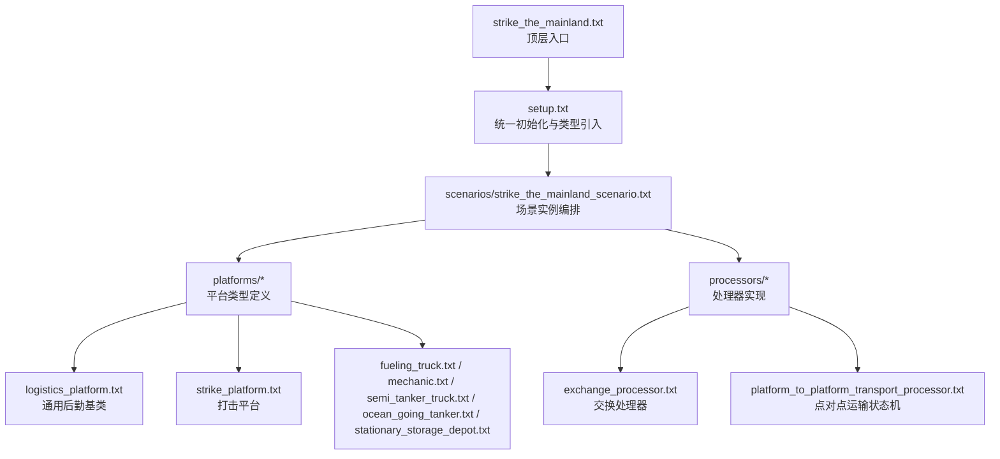
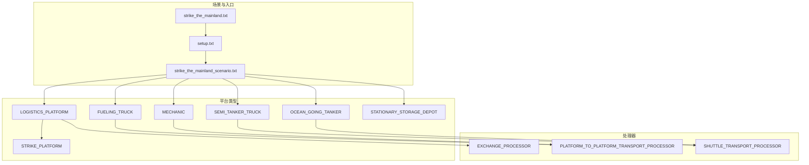
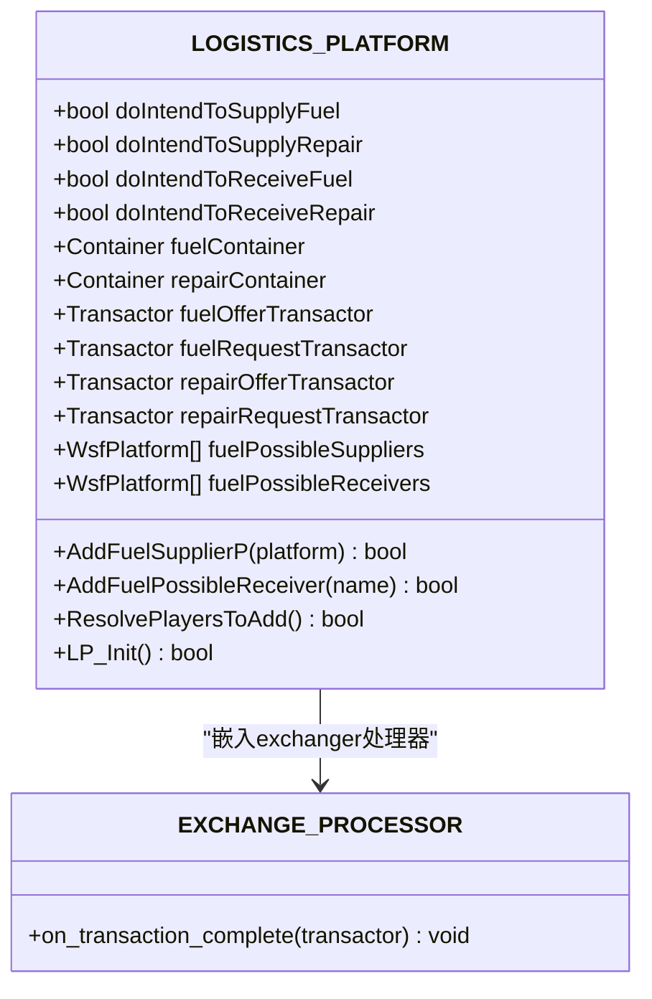
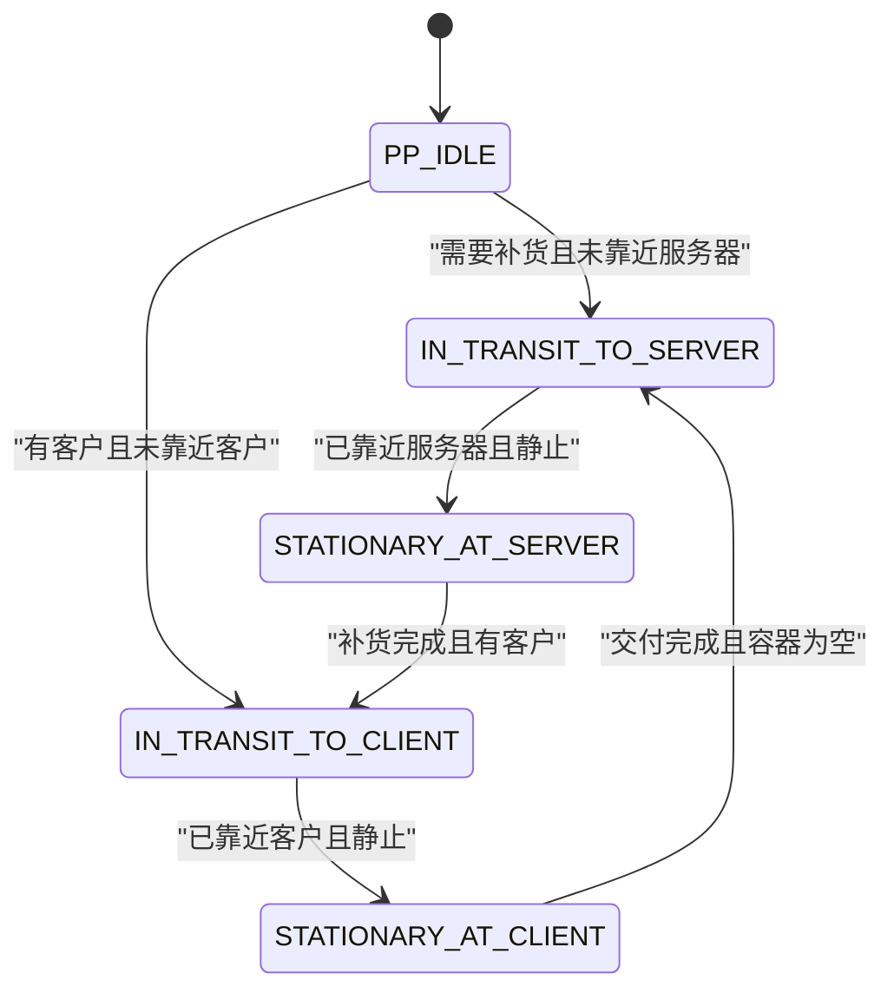
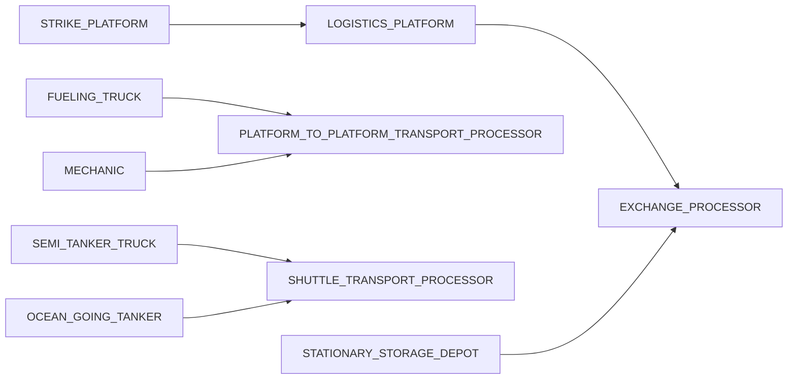
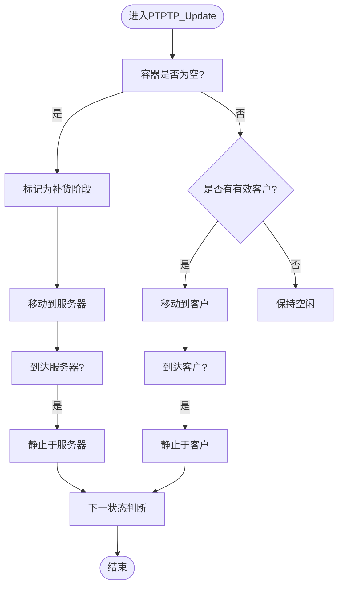

# 后勤仿真

<cite>
**本文引用的文件**   
- [setup.txt](file://demos/logistics/setup.txt)
- [strike_the_mainland.txt](file://demos/logistics/strike_the_mainland.txt)
- [strike_the_mainland_scenario.txt](file://demos/logistics/scenarios/strike_the_mainland_scenario.txt)
- [logistics_platform.txt](file://demos/logistics/platforms/logistics_platform.txt)
- [strike_platform.txt](file://demos/logistics/platforms/strike_platform.txt)
- [mechanic.txt](file://demos/logistics/platforms/mechanic.txt)
- [fueling_truck.txt](file://demos/logistics/platforms/fueling_truck.txt)
- [semi_tanker_truck.txt](file://demos/logistics/platforms/semi_tanker_truck.txt)
- [ocean_going_tanker.txt](file://demos/logistics/platforms/ocean_going_tanker.txt)
- [stationary_storage_depot.txt](file://demos/logistics/platforms/stationary_storage_depot.txt)
- [exchange_processor.txt](file://demos/logistics/processors/exchange_processor.txt)
- [platform_to_platform_transport_processor.txt](file://demos/logistics/processors/platform_to_platform_transport_processor.txt)
</cite>

## 目录
1. [引言](#引言)
2. [项目结构](#项目结构)
3. [核心组件](#核心组件)
4. [架构总览](#架构总览)
5. [详细组件分析](#详细组件分析)
6. [依赖关系分析](#依赖关系分析)
7. [性能与可扩展性](#性能与可扩展性)
8. [故障排查指南](#故障排查指南)
9. [结论](#结论)
10. [附录：场景配置与调度示例](#附录场景配置与调度示例)

## 引言
本文件面向“后勤供应链”的建模与仿真，聚焦物资调配、运输调度、仓储管理与保障流程的数字化建模。基于AFSIM的物流演示（logistics），文档从系统架构、数据流、处理逻辑、集成点与错误处理等维度展开，解释物流网络优化、库存控制与需求预测的技术要点，并提供可操作的策略分析与效率评估方法，以及具体的物流场景配置与调度算法示例。

## 项目结构
AFSIM的logistics演示采用“类型定义 + 处理器 + 场景实例”的分层组织方式：
- setup.txt：统一引入静态资源、全局脚本、路由与平台类型定义，并开启事件输出与观察者钩子。
- strike_the_mainland.txt：顶层运行入口，组合setup与具体场景。
- scenarios/strike_the_mainland_scenario.txt：场景编排，包含固定仓库、穿梭车辆、加油车、半挂油罐车、维修车与打击平台等实例的加载。
- platforms/*：平台类型定义，包括通用后勤平台基类、打击平台、维修车、加油车、半挂油罐车、远洋油轮与固定仓库等。
- processors/*：处理器实现，包括交换处理器（物资与服务交易）、点对点运输状态机、穿梭运输处理器等。

**图示来源**
- [strike_the_mainland.txt:1-16](file://demos/logistics/strike_the_mainland.txt#L1-L16)
- [setup.txt:10-48](file://demos/logistics/setup.txt#L10-L48)
- [strike_the_mainland_scenario.txt:1-34](file://demos/logistics/scenarios/strike_the_mainland_scenario.txt#L1-L34)

**章节来源**
- [strike_the_mainland.txt:1-16](file://demos/logistics/strike_the_mainland.txt#L1-L16)
- [setup.txt:10-48](file://demos/logistics/setup.txt#L10-L48)
- [strike_the_mainland_scenario.txt:1-34](file://demos/logistics/scenarios/strike_the_mainland_scenario.txt#L1-L34)

## 核心组件
- 通用后勤平台基类（LOGISTICS_PLATFORM）：封装燃料与维修两类物资/服务的容器、Transactor、可能供应商/接收者列表、意图标志位与初始化逻辑；提供统一的Set/Add接口以管理供应与接收关系。
- 交换处理器（EXCHANGE_PROCESSOR）：声明商品与服务的能力配对（如JP-8_FUEL↔SUPPLY_FUEL、ENGINE_REPAIR↔VEHICLE_REPAIR），并定义事务完成回调。
- 点对点运输状态机（PLATFORM_TO_PLATFORM_TRANSPORT_PROCESSOR）：驱动平台在“服务器（供应商）与客户（接收者）”之间移动，依据容器空满与距离判定切换状态，并在到达后启用/禁用供应或接收能力。
- 穿梭运输处理器（SHUTTLE_TRANSPORT_PROCESSOR）：用于固定两端的往返运输（如码头到机场油库、跨港口调拨）。
- 平台类型：
  - STRIKE_PLATFORM：继承LOGISTICS_PLATFORM，注入打击控制器，配置燃油与服务容器及Transactor参数，绑定WSF_AIR_MOVER。
  - FUELING_TRUCK：地面加油车，负责从机场油库取油并配送至飞机。
  - MECHANIC：维修车，携带发动机维修服务，前往受损平台进行修复。
  - SEMI_TANKER_TRUCK：半挂油罐车，码头油库↔机场油库的穿梭补给。
  - OCEAN_GOING_TANKER：远洋油轮，跨港口间大规模燃油调拨。
  - STATIONARY_STORAGE_DEPOT：固定仓库，作为静态供应源或接收端，具备就近选择最近请求者的逻辑。

**章节来源**
- [logistics_platform.txt:38-466](file://demos/logistics/platforms/logistics_platform.txt#L38-L466)
- [exchange_processor.txt:10-26](file://demos/logistics/processors/exchange_processor.txt#L10-L26)
- [platform_to_platform_transport_processor.txt:27-279](file://demos/logistics/processors/platform_to_platform_transport_processor.txt#L27-L279)
- [strike_platform.txt:16-131](file://demos/logistics/platforms/strike_platform.txt#L16-L131)
- [fueling_truck.txt:11-201](file://demos/logistics/platforms/fueling_truck.txt#L11-L201)
- [mechanic.txt:12-160](file://demos/logistics/platforms/mechanic.txt#L12-L160)
- [semi_tanker_truck.txt:12-203](file://demos/logistics/platforms/semi_tanker_truck.txt#L12-L203)
- [ocean_going_tanker.txt:13-216](file://demos/logistics/platforms/ocean_going_tanker.txt#L13-L216)
- [stationary_storage_depot.txt:12-251](file://demos/logistics/platforms/stationary_storage_depot.txt#L12-L251)

## 架构总览
下图展示后勤仿真系统的整体交互：场景通过setup引入类型与处理器，平台实例在运行时通过Exchange Processor完成物资与服务交易，Transport Processors驱动平台移动与供需匹配。

**图示来源**
- [strike_the_mainland.txt:1-16](file://demos/logistics/strike_the_mainland.txt#L1-L16)
- [setup.txt:10-48](file://demos/logistics/setup.txt#L10-L48)
- [strike_the_mainland_scenario.txt:1-34](file://demos/logistics/scenarios/strike_the_mainland_scenario.txt#L1-L34)
- [logistics_platform.txt:38-466](file://demos/logistics/platforms/logistics_platform.txt#L38-L466)
- [exchange_processor.txt:10-26](file://demos/logistics/processors/exchange_processor.txt#L10-L26)
- [platform_to_platform_transport_processor.txt:27-279](file://demos/logistics/processors/platform_to_platform_transport_processor.txt#L27-L279)

## 详细组件分析

### 通用后勤平台基类（LOGISTICS_PLATFORM）
- 设计要点：
  - 使用Container管理燃料与维修服务库存，使用Transactor发起/响应供需请求。
  - 维护可能的供应商/接收者集合，支持按名称解析为平台对象。
  - 通过Intent标志位（doIntendToSupplyFuel/Repair, doIntendToReceiveFuel/Repair）表达平台角色。
  - LP_Init()统一获取处理器、容器与Transactor引用，确保后续逻辑可用。
- 关键接口：
  - Set/Add Fuel/Repair Supplier/Receiver：添加潜在供应/接收方。
  - ResolvePlayersToAdd()：批量将字符串名称解析为平台对象。
  - Exchanger处理器内嵌fuel_container/good_engine_container与对应Transactor。

**图示来源**
- [logistics_platform.txt:38-466](file://demos/logistics/platforms/logistics_platform.txt#L38-L466)
- [exchange_processor.txt:10-26](file://demos/logistics/processors/exchange_processor.txt#L10-L26)

**章节来源**
- [logistics_platform.txt:38-466](file://demos/logistics/platforms/logistics_platform.txt#L38-L466)

### 交换处理器（EXCHANGE_PROCESSOR）
- 功能：
  - 声明商品与服务的能力配对，使Transactor能识别并协商交易。
  - 提供事务完成回调，便于记录日志或触发后续动作。
- 扩展点：
  - 可通过on_request_failed/on_transaction_complete扩展失败与成功行为。

**章节来源**
- [exchange_processor.txt:10-26](file://demos/logistics/processors/exchange_processor.txt#L10-L26)

### 点对点运输状态机（PLATFORM_TO_PLATFORM_TRANSPORT_PROCESSOR）
- 状态图：
  - PP_IDLE → IN_TRANSIT_TO_SERVER / IN_TRANSIT_TO_CLIENT → STATIONARY_AT_SERVER / STATIONARY_AT_CLIENT
  - 根据容器空满与是否处于补货阶段（ppIsInRefillStage）切换状态。
- 关键逻辑：
  - ExecuteMoveToServer/Client：生成路线并跟随，设置速度。
  - on_update：周期性评估状态，必要时调用全局函数gGetFuelingAssignment/gGetRepairAssignment分配客户。
  - 到达后通过父平台的Set*RequestingPlatform/Set*OfferingPlatform启用/禁用Transactor。

**图示来源**
- [platform_to_platform_transport_processor.txt:87-167](file://demos/logistics/processors/platform_to_platform_transport_processor.txt#L87-L167)

**章节来源**
- [platform_to_platform_transport_processor.txt:27-279](file://demos/logistics/processors/platform_to_platform_transport_processor.txt#L27-L279)

### 打击平台（STRIKE_PLATFORM）
- 特点：
  - 继承LOGISTICS_PLATFORM，注入STRIKE_CONTROLLER处理器。
  - 配置燃油容器（JP-8_FUEL）与服务容器（ENGINE_REPAIR），并调整Transactor参数（如hook_to_fuel）。
  - 绑定WSF_AIR_MOVER，定义最大/最小速度与加速度。
- 初始化：
  - SP_Init()调用LP_Init()，然后执行SC_Init()传递容器与Transactor引用。

**章节来源**
- [strike_platform.txt:16-131](file://demos/logistics/platforms/strike_platform.txt#L16-L131)

### 加油车（FUELING_TRUCK）
- 职责：
  - 从机场油库取油，配送至受油平台，等待下一次任务。
  - 在油箱未满前不离开油库，空载时返回油库。
- 初始化与周期逻辑：
  - FT_Init()注册可能的接收者与供应商。
  - on_initialize2中启动transportProcessor并执行PTPTP_Init()。
  - at_interval_of循环中尝试RequestFrom(供应商)与ReserveAll(对外供油)。

**章节来源**
- [fueling_truck.txt:11-201](file://demos/logistics/platforms/fueling_truck.txt#L11-L201)

### 维修车（MECHANIC）
- 职责：
  - 携带发动机维修服务，前往受损平台进行修复。
  - 当自身库存耗尽时返回供应商补充。
- 初始化与周期逻辑：
  - Mech_Init()注册可能的接收者与供应商。
  - on_initialize2中启动transportProcessor并执行PTPTP_Init()。
  - at_interval_of循环中更新库存标志并ReserveAll维修服务。

**章节来源**
- [mechanic.txt:12-160](file://demos/logistics/platforms/mechanic.txt#L12-L160)

### 半挂油罐车（SEMI_TANKER_TRUCK）
- 职责：
  - 码头油库↔机场油库的穿梭补给，满载出发，空载返回。
- 初始化与周期逻辑：
  - STT_Init()注册两端站点，启动SHUTTLE_TRANSPORT_PROCESSOR。
  - at_interval_of循环中持续向供应商RequestFrom，并向接收者ReserveAll。

**章节来源**
- [semi_tanker_truck.txt:12-203](file://demos/logistics/platforms/semi_tanker_truck.txt#L12-L203)

### 远洋油轮（OCEAN_GOING_TANKER）
- 职责：
  - 跨港口大规模燃油调拨，满载出发，空载返回。
- 初始化与周期逻辑：
  - OGT_Init()注册两端港口，启动SHUTTLE_TRANSPORT_PROCESSOR。
  - at_interval_of循环中持续RequestFrom与ReserveAll。

**章节来源**
- [ocean_going_tanker.txt:13-216](file://demos/logistics/platforms/ocean_going_tanker.txt#L13-L216)

### 固定仓库（STATIONARY_STORAGE_DEPOT）
- 职责：
  - 静态供应源或接收端，具备就近选择最近请求者的逻辑。
  - 若库存不足，可向路过的供应商请求补货。
- 周期逻辑：
  - at_interval_of循环中更新库存标志、ReserveAll，并选择最近的请求者。
  - 若满足条件则RequestFrom(供应商)或允许接收者取货。

**章节来源**
- [stationary_storage_depot.txt:12-251](file://demos/logistics/platforms/stationary_storage_depot.txt#L12-L251)

## 依赖关系分析
- 耦合与内聚：
  - LOGISTICS_PLATFORM对EXCHANGE_PROCESSOR强耦合（嵌入处理器），但对Transport Processors弱耦合（可选引用）。
  - 各平台类型通过edit processor exchanger定制容器与Transactor参数，保持高内聚。
- 直接/间接依赖：
  - strike_platform依赖logistics_platform与strike_controller。
  - fueling_truck/mechanic依赖platform_to_platform_transport_processor。
  - semi_tanker_truck/ocean_going_tanker依赖shuttle_transport_processor。
- 外部依赖与集成点：
  - 场景通过setup.txt引入全局脚本与路由，事件输出用于回放与分析。
  - 通过WSF_*处理器与Mover/Sensor等AFSIM内置模型扩展平台行为。

**图示来源**
- [logistics_platform.txt:38-466](file://demos/logistics/platforms/logistics_platform.txt#L38-L466)
- [exchange_processor.txt:10-26](file://demos/logistics/processors/exchange_processor.txt#L10-L26)
- [platform_to_platform_transport_processor.txt:27-279](file://demos/logistics/processors/platform_to_platform_transport_processor.txt#L27-L279)
- [strike_platform.txt:16-131](file://demos/logistics/platforms/strike_platform.txt#L16-L131)
- [fueling_truck.txt:11-201](file://demos/logistics/platforms/fueling_truck.txt#L11-L201)
- [mechanic.txt:12-160](file://demos/logistics/platforms/mechanic.txt#L12-L160)
- [semi_tanker_truck.txt:12-203](file://demos/logistics/platforms/semi_tanker_truck.txt#L12-L203)
- [ocean_going_tanker.txt:13-216](file://demos/logistics/platforms/ocean_going_tanker.txt#L13-L216)
- [stationary_storage_depot.txt:12-251](file://demos/logistics/platforms/stationary_storage_depot.txt#L12-L251)

**章节来源**
- [logistics_platform.txt:38-466](file://demos/logistics/platforms/logistics_platform.txt#L38-L466)
- [exchange_processor.txt:10-26](file://demos/logistics/processors/exchange_processor.txt#L10-L26)
- [platform_to_platform_transport_processor.txt:27-279](file://demos/logistics/processors/platform_to_platform_transport_processor.txt#L27-L279)

## 性能与可扩展性
- 更新间隔与事务超时：
  - Exchange Processor与Transactor均设置update_interval与time_out_clock_interval，避免频繁计算与死锁。
- 容量与速率：
  - Container的maximum_mass_quantity与maximum_mass_rate决定吞吐上限，需与Mover速度与距离限制匹配。
- 可扩展点：
  - 通过新增平台类型与处理器扩展新的物流模式（如多式联运、动态路径规划）。
  - 结合外部优化器（如线性规划）在场景级进行资源分配与路径优化。

[本节为一般性指导，不涉及具体文件分析]

## 故障排查指南
- 常见错误：
  - 处理器或容器未找到：LP_Init()会打印错误信息并返回失败。
  - 供应商/接收者未解析：ResolvePlayersToAdd()失败时会记录未找到的平台名。
  - 事务超时或失败：Transactor.RequestFrom/ReserveAll返回失败时需检查距离、能力配对与库存状态。
- 诊断建议：
  - 启用event_output中的EXCHANGE_COMPLETED等事件，观察交易生命周期。
  - 在平台周期逻辑中加入日志输出，跟踪库存标志与状态切换。
  - 检查WSF_EXCHANGE_PROCESSOR的商品与服务配对是否正确。

**章节来源**
- [logistics_platform.txt:400-466](file://demos/logistics/platforms/logistics_platform.txt#L400-L466)
- [exchange_processor.txt:10-26](file://demos/logistics/processors/exchange_processor.txt#L10-L26)
- [setup.txt:22-33](file://demos/logistics/setup.txt#L22-L33)

## 结论
AFSIM的logistics演示提供了完整的后勤供应链建模框架：以LOGISTICS_PLATFORM为核心，结合EXCHANGE_PROCESSOR与Transport Processors，实现了物资与服务的双向交易、平台移动与供需匹配。通过平台类型的多样化定义与场景编排，可灵活模拟机场加油、港口调拨、维修保障等典型后勤流程。在此基础上，可进一步引入需求预测、库存控制与网络优化算法，提升后勤保障策略的分析与评估能力。

[本节为总结性内容，不涉及具体文件分析]

## 附录：场景配置与调度示例

### 场景配置要点
- 顶层入口：strike_the_mainland.txt包含setup与场景文件。
- 场景编排：strike_the_mainland_scenario.txt加载固定仓库、穿梭车辆、加油车、半挂油罐车、维修车与打击平台实例。
- 事件输出：setup.txt开启EXCHANGE_COMPLETED等事件，便于回放与分析。

**章节来源**
- [strike_the_mainland.txt:1-16](file://demos/logistics/strike_the_mainland.txt#L1-L16)
- [strike_the_mainland_scenario.txt:1-34](file://demos/logistics/scenarios/strike_the_mainland_scenario.txt#L1-L34)
- [setup.txt:22-33](file://demos/logistics/setup.txt#L22-L33)

### 调度算法示例（点对点运输状态机）
- 输入：容器状态（空/满）、当前状态、服务器/客户位置、距离阈值。
- 决策：
  - 若容器为空且处于补货阶段，前往服务器。
  - 若有客户且未靠近客户，前往客户。
  - 到达后根据容器状态决定是否返回服务器或继续服务。
- 输出：平台移动指令（FollowRoute/GoToSpeed）与Transactor启用/禁用。

**图示来源**
- [platform_to_platform_transport_processor.txt:87-167](file://demos/logistics/processors/platform_to_platform_transport_processor.txt#L87-L167)

### 库存控制与需求预测方法指导
- 库存控制：
  - 基于Container.IsFull()/IsEmpty()与ReserveAll()实现动态库存管理。
  - 通过Proximity Limit与Time Out Clock Interval控制交易窗口。
- 需求预测：
  - 可在场景级引入历史消耗数据与统计模型，预测未来需求并提前调度资源。
  - 结合优化算法（如线性规划）求解最优补给路径与批次规模。

[本节为方法论指导，不涉及具体文件分析]