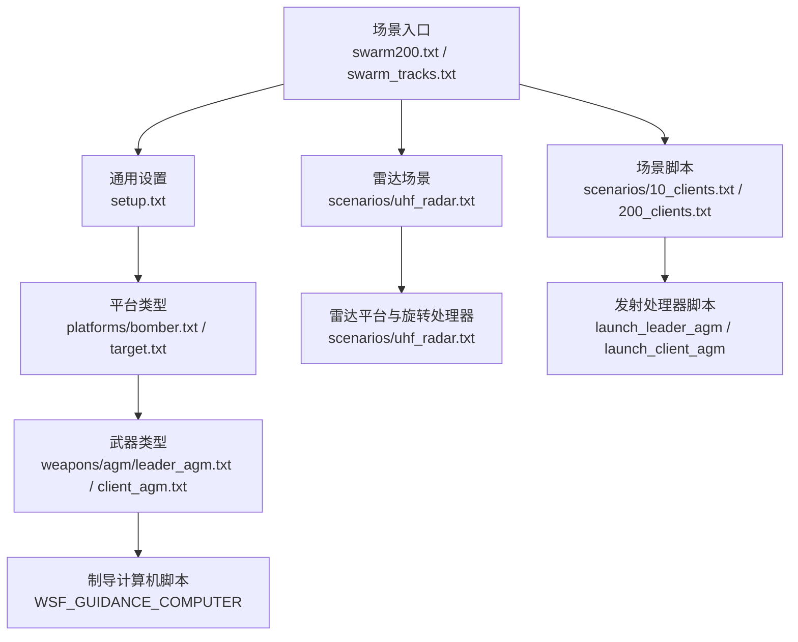
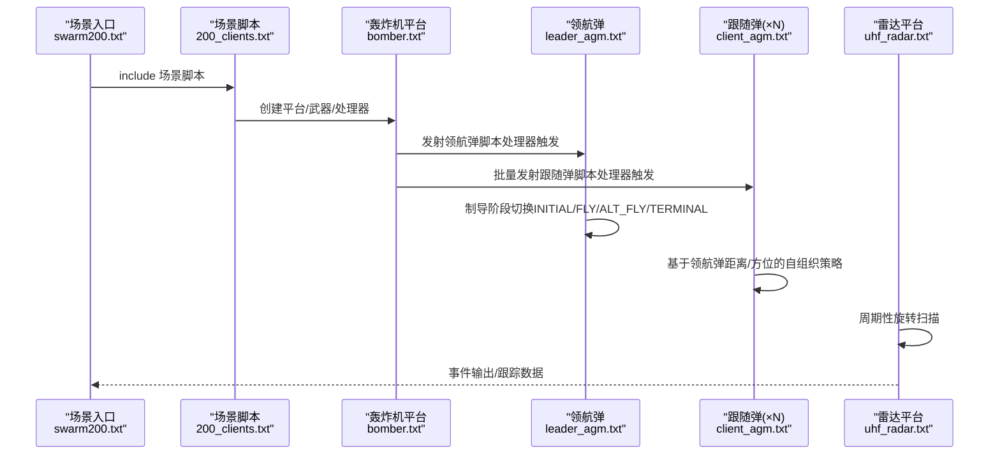
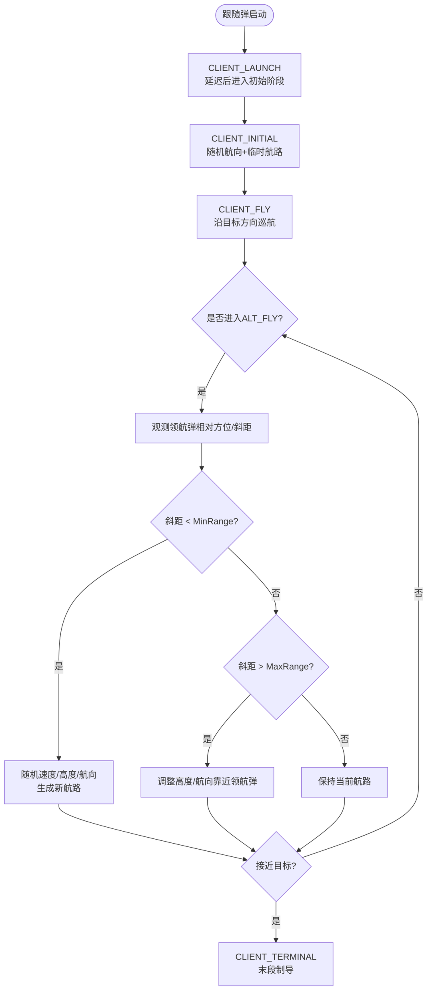
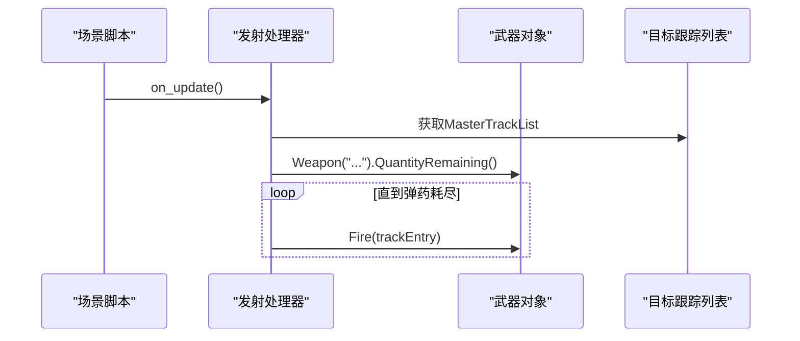
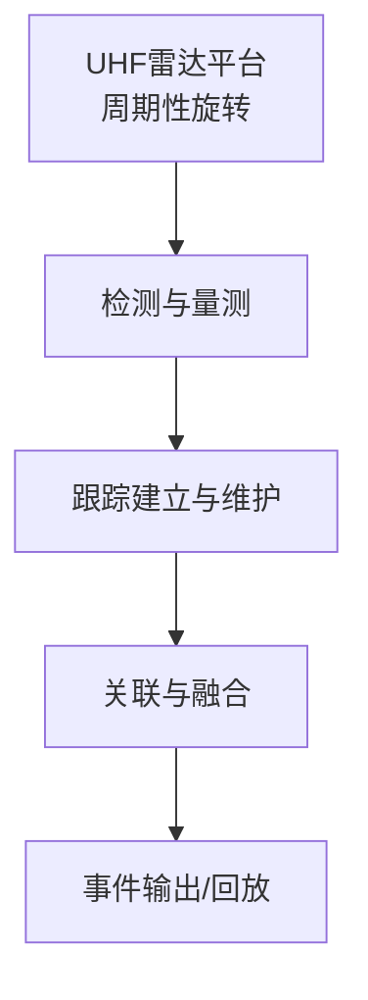
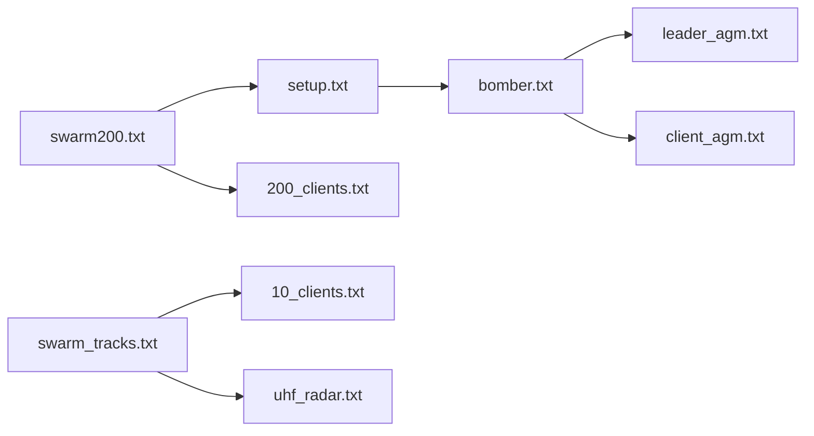

# 蜂群仿真

<cite>
**本文引用的文件**   
- [README.md](file://demos/swarm/README.md)
- [setup.txt](file://demos/swarm/setup.txt)
- [swarm200.txt](file://demos/swarm/swarm200.txt)
- [swarm_tracks.txt](file://demos/swarm/swarm_tracks.txt)
- [10_clients.txt](file://demos/swarm/scenarios/10_clients.txt)
- [200_clients.txt](file://demos/swarm/scenarios/200_clients.txt)
- [uhf_radar.txt](file://demos/swarm/scenarios/uhf_radar.txt)
- [bomber.txt](file://demos/swarm/platforms/bomber.txt)
- [target.txt](file://demos/swarm/platforms/target.txt)
- [client_agm.txt](file://demos/swarm/weapons/agm/client_agm.txt)
- [leader_agm.txt](file://demos/swarm/weapons/agm/leader_agm.txt)
</cite>

## 目录
1. [引言](#引言)
2. [项目结构](#项目结构)
3. [核心组件](#核心组件)
4. [架构总览](#架构总览)
5. [详细组件分析](#详细组件分析)
6. [依赖关系分析](#依赖关系分析)
7. [性能与可扩展性](#性能与可扩展性)
8. [故障排查指南](#故障排查指南)
9. [结论](#结论)
10. [附录：配置示例与最佳实践](#附录配置示例与最佳实践)

## 引言
本文件面向大规模蜂群仿真的技术实现与应用，聚焦以下主题：
- 蜂群编队控制、协同决策与自组织行为的技术路径
- 大规模实体管理、通信约束与资源分配方法
- 蜂群算法设计与性能优化建议
- 具体规模与通信拓扑配置示例（以AFSIM的swarm演示为例）

该仓库中的demos/swarm提供了“一机发射多弹”的蜂群场景：轰炸机先发射一枚“领航弹”，随后批量发射若干“跟随弹”。跟随弹在制导计算机脚本中通过相对领航弹的距离/方位进行随机扰动与航迹重规划，体现去中心化、弱通信条件下的自组织特性。同时，雷达传感器对来袭导弹进行跟踪与关联融合，展示感知与真实轨迹的差异以及WsfDraw可视化能力。

**章节来源**
- [README.md:1-18](file://demos/swarm/README.md#L1-L18)

## 项目结构
swarm演示采用分层组织：顶层场景入口、平台类型定义、武器与制导脚本、传感器与雷达旋转处理器、事件输出与回放管道。

**图表来源**
- [swarm200.txt:10-33](file://demos/swarm/swarm200.txt#L10-L33)
- [swarm_tracks.txt:10-34](file://demos/swarm/swarm_tracks.txt#L10-L34)
- [setup.txt:10-15](file://demos/swarm/setup.txt#L10-L15)
- [10_clients.txt:15-79](file://demos/swarm/scenarios/10_clients.txt#L15-L79)
- [200_clients.txt:15-79](file://demos/swarm/scenarios/200_clients.txt#L15-L79)
- [uhf_radar.txt:11-22](file://demos/swarm/scenarios/uhf_radar.txt#L11-L22)
- [bomber.txt:9-20](file://demos/swarm/platforms/bomber.txt#L9-L20)
- [target.txt:9-12](file://demos/swarm/platforms/target.txt#L9-L12)
- [leader_agm.txt:42-183](file://demos/swarm/weapons/agm/leader_agm.txt#L42-L183)
- [client_agm.txt:42-232](file://demos/swarm/weapons/agm/client_agm.txt#L42-L232)

**章节来源**
- [swarm200.txt:10-33](file://demos/swarm/swarm200.txt#L10-L33)
- [swarm_tracks.txt:10-34](file://demos/swarm/swarm_tracks.txt#L10-L34)
- [setup.txt:10-15](file://demos/swarm/setup.txt#L10-L15)

## 核心组件
- 场景入口与运行参数
  - swarm200.txt：定义日志、事件输出、事件管道、包含200个跟随弹的场景，并设置仿真时长与随机种子。
  - swarm_tracks.txt：包含10个跟随弹与UHF雷达场景，用于演示跟踪关联与可视化。
- 平台与武器
  - bomber.txt：轰炸机平台类型，挂载领航弹与跟随弹武器。
  - target.txt：不可摧毁的目标点。
  - leader_agm.txt / client_agm.txt：领航弹与跟随弹的平台类型、气动、推进、制导计算机与引信。
- 场景逻辑
  - 10_clients.txt / 200_clients.txt：定义目标、轰炸机航线、武器数量，并通过脚本处理器按时间触发发射。
- 雷达与旋转处理器
  - uhf_radar.txt：UHF电子战雷达平台，周期性改变朝向模拟扫描。

**章节来源**
- [swarm200.txt:10-33](file://demos/swarm/swarm200.txt#L10-L33)
- [swarm_tracks.txt:10-34](file://demos/swarm/swarm_tracks.txt#L10-L34)
- [bomber.txt:9-20](file://demos/swarm/platforms/bomber.txt#L9-L20)
- [target.txt:9-12](file://demos/swarm/platforms/target.txt#L9-L12)
- [leader_agm.txt:42-183](file://demos/swarm/weapons/agm/leader_agm.txt#L42-L183)
- [client_agm.txt:42-232](file://demos/swarm/weapons/agm/client_agm.txt#L42-L232)
- [10_clients.txt:15-79](file://demos/swarm/scenarios/10_clients.txt#L15-L79)
- [200_clients.txt:15-79](file://demos/swarm/scenarios/200_clients.txt#L15-L79)
- [uhf_radar.txt:11-22](file://demos/swarm/scenarios/uhf_radar.txt#L11-L22)

## 架构总览
下图展示了从场景加载到实体发射、制导与跟踪的关键流程。

**图表来源**
- [swarm200.txt:10-33](file://demos/swarm/swarm200.txt#L10-L33)
- [200_clients.txt:15-79](file://demos/swarm/scenarios/200_clients.txt#L15-L79)
- [bomber.txt:9-20](file://demos/swarm/platforms/bomber.txt#L9-L20)
- [leader_agm.txt:42-183](file://demos/swarm/weapons/agm/leader_agm.txt#L42-L183)
- [client_agm.txt:42-232](file://demos/swarm/weapons/agm/client_agm.txt#L42-L232)
- [uhf_radar.txt:11-22](file://demos/swarm/scenarios/uhf_radar.txt#L11-L22)

## 详细组件分析

### 蜂群编队控制与自组织行为
- 领航弹（LEADER_AGM）
  - 制导阶段：LAUNCH → INITIAL → FLY → ALT_FLY → TERMINAL
  - 在ALT_FLY阶段根据目标相对方位进行随机偏置航路生成，并在退出时检查子节点或接近目标条件决定后续阶段。
- 跟随弹（CLIENT_AGM）
  - 制导阶段：CLIENT_LAUNCH → CLIENT_INITIAL → CLIENT_FLY → CLIENT_ALT_FLY → CLIENT_TERMINAL
  - 在CLIENT_INITIAL阶段立即设定随机航向以分散初始位置；在CLIENT_ALT_FLY阶段依据与领航弹的斜距阈值（最小/最大范围）进行速度、高度与航向的随机调整，并动态生成新航路；当接近目标至无偏差范围则进入终端阶段。
- 自组织机制要点
  - 去中心化：跟随弹仅依赖局部观测（与领航弹的相对几何），无需全局通信。
  - 鲁棒性：随机扰动避免密集聚集，降低被探测概率并提升生存性。
  - 可配置性：通过脚本变量调节速度、高度偏差、相位时间与阈值，从而控制蜂群密度与机动强度。

**图表来源**
- [client_agm.txt:82-228](file://demos/swarm/weapons/agm/client_agm.txt#L82-L228)

**章节来源**
- [leader_agm.txt:63-175](file://demos/swarm/weapons/agm/leader_agm.txt#L63-L175)
- [client_agm.txt:82-228](file://demos/swarm/weapons/agm/client_agm.txt#L82-L228)

### 大规模实体管理与发射调度
- 发射处理器（WSF_SCRIPT_PROCESSOR）
  - launch_leader_agm：在指定时间后遍历目标列表并发射领航弹。
  - launch_client_agm：在指定时间后批量发射跟随弹，数量由武器quantity决定。
- 武器数量配置
  - 10_clients.txt：将client_agm数量设为10。
  - 200_clients.txt：将client_agm数量设为200。
- 平台与武器挂载
  - bomber.txt：挂载leader_agm与client_agm，其中client_agm数量可在场景覆盖。

**图表来源**
- [10_clients.txt:30-78](file://demos/swarm/scenarios/10_clients.txt#L30-L78)
- [200_clients.txt:30-78](file://demos/swarm/scenarios/200_clients.txt#L30-L78)
- [bomber.txt:14-19](file://demos/swarm/platforms/bomber.txt#L14-L19)

**章节来源**
- [10_clients.txt:15-79](file://demos/swarm/scenarios/10_clients.txt#L15-L79)
- [200_clients.txt:15-79](file://demos/swarm/scenarios/200_clients.txt#L15-L79)
- [bomber.txt:9-20](file://demos/swarm/platforms/bomber.txt#L9-L20)

### 雷达跟踪与关联融合
- UHF雷达平台周期性旋转，模拟扫描过程。
- README指出：由于导弹彼此接近，仅部分导弹被跟踪，体现跟踪关联与融合效果，以及感知与真实轨迹的差异。
- 可通过event_output与event_pipe输出跟踪事件与回放数据，配合WsfDraw显示轨迹线与贡献源。

**图表来源**
- [uhf_radar.txt:11-22](file://demos/swarm/scenarios/uhf_radar.txt#L11-L22)
- [README.md:11-18](file://demos/swarm/README.md#L11-L18)
- [swarm_tracks.txt:22-30](file://demos/swarm/swarm_tracks.txt#L22-L30)

**章节来源**
- [uhf_radar.txt:11-22](file://demos/swarm/scenarios/uhf_radar.txt#L11-L22)
- [README.md:11-18](file://demos/swarm/README.md#L11-L18)
- [swarm_tracks.txt:22-30](file://demos/swarm/swarm_tracks.txt#L22-L30)

### 通信约束与协同决策
- 本演示采用“弱通信/无通信”的自组织模式：跟随弹通过相对领航弹的几何信息（方位、斜距）进行局部决策，不依赖持续通信链路。
- 若需扩展为有通信的协同决策，可在平台间引入通信处理器与消息协议，结合任务处理器（WSF_TASK_PROCESSOR）进行任务分配与协调。

[本节为概念性说明，未直接分析具体文件]

## 依赖关系分析
- 场景入口依赖通用设置与具体场景脚本。
- 平台类型依赖武器类型与移动器、处理器等子系统。
- 武器类型依赖气动模型、推进、制导计算机与引信。
- 雷达平台独立于蜂群实体，但通过事件系统与之交互。

**图表来源**
- [swarm200.txt:10-33](file://demos/swarm/swarm200.txt#L10-L33)
- [swarm_tracks.txt:10-34](file://demos/swarm/swarm_tracks.txt#L10-L34)
- [setup.txt:10-15](file://demos/swarm/setup.txt#L10-L15)
- [bomber.txt:9-20](file://demos/swarm/platforms/bomber.txt#L9-L20)
- [leader_agm.txt:42-183](file://demos/swarm/weapons/agm/leader_agm.txt#L42-L183)
- [client_agm.txt:42-232](file://demos/swarm/weapons/agm/client_agm.txt#L42-L232)
- [10_clients.txt:15-79](file://demos/swarm/scenarios/10_clients.txt#L15-L79)
- [uhf_radar.txt:11-22](file://demos/swarm/scenarios/uhf_radar.txt#L11-L22)

**章节来源**
- [swarm200.txt:10-33](file://demos/swarm/swarm200.txt#L10-L33)
- [swarm_tracks.txt:10-34](file://demos/swarm/swarm_tracks.txt#L10-L34)
- [setup.txt:10-15](file://demos/swarm/setup.txt#L10-L15)

## 性能与可扩展性
- 实体规模
  - 10个跟随弹：适合快速验证与调试。
  - 200个跟随弹：评估大规模实体的计算开销与I/O压力。
- 关键性能瓶颈
  - 制导计算机脚本执行频率（update_interval）与阶段切换逻辑复杂度。
  - 事件输出与回放管道的写入吞吐。
  - 雷达检测与跟踪处理的计算负载。
- 优化建议
  - 合理设置update_interval，平衡精度与性能。
  - 使用事件管道批量输出，减少频繁I/O。
  - 限制跟踪关联窗口与最近邻搜索半径，降低关联复杂度。
  - 对随机扰动进行批量化与预计算，减少运行时开销。

[本节提供一般性指导，未直接分析具体文件]

## 故障排查指南
- 发射未触发
  - 检查发射处理器的on_update条件与TIME_NOW阈值。
  - 确认武器quantity已正确设置且未被覆盖。
- 跟随弹未分散或聚集过密
  - 调整CLIENT_ALT_FLY阶段的随机范围与阈值（ClientMinRangeToLeader/ClientMaxRangeToLeader）。
  - 检查PhaseTimeAltFly与CLIENT_FLY阶段切换条件。
- 雷达未检测到目标
  - 确认雷达旋转处理器工作正常。
  - 检查传感器量程、帧时间与跟踪建立/维持参数。
- 事件输出为空
  - 检查event_output与event_pipe配置是否正确。
  - 确认log_file与output目录权限。

**章节来源**
- [10_clients.txt:30-78](file://demos/swarm/scenarios/10_clients.txt#L30-L78)
- [200_clients.txt:30-78](file://demos/swarm/scenarios/200_clients.txt#L30-L78)
- [client_agm.txt:82-228](file://demos/swarm/weapons/agm/client_agm.txt#L82-L228)
- [uhf_radar.txt:11-22](file://demos/swarm/scenarios/uhf_radar.txt#L11-L22)
- [swarm200.txt:22-27](file://demos/swarm/swarm200.txt#L22-L27)
- [swarm_tracks.txt:22-30](file://demos/swarm/swarm_tracks.txt#L22-L30)

## 结论
AFSIM的swarm演示展示了在弱通信条件下，通过制导计算机脚本实现的蜂群自组织行为：领航弹引导方向，跟随弹基于局部观测进行随机扰动与航路重规划，形成去中心化的编队控制。同时，雷达平台的扫描与跟踪展示了感知与真实轨迹的差异，以及关联融合的效果。通过调整脚本变量与场景参数，可以灵活控制蜂群规模、机动强度与通信拓扑，满足不同规模的仿真需求。

[本节为总结性内容，未直接分析具体文件]

## 附录：配置示例与最佳实践
- 蜂群规模配置
  - 10个跟随弹：参考[10_clients.txt:25-27](file://demos/swarm/scenarios/10_clients.txt#L25-L27)。
  - 200个跟随弹：参考[200_clients.txt:25-27](file://demos/swarm/scenarios/200_clients.txt#L25-L27)。
- 通信拓扑配置
  - 无通信自组织：跟随弹仅依赖相对领航弹的几何信息（见[client_agm.txt:142-218](file://demos/swarm/weapons/agm/client_agm.txt#L142-L218)）。
  - 可扩展为有通信：在平台间添加通信处理器与消息协议，结合任务处理器进行协同决策。
- 性能调优
  - 制导更新间隔：参考[client_agm.txt:66-68](file://demos/swarm/weapons/agm/client_agm.txt#L66-L68)、[leader_agm.txt:47-49](file://demos/swarm/weapons/agm/leader_agm.txt#L47-L49)。
  - 事件输出：参考[swarm200.txt:22-27](file://demos/swarm/swarm200.txt#L22-L27)、[swarm_tracks.txt:22-30](file://demos/swarm/swarm_tracks.txt#L22-L30)。
- 雷达扫描
  - 旋转处理器：参考[uhf_radar.txt:13-21](file://demos/swarm/scenarios/uhf_radar.txt#L13-L21)。

**章节来源**
- [10_clients.txt:25-27](file://demos/swarm/scenarios/10_clients.txt#L25-L27)
- [200_clients.txt:25-27](file://demos/swarm/scenarios/200_clients.txt#L25-L27)
- [client_agm.txt:66-68](file://demos/swarm/weapons/agm/client_agm.txt#L66-L68)
- [leader_agm.txt:47-49](file://demos/swarm/weapons/agm/leader_agm.txt#L47-L49)
- [swarm200.txt:22-27](file://demos/swarm/swarm200.txt#L22-L27)
- [swarm_tracks.txt:22-30](file://demos/swarm/swarm_tracks.txt#L22-L30)
- [uhf_radar.txt:13-21](file://demos/swarm/scenarios/uhf_radar.txt#L13-L21)