# 行为树系统

<cite>
**本文引用的文件**   
- [README.md](file://demos/behavior_tree/README.md)
- [blackboard.txt](file://demos/behavior_tree/blackboard.txt)
- [condition.txt](file://demos/behavior_tree/condition.txt)
- [decorator.txt](file://demos/behavior_tree/decorator.txt)
- [parallel.txt](file://demos/behavior_tree/parallel.txt)
- [priority_selector.txt](file://demos/behavior_tree/priority_selector.txt)
- [run_tree.txt](file://demos/behavior_tree/run_tree.txt)
- [selector.txt](file://demos/behavior_tree/selector.txt)
- [selector_with_memory.txt](file://demos/behavior_tree/selector_with_memory.txt)
- [sequence.txt](file://demos/behavior_tree/sequence.txt)
- [sequence_with_memory.txt](file://demos/behavior_tree/sequence_with_memory.txt)
- [state_machine.txt](file://demos/behavior_tree/state_machine.txt)
- [subtrees.txt](file://demos/behavior_tree/subtrees.txt)
- [weighted_random.txt](file://demos/behavior_tree/weighted_random.txt)
</cite>

## 目录
1. [简介](#简介)
2. [项目结构](#项目结构)
3. [核心组件](#核心组件)
4. [架构总览](#架构总览)
5. [详细组件分析](#详细组件分析)
6. [依赖关系分析](#依赖关系分析)
7. [性能与优化](#性能与优化)
8. [故障排查指南](#故障排查指南)
9. [结论](#结论)
10. [附录](#附录)

## 简介
本文件系统性地介绍 AFSIM 行为树决策系统的设计与实现，围绕节点类型、执行流程与状态管理展开，并结合黑板模式、任务规划与智能体协作进行技术说明。文档同时提供行为树设计模式、调试与优化的实践方法，以及复杂决策逻辑的实现示例与最佳实践，帮助读者在仿真环境中构建可维护、可扩展的智能体行为体系。

## 项目结构
行为树演示位于 demos/behavior_tree 目录下，包含：
- 顶层场景脚本：展示不同行为树组合（选择器、序列、并行、优先级选择器、带记忆的选择器/序列、条件、装饰器、子树、加权随机、状态机、运行树等）。
- platforms 目录：平台定义与处理器配置，承载行为树的具体装配与参数。
- processors/quantum_agents/aiai 目录：大量行为节点与检查点脚本，用于驱动和观测行为树执行过程。
- weapons/aam 目录：武器相关配置，配合行为树完成打击与拦截等战术动作。
- doc 目录：行为树演示文档与图片资源。

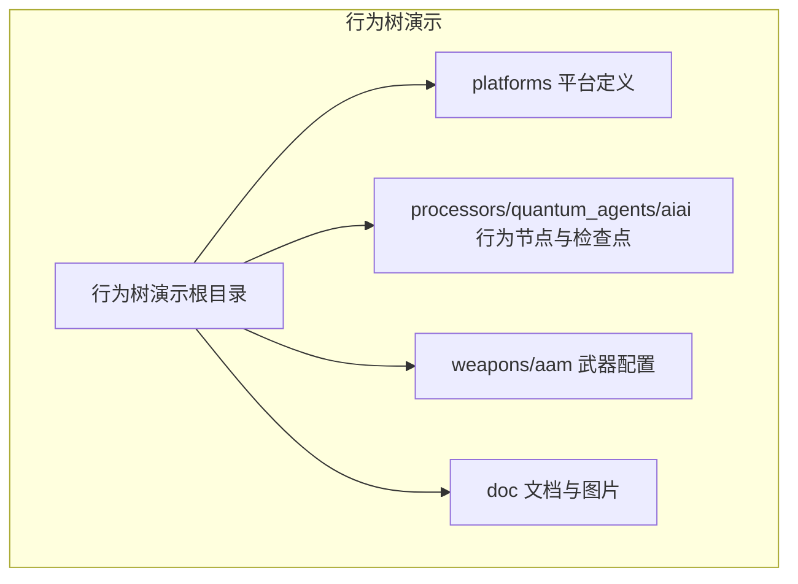

图表来源
- [README.md:1-49](file://demos/behavior_tree/README.md#L1-L49)

章节来源
- [README.md:1-49](file://demos/behavior_tree/README.md#L1-L49)

## 核心组件
- 行为树节点类型
  - 控制流节点：Sequence（顺序）、Selector（选择器）、Parallel（并行）、Priority Selector（优先级选择器）、Weighted Random（加权随机）
  - 功能节点：Condition（条件判断）、Decorator（装饰器）、Behavior Node（具体行为，如 fly_checkpoint、engage_weapon_task_target、planned_route、rtb 等）
  - 复合与扩展：Subtree（子树复用）、State Machine（状态机）、Run Tree（运行时动态选择树）
- 执行流程
  - 每帧由调度器驱动行为树执行，根据节点语义返回 Success/Failure/Running，并更新节点状态与内存。
  - 条件节点评估环境信息；装饰器对子节点行为进行增强或约束；控制流节点协调子节点执行策略。
- 状态管理
  - 节点级状态：Success/Failure/Running，支持“带记忆”的节点在多次调用中保持进度。
  - 黑板（Blackboard）：跨节点共享的状态数据，用于任务规划、目标跟踪、路径点进度等。
- 黑板模式
  - 通过事件管道输出行为工具日志，结合检查点脚本记录关键状态变化，便于可视化与调试。
- 任务规划与智能体协作
  - 通过 Run Tree 动态选择行为树分支，结合 Commander（编队长）与多平台协同，实现编队飞行、目标分配与攻击协调。

章节来源
- [run_tree.txt:46-75](file://demos/behavior_tree/run_tree.txt#L46-L75)
- [blackboard.txt:17-20](file://demos/behavior_tree/blackboard.txt#L17-L20)
- [selector.txt:28-47](file://demos/behavior_tree/selector.txt#L28-L47)

## 架构总览
AFSIM 行为树系统以平台为执行主体，处理器中的 advanced_behavior_tree 作为行为树引擎，驱动节点执行并与传感器、武器、移动器等子系统交互。

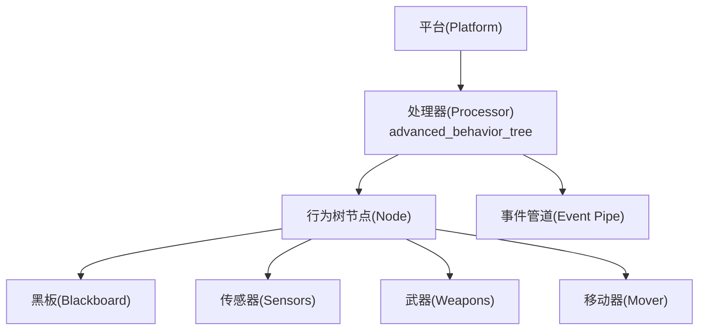

图表来源
- [run_tree.txt:46-75](file://demos/behavior_tree/run_tree.txt#L46-L75)
- [blackboard.txt:17-20](file://demos/behavior_tree/blackboard.txt#L17-L20)

## 详细组件分析

### 控制流节点：Sequence（顺序）
- 语义：按序执行子节点，任一失败则立即返回失败；全部成功则返回成功。
- 典型用法：依次访问多个航路点，或在到达条件后执行后续动作。
- 状态管理：支持“带记忆”版本，可在中断恢复时继续从上次位置推进。

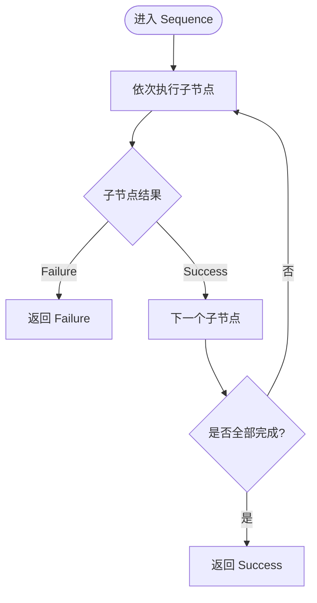

图表来源
- [sequence.txt:10-68](file://demos/behavior_tree/sequence.txt#L10-L68)
- [sequence_with_memory.txt:10-68](file://demos/behavior_tree/sequence_with_memory.txt#L10-L68)

章节来源
- [sequence.txt:10-68](file://demos/behavior_tree/sequence.txt#L10-L68)
- [sequence_with_memory.txt:10-68](file://demos/behavior_tree/sequence_with_memory.txt#L10-L68)

### 控制流节点：Selector（选择器）
- 语义：按序尝试子节点，首个成功即返回成功；全部失败则返回失败。
- 典型用法：在多种行为之间做优先级选择，例如优先追击目标，否则沿计划航线飞行。
- 带记忆：保存当前尝试的子节点索引，避免每次从头开始。

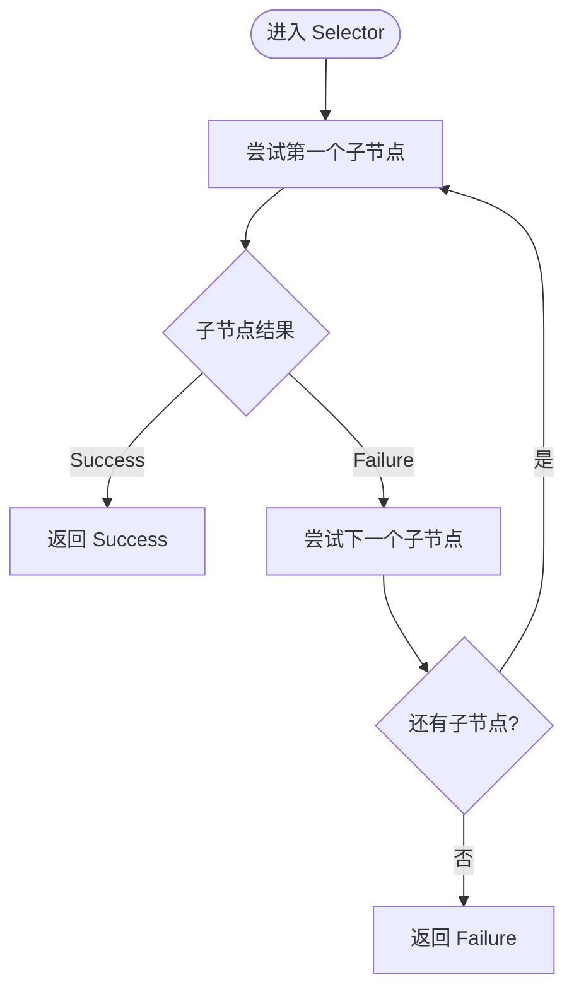

图表来源
- [selector.txt:10-99](file://demos/behavior_tree/selector.txt#L10-L99)
- [selector_with_memory.txt:10-52](file://demos/behavior_tree/selector_with_memory.txt#L10-L52)

章节来源
- [selector.txt:10-99](file://demos/behavior_tree/selector.txt#L10-L99)
- [selector_with_memory.txt:10-52](file://demos/behavior_tree/selector_with_memory.txt#L10-L52)

### 控制流节点：Parallel（并行）
- 语义：并行执行多个子节点，通常用于同时执行感知、机动与武器准备等任务。
- 终止策略：可配置为“全部成功”或“任一成功”，依战术需求而定。

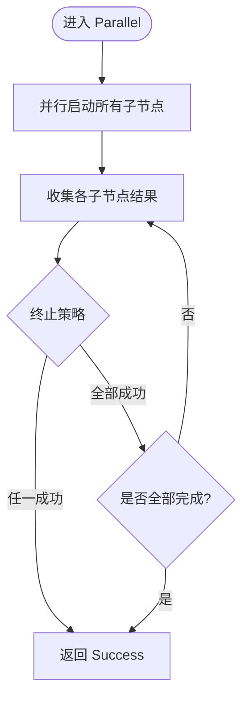

图表来源
- [parallel.txt:10-33](file://demos/behavior_tree/parallel.txt#L10-L33)

章节来源
- [parallel.txt:10-33](file://demos/behavior_tree/parallel.txt#L10-L33)

### 控制流节点：Priority Selector（优先级选择器）
- 语义：基于优先级评估子节点，优先执行高优先级行为（如规避威胁），其次低优先级行为（如巡逻）。
- 适用场景：动态战场环境下的高优响应。

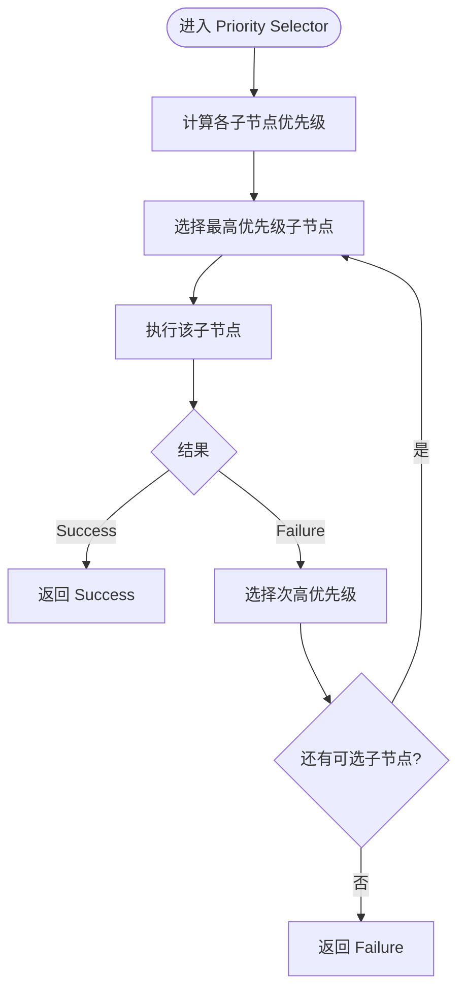

图表来源
- [priority_selector.txt:10-53](file://demos/behavior_tree/priority_selector.txt#L10-L53)

章节来源
- [priority_selector.txt:10-53](file://demos/behavior_tree/priority_selector.txt#L10-L53)

### 控制流节点：Weighted Random（加权随机）
- 语义：按权重随机选择一个子节点执行，适合多样化战术或探索性决策。
- 调参建议：根据敌我态势与历史成功率调整权重，平衡风险与收益。

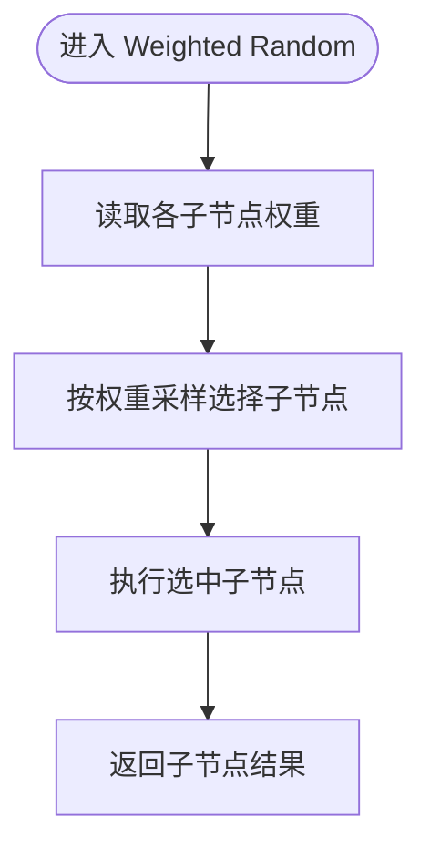

图表来源
- [weighted_random.txt](file://demos/behavior_tree/weighted_random.txt)

章节来源
- [weighted_random.txt](file://demos/behavior_tree/weighted_random.txt)

### 功能节点：Condition（条件）
- 语义：评估环境或内部状态（如距离、高度、威胁等级），返回布尔结果。
- 使用方式：常与控制流节点组合，决定行为分支。

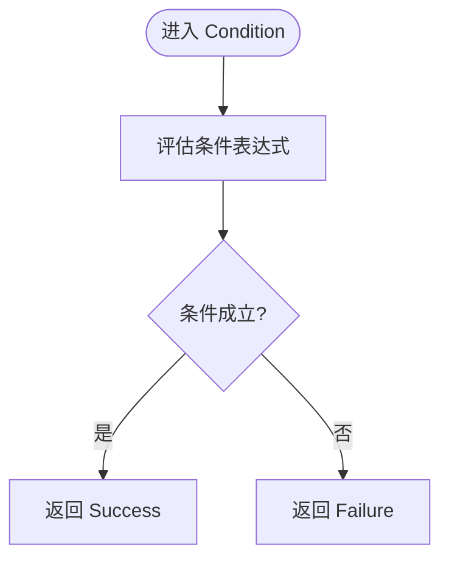

图表来源
- [condition.txt:10-53](file://demos/behavior_tree/condition.txt#L10-L53)

章节来源
- [condition.txt:10-53](file://demos/behavior_tree/condition.txt#L10-L53)

### 功能节点：Decorator（装饰器）
- 语义：对子节点的行为进行包装，如限制时间、角度、速度或添加重试机制。
- 常见类型：Turn Left/Right（转向）、Wait（等待）、Repeat（重复）等。

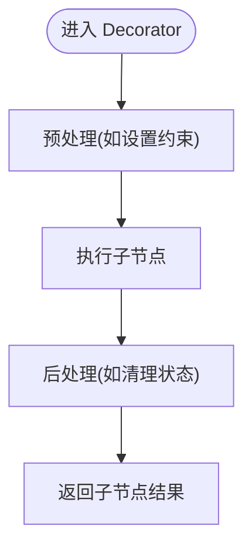

图表来源
- [decorator.txt:10-53](file://demos/behavior_tree/decorator.txt#L10-L53)

章节来源
- [decorator.txt:10-53](file://demos/behavior_tree/decorator.txt#L10-L53)

### 复合节点：Subtree（子树）
- 语义：将一组常用行为封装为子树，提高复用性与可维护性。
- 适用场景：标准战术动作（如编队集结、区域搜索）的模块化组织。

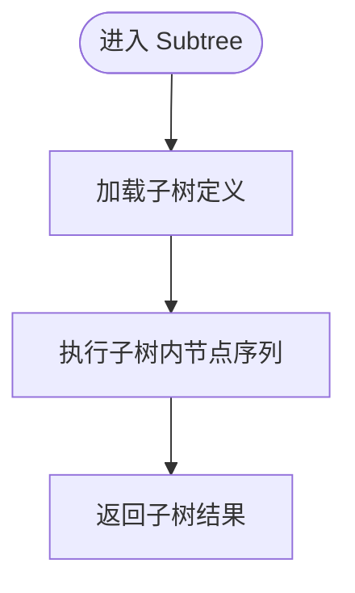

图表来源
- [subtrees.txt:10-57](file://demos/behavior_tree/subtrees.txt#L10-L57)

章节来源
- [subtrees.txt:10-57](file://demos/behavior_tree/subtrees.txt#L10-L57)

### 复合节点：State Machine（状态机）
- 语义：将复杂行为划分为有限状态，状态间依据条件转移。
- 优势：清晰表达阶段性目标与转换规则，便于调试与验证。

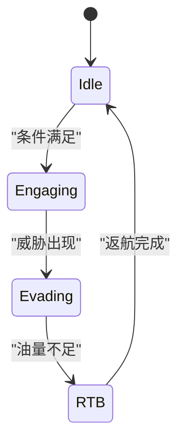

图表来源
- [state_machine.txt:10-77](file://demos/behavior_tree/state_machine.txt#L10-L77)

章节来源
- [state_machine.txt:10-77](file://demos/behavior_tree/state_machine.txt#L10-L77)

### 运行时行为树：Run Tree（动态选择）
- 语义：在运行时根据条件动态选择要执行的完整行为树，支持多套战术方案切换。
- 典型结构：choose_tree（选择树）+ sequence（执行分支）+ condition（运行条件）+ behavior_node（具体行为）。

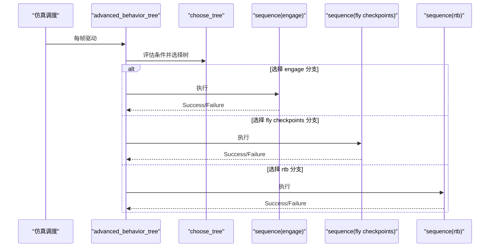

图表来源
- [run_tree.txt:46-75](file://demos/behavior_tree/run_tree.txt#L46-L75)

章节来源
- [run_tree.txt:46-75](file://demos/behavior_tree/run_tree.txt#L46-L75)

## 依赖关系分析
- 平台与处理器耦合：平台通过处理器装配行为树，处理器内的 advanced_behavior_tree 节点负责驱动整个决策流程。
- 节点与外部子系统：行为节点依赖传感器（探测/跟踪）、武器（发射/制导）、移动器（机动/航线）等。
- 事件管道与可视化：启用 BEHAVIOR_TOOL 并通过 event_pipe 输出 .aer 文件，供 Mystic 行为树视图可视化。

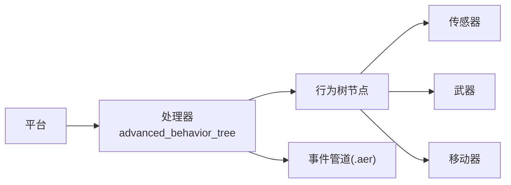

图表来源
- [run_tree.txt:46-75](file://demos/behavior_tree/run_tree.txt#L46-L75)
- [blackboard.txt:17-20](file://demos/behavior_tree/blackboard.txt#L17-L20)

章节来源
- [run_tree.txt:46-75](file://demos/behavior_tree/run_tree.txt#L46-L75)
- [blackboard.txt:17-20](file://demos/behavior_tree/blackboard.txt#L17-L20)

## 性能与优化
- 节点粒度与复杂度
  - 将高频评估的条件与计算密集型逻辑下沉到专用节点，减少控制流节点的开销。
- 记忆化与缓存
  - 对昂贵的环境查询结果进行缓存，并在状态变化时失效，避免重复计算。
- 并行与批处理
  - 合理使用 Parallel 节点并行执行独立任务；对批量目标进行聚合处理。
- 权重与优先级调优
  - 基于仿真统计调整 Weighted Random 权重与 Priority Selector 优先级，提升整体决策效率。
- 可视化与监控
  - 启用 BEHAVIOR_TOOL 并输出 .aer，利用 Mystic 行为树视图观察节点执行路径与耗时。

[本节为通用指导，不直接分析具体文件]

## 故障排查指南
- 启用行为工具
  - 在场景脚本中启用 BEHAVIOR_TOOL 并指定输出文件，确保事件管道正常工作。
- 检查点与日志
  - 使用 processors/quantum_agents/aiai 下的检查点脚本，记录关键节点执行与状态变化。
- 常见问题定位
  - 条件不满足：检查 Condition 节点输入与环境数据是否正确。
  - 行为未切换：确认 Run Tree 的 choose_tree 条件与优先级设置。
  - 状态卡住：核查带记忆的 Sequence/Selector 的进度存储与恢复逻辑。

章节来源
- [blackboard.txt:17-20](file://demos/behavior_tree/blackboard.txt#L17-L20)
- [run_tree.txt:46-75](file://demos/behavior_tree/run_tree.txt#L46-L75)

## 结论
AFSIM 行为树系统通过丰富的节点类型与灵活的组合方式，为智能体提供了强大而清晰的决策框架。借助黑板模式、任务规划与运行时行为树，可以在复杂战场环境中实现高效、可维护且可观测的智能体协作。实践中应注重节点设计原则、状态管理与性能优化，并利用可视化与检查点进行持续调试与改进。

[本节为总结性内容，不直接分析具体文件]

## 附录
- 行为树设计模式
  - 组合模式：用 Sequence/Selector/Parallel 组合复杂行为。
  - 模板方法：用 Decorator 统一约束与增强行为。
  - 策略模式：用 Weighted Random 与 Priority Selector 实现动态策略选择。
  - 状态模式：用 State Machine 表达阶段性与条件转移。
- 最佳实践
  - 明确职责边界：每个节点只做一件事，保证可测试性与可复用性。
  - 分层抽象：高层控制流与底层行为分离，便于替换与扩展。
  - 数据共享：通过黑板传递上下文，避免全局变量与隐式耦合。
  - 可观测性：全面启用事件管道与检查点，形成闭环调试。

[本节为概念性内容，不直接分析具体文件]