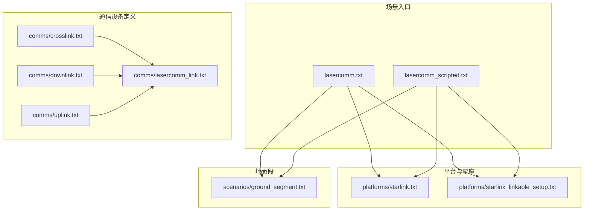
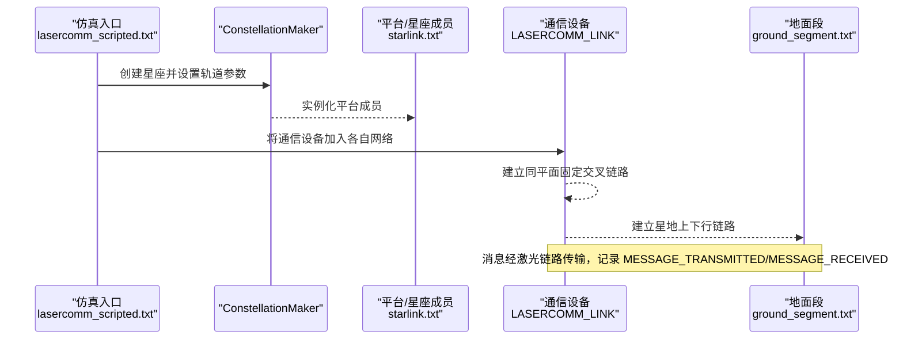
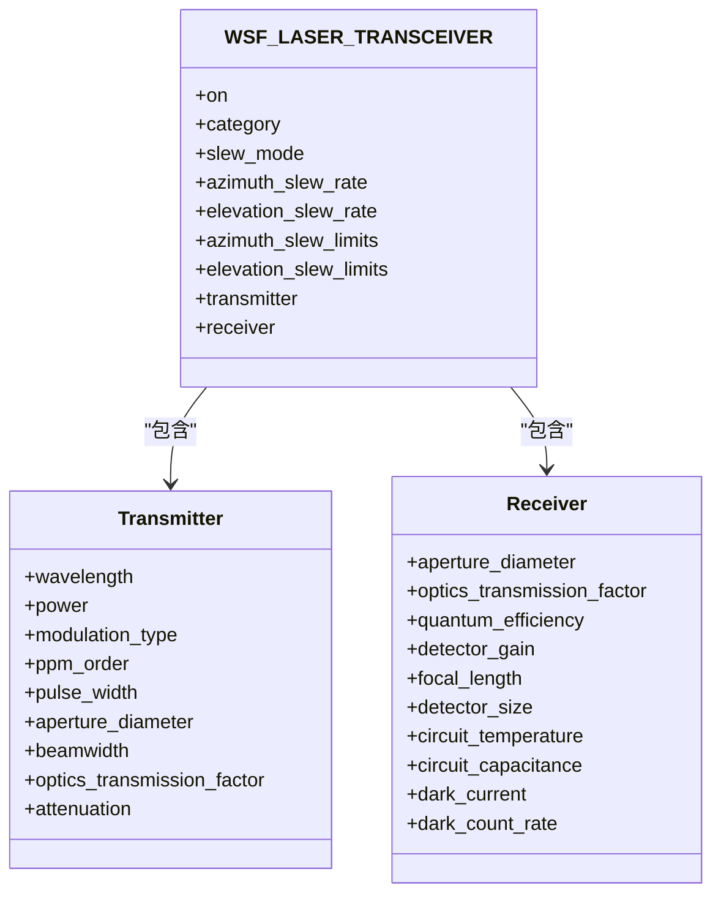
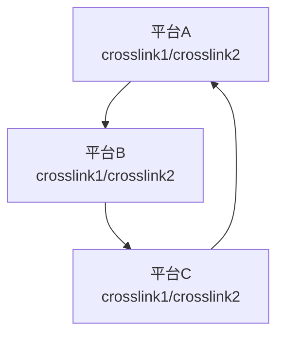
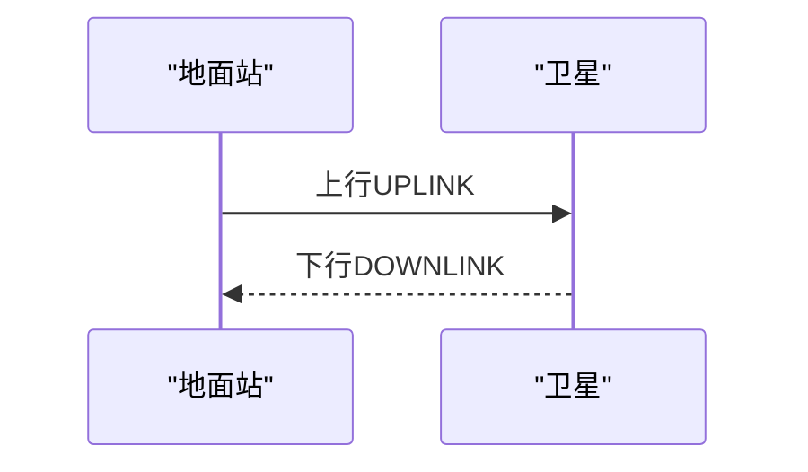
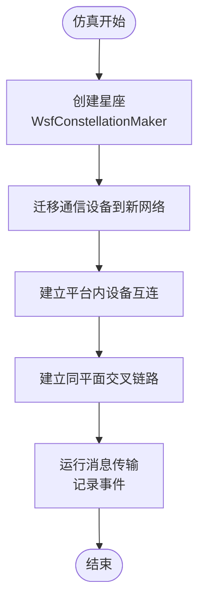
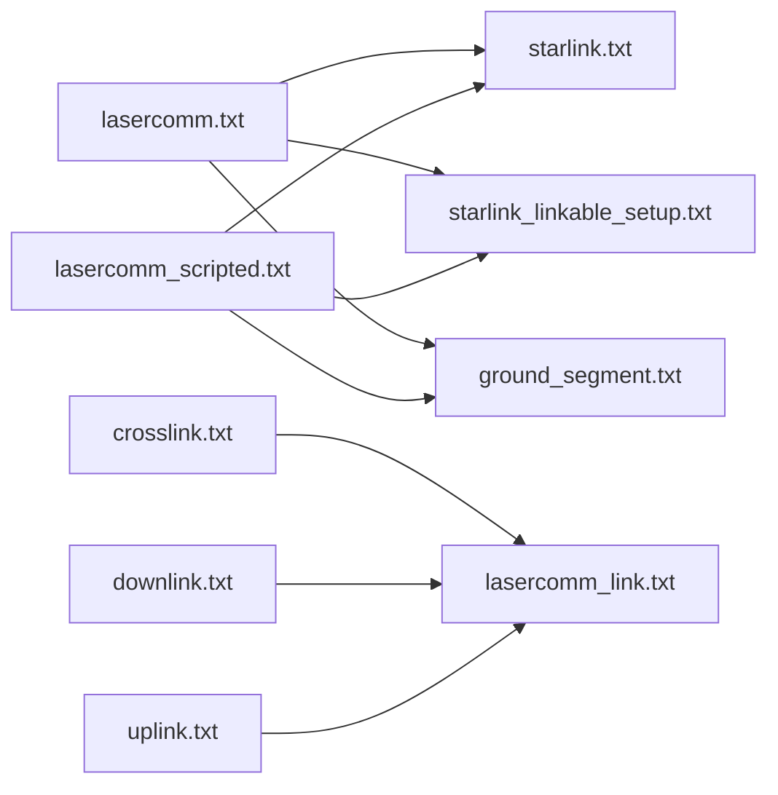

# 卫星通信

<cite>
**本文引用的文件**   
- [lasercomm.txt](file://demos/space_operations/lasercomm.txt)
- [lasercomm_scripted.txt](file://demos/space_operations/lasercomm_scripted.txt)
- [lasercomm_link.txt](file://demos/space_operations/comms/lasercomm_link.txt)
- [crosslink.txt](file://demos/space_operations/comms/crosslink.txt)
- [downlink.txt](file://demos/space_operations/comms/downlink.txt)
- [uplink.txt](file://demos/space_operations/comms/uplink.txt)
- [starlink.txt](file://demos/space_operations/platforms/starlink.txt)
- [starlink_linkable_setup.txt](file://demos/space_operations/platforms/starlink_linkable_setup.txt)
- [ground_segment.txt](file://demos/space_operations/scenarios/ground_segment.txt)
- [antenna_commands.rst](file://swdev/src/core/wsf/doc/antenna_commands.rst)
</cite>

## 目录
1. [引言](#引言)
2. [项目结构](#项目结构)
3. [核心组件](#核心组件)
4. [架构总览](#架构总览)
5. [详细组件分析](#详细组件分析)
6. [依赖关系分析](#依赖关系分析)
7. [性能与链路预算](#性能与链路预算)
8. [网络优化与干扰防护](#网络优化与干扰防护)
9. [故障排查指南](#故障排查指南)
10. [结论](#结论)

## 引言
本文件面向太空通信系统的建模与配置，聚焦于AFSIM中“space_operations”示例下的激光通信（LaserComm）链路、星间交叉链路、星地上下行链路以及基于脚本的星座通信网络构建。文档从系统架构、组件职责、数据流与控制流出发，解释信号传播模型、通信协议组织方式，并给出延迟、带宽限制与信号衰减的处理方法，同时提供可操作的优化与抗干扰策略。

## 项目结构
该主题相关代码与配置集中在以下路径：
- 场景入口与事件输出：demos/space_operations/lasercomm*.txt
- 通信设备定义与复用：demos/space_operations/comms/*.txt
- 平台与星座生成：demos/space_operations/platforms/*.txt
- 地面段场景：demos/space_operations/scenarios/ground_segment.txt
- 天线命令参考：swdev/src/core/wsf/doc/antenna_commands.rst

图表来源
- [lasercomm.txt:20-24](file://demos/space_operations/lasercomm.txt#L20-L24)
- [lasercomm_scripted.txt:21-24](file://demos/space_operations/lasercomm_scripted.txt#L21-L24)
- [crosslink.txt:10-17](file://demos/space_operations/comms/crosslink.txt#L10-L17)
- [downlink.txt:10-18](file://demos/space_operations/comms/downlink.txt#L10-L18)
- [uplink.txt:10-18](file://demos/space_operations/comms/uplink.txt#L10-L18)
- [lasercomm_link.txt:16-69](file://demos/space_operations/comms/lasercomm_link.txt#L16-L69)

章节来源
- [lasercomm.txt:20-42](file://demos/space_operations/lasercomm.txt#L20-L42)
- [lasercomm_scripted.txt:21-155](file://demos/space_operations/lasercomm_scripted.txt#L21-L155)
- [lasercomm_link.txt:10-75](file://demos/space_operations/comms/lasercomm_link.txt#L10-L75)
- [crosslink.txt:10-17](file://demos/space_operations/comms/crosslink.txt#L10-L17)
- [downlink.txt:10-18](file://demos/space_operations/comms/downlink.txt#L10-L18)
- [uplink.txt:10-18](file://demos/space_operations/comms/uplink.txt#L10-L18)

## 核心组件
- 激光收发器通信设备（WSF_LASER_TRANSCEIVER）
  - 负责光学发射机与接收机的物理层参数、调制格式、光束指向与 slew 能力、衰减模型等。
- 激光链路衰减模型（WSF_OPTICAL_ATTENUATION）
  - 通过内部表驱动的光学衰减曲线，表征大气/空间传输损耗。
- 通信组与实例化
  - crosslink/downlink/uplink 三个通信组分别复用 LASERCOMM_LINK 类型，用于星间交叉链路、星地下行与上行。
- 星座与平台
  - starlink 平台类型与 linkable 设置，配合 Constellation Maker 在仿真中动态生成星座成员与通信拓扑。
- 地面段
  - ground_segment 提供地面站或地面终端，作为星地链路的端点。

章节来源
- [lasercomm_link.txt:10-69](file://demos/space_operations/comms/lasercomm_link.txt#L10-L69)
- [crosslink.txt:10-17](file://demos/space_operations/comms/crosslink.txt#L10-L17)
- [downlink.txt:10-18](file://demos/space_operations/comms/downlink.txt#L10-L18)
- [uplink.txt:10-18](file://demos/space_operations/comms/uplink.txt#L10-L18)
- [starlink.txt](file://demos/space_operations/platforms/starlink.txt)
- [starlink_linkable_setup.txt](file://demos/space_operations/platforms/starlink_linkable_setup.txt)
- [ground_segment.txt](file://demos/space_operations/scenarios/ground_segment.txt)

## 架构总览
下图展示从场景入口到通信设备、平台与地面段的整体调用关系，以及脚本驱动的星座创建与链路建立流程。

图表来源
- [lasercomm_scripted.txt:121-140](file://demos/space_operations/lasercomm_scripted.txt#L121-L140)
- [lasercomm_link.txt:16-69](file://demos/space_operations/comms/lasercomm_link.txt#L16-L69)
- [ground_segment.txt](file://demos/space_operations/scenarios/ground_segment.txt)

## 详细组件分析

### 激光收发器与光学链路（WSF_LASER_TRANSCEIVER）
- 关键特性
  - 波长、功率、PPM 调制、脉冲宽度、孔径直径、波束宽度、光学透过率。
  - 接收机量子效率、暗电流、热噪声参数、IFOV 计算参数。
  - 指向控制：azimuth/elevation slew 速率与范围。
  - 衰减模型：通过 WSF_OPTICAL_ATTENUATION 引入内部表驱动的光学损耗。
- 设计要点
  - 使用 ppm_order 覆盖 transfer_rate，体现高脉冲位置调制带来的等效速率提升。
  - 光学链路对指向精度与光束发散角敏感，需结合平台姿态与相对运动进行跟踪。

图表来源
- [lasercomm_link.txt:16-69](file://demos/space_operations/comms/lasercomm_link.txt#L16-L69)

章节来源
- [lasercomm_link.txt:10-75](file://demos/space_operations/comms/lasercomm_link.txt#L10-L75)

### 星间交叉链路（Crosslink）
- 复用 LASERCOMM_LINK 类型，加入 CROSSLINK 组。
- 典型用途：同一轨道面内前后卫星之间的固定链路，以及邻近轨道面间的动态侧向交叉链路。
- 在 scripted 场景中，通过脚本为每个平台上的多个 crosslink 设备建立双向连接，形成环状或网状拓扑。

图表来源
- [crosslink.txt:10-17](file://demos/space_operations/comms/crosslink.txt#L10-L17)
- [lasercomm_scripted.txt:108-117](file://demos/space_operations/lasercomm_scripted.txt#L108-L117)

章节来源
- [crosslink.txt:10-17](file://demos/space_operations/comms/crosslink.txt#L10-L17)
- [lasercomm_scripted.txt:108-117](file://demos/space_operations/lasercomm_scripted.txt#L108-L117)

### 星地上下行链路（Uplink/Downlink）
- uplink/downlink 同样复用 LASERCOMM_LINK，分别表示上行（地面→卫星）与下行（卫星→地面）。
- downlink 默认开启（on），便于持续回传遥测或载荷数据；uplink 可用于注入指令或更新任务。

图表来源
- [uplink.txt:10-18](file://demos/space_operations/comms/uplink.txt#L10-L18)
- [downlink.txt:10-18](file://demos/space_operations/comms/downlink.txt#L10-L18)

章节来源
- [uplink.txt:10-18](file://demos/space_operations/comms/uplink.txt#L10-L18)
- [downlink.txt:10-18](file://demos/space_operations/comms/downlink.txt#L10-L18)

### 星座与脚本化网络管理
- 使用 WsfConstellationMaker 创建星座，并通过脚本在成员实例化后：
  - 将各平台的多个通信设备迁移至独立网络。
  - 在同一平台上建立设备间互连，保证路由可达。
  - 根据星座几何关系建立同平面固定交叉链路。
- 事件管道输出 MESSAGE_TRANSMITTED/MESSAGE_RECEIVED，便于统计端到端时延与吞吐。

图表来源
- [lasercomm_scripted.txt:30-62](file://demos/space_operations/lasercomm_scripted.txt#L30-L62)
- [lasercomm_scripted.txt:64-103](file://demos/space_operations/lasercomm_scripted.txt#L64-L103)
- [lasercomm_scripted.txt:108-140](file://demos/space_operations/lasercomm_scripted.txt#L108-L140)
- [lasercomm_scripted.txt:142-154](file://demos/space_operations/lasercomm_scripted.txt#L142-L154)

章节来源
- [lasercomm_scripted.txt:30-155](file://demos/space_operations/lasercomm_scripted.txt#L30-L155)

## 依赖关系分析
- 场景入口依赖平台与地面段定义，并通过 include_once 组合模块。
- 通信设备定义被 crosslink/downlink/uplink 复用，减少重复配置。
- 脚本逻辑依赖星座 API 与通信设备 API，完成网络拓扑的动态构建。

图表来源
- [lasercomm.txt:20-24](file://demos/space_operations/lasercomm.txt#L20-L24)
- [lasercomm_scripted.txt:21-24](file://demos/space_operations/lasercomm_scripted.txt#L21-L24)
- [crosslink.txt:10-17](file://demos/space_operations/comms/crosslink.txt#L10-L17)
- [downlink.txt:10-18](file://demos/space_operations/comms/downlink.txt#L10-L18)
- [uplink.txt:10-18](file://demos/space_operations/comms/uplink.txt#L10-L18)
- [lasercomm_link.txt:16-69](file://demos/space_operations/comms/lasercomm_link.txt#L16-L69)

章节来源
- [lasercomm.txt:20-42](file://demos/space_operations/lasercomm.txt#L20-L42)
- [lasercomm_scripted.txt:21-155](file://demos/space_operations/lasercomm_scripted.txt#L21-L155)
- [lasercomm_link.txt:16-69](file://demos/space_operations/comms/lasercomm_link.txt#L16-L69)

## 性能与链路预算
- 延迟
  - 光链路传播延迟由距离决定；星间链路通常毫秒级，星地链路受轨道高度影响更大。
  - 可通过事件管道中的 MESSAGE_TRANSMITTED/MESSAGE_RECEIVED 时间戳估算端到端时延。
- 带宽与速率
  - 采用 PPM 调制，ppm_order 提高等效比特率；实际吞吐还受链路信噪比与误码率约束。
  - 建议结合链路预算评估可用速率，避免超配导致丢包。
- 信号衰减与噪声
  - 光学衰减通过 WSF_OPTICAL_ATTENUATION 内部表驱动；接收机热噪声、暗电流与背景噪声影响灵敏度。
  - 调整 aperture_diameter、optics_transmission_factor、quantum_efficiency 以改善接收灵敏度。
- 指向与波束
  - slew 速率与范围限制指向跟踪能力；波束宽度与孔径直径决定发散角与增益。
  - 建议使用更窄波束与更高增益天线，但需权衡指向精度与跟踪难度。

章节来源
- [lasercomm_link.txt:16-69](file://demos/space_operations/comms/lasercomm_link.txt#L16-L69)
- [lasercomm_scripted.txt:142-154](file://demos/space_operations/lasercomm_scripted.txt#L142-L154)

## 网络优化与干扰防护
- 拓扑优化
  - 同平面固定链路形成环网，降低跨平面转发次数；侧向交叉链路按需建立，平衡负载。
  - 利用脚本在星座演化过程中动态增删链路，保持连通性与负载均衡。
- 指向与跟踪
  - 合理设置 slew 速率与角度范围，确保快速捕获与稳定跟踪。
  - 结合平台视觉部件（VisualPart）辅助可视化与调试。
- 抗干扰与鲁棒性
  - 选择合适波长与调制格式（如 PPM），降低背景噪声影响。
  - 通过衰减表与接收机参数调优，提升链路余量；必要时增加冗余链路或多路径路由。
- 资源调度
  - 区分上下行优先级，保障关键指令与遥测的实时性。
  - 在拥塞时优先保留高价值链路，降级非关键业务。

章节来源
- [lasercomm_link.txt:16-69](file://demos/space_operations/comms/lasercomm_link.txt#L16-L69)
- [lasercomm_scripted.txt:108-140](file://demos/space_operations/lasercomm_scripted.txt#L108-L140)
- [antenna_commands.rst:32-108](file://swdev/src/core/wsf/doc/antenna_commands.rst#L32-L108)

## 故障排查指南
- 常见问题定位
  - 通信设备未加入正确网络：检查脚本中 AddCommToNewNetwork 与 RemoveMember 返回值。
  - 设备地址变化导致路由失效：在迁移网络后重新建立设备间互连（LinkIntra）。
  - 链路不可达：确认 crosslink/downlink/uplink 是否启用（on），并检查 slew 范围与指向。
- 事件与日志
  - 启用 event_pipe 与 event_output，观察 MESSAGE_TRANSMITTED/MESSAGE_RECEIVED 事件。
  - 若出现错误提示（如无法移除成员或添加网络），按脚本输出定位具体平台与设备名。
- 参数校验
  - 核对 transmitter/receiver 参数一致性（孔径、透过率、量子效率等）。
  - 验证衰减表 internal_table 是否存在且匹配波长。

章节来源
- [lasercomm_scripted.txt:30-62](file://demos/space_operations/lasercomm_scripted.txt#L30-L62)
- [lasercomm_scripted.txt:64-103](file://demos/space_operations/lasercomm_scripted.txt#L64-L103)
- [lasercomm_scripted.txt:142-154](file://demos/space_operations/lasercomm_scripted.txt#L142-L154)

## 结论
AFSIM 的 space_operations 示例提供了完整的激光通信链路建模与脚本化星座网络构建方案。通过 WSF_LASER_TRANSCEIVER 与 WSF_OPTICAL_ATTENUATION，可精确刻画光学链路的物理层特性；借助 ConstellationMaker 与脚本，能够灵活搭建星间交叉链路和星地上下行链路，并实现动态拓扑管理。在实际工程中，应结合链路预算、指向跟踪与拓扑优化，制定稳健的网络规划与抗干扰策略，以满足高可靠、低时延的太空通信需求。