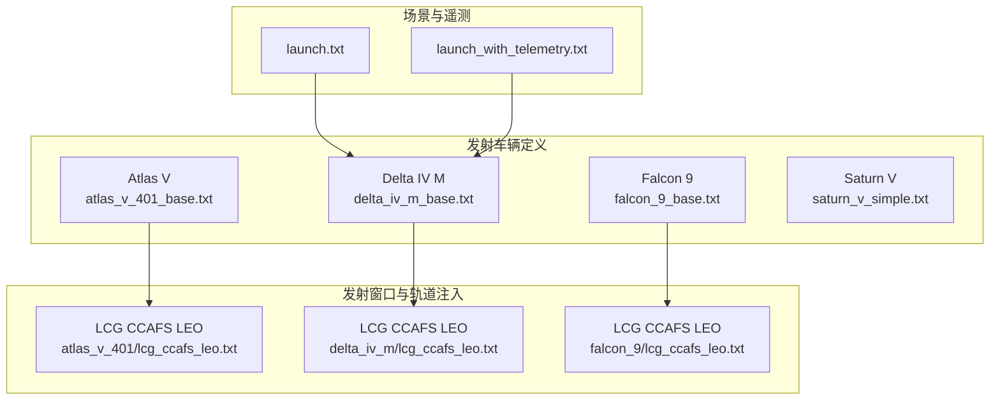
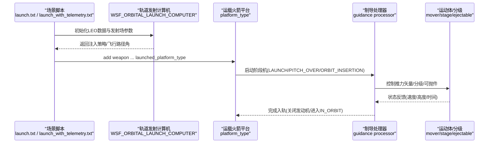
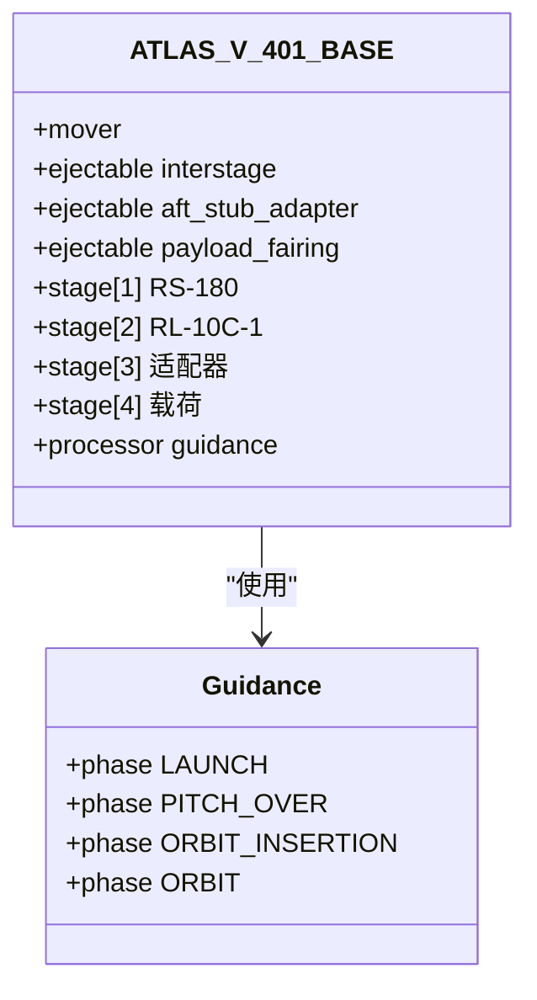
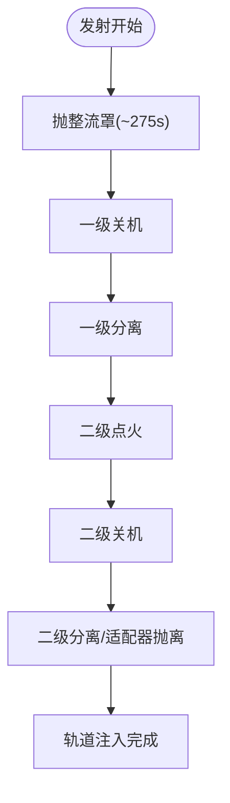
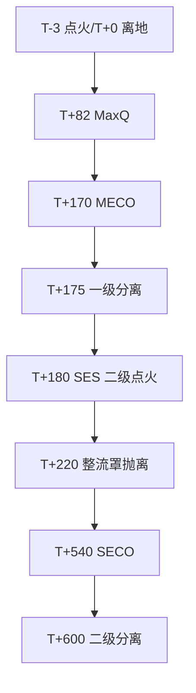
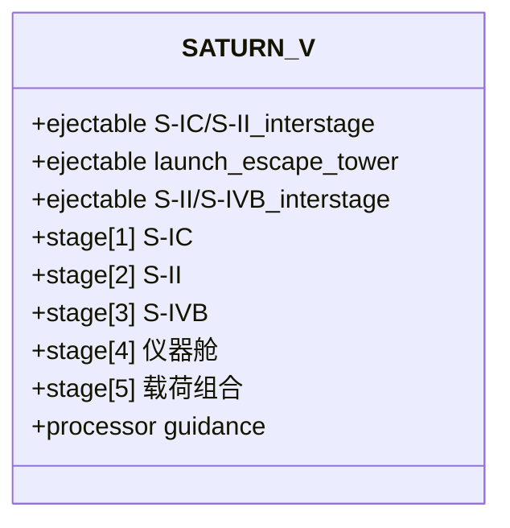
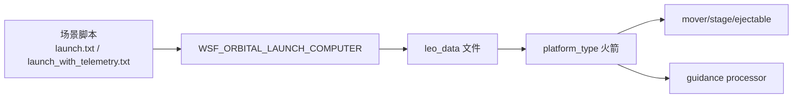
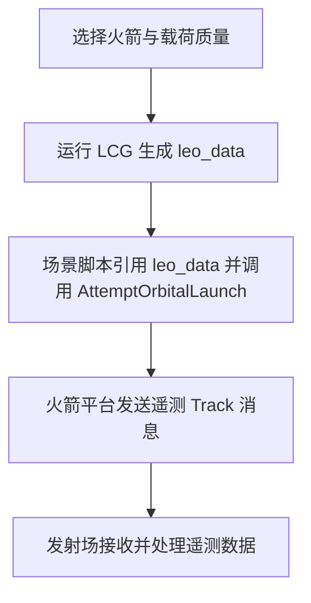

# 发射系统

<cite>
**本文引用的文件**   
- [atlas_v_401.txt](file://demos/space_operations/launch_vehicles/atlas_v_401/atlas_v_401.txt)
- [atlas_v_401_base.txt](file://demos/space_operations/launch_vehicles/atlas_v_401/atlas_v_401_base.txt)
- [lcg_ccafs_leo.txt（Atlas V）](file://demos/space_operations/launch_vehicles/atlas_v_401/lcg_ccafs_leo.txt)
- [delta_iv_m.txt](file://demos/space_operations/launch_vehicles/delta_iv_m/delta_iv_m.txt)
- [delta_iv_m_base.txt](file://demos/space_operations/launch_vehicles/delta_iv_m/delta_iv_m_base.txt)
- [lcg_ccafs_leo.txt（Delta IV M）](file://demos/space_operations/launch_vehicles/delta_iv_m/lcg_ccafs_leo.txt)
- [falcon_9.txt](file://demos/space_operations/launch_vehicles/falcon_9/falcon_9.txt)
- [falcon_9_base.txt](file://demos/space_operations/launch_vehicles/falcon_9/falcon_9_base.txt)
- [lcg_ccafs_leo.txt（Falcon 9）](file://demos/space_operations/launch_vehicles/falcon_9/lcg_ccafs_leo.txt)
- [saturn_v_simple.txt](file://demos/space_operations/launch_vehicles/saturn_v/saturn_v_simple.txt)
- [launch.txt](file://demos/space_operations/scenarios/launch.txt)
- [launch_with_telemetry.txt](file://demos/space_operations/scenarios/launch_with_telemetry.txt)
</cite>

## 目录
1. [简介](#简介)
2. [项目结构](#项目结构)
3. [核心组件](#核心组件)
4. [架构总览](#架构总览)
5. [详细组件分析](#详细组件分析)
6. [依赖关系分析](#依赖关系分析)
7. [性能与精度考量](#性能与精度考量)
8. [故障模拟与排错指南](#故障模拟与排错指南)
9. [结论](#结论)
10. [附录：发射任务规划与遥测数据处理流程](#附录发射任务规划与遥测数据处理流程)

## 简介
本文件面向运载火箭建模与仿真配置，覆盖 Atlas V、Delta IV Medium、Falcon 9、Saturn V 等型号的性能参数与飞行特性。重点说明多级分离机制、推进系统建模、发射轨迹优化、发射窗口计算、轨道注入精度与故障模拟的技术实现，并给出从发射任务规划到遥测数据处理的完整流程。

## 项目结构
空间操作演示位于 demos/space_operations，其中 launch_vehicles 子目录包含各型号火箭的基线与便捷定义；scenarios 提供发射场景脚本与遥测示例。

图示来源
- [atlas_v_401_base.txt:17-27](file://demos/space_operations/launch_vehicles/atlas_v_401/atlas_v_401_base.txt#L17-L27)
- [delta_iv_m_base.txt:19-40](file://demos/space_operations/launch_vehicles/delta_iv_m/delta_iv_m_base.txt#L19-L40)
- [falcon_9_base.txt:23-39](file://demos/space_operations/launch_vehicles/falcon_9/falcon_9_base.txt#L23-L39)
- [saturn_v_simple.txt:27-36](file://demos/space_operations/launch_vehicles/saturn_v/saturn_v_simple.txt#L27-L36)
- [lcg_ccafs_leo.txt（Atlas V）:21-36](file://demos/space_operations/launch_vehicles/atlas_v_401/lcg_ccafs_leo.txt#L21-L36)
- [lcg_ccafs_leo.txt（Delta IV M）:21-34](file://demos/space_operations/launch_vehicles/delta_iv_m/lcg_ccafs_leo.txt#L21-L34)
- [lcg_ccafs_leo.txt（Falcon 9）:21-37](file://demos/space_operations/launch_vehicles/falcon_9/lcg_ccafs_leo.txt#L21-L37)
- [launch.txt:30-46](file://demos/space_operations/scenarios/launch.txt#L30-L46)
- [launch_with_telemetry.txt:49-66](file://demos/space_operations/scenarios/launch_with_telemetry.txt#L49-L66)

章节来源
- [atlas_v_401.txt:17-24](file://demos/space_operations/launch_vehicles/atlas_v_401/atlas_v_401.txt#L17-L24)
- [delta_iv_m.txt:17-24](file://demos/space_operations/launch_vehicles/delta_iv_m/delta_iv_m.txt#L17-L24)
- [falcon_9.txt:17-24](file://demos/space_operations/launch_vehicles/falcon_9/falcon_9.txt#L17-L24)

## 核心组件
- 气动模型（aero）：为每级或全箭定义参考面积与阻力系数随马赫数变化曲线，支撑大气段气动载荷与阻力估算。
- 运动体（mover）：六自由度/制导运动体，负责积分、坐标框架、地面碰撞检测、可抛件与分级。
- 推进系统（stage）：质量、燃料、海平面/真空推力、比冲或燃烧率、推力矢量角限、侧向增益、点火/分离延时。
- 制导处理器（processor guidance）：阶段机（LAUNCH→PITCH_OVER→ORBIT_INSERTION→ORBIT），使用 FLIGHT_PATH_ANGLE_PROGRAM 与 ORBIT_INSERTION_PROGRAM 完成俯仰转与重力转弯入轨。
- 发射计算机（WSF_ORBITAL_LAUNCH_COMPUTER）：结合 LEO 数据文件与发射场位置、方位角/ loft 角扫描生成轨道注入指令。
- 武器/平台封装（weapon/platform_type）：将火箭作为武器发射，绑定被发射平台类型与初始姿态/速度。

章节来源
- [atlas_v_401_base.txt:17-186](file://demos/space_operations/launch_vehicles/atlas_v_401/atlas_v_401_base.txt#L17-L186)
- [delta_iv_m_base.txt:19-138](file://demos/space_operations/launch_vehicles/delta_iv_m/delta_iv_m_base.txt#L19-L138)
- [falcon_9_base.txt:23-196](file://demos/space_operations/launch_vehicles/falcon_9/falcon_9_base.txt#L23-L196)
- [saturn_v_simple.txt:38-258](file://demos/space_operations/launch_vehicles/saturn_v/saturn_v_simple.txt#L38-L258)

## 架构总览
下图展示从发射场到轨道注入的关键交互：场景脚本调用发射计算机，发射计算机根据 LEO 数据与发射场约束生成飞行路径角与点火时序，制导程序驱动分级与分离，最终进入目标轨道。

图示来源
- [launch.txt:30-46](file://demos/space_operations/scenarios/launch.txt#L30-L46)
- [launch_with_telemetry.txt:49-66](file://demos/space_operations/scenarios/launch_with_telemetry.txt#L49-L66)
- [atlas_v_401_base.txt:142-186](file://demos/space_operations/launch_vehicles/atlas_v_401/atlas_v_401_base.txt#L142-L186)
- [delta_iv_m_base.txt:104-138](file://demos/space_operations/launch_vehicles/delta_iv_m/delta_iv_m_base.txt#L104-L138)
- [falcon_9_base.txt:156-196](file://demos/space_operations/launch_vehicles/falcon_9/falcon_9_base.txt#L156-L196)
- [saturn_v_simple.txt:202-258](file://demos/space_operations/launch_vehicles/saturn_v/saturn_v_simple.txt#L202-L258)

## 详细组件分析

### Atlas V 401
- 气动：一级参考面积与多马赫点阻力系数；二级固定零升阻力。
- 分级与可抛件：一级后抛 interstage/aft_stub_adapter/payload_fairing；二级 Centaur RL-10C-1 真空发动机；三级仅承载适配器质量；四级为有效载荷。
- 推进：一级海平面/真空推力与平均燃烧率；二级真空推力与燃烧率；节流曲线用于匹配公开时长。
- 制导：LAUNCH→PITCH_OVER（FLIGHT_PATH_ANGLE_PROGRAM）→ORBIT_INSERTION（ORBIT_INSERTION_PROGRAM）→ORBIT。
- 发射窗口：通过 lcg_ccafs_leo.txt 指定发射场位置、方位角范围与 loft 角扫描，生成 leo_data 文件供 WSF_ORBITAL_LAUNCH_COMPUTER 使用。

图示来源
- [atlas_v_401_base.txt:36-186](file://demos/space_operations/launch_vehicles/atlas_v_401/atlas_v_401_base.txt#L36-L186)

章节来源
- [atlas_v_401_base.txt:17-186](file://demos/space_operations/launch_vehicles/atlas_v_401/atlas_v_401_base.txt#L17-L186)
- [lcg_ccafs_leo.txt（Atlas V）:21-36](file://demos/space_operations/launch_vehicles/atlas_v_401/lcg_ccafs_leo.txt#L21-L36)

### Delta IV Medium (Delta 9040)
- 气动：一级采用近似 Saturn IV 的 Cd 曲线；二级与整流罩共享参考面积。
- 分级与可抛件：payload_fairing 在约 275 s 抛离；一级 IUS 类发动机；二级 RL10B-2；三级适配器；四级载荷。
- 推进：一级海平面推力与比冲；二级真空推力与较长燃烧时长；推力矢量角限较小，侧向增益逐级提高。
- 制导：与 Atlas V 类似，但 PITCH_OVER 速率与阈值略有差异。
- 发射窗口：LCG 配置 CCAFS SLC-37，方位角 40°~90°，loft 角 81°~89°。

图示来源
- [delta_iv_m_base.txt:52-101](file://demos/space_operations/launch_vehicles/delta_iv_m/delta_iv_m_base.txt#L52-L101)
- [delta_iv_m_base.txt:104-138](file://demos/space_operations/launch_vehicles/delta_iv_m/delta_iv_m_base.txt#L104-L138)

章节来源
- [delta_iv_m_base.txt:19-138](file://demos/space_operations/launch_vehicles/delta_iv_m/delta_iv_m_base.txt#L19-L138)
- [lcg_ccafs_leo.txt（Delta IV M）:21-34](file://demos/space_operations/launch_vehicles/delta_iv_m/lcg_ccafs_leo.txt#L21-L34)

### Falcon 9（Full Thrust）
- 气动：整流罩直径 5.2 m，参考面积较大；二级沿用相同参考面积。
- 分级与可抛件：整流罩约 225 s 抛离；一级 9×Merlin 1D+；二级 1×Merlin Vacuum；三级适配器；四级载荷。
- 推进：一级海平面/真空推力与节流曲线；二级真空推力与燃烧率；推力矢量角限与侧向增益逐级调整。
- 制导：LAUNCH→PITCH_OVER→GRAVITY_TURN（ORBIT_INSERTION_PROGRAM）→ORBIT。
- 发射窗口：LCG 配置 CCAFS SLC-40，方位角 40°~90°，loft 角 84°~89°。

图示来源
- [falcon_9_base.txt:53-69](file://demos/space_operations/launch_vehicles/falcon_9/falcon_9_base.txt#L53-L69)
- [falcon_9_base.txt:86-153](file://demos/space_operations/launch_vehicles/falcon_9/falcon_9_base.txt#L86-L153)

章节来源
- [falcon_9_base.txt:23-196](file://demos/space_operations/launch_vehicles/falcon_9/falcon_9_base.txt#L23-L196)
- [lcg_ccafs_leo.txt（Falcon 9）:21-37](file://demos/space_operations/launch_vehicles/falcon_9/lcg_ccafs_leo.txt#L21-L37)

### Saturn V（Apollo 11 简化版）
- 气动：S-IC/S-II 分别定义参考面积与 Cd-Mach 表；S-IVB 及后续无气动。
- 分级与可抛件：S-IC/S-II 级间段、逃逸塔、S-II/S-IVB 级间段作为 ejectable；S-IC→S-II→S-IVB→仪器舱→指令舱/服务舱/登月舱。
- 推进：S-IC 海平面/真空推力与节流曲线；S-II 真空推力与多段节流；S-IVB 单次点火至近圆轨道。
- 制导：LAUNCH→PITCH_OVER→ASCENT_1→ASCENT_2→ORBIT_INSERTION→IN_ORBIT，含重力偏置与轨道插入程序。

图示来源
- [saturn_v_simple.txt:48-65](file://demos/space_operations/launch_vehicles/saturn_v/saturn_v_simple.txt#L48-L65)
- [saturn_v_simple.txt:67-200](file://demos/space_operations/launch_vehicles/saturn_v/saturn_v_simple.txt#L67-L200)
- [saturn_v_simple.txt:202-258](file://demos/space_operations/launch_vehicles/saturn_v/saturn_v_simple.txt#L202-L258)

章节来源
- [saturn_v_simple.txt:27-258](file://demos/space_operations/launch_vehicles/saturn_v/saturn_v_simple.txt#L27-L258)

## 依赖关系分析
- 场景脚本依赖发射计算机与 LEO 数据文件，以生成轨道注入策略。
- 各火箭 platform_type 依赖 aero、stage、ejectable 与 guidance processor。
- 发射窗口工具（ORBITAL_LAUNCH_COMPUTER_GENERATOR）依赖发射场位置、方位角与 loft 角扫描，输出 leo_data 文件供运行时使用。

图示来源
- [launch.txt:30-46](file://demos/space_operations/scenarios/launch.txt#L30-L46)
- [launch_with_telemetry.txt:49-66](file://demos/space_operations/scenarios/launch_with_telemetry.txt#L49-L66)
- [lcg_ccafs_leo.txt（Delta IV M）:21-34](file://demos/space_operations/launch_vehicles/delta_iv_m/lcg_ccafs_leo.txt#L21-L34)

章节来源
- [launch.txt:30-46](file://demos/space_operations/scenarios/launch.txt#L30-L46)
- [launch_with_telemetry.txt:49-66](file://demos/space_operations/scenarios/launch_with_telemetry.txt#L49-L66)

## 性能与精度考量
- 气动建模：Cd-Mach 曲线与参考面积直接影响大气段阻力与热载荷估算；不同型号采用不同拟合方式（多点 Mach-cd 或分段多项式）。
- 推进效率：海平面/真空推力与比冲/燃烧率的匹配决定燃料消耗与推力持续时间；节流曲线用于贴近真实任务剖面。
- 数值稳定性：积分步长与更新间隔（如 0.01 s）影响轨迹平滑度与计算开销；推力矢量角限与侧向增益需合理设置以避免过度控制。
- 轨道注入精度：LOFT 角与方位角扫描范围决定可达倾角与能量；ORBIT_INSERTION_PROGRAM 的终止条件（飞行路径角接近零、速度满足圆轨道）影响注入误差。
- 分离时序：pre_ignition_coast_time 与 pre_separation_coast_time 对级间动量交换与姿态扰动有显著影响，需按任务时序校准。

章节来源
- [atlas_v_401_base.txt:17-186](file://demos/space_operations/launch_vehicles/atlas_v_401/atlas_v_401_base.txt#L17-L186)
- [delta_iv_m_base.txt:19-138](file://demos/space_operations/launch_vehicles/delta_iv_m/delta_iv_m_base.txt#L19-L138)
- [falcon_9_base.txt:23-196](file://demos/space_operations/launch_vehicles/falcon_9/falcon_9_base.txt#L23-L196)
- [saturn_v_simple.txt:38-258](file://demos/space_operations/launch_vehicles/saturn_v/saturn_v_simple.txt#L38-L258)

## 故障模拟与排错指南
- 分级失败：场景脚本中可通过观测器触发 MOVER_BROKEN 事件，标记 staging_failure 并联动拦截逻辑。
- 遥测中断：在带遥测场景中，通信收发器周期性发送 WsfTrackMessage；若接收端未加入组播地址或协议配置错误，将导致遥测丢失。
- 调试建议：
  - 检查 LEO 数据文件是否由 ORBITAL_LAUNCH_COMPUTER_GENERATOR 正确生成。
  - 校验发射场经纬度、方位角与 loft 角范围是否与任务要求一致。
  - 观察制导阶段切换条件（vertical_speed、program complete）是否达成。
  - 确认 ejectable 抛离时间与 stage 点火/关机时序匹配。

章节来源
- [launch.txt:51-60](file://demos/space_operations/scenarios/launch.txt#L51-L60)
- [launch_with_telemetry.txt:14-45](file://demos/space_operations/scenarios/launch_with_telemetry.txt#L14-L45)

## 结论
AFSIM 的空间操作演示提供了完整的运载火箭建模与仿真能力：通过 aero/mover/stage/ejectable/guidance 的组合，能够精确刻画多级火箭的气动、推进与制导行为；借助 ORBITAL_LAUNCH_COMPUTER 与 LEO 数据文件，可实现发射窗口计算与轨道注入优化；场景脚本支持故障注入与遥测链路验证，形成从任务规划到数据分析的闭环。

## 附录：发射任务规划与遥测数据处理流程
- 任务规划：
  - 选择火箭型号与载荷质量（修改 stage 4 total_mass）。
  - 使用 ORBITAL_LAUNCH_COMPUTER_GENERATOR 基于发射场位置、方位角与 loft 角扫描生成 leo_data 文件。
  - 在场景脚本中通过 WSF_ORBITAL_LAUNCH_COMPUTER 引用 leo_data，并调用 AttemptOrbitalLaunch 执行发射。
- 遥测处理：
  - 在火箭平台定义中添加 WSF_COMM_TRANSCEIVER 与本地组播协议。
  - 周期性生成 WsfTrack 并通过 SendMessage 发送至发射场组播地址。
  - 发射场平台订阅该组播地址，解析 Track 消息进行可视化与分析。

图示来源
- [lcg_ccafs_leo.txt（Delta IV M）:21-34](file://demos/space_operations/launch_vehicles/delta_iv_m/lcg_ccafs_leo.txt#L21-L34)
- [launch.txt:30-46](file://demos/space_operations/scenarios/launch.txt#L30-L46)
- [launch_with_telemetry.txt:14-45](file://demos/space_operations/scenarios/launch_with_telemetry.txt#L14-L45)