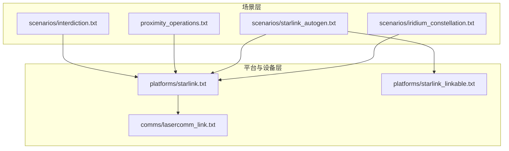
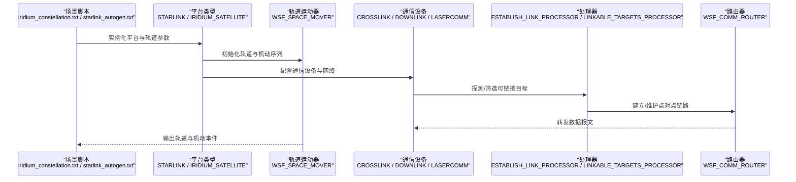
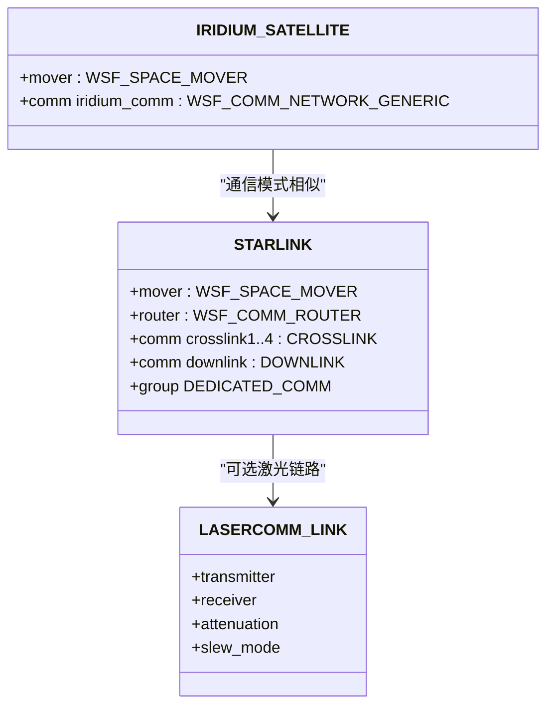
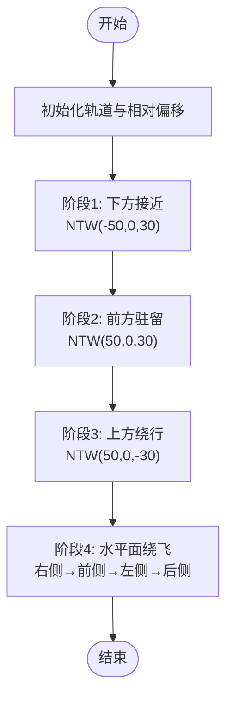
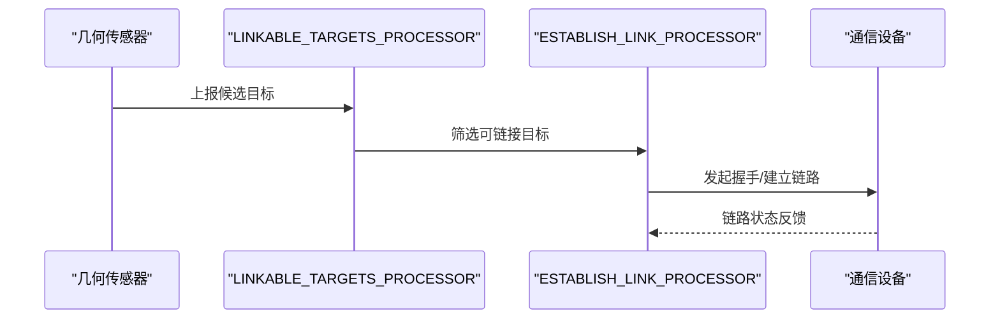
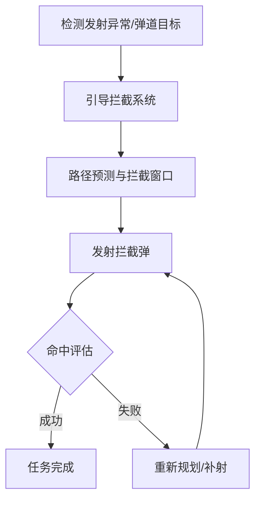
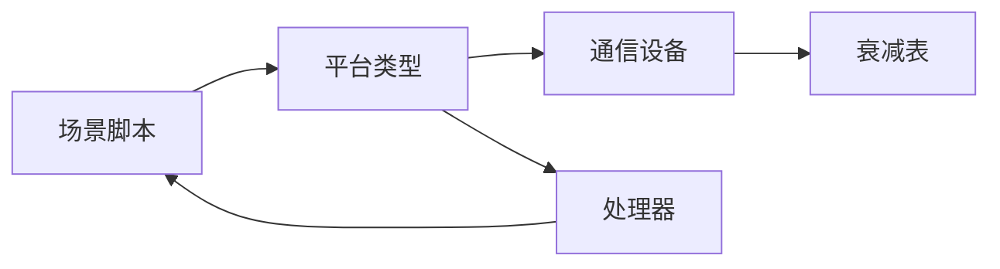

# 太空作战场景

<cite>
**本文引用的文件**   
- [README.md](file://demos/space_operations/README.md)
- [iridium_constellation.txt](file://demos/space_operations/scenarios/iridium_constellation.txt)
- [starlink_autogen.txt](file://demos/space_operations/scenarios/starlink_autogen.txt)
- [proximity_operations.txt](file://demos/space_operations/proximity_operations.txt)
- [lasercomm_link.txt](file://demos/space_operations/comms/lasercomm_link.txt)
- [starlink.txt](file://demos/space_operations/platforms/starlink.txt)
- [starlink_linkable.txt](file://demos/space_operations/platforms/starlink_linkable.txt)
- [interdiction.txt](file://demos/space_operations/scenarios/interdiction.txt)
</cite>

## 目录
1. [引言](#引言)
2. [项目结构](#项目结构)
3. [核心组件](#核心组件)
4. [架构总览](#架构总览)
5. [详细组件分析](#详细组件分析)
6. [依赖关系分析](#依赖关系分析)
7. [性能与可扩展性](#性能与可扩展性)
8. [故障排查指南](#故障排查指南)
9. [结论](#结论)
10. [附录：实战演练与任务规划要点](#附录实战演练与任务规划要点)

## 引言
本教程面向使用 AFSIM 构建太空作战仿真场景的工程师与分析师，聚焦以下主题：
- 轨道力学与卫星通信链路建模
- 空间态势感知（SSA）与星座管理
- 轨道转移、交会对接与近程操作
- 反卫星作战（ASAT）与发射拦截
- 星间激光通信与地面站数据回传
- 复杂太空作战场景设计与实战演练方法

AFSIM 的 space_operations 演示集提供了从单星到大规模星座、从通信链路到近程机动、从发射到拦截的全栈示例，适合作为太空作战仿真的起点与扩展基线。

## 项目结构
space_operations 演示采用“按能力分层 + 按场景组合”的组织方式：
- scenarios：端到端场景脚本，组合平台、传感器、处理器与通信
- platforms：平台类型与通用设备定义（如 STARLINK、IRIDIUM_SATELLITE）
- comms：通信设备与链路参数（含激光通信收发机）
- processors：数据处理逻辑（如链路建立、目标可链接判定）
- scripts：辅助脚本（轨道元素打印、星座生成等）
- launch_vehicles：运载火箭模型与发射流程
- sensors/weapons/patterns：传感器、武器与天线方向图模板



图表来源
- [iridium_constellation.txt:1-800](file://demos/space_operations/scenarios/iridium_constellation.txt#L1-L800)
- [starlink_autogen.txt:1-800](file://demos/space_operations/scenarios/starlink_autogen.txt#L1-L800)
- [proximity_operations.txt:1-166](file://demos/space_operations/proximity_operations.txt#L1-L166)
- [interdiction.txt:1-39](file://demos/space_operations/scenarios/interdiction.txt#L1-L39)
- [starlink.txt:1-109](file://demos/space_operations/platforms/starlink.txt#L1-L109)
- [starlink_linkable.txt:1-129](file://demos/space_operations/platforms/starlink_linkable.txt#L1-L129)
- [lasercomm_link.txt:1-75](file://demos/space_operations/comms/lasercomm_link.txt#L1-L75)

章节来源
- [README.md:1-47](file://demos/space_operations/README.md#L1-L47)

## 核心组件
- 轨道运动器（WSF_SPACE_MOVER）：提供开普勒轨道演化、轨道事件与机动序列（拦截、会合、霍曼转移等）。
- 通信系统（WSF_COMM_NETWORK_GENERIC / WSF_LASER_TRANSCEIVER）：支持射频与激光链路，具备自动路由、组播/点对点链路、衰减模型与指向控制。
- 星座与平台类型（STARLINK、IRIDIUM_SATELLITE）：封装平台外观、雷达反射、通信接口与默认网络。
- 可链接目标处理（LINKABLE_TARGETS_PROCESSOR / ESTABLISH_LINK_PROCESSOR）：基于几何探测与处理器筛选潜在链路，并发起握手建立双向链路。
- 近程操作（mission_sequence）：以相对坐标系（NTW）描述多段拦截与会合轨迹，输出轨道机动事件。
- 发射与拦截（launch_vehicle_interdiction 相关场景）：将发射失败或弹道目标交由海基防空/反导系统进行拦截决策。

章节来源
- [starlink.txt:28-109](file://demos/space_operations/platforms/starlink.txt#L28-L109)
- [starlink_linkable.txt:29-129](file://demos/space_operations/platforms/starlink_linkable.txt#L29-L129)
- [proximity_operations.txt:21-166](file://demos/space_operations/proximity_operations.txt#L21-L166)
- [lasercomm_link.txt:10-75](file://demos/space_operations/comms/lasercomm_link.txt#L10-L75)

## 架构总览
下图展示从场景到平台、通信与处理的调用链，以及数据流与控制流的关键节点。



图表来源
- [iridium_constellation.txt:1-800](file://demos/space_operations/scenarios/iridium_constellation.txt#L1-L800)
- [starlink_autogen.txt:1-800](file://demos/space_operations/scenarios/starlink_autogen.txt#L1-L800)
- [starlink.txt:28-109](file://demos/space_operations/platforms/starlink.txt#L28-L109)
- [starlink_linkable.txt:29-129](file://demos/space_operations/platforms/starlink_linkable.txt#L29-L129)
- [lasercomm_link.txt:10-75](file://demos/space_operations/comms/lasercomm_link.txt#L10-L75)

## 详细组件分析

### 卫星星座管理与通信拓扑
- Iridium 星座：通过多轨道面与均匀分布的真近点角实现全球覆盖；每颗卫星挂载通信设备并加入独立网络名称，便于区分与路由。
- Starlink 星座：自动生成大量卫星，每条轨道面内卫星按固定角度间隔排列，并通过 crosslink1/2/3/4 形成前后左右星间链路，downlink 用于对地回传。
- 通信设备：
  - CROSSLINK：星间链路，支持方位/俯仰指向与 slew 速率限制。
  - DOWNLINK：对地链路，通常向下指向。
  - LASERCOMM_LINK：激光收发机，包含波长、功率、调制、孔径、光束宽度、衰减表与接收机噪声参数。



图表来源
- [starlink.txt:28-109](file://demos/space_operations/platforms/starlink.txt#L28-L109)
- [iridium_constellation.txt:1-800](file://demos/space_operations/scenarios/iridium_constellation.txt#L1-L800)
- [lasercomm_link.txt:10-75](file://demos/space_operations/comms/lasercomm_link.txt#L10-L75)

章节来源
- [iridium_constellation.txt:1-800](file://demos/space_operations/scenarios/iridium_constellation.txt#L1-L800)
- [starlink_autogen.txt:1-800](file://demos/space_operations/scenarios/starlink_autogen.txt#L1-L800)
- [starlink.txt:1-109](file://demos/space_operations/platforms/starlink.txt#L1-L109)
- [lasercomm_link.txt:1-75](file://demos/space_operations/comms/lasercomm_link.txt#L1-L75)

### 轨道转移与交会对接（近程操作）
- 相对坐标系（NTW）：N（径向向外）、T（切向沿轨）、W（法向），用于精确描述拦截点与会合点的相对位置。
- mission_sequence：由多个 maneuver intercept/rendezvous 组成，逐步逼近目标并在关键位置短暂驻留，随后在水平面内绕飞。
- 事件输出：记录 ORBITAL_MANEUVER_INITIATED/ORBITAL_MANEUVER_COMPLETED，便于分析与可视化。



图表来源
- [proximity_operations.txt:21-166](file://demos/space_operations/proximity_operations.txt#L21-L166)

章节来源
- [proximity_operations.txt:1-166](file://demos/space_operations/proximity_operations.txt#L1-L166)

### 星间激光通信链路建模
- 发射机：波长 1550nm、PPM 调制、脉冲宽度、孔径与光束宽度、光学透过率。
- 接收机：孔径、量子效率、探测器增益、IFOV 计算参数、热噪声与背景噪声参数。
- 指向控制：方位/俯仰 slew 速率与范围限制，确保快速捕获与稳定跟踪。
- 衰减模型：通过内部表（mono_1550nm_a2_h1）映射距离/大气条件至衰减系数。

```mermaid
sequenceDiagram
participant Tx as "激光发射机"
participant Channel as "信道衰减表"
participant Rx as "激光接收机"
participant Link as "CommLink"
Tx->>Channel : 查询衰减(距离/环境)
Channel-->>Tx : 返回衰减系数
Tx->>Rx : 发送光脉冲(PPM)
Rx->>Link : 解码/信噪比评估
Link-->>Rx : 链路状态(建立/维持/断开)
```

图表来源
- [lasercomm_link.txt:10-75](file://demos/space_operations/comms/lasercomm_link.txt#L10-L75)

章节来源
- [lasercomm_link.txt:1-75](file://demos/space_operations/comms/lasercomm_link.txt#L1-L75)

### 可链接目标发现与自动建链
- 几何传感器（WSF_GEOMETRIC_SENSOR）：在一定范围内报告潜在目标。
- 可链接目标处理器（LINKABLE_TARGETS_PROCESSOR）：过滤满足条件的候选目标。
- 链路建立处理器（ESTABLISH_LINK_PROCESSOR）：发起握手、建立双向链路。
- 脚本驱动：定期尝试与未占用的目标通信端口建立链路，避免冲突。



图表来源
- [starlink_linkable.txt:29-129](file://demos/space_operations/platforms/starlink_linkable.txt#L29-L129)

章节来源
- [starlink_linkable.txt:1-129](file://demos/space_operations/platforms/starlink_linkable.txt#L1-L129)

### 发射拦截与反卫星作战（ASAT）
- 场景设置：当出现级联分离失败或异常弹道时，海基防空/反导系统（BLUE_NAVAL_SAM_BATTERY/LAUNCHER）进行路径提示与导弹拦截。
- 指挥链：电池作为指挥官，分配任务给发射器与雷达跟踪器（BLUE_ABM_TTR）。
- 典型流程：检测异常 → 路径预测 → 拦截决策 → 导弹发射 → 命中/脱靶评估。



图表来源
- [interdiction.txt:1-39](file://demos/space_operations/scenarios/interdiction.txt#L1-L39)

章节来源
- [interdiction.txt:1-39](file://demos/space_operations/scenarios/interdiction.txt#L1-L39)

## 依赖关系分析
- 场景脚本依赖平台类型与通信设备定义。
- 平台类型依赖通信网络、路由器与视觉部件。
- 可链接目标功能依赖处理器与脚本，需在其他处 include 处理器定义或使用 setup 文件。
- 激光通信链路依赖衰减表与收发机模型。



图表来源
- [starlink_autogen.txt:1-800](file://demos/space_operations/scenarios/starlink_autogen.txt#L1-L800)
- [starlink.txt:1-109](file://demos/space_operations/platforms/starlink.txt#L1-L109)
- [starlink_linkable.txt:1-129](file://demos/space_operations/platforms/starlink_linkable.txt#L1-L129)
- [lasercomm_link.txt:1-75](file://demos/space_operations/comms/lasercomm_link.txt#L1-L75)

章节来源
- [starlink_autogen.txt:1-800](file://demos/space_operations/scenarios/starlink_autogen.txt#L1-L800)
- [starlink.txt:1-109](file://demos/space_operations/platforms/starlink.txt#L1-L109)
- [starlink_linkable.txt:1-129](file://demos/space_operations/platforms/starlink_linkable.txt#L1-L129)
- [lasercomm_link.txt:1-75](file://demos/space_operations/comms/lasercomm_link.txt#L1-L75)

## 性能与可扩展性
- 大规模星座：Starlink 自动生成大量平台，建议启用自动化链路连接与分组（DEDICATED_COMM）以减少开销。
- 通信调度：合理设置帧时间（frame_time）与更新间隔，平衡链路发现频率与仿真负载。
- 激光链路：在高动态场景中，适当提高 slew 速率与放宽指向限制以提升捕获概率。
- 事件输出：仅启用必要的事件类别（如 ORBITAL_MANEUVER_*），降低 I/O 压力。

[本节为通用指导，不直接分析具体文件]

## 故障排查指南
- 链路无法建立：
  - 检查几何传感器的最大范围与 FOV 是否覆盖目标。
  - 确认可链接目标处理器已正确 include，且目标未被其他链路占用。
  - 验证通信设备的 group 与 network_name 一致。
- 激光链路中断：
  - 检查衰减表是否存在且映射有效。
  - 调整发射功率、孔径与光束宽度，或优化接收机噪声参数。
- 近程操作偏差：
  - 核对 NTW 偏移量与 delta_time，确保各阶段过渡平滑。
  - 观察事件输出中的机动起止时间，定位异常阶段。
- 发射拦截失败：
  - 检查拦截器的路径预测与拦截窗口是否合理。
  - 验证雷达跟踪器（BLUE_ABM_TTR）的指向与扫描策略。

章节来源
- [starlink_linkable.txt:29-129](file://demos/space_operations/platforms/starlink_linkable.txt#L29-L129)
- [lasercomm_link.txt:10-75](file://demos/space_operations/comms/lasercomm_link.txt#L10-L75)
- [proximity_operations.txt:155-166](file://demos/space_operations/proximity_operations.txt#L155-L166)
- [interdiction.txt:1-39](file://demos/space_operations/scenarios/interdiction.txt#L1-L39)

## 结论
AFSIM 的 space_operations 演示集提供了完整的太空作战仿真基线：从轨道动力学、星座通信到近程操作与发射拦截。通过模块化平台类型、通信设备与处理器，用户可在现有示例基础上快速扩展复杂太空作战场景，包括反卫星作战、星座抗毁与弹性通信等。

[本节为总结性内容，不直接分析具体文件]

## 附录：实战演练与任务规划要点
- 任务规划
  - 明确任务目标（侦察、通信中继、拦截、伴飞等），选择合适平台类型与通信模式。
  - 设计轨道面与相位布局，确保覆盖与可见性。
  - 制定机动序列（拦截/会合/绕飞），分阶段设定 NTW 偏移与时间预算。
- 轨道优化
  - 利用霍曼转移与复合机动减少燃料消耗。
  - 结合星座相位差与相对速度优化链路切换时机。
- 冲突避免
  - 设置最小安全距离与相对速度阈值，触发规避机动。
  - 使用 conjunction_avoidance 相关场景与处理器进行碰撞预警。
- 实战演练
  - 从简单单星通信开始，逐步引入星座与激光链路。
  - 加入干扰与链路中断，测试鲁棒性与恢复策略。
  - 集成发射拦截流程，演练 ASAT 与反导协同。

[本节为通用指导，不直接分析具体文件]