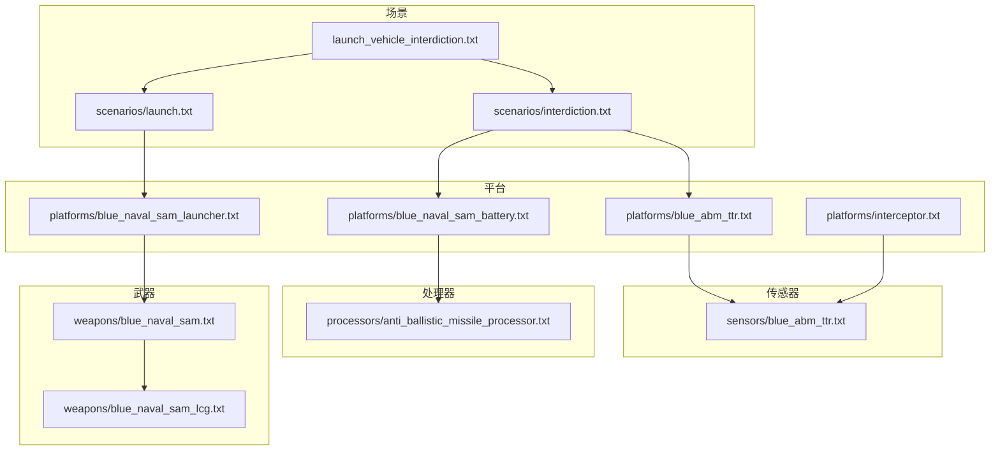
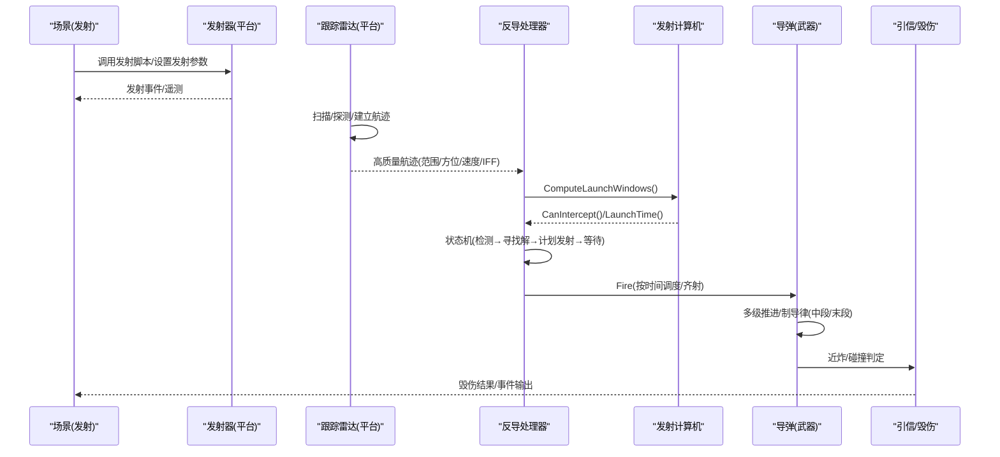
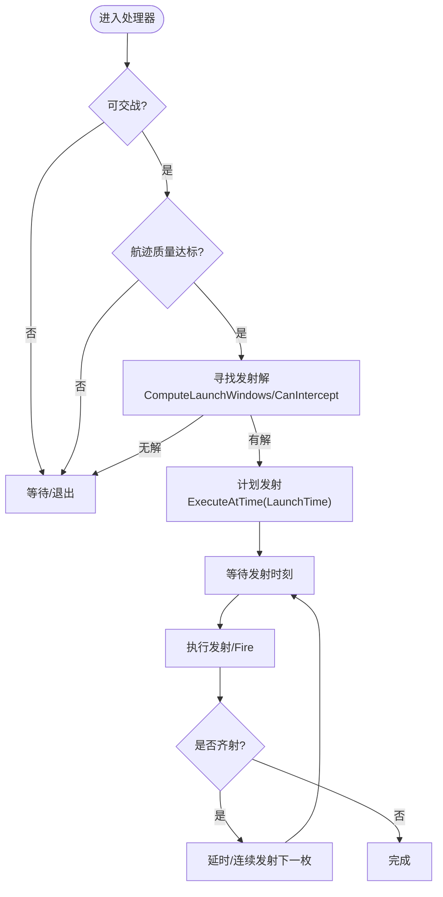
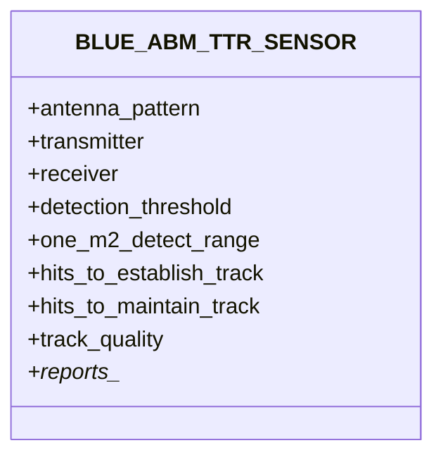
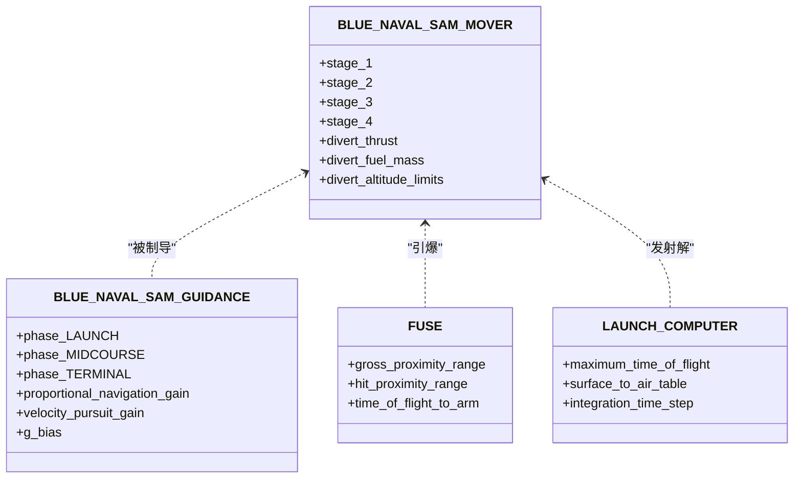
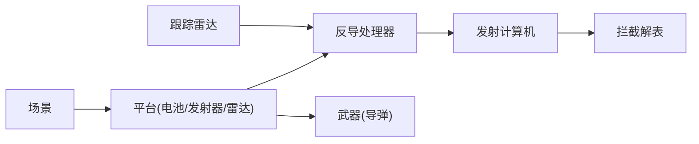

# 太空武器系统

<cite>
**本文引用的文件**   
- [README.md](file://demos/space_operations/README.md)
- [launch.txt](file://demos/space_operations/scenarios/launch.txt)
- [interdiction.txt](file://demos/space_operations/scenarios/interdiction.txt)
- [blue_naval_sam_battery.txt](file://demos/space_operations/platforms/blue_naval_sam_battery.txt)
- [blue_naval_sam_launcher.txt](file://demos/space_operations/platforms/blue_naval_sam_launcher.txt)
- [blue_abm_ttr.txt](file://demos/space_operations/platforms/blue_abm_ttr.txt)
- [blue_abm_ttr_sensor.txt](file://demos/space_operations/sensors/blue_abm_ttr.txt)
- [anti_ballistic_missile_processor.txt](file://demos/space_operations/processors/anti_ballistic_missile_processor.txt)
- [blue_naval_sam.txt](file://demos/space_operations/weapons/blue_naval_sam.txt)
- [blue_naval_sam_lcg.txt](file://demos/space_operations/weapons/blue_naval_sam_lcg.txt)
- [launch_vehicle_interdiction.txt](file://demos/space_operations/launch_vehicle_interdiction.txt)
- [interceptor.txt](file://demos/space_operations/platforms/interceptor.txt)
</cite>

## 目录
1. [引言](#引言)
2. [项目结构](#项目结构)
3. [核心组件](#核心组件)
4. [架构总览](#架构总览)
5. [详细组件分析](#详细组件分析)
6. [依赖关系分析](#依赖关系分析)
7. [性能与精度考量](#性能与精度考量)
8. [故障排查指南](#故障排查指南)
9. [结论](#结论)
10. [附录：实战案例与战术指导](#附录实战案例与战术指导)

## 引言
本文件面向太空环境下的武器系统建模与作战仿真，聚焦反导拦截、反卫星（含动能拦截）与发射载具拦截等典型场景。基于AFSIM的space_operations演示集，文档从系统架构、数据流、处理逻辑与集成点出发，解释弹道计算、命中概率评估与毁伤效果模拟的关键实现路径，并提供拦截窗口计算、多武器协同与战术决策的技术指导。同时给出实际的反导拦截与太空对抗演练案例，帮助读者快速上手并扩展至更复杂的太空作战体系。

## 项目结构
space_operations演示集围绕“发射—跟踪—拦截—毁伤”的主线组织，关键目录与职责如下：
- scenarios：场景编排，如发射流程、拦截触发条件、事件输出配置
- platforms：平台定义，包括指挥控制、雷达跟踪、导弹发射器、拦截器等
- sensors：传感器模型，提供高精度跟踪能力
- processors：任务处理器，实现拦截决策、状态机与发射调度
- weapons：武器与飞行体模型，包含多级推进、制导律、引信与杀伤包络
- scripts：脚本工具，用于轨道发射尝试、载荷分离、事件回调等

图表来源
- [launch.txt:1-68](file://demos/space_operations/scenarios/launch.txt#L1-L68)
- [interdiction.txt:1-39](file://demos/space_operations/scenarios/interdiction.txt#L1-L39)
- [launch_vehicle_interdiction.txt:1-43](file://demos/space_operations/launch_vehicle_interdiction.txt#L1-L43)
- [blue_naval_sam_battery.txt:1-53](file://demos/space_operations/platforms/blue_naval_sam_battery.txt#L1-L53)
- [blue_naval_sam_launcher.txt:1-34](file://demos/space_operations/platforms/blue_naval_sam_launcher.txt#L1-L34)
- [blue_abm_ttr.txt:1-34](file://demos/space_operations/platforms/blue_abm_ttr.txt#L1-L34)
- [blue_abm_ttr_sensor.txt:1-62](file://demos/space_operations/sensors/blue_abm_ttr.txt#L1-L62)
- [anti_ballistic_missile_processor.txt:1-296](file://demos/space_operations/processors/anti_ballistic_missile_processor.txt#L1-L296)
- [blue_naval_sam.txt:1-220](file://demos/space_operations/weapons/blue_naval_sam.txt#L1-L220)
- [blue_naval_sam_lcg.txt:1-51](file://demos/space_operations/weapons/blue_naval_sam_lcg.txt#L1-L51)
- [interceptor.txt:1-45](file://demos/space_operations/platforms/interceptor.txt#L1-L45)

章节来源
- [README.md:1-47](file://demos/space_operations/README.md#L1-L47)

## 核心组件
- 发射与载荷分离：通过脚本尝试轨道发射，并在分阶段失败时触发拦截流程
- 跟踪与态势感知：相控阵跟踪雷达提供高质量航迹，供拦截处理器使用
- 拦截决策与发射调度：任务处理器根据航迹质量、武器能力与发射窗口进行拦截判定与定时发射
- 武器与飞行体：多级固体火箭推进、中段/末段制导律、近炸引信与杀伤包络
- 发射计算机与数据集：预生成拦截解表，加速在线求解与窗口计算
- 通信与中继：支持遥测组播与跨节点转发，便于拦截器参与信息融合

章节来源
- [launch.txt:1-68](file://demos/space_operations/scenarios/launch.txt#L1-L68)
- [blue_abm_ttr_sensor.txt:1-62](file://demos/space_operations/sensors/blue_abm_ttr.txt#L1-L62)
- [anti_ballistic_missile_processor.txt:1-296](file://demos/space_operations/processors/anti_ballistic_missile_processor.txt#L1-L296)
- [blue_naval_sam.txt:1-220](file://demos/space_operations/weapons/blue_naval_sam.txt#L1-L220)
- [blue_naval_sam_lcg.txt:1-51](file://demos/space_operations/weapons/blue_naval_sam_lcg.txt#L1-L51)
- [interceptor.txt:1-45](file://demos/space_operations/platforms/interceptor.txt#L1-L45)

## 架构总览
下图展示从发射到拦截的端到端数据与控制流，涵盖传感器、处理器、武器与发射计算机之间的交互。

图表来源
- [launch.txt:1-68](file://demos/space_operations/scenarios/launch.txt#L1-L68)
- [blue_abm_ttr_sensor.txt:1-62](file://demos/space_operations/sensors/blue_abm_ttr.txt#L1-L62)
- [anti_ballistic_missile_processor.txt:1-296](file://demos/space_operations/processors/anti_ballistic_missile_processor.txt#L1-L296)
- [blue_naval_sam.txt:1-220](file://demos/space_operations/weapons/blue_naval_sam.txt#L1-L220)

## 详细组件分析

### 反导拦截处理器（任务状态机与发射调度）
该处理器负责：
- 航迹可用性判断（友军识别、存活状态、任务指派）
- 航迹质量门槛过滤（武器级高质量航迹）
- 武器能力检查（库存、开关状态、下级武器分配）
- 发射窗口计算（调用发射计算机ComputeLaunchWindows/CanIntercept/LaunchTime）
- 发射调度（ExecuteAtTime定时发射，支持齐射与延迟）
- 状态机流转（DETECTED→ENGAGING→FIND_LAUNCH_SOLUTION→SCHEDULE_LAUNCH→WAIT）

图表来源
- [anti_ballistic_missile_processor.txt:1-296](file://demos/space_operations/processors/anti_ballistic_missile_processor.txt#L1-L296)

章节来源
- [anti_ballistic_missile_processor.txt:1-296](file://demos/space_operations/processors/anti_ballistic_missile_processor.txt#L1-L296)

### 跟踪雷达（高质量航迹源）
- 天线方向图：圆形波束、窄波束宽度、高增益
- 电子扫描：方位+俯仰扫描与限幅
- 收发机：频率与功率设定，接收方向图匹配
- 探测阈值与单目标探测距离：满足远距离探测需求
- 航迹建立与维护：短击数建轨，低维持要求
- 航迹质量：设置为武器级高质量，直接驱动拦截处理器

图表来源
- [blue_abm_ttr_sensor.txt:1-62](file://demos/space_operations/sensors/blue_abm_ttr.txt#L1-L62)

章节来源
- [blue_abm_ttr_sensor.txt:1-62](file://demos/space_operations/sensors/blue_abm_ttr.txt#L1-L62)

### 武器与飞行体（多级推进、制导律、引信与杀伤包络）
- 气动与多级推进：四级固体火箭，每级独立气动、质量、比冲与推力时长
- 制导计算机：分段制导（发射段指令/中段保持/末段比例导引），支持预测拦截角
- 引信：近炸/碰撞半径，更新周期与保险时间
- 杀伤模型：渐变杀伤（半径与概率），用于毁伤效果评估
- 发射计算机：弹道导弹发射计算机，预先生成拦截解表，限制最大飞行时间与输出范围

图表来源
- [blue_naval_sam.txt:1-220](file://demos/space_operations/weapons/blue_naval_sam.txt#L1-L220)
- [blue_naval_sam_lcg.txt:1-51](file://demos/space_operations/weapons/blue_naval_sam_lcg.txt#L1-L51)

章节来源
- [blue_naval_sam.txt:1-220](file://demos/space_operations/weapons/blue_naval_sam.txt#L1-L220)
- [blue_naval_sam_lcg.txt:1-51](file://demos/space_operations/weapons/blue_naval_sam_lcg.txt#L1-L51)

### 发射与载荷分离（轨道发射脚本）
- 通过脚本变量控制分阶段失败标志位
- 修改发射载具类型以在入轨阶段释放载荷
- 调用发射计算机加载LEO轨道数据，设置发射位置与姿态
- 观察者监听MOVER_BURNED_OUT/MOVER_STAGED事件，触发后续拦截流程

章节来源
- [launch.txt:1-68](file://demos/space_operations/scenarios/launch.txt#L1-L68)

### 拦截场景编排（分阶段失败触发拦截）
- 引入蓝方海军防空电池、发射器与ABM跟踪雷达
- 当分阶段失败发生时，蓝方电池对发射载具轨迹进行拦截
- 事件管道与事件输出记录关键过程

章节来源
- [interdiction.txt:1-39](file://demos/space_operations/scenarios/interdiction.txt#L1-L39)
- [launch_vehicle_interdiction.txt:1-43](file://demos/space_operations/launch_vehicle_interdiction.txt#L1-L43)

### 拦截器（遥测中继与组播）
- 加入遥测组播组，捕获发射器与设施间通信
- 将跟踪消息转发给雷达网络，辅助跟踪与融合
- 适用于太空对抗中的信息截获与再分发

章节来源
- [interceptor.txt:1-45](file://demos/space_operations/platforms/interceptor.txt#L1-L45)

## 依赖关系分析
- 场景依赖平台与处理器：发射与拦截场景通过include机制组合平台、处理器与传感器
- 处理器依赖发射计算机：拦截决策通过发射计算机的窗口计算与拦截判定
- 武器依赖发射计算机数据集：预生成的拦截解表减少在线计算开销
- 雷达为处理器提供高质量航迹：航迹质量门槛决定能否进入拦截流程

图表来源
- [launch.txt:1-68](file://demos/space_operations/scenarios/launch.txt#L1-L68)
- [interdiction.txt:1-39](file://demos/space_operations/scenarios/interdiction.txt#L1-L39)
- [blue_naval_sam_battery.txt:1-53](file://demos/space_operations/platforms/blue_naval_sam_battery.txt#L1-L53)
- [blue_naval_sam_launcher.txt:1-34](file://demos/space_operations/platforms/blue_naval_sam_launcher.txt#L1-L34)
- [blue_abm_ttr.txt:1-34](file://demos/space_operations/platforms/blue_abm_ttr.txt#L1-L34)
- [blue_abm_ttr_sensor.txt:1-62](file://demos/space_operations/sensors/blue_abm_ttr.txt#L1-L62)
- [anti_ballistic_missile_processor.txt:1-296](file://demos/space_operations/processors/anti_ballistic_missile_processor.txt#L1-L296)
- [blue_naval_sam.txt:1-220](file://demos/space_operations/weapons/blue_naval_sam.txt#L1-L220)
- [blue_naval_sam_lcg.txt:1-51](file://demos/space_operations/weapons/blue_naval_sam_lcg.txt#L1-L51)

章节来源
- [blue_naval_sam_battery.txt:1-53](file://demos/space_operations/platforms/blue_naval_sam_battery.txt#L1-L53)
- [blue_naval_sam_launcher.txt:1-34](file://demos/space_operations/platforms/blue_naval_sam_launcher.txt#L1-L34)
- [blue_abm_ttr.txt:1-34](file://demos/space_operations/platforms/blue_abm_ttr.txt#L1-L34)
- [blue_abm_ttr_sensor.txt:1-62](file://demos/space_operations/sensors/blue_abm_ttr.txt#L1-L62)
- [anti_ballistic_missile_processor.txt:1-296](file://demos/space_operations/processors/anti_ballistic_missile_processor.txt#L1-L296)
- [blue_naval_sam.txt:1-220](file://demos/space_operations/weapons/blue_naval_sam.txt#L1-L220)
- [blue_naval_sam_lcg.txt:1-51](file://demos/space_operations/weapons/blue_naval_sam_lcg.txt#L1-L51)

## 性能与精度考量
- 发射计算机数据集规模：通过预生成拦截解表降低在线求解复杂度；合理设置最小输出时间、最大输出范围与角度采样步长，平衡精度与内存占用
- 雷达探测与跟踪：提高帧时间分辨率与波束指向策略，缩短建轨时间；航迹质量直接影响拦截成功率
- 制导律切换：中段保持与末段比例导引的参数需针对目标弹道特性调优，避免过敏感导致的失锁或过度机动
- 引信与杀伤包络：近炸半径与保险时间影响命中概率与毁伤效果；需结合目标尺寸与相对速度校准
- 事件输出与观测：启用关键事件（MOVER_BURNED_OUT、PLATFORM_ADDED/DELETED）有助于调试与性能分析

[本节为通用指导，不直接分析具体文件]

## 故障排查指南
- 无法找到发射解：检查武器库存、开关状态、下级武器分配与发射计算机数据集覆盖范围；确认航迹质量高于阈值
- 发射时机异常：核对LAUNCH_DELAY与ScheduleTheLaunch的时间窗口；检查ExecuteAtTime调度是否被其他任务抢占
- 跟踪丢失：调整雷达frame_time、扫描限幅与检测阈值；确保忽略同侧目标与IFF正确
- 毁伤未生效：检查引信update_interval、fine_update_interval与time_of_flight_to_arm；验证weapon_effects半径与概率
- 遥测未转发：确认组播地址与协议配置；检查processor on_message脚本是否正确发送

章节来源
- [anti_ballistic_missile_processor.txt:1-296](file://demos/space_operations/processors/anti_ballistic_missile_processor.txt#L1-L296)
- [blue_abm_ttr_sensor.txt:1-62](file://demos/space_operations/sensors/blue_abm_ttr.txt#L1-L62)
- [blue_naval_sam.txt:1-220](file://demos/space_operations/weapons/blue_naval_sam.txt#L1-L220)
- [interceptor.txt:1-45](file://demos/space_operations/platforms/interceptor.txt#L1-L45)

## 结论
AFSIM的space_operations演示集提供了完整的太空武器系统建模与作战仿真框架：以高质量跟踪雷达为输入，通过任务处理器与发射计算机实现拦截窗口计算与发射调度，配合多级推进与分段制导的导弹模型，最终由引信与杀伤包络完成毁伤效果评估。该体系可扩展至反卫星与动能拦截场景，支持多武器协同与复杂战术编排。

[本节为总结性内容，不直接分析具体文件]

## 附录：实战案例与战术指导

### 反导拦截场景（发射载具分阶段失败拦截）
- 场景要点：发射脚本触发载荷分离；若分阶段失败，蓝方电池对发射载具轨迹实施拦截
- 关键配置：高质量跟踪雷达、武器级航迹质量、发射计算机拦截解表、处理器状态机
- 预期结果：在发射载具失效后，系统自动规划拦截窗口并发射导弹，完成拦截

章节来源
- [launch.txt:1-68](file://demos/space_operations/scenarios/launch.txt#L1-L68)
- [interdiction.txt:1-39](file://demos/space_operations/scenarios/interdiction.txt#L1-L39)
- [launch_vehicle_interdiction.txt:1-43](file://demos/space_operations/launch_vehicle_interdiction.txt#L1-L43)
- [blue_naval_sam_battery.txt:1-53](file://demos/space_operations/platforms/blue_naval_sam_battery.txt#L1-L53)
- [blue_naval_sam_launcher.txt:1-34](file://demos/space_operations/platforms/blue_naval_sam_launcher.txt#L1-L34)
- [blue_abm_ttr.txt:1-34](file://demos/space_operations/platforms/blue_abm_ttr.txt#L1-L34)
- [blue_abm_ttr_sensor.txt:1-62](file://demos/space_operations/sensors/blue_abm_ttr.txt#L1-L62)
- [anti_ballistic_missile_processor.txt:1-296](file://demos/space_operations/processors/anti_ballistic_missile_processor.txt#L1-L296)
- [blue_naval_sam.txt:1-220](file://demos/space_operations/weapons/blue_naval_sam.txt#L1-L220)
- [blue_naval_sam_lcg.txt:1-51](file://demos/space_operations/weapons/blue_naval_sam_lcg.txt#L1-L51)

### 太空对抗演练（遥测中继与多传感器协同）
- 场景要点：拦截器加入遥测组播，捕获并转发跟踪消息，辅助雷达网络融合
- 关键配置：组播协议、消息处理器、内部链路
- 预期结果：提升态势感知与跟踪稳定性，支撑多武器协同拦截

章节来源
- [interceptor.txt:1-45](file://demos/space_operations/platforms/interceptor.txt#L1-L45)

### 战术与技术指导
- 拦截窗口计算：优先选择中段拦截窗口，利用发射计算机预生成解表；根据目标弹道变化动态刷新
- 命中概率评估：结合雷达探测概率、航迹质量、制导误差与引信近炸半径综合评估；通过Monte Carlo批跑统计命中率
- 毁伤效果模拟：采用渐变杀伤模型，依据相对速度与目标结构特性调整杀伤半径与概率
- 多武器协同：在同一目标上分配不同高度层与时间窗口的拦截弹，形成多层防御；通过处理器协调齐射与延迟
- 太空作战战术：结合轨道力学约束（如倾角、升交点经度）与传感器覆盖区，优化部署与任务时序

[本节为概念性指导，不直接分析具体文件]