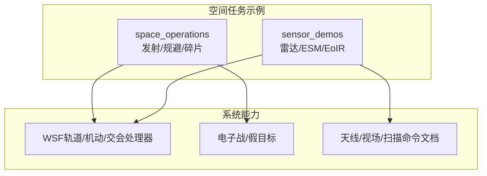
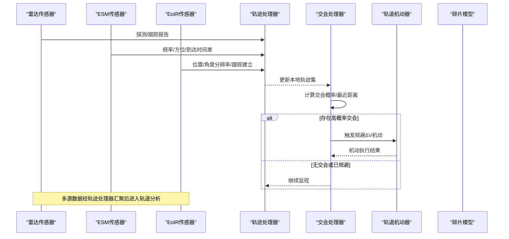
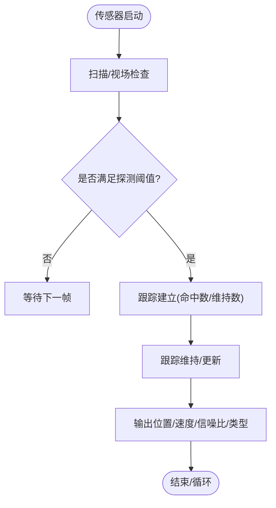
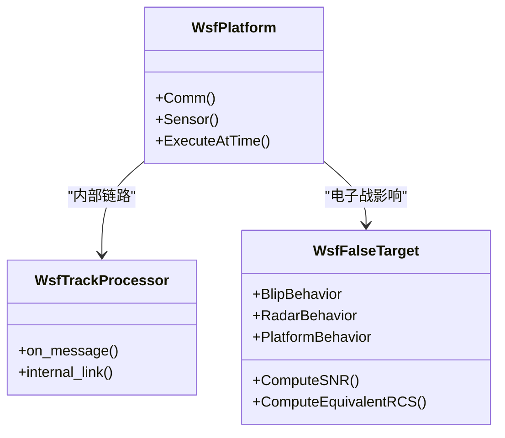
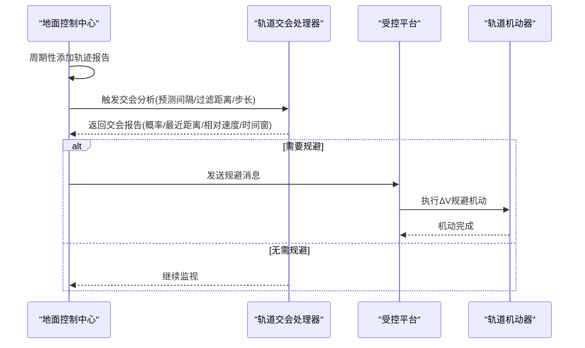
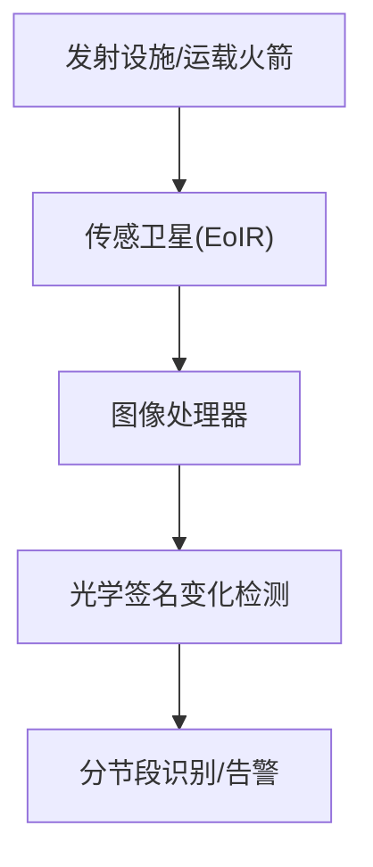

# 空间态势感知

<cite>
**本文引用的文件**   
- [sat_sensor.txt](file://demos/space_operations/sensors/sat_sensor.txt)
- [sat_sensor.txt](file://demos/space_operations/platforms/sat_sensor.txt)
- [launch_detection.txt](file://demos/space_operations/launch_detection.txt)
- [conjunction_avoidance.txt](file://demos/space_operations/conjunction_avoidance.txt)
- [satellite_breakup.txt](file://demos/space_operations/satellite_breakup.txt)
- [esem_demo.txt](file://demos/sensor_demos/esm_demo.txt)
- [eoir_demo.txt](file://demos/sensor_demos/eoir_demo.txt)
- [antenna_commands.rst](file://swdev/src/core/wsf/doc/antenna_commands.rst)
- [WsfFalseTarget.hpp](file://swdev/src/core/wsf_mil/source/ew/WsfFalseTarget.hpp)
</cite>

## 目录
1. [引言](#引言)
2. [项目结构](#项目结构)
3. [核心组件](#核心组件)
4. [架构总览](#架构总览)
5. [详细组件分析](#详细组件分析)
6. [依赖关系分析](#依赖关系分析)
7. [性能与可扩展性](#性能与可扩展性)
8. [故障排查指南](#故障排查指南)
9. [结论](#结论)
10. [附录](#附录)

## 引言
本文件面向空间态势感知的技术落地，围绕空间目标探测、跟踪与识别的传感器配置；空间碎片监测、碰撞规避与威胁评估的方法；以及雷达、光学观测与电子支援措施的集成使用与多传感器数据融合、目标关联的技术实现进行系统化说明。文档以仓库中的“space_operations”和“sensor_demos”示例为基础，结合系统级能力（轨道交会处理器、轨道机动、NASA碎片模型、ESM/Radar/EoIR传感器）给出可操作的工程化路径与可视化展示建议。

## 项目结构
与空间态势感知直接相关的示例与资源集中在以下目录：
- demos/space_operations：包含发射探测、对接规避、卫星解体等场景脚本与平台/传感器定义
- demos/sensor_demos：包含雷达、ESM、EoIR等传感器的典型用法与事件输出
- swdev/src/core/wsf/doc：天线命令与视场/扫描限制等参考文档
- swdev/src/core/wsf_mil/source/ew：电子战相关类（如假目标生成）

**图示来源**
- [launch_detection.txt:1-60](file://demos/space_operations/launch_detection.txt#L1-L60)
- [conjunction_avoidance.txt:1-221](file://demos/space_operations/conjunction_avoidance.txt#L1-L221)
- [satellite_breakup.txt:1-129](file://demos/space_operations/satellite_breakup.txt#L1-L129)
- [esem_demo.txt:1-252](file://demos/sensor_demos/esm_demo.txt#L1-L252)
- [eoir_demo.txt:1-34](file://demos/sensor_demos/eoir_demo.txt#L1-L34)
- [antenna_commands.rst:133-210](file://swdev/src/core/wsf/doc/antenna_commands.rst#L133-L210)
- [WsfFalseTarget.hpp:49-460](file://swdev/src/core/wsf_mil/source/ew/WsfFalseTarget.hpp#L49-L460)

**章节来源**
- [launch_detection.txt:1-60](file://demos/space_operations/launch_detection.txt#L1-L60)
- [conjunction_avoidance.txt:1-221](file://demos/space_operations/conjunction_avoidance.txt#L1-L221)
- [satellite_breakup.txt:1-129](file://demos/space_operations/satellite_breakup.txt#L1-L129)
- [esem_demo.txt:1-252](file://demos/sensor_demos/esm_demo.txt#L1-L252)
- [eoir_demo.txt:1-34](file://demos/sensor_demos/eoir_demo.txt#L1-L34)
- [antenna_commands.rst:133-210](file://swdev/src/core/wsf/doc/antenna_commands.rst#L133-L210)

## 核心组件
- 轨道交会与规避处理器：用于在给定预测时间窗口内搜索潜在交会并触发规避决策
- 轨道机动器：支持ΔV机动、拦截机动、事件条件驱动的轨道变更
- NASA碎片模型：基于碰撞参数生成碎片云，支持面积/质量分布与大碎片比例设置
- 传感器族：雷达（WSF_RADAR_SENSOR）、电子支援（WSF_ESM_SENSOR）、光电红外（WSF_EOIR_SENSOR）
- 轨迹处理与通信联动：通过内部链路将传感器检测/跟踪消息与通信连接状态联动
- 电子战假目标：为雷达接收端生成一致的假目标回波，支持跨平台/跨雷达的一致性建模

**章节来源**
- [conjunction_avoidance.txt:131-212](file://demos/space_operations/conjunction_avoidance.txt#L131-L212)
- [satellite_breakup.txt:101-128](file://demos/space_operations/satellite_breakup.txt#L101-L128)
- [sat_sensor.txt:1-24](file://demos/space_operations/sensors/sat_sensor.txt#L1-L24)
- [sat_sensor.txt:1-65](file://demos/space_operations/platforms/sat_sensor.txt#L1-L65)
- [esem_demo.txt:37-113](file://demos/sensor_demos/esm_demo.txt#L37-L113)
- [WsfFalseTarget.hpp:49-460](file://swdev/src/core/wsf_mil/source/ew/WsfFalseTarget.hpp#L49-L460)

## 架构总览
下图展示了从传感器探测到数据处理、轨道分析与规避执行的端到端流程，覆盖雷达、ESM、EoIR三类传感器与轨道交会/碎片模型的集成。

**图示来源**
- [esem_demo.txt:37-113](file://demos/sensor_demos/esm_demo.txt#L37-L113)
- [eoir_demo.txt:10-31](file://demos/sensor_demos/eoir_demo.txt#L10-L31)
- [sat_sensor.txt:1-24](file://demos/space_operations/sensors/sat_sensor.txt#L1-L24)
- [conjunction_avoidance.txt:143-196](file://demos/space_operations/conjunction_avoidance.txt#L143-L196)

## 详细组件分析

### 组件A：空间目标探测与跟踪（雷达/ESM/EoIR）
- 雷达传感器：提供范围、方位、俯仰、信噪比等观测，支持帧周期、扫描模式、视场与灵敏度参数
- ESM传感器：被动侦测辐射源频率、方位等信息，适合早期预警与信号特征采集
- EoIR传感器：高分辨率角度测量与跟踪建立，适用于光学可见/红外目标的精细跟踪

**图示来源**
- [esem_demo.txt:37-85](file://demos/sensor_demos/esm_demo.txt#L37-L85)
- [esem_demo.txt:94-113](file://demos/sensor_demos/esm_demo.txt#L94-L113)
- [eoir_demo.txt:10-31](file://demos/sensor_demos/eoir_demo.txt#L10-L31)
- [sat_sensor.txt:10-23](file://demos/space_operations/sensors/sat_sensor.txt#L10-L23)

**章节来源**
- [esem_demo.txt:37-113](file://demos/sensor_demos/esm_demo.txt#L37-L113)
- [eoir_demo.txt:10-31](file://demos/sensor_demos/eoir_demo.txt#L10-L31)
- [sat_sensor.txt:10-23](file://demos/space_operations/sensors/sat_sensor.txt#L10-L23)

### 组件B：多传感器数据融合与目标关联
- 通过内部链路将传感器消息路由至轨迹处理器，统一维护本地轨迹集合
- 在平台层脚本中根据跟踪消息动态管理通信连接，实现“跟踪即连通”的策略
- 对多平台/多雷达感知的一致性建模，支持跨平台/跨雷达的假目标一致性控制

**图示来源**
- [sat_sensor.txt:26-61](file://demos/space_operations/platforms/sat_sensor.txt#L26-L61)
- [WsfFalseTarget.hpp:64-102](file://swdev/src/core/wsf_mil/source/ew/WsfFalseTarget.hpp#L64-L102)
- [WsfFalseTarget.hpp:338-423](file://swdev/src/core/wsf_mil/source/ew/WsfFalseTarget.hpp#L338-L423)

**章节来源**
- [sat_sensor.txt:26-61](file://demos/space_operations/platforms/sat_sensor.txt#L26-L61)
- [WsfFalseTarget.hpp:64-102](file://swdev/src/core/wsf_mil/source/ew/WsfFalseTarget.hpp#L64-L102)
- [WsfFalseTarget.hpp:338-423](file://swdev/src/core/wsf_mil/source/ew/WsfFalseTarget.hpp#L338-L423)

### 组件C：空间碎片监测与碰撞规避
- 碰撞规避：地面控制中心周期性更新轨迹，轨道交会处理器在指定预测窗口内评估交会概率与最近距离，必要时下发规避指令
- 规避机动：受控平台收到消息后执行随机方向的小ΔV机动，降低交会风险
- 碎片生成：基于NASA模型按碰撞参数生成碎片，支持最小碎片尺寸、面积/质量分布、大碎片比例与命名规则

**图示来源**
- [conjunction_avoidance.txt:143-196](file://demos/space_operations/conjunction_avoidance.txt#L143-L196)
- [conjunction_avoidance.txt:37-52](file://demos/space_operations/conjunction_avoidance.txt#L37-L52)

**章节来源**
- [conjunction_avoidance.txt:143-196](file://demos/space_operations/conjunction_avoidance.txt#L143-L196)
- [conjunction_avoidance.txt:37-52](file://demos/space_operations/conjunction_avoidance.txt#L37-L52)

### 组件D：发射阶段识别与分节段检测
- 通过图像处理器与光学签名变化处理器，在发射过程中识别分节段的分离与新增
- 传感卫星对发射设施与运载火箭进行光学观测，结合轨道星座提升覆盖与重访能力

**图示来源**
- [launch_detection.txt:16-22](file://demos/space_operations/launch_detection.txt#L16-L22)
- [launch_detection.txt:33-45](file://demos/space_operations/launch_detection.txt#L33-L45)

**章节来源**
- [launch_detection.txt:16-22](file://demos/space_operations/launch_detection.txt#L16-L22)
- [launch_detection.txt:33-45](file://demos/space_operations/launch_detection.txt#L33-L45)

### 组件E：传感器天线与视场/扫描配置
- 扫描模式：方位/俯仰/双轴扫描
- 视场与扫描限制：方位/俯仰视场与扫描范围，支持稳定化以抵消平台姿态扰动
- 这些参数直接影响初始筛选与交互判定，需在空间目标探测场景中合理设置

**章节来源**
- [antenna_commands.rst:133-210](file://swdev/src/core/wsf/doc/antenna_commands.rst#L133-L210)

## 依赖关系分析
- 传感器与轨迹处理器：通过内部链路耦合，传感器产生检测/跟踪消息，轨迹处理器维护本地轨迹
- 轨道交会处理器与通信链路：地面控制中心通过通信向受控平台下发规避指令
- 电子战假目标与雷达接收端：假目标模型为雷达接收端提供一致的回波强度与等效RCS，影响跟踪稳定性

**图示来源**
- [sat_sensor.txt:26-61](file://demos/space_operations/platforms/sat_sensor.txt#L26-L61)
- [conjunction_avoidance.txt:143-196](file://demos/space_operations/conjunction_avoidance.txt#L143-L196)
- [WsfFalseTarget.hpp:338-423](file://swdev/src/core/wsf_mil/source/ew/WsfFalseTarget.hpp#L338-L423)

**章节来源**
- [sat_sensor.txt:26-61](file://demos/space_operations/platforms/sat_sensor.txt#L26-L61)
- [conjunction_avoidance.txt:143-196](file://demos/space_operations/conjunction_avoidance.txt#L143-L196)
- [WsfFalseTarget.hpp:338-423](file://swdev/src/core/wsf_mil/source/ew/WsfFalseTarget.hpp#L338-L423)

## 性能与可扩展性
- 传感器帧时间与扫描模式：较短帧时间提高跟踪更新率但增加计算负载；双轴扫描提升覆盖但需更多计算资源
- 轨迹处理器的消息吞吐：大量传感器同时上报时，应优化内部链路的消息分发策略
- 轨道交会处理器预测间隔与步长：更细的步长提高精度但增加计算量；预测间隔需与通信延迟匹配
- 碎片模型规模：碎片数量与面积/质量分布影响后续传播与碰撞风险评估的计算复杂度

[本节为通用指导，不直接分析具体文件]

## 故障排查指南
- 传感器未建立跟踪：检查帧时间、扫描模式、视场与灵敏度参数是否合理；确认命中数/维持数阈值
- 通信未建立：验证内部链路名称与平台通信地址；跟踪消息触发连接逻辑是否正确
- 规避未生效：核查轨道交会处理器的预测间隔、过滤距离与步长；确认规避消息下发与ΔV机动执行时机
- 碎片未生成：核对NASA模型的最小碎片尺寸、面积/质量分布与大碎片比例设置

**章节来源**
- [esem_demo.txt:37-85](file://demos/sensor_demos/esm_demo.txt#L37-L85)
- [sat_sensor.txt:26-61](file://demos/space_operations/platforms/sat_sensor.txt#L26-L61)
- [conjunction_avoidance.txt:143-196](file://demos/space_operations/conjunction_avoidance.txt#L143-L196)
- [satellite_breakup.txt:101-128](file://demos/space_operations/satellite_breakup.txt#L101-L128)

## 结论
本文件基于AFSIM的空间任务与传感器示例，给出了空间态势感知的完整技术路径：以雷达/ESM/EoIR多源传感器为输入，通过轨迹处理器汇聚数据，由轨道交会处理器进行威胁评估与规避决策，最终驱动轨道机动器执行规避；同时结合NASA碎片模型进行碎片监测与风险评估。该体系具备良好的可扩展性与工程可操作性，适用于复杂空间环境的态势感知与任务规划。

[本节为总结性内容，不直接分析具体文件]

## 附录
- 可视化展示建议：
  - 地图显示：在地图视图上叠加本地轨迹图标与平台详情
  - SA显示：开启感知实体、友军、优先威胁/目标、高度、ESM/RWR轨迹等图层
  - 轨迹回放：导出事件管道文件用于离线回放与分析

**章节来源**
- [rv_tracks.html:73-76](file://documentation/html/docs/wkf_plugin/rv_tracks.html#L73-L76)
- [rv_sa_display.html:217-251](file://documentation/html/docs/wkf_plugin/rv_sa_display.html#L217-L251)