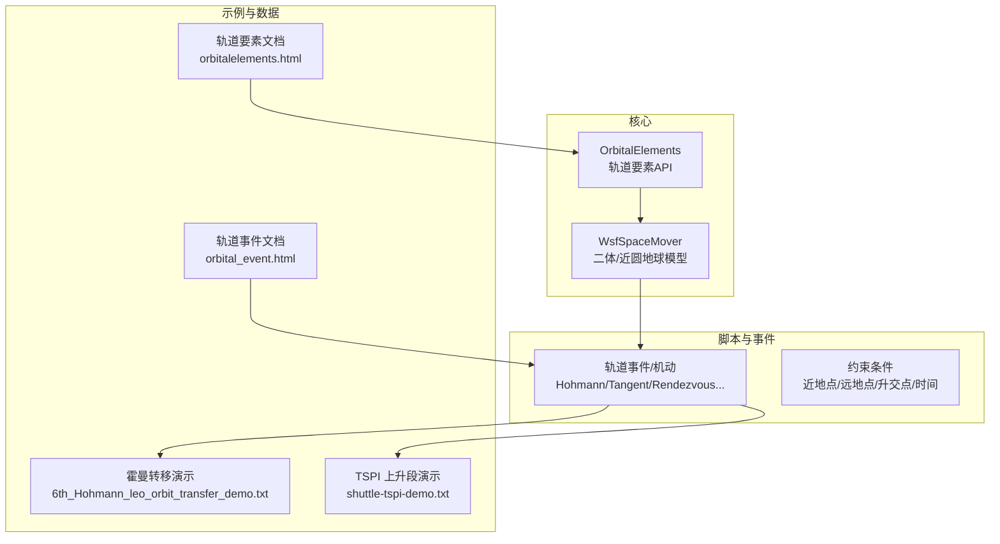
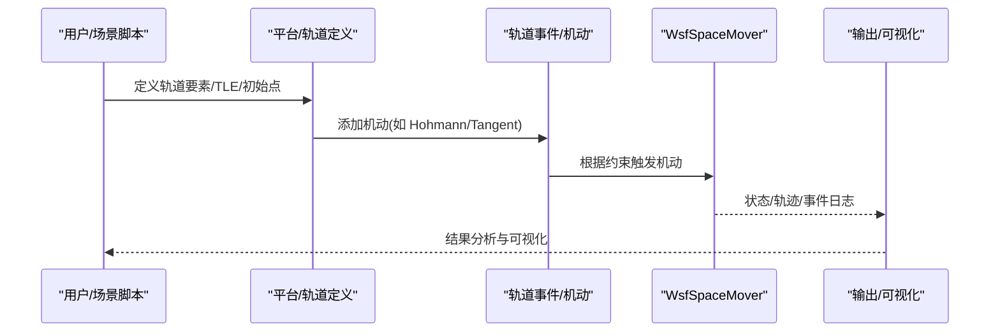
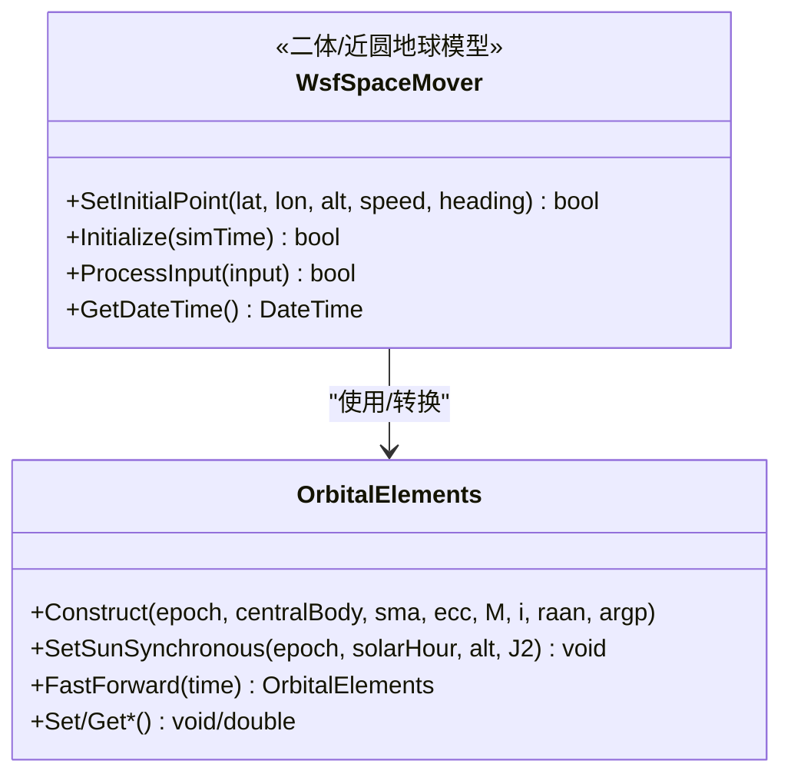
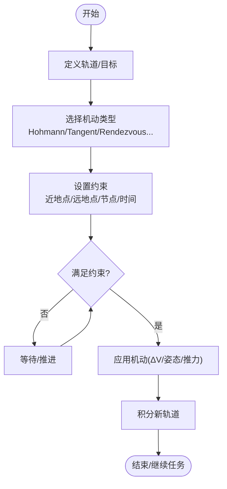
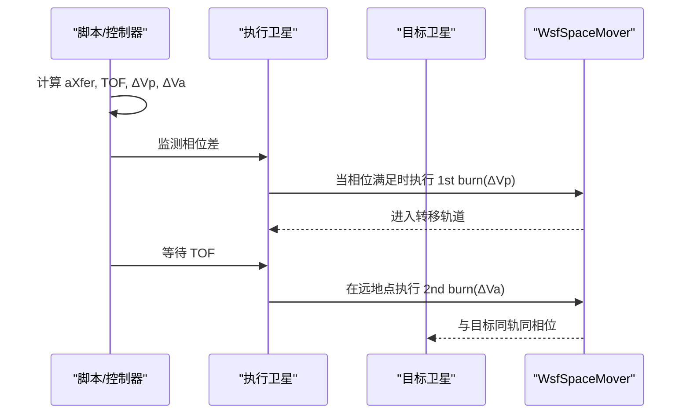
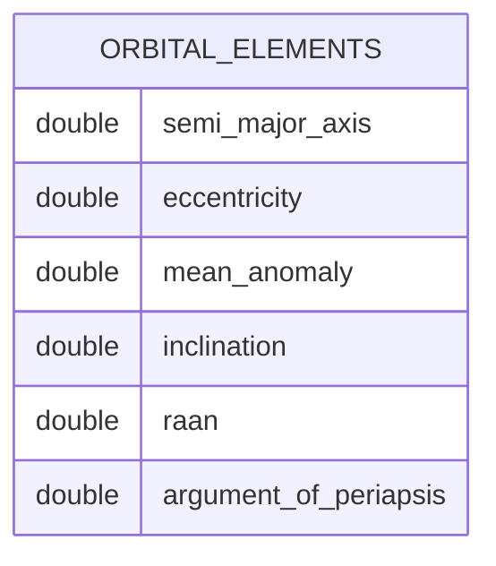
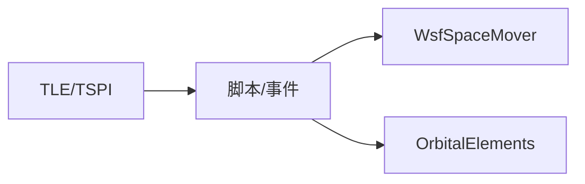

# 轨道力学

<cite>
**本文引用的文件**   
- [WsfSpaceMover.hpp](file://swdev/src/core/wsf_space/source/WsfSpaceMover.hpp)
- [orbital_event.html](file://documentation/html/docs/orbital_event.html)
- [orbitalelements.html](file://documentation/html/docs/script/orbitalelements.html)
- [6th_Hohmann_leo_orbit_transfer_demo.txt](file://demos/satellite_demos/6th_Hohmann_leo_orbit_transfer_demo.txt)
- [shuttle-tspi-demo.txt](file://demos/satellite_demos/shuttle-tspi-demo.txt)
- [satellite_demos.rst](file://demos/satellite_demos/doc/satellite_demos.rst)
</cite>

## 目录
1. [引言](#引言)
2. [项目结构](#项目结构)
3. [核心组件](#核心组件)
4. [架构总览](#架构总览)
5. [详细组件分析](#详细组件分析)
6. [依赖关系分析](#依赖关系分析)
7. [性能考虑](#性能考虑)
8. [故障排查指南](#故障排查指南)
9. [结论](#结论)
10. [附录](#附录)

## 引言
本文件面向太空仿真中的轨道力学与配置方法，围绕卫星轨道参数、轨道转移机动、轨道稳定性与摄动影响、轨道计算引擎使用与数据处理、以及经典轨道机动（霍曼转移、双椭圆转移等）进行系统化说明。文档同时提供实际案例与优化建议，帮助读者在 AFSIM 中完成从轨道设计到仿真验证的完整流程。

## 项目结构
AFSIM 的轨道能力由“核心空间运动器 + 脚本事件/机动 + 示例场景”三部分构成：
- 核心空间运动器：提供二体轨道积分、J2 摄动近似、TLE/初始点初始化、脉冲机动接口等。
- 轨道事件与机动：通过脚本事件定义各类轨道机动（如霍曼转移、切向机动、交会对接等），并支持约束条件控制执行时机。
- 示例与数据：包含 TLE、TSPI、轨道要素对象 API 文档与多类演示场景，便于快速上手与扩展。

图示来源
- [WsfSpaceMover.hpp:30-45](file://swdev/src/core/wsf_space/source/WsfSpaceMover.hpp#L30-L45)
- [orbital_event.html:97-124](file://documentation/html/docs/orbital_event.html#L97-L124)
- [orbitalelements.html:89-101](file://documentation/html/docs/script/orbitalelements.html#L89-L101)
- [6th_Hohmann_leo_orbit_transfer_demo.txt:10-17](file://demos/satellite_demos/6th_Hohmann_leo_orbit_transfer_demo.txt#L10-L17)
- [shuttle-tspi-demo.txt:18-30](file://demos/satellite_demos/shuttle-tspi-demo.txt#L18-L30)

章节来源
- [satellite_demos.rst:27-31](file://demos/satellite_demos/doc/satellite_demos.rst#L27-L31)

## 核心组件
- WsfSpaceMover（空间运动器）
  - 功能：二体轨道传播；可选 J2 项引起的 RAAN 与近心点进动的一阶近似；支持从初始航路点或 TLE 初始化；提供脉冲机动接口（AddDeltaV/Boost）。
  - 关键要点：默认球对称地球；J2 项用于简化摄动；适合轨道设计与初步稳定性评估。
- OrbitalElements（轨道要素对象）
  - 功能：封装半长轴、偏心率、平近点角、倾角、RAAN、近心点幅角等六根数；提供设置/获取方法与太阳同步轨道构造、快速前推等工具。
  - 关键要点：单位明确（米、度、无量纲）；可用于轨道设计与参数化扫描。
- 轨道事件与机动（脚本层）
  - 功能：以 event/maneuver 形式声明机动类型（Hohmann、Tangent、Rendezvous、Teardrop 等），并通过约束（近地点/远地点/升交点/相对时间/食入/食出等）控制执行时机。
  - 关键要点：支持有限时长机动（非脉冲）与更新间隔；可与任务序列组合。

章节来源
- [WsfSpaceMover.hpp:30-45](file://swdev/src/core/wsf_space/source/WsfSpaceMover.hpp#L30-L45)
- [orbitalelements.html:89-101](file://documentation/html/docs/script/orbitalelements.html#L89-L101)
- [orbital_event.html:97-124](file://documentation/html/docs/orbital_event.html#L97-L124)

## 架构总览
下图展示从“平台/轨道定义 → 轨道事件/机动 → 空间运动器积分 → 输出/可视化”的整体流程。

图示来源
- [6th_Hohmann_leo_orbit_transfer_demo.txt:10-17](file://demos/satellite_demos/6th_Hohmann_leo_orbit_transfer_demo.txt#L10-L17)
- [orbital_event.html:152-241](file://documentation/html/docs/orbital_event.html#L152-L241)
- [WsfSpaceMover.hpp:30-45](file://swdev/src/core/wsf_space/source/WsfSpaceMover.hpp#L30-L45)

## 详细组件分析

### 轨道计算引擎（WsfSpaceMover）
- 轨道模型
  - 二体问题：基础动力学，适用于大多数轨道设计与初步分析。
  - J2 摄动近似：对 RAAN 与近心点幅角施加一阶进动，提升长期预测的合理性。
- 初始化方式
  - 初始航路点（位置/速度/姿态）或 TLE（两行轨道根数）。
- 机动接口
  - 通用脉冲 AddDeltaV；沿速度方向的 Boost；脚本层通过事件/机动调用。
- 适用性
  - 适合 LEO/GEO 轨道设计、转移轨道规划、初步稳定性与敏感性分析。

图示来源
- [WsfSpaceMover.hpp:30-45](file://swdev/src/core/wsf_space/source/WsfSpaceMover.hpp#L30-L45)
- [orbitalelements.html:89-101](file://documentation/html/docs/script/orbitalelements.html#L89-L101)

章节来源
- [WsfSpaceMover.hpp:30-45](file://swdev/src/core/wsf_space/source/WsfSpaceMover.hpp#L30-L45)

### 轨道事件与机动（脚本层）
- 机动类型
  - Hohmann 转移、切向机动（Tangent）、交会（Rendezvous）、泪滴（Teardrop）、ΔV、漂移（Drift）、自然运动环游等。
- 约束条件
  - 近地点/远地点、升交点/降交点、指定半径、南北纬度交点、食入/食出、相对时间等。
- 执行模式
  - 脉冲（瞬时）或有限时长（duration/update_interval）。

图示来源
- [orbital_event.html:97-124](file://documentation/html/docs/orbital_event.html#L97-L124)
- [orbital_event.html:152-241](file://documentation/html/docs/orbital_event.html#L152-L241)

章节来源
- [orbital_event.html:97-124](file://documentation/html/docs/orbital_event.html#L97-L124)
- [orbital_event.html:152-241](file://documentation/html/docs/orbital_event.html#L152-L241)

### 霍曼转移（Hohmann Transfer）
- 原理
  - 两次切向脉冲：在近地点加速进入转移椭圆，在远地点再次加速圆化至目标轨道。
- 关键参数
  - 转移轨道半长轴 aXfer = (a1 + a2)/2；飞行时间 TOF = π√(aXfer^3/μ)。
  - ΔVp、ΔVa 由初/末轨道能量差决定。
- 实现要点（基于演示）
  - 脚本计算 TOF 与相位窗口，按相位差触发第一次点火；到达远地点后执行第二次点火。
  - 使用切向机动（TangentManeuver）施加 ΔV。

图示来源
- [6th_Hohmann_leo_orbit_transfer_demo.txt:10-17](file://demos/satellite_demos/6th_Hohmann_leo_orbit_transfer_demo.txt#L10-L17)
- [6th_Hohmann_leo_orbit_transfer_demo.txt:97-109](file://demos/satellite_demos/6th_Hohmann_leo_orbit_transfer_demo.txt#L97-L109)
- [6th_Hohmann_leo_orbit_transfer_demo.txt:168-176](file://demos/satellite_demos/6th_Hohmann_leo_orbit_transfer_demo.txt#L168-L176)
- [6th_Hohmann_leo_orbit_transfer_demo.txt:197-202](file://demos/satellite_demos/6th_Hohmann_leo_orbit_transfer_demo.txt#L197-L202)

章节来源
- [6th_Hohmann_leo_orbit_transfer_demo.txt:10-17](file://demos/satellite_demos/6th_Hohmann_leo_orbit_transfer_demo.txt#L10-L17)
- [6th_Hohmann_leo_orbit_transfer_demo.txt:97-109](file://demos/satellite_demos/6th_Hohmann_leo_orbit_transfer_demo.txt#L97-L109)
- [6th_Hohmann_leo_orbit_transfer_demo.txt:168-176](file://demos/satellite_demos/6th_Hohmann_leo_orbit_transfer_demo.txt#L168-L176)
- [6th_Hohmann_leo_orbit_transfer_demo.txt:197-202](file://demos/satellite_demos/6th_Hohmann_leo_orbit_transfer_demo.txt#L197-L202)

### 双椭圆转移（Bi-Elliptic Transfer）
- 适用场景
  - 当目标轨道半长轴显著大于初始轨道时，双椭圆可能比霍曼更省燃料。
- 步骤概述
  - 第一次脉冲进入第一椭圆（远地点很高）；
  - 在远地点第二次脉冲进入第二椭圆（近地点为目标轨道）；
  - 在第二椭圆近地点第三次脉冲圆化至目标轨道。
- 工程权衡
  - 三次脉冲 vs 两次脉冲；转移时间长；需精确相位与时间管理。
- 在 AFSIM 中的实现思路
  - 使用多个切向机动（Tangent）或 ΔV 事件，配合约束（远地点/近地点）分阶段执行。

[本节为概念性说明，不直接分析具体文件]

### 轨道要素与数据处理
- 轨道要素（六根数）
  - 半长轴、偏心率、平近点角、倾角、RAAN、近心点幅角。
- 常用操作
  - 设置/获取各根数；构建太阳同步轨道；快速前推（FastForward）。
- 数据来源
  - TLE（两行轨道根数）；TSPI（弹道/上升段轨迹数据）。

图示来源
- [orbitalelements.html:89-101](file://documentation/html/docs/script/orbitalelements.html#L89-L101)

章节来源
- [orbitalelements.html:89-101](file://documentation/html/docs/script/orbitalelements.html#L89-L101)

### TSPI 数据驱动（航天飞机上升段）
- 用途
  - 使用 TSPI 文件驱动平台轨迹，适合发射/上升段仿真与异常中止场景复现。
- 关键点
  - 通过 mover 的 TSPI_filename 指向数据文件；可叠加脚本注释/事件标记关键阶段。

章节来源
- [shuttle-tspi-demo.txt:18-30](file://demos/satellite_demos/shuttle-tspi-demo.txt#L18-L30)
- [shuttle-tspi-demo.txt:32-48](file://demos/satellite_demos/shuttle-tspi-demo.txt#L32-L48)

## 依赖关系分析
- 组件耦合
  - 脚本事件/机动依赖 WsfSpaceMover 提供的轨道积分与机动接口。
  - OrbitalElements 作为轨道参数载体，被脚本与运动器共同使用。
- 外部依赖
  - TLE/TSPI 数据文件；地球引力常数与 J2 参数（内核常量）。
- 潜在循环
  - 脚本层与运动器之间为单向调用，无循环依赖。

图示来源
- [WsfSpaceMover.hpp:30-45](file://swdev/src/core/wsf_space/source/WsfSpaceMover.hpp#L30-L45)
- [orbitalelements.html:89-101](file://documentation/html/docs/script/orbitalelements.html#L89-L101)
- [shuttle-tspi-demo.txt:18-30](file://demos/satellite_demos/shuttle-tspi-demo.txt#L18-L30)

## 性能考虑
- 积分器与步长
  - 合理设置 update_interval 与 duration，避免过细步长导致开销增大。
- 摄动模型
  - J2 近似成本低且能改善长期趋势；如需更高精度可引入更多摄动项（若可用）。
- 机动策略
  - 优先使用切向机动减少横向分量带来的数值误差；将大 ΔV 拆分为多次小脉冲可降低非线性误差。
- 数据输入
  - TLE/TSPI 数据质量直接影响初始条件准确性；建议使用最新数据并进行一致性校验。

[本节为通用指导，不直接分析具体文件]

## 故障排查指南
- 机动未触发
  - 检查约束条件是否满足（近地点/远地点/节点/时间）；确认脚本相位计算与阈值设置。
- 转移失败或相位不对
  - 核对 TOF 与相位窗口；检查 ΔV 大小与方向（切向/法向）；确认目标轨道参数。
- TSPI 轨迹异常
  - 检查数据路径与坐标系单位；确认起始时间与平台位置匹配。
- 输出/可视化
  - 启用事件输出与调试开关；观察事件日志定位问题阶段。

章节来源
- [orbital_event.html:152-241](file://documentation/html/docs/orbital_event.html#L152-L241)
- [shuttle-tspi-demo.txt:205-222](file://demos/satellite_demos/shuttle-tspi-demo.txt#L205-L222)

## 结论
AFSIM 提供了从轨道要素建模、事件驱动的机动控制到二体/J2 摄动积分的完整轨道仿真能力。借助霍曼/双椭圆等经典机动与丰富的约束条件，用户可以高效完成轨道设计与优化。结合 TLE/TSPI 数据与脚本自动化，可实现从方案到验证的闭环流程。建议在工程中重视数据质量、机动策略与数值稳定性，以获得可靠的轨道预测与优化结果。

## 附录
- 相关演示与文档
  - 卫星演示总览与说明：[satellite_demos.rst](file://demos/satellite_demos/doc/satellite_demos.rst)
  - 轨道事件参考：[orbital_event.html](file://documentation/html/docs/orbital_event.html)
  - 轨道要素 API：[orbitalelements.html](file://documentation/html/docs/script/orbitalelements.html)
  - 霍曼转移演示：[6th_Hohmann_leo_orbit_transfer_demo.txt](file://demos/satellite_demos/6th_Hohmann_leo_orbit_transfer_demo.txt)
  - TSPI 上升段演示：[shuttle-tspi-demo.txt](file://demos/satellite_demos/shuttle-tspi-demo.txt)