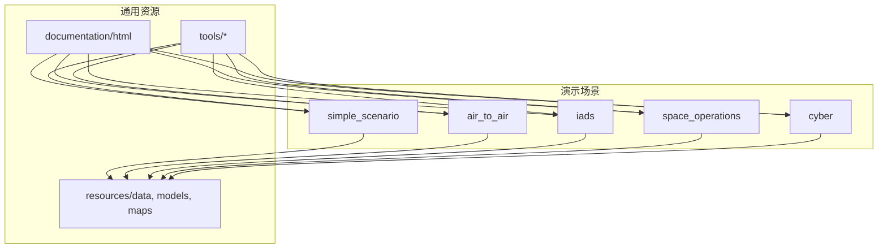
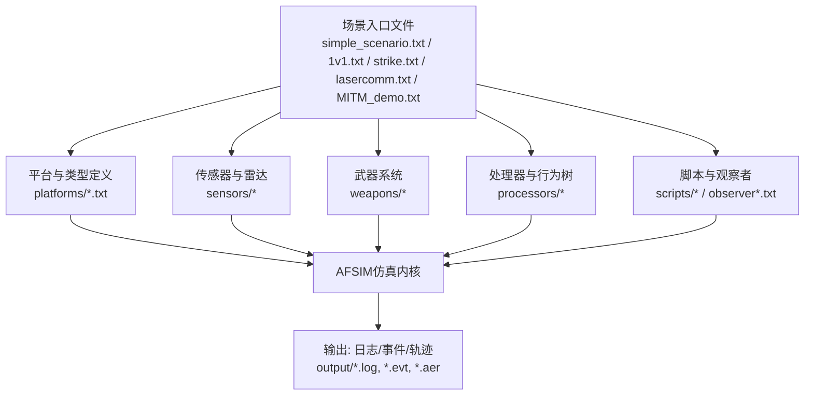
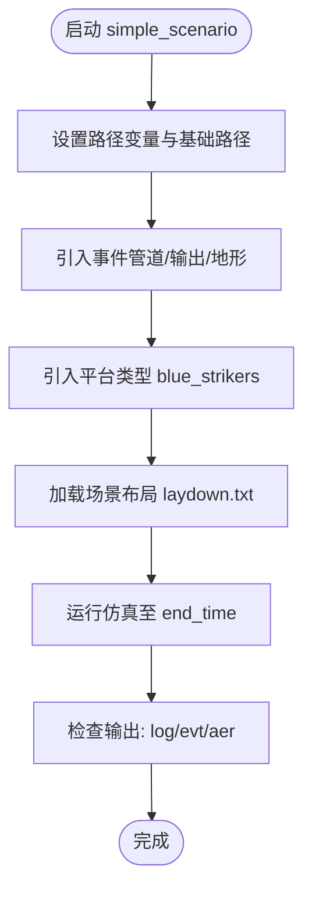
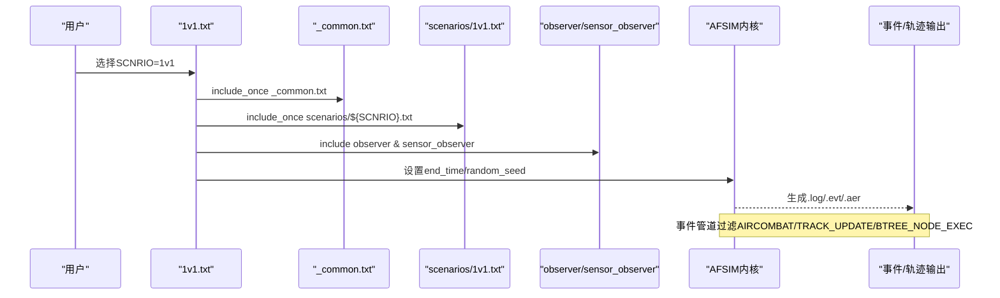
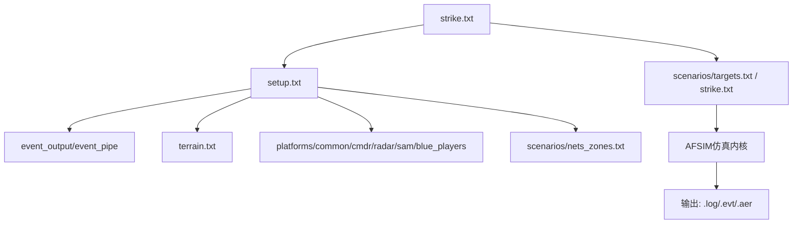
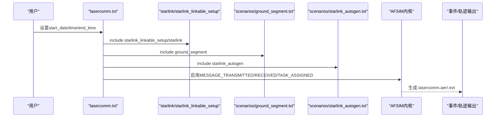
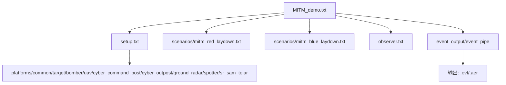
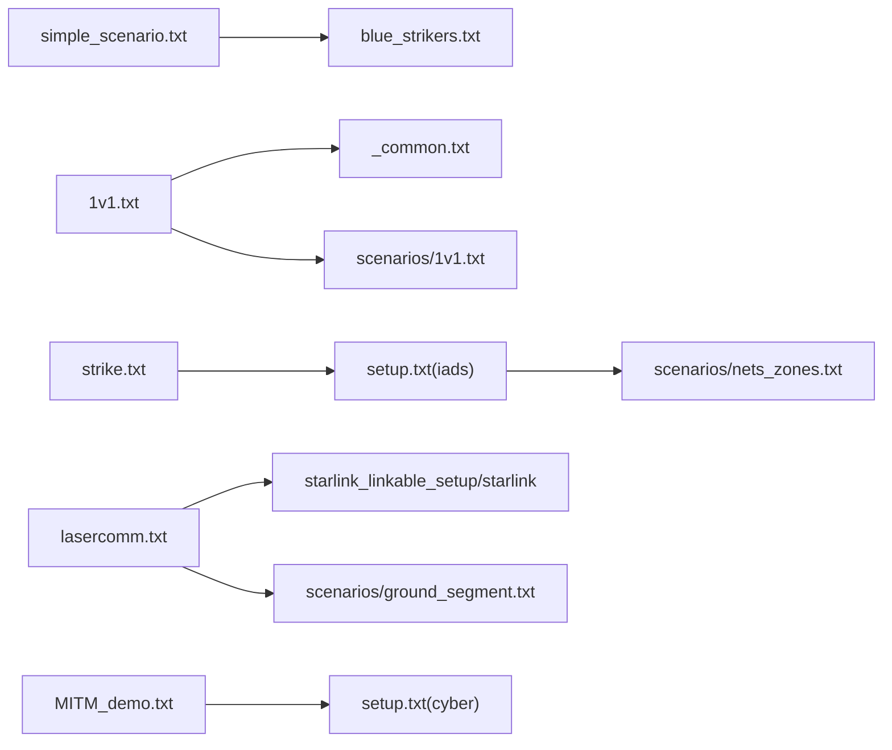

# 演示场景详解

<cite>
**本文引用的文件**   
- [simple_scenario.txt](file://demos/simple_scenario/simple_scenario.txt)
- [laydown.txt](file://demos/simple_scenario/scenarios/laydown.txt)
- [README.md（simple_scenario）](file://demos/simple_scenario/README.md)
- [1v1.txt](file://demos/air_to_air/1v1.txt)
- [_common.txt](file://demos/air_to_air/_common.txt)
- [README.md（air_to_air）](file://demos/air_to_air/README.md)
- [strike.txt](file://demos/iads/strike.txt)
- [setup.txt（iads）](file://demos/iads/setup.txt)
- [README.md（iads）](file://demos/iads/README.md)
- [lasercomm.txt](file://demos/space_operations/lasercomm.txt)
- [setup.txt（space_operations）](file://demos/space_operations/setup.txt)
- [README.md（space_operations）](file://demos/space_operations/README.md)
- [MITM_demo.txt](file://demos/cyber/MITM_demo.txt)
- [setup.txt（cyber）](file://demos/cyber/setup.txt)
- [README.md（cyber）](file://demos/cyber/README.md)
</cite>

## 目录
1. [简介](#简介)
2. [项目结构](#项目结构)
3. [核心组件](#核心组件)
4. [架构总览](#架构总览)
5. [详细组件分析](#详细组件分析)
6. [依赖关系分析](#依赖关系分析)
7. [性能与可观测性](#性能与可观测性)
8. [故障排查指南](#故障排查指南)
9. [结论](#结论)
10. [附录：场景扩展与调优建议](#附录场景扩展与调优建议)

## 简介
本教程面向AFSIM初学者与进阶用户，围绕以下演示场景进行系统化讲解：
- 简单场景（simple_scenario）：最小化配置、平台与航路定义、事件输出与地形加载。
- 空中对抗（air_to_air）：战术建模、传感器与武器交战逻辑、行为树与编队协同。
- 防空系统（iads）：多层防御体系、指挥控制与协同作战机制。
- 太空作战（space_operations）：轨道计算、卫星通信与空间态势感知。
- 网络战（cyber）：攻击防御策略与网络拓扑建模。

每个场景均包含配置解析、参数调优与结果分析方法，并提供修改与扩展指导，帮助读者基于现有场景开发自定义仿真案例。

## 项目结构
各演示场景遵循统一的目录组织方式：
- scenarios：场景编排与兵力部署
- platforms：平台类型与属性定义
- sensors：传感器模型与参数
- weapons：武器系统与弹道/制导模型
- processors：处理器与任务调度
- scripts：脚本与自动化流程
- output：运行日志、事件与轨迹数据

[本图为概念性结构图，不直接映射具体源码文件]

## 核心组件
- 场景入口文件：负责路径设置、公共模块引入、事件输出与仿真时长等全局配置。
- 平台与类型定义：声明平台族谱、能力、传感器与武器挂载。
- 传感器与雷达：探测、跟踪、电子战与通信链路建模。
- 武器系统：空空导弹、地空导弹、激光通信等。
- 处理器与行为树：战术决策、编队协同、交战规则。
- 脚本与观察者：自动化流程、可视化与数据导出。

本节为概念性概述，不直接分析具体文件。

## 架构总览
下图展示五个演示场景在AFSIM中的典型交互关系：场景入口引入平台、传感器、武器与处理器；仿真运行时产生事件与轨迹数据供分析与可视化。

[本图为概念性架构图，不直接映射具体源码文件]

## 详细组件分析

### 简单场景（simple_scenario）
目标：理解AFSIM的最小可用场景，包括路径变量、平台定义、航路与事件输出。

- 入口文件要点
  - 定义路径变量与基础路径，便于复用base_types等资源。
  - 引入事件管道与事件输出，指定输出文件路径。
  - 引入地形与平台类型，随后加载场景布局。
  - 设置仿真结束时间。

- 场景布局要点
  - 定义一个蓝色战斗机平台，设定类别与航线。
  - 航路由多个航点组成，含速度与高度约束。
  - 初始航向用于初始化姿态。

- 运行与验证
  - 检查日志与事件文件是否生成。
  - 使用工具查看轨迹与事件，确认平台按航路飞行并触发预期事件。

**图表来源** 
- [simple_scenario.txt:10-28](file://demos/simple_scenario/simple_scenario.txt#L10-L28)
- [laydown.txt:18-29](file://demos/simple_scenario/scenarios/laydown.txt#L18-L29)

**章节来源**
- [simple_scenario.txt:10-28](file://demos/simple_scenario/simple_scenario.txt#L10-L28)
- [laydown.txt:18-29](file://demos/simple_scenario/scenarios/laydown.txt#L18-L29)
- [README.md（simple_scenario）:1-45](file://demos/simple_scenario/README.md#L1-L45)

### 空中对抗（air_to_air）
目标：掌握战术建模、传感器配置与武器交战逻辑，理解行为树与编队协同。

- 入口文件要点
  - 通过变量切换不同子场景（1v1、2v2、HVAA DCA、护航）。
  - 引入公共配置_common.txt，统一签名与武器库引用。
  - 设置观察者与传感器观察者，生成标准输出文件。
  - 启用事件管道与事件输出，过滤关键事件（如空战、跟踪更新、行为树节点执行）。
  - 设置随机种子以保证可重复性。

- 战术与行为树
  - 飞机继承自战斗机基类，内嵌行为树与Brawler处理器。
  - 编队以command_chain组织（IFLITE、ELEMENT），由长机决定阶段转换。
  - 武器分类约定：短程红外导弹与中程雷达导弹，分别对应FOX2/FOX3。

- 传感器与交战
  - 雷达签名与IR签名参与探测与锁定。
  - 行为树驱动探测、跟踪、威胁评估、武器发射与机动规避。

**图表来源** 
- [1v1.txt:10-54](file://demos/air_to_air/1v1.txt#L10-L54)
- [1v1.txt:67-97](file://demos/air_to_air/1v1.txt#L67-L97)
- [_common.txt:20-27](file://demos/air_to_air/_common.txt#L20-L27)

**章节来源**
- [1v1.txt:10-54](file://demos/air_to_air/1v1.txt#L10-L54)
- [1v1.txt:67-97](file://demos/air_to_air/1v1.txt#L67-L97)
- [_common.txt:20-27](file://demos/air_to_air/_common.txt#L20-L27)
- [README.md（air_to_air）:1-101](file://demos/air_to_air/README.md#L1-L101)

### 防空系统（iads）
目标：理解多层防御体系、指挥控制与协同作战机制。

- 入口文件要点
  - 主场景strike.txt引入setup.txt与多套场景文件（nets_zones、targets、strike）。
  - setup.txt作为统一入口，先引入事件管道/输出、地形，再引入平台类型与网络区域定义。
  - 支持多线程与CSV事件输出（可选）。

- 多层防御与C2
  - 平台类型涵盖指挥员、雷达、地空导弹等角色。
  - 网络与区域（nets_zones）定义传感器覆盖与指挥链。
  - 打击场景（strike）组织蓝方攻击与红方拦截的协同流程。

**图表来源** 
- [strike.txt:9-21](file://demos/iads/strike.txt#L9-L21)
- [setup.txt（iads）:15-34](file://demos/iads/setup.txt#L15-L34)

**章节来源**
- [strike.txt:9-21](file://demos/iads/strike.txt#L9-L21)
- [setup.txt（iads）:15-34](file://demos/iads/setup.txt#L15-L34)
- [README.md（iads）:1-45](file://demos/iads/README.md#L1-L45)

### 太空作战（space_operations）
目标：掌握轨道计算、卫星通信与空间态势感知。

- 入口文件要点
  - lasercomm.txt引入星间激光通信场景，包含Starlink相关平台与地面段。
  - 通过start_date/start_time/end_time设置仿真时间窗口。
  - 启用事件管道与事件输出，记录消息收发与任务分配。

- 轨道与通信
  - 星座采用Wizard Constellation Maker生成，同轨面固定交叉链路，邻近卫星动态侧向链路。
  - 通信管理通过脚本实现，周期性向全球另一端指挥官发送消息。

**图表来源** 
- [lasercomm.txt:20-42](file://demos/space_operations/lasercomm.txt#L20-L42)
- [setup.txt（space_operations）:11-13](file://demos/space_operations/setup.txt#L11-L13)

**章节来源**
- [lasercomm.txt:20-42](file://demos/space_operations/lasercomm.txt#L20-L42)
- [setup.txt（space_operations）:11-13](file://demos/space_operations/setup.txt#L11-L13)
- [README.md（space_operations）:1-47](file://demos/space_operations/README.md#L1-L47)

### 网络战（cyber）
目标：理解攻击防御策略与网络拓扑建模。

- 入口文件要点
  - MITM_demo.txt引入setup.txt与红蓝双方兵力部署（mitm_red_laydown/mitm_blue_laydown）。
  - 引入观察者与事件管道，禁用DRAW以减少开销。
  - 设置仿真时长为1小时，输出事件与轨迹。

- 网络拓扑与攻防
  - setup.txt引入通用平台类型与特定角色（网络指挥所、前哨站、地面雷达、观察员、地空导弹等）。
  - 通过场景文件构建网络节点与链路，模拟中间人攻击与防御响应。

**图表来源** 
- [MITM_demo.txt:11-28](file://demos/cyber/MITM_demo.txt#L11-L28)
- [setup.txt（cyber）:11-21](file://demos/cyber/setup.txt#L11-L21)

**章节来源**
- [MITM_demo.txt:11-28](file://demos/cyber/MITM_demo.txt#L11-L28)
- [setup.txt（cyber）:11-21](file://demos/cyber/setup.txt#L11-L21)
- [README.md（cyber）:1-48](file://demos/cyber/README.md#L1-L48)

## 依赖关系分析
- 场景入口文件依赖公共配置与平台类型定义，确保一致的签名、武器与处理器。
- air_to_air通过_common.txt统一雷达签名与武器库引用，降低耦合度。
- iads通过setup.txt集中引入事件、地形、平台类型与网络区域，提升可维护性。
- space_operations通过lasercomm.txt组合星间通信与地面段，形成端到端通信链路。
- cyber通过setup.txt聚合网络节点类型，支撑复杂网络拓扑建模。

**图表来源** 
- [simple_scenario.txt:25-26](file://demos/simple_scenario/simple_scenario.txt#L25-L26)
- [1v1.txt:20-21](file://demos/air_to_air/1v1.txt#L20-L21)
- [strike.txt:12-16](file://demos/iads/strike.txt#L12-L16)
- [lasercomm.txt:21-24](file://demos/space_operations/lasercomm.txt#L21-L24)
- [MITM_demo.txt:13-16](file://demos/cyber/MITM_demo.txt#L13-L16)

**章节来源**
- [simple_scenario.txt:25-26](file://demos/simple_scenario/simple_scenario.txt#L25-L26)
- [1v1.txt:20-21](file://demos/air_to_air/1v1.txt#L20-L21)
- [strike.txt:12-16](file://demos/iads/strike.txt#L12-L16)
- [lasercomm.txt:21-24](file://demos/space_operations/lasercomm.txt#L21-L24)
- [MITM_demo.txt:13-16](file://demos/cyber/MITM_demo.txt#L13-L16)

## 性能与可观测性
- 事件管道与事件输出
  - 合理启用事件类别（如TRACK_UPDATE、MESSAGE_TRANSMITTED/RECEIVED、WEAPON_HIT/MISSED）可减少输出体积。
  - 在大规模场景中关闭DRAW或抑制非标准数据以降低I/O压力。
- 随机种子与可重复性
  - 设置random_seed保证多次运行结果一致，便于对比实验。
- 多线程与并行
  - iads示例提供多线程选项，可在硬件允许时提升仿真吞吐。

本节为通用指导，不直接分析具体文件。

## 故障排查指南
- 输出文件未生成
  - 检查event_output与event_pipe是否正确引入与配置。
  - 确认输出路径存在且具备写入权限。
- 传感器无探测或跟踪丢失
  - 检查雷达签名与IR签名是否定义与加载。
  - 调整传感器参数（波束、扫描模式、噪声与杂波）。
- 武器未发射或命中率异常
  - 核对武器类型与挂载数量，确认行为树交战条件满足。
  - 检查制导模型与弹道参数是否匹配平台能力。
- 通信链路中断
  - 核查星座生成脚本与链路管理脚本，确认可见性与指向正确。
  - 检查地面段与终端设备配置。

本节为通用指导，不直接分析具体文件。

## 结论
通过对五个演示场景的系统化解析，读者可以：
- 快速上手AFSIM的基本工作流程与配置文件组织。
- 深入理解空中对抗的战术建模、传感器与武器交战逻辑。
- 掌握防空系统的多层防御与指挥控制协同。
- 熟悉太空作战的轨道计算、卫星通信与空间态势感知。
- 构建网络战的攻击防御策略与网络拓扑。

在此基础上，读者可基于现有场景进行扩展与定制，开发更复杂的仿真案例。

## 附录：场景扩展与调优建议
- 简单场景
  - 增加平台数量与编队，使用command_chain组织。
  - 添加传感器与武器挂载，测试探测与交战流程。
- 空中对抗
  - 扩展行为树节点，加入更多战术阶段（巡逻、拦截、脱离）。
  - 调整武器射程与杀伤概率，评估不同交战策略效果。
- 防空系统
  - 扩展雷达网与SAM阵地，优化覆盖与冗余。
  - 引入电子战与干扰场景，评估抗干扰能力。
- 太空作战
  - 扩展星座规模与轨道参数，测试跨链路路由与拥塞控制。
  - 加入空间天气与遮挡模型，评估通信可靠性。
- 网络战
  - 细化网络节点与链路拓扑，模拟多跳攻击与防御。
  - 引入流量监控与入侵检测，评估网络安全策略。

本节为通用指导，不直接分析具体文件。