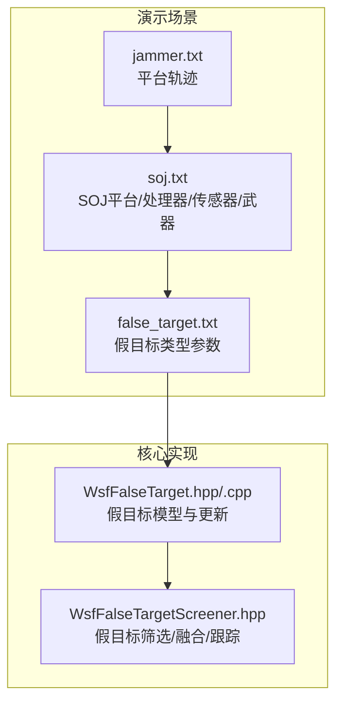
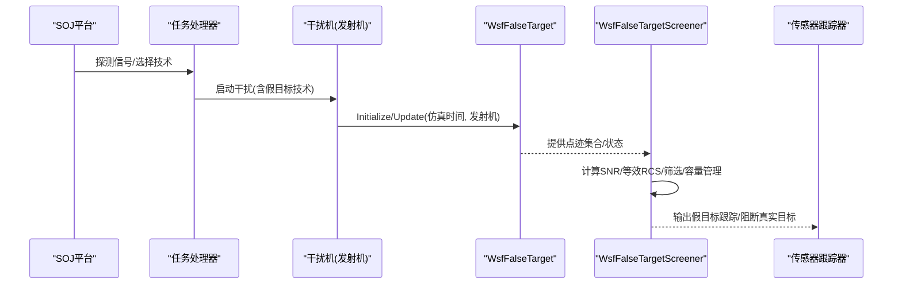
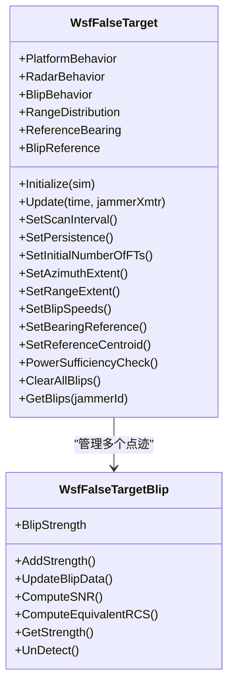
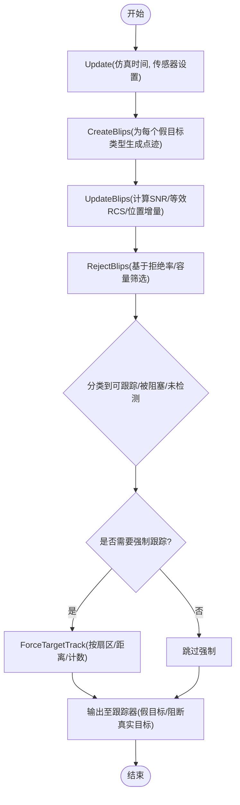

# 假目标生成

<cite>
**本文引用的文件**   
- [WsfFalseTarget.hpp](file://swdev/src/core/wsf_mil/source/ew/WsfFalseTarget.hpp)
- [WsfFalseTarget.cpp](file://swdev/src/core/wsf_mil/source/ew/WsfFalseTarget.cpp)
- [WsfFalseTargetScreener.hpp](file://swdev/src/core/wsf_mil/source/ew/WsfFalseTargetScreener.hpp)
- [soj.txt](file://demos/electronic_warfare/test_false_targets/platforms/soj.txt)
- [false_target.txt](file://demos/electronic_warfare/test_false_targets/weapons/jammer/false_target.txt)
- [jammer.txt](file://demos/electronic_warfare/test_false_targets/scenarios/jammer.txt)
</cite>

## 目录
1. [引言](#引言)
2. [项目结构](#项目结构)
3. [核心组件](#核心组件)
4. [架构总览](#架构总览)
5. [详细组件分析](#详细组件分析)
6. [依赖关系分析](#依赖关系分析)
7. [性能与复杂度](#性能与复杂度)
8. [故障排查指南](#故障排查指南)
9. [结论](#结论)
10. [附录：配置与使用要点](#附录配置与使用要点)

## 引言
本文件围绕 AFSIM 中的“假目标（False Target）”技术，系统解析其物理特性、电磁特征与运动规律建模，说明假目标与真实目标的区分方法与识别算法，给出假目标数量优化与分布策略的具体技术，并总结复杂战场环境下的生成策略与反识别对抗思路。内容以代码级实现为依据，结合演示场景的配置进行说明，帮助读者从原理到落地全面掌握假目标生成与运用。

## 项目结构
与假目标相关的核心代码位于电子战模块中，演示场景位于 electronic_warfare/test_false_targets 下。关键文件包括：
- 核心类定义与实现：WsfFalseTarget.hpp/.cpp、WsfFalseTargetScreener.hpp
- 平台与武器配置：platforms/soj.txt、weapons/jammer/false_target.txt
- 场景编排：scenarios/jammer.txt

图表来源
- [jammer.txt:17-32](file://demos/electronic_warfare/test_false_targets/scenarios/jammer.txt#L17-L32)
- [soj.txt:214-275](file://demos/electronic_warfare/test_false_targets/platforms/soj.txt#L214-L275)
- [false_target.txt:10-42](file://demos/electronic_warfare/test_false_targets/weapons/jammer/false_target.txt#L10-L42)
- [WsfFalseTarget.hpp:49-329](file://swdev/src/core/wsf_mil/source/ew/WsfFalseTarget.hpp#L49-L329)
- [WsfFalseTargetScreener.hpp:40-373](file://swdev/src/core/wsf_mil/source/ew/WsfFalseTargetScreener.hpp#L40-L373)

章节来源
- [jammer.txt:17-32](file://demos/electronic_warfare/test_false_targets/scenarios/jammer.txt#L17-L32)
- [soj.txt:214-275](file://demos/electronic_warfare/test_false_targets/platforms/soj.txt#L214-L275)
- [false_target.txt:10-42](file://demos/electronic_warfare/test_false_targets/weapons/jammer/false_target.txt#L10-L42)
- [WsfFalseTarget.hpp:49-329](file://swdev/src/core/wsf_mil/source/ew/WsfFalseTarget.hpp#L49-L329)
- [WsfFalseTargetScreener.hpp:40-373](file://swdev/src/core/wsf_mil/source/ew/WsfFalseTargetScreener.hpp#L40-L373)

## 核心组件
- WsfFalseTarget：描述一组假目标的总体行为、分布、运动、扫描周期、持久性、参考方位基准等，负责按雷达/干扰机维度维护假目标点迹（Blip）集合，并在仿真时间推进时更新位置、强度与可见性。
- WsfFalseTargetBlip：单个假目标点迹的数据载体，维护每个雷达的 SNR、等效 RCS、距离、位置增量、交互对象等，支持强/弱/未检测三类强度状态。
- WsfFalseTargetScreener：将假目标点迹与传感器跟踪器融合，管理可跟踪/被阻塞/未检测三类点迹列表，控制容量、拒绝率、强制跟踪、输出模式（绘图/跟踪/过载），并提供对真实目标跟踪的过滤与放行逻辑。

章节来源
- [WsfFalseTarget.hpp:49-329](file://swdev/src/core/wsf_mil/source/ew/WsfFalseTarget.hpp#L49-L329)
- [WsfFalseTarget.hpp:331-458](file://swdev/src/core/wsf_mil/source/ew/WsfFalseTarget.hpp#L331-L458)
- [WsfFalseTargetScreener.hpp:40-373](file://swdev/src/core/wsf_mil/source/ew/WsfFalseTargetScreener.hpp#L40-L373)

## 架构总览
假目标生成的端到端流程如下：
- 平台侧通过任务处理器根据探测到的辐射源频率与目标类型选择干扰技术与设备；
- 在武器层加载假目标类型（WSF_FALSE_TARGET），设置数量、多雷达一致性、扫描间隔、分布区域、运动参数、持久性等；
- 仿真运行时，WsfFalseTarget 为每个干扰机发射机实例化并维护假目标点迹集合；
- WsfFalseTargetScreener 将点迹与传感器模式关联，计算 SNR/等效 RCS，执行筛选、容量管理与强制跟踪，最终向跟踪器输出假目标或阻断真实目标。

图表来源
- [soj.txt:22-210](file://demos/electronic_warfare/test_false_targets/platforms/soj.txt#L22-L210)
- [false_target.txt:10-42](file://demos/electronic_warfare/test_false_targets/weapons/jammer/false_target.txt#L10-L42)
- [WsfFalseTarget.cpp:263-279](file://swdev/src/core/wsf_mil/source/ew/WsfFalseTarget.cpp#L263-L279)
- [WsfFalseTargetScreener.hpp:104-110](file://swdev/src/core/wsf_mil/source/ew/WsfFalseTargetScreener.hpp#L104-L110)

## 详细组件分析

### 组件一：WsfFalseTarget（假目标模型）
- 行为枚举
  - 平台行为：多平台感知一致或不一致；
  - 雷达行为：多雷达感知一致或不一致；
  - 点迹行为：逐次扫描随机或相对真实几何一致；
  - 分布方式：随机/圆形/扇形；
  - 距离分布：均匀/对数/指数；
  - 参考方位基准：干扰机/正北/受保护实体；
  - 点迹速度/航向参考：输入值或跟随干扰机平台。
- 关键数据
  - 初始假目标数量、扫描间隔、持久性；
  - 方位范围、距离范围、是否距离受限；
  - 参考质心（经纬高、航向、速度）、AGL 调整；
  - 每干扰机维度的点迹集合与状态（创建标志、上次扫描/更新时间、位置、被拒数量等）。
- 主要方法
  - 初始化与克隆、输入处理、更新（Rescan/UpdateBlipPositions/UpdateCentroidPosition）；
  - 获取/设置行为、范围、速度、参考方位、质心；
  - 功率充分性检查、清理点迹、删除干扰机、丢弃跟踪等。

图表来源
- [WsfFalseTarget.hpp:49-329](file://swdev/src/core/wsf_mil/source/ew/WsfFalseTarget.hpp#L49-L329)
- [WsfFalseTarget.hpp:331-458](file://swdev/src/core/wsf_mil/source/ew/WsfFalseTarget.hpp#L331-L458)

章节来源
- [WsfFalseTarget.hpp:49-329](file://swdev/src/core/wsf_mil/source/ew/WsfFalseTarget.hpp#L49-L329)
- [WsfFalseTarget.cpp:202-279](file://swdev/src/core/wsf_mil/source/ew/WsfFalseTarget.cpp#L202-L279)

### 组件二：WsfFalseTargetScreener（筛选与融合）
- 功能职责
  - 收集假目标点迹并与传感器跟踪器融合；
  - 管理三类点迹列表：可跟踪、被阻塞、未检测；
  - 控制输出模式：绘图/跟踪/过载；
  - 评估干扰效果：完美/降级/无效；
  - 容量与拒绝率：跟踪容量、传输容量、初始/运行期拒绝率；
  - 强制跟踪：按方位扇区/距离/计数阈值强制注入目标跟踪；
  - 真实目标放行：AllowTargetTrack/AllowTrackReporting 决定是否允许真实目标跟踪上报。
- 关键接口
  - Initialize/Update/Reset；
  - AddFalseTarget/RemoveFalseTarget；
  - FindTrackableBlip/FindBlockedBlip/FindUndetectedBlip；
  - GetActiveTargetTracks/GetFalseTargetTracks；
  - ForceTargetTrack/RejectBlips。

图表来源
- [WsfFalseTargetScreener.hpp:104-110](file://swdev/src/core/wsf_mil/source/ew/WsfFalseTargetScreener.hpp#L104-L110)
- [WsfFalseTargetScreener.hpp:257-275](file://swdev/src/core/wsf_mil/source/ew/WsfFalseTargetScreener.hpp#L257-L275)

章节来源
- [WsfFalseTargetScreener.hpp:40-373](file://swdev/src/core/wsf_mil/source/ew/WsfFalseTargetScreener.hpp#L40-L373)

### 组件三：平台与武器配置（SOJ 与假目标类型）
- SOJ 平台
  - 包含 ESM 传感器、多频段干扰武器、任务处理器脚本；
  - 根据探测信号频率与目标类型动态选择干扰技术与带宽；
  - 在 IS_JAMMING 状态下调用 StartJamming 启动干扰（含假目标技术）。
- 假目标类型（WSF_FALSE_TARGET）
  - quantity：初始假目标数量；
  - multi_radar_behavior：多雷达一致性；
  - false_target_behavior：逐次扫描一致性；
  - scan_time：扫描周期；
  - distribution_centroid：分布质心（经纬高、航向、速度）；
  - distribution：方位基准、半径、扇区角；
  - false_target_movement：速度与航向范围、参考；
  - range_constrained/persistence：距离约束与持久性。

章节来源
- [soj.txt:22-210](file://demos/electronic_warfare/test_false_targets/platforms/soj.txt#L22-L210)
- [soj.txt:214-275](file://demos/electronic_warfare/test_false_targets/platforms/soj.txt#L214-L275)
- [false_target.txt:10-42](file://demos/electronic_warfare/test_false_targets/weapons/jammer/false_target.txt#L10-L42)

## 依赖关系分析
- WsfFalseTarget 依赖 EM 交互对象、地形、平台、仿真、随机数、字符串 ID 等；
- WsfFalseTargetScreener 依赖传感器模式、跟踪器、平台、仿真、随机数，并通过 EffectManager 注册/移除假目标筛选器；
- 演示场景中，SOJ 平台通过任务处理器脚本驱动干扰武器，武器中包含假目标类型定义。

图表来源
- [soj.txt:214-275](file://demos/electronic_warfare/test_false_targets/platforms/soj.txt#L214-L275)
- [false_target.txt:10-42](file://demos/electronic_warfare/test_false_targets/weapons/jammer/false_target.txt#L10-L42)
- [WsfFalseTarget.hpp:49-329](file://swdev/src/core/wsf_mil/source/ew/WsfFalseTarget.hpp#L49-L329)
- [WsfFalseTargetScreener.hpp:40-373](file://swdev/src/core/wsf_mil/source/ew/WsfFalseTargetScreener.hpp#L40-L373)

章节来源
- [soj.txt:214-275](file://demos/electronic_warfare/test_false_targets/platforms/soj.txt#L214-L275)
- [false_target.txt:10-42](file://demos/electronic_warfare/test_false_targets/weapons/jammer/false_target.txt#L10-L42)
- [WsfFalseTarget.hpp:49-329](file://swdev/src/core/wsf_mil/source/ew/WsfFalseTarget.hpp#L49-L329)
- [WsfFalseTargetScreener.hpp:40-373](file://swdev/src/core/wsf_mil/source/ew/WsfFalseTargetScreener.hpp#L40-L373)

## 性能与复杂度
- 点迹管理
  - 每个假目标类型维护一个 Blips 向量，按干扰机 ID 索引；
  - 点迹按雷达/传感器对（RadarSnsrPair）维护 BlipData 映射，便于多雷达差异化处理；
  - 更新过程涉及遍历点迹、计算 SNR/等效 RCS、位置增量与强度判定。
- 筛选与容量控制
  - 三类点迹列表（可跟踪/被阻塞/未检测）在每次 Update 中调整；
  - 拒绝率（初始/运行期）与容量（PlotCapacity/TrackCapacity/TransferCapacity）共同决定输出规模；
  - 强制跟踪按方位扇区与距离阈值注入，避免过密或过疏。
- 复杂度估计
  - 设 N 为假目标总数，M 为关联雷达数，K 为干扰机数；
  - 典型更新复杂度约为 O(N·M) 级别（点迹×雷达），容量剪枝与拒绝率可降低实际运算量。

[本节为通用性能讨论，不直接分析具体文件]

## 故障排查指南
- 初始化错误
  - 当雷达行为为 random_to_multiple_radars 且平台行为为 consistent_to_multiple_platforms 时，初始化会报错；
  - 当雷达行为为 consistent_to_multiple_radars 但未设置 reference centroid 时，初始化失败。
- 调试开关
  - 可通过 debug 命令开启 WsfFalseTarget 的调试输出；
  - Screener 提供 DebugEnabled 与 ScreenerValid 状态查询。
- 常见现象
  - 假目标过多导致过载（OVERLOAD）：需调整 quantity、scan_time、distribution 与 screener 容量；
  - 假目标未被跟踪：检查 persistence、range_constrained、strength 与拒绝率；
  - 真实目标被误阻断：检查 AllowTargetTrack/AllowTrackReporting 逻辑与强制跟踪阈值。

章节来源
- [WsfFalseTarget.cpp:242-257](file://swdev/src/core/wsf_mil/source/ew/WsfFalseTarget.cpp#L242-L257)
- [WsfFalseTarget.cpp:288-300](file://swdev/src/core/wsf_mil/source/ew/WsfFalseTarget.cpp#L288-L300)
- [WsfFalseTargetScreener.hpp:118-124](file://swdev/src/core/wsf_mil/source/ew/WsfFalseTargetScreener.hpp#L118-L124)

## 结论
AFSIM 的假目标体系通过 WsfFalseTarget 与 WsfFalseTargetScreener 的配合，实现了从物理/电磁/运动建模到传感器融合与跟踪输出的完整链路。通过灵活的行为枚举、分布策略、运动参数与容量控制，可在复杂战场环境下生成逼真且可控的假目标群，有效干扰敌方雷达与跟踪系统。同时，通过真实目标放行与强制跟踪机制，可在对抗中平衡假目标效果与真实目标保留需求。

[本节为总结性内容，不直接分析具体文件]

## 附录：配置与使用要点
- 平台侧
  - 在 SOJ 平台的任务处理器中，依据 TRACK.FrequencyValid() 与目标类型选择干扰技术；
  - 在 IS_JAMMING 状态调用 StartJamming 启动干扰（含假目标技术）。
- 假目标类型
  - 设置 quantity、multi_radar_behavior、false_target_behavior、scan_time；
  - 配置 distribution_centroid 与 distribution（bearing_reference、radius、sector_arc）；
  - 设置 false_target_movement（speeds、headings、reference）；
  - 调整 range_constrained 与 persistence 控制可见性与持久性。
- 场景编排
  - 在 scenarios/jammer.txt 中定义 SOJ 平台轨迹与初始姿态。

章节来源
- [soj.txt:22-210](file://demos/electronic_warfare/test_false_targets/platforms/soj.txt#L22-L210)
- [false_target.txt:10-42](file://demos/electronic_warfare/test_false_targets/weapons/jammer/false_target.txt#L10-L42)
- [jammer.txt:17-32](file://demos/electronic_warfare/test_false_targets/scenarios/jammer.txt#L17-L32)