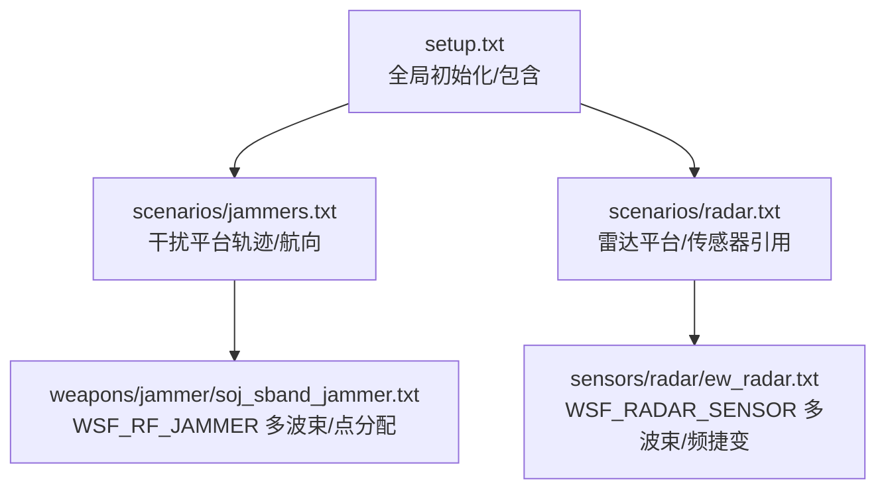
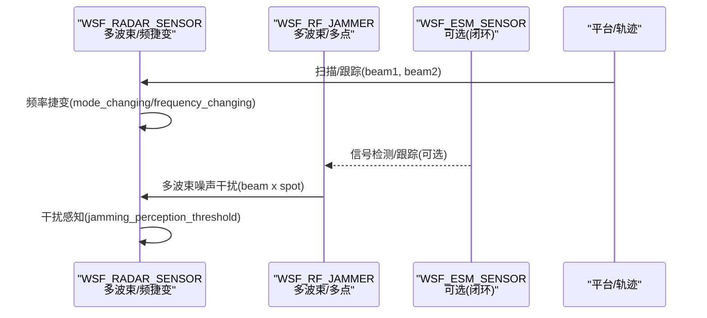
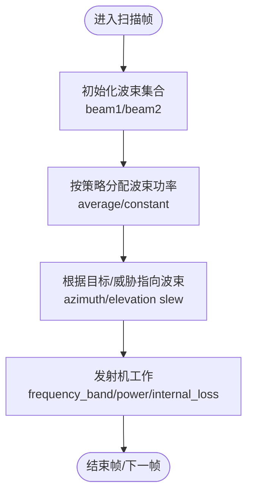
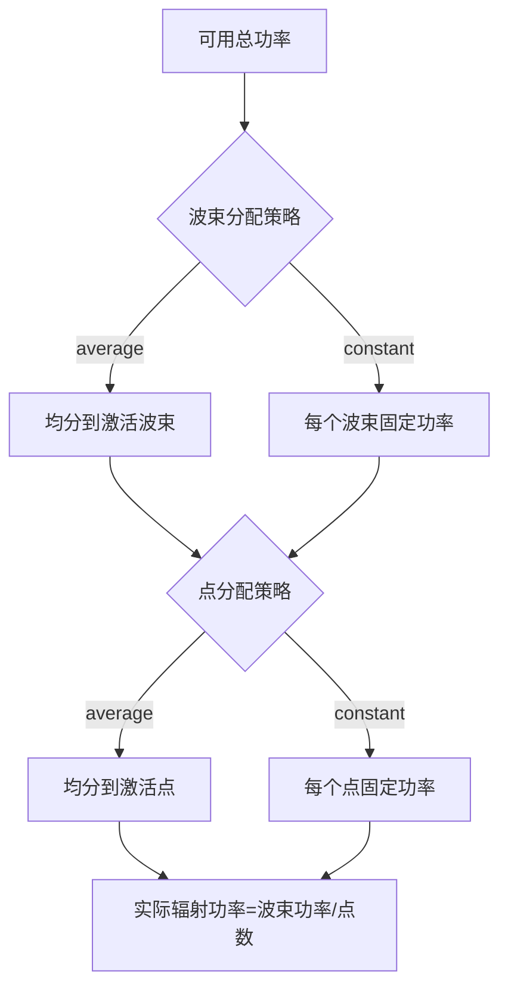
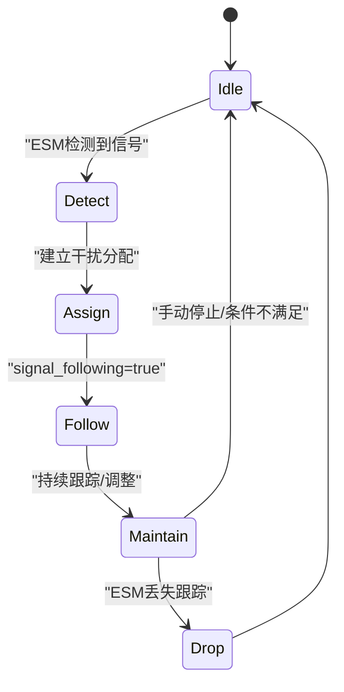
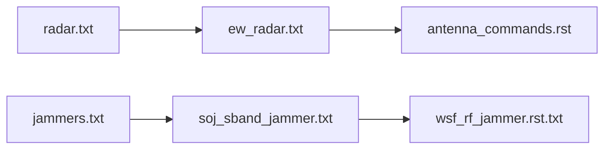

# 多波束干扰

<cite>
**本文引用的文件**   
- [setup.txt](file://demos/electronic_warfare/test_multi_beam/setup.txt)
- [jammers.txt](file://demos/electronic_warfare/test_multi_beam/scenarios/jammers.txt)
- [radar.txt](file://demos/electronic_warfare/test_multi_beam/scenarios/radar.txt)
- [ew_radar.txt](file://demos/electronic_warfare/test_multi_beam/sensors/radar/ew_radar.txt)
- [soj_sband_jammer.txt](file://demos/electronic_warfare/test_multi_beam/weapons/jammer/soj_sband_jammer.txt)
- [wsf_rf_jammer.rst.txt](file://documentation/html/_sources/docs/wsf_rf_jammer.rst.txt)
- [antenna_commands.rst](file://swdev/src/core/wsf/doc/antenna_commands.rst)
- [WsfFalseTarget.hpp](file://swdev/src/core/wsf_mil/source/ew/WsfFalseTarget.hpp)
</cite>

## 目录
1. [简介](#简介)
2. [项目结构](#项目结构)
3. [核心组件](#核心组件)
4. [架构总览](#架构总览)
5. [详细组件分析](#详细组件分析)
6. [依赖关系分析](#依赖关系分析)
7. [性能与调优](#性能与调优)
8. [故障排查指南](#故障排查指南)
9. [结论](#结论)
10. [附录：配置要点速查](#附录配置要点速查)

## 简介
本文件面向“多波束干扰系统”的配置与操控，围绕以下目标展开：
- 多波束形成、波束切换与干扰资源分配的技术实现
- 多目标同时干扰、自适应波束控制与干扰效能评估方法
- 多波束干扰策略优化与性能调优指导
- 自动重复干扰、半自动重复干扰等高级干扰模式的使用说明

AFSIM 通过 WSF_RF_JAMMER 模型支持多波束、多点（spot）的射频干扰；配合雷达传感器（WSF_RADAR_SENSOR）的多波束扫描与频率捷变能力，可构建闭环或开环的多波束干扰场景。示例工程位于 demos/electronic_warfare/test_multi_beam。

## 项目结构
test_multi_beam 示例采用分层组织：
- 顶层 setup.txt 引入通用类型、事件输出与地形，并设置仿真时长
- scenarios 定义平台与指挥关系
- sensors/radar 定义雷达传感器及其多波束、频率通道与电子防护
- weapons/jammer 定义干扰机武器（WSF_RF_JAMPER），包含多波束与点功率分配、指向限制与发射机参数
- platforms 与 common 类型由 include_once 引入

图表来源
- [setup.txt:15-34](file://demos/electronic_warfare/test_multi_beam/setup.txt#L15-L34)
- [radar.txt:14-36](file://demos/electronic_warfare/test_multi_beam/scenarios/radar.txt#L14-L36)
- [jammers.txt:12-22](file://demos/electronic_warfare/test_multi_beam/scenarios/jammers.txt#L12-L22)
- [ew_radar.txt:29-123](file://demos/electronic_warfare/test_multi_beam/sensors/radar/ew_radar.txt#L29-L123)
- [soj_sband_jammer.txt:24-51](file://demos/electronic_warfare/test_multi_beam/weapons/jammer/soj_sband_jammer.txt#L24-L51)

章节来源
- [setup.txt:15-34](file://demos/electronic_warfare/test_multi_beam/setup.txt#L15-L34)

## 核心组件
- 雷达传感器（WSF_RADAR_SENSOR）
  - 多波束：在同一帧模板中定义 beam 1、beam 2，各自拥有独立发射机频率通道
  - 频率捷变：receiver.electronic_protect.frequency_agility 在 mode_changing 与 frequency_changing 间切换
  - 干扰感知：jamming_perception_threshold 用于判断是否感知到干扰
- 干扰机（WSF_RF_JAMMER）
  - 多波束：maximum_number_of_beams 指定最大波束数
  - 波束功率分配：beam_power_distribution average/constant
  - 每波束多点：maximum_spots_per_beam 与 spot_power_distribution
  - 指向能力：slew_mode azimuth_and_elevation 及方位/俯仰 slew 限制
  - 发射机：frequency_band、power、internal_loss、electronic_attack.technique noise_jamming
- 平台与场景
  - 雷达平台挂载 EW_RADAR 传感器
  - 干扰平台 SOJ 携带 S/X 波段干扰武器，按轨道/航向机动

章节来源
- [ew_radar.txt:29-123](file://demos/electronic_warfare/test_multi_beam/sensors/radar/ew_radar.txt#L29-L123)
- [soj_sband_jammer.txt:24-51](file://demos/electronic_warfare/test_multi_beam/weapons/jammer/soj_sband_jammer.txt#L24-L51)
- [wsf_rf_jammer.rst.txt:198-237](file://documentation/html/_sources/docs/wsf_rf_jammer.rst.txt#L198-L237)

## 架构总览
下图展示多波束干扰的关键交互：雷达传感器以多波束扫描并执行频率捷变；干扰机以多波束/多点对多个雷达波束实施噪声干扰；ESM 可用于闭环重复干扰（自动/半自动）。

图表来源
- [ew_radar.txt:34-121](file://demos/electronic_warfare/test_multi_beam/sensors/radar/ew_radar.txt#L34-L121)
- [soj_sband_jammer.txt:24-51](file://demos/electronic_warfare/test_multi_beam/weapons/jammer/soj_sband_jammer.txt#L24-L51)
- [wsf_rf_jammer.rst.txt:138-192](file://documentation/html/_sources/docs/wsf_rf_jammer.rst.txt#L138-L192)

## 详细组件分析

### 多波束形成与波束切换
- 雷达侧
  - 在 mode_template 下定义 beam 1、beam 2，分别配置 transmitter 的频率通道与天线参数
  - 通过 frame_time 控制扫描周期，scan_mode 控制扫描维度
- 干扰侧
  - maximum_number_of_beams 决定可同时形成的波束数量
  - beam_power_distribution 控制波束间功率分配策略（average/constant）
  - slew_mode 与方位/俯仰 slew 限制决定波束指向范围与速度

图表来源
- [ew_radar.txt:34-121](file://demos/electronic_warfare/test_multi_beam/sensors/radar/ew_radar.txt#L34-L121)
- [soj_sband_jammer.txt:24-51](file://demos/electronic_warfare/test_multi_beam/weapons/jammer/soj_sband_jammer.txt#L24-L51)
- [wsf_rf_jammer.rst.txt:198-215](file://documentation/html/_sources/docs/wsf_rf_jammer.rst.txt#L198-L215)

章节来源
- [ew_radar.txt:34-121](file://demos/electronic_warfare/test_multi_beam/sensors/radar/ew_radar.txt#L34-L121)
- [soj_sband_jammer.txt:24-51](file://demos/electronic_warfare/test_multi_beam/weapons/jammer/soj_sband_jammer.txt#L24-L51)
- [wsf_rf_jammer.rst.txt:198-215](file://documentation/html/_sources/docs/wsf_rf_jammer.rst.txt#L198-L215)

### 干扰资源分配（波束与点）
- 波束级
  - maximum_number_of_beams：最大并发波束数
  - beam_power_distribution：平均或恒定分配
- 点级（Spot）
  - maximum_spots_per_beam：每波束最大点数
  - maximum_number_of_spots：全局最大点数上限
  - spot_power_distribution：点间功率分配策略

图表来源
- [wsf_rf_jammer.rst.txt:203-237](file://documentation/html/_sources/docs/wsf_rf_jammer.rst.txt#L203-L237)

章节来源
- [wsf_rf_jammer.rst.txt:203-237](file://documentation/html/_sources/docs/wsf_rf_jammer.rst.txt#L203-L237)

### 多目标同时干扰
- 干扰机通过“波束×点”二维资源矩阵覆盖多个目标
- 结合平台的机动与波束指向限制，可在不同方位/俯仰范围内同时对多个雷达波束实施干扰
- 当存在多个雷达平台时，可通过 jammer_group 与 group_power_distribution 将多个干扰器组合为“功率组”，协同提升覆盖与强度

章节来源
- [wsf_rf_jammer.rst.txt:114-125](file://documentation/html/_sources/docs/wsf_rf_jammer.rst.txt#L114-L125)

### 自适应波束控制与频率捷变对抗
- 雷达侧
  - receiver.electronic_protect.frequency_agility 支持 mode_changing 与 frequency_changing
  - jamming_perception_threshold 用于判定是否感知到干扰
- 干扰侧
  - 使用 repeater 逻辑（ESM 内联）可实现自动/半自动闭环干扰，跟踪信号变化并维持干扰任务
  - signal_following 允许跟随 ESM 报告的频率变化

图表来源
- [wsf_rf_jammer.rst.txt:138-192](file://documentation/html/_sources/docs/wsf_rf_jammer.rst.txt#L138-L192)
- [ew_radar.txt:64-80](file://demos/electronic_warfare/test_multi_beam/sensors/radar/ew_radar.txt#L64-L80)

章节来源
- [ew_radar.txt:64-80](file://demos/electronic_warfare/test_multi_beam/sensors/radar/ew_radar.txt#L64-L80)
- [wsf_rf_jammer.rst.txt:138-192](file://documentation/html/_sources/docs/wsf_rf_jammer.rst.txt#L138-L192)

### 干扰效能评估
- 雷达端指标
  - jamming_perception_threshold：感知阈值
  - required_pd / hits_to_establish_track / hits_to_maintain_track：探测/跟踪门限
  - track_quality：轨迹质量
- 干扰端指标
  - 有效辐射功率（考虑 internal_loss、antenna_pattern、beam/spot 分配）
  - 干扰覆盖度（波束×点覆盖的方位/俯仰范围）
- 建议采集的事件
  - 干扰感知事件、频率捷变事件、跟踪丢失/重建事件

章节来源
- [ew_radar.txt:47-103](file://demos/electronic_warfare/test_multi_beam/sensors/radar/ew_radar.txt#L47-L103)

### 自动/半自动重复干扰模式
- repeater.operating_mode
  - manual：人工启停
  - semi-auto：人工启动，基于 ESM 跟踪丢失自动停止
  - auto：完全自动，依据 ESM 跟踪启停
- signal_following：开启后干扰机可跟随 ESM 报告的频率变化进行跟踪

章节来源
- [wsf_rf_jammer.rst.txt:157-188](file://documentation/html/_sources/docs/wsf_rf_jammer.rst.txt#L157-L188)

## 依赖关系分析
- 场景层
  - radar.txt 将平台与传感器关联
  - jammers.txt 定义干扰平台轨迹与航向
- 设备层
  - ew_radar.txt 定义 WSF_RADAR_SENSOR 的多波束与频率捷变
  - soj_sband_jammer.txt 定义 WSF_RF_JAMMER 的多波束/点与发射机参数
- 文档层
  - wsf_rf_jammer.rst.txt 提供命令参考
  - antenna_commands.rst 提供天线/扫描相关命令参考

图表来源
- [radar.txt:21-36](file://demos/electronic_warfare/test_multi_beam/scenarios/radar.txt#L21-L36)
- [jammers.txt:12-22](file://demos/electronic_warfare/test_multi_beam/scenarios/jammers.txt#L12-L22)
- [ew_radar.txt:29-123](file://demos/electronic_warfare/test_multi_beam/sensors/radar/ew_radar.txt#L29-L123)
- [soj_sband_jammer.txt:24-51](file://demos/electronic_warfare/test_multi_beam/weapons/jammer/soj_sband_jammer.txt#L24-L51)
- [wsf_rf_jammer.rst.txt:198-237](file://documentation/html/_sources/docs/wsf_rf_jammer.rst.txt#L198-L237)
- [antenna_commands.rst:108-134](file://swdev/src/core/wsf/doc/antenna_commands.rst#L108-L134)

章节来源
- [radar.txt:21-36](file://demos/electronic_warfare/test_multi_beam/scenarios/radar.txt#L21-L36)
- [jammers.txt:12-22](file://demos/electronic_warfare/test_multi_beam/scenarios/jammers.txt#L12-L22)
- [ew_radar.txt:29-123](file://demos/electronic_warfare/test_multi_beam/sensors/radar/ew_radar.txt#L29-L123)
- [soj_sband_jammer.txt:24-51](file://demos/electronic_warfare/test_multi_beam/weapons/jammer/soj_sband_jammer.txt#L24-L51)

## 性能与调优
- 波束与点资源
  - 合理设置 maximum_number_of_beams 与 maximum_spots_per_beam，避免过度分散导致单点功率不足
  - 在目标密集区优先使用 average 分配以提升整体覆盖；在关键目标上使用 constant 保障最低功率
- 指向与扫描
  - 利用 slew_mode 与方位/俯仰 slew 限制，确保波束快速重定向至高价值目标
  - 雷达侧 frame_time 与 scan_mode 需与干扰机响应时间匹配，避免“跳频快于干扰更新”
- 频率捷变对抗
  - 雷达侧 frequency_agility 的 agility_type 与 mode_changing 应结合干扰机的 repeater.signal_following 启用，提高闭环跟踪成功率
- 干扰组协同
  - 使用 jammer_group 与 group_power_distribution=average 聚合多台干扰器功率，提升覆盖与鲁棒性
- 效能观测
  - 关注 jamming_perception_threshold 触发次数、required_pd 达成率、track 丢失/恢复统计

[本节为通用指导，不直接分析具体文件]

## 故障排查指南
- 干扰未生效
  - 检查干扰机是否定义了 electronic_attack.technique noise_jamming 且 power > 0
  - 确认波束指向是否在 slew 限制范围内
  - 核查 beam_power_distribution 与 spot_power_distribution 是否导致功率过低
- 雷达未感知干扰
  - 检查 jamming_perception_threshold 是否过高
  - 确认 receiver.internal_loss 与 bandwidth 设置是否合理
- 频率捷变后干扰中断
  - 若使用 repeater，请开启 signal_following 并确保 ESM 报告频率
  - 核查 operating_mode 是否为 auto/semi-auto
- 多波束雷达与假目标干扰兼容性问题
  - 注意历史版本中对多波束雷达与假目标干扰的兼容性修复，必要时升级框架版本

章节来源
- [soj_sband_jammer.txt:38-50](file://demos/electronic_warfare/test_multi_beam/weapons/jammer/soj_sband_jammer.txt#L38-L50)
- [ew_radar.txt:47-80](file://demos/electronic_warfare/test_multi_beam/sensors/radar/ew_radar.txt#L47-L80)
- [wsf_rf_jammer.rst.txt:138-192](file://documentation/html/_sources/docs/wsf_rf_jammer.rst.txt#L138-L192)
- [WsfFalseTarget.hpp:97-124](file://swdev/src/core/wsf_mil/source/ew/WsfFalseTarget.hpp#L97-L124)

## 结论
在多波束干扰系统中，关键在于：
- 明确波束与点的资源边界与功率分配策略
- 将雷达的多波束扫描与频率捷变纳入干扰闭环设计
- 通过 repeater 与 ESM 实现自动/半自动干扰，提升对动态目标的压制效果
- 以感知阈值、探测概率与轨迹质量为核心指标进行效能评估与迭代优化

[本节为总结性内容，不直接分析具体文件]

## 附录：配置要点速查
- 雷达传感器（WSF_RADAR_SENSOR）
  - 多波束：mode_template 下定义 beam 1/2，分别设置 transmitter.frequency_channels
  - 频率捷变：receiver.electronic_protect.frequency_agility.agility_type mode_changing/frequency_changing
  - 干扰感知：jamming_perception_threshold
- 干扰机（WSF_RF_JAMMER）
  - 多波束：maximum_number_of_beams、beam_power_distribution
  - 点资源：maximum_spots_per_beam、spot_power_distribution
  - 指向：slew_mode azimuth_and_elevation，方位/俯仰 slew 限制
  - 发射机：frequency_band、power、internal_loss、electronic_attack.technique noise_jamming
  - 重复干扰：repeater.operating_mode manual/semi-auto/auto，signal_following
- 平台与场景
  - 雷达平台挂载传感器，干扰平台定义轨迹与航向

章节来源
- [ew_radar.txt:34-121](file://demos/electronic_warfare/test_multi_beam/sensors/radar/ew_radar.txt#L34-L121)
- [soj_sband_jammer.txt:24-51](file://demos/electronic_warfare/test_multi_beam/weapons/jammer/soj_sband_jammer.txt#L24-L51)
- [wsf_rf_jammer.rst.txt:198-237](file://documentation/html/_sources/docs/wsf_rf_jammer.rst.txt#L198-L237)