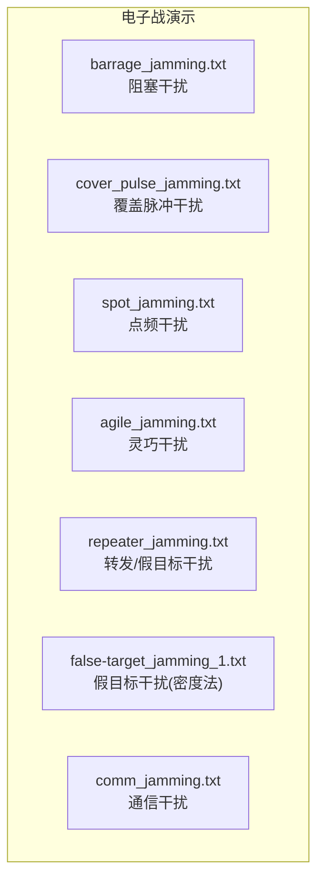
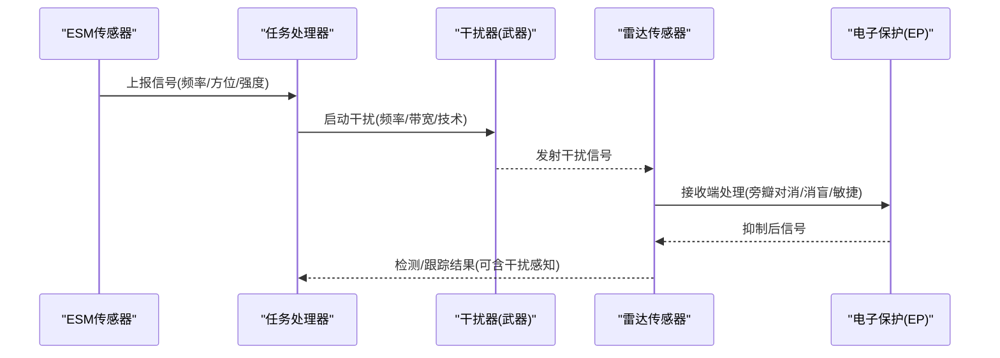
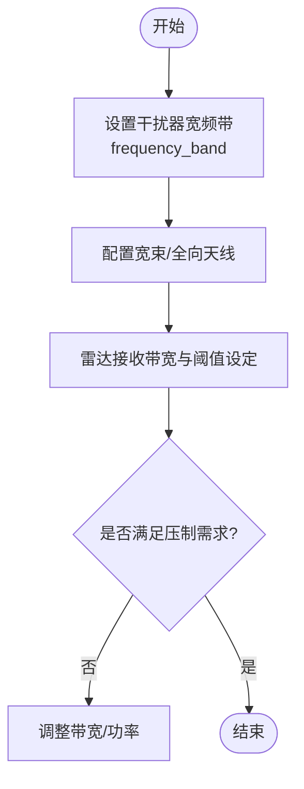
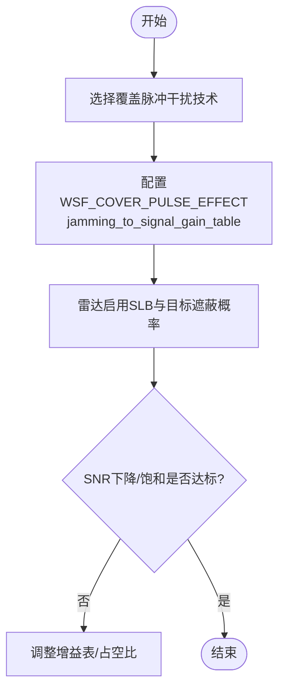
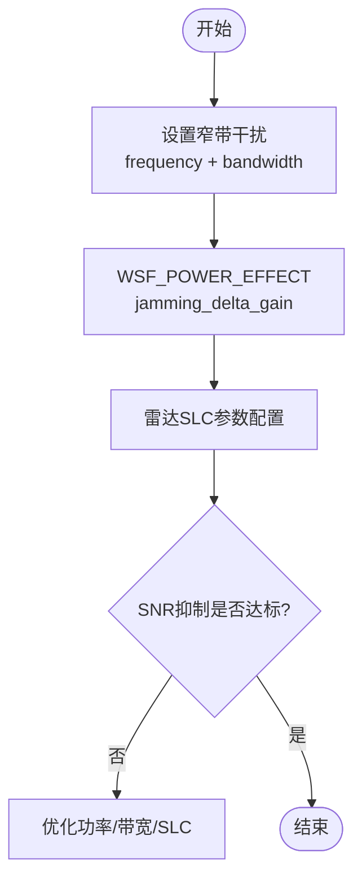
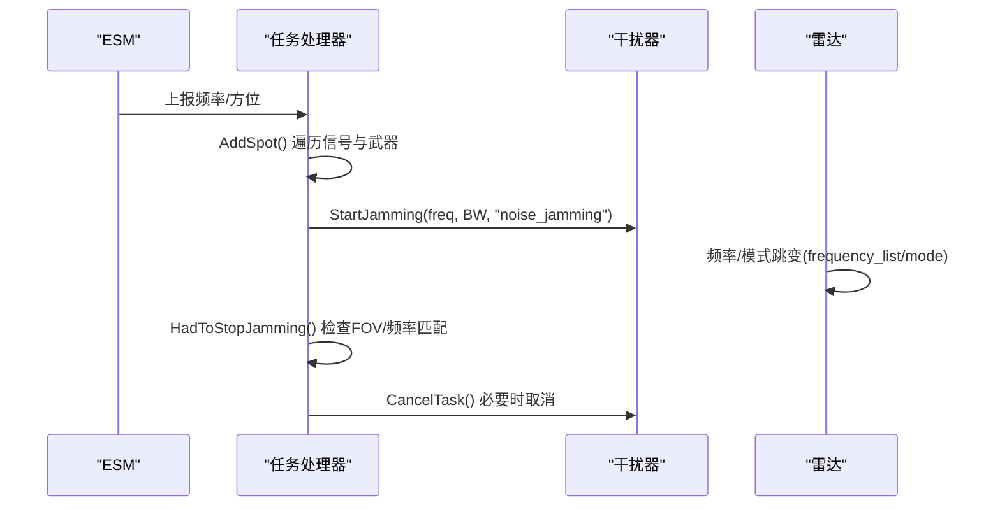
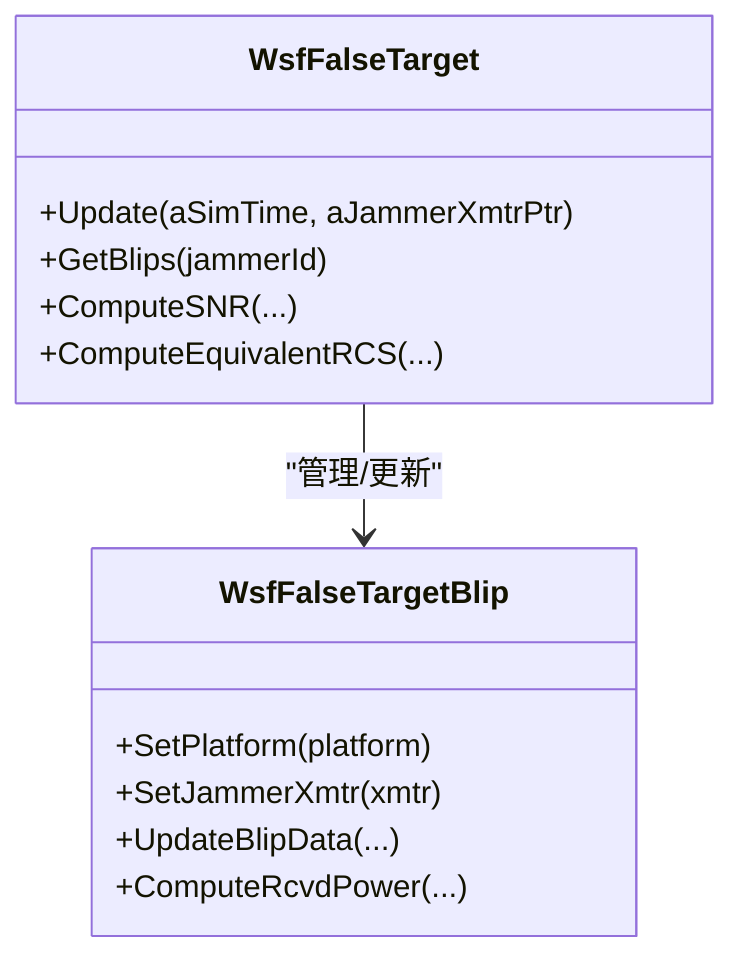
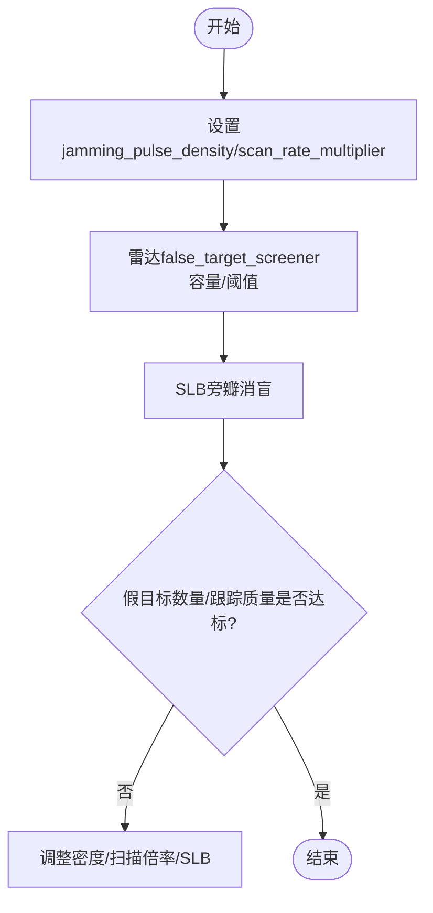
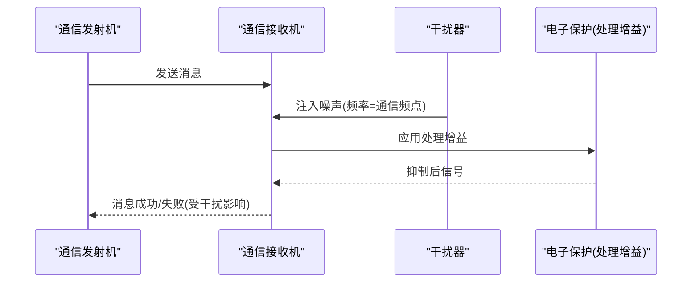
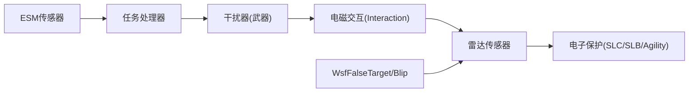

# 干扰技术

<cite>
**本文引用的文件**   
- [barrage_jamming.txt](file://demos/electronic_warfare/barrage_jamming.txt)
- [cover_pulse_jamming.txt](file://demos/electronic_warfare/cover_pulse_jamming.txt)
- [spot_jamming.txt](file://demos/electronic_warfare/spot_jamming.txt)
- [agile_jamming.txt](file://demos/electronic_warfare/agile_jamming.txt)
- [repeater_jamming.txt](file://demos/electronic_warfare/repeater_jamming.txt)
- [false-target_jamming_1.txt](file://demos/electronic_warfare/false-target_jamming_1.txt)
- [comm_jamming.txt](file://demos/electronic_warfare/comm_jamming.txt)
- [WsfFalseTarget.hpp](file://swdev/src/core/wsf_mil/source/ew/WsfFalseTarget.hpp)
</cite>

## 目录
1. [引言](#引言)
2. [项目结构](#项目结构)
3. [核心组件](#核心组件)
4. [架构总览](#架构总览)
5. [详细组件分析](#详细组件分析)
6. [依赖关系分析](#依赖关系分析)
7. [性能与实现要点](#性能与实现要点)
8. [故障排查指南](#故障排查指南)
9. [结论](#结论)
10. [附录：干扰模式配置速查](#附录干扰模式配置速查)

## 引言
本文件面向电子战仿真用户，系统梳理并详解压制干扰、欺骗干扰、灵巧干扰与转发干扰的技术原理与AFSIM中的配置方法。重点覆盖阻塞（宽频）干扰、覆盖脉冲干扰、点频（窄带）干扰、灵巧频率/模式跳变干扰、以及基于回波转发的假目标干扰等典型模式；同时给出干扰波形设计思路、功率控制策略、时频同步要点，并提供干扰策略优化与抗干扰对抗的实践指导。

## 项目结构
AFSIM的“电子战”演示位于 demos/electronic_warfare 目录，包含多种干扰场景脚本与测试用例。每个 .txt 文件定义一个完整的仿真场景，包括平台、传感器、武器（含干扰器）、电子攻击/保护技术与事件输出等。

**图示来源**
- [barrage_jamming.txt:1-260](file://demos/electronic_warfare/barrage_jamming.txt#L1-L260)
- [cover_pulse_jamming.txt:1-324](file://demos/electronic_warfare/cover_pulse_jamming.txt#L1-L324)
- [spot_jamming.txt:1-320](file://demos/electronic_warfare/spot_jamming.txt#L1-L320)
- [agile_jamming.txt:1-472](file://demos/electronic_warfare/agile_jamming.txt#L1-L472)
- [repeater_jamming.txt:1-428](file://demos/electronic_warfare/repeater_jamming.txt#L1-L428)
- [false-target_jamming_1.txt:1-392](file://demos/electronic_warfare/false-target_jamming_1.txt#L1-L392)
- [comm_jamming.txt:1-383](file://demos/electronic_warfare/comm_jamming.txt#L1-L383)

**章节来源**
- [barrage_jamming.txt:1-260](file://demos/electronic_warfare/barrage_jamming.txt#L1-L260)
- [cover_pulse_jamming.txt:1-324](file://demos/electronic_warfare/cover_pulse_jamming.txt#L1-L324)
- [spot_jamming.txt:1-320](file://demos/electronic_warfare/spot_jamming.txt#L1-L320)
- [agile_jamming.txt:1-472](file://demos/electronic_warfare/agile_jamming.txt#L1-L472)
- [repeater_jamming.txt:1-428](file://demos/electronic_warfare/repeater_jamming.txt#L1-L428)
- [false-target_jamming_1.txt:1-392](file://demos/electronic_warfare/false-target_jamming_1.txt#L1-L392)
- [comm_jamming.txt:1-383](file://demos/electronic_warfare/comm_jamming.txt#L1-L383)

## 核心组件
- 雷达传感器模型：用于发射探测信号、接收回波与噪声，支持多模式、多频率、扫描参数、检测阈值、跟踪逻辑等。
- 干扰器（RF Jammer）：作为武器挂载于平台，具备发射机、天线方向图、电子攻击技术（EA）与可选转发器（Repeater）。
- 电子攻击（EA）技术：噪声干扰、假目标干扰、覆盖脉冲干扰等，通过 effect 块进行功率、增益、密度、扫描倍率等控制。
- 电子保护（EP）技术：旁瓣对消（SLC）、旁瓣消盲（SLB）、敏捷性（Agility）、处理增益等，用于提升抗干扰能力。
- ESM（电子支援措施）传感器：用于侦测敌方辐射源频率、方位等信息，驱动灵巧干扰任务调度。
- 任务处理器（Task Processor）：结合脚本实现自动选频、驻留、切换与取消干扰任务。

**章节来源**
- [spot_jamming.txt:44-78](file://demos/electronic_warfare/spot_jamming.txt#L44-L78)
- [cover_pulse_jamming.txt:30-67](file://demos/electronic_warfare/cover_pulse_jamming.txt#L30-L67)
- [agile_jamming.txt:39-88](file://demos/electronic_warfare/agile_jamming.txt#L39-L88)
- [repeater_jamming.txt:82-120](file://demos/electronic_warfare/repeater_jamming.txt#L82-L120)
- [false-target_jamming_1.txt:40-66](file://demos/electronic_warfare/false-target_jamming_1.txt#L40-L66)
- [comm_jamming.txt:216-240](file://demos/electronic_warfare/comm_jamming.txt#L216-L240)

## 架构总览
以下架构图展示了干扰链路中关键实体与数据流：ESM侦测→任务调度→干扰器发射→雷达接收→检测/跟踪→反制（EP）。

**图示来源**
- [agile_jamming.txt:39-88](file://demos/electronic_warfare/agile_jamming.txt#L39-L88)
- [agile_jamming.txt:90-197](file://demos/electronic_warfare/agile_jamming.txt#L90-L197)
- [agile_jamming.txt:203-308](file://demos/electronic_warfare/agile_jamming.txt#L203-L308)
- [spot_jamming.txt:84-166](file://demos/electronic_warfare/spot_jamming.txt#L84-L166)
- [cover_pulse_jamming.txt:89-170](file://demos/electronic_warfare/cover_pulse_jamming.txt#L89-L170)

## 详细组件分析

### 阻塞（宽频）干扰
- 原理：将干扰功率分散到较宽带宽上，以同时压制多个不同中心频率的雷达，但单频点干扰功率密度降低。
- 关键配置：
  - 干扰器发射机设置宽频带（frequency_band），配合全向或宽束天线。
  - 雷达侧需合理设置接收带宽与检测阈值，避免被宽频噪声淹没。
- 示例参考：[barrage_jamming.txt:36-49](file://demos/electronic_warfare/barrage_jamming.txt#L36-L49)

**图示来源**
- [barrage_jamming.txt:36-49](file://demos/electronic_warfare/barrage_jamming.txt#L36-L49)
- [barrage_jamming.txt:63-105](file://demos/electronic_warfare/barrage_jamming.txt#L63-L105)

**章节来源**
- [barrage_jamming.txt:36-49](file://demos/electronic_warfare/barrage_jamming.txt#L36-L49)
- [barrage_jamming.txt:63-105](file://demos/electronic_warfare/barrage_jamming.txt#L63-L105)

### 覆盖脉冲干扰
- 原理：在雷达主瓣扫描期间注入与雷达脉冲时序相关的噪声脉冲，提高雷达接收机饱和概率，降低信噪比。
- 关键配置：
  - EA技术选择 cover_pulse_jamming，effect为 WSF_COVER_PULSE_EFFECT。
  - 通过 jamming_to_signal_gain_table 调节干扰相对信号的增益曲线。
  - 雷达侧可启用 SLB（旁瓣消盲）与目标遮蔽概率表，评估抗干扰效果。
- 示例参考：[cover_pulse_jamming.txt:37-67](file://demos/electronic_warfare/cover_pulse_jamming.txt#L37-L67), [cover_pulse_jamming.txt:89-170](file://demos/electronic_warfare/cover_pulse_jamming.txt#L89-L170)

**图示来源**
- [cover_pulse_jamming.txt:37-67](file://demos/electronic_warfare/cover_pulse_jamming.txt#L37-L67)
- [cover_pulse_jamming.txt:89-170](file://demos/electronic_warfare/cover_pulse_jamming.txt#L89-L170)

**章节来源**
- [cover_pulse_jamming.txt:37-67](file://demos/electronic_warfare/cover_pulse_jamming.txt#L37-L67)
- [cover_pulse_jamming.txt:89-170](file://demos/electronic_warfare/cover_pulse_jamming.txt#L89-L170)

### 点频（窄带）干扰
- 原理：将干扰功率集中在雷达工作频率附近窄带内，最大化对特定雷达的压制效果。
- 关键配置：
  - EA技术选择 noise_jamming，effect为 WSF_POWER_EFFECT，可通过 jamming_delta_gain 微调。
  - 雷达侧可启用旁瓣对消（SLC）与通道数、锁定比等参数，评估抗干扰能力。
- 示例参考：[spot_jamming.txt:54-78](file://demos/electronic_warfare/spot_jamming.txt#L54-L78), [spot_jamming.txt:100-166](file://demos/electronic_warfare/spot_jamming.txt#L100-L166)

**图示来源**
- [spot_jamming.txt:54-78](file://demos/electronic_warfare/spot_jamming.txt#L54-L78)
- [spot_jamming.txt:100-166](file://demos/electronic_warfare/spot_jamming.txt#L100-L166)

**章节来源**
- [spot_jamming.txt:54-78](file://demos/electronic_warfare/spot_jamming.txt#L54-L78)
- [spot_jamming.txt:100-166](file://demos/electronic_warfare/spot_jamming.txt#L100-L166)

### 灵巧干扰（频率/模式跳变）
- 原理：根据ESM侦测到的雷达频率变化，动态切换干扰频率与模式，保持对跳频/模态雷达的有效压制。
- 关键配置：
  - ESM传感器侦测频率与方位，任务处理器脚本根据 TRACK.SignalFrequency 与 CanJam 判断可用干扰器。
  - 雷达侧配置 agility_type（mode_changing/frequency_changing）与 frequency_list，模拟跳频/模态。
- 示例参考：[agile_jamming.txt:39-88](file://demos/electronic_warfare/agile_jamming.txt#L39-L88), [agile_jamming.txt:90-197](file://demos/electronic_warfare/agile_jamming.txt#L90-L197), [agile_jamming.txt:203-308](file://demos/electronic_warfare/agile_jamming.txt#L203-L308)

**图示来源**
- [agile_jamming.txt:39-88](file://demos/electronic_warfare/agile_jamming.txt#L39-L88)
- [agile_jamming.txt:90-197](file://demos/electronic_warfare/agile_jamming.txt#L90-L197)
- [agile_jamming.txt:203-308](file://demos/electronic_warfare/agile_jamming.txt#L203-L308)

**章节来源**
- [agile_jamming.txt:39-88](file://demos/electronic_warfare/agile_jamming.txt#L39-L88)
- [agile_jamming.txt:90-197](file://demos/electronic_warfare/agile_jamming.txt#L90-L197)
- [agile_jamming.txt:203-308](file://demos/electronic_warfare/agile_jamming.txt#L203-L308)

### 转发干扰（假目标干扰）
- 原理：通过 Repeater 捕获雷达回波并转发，生成可控的假目标轨迹与RCS，扰乱雷达跟踪与识别。
- 关键配置：
  - 武器定义 repeater 模块，开启 frequency_following 与 operating_mode。
  - EA技术 false_target_jamming，effect为 WSF_FALSE_TARGET_EFFECT，设置 jamming_pulse_density、desired_false_target_rcs、scan_rate_multiplier 等。
  - 雷达侧可启用 false_target_screener 与 SLB，评估假目标过滤能力。
- 示例参考：[repeater_jamming.txt:82-120](file://demos/electronic_warfare/repeater_jamming.txt#L82-L120), [repeater_jamming.txt:145-228](file://demos/electronic_warfare/repeater_jamming.txt#L145-L228)

**图示来源**
- [WsfFalseTarget.hpp:49-184](file://swdev/src/core/wsf_mil/source/ew/WsfFalseTarget.hpp#L49-L184)
- [WsfFalseTarget.hpp:336-434](file://swdev/src/core/wsf_mil/source/ew/WsfFalseTarget.hpp#L336-L434)

**章节来源**
- [repeater_jamming.txt:82-120](file://demos/electronic_warfare/repeater_jamming.txt#L82-L120)
- [repeater_jamming.txt:145-228](file://demos/electronic_warfare/repeater_jamming.txt#L145-L228)
- [WsfFalseTarget.hpp:49-184](file://swdev/src/core/wsf_mil/source/ew/WsfFalseTarget.hpp#L49-L184)
- [WsfFalseTarget.hpp:336-434](file://swdev/src/core/wsf_mil/source/ew/WsfFalseTarget.hpp#L336-L434)

### 假目标干扰（密度法）
- 原理：通过提高 jamming_pulse_density 与 scan_rate_multiplier，增加雷达接收端的假目标密度，造成跟踪混淆。
- 关键配置：
  - EA技术 false_target_jamming，effect为 WSF_FALSE_TARGET_EFFECT，设置 jamming_pulse_density 与 scan_rate_multiplier。
  - 雷达侧启用 false_target_screener 与 SLB，评估假目标过滤与跟踪稳定性。
- 示例参考：[false-target_jamming_1.txt:40-66](file://demos/electronic_warfare/false-target_jamming_1.txt#L40-L66), [false-target_jamming_1.txt:88-170](file://demos/electronic_warfare/false-target_jamming_1.txt#L88-L170)

**图示来源**
- [false-target_jamming_1.txt:40-66](file://demos/electronic_warfare/false-target_jamming_1.txt#L40-L66)
- [false-target_jamming_1.txt:88-170](file://demos/electronic_warfare/false-target_jamming_1.txt#L88-L170)

**章节来源**
- [false-target_jamming_1.txt:40-66](file://demos/electronic_warfare/false-target_jamming_1.txt#L40-L66)
- [false-target_jamming_1.txt:88-170](file://demos/electronic_warfare/false-target_jamming_1.txt#L88-L170)

### 通信干扰
- 原理：针对通信收发链路，在通信频段注入噪声，降低信噪比，阻断信息传递。
- 关键配置：
  - 通信设备（WSF_RADIO_TRANSCEIVER）定义发射/接收参数与电子保护（processing_gain）。
  - 干扰器使用 noise_jamming 技术，按通信频率与带宽设置干扰。
- 示例参考：[comm_jamming.txt:63-99](file://demos/electronic_warfare/comm_jamming.txt#L63-L99), [comm_jamming.txt:216-240](file://demos/electronic_warfare/comm_jamming.txt#L216-L240)

**图示来源**
- [comm_jamming.txt:63-99](file://demos/electronic_warfare/comm_jamming.txt#L63-L99)
- [comm_jamming.txt:216-240](file://demos/electronic_warfare/comm_jamming.txt#L216-L240)

**章节来源**
- [comm_jamming.txt:63-99](file://demos/electronic_warfare/comm_jamming.txt#L63-L99)
- [comm_jamming.txt:216-240](file://demos/electronic_warfare/comm_jamming.txt#L216-L240)

## 依赖关系分析
- 干扰器与雷达之间的耦合主要通过电磁相互作用（EM Interaction）与接收端电子保护技术（SLC/SLB/Agility）实现。
- 假目标干扰依赖 WsfFalseTarget 与 WsfFalseTargetBlip 类管理虚假目标的创建、更新与强度计算。
- 灵巧干扰依赖 ESM 与任务处理器脚本，形成闭环反馈控制。

**图示来源**
- [WsfFalseTarget.hpp:49-184](file://swdev/src/core/wsf_mil/source/ew/WsfFalseTarget.hpp#L49-L184)
- [WsfFalseTarget.hpp:336-434](file://swdev/src/core/wsf_mil/source/ew/WsfFalseTarget.hpp#L336-L434)
- [agile_jamming.txt:39-88](file://demos/electronic_warfare/agile_jamming.txt#L39-L88)
- [agile_jamming.txt:90-197](file://demos/electronic_warfare/agile_jamming.txt#L90-L197)

**章节来源**
- [WsfFalseTarget.hpp:49-184](file://swdev/src/core/wsf_mil/source/ew/WsfFalseTarget.hpp#L49-L184)
- [WsfFalseTarget.hpp:336-434](file://swdev/src/core/wsf_mil/source/ew/WsfFalseTarget.hpp#L336-L434)
- [agile_jamming.txt:39-88](file://demos/electronic_warfare/agile_jamming.txt#L39-L88)
- [agile_jamming.txt:90-197](file://demos/electronic_warfare/agile_jamming.txt#L90-L197)

## 性能与实现要点
- 干扰波形设计
  - 阻塞干扰：增大 bandwidth，牺牲单频点功率密度，换取多频点覆盖。
  - 点频干扰：缩小 bandwidth，集中功率，提升 SNR 抑制效果。
  - 覆盖脉冲干扰：依据雷达 PRI/PW 配置干扰脉冲密度与占空比，利用 jamming_to_signal_gain_table 精细控制。
- 功率控制
  - 使用 WSF_POWER_EFFECT 的 jamming_delta_gain 或 signal_power_gain 进行微调。
  - 在通信干扰中，结合 processing_gain 与 jamming_perception_threshold 评估链路可用性。
- 时频同步
  - 灵巧干扰依赖 ESM 实时上报频率，任务处理器脚本根据 TRACK.SignalFrequency 与 CanJam 进行匹配与切换。
  - 雷达侧 frequency_list 与 mode_template 提供多频/多模态能力，要求干扰器具备快速响应与驻留时间控制。
- 资源与容量
  - 假目标干扰需关注 false_target_screener 的 track_capacity/plot_capacity/transfer_capacity，避免过载导致跟踪丢失。
  - 任务处理器需合理设置 evaluation_interval 与状态转换条件，避免频繁切换造成开销。

**章节来源**
- [spot_jamming.txt:54-78](file://demos/electronic_warfare/spot_jamming.txt#L54-L78)
- [cover_pulse_jamming.txt:37-67](file://demos/electronic_warfare/cover_pulse_jamming.txt#L37-L67)
- [agile_jamming.txt:90-197](file://demos/electronic_warfare/agile_jamming.txt#L90-L197)
- [false-target_jamming_1.txt:149-170](file://demos/electronic_warfare/false-target_jamming_1.txt#L149-L170)
- [comm_jamming.txt:63-99](file://demos/electronic_warfare/comm_jamming.txt#L63-L99)

## 故障排查指南
- 干扰无效或效果不足
  - 检查干扰器 power、bandwidth、antenna_pattern 是否与雷达 receiver 参数匹配。
  - 对于点频干扰，确认 jamming_delta_gain 是否过小；对于阻塞干扰，确认 bandwidth 是否过宽导致功率密度不足。
- 假目标过多或过少
  - 调整 jamming_pulse_density 与 scan_rate_multiplier。
  - 检查 false_target_screener 容量与 SLB 阈值，避免过度过滤或漏滤。
- 灵巧干扰无法跟踪雷达频率
  - 确认 ESM frame_time、maximum_range、frequency_band 配置正确。
  - 检查任务处理器脚本中 AddSpot/HadToStopJamming 逻辑与 FOV 限制。
- 通信干扰导致链路中断
  - 检查 comm 设备的 transmit_mode、frequency、bandwidth 与 jamming_perception_threshold。
  - 评估电子保护 processing_gain 是否足够补偿干扰。

**章节来源**
- [spot_jamming.txt:54-78](file://demos/electronic_warfare/spot_jamming.txt#L54-L78)
- [false-target_jamming_1.txt:149-170](file://demos/electronic_warfare/false-target_jamming_1.txt#L149-L170)
- [agile_jamming.txt:90-197](file://demos/electronic_warfare/agile_jamming.txt#L90-L197)
- [comm_jamming.txt:63-99](file://demos/electronic_warfare/comm_jamming.txt#L63-L99)

## 结论
AFSIM的电子战演示提供了从基础压制到复杂灵巧与假目标干扰的完整配置范式。通过合理设计干扰波形、精确控制功率、实现时频同步与资源管理，并结合雷达侧电子保护技术，可在仿真环境中有效评估干扰策略与抗干扰对抗效果。建议在实际应用中，先以点频/阻塞干扰为基础验证链路，再逐步引入覆盖脉冲与假目标干扰，最后结合灵巧干扰与任务调度实现闭环优化。

## 附录：干扰模式配置速查
- 阻塞干扰
  - 关键词：frequency_band、wide bandwidth、WSF_RF_JAMMER
  - 参考：[barrage_jamming.txt:36-49](file://demos/electronic_warfare/barrage_jamming.txt#L36-L49)
- 覆盖脉冲干扰
  - 关键词：cover_pulse_jamming、WSF_COVER_PULSE_EFFECT、jamming_to_signal_gain_table
  - 参考：[cover_pulse_jamming.txt:37-67](file://demos/electronic_warfare/cover_pulse_jamming.txt#L37-L67)
- 点频干扰
  - 关键词：noise_jamming、WSF_POWER_EFFECT、jamming_delta_gain、SLC
  - 参考：[spot_jamming.txt:54-78](file://demos/electronic_warfare/spot_jamming.txt#L54-L78)
- 灵巧干扰
  - 关键词：ESM、task processor script、StartJamming、frequency_list、mode_template
  - 参考：[agile_jamming.txt:39-88](file://demos/electronic_warfare/agile_jamming.txt#L39-L88)
- 转发/假目标干扰
  - 关键词：repeater、false_target_jamming、WSF_FALSE_TARGET_EFFECT、desired_false_target_rcs
  - 参考：[repeater_jamming.txt:82-120](file://demos/electronic_warfare/repeater_jamming.txt#L82-L120)
- 假目标干扰（密度法）
  - 关键词：jamming_pulse_density、scan_rate_multiplier、false_target_screener
  - 参考：[false-target_jamming_1.txt:40-66](file://demos/electronic_warfare/false-target_jamming_1.txt#L40-L66)
- 通信干扰
  - 关键词：WSF_RADIO_TRANSCEIVER、noise_jamming、processing_gain
  - 参考：[comm_jamming.txt:63-99](file://demos/electronic_warfare/comm_jamming.txt#L63-L99)