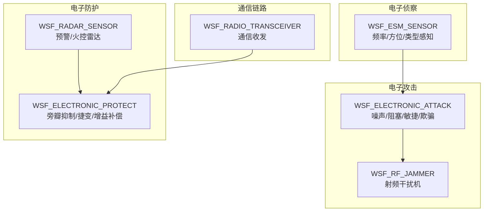
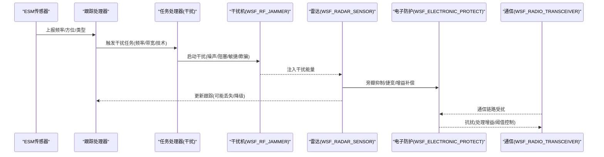
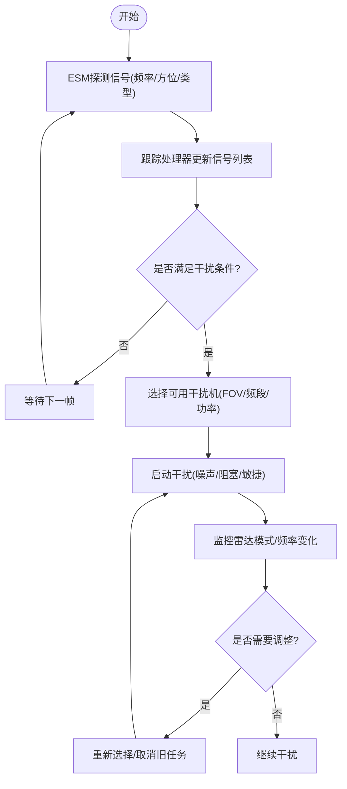
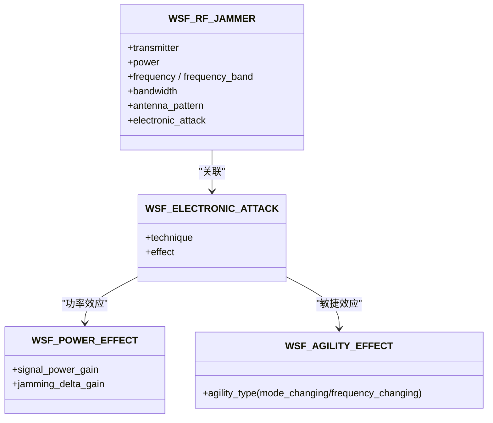
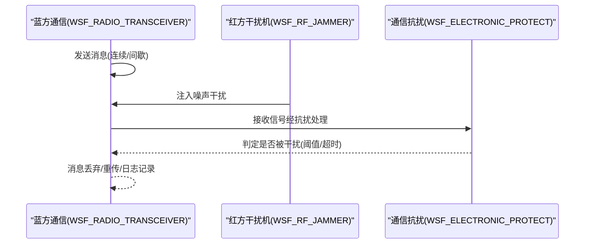
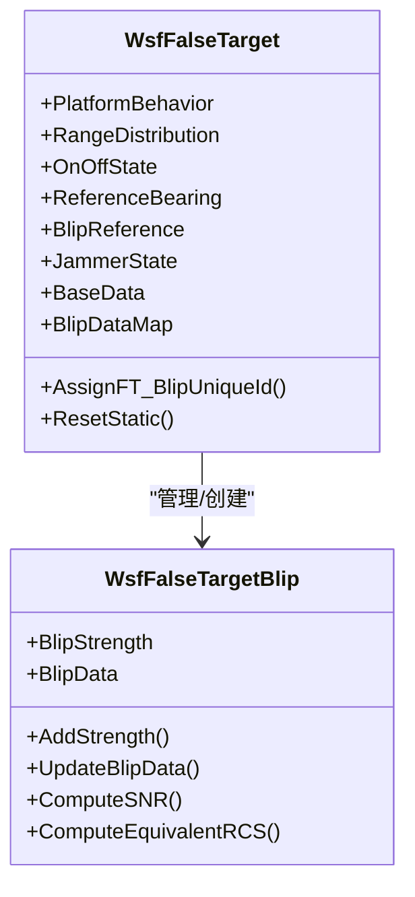
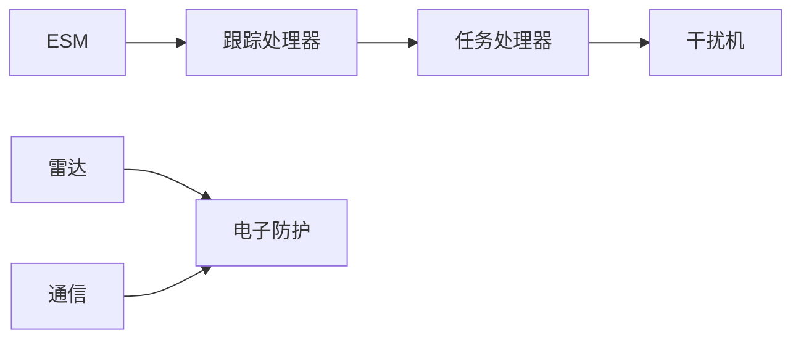

# 电子战场景

<cite>
**本文引用的文件**   
- [README.md](file://demos/electronic_warfare/README.md)
- [electronic_warfare_demos.rst](file://demos/electronic_warfare/doc/electronic_warfare_demos.rst)
- [esem_detect_radar.txt](file://demos/electronic_warfare/esm_detect_radar.txt)
- [agile_jamming.txt](file://demos/electronic_warfare/agile_jamming.txt)
- [barrage_jamming.txt](file://demos/electronic_warfare/barrage_jamming.txt)
- [comm_jamming.txt](file://demos/electronic_warfare/comm_jamming.txt)
- [false-target_jamming_1.txt](file://demos/electronic_warfare/false-target_jamming_1.txt)
- [WsfFalseTarget.hpp](file://swdev/src/core/wsf_mil/source/ew/WsfFalseTarget.hpp)
</cite>

## 目录
1. [引言](#引言)
2. [项目结构](#项目结构)
3. [核心组件](#核心组件)
4. [架构总览](#架构总览)
5. [详细组件分析](#详细组件分析)
6. [依赖关系分析](#依赖关系分析)
7. [性能与仿真特性](#性能与仿真特性)
8. [故障排查指南](#故障排查指南)
9. [结论](#结论)
10. [附录：实战演练脚本索引](#附录实战演练脚本索引)

## 引言
本教程面向AFSIM电子战场景建模与仿真，围绕电子侦察、电子攻击与电子防护的完整作战流程展开，覆盖雷达干扰、通信干扰、欺骗干扰与噪声干扰的技术实现；并给出装备配置、策略选择与效果评估方法，以及频谱管理、抗干扰技术与战术优化指导。文档以仓库中的演示案例为蓝本，帮助读者从“可运行脚本”到“体系化设计”逐步掌握复杂电子战环境与多平台协同电子战的仿真方法。

## 项目结构
AFSIM的电子战演示集中在 demos/electronic_warfare 目录，包含多种典型干扰类型与对抗组合的输入脚本，配套有说明文档与输出示例。核心内容分为三类：
- 电子侦察（ESM）：用于探测敌方辐射源频率、方位等特征，支撑闭环干扰决策
- 电子攻击（EA）：包括噪声干扰、阻塞式干扰、敏捷干扰、欺骗干扰等
- 电子防护（EP）：包括旁瓣对消/抑制、捷变频、增益补偿、轨迹误差缓解等

图表来源
- [electronic_warfare_demos.rst:34-131](file://demos/electronic_warfare/doc/electronic_warfare_demos.rst#L34-L131)
- [esem_detect_radar.txt:39-66](file://demos/electronic_warfare/esm_detect_radar.txt#L39-L66)
- [agile_jamming.txt:67-88](file://demos/electronic_warfare/agile_jamming.txt#L67-L88)
- [barrage_jamming.txt:43-49](file://demos/electronic_warfare/barrage_jamming.txt#L43-L49)
- [comm_jamming.txt:63-99](file://demos/electronic_warfare/comm_jamming.txt#L63-L99)

章节来源
- [README.md:1-45](file://demos/electronic_warfare/README.md#L1-L45)
- [electronic_warfare_demos.rst:10-32](file://demos/electronic_warfare/doc/electronic_warfare_demos.rst#L10-L32)

## 核心组件
- 电子侦察传感器（WSF_ESM_SENSOR）
  - 功能：宽频带侦测、方位估计、信号类型识别、测距（可选）
  - 关键参数：frame_time、maximum_range、receiver（antenna_pattern、detection_threshold、noise_power）、frequency_band、reported_emitter_type、reports_location/frequency/type
  - 参考：[esem_detect_radar.txt:39-66](file://demos/electronic_warfare/esm_detect_radar.txt#L39-L66)

- 电子攻击（WSF_ELECTRONIC_ATTACK）
  - 技术族：噪声干扰、随机脉冲干扰、阻塞式干扰、敏捷干扰、欺骗干扰（假目标）
  - 效果族：功率效应（jamming_delta_gain/signal_power_gain）、敏捷效应（mode_changing/frequency_changing）、假目标效应（pulse_density/scan_rate_multiplier）
  - 参考：
    - [agile_jamming.txt:67-88](file://demos/electronic_warfare/agile_jamming.txt#L67-L88)
    - [barrage_jamming.txt:43-49](file://demos/electronic_warfare/barrage_jamming.txt#L43-L49)
    - [false-target_jamming_1.txt:40-66](file://demos/electronic_warfare/false-target_jamming_1.txt#L40-L66)

- 电子防护（WSF_ELECTRONIC_PROTECT）
  - 技术族：旁瓣抑制/对消（SLB/SLC）、脉冲抑制、捷变频（模式/频率切换）、增益补偿、轨迹误差缓解
  - 参考：
    - [agile_jamming.txt:211-228](file://demos/electronic_warfare/agile_jamming.txt#L211-L228)
    - [false-target_jamming_1.txt:88-124](file://demos/electronic_warfare/false-target_jamming_1.txt#L88-L124)
    - [comm_jamming.txt:63-72](file://demos/electronic_warfare/comm_jamming.txt#L63-L72)

- 雷达传感器（WSF_RADAR_SENSOR）
  - 功能：发射/接收、扫描模式、检测概率/虚警率、跟踪建立/保持、报告项（range/bearing/velocity/SNR）
  - 参考：
    - [esem_detect_radar.txt:81-124](file://demos/electronic_warfare/esm_detect_radar.txt#L81-L124)
    - [barrage_jamming.txt:63-105](file://demos/electronic_warfare/barrage_jamming.txt#L63-L105)
    - [false-target_jamming_1.txt:126-184](file://demos/electronic_warfare/false-target_jamming_1.txt#L126-L184)

- 通信设备（WSF_RADIO_TRANSCEIVER）
  - 功能：连续/间歇发射、频段/带宽、接收机电子防护、干扰感知阈值/超时
  - 参考：[comm_jamming.txt:80-99](file://demos/electronic_warfare/comm_jamming.txt#L80-L99)

章节来源
- [esem_detect_radar.txt:39-124](file://demos/electronic_warfare/esm_detect_radar.txt#L39-L124)
- [agile_jamming.txt:67-228](file://demos/electronic_warfare/agile_jamming.txt#L67-L228)
- [barrage_jamming.txt:43-105](file://demos/electronic_warfare/barrage_jamming.txt#L43-L105)
- [comm_jamming.txt:63-99](file://demos/electronic_warfare/comm_jamming.txt#L63-L99)
- [false-target_jamming_1.txt:40-184](file://demos/electronic_warfare/false-target_jamming_1.txt#L40-L184)

## 架构总览
下图展示一次典型的“侦察-决策-干扰-防护”闭环流程，涵盖ESM探测、任务处理器调度、干扰机发射、雷达/通信接收端防护与感知。

图表来源
- [esem_detect_radar.txt:39-66](file://demos/electronic_warfare/esm_detect_radar.txt#L39-L66)
- [agile_jamming.txt:90-197](file://demos/electronic_warfare/agile_jamming.txt#L90-L197)
- [agile_jamming.txt:211-228](file://demos/electronic_warfare/agile_jamming.txt#L211-L228)
- [comm_jamming.txt:63-99](file://demos/electronic_warfare/comm_jamming.txt#L63-L99)

## 详细组件分析

### 电子侦察（ESM）与闭环干扰
- 能力要点
  - 宽频带侦测（0.1 GHz–20 GHz），固定扫描模式，报告位置/频率/类型
  - 通过内部链接将探测结果接入跟踪处理器，再由任务处理器进行干扰资源分配
- 典型用法
  - 在敏捷干扰场景中，ESM持续探测雷达频率变化，任务处理器根据当前信号频率选择可用干扰机并发起点频干扰
- 关键配置路径
  - ESM定义与报告项：[esem_detect_radar.txt:39-66](file://demos/electronic_warfare/esm_detect_radar.txt#L39-L66)
  - 任务处理器状态机与干扰调度：[agile_jamming.txt:90-197](file://demos/electronic_warfare/agile_jamming.txt#L90-L197)

图表来源
- [esem_detect_radar.txt:39-66](file://demos/electronic_warfare/esm_detect_radar.txt#L39-L66)
- [agile_jamming.txt:90-197](file://demos/electronic_warfare/agile_jamming.txt#L90-L197)

章节来源
- [esem_detect_radar.txt:39-66](file://demos/electronic_warfare/esm_detect_radar.txt#L39-L66)
- [agile_jamming.txt:90-197](file://demos/electronic_warfare/agile_jamming.txt#L90-L197)

### 雷达干扰：噪声、阻塞与敏捷
- 噪声干扰（Spot Noise Jamming）
  - 窄带高功率干扰，针对特定雷达工作频率
  - 参考：[agile_jamming.txt:67-88](file://demos/electronic_warfare/agile_jamming.txt#L67-L88)
- 阻塞式干扰（Barrage Noise Jamming）
  - 宽带低功率密度，同时压制多个雷达或跳频雷达
  - 参考：[barrage_jamming.txt:43-49](file://demos/electronic_warfare/barrage_jamming.txt#L43-L49)
- 敏捷干扰（Agile Jamming）
  - 基于ESM反馈动态跟踪雷达频率/模式变化，实时调整干扰参数
  - 参考：[agile_jamming.txt:67-88](file://demos/electronic_warfare/agile_jamming.txt#L67-L88), [agile_jamming.txt:211-228](file://demos/electronic_warfare/agile_jamming.txt#L211-L228)

图表来源
- [agile_jamming.txt:67-88](file://demos/electronic_warfare/agile_jamming.txt#L67-L88)
- [agile_jamming.txt:211-228](file://demos/electronic_warfare/agile_jamming.txt#L211-L228)
- [barrage_jamming.txt:43-49](file://demos/electronic_warfare/barrage_jamming.txt#L43-L49)

章节来源
- [agile_jamming.txt:67-88](file://demos/electronic_warfare/agile_jamming.txt#L67-L88)
- [barrage_jamming.txt:43-49](file://demos/electronic_warfare/barrage_jamming.txt#L43-L49)
- [agile_jamming.txt:211-228](file://demos/electronic_warfare/agile_jamming.txt#L211-L228)

### 通信干扰与抗扰
- 干扰侧
  - 使用WSF_RF_JAMMER对通信频段进行噪声干扰，设置频率/带宽/功率
  - 参考：[comm_jamming.txt:216-240](file://demos/electronic_warfare/comm_jamming.txt#L216-L240)
- 抗扰侧
  - 通信接收机配置WSF_ELECTRONIC_PROTECT，启用处理增益等技术提升抗噪能力
  - 设置干扰感知阈值与超时，结合事件输出观察消息丢弃/重传
  - 参考：[comm_jamming.txt:63-99](file://demos/electronic_warfare/comm_jamming.txt#L63-L99), [comm_jamming.txt:309-358](file://demos/electronic_warfare/comm_jamming.txt#L309-L358)

图表来源
- [comm_jamming.txt:63-99](file://demos/electronic_warfare/comm_jamming.txt#L63-L99)
- [comm_jamming.txt:216-240](file://demos/electronic_warfare/comm_jamming.txt#L216-L240)
- [comm_jamming.txt:309-358](file://demos/electronic_warfare/comm_jamming.txt#L309-L358)

章节来源
- [comm_jamming.txt:63-99](file://demos/electronic_warfare/comm_jamming.txt#L63-L99)
- [comm_jamming.txt:216-240](file://demos/electronic_warfare/comm_jamming.txt#L216-L240)
- [comm_jamming.txt:309-358](file://demos/electronic_warfare/comm_jamming.txt#L309-L358)

### 欺骗干扰（假目标）
- 机制
  - 通过WSF_FALSE_TARGET_EFFECT生成虚假回波，影响雷达跟踪逻辑，导致丢跟或错误跟踪
  - 支持按脉冲密度、范围约束、随机性等多种方式生成假目标
  - 参考：[false-target_jamming_1.txt:40-66](file://demos/electronic_warfare/false-target_jamming_1.txt#L40-L66)
- 雷达侧防护
  - 旁瓣抑制（SLB）+ 信号增益补偿，降低假目标影响
  - 参考：[false-target_jamming_1.txt:88-124](file://demos/electronic_warfare/false-target_jamming_1.txt#L88-L124)
- 数据结构与行为
  - 假目标对象模型与blip强度/等效RCS/SNR计算等由底层类提供
  - 参考：[WsfFalseTarget.hpp:49-434](file://swdev/src/core/wsf_mil/source/ew/WsfFalseTarget.hpp#L49-L434)

图表来源
- [WsfFalseTarget.hpp:49-434](file://swdev/src/core/wsf_mil/source/ew/WsfFalseTarget.hpp#L49-L434)

章节来源
- [false-target_jamming_1.txt:40-66](file://demos/electronic_warfare/false-target_jamming_1.txt#L40-L66)
- [false-target_jamming_1.txt:88-124](file://demos/electronic_warfare/false-target_jamming_1.txt#L88-L124)
- [WsfFalseTarget.hpp:49-434](file://swdev/src/core/wsf_mil/source/ew/WsfFalseTarget.hpp#L49-L434)

### 雷达防护（EP）与敏捷
- 旁瓣抑制/对消（SLB/SLC）
  - 利用辅助全向天线判断主瓣/旁瓣信号，抑制旁瓣干扰
  - 参考：[false-target_jamming_1.txt:88-124](file://demos/electronic_warfare/false-target_jamming_1.txt#L88-L124)
- 捷变频/模式切换
  - 雷达在接收窗口内仅接收当前频率，规避阻塞/点频干扰
  - 参考：[agile_jamming.txt:211-228](file://demos/electronic_warfare/agile_jamming.txt#L211-L228)
- 增益补偿与轨迹误差缓解
  - 通过WSF_POWER_EFFECT与通用效果接口提升抗扰鲁棒性
  - 参考：[false-target_jamming_1.txt:116-124](file://demos/electronic_warfare/false-target_jamming_1.txt#L116-L124)

章节来源
- [false-target_jamming_1.txt:88-124](file://demos/electronic_warfare/false-target_jamming_1.txt#L88-L124)
- [agile_jamming.txt:211-228](file://demos/electronic_warfare/agile_jamming.txt#L211-L228)

## 依赖关系分析
- 组件耦合
  - ESM与任务处理器：松耦合，通过跟踪处理器传递信号信息
  - 任务处理器与干扰机：强耦合，需匹配FOV、频段、功率与干扰技术
  - 雷达与EP：紧耦合，EP直接影响雷达检测/跟踪质量
  - 通信与EP：紧耦合，EP决定抗扰能力与消息可靠性
- 外部依赖
  - 地形/传播模型（可选）
  - 事件输出/管道（evt/aer）用于分析与可视化

图表来源
- [esem_detect_radar.txt:39-66](file://demos/electronic_warfare/esm_detect_radar.txt#L39-L66)
- [agile_jamming.txt:90-197](file://demos/electronic_warfare/agile_jamming.txt#L90-L197)
- [comm_jamming.txt:63-99](file://demos/electronic_warfare/comm_jamming.txt#L63-L99)

章节来源
- [esem_detect_radar.txt:39-66](file://demos/electronic_warfare/esm_detect_radar.txt#L39-L66)
- [agile_jamming.txt:90-197](file://demos/electronic_warfare/agile_jamming.txt#L90-L197)
- [comm_jamming.txt:63-99](file://demos/electronic_warfare/comm_jamming.txt#L63-L99)

## 性能与仿真特性
- 检测与跟踪
  - Swerling目标模型、虚警概率、所需检测概率、脉冲积分数、跟踪建立/保持命中次数
  - 参考：[esem_detect_radar.txt:112-124](file://demos/electronic_warfare/esm_detect_radar.txt#L112-L124), [barrage_jamming.txt:93-105](file://demos/electronic_warfare/barrage_jamming.txt#L93-L105)
- 干扰效能
  - 阻塞式干扰通过宽带低功率密度压制多雷达；点频干扰集中功率于单雷达
  - 参考：[barrage_jamming.txt:11-15](file://demos/electronic_warfare/barrage_jamming.txt#L11-L15), [agile_jamming.txt:67-88](file://demos/electronic_warfare/agile_jamming.txt#L67-L88)
- 通信可靠性
  - 通过事件输出统计消息丢弃/重传，结合抗扰处理增益评估链路可用性
  - 参考：[comm_jamming.txt:309-358](file://demos/electronic_warfare/comm_jamming.txt#L309-L358)

章节来源
- [esem_detect_radar.txt:112-124](file://demos/electronic_warfare/esm_detect_radar.txt#L112-L124)
- [barrage_jamming.txt:93-105](file://demos/electronic_warfare/barrage_jamming.txt#L93-L105)
- [comm_jamming.txt:309-358](file://demos/electronic_warfare/comm_jamming.txt#L309-L358)

## 故障排查指南
- 干扰未生效
  - 检查干扰机频段/带宽是否与目标雷达匹配
  - 确认干扰机FOV与目标相对位置
  - 参考：[agile_jamming.txt:90-197](file://demos/electronic_warfare/agile_jamming.txt#L90-L197)
- 通信链路频繁中断
  - 检查接收机抗扰处理增益与干扰感知阈值/超时
  - 查看事件输出中MESSAGE_DISCARDED/MESSAGE_RECEIVED计数
  - 参考：[comm_jamming.txt:63-99](file://demos/electronic_warfare/comm_jamming.txt#L63-L99), [comm_jamming.txt:309-358](file://demos/electronic_warfare/comm_jamming.txt#L309-L358)
- 假目标过多导致跟踪混乱
  - 调整假目标脉冲密度/范围约束
  - 启用旁瓣抑制与信号增益补偿
  - 参考：[false-target_jamming_1.txt:40-66](file://demos/electronic_warfare/false-target_jamming_1.txt#L40-L66), [false-target_jamming_1.txt:88-124](file://demos/electronic_warfare/false-target_jamming_1.txt#L88-L124)

章节来源
- [agile_jamming.txt:90-197](file://demos/electronic_warfare/agile_jamming.txt#L90-L197)
- [comm_jamming.txt:63-99](file://demos/electronic_warfare/comm_jamming.txt#L63-L99)
- [comm_jamming.txt:309-358](file://demos/electronic_warfare/comm_jamming.txt#L309-L358)
- [false-target_jamming_1.txt:40-66](file://demos/electronic_warfare/false-target_jamming_1.txt#L40-L66)
- [false-target_jamming_1.txt:88-124](file://demos/electronic_warfare/false-target_jamming_1.txt#L88-L124)

## 结论
AFSIM电子战演示提供了从基础到进阶的完整技术栈：ESM探测、任务驱动干扰、雷达/通信抗扰、假目标欺骗等。通过合理配置WSF_ELECTRONIC_ATTACK/WSF_ELECTRONIC_PROTECT与WSF_RF_JAMMER/WSF_RADAR_SENSOR/WSF_RADIO_TRANSCEIVER，可在复杂电磁环境中实现多平台协同电子战仿真，并通过事件输出与数据管道进行效果评估与战术优化。

## 附录：实战演练脚本索引
- 电子侦察与敏捷干扰
  - [esem_detect_radar.txt](file://demos/electronic_warfare/esm_detect_radar.txt)
  - [agile_jamming.txt](file://demos/electronic_warfare/agile_jamming.txt)
- 阻塞式干扰
  - [barrage_jamming.txt](file://demos/electronic_warfare/barrage_jamming.txt)
- 通信干扰与抗扰
  - [comm_jamming.txt](file://demos/electronic_warfare/comm_jamming.txt)
- 欺骗干扰（假目标）
  - [false-target_jamming_1.txt](file://demos/electronic_warfare/false-target_jamming_1.txt)
- 综合说明文档
  - [electronic_warfare_demos.rst](file://demos/electronic_warfare/doc/electronic_warfare_demos.rst)