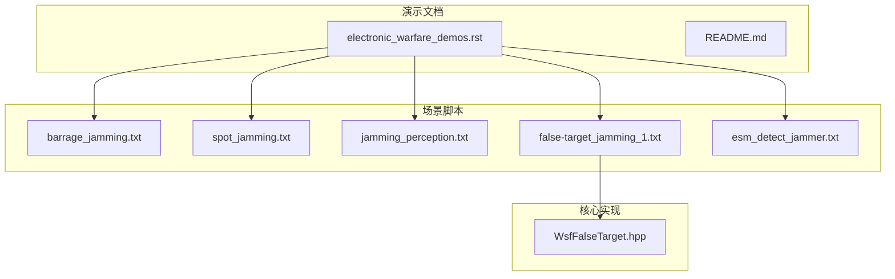
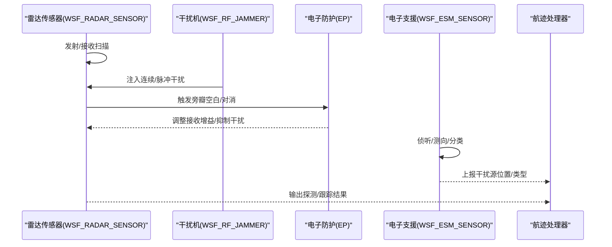
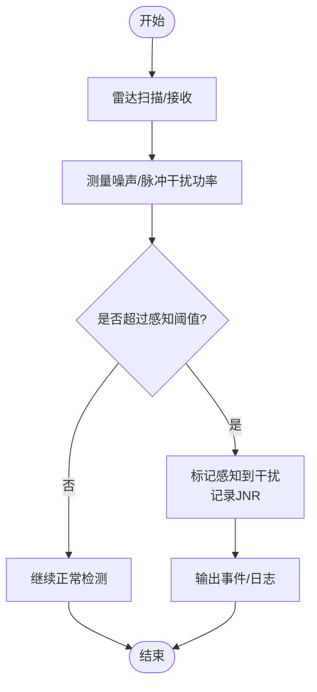
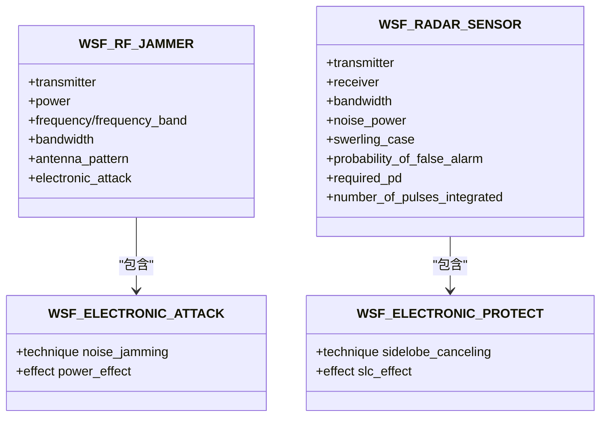
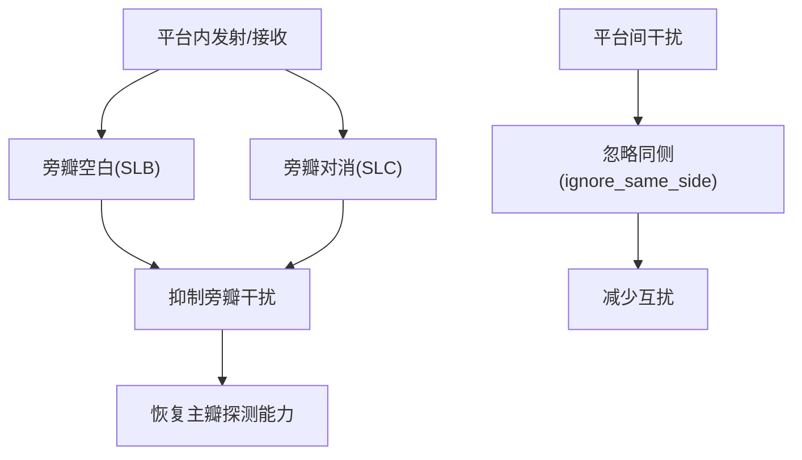
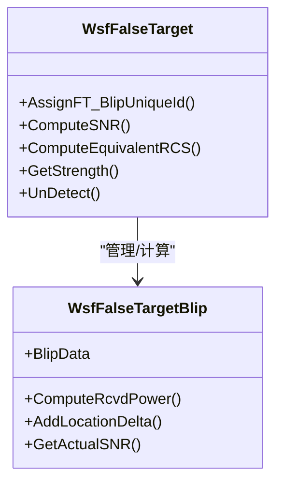
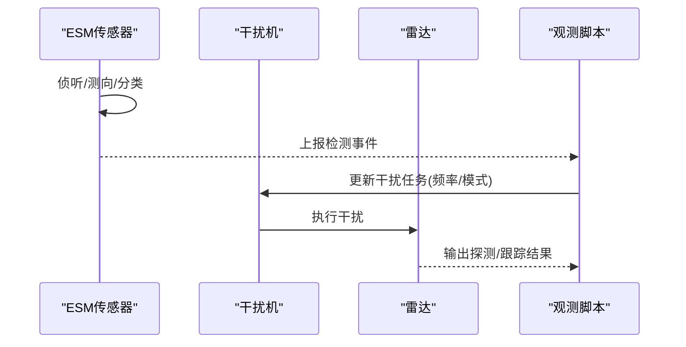
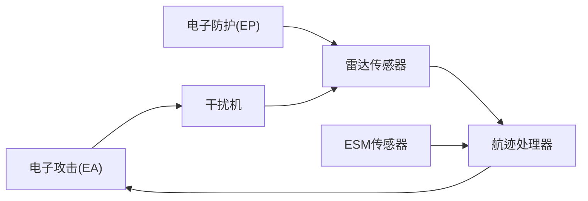

# 电磁兼容性

<cite>
**本文引用的文件**   
- [demos/electronic_warfare/doc/electronic_warfare_demos.rst](file://demos/electronic_warfare/doc/electronic_warfare_demos.rst)
- [demos/electronic_warfare/README.md](file://demos/electronic_warfare/README.md)
- [demos/electronic_warfare/barrage_jamming.txt](file://demos/electronic_warfare/barrage_jamming.txt)
- [demos/electronic_warfare/spot_jamming.txt](file://demos/electronic_warfare/spot_jamming.txt)
- [demos/electronic_warfare/jamming_perception.txt](file://demos/electronic_warfare/jamming_perception.txt)
- [demos/electronic_warfare/false-target_jamming_1.txt](file://demos/electronic_warfare/false-target_jamming_1.txt)
- [demos/electronic_warfare/esm_detect_jammer.txt](file://demos/electronic_warfare/esm_detect_jammer.txt)
- [swdev/src/core/wsf_mil/source/ew/WsfFalseTarget.hpp](file://swdev/src/core/wsf_mil/source/ew/WsfFalseTarget.hpp)
</cite>

## 目录
1. [引言](#引言)
2. [项目结构](#项目结构)
3. [核心组件](#核心组件)
4. [架构总览](#架构总览)
5. [详细组件分析](#详细组件分析)
6. [依赖关系分析](#依赖关系分析)
7. [性能与可扩展性](#性能与可扩展性)
8. [故障排查指南](#故障排查指南)
9. [结论](#结论)
10. [附录](#附录)

## 引言
本文件面向电磁兼容性与电子战（EW）仿真，聚焦干扰感知、功率管理与频谱协调的技术实现；提供自干扰抑制、互干扰分析与电磁环境优化的具体指导；并给出电子支援措施（ESM）对干扰源的检测与定位方法。内容基于AFSIM的“electronic_warfare”演示集与核心类库，结合雷达传感器、干扰机、电子攻击（EA）、电子防护（EP）与ESM的配置示例进行系统化说明。

## 项目结构
- 演示文档与说明：
  - electronic_warfare_demos.rst：概述电子攻击（EA）与电子防护（EP）技术族及示例链接。
  - README.md：受控信息标识与分发声明。
- 典型场景脚本：
  - 宽带阻塞干扰（barrage_jamming.txt）
  - 点频干扰（spot_jamming.txt）
  - 干扰感知阈值与观测（jamming_perception.txt）
  - 假目标干扰与旁瓣空白（false-target_jamming_1.txt）
  - ESM检测干扰源（esm_detect_jammer.txt）
- 核心实现：
  - WsfFalseTarget.hpp：假目标生成、强度评估、SNR计算等逻辑。

**图示来源**
- [demos/electronic_warfare/doc/electronic_warfare_demos.rst:10-159](file://demos/electronic_warfare/doc/electronic_warfare_demos.rst#L10-L159)
- [demos/electronic_warfare/README.md:1-45](file://demos/electronic_warfare/README.md#L1-L45)
- [demos/electronic_warfare/barrage_jamming.txt:1-260](file://demos/electronic_warfare/barrage_jamming.txt#L1-L260)
- [demos/electronic_warfare/spot_jamming.txt:1-320](file://demos/electronic_warfare/spot_jamming.txt#L1-L320)
- [demos/electronic_warfare/jamming_perception.txt:1-291](file://demos/electronic_warfare/jamming_perception.txt#L1-L291)
- [demos/electronic_warfare/false-target_jamming_1.txt:1-392](file://demos/electronic_warfare/false-target_jamming_1.txt#L1-L392)
- [demos/electronic_warfare/esm_detect_jammer.txt:1-328](file://demos/electronic_warfare/esm_detect_jammer.txt#L1-L328)
- [swdev/src/core/wsf_mil/source/ew/WsfFalseTarget.hpp:41-434](file://swdev/src/core/wsf_mil/source/ew/WsfFalseTarget.hpp#L41-L434)

**章节来源**
- [demos/electronic_warfare/doc/electronic_warfare_demos.rst:10-159](file://demos/electronic_warfare/doc/electronic_warfare_demos.rst#L10-L159)
- [demos/electronic_warfare/README.md:1-45](file://demos/electronic_warfare/README.md#L1-L45)

## 核心组件
- 电子攻击（EA）
  - 噪声干扰（noise_jamming）：通过功率提升或带宽配置影响接收信噪比。
  - 随机脉冲干扰（random_pulse_jamming）：以随机脉冲序列降低跟踪稳定性。
  - 假目标干扰（false_target_jamming）：注入虚假回波，破坏跟踪关联。
- 电子防护（EP）
  - 旁瓣空白（SLB）：利用全向辅助天线在强干扰方向空白主瓣信号。
  - 旁瓣对消（SLC）：利用辅助通道抵消旁瓣干扰，恢复非干扰方向探测。
  - 敏捷频率（Agility）：快速切换收发频率规避窄带干扰。
- 电子支援措施（ESM）
  - 宽频带侦听与测向：用于发现与定位干扰源，支撑闭环干扰分配。

**章节来源**
- [demos/electronic_warfare/doc/electronic_warfare_demos.rst:34-133](file://demos/electronic_warfare/doc/electronic_warfare_demos.rst#L34-L133)

## 架构总览
下图展示一次典型的“雷达探测—干扰注入—防护处理—ESM感知”的端到端流程，体现干扰感知、功率管理与频谱协调的协同。

**图示来源**
- [demos/electronic_warfare/spot_jamming.txt:54-119](file://demos/electronic_warfare/spot_jamming.txt#L54-L119)
- [demos/electronic_warfare/false-target_jamming_1.txt:40-124](file://demos/electronic_warfare/false-target_jamming_1.txt#L40-L124)
- [demos/electronic_warfare/esm_detect_jammer.txt:127-146](file://demos/electronic_warfare/esm_detect_jammer.txt#L127-L146)

## 详细组件分析

### 干扰感知与阈值判定
- 关键机制
  - 雷达侧设置连续/脉冲干扰感知阈值，当JNR超过阈值即标记为“感知到干扰”。
  - 观测脚本可打印各波束的噪声/脉冲干扰功率与接收机噪声底，便于调试。
- 参数要点
  - continuous_jamming_perception_threshold / pulsed_jamming_perception_threshold
  - 报告项：reports_signal_to_noise、SENSOR_DETECTION_ATTEMPT事件
- 实践建议
  - 根据雷达带宽与噪声系数校准接收噪声功率，避免误判。
  - 多波束场景中分别设定阈值，避免跨波束相互影响。

**图示来源**
- [demos/electronic_warfare/jamming_perception.txt:78-85](file://demos/electronic_warfare/jamming_perception.txt#L78-L85)
- [demos/electronic_warfare/jamming_perception.txt:251-285](file://demos/electronic_warfare/jamming_perception.txt#L251-L285)

**章节来源**
- [demos/electronic_warfare/jamming_perception.txt:78-85](file://demos/electronic_warfare/jamming_perception.txt#L78-L85)
- [demos/electronic_warfare/jamming_perception.txt:251-285](file://demos/electronic_warfare/jamming_perception.txt#L251-L285)

### 功率管理与频谱协调
- 宽带阻塞干扰（Barrage）
  - 使用宽频带覆盖多个雷达工作频段，单频点功率密度下降但可压制更多雷达。
  - 适用于多目标、多频段场景下的广域压制。
- 点频干扰（Spot）
  - 将能量集中在单一雷达频率上，最大化对特定目标的压制效果。
  - 配合EP的SLC/SLB，形成对抗博弈。
- 频谱协调策略
  - 干扰机根据ESM反馈动态选择目标频段与模式（开环/闭环）。
  - 雷达侧采用敏捷频率与自适应带宽，降低被锁定概率。

**图示来源**
- [demos/electronic_warfare/barrage_jamming.txt:43-49](file://demos/electronic_warfare/barrage_jamming.txt#L43-L49)
- [demos/electronic_warfare/spot_jamming.txt:54-78](file://demos/electronic_warfare/spot_jamming.txt#L54-L78)
- [demos/electronic_warfare/spot_jamming.txt:100-119](file://demos/electronic_warfare/spot_jamming.txt#L100-L119)

**章节来源**
- [demos/electronic_warfare/barrage_jamming.txt:43-49](file://demos/electronic_warfare/barrage_jamming.txt#L43-L49)
- [demos/electronic_warfare/spot_jamming.txt:54-78](file://demos/electronic_warfare/spot_jamming.txt#L54-L78)
- [demos/electronic_warfare/spot_jamming.txt:100-119](file://demos/electronic_warfare/spot_jamming.txt#L100-L119)

### 自干扰抑制与互干扰分析
- 自干扰抑制（平台内）
  - 通过EP的SLB/SLC抑制自身发射对接收的泄漏与旁瓣干扰。
  - 合理设置辅助天线方向图与对消通道数，平衡饱和与对消深度。
- 互干扰分析（平台间）
  - 同侧平台间的雷达/通信/干扰链路需考虑空间隔离与时间错配。
  - 使用ignore_same_side与内部链路（internal_link）控制交互范围。
- 优化建议
  - 对高功率发射机与敏感接收机进行隔离度预算。
  - 在多波束雷达中，按波束独立配置EP参数，避免全局抑制导致漏检。

**图示来源**
- [demos/electronic_warfare/spot_jamming.txt:100-119](file://demos/electronic_warfare/spot_jamming.txt#L100-L119)
- [demos/electronic_warfare/false-target_jamming_1.txt:88-124](file://demos/electronic_warfare/false-target_jamming_1.txt#L88-L124)

**章节来源**
- [demos/electronic_warfare/spot_jamming.txt:100-119](file://demos/electronic_warfare/spot_jamming.txt#L100-L119)
- [demos/electronic_warfare/false-target_jamming_1.txt:88-124](file://demos/electronic_warfare/false-target_jamming_1.txt#L88-L124)

### 假目标干扰与自干扰抑制
- 假目标干扰（FT）
  - 通过WSF_FALSE_TARGET_EFFECT注入虚假回波，按脉冲密度或约束条件生成blip。
  - 雷达侧可通过false_target_screener过滤异常轨迹，降低跟踪欺骗成功率。
- 自干扰抑制
  - 在FT注入时，SLB可对强干扰方向空白，从而限制假目标在旁瓣区的可见性。
- 实现要点
  - jamming_pulse_density、scan_rate_multiplier控制假目标密度与更新速率。
  - target_blanking_effect的概率表决定不同脉冲密度下的目标空白率。

**图示来源**
- [swdev/src/core/wsf_mil/source/ew/WsfFalseTarget.hpp:41-434](file://swdev/src/core/wsf_mil/source/ew/WsfFalseTarget.hpp#L41-L434)
- [demos/electronic_warfare/false-target_jamming_1.txt:40-66](file://demos/electronic_warfare/false-target_jamming_1.txt#L40-L66)
- [demos/electronic_warfare/false-target_jamming_1.txt:149-159](file://demos/electronic_warfare/false-target_jamming_1.txt#L149-L159)

**章节来源**
- [swdev/src/core/wsf_mil/source/ew/WsfFalseTarget.hpp:41-434](file://swdev/src/core/wsf_mil/source/ew/WsfFalseTarget.hpp#L41-L434)
- [demos/electronic_warfare/false-target_jamming_1.txt:40-66](file://demos/electronic_warfare/false-target_jamming_1.txt#L40-L66)
- [demos/electronic_warfare/false-target_jamming_1.txt:149-159](file://demos/electronic_warfare/false-target_jamming_1.txt#L149-L159)

### 电子支援措施（ESM）检测与定位
- 功能要点
  - 宽频带接收（frequency_band），设置检测阈值与噪声底，输出位置、类型、频率。
  - 与雷达/干扰机共存时，通过ignore_same_side避免自扰。
- 闭环干扰分配
  - 基于ESM检测到的干扰源方位/频率，驱动干扰机选择目标与模式（开环/闭环）。
- 实践建议
  - 合理设置frame_time与slew_mode，平衡扫描速度与测向精度。
  - 结合事件输出（SENSOR_DETECTION_ATTEMPT）与外部观测脚本进行分析。

**图示来源**
- [demos/electronic_warfare/esm_detect_jammer.txt:127-146](file://demos/electronic_warfare/esm_detect_jammer.txt#L127-L146)
- [demos/electronic_warfare/esm_detect_jammer.txt:268-316](file://demos/electronic_warfare/esm_detect_jammer.txt#L268-L316)

**章节来源**
- [demos/electronic_warfare/esm_detect_jammer.txt:127-146](file://demos/electronic_warfare/esm_detect_jammer.txt#L127-L146)
- [demos/electronic_warfare/esm_detect_jammer.txt:268-316](file://demos/electronic_warfare/esm_detect_jammer.txt#L268-L316)

## 依赖关系分析
- EA/EP与传感器的耦合
  - 雷达传感器通过receiver.electronic_protect挂载EP技术（SLB/SLC/Signal Gain）。
  - 干扰机通过transmitter.electronic_attack挂载EA技术（Noise/RPJ/FT）。
- 数据流
  - 干扰机发射→雷达接收→EP处理→检测/跟踪→ESM侦听→闭环任务更新。
- 潜在环路
  - 若ESM与雷达共用同一平台，需通过ignore_same_side与internal_link避免自环。

**图示来源**
- [demos/electronic_warfare/spot_jamming.txt:54-119](file://demos/electronic_warfare/spot_jamming.txt#L54-L119)
- [demos/electronic_warfare/false-target_jamming_1.txt:40-124](file://demos/electronic_warfare/false-target_jamming_1.txt#L40-L124)
- [demos/electronic_warfare/esm_detect_jammer.txt:127-146](file://demos/electronic_warfare/esm_detect_jammer.txt#L127-L146)

**章节来源**
- [demos/electronic_warfare/spot_jamming.txt:54-119](file://demos/electronic_warfare/spot_jamming.txt#L54-L119)
- [demos/electronic_warfare/false-target_jamming_1.txt:40-124](file://demos/electronic_warfare/false-target_jamming_1.txt#L40-L124)
- [demos/electronic_warfare/esm_detect_jammer.txt:127-146](file://demos/electronic_warfare/esm_detect_jammer.txt#L127-L146)

## 性能与可扩展性
- 复杂度与资源
  - 假目标数量与扫描倍率直接影响计算量；应结合track_capacity/plot_capacity/transfer_capacity进行容量规划。
  - SLC通道数越多，对消能力越强，但计算与标定成本越高。
- 可扩展性
  - 通过WSF_ELECTRONIC_ATTACK/WSF_ELECTRONIC_PROTECT扩展新干扰/防护效应。
  - 借助observer与event_output接入外部分析工具，支持在线监控与离线后处理。

[本节为通用指导，不直接分析具体文件]

## 故障排查指南
- 常见问题
  - 干扰未生效：检查干扰机功率/带宽/天线方向图与雷达接收带宽匹配。
  - 过度抑制：EP参数过强导致真实目标丢失，需调低SLC对消深度或SLB空白阈值。
  - ESM无检测：确认frequency_band覆盖干扰频率，且detection_threshold与noise_power合理。
- 诊断步骤
  - 启用SENSOR_DETECTION_ATTEMPT与JAMMING_ATTEMPT事件，观察探测尝试与干扰尝试。
  - 使用observer脚本打印JNR、感知状态与波束编号，定位问题波束。
  - 逐步关闭EP/EA技术，验证基线探测性能。

**章节来源**
- [demos/electronic_warfare/jamming_perception.txt:251-285](file://demos/electronic_warfare/jamming_perception.txt#L251-L285)
- [demos/electronic_warfare/spot_jamming.txt:100-119](file://demos/electronic_warfare/spot_jamming.txt#L100-L119)
- [demos/electronic_warfare/esm_detect_jammer.txt:268-316](file://demos/electronic_warfare/esm_detect_jammer.txt#L268-L316)

## 结论
通过AFSIM的EA/EP与ESM体系，可实现从干扰感知、功率与频谱协调，到自干扰抑制、互干扰分析与电磁环境优化的完整闭环。实践中应结合场景需求合理配置干扰模式与防护技术，并以ESM为纽带实现闭环任务分配与动态优化。同时，借助事件输出与观测脚本，建立完善的诊断与验证流程，确保系统在复杂电磁环境中稳定可靠。

[本节为总结性内容，不直接分析具体文件]

## 附录
- 术语
  - EA：电子攻击（Electronic Attack）
  - EP：电子防护（Electronic Protect）
  - ESM：电子支援措施（Electronic Support Measures）
  - SLB：旁瓣空白（Side Lobe Blanker）
  - SLC：旁瓣对消（Side Lobe Canceller）
  - JNR：干扰噪声比（Jammer-to-Noise Ratio）
- 参考示例
  - 宽带阻塞干扰：barrage_jamming.txt
  - 点频干扰与SLC：spot_jamming.txt
  - 干扰感知阈值：jamming_perception.txt
  - 假目标干扰与SLB：false-target_jamming_1.txt
  - ESM检测干扰源：esm_detect_jammer.txt

[本节为补充信息，不直接分析具体文件]