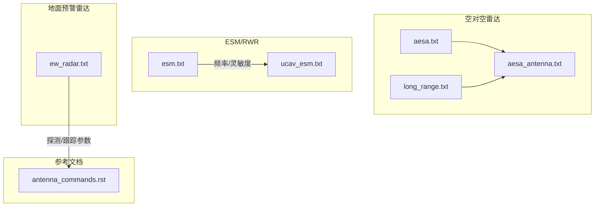
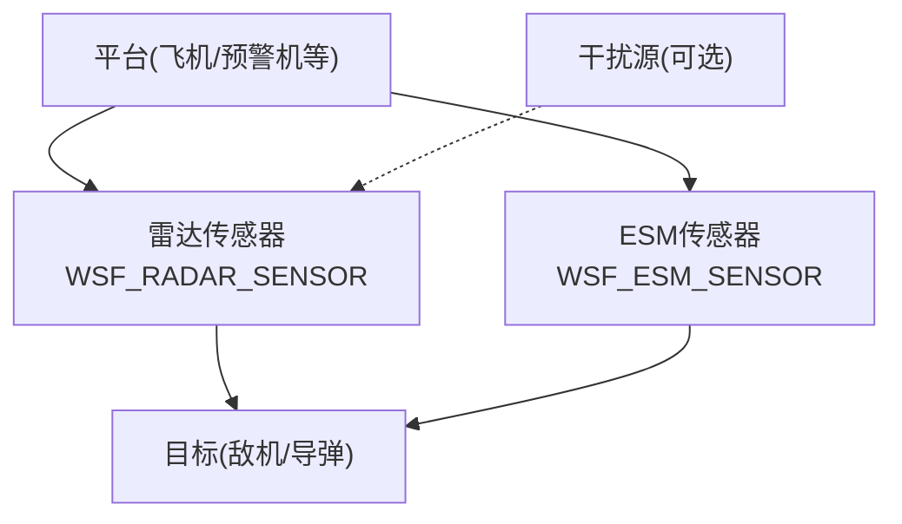
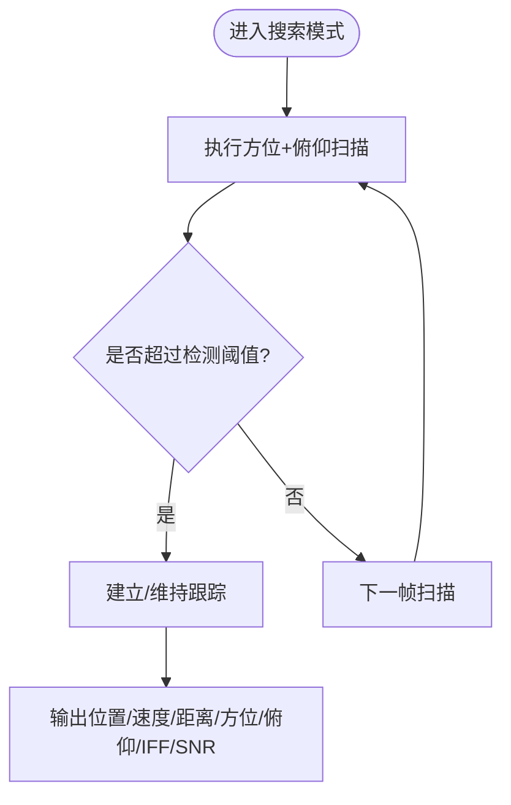
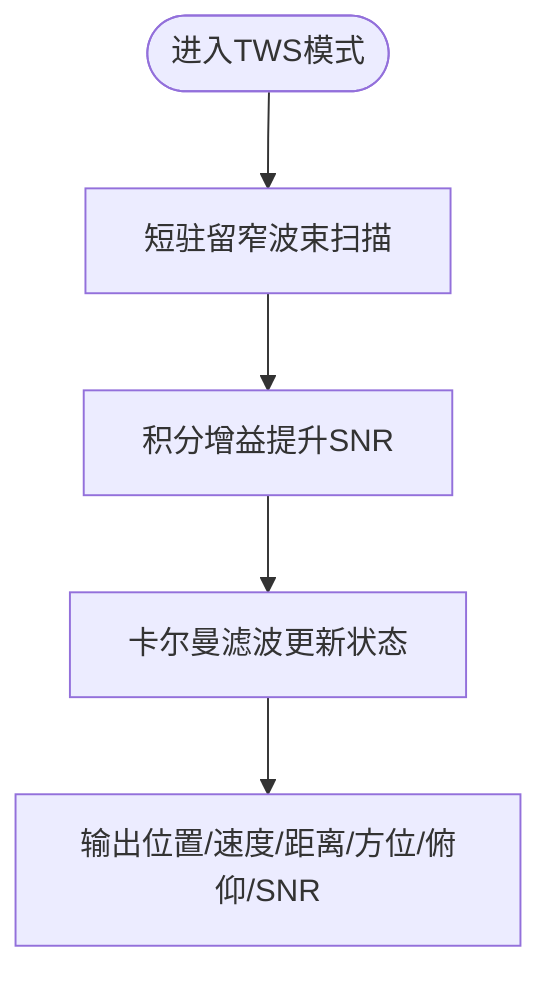
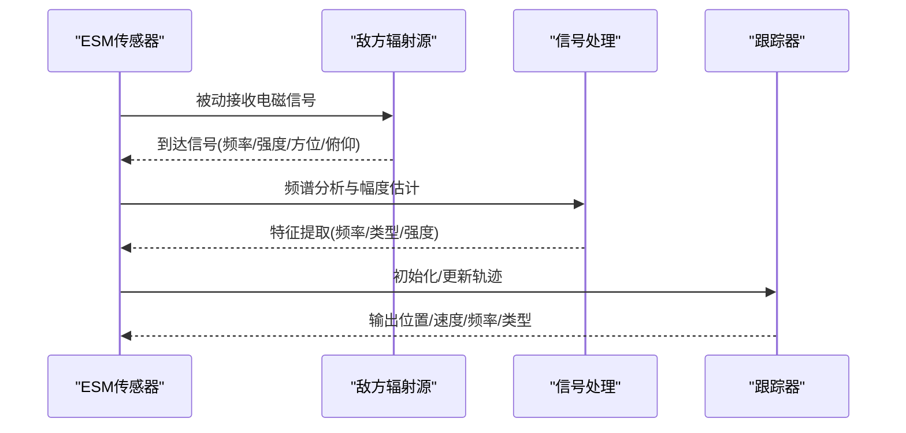
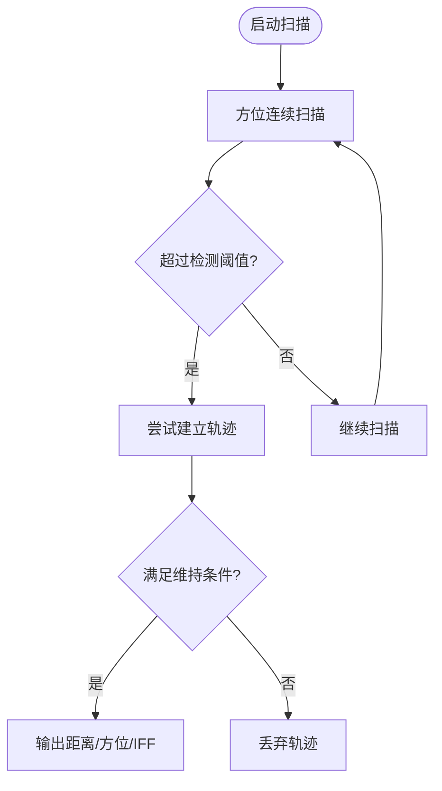
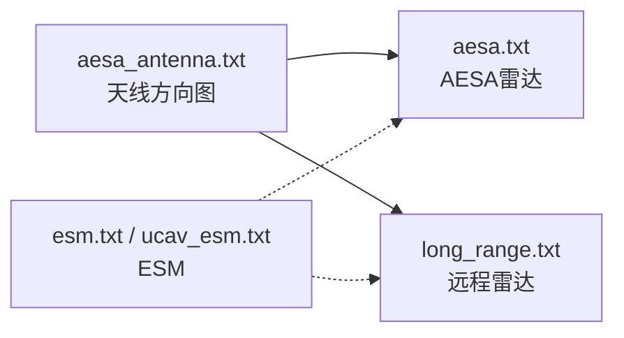

# 传感器建模

<cite>
**本文引用的文件**   
- [aesa.txt](file://demos/air_to_air/sensors/radar/aesa.txt)
- [long_range.txt](file://demos/air_to_air/sensors/radar/long_range.txt)
- [aesa_antenna.txt](file://demos/air_to_air/sensors/radar/aesa_antenna.txt)
- [esm.txt](file://demos/air_to_air/sensors/esm_rwr/esm.txt)
- [ucav_esm.txt](file://demos/electronic_warfare/test_multi_beam/sensors/esm/ucav_esm.txt)
- [ew_radar.txt](file://training/user/10_Other_Topics/bam/scenarios/floridistan/27_floridistan_cluster_gci/sensors/radar/ew_radar.txt)
- [antenna_commands.rst](file://swdev/src/core/wsf/doc/antenna_commands.rst)
</cite>

## 目录
1. [引言](#引言)
2. [项目结构](#项目结构)
3. [核心组件](#核心组件)
4. [架构总览](#架构总览)
5. [详细组件分析](#详细组件分析)
6. [依赖关系分析](#依赖关系分析)
7. [性能考虑与优化](#性能考虑与优化)
8. [故障排查指南](#故障排查指南)
9. [结论](#结论)

## 引言
本文件聚焦空中对抗中的传感器建模，围绕雷达（含AESA与远程雷达）、电子支援措施（ESM）与雷达警告接收机（RWR）的探测范围、分辨率、扫描模式与参数配置进行系统说明；同时给出探测概率、虚警率与跟踪精度的调优方法与实践建议。内容以AFSIM仓库中提供的示例配置文件为依据，帮助读者快速搭建并优化传感器模型。

## 项目结构
与传感器建模直接相关的示例与文档主要位于以下路径：
- 空对空雷达示例：demos/air_to_air/sensors/radar/
- ESM/RWR示例：demos/air_to_air/sensors/esm_rwr/ 与 demos/electronic_warfare/test_multi_beam/sensors/esm/
- 地面预警雷达示例：training/user/.../sensors/radar/
- 天线命令参考文档：swdev/src/core/wsf/doc/antenna_commands.rst

**图示来源**
- [aesa.txt:1-130](file://demos/air_to_air/sensors/radar/aesa.txt#L1-L130)
- [long_range.txt:1-121](file://demos/air_to_air/sensors/radar/long_range.txt#L1-L121)
- [aesa_antenna.txt:1-22](file://demos/air_to_air/sensors/radar/aesa_antenna.txt#L1-L22)
- [esm.txt:1-87](file://demos/air_to_air/sensors/esm_rwr/esm.txt#L1-L87)
- [ucav_esm.txt:1-40](file://demos/electronic_warfare/test_multi_beam/sensors/esm/ucav_esm.txt#L1-L40)
- [ew_radar.txt:1-63](file://training/user/10_Other_Topics/bam/scenarios/floridistan/27_floridistan_cluster_gci/sensors/radar/ew_radar.txt#L1-L63)
- [antenna_commands.rst:108-210](file://swdev/src/core/wsf/doc/antenna_commands.rst#L108-L210)

**章节来源**
- [aesa.txt:1-130](file://demos/air_to_air/sensors/radar/aesa.txt#L1-L130)
- [long_range.txt:1-121](file://demos/air_to_air/sensors/radar/long_range.txt#L1-L121)
- [aesa_antenna.txt:1-22](file://demos/air_to_air/sensors/radar/aesa_antenna.txt#L1-L22)
- [esm.txt:1-87](file://demos/air_to_air/sensors/esm_rwr/esm.txt#L1-L87)
- [ucav_esm.txt:1-40](file://demos/electronic_warfare/test_multi_beam/sensors/esm/ucav_esm.txt#L1-L40)
- [ew_radar.txt:1-63](file://training/user/10_Other_Topics/bam/scenarios/floridistan/27_floridistan_cluster_gci/sensors/radar/ew_radar.txt#L1-L63)
- [antenna_commands.rst:108-210](file://swdev/src/core/wsf/doc/antenna_commands.rst#L108-L210)

## 核心组件
- 雷达传感器（WSF_RADAR_SENSOR）
  - 支持多工作模式（搜索、TWS等），可配置发射机、接收机、检测概率曲线、信号处理器、测量误差、跟踪门限与报告字段。
  - 典型参数包括：最大作用距离、帧时间、扫描模式、方位/俯仰扫描限制、电子波束指向、误差方差、脉冲重复频率、带宽、噪声系数、虚警概率、所需探测概率、Swerling目标起伏模型、建立/维持跟踪命中数、Doppler分辨率等。
- 电子支援措施（ESM，WSF_ESM_SENSOR）
  - 被动侦测敌方辐射源，支持频段设置、检测灵敏度、方位/俯仰扫描、误差模型、跟踪门限与输出字段（位置、频率、类型、速度等）。
- 天线方向图（genap_pattern/rectangular_pattern）
  - 定义峰值增益、最小增益、孔径形状、方位/俯仰波束宽度与分布指数，影响探测范围与角度分辨率。

**章节来源**
- [aesa.txt:1-130](file://demos/air_to_air/sensors/radar/aesa.txt#L1-L130)
- [long_range.txt:1-121](file://demos/air_to_air/sensors/radar/long_range.txt#L1-L121)
- [aesa_antenna.txt:1-22](file://demos/air_to_air/sensors/radar/aesa_antenna.txt#L1-L22)
- [esm.txt:1-87](file://demos/air_to_air/sensors/esm_rwr/esm.txt#L1-L87)
- [ucav_esm.txt:1-40](file://demos/electronic_warfare/test_multi_beam/sensors/esm/ucav_esm.txt#L1-L40)
- [ew_radar.txt:1-63](file://training/user/10_Other_Topics/bam/scenarios/floridistan/27_floridistan_cluster_gci/sensors/radar/ew_radar.txt#L1-L63)

## 架构总览
下图展示雷达与ESM在空对空对抗中的角色与交互关系：雷达主动发射并处理回波，ESM被动侦测敌方辐射源，二者通过平台与场景逻辑协同形成态势感知。

[此图为概念性架构图，不直接映射具体源码文件]

## 详细组件分析

### AESA雷达（空对空）
- 关键能力
  - 多模式：SEARCH与TWS，支持方位+俯仰电子波束指向与扫描。
  - 发射机：功率、频率、极化、占空比、脉宽、PRF、内部损耗、衰减模型。
  - 接收机：噪声系数、瞬时带宽、内部损耗。
  - 检测概率：按信噪比分段的绝对探测概率曲线。
  - 信号处理器：简单Doppler，最大多普勒速度。
  - 测量误差：方位/俯仰/距离/多普勒误差标准差。
  - 跟踪：建立/维持跟踪命中数，Doppler分辨率。
  - 报告：位置、距离、距离变化率、方位、俯仰、速度、侧别、IFF、信噪比等。
- 典型参数要点
  - 最大作用距离：约400 km（模式模板内）。
  - 扫描范围：方位±60°，俯仰±30°（搜索模式）。
  - 电子波束指向：方位+俯仰，指向极限60°，附加指向损耗指数。
  - Doppler分辨率：5 m/s。
  - 跟踪门限：建立2/2，维持1/3。
- 优化建议
  - 调整检测概率曲线以匹配不同RCS目标与传播环境。
  - 在TWS模式下缩短帧时间、缩小扫描扇区以提升重访率与跟踪稳定性。
  - 合理设置方位/俯仰误差标准差与Doppler分辨率，平衡精度与更新速率。

**图示来源**
- [aesa.txt:19-113](file://demos/air_to_air/sensors/radar/aesa.txt#L19-L113)

**章节来源**
- [aesa.txt:1-130](file://demos/air_to_air/sensors/radar/aesa.txt#L1-L130)
- [aesa_antenna.txt:1-22](file://demos/air_to_air/sensors/radar/aesa_antenna.txt#L1-L22)

### 远程雷达（空对空）
- 关键能力
  - 大视场搜索与窄波束TWS跟踪，支持方位+俯仰扫描。
  - 发射机：更高功率（30 kW），相同频段（9.5 GHz），具备ITU衰减模型。
  - 接收机：噪声系数与瞬时带宽与AESA一致。
  - 检测概率：同AESA的分段曲线。
  - 跟踪：建立1/1，维持1/3，Doppler分辨率5 m/s。
  - 滤波器：卡尔曼滤波，恒速过程噪声模型，XYZ过程噪声标准差推荐值。
- 典型参数要点
  - 最大作用距离：约300 nmi（模式模板内）。
  - 扫描范围：搜索方位±60°，俯仰±5°；TWS方位±3°，俯仰±3°。
  - TWS驻留时间：0.04秒，积分增益4 dB。
- 优化建议
  - 使用卡尔曼滤波提升机动目标跟踪稳定性。
  - 在TWS模式中利用积分增益提高弱目标检测概率。
  - 根据任务需求调整扫描扇区与帧时间，权衡覆盖与重访。

**图示来源**
- [long_range.txt:92-119](file://demos/air_to_air/sensors/radar/long_range.txt#L92-L119)

**章节来源**
- [long_range.txt:1-121](file://demos/air_to_air/sensors/radar/long_range.txt#L1-L121)
- [aesa_antenna.txt:1-22](file://demos/air_to_air/sensors/radar/aesa_antenna.txt#L1-L22)

### 电子支援措施（ESM）
- 关键能力
  - 被动侦测敌方辐射源，支持频段设置与检测灵敏度表。
  - 扫描：方位+俯扫，全向或受限视场。
  - 误差模型：方位/俯仰误差标准差，距离误差为百分比，距离变化率误差。
  - 跟踪：建立/维持跟踪命中数。
  - 报告：位置、频率、类型、速度、方位、俯仰、侧别等。
- 典型参数要点
  - 频段：X波段（8–12 GHz）或更宽（0.1–20 GHz）。
  - 检测灵敏度：-70 dBm/-70 dBW（依配置）。
  - 扫描范围：方位±180°，俯仰±90°。
  - 误差：方位/俯仰0.3°，距离误差20%真距，距离变化率500 ft/s。
- 优化建议
  - 针对威胁频段细化检测灵敏度表，提升特定雷达类型的发现概率。
  - 调整扫描帧时间与扫描扇区，平衡覆盖与更新率。
  - 结合RWR告警逻辑，实现早期告警与威胁排序。

**图示来源**
- [esm.txt:27-87](file://demos/air_to_air/sensors/esm_rwr/esm.txt#L27-L87)
- [ucav_esm.txt:19-38](file://demos/electronic_warfare/test_multi_beam/sensors/esm/ucav_esm.txt#L19-L38)

**章节来源**
- [esm.txt:1-87](file://demos/air_to_air/sensors/esm_rwr/esm.txt#L1-L87)
- [ucav_esm.txt:1-40](file://demos/electronic_warfare/test_multi_beam/sensors/esm/ucav_esm.txt#L1-L40)

### 地面预警雷达（EW雷达）
- 关键能力
  - 矩形天线方向图，方位/俯仰波束较宽，适合广域监视。
  - 发射机：较低频（200 MHz），较高功率（1 MW），内部损耗。
  - 接收机：带宽2 MHz，噪声功率校准至1 m²目标。
  - 探测参数：虚警概率1e-6，所需探测概率0.5，Swerling Case 1。
  - 跟踪：建立3/5，维持1/3，轨迹质量0.5。
  - 报告：距离、方位、IFF。
- 典型参数要点
  - 1 m²目标探测距离：100 nm。
  - 扫描模式：方位扫描，方位扫描限制±180°。
  - 天线高度：6 m，波束下倾10°。
- 优化建议
  - 根据地形与杂波环境调整噪声功率与虚警概率。
  - 降低建立跟踪命中数以加快初始捕获，但需评估误报风险。
  - 结合多站融合提升低轨目标持续跟踪能力。

**图示来源**
- [ew_radar.txt:24-63](file://training/user/10_Other_Topics/bam/scenarios/floridistan/27_floridistan_cluster_gci/sensors/radar/ew_radar.txt#L24-L63)

**章节来源**
- [ew_radar.txt:1-63](file://training/user/10_Other_Topics/bam/scenarios/floridistan/27_floridistan_cluster_gci/sensors/radar/ew_radar.txt#L1-L63)

## 依赖关系分析
- 雷达与天线方向图的耦合
  - AESA与远程雷达均引用aesa_antenna.txt定义的genap_pattern，决定峰值增益、波束宽度与方向图形状，直接影响探测距离与角度分辨率。
- 扫描与电子波束指向
  - 扫描模式（方位/俯仰/双向）与电子波束指向（方位/俯仰/双向）共同决定覆盖体积与重访周期；指向极限与损耗指数影响边缘区域性能。
- ESM与雷达的对抗关系
  - ESM被动侦测雷达辐射源，其检测灵敏度与频段覆盖决定告警时机；雷达可通过改变PRF、频率捷变与波束指向降低被侦测概率。

**图示来源**
- [aesa_antenna.txt:1-22](file://demos/air_to_air/sensors/radar/aesa_antenna.txt#L1-L22)
- [aesa.txt:1-130](file://demos/air_to_air/sensors/radar/aesa.txt#L1-L130)
- [long_range.txt:1-121](file://demos/air_to_air/sensors/radar/long_range.txt#L1-L121)
- [esm.txt:1-87](file://demos/air_to_air/sensors/esm_rwr/esm.txt#L1-L87)
- [ucav_esm.txt:1-40](file://demos/electronic_warfare/test_multi_beam/sensors/esm/ucav_esm.txt#L1-L40)

**章节来源**
- [aesa_antenna.txt:1-22](file://demos/air_to_air/sensors/radar/aesa_antenna.txt#L1-L22)
- [aesa.txt:1-130](file://demos/air_to_air/sensors/radar/aesa.txt#L1-L130)
- [long_range.txt:1-121](file://demos/air_to_air/sensors/radar/long_range.txt#L1-L121)
- [esm.txt:1-87](file://demos/air_to_air/sensors/esm_rwr/esm.txt#L1-L87)
- [ucav_esm.txt:1-40](file://demos/electronic_warfare/test_multi_beam/sensors/esm/ucav_esm.txt#L1-L40)

## 性能考虑与优化
- 探测概率与虚警率
  - 通过分段检测概率曲线（信噪比到绝对概率）匹配不同RCS与传播条件；调节虚警概率以控制误报数量。
  - 参考：AESA与远程雷达的检测概率曲线与虚警概率/所需探测概率设置。
- 跟踪精度与稳定性
  - 方位/俯仰误差标准差、距离误差、距离变化率误差直接影响跟踪精度；Doppler分辨率影响速度分辨能力。
  - 使用卡尔曼滤波与合适的过程噪声模型提升机动目标跟踪稳定性。
- 扫描策略与重访率
  - 搜索模式采用宽视场、较长帧时间；TWS模式采用窄波束、短驻留与高积分增益，提升重访与跟踪质量。
  - 电子波束指向极限与损耗指数需在覆盖与性能之间折衷。
- ESM灵敏度与频段覆盖
  - 细化频段检测灵敏度表，提升对特定威胁雷达的发现概率；调整扫描帧时间与视场以平衡覆盖与更新率。
- 雷达抗侦察与抗干扰
  - 通过频率捷变、PRF变化、波束指向控制与功率管理降低被ESM发现的概率；结合干扰与反干扰策略提升生存能力。

**章节来源**
- [aesa.txt:46-96](file://demos/air_to_air/sensors/radar/aesa.txt#L46-L96)
- [long_range.txt:41-90](file://demos/air_to_air/sensors/radar/long_range.txt#L41-L90)
- [esm.txt:48-75](file://demos/air_to_air/sensors/esm_rwr/esm.txt#L48-L75)
- [ew_radar.txt:35-58](file://training/user/10_Other_Topics/bam/scenarios/floridistan/27_floridistan_cluster_gci/sensors/radar/ew_radar.txt#L35-L58)
- [antenna_commands.rst:120-158](file://swdev/src/core/wsf/doc/antenna_commands.rst#L120-L158)

## 故障排查指南
- 探测距离异常
  - 检查天线峰值增益与波束宽度、发射功率与内部损耗、接收机噪声系数与带宽、衰减模型与传播环境。
- 虚警过多或过少
  - 调整虚警概率与检测概率曲线；核查噪声功率校准与杂波环境参数。
- 跟踪不稳定或丢失
  - 检查建立/维持跟踪命中数、误差标准差、Doppler分辨率与滤波器参数；适当增加积分增益或缩短帧时间。
- ESM未检测到威胁
  - 确认频段覆盖与检测灵敏度表；检查扫描视场与帧时间；验证天线方向图与噪声功率设置。
- 扫描覆盖不足
  - 核对扫描模式、方位/俯仰扫描限制与电子波束指向极限；必要时放宽限制或启用双向扫描。

**章节来源**
- [aesa.txt:26-45](file://demos/air_to_air/sensors/radar/aesa.txt#L26-L45)
- [long_range.txt:23-40](file://demos/air_to_air/sensors/radar/long_range.txt#L23-L40)
- [esm.txt:31-62](file://demos/air_to_air/sensors/esm_rwr/esm.txt#L31-L62)
- [ew_radar.txt:24-58](file://training/user/10_Other_Topics/bam/scenarios/floridistan/27_floridistan_cluster_gci/sensors/radar/ew_radar.txt#L24-L58)
- [antenna_commands.rst:128-158](file://swdev/src/core/wsf/doc/antenna_commands.rst#L128-L158)

## 结论
通过对AESA雷达、远程雷达与ESM/RWR的系统建模与参数调优，可在空对空对抗中实现高可靠的目标探测、稳定跟踪与及时告警。关键在于：
- 精确的天线与传播模型；
- 合理的检测概率与虚警率配置；
- 优化的扫描策略与电子波束指向；
- 精细的误差模型与跟踪算法；
- 针对威胁频段的ESM灵敏度与覆盖设计。
以上实践有助于在复杂对抗环境中提升态势感知与决策优势。